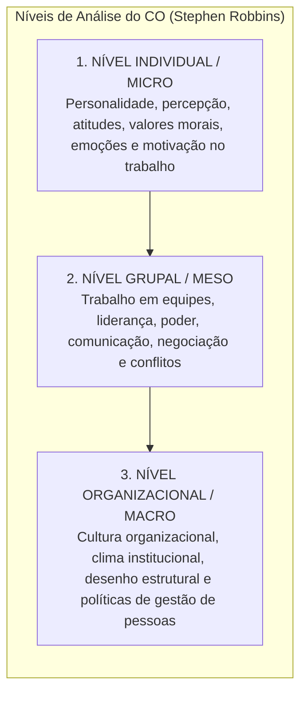
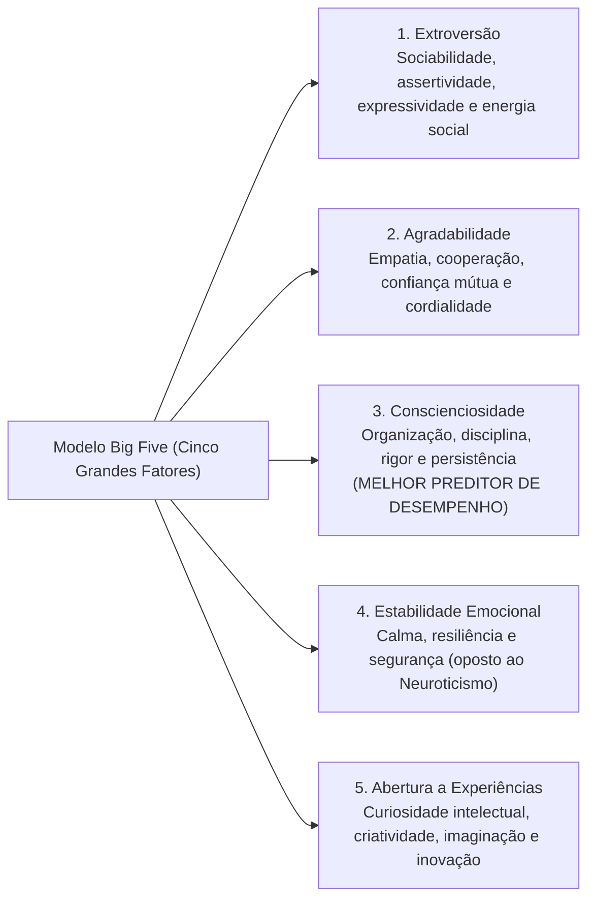
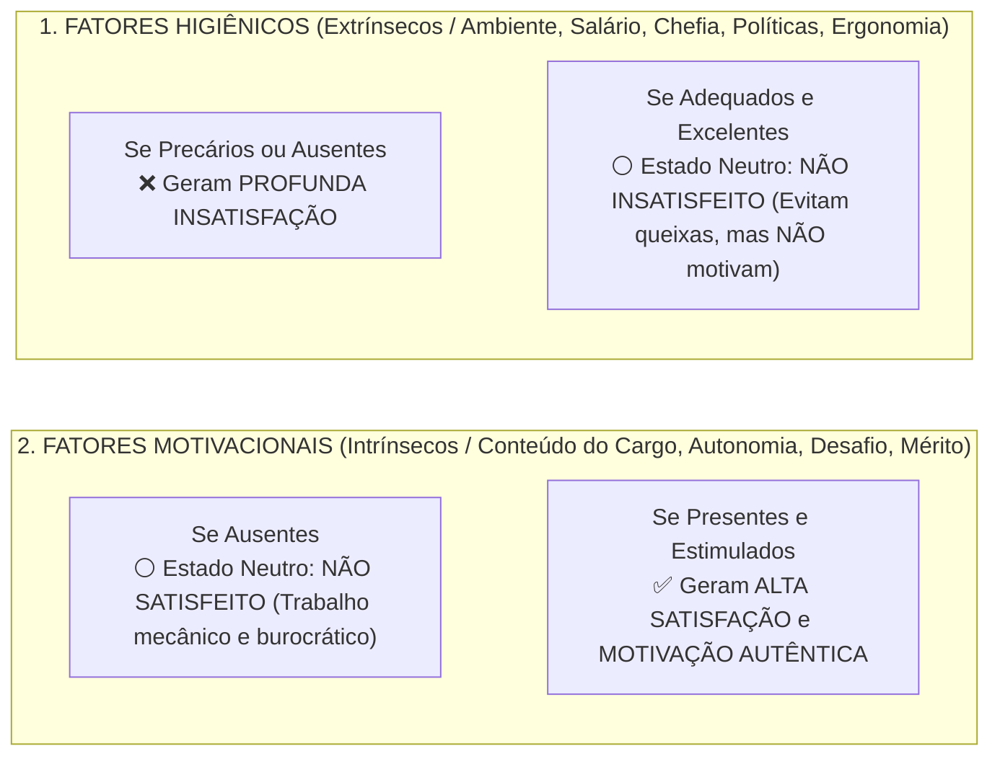

# 01 - Comportamento Individual: Personalidade, Valores, Atitudes e Teorias da Motivação

> **Matéria:** Comportamento Organizacional  
> **Cargo:** A01 – Técnico de Controle Externo – Especialidade: Técnico Administrativo  
> **Arquivo:** `01_individuo_personalidade_valores_atitudes_e_motivacao.md`  

---

## 📌 Ementa / Itens do Edital
- Fundamentos do Comportamento Organizacional (CO): conceito, objetivos científicos (descrever, explicar, prever e controlar o comportamento) e os três níveis de análise de Stephen Robbins (nível individual, grupal e do sistema organizacional);
- O Comportamento Individual nas organizações:
    - Personalidade: determinantes (hereditariedade vs. ambiente), o modelo dos Cinco Grandes Fatores (*Big Five*: Extroversão, Agradabilidade, Conscienciosidade, Estabilidade Emocional e Abertura a Experiências);
    - Traços de personalidade específicos: *Locus* de controle interno versus externo, autoeficácia (Bandura), maquiavelismo, autoestima e automonitoramento;
    - Emoções e sentimentos no ambiente de trabalho; o conceito de Inteligência Emocional (Daniel Goleman);
- Valores, Atitudes e Satisfação no Trabalho:
    - Atitudes: componentes cognitivo (crença/saber), afetivo (sentimento) e comportamental (intenção de ação);
    - Dissonância Cognitiva (Leon Festinger): desconforto mental e estratégias de harmonização interna;
    - Satisfação no trabalho e as três dimensões do Comprometimento Organizacional (Meyer e Allen: Afetivo, Instrumental/Continuação e Normativo);
- Teorias da Motivação no Trabalho:
    - **Teorias de Conteúdo (O que motiva as pessoas?):**
    - Hierarquia das Necessidades Humanas de Abraham Maslow;
    - Teoria dos Dois Fatores de Frederick Herzberg (Fatores Higiênicos vs. Fatores Motivacionais);
    - Teoria ERC de Clayton Alderfer (Existência, Relacionamento e Crescimento) e o princípio de frustração-regressão;
    - Teoria das Necessidades Adquiridas de David McClelland (Realização, Poder e Afiliação);
    - **Teorias de Processo (Como ocorre a dinâmica motivacional?):**
    - Teoria da Expectativa / Expectância de Victor Vroom (Força Motivacional = Expectativa $\times$ Instrumentalidade $\times$ Valência);
    - Teoria da Equidade de J. Stacy Adams (comparação da relação insumos/recompensas com os pares);
    - Teoria do Estabelecimento de Metas de Edwin Locke (metas específicas e desafiadoras com *feedback*);
    - Teoria do Reforço de B.F. Skinner (reforço positivo, negativo, punição e extinção).

---

## 🧭 Sumário Interativo
- [1. Fundamentos do Comportamento Organizacional (CO)](#1-fundamentos-do-comportamento-organizacional-co)
- [2. Personalidade: O Modelo dos Cinco Grandes Fatores (Big Five) e Traços Específicos](#2-personalidade-o-modelo-dos-cinco-grandes-fatores-big-five-e-tracos-especificos)
- [3. Atitudes, Dissonância Cognitiva e Comprometimento Organizacional](#3-atitudes-dissonancia-cognitiva-e-comprometimento-organizacional)
- [4. Teorias Motivacionais de Conteúdo (Maslow, Herzberg, Alderfer e McClelland)](#4-teorias-motivacionais-de-conteudo-maslow-herzberg-alderfer-e-mcclelland)
- [5. Teorias Motivacionais de Processo (Vroom, Adams, Locke e Skinner)](#5-teorias-motivacionais-de-processo-vroom-adams-locke-e-skinner)
- [6. Fontes Oficiais e Referências Bibliográficas](#6-fontes-oficiais-e-referencias-bibliograficas)
- [7. Questões de Concurso FCC Comentadas](#7-questoes-de-concurso-fcc-comentadas)

---

## 📖 Resumo Teórico Aprofundado & Esquematizado

### 1. Fundamentos do Comportamento Organizacional (CO)

O Comportamento Organizacional (CO) é um campo interdisciplinar que investiga o impacto que indivíduos, grupos e a estrutura exercem sobre o comportamento dentro das instituições, com a finalidade prática de aprimorar a eficácia, a produtividade e a qualidade de vida no trabalho.

Stephen Robbins estrutura o estudo do CO em **três níveis de análise concêntricos e interdependentes**:



---

### 2. Personalidade: O Modelo dos Cinco Grandes Fatores (Big Five) e Traços Específicos

A personalidade é a constelação dinâmica de traços psicológicos que determinam a forma única como cada indivíduo se adapta e reage aos ambientes em que vive. É condicionada tanto pela **hereditariedade** (carga genética) quanto pelo **ambiente** (cultura, educação, experiências de vida).



#### Traços Psicológicos Específicos de Alto Impacto Organizacional:
* **Locus de Controle Interno:** O indivíduo acredita firmemente que é o condutor de seu próprio destino; atribui seus êxitos ou insucessos à sua dedicação pessoal, inteligência e esforço.
* **Locus de Controle Externo:** O indivíduo acredita que seus resultados são determinados pelo acaso, pela sorte, pelo destino ou por terceiros poderosos sobre os quais não tem controle.
* **Autoeficácia (Albert Bandura):** A convicção pessoal que um colaborador tem em sua própria capacidade de desempenhar com sucesso uma tarefa específica. Servidores com alta autoeficácia reagem a dificuldades com maior perseverança.
* **Maquiavelismo:** Traço caracterizado pelo pragmatismo frio, cálculo emocional e crença de que os fins justificam os meios em disputas corporativas.

> ⭐ **IMPORTANTE (O MELHOR PREDITOR NO BIG FIVE):**  
> Grave o fator que mais cai nas provas da FCC: no modelo dos Cinco Grandes Fatores (*Big Five*), o traço com maior poder preditivo de alto desempenho profissional consistente em praticamente qualquer profissão é a **CONSCIENCIOSIDADE** (disciplina, foco em resultados, persistência e responsabilidade).

---

### 3. Atitudes, Dissonância Cognitiva e Comprometimento Organizacional

Uma **atitude** é um estado mental de prontidão organizado pela experiência, manifestado em juízos avaliativos (favoráveis ou desfavoráveis) sobre objetos, pessoas ou eventos. Estrutura-se em três componentes indissociáveis:

* **Componente Cognitivo:** O saber, a crença, a opinião ou o conhecimento fático sobre o objeto (ex.: "A auditoria pública combate a corrupção").
* **Componente Afetivo:** A dimensão emocional ou sentimento em relação ao objeto (ex.: "Tenho orgulho de atuar no Tribunal de Contas").
* **Componente Comportamental:** A intenção explícita de agir ou se comportar de determinado modo (ex.: "Vou me dedicar com rigor na elaboração do relatório de fiscalização").

#### Dissonância Cognitiva (Leon Festinger):
Fenômeno caracterizado por desconforto e tensão psicológica profunda quando o indivíduo percebe inconsistência entre duas atitudes ou entre sua atitude pessoal e seu comportamento concreto. Para mitigar essa tensão interna, o sujeito tende a:

1. Mudar o seu comportamento concreto;
2. Alterar a sua crença/atitude pessoal para justificar o ato; ou
3. Desenvolver justificativas racionais e argumentos atenuantes.

#### As Três Dimensões do Comprometimento Organizacional (Meyer e Allen):
1. **Comprometimento Afetivo:** O servidor permanece na instituição pública porque **ele quer**. Há identificação emocional autêntica, orgulho corporativo e adesão genuína à missão institucional.
2. **Comprometimento Instrumental / De Continuação:** O servidor permanece porque **ele precisa**. Pesa racionalmente os custos financeiros, estabilidade e perdas pecuniárias decorrentes de um eventual desligamento.
3. **Comprometimento Normativo:** O servidor permanece porque **ele sente que deve**. É movido por um senso de obrigação moral, gratidão ou lealdade ética perante o órgão público.

> 📌 **NOTA EXPLICATIVA (DISSONÂNCIA COGNITIVA):**  
> A dissonância cognitiva (Leon Festinger) ocorre quando um indivíduo tem duas crenças contraditórias ou quando seu comportamento viola sua própria atitude moral. Para aliviar a tensão psicológica, a pessoa tende a mudar seu comportamento, alterar sua atitude ou criar justificativas racionais que acomodem a contradição.

---

### 4. Teorias Motivacionais de Conteúdo (Maslow, Herzberg, Alderfer e McClelland)

As **teorias de conteúdo** buscam identificar e explicar *o que* motiva as pessoas, mapeando as necessidades internas que orientam a conduta humana:

#### A) Hierarquia das Necessidades Humanas de Abraham Maslow:
As necessidades humanas organizam-se em uma pirâmide progressiva e hierárquica:

1. **Necessidades Fisiológicas (Base):** Alimentação, repouso, sono, abrigo e conforto térmico.
2. **Necessidades de Segurança:** Estabilidade no cargo, proteção física, remuneração previsível e plano de saúde.
3. **Necessidades Sociais (Amor/Afiliação):** Amizades no setor, aceitação pelos pares e clima harmônico de trabalho.
4. **Necessidades de Estima:** Reconhecimento profissional, status funcional, prestígio e respeito dos superiores.
5. **Necessidades de Autorrealização (Topo):** Pleno desenvolvimento do potencial próprio, autonomia criativa e desafios intelectuais.

* *Premissa de Maslow:* Uma necessidade superior só passa a motivar o comportamento quando a necessidade imediatamente inferior estiver substancialmente satisfeita.

#### B) Teoria dos Dois Fatores de Frederick Herzberg:
Herzberg demonstrou que a satisfação e a insatisfação no trabalho são fenômenos governados por dois conjuntos completamente independentes de fatores:



* **Fatores Higiênicos (Extrínsecos):** Referem-se ao **contexto do trabalho** (salário, condições físicas, segurança, benefícios e tipo de supervisão). Sua presença apenas evita a insatisfação funcional; não tem o poder de gerar motivação duradoura.
* **Fatores Motivacionais (Intrínsecos):** Referem-se ao **conteúdo do trabalho** (complexidade da tarefa, realização, responsabilidade, desafios intelectuais e desenvolvimento). São os únicos capazes de provocar satisfação plena e motivação autêntica.

> 🚨 **ALERTA DE PROVA / PEGADINHA FCC (SALÁRIO MOTIVA SEGUNDO HERZBERG?):**  
> Pegadinha clássica em provas da FCC: afirmar que na teoria de Herzberg o aumento de remuneração é um fator motivacional primordial. **FALSO!** Salário é um **Fator Higiênico (Extrínseco)**. O salário baixo gera insatisfação, mas o salário alto apenas neutraliza o descontentamento; ele **não possui o poder de produzir motivação duradoura**!

#### C) Teoria ERC de Clayton Alderfer:
Condensou os níveis de Maslow em três necessidades essenciais:

* **E**xistência (fisiológicas e de segurança);
* **R**elacionamento (sociais e consideração externa);
* **C**rescimento (estima interna e autorrealização).
* *Inovação conceitual:* Alderfer admitiu o princípio da **frustração-regressão**: quando uma necessidade superior não pode ser satisfeita, a pessoa regride e intensifica o desejo de suprir uma necessidade do nível inferior.

#### D) Teoria das Necessidades Adquiridas de David McClelland:
Afirma que a motivação dos indivíduos é moldada por três necessidades essenciais adquiridas ao longo da socialização:

1. **Necessidade de Realização (*nAch*):** Busca incessante por excelência, superação de padrões difíceis e assunção de riscos calculados.
2. **Necessidade de Poder (*nPow*):** Desejo de influenciar, liderar, controlar e orientar o comportamento de terceiros.
3. **Necessidade de Afiliação (*nAff*):** Desejo de estabelecer relacionamentos interpessoais amigáveis, cooperação e aceitação mútua.

---

### 5. Teorias Motivacionais de Processo (Vroom, Adams, Locke e Skinner)

As **teorias de processo** investigam a dinâmica cognitiva e os mecanismos mentais por meio dos quais o comportamento humano é estimulado, direcionado e mantido no tempo:

#### A) Teoria da Expectativa / Expectância de Victor Vroom (Modelo VIE):
A motivação resulta de um cálculo mental ponderado que encadeia três elementos fundamentais:

$$\mathbf{\text{Força Motivacional} = \text{Expectativa (E)} \times \text{Instrumentalidade (I)} \times \text{Valência (V)}}$$

```mermaid
flowchart LR
    Esforco["ESFORÇO<br/>DO SERVIDOR"] -->|1. EXPECTATIVA (E)<br/>'Se eu me esforçar, alcanço a meta?'| Desempenho["DESEMPENHO /<br/>ENTREGA DA META"]
    Desempenho -->|2. INSTRUMENTALIDADE (I)<br/>'Se eu bater a meta, receberei o prêmio?'| Recompensa["RECOMPENSA<br/>INSTITUCIONAL"]
    Recompensa -->|3. VALÊNCIA (V)<br/>'Essa recompensa é atrativa para mim?'| Metas["METAS E VALORES<br/>PESSOAIS"]
```

1. **Expectativa ($E$):** Relação **Esforço $\rightarrow$ Desempenho**. A crença subjetiva do indivíduo de que seu esforço resultará no atingimento do padrão de desempenho exigido.
2. **Instrumentalidade ($I$):** Relação **Desempenho $\rightarrow$ Recompensa**. A crença de que a organização realmente cumprirá o acordado e entregará a recompensa prometida se o desempenho for alcançado.
3. **Valência ($V$):** Relação **Recompensa $\rightarrow$ Metas Pessoais**. O valor atrativo, positivo ou negativo, que o servidor atribui ao resultado ou recompensa oferecida.

* **Propriedade Multiplicativa:** Tratando-se de uma multiplicação, **se qualquer uma das três variáveis for igual a zero, a motivação final será nula!**

> 🛑 **ATENÇÃO (PRODUTO MULTIPLICATIVO DE VROOM):**  
> Na teoria da expectância de Vroom, se um servidor quer muito a promoção (Valência alta) e sabe que consegue bater a meta (Expectativa alta), mas sabe que o chefe vai promover um parente por nepotismo (Instrumentalidade = zero), a força motivacional do servidor será **ZERO**!

#### B) Teoria da Equidade de J. Stacy Adams:
Sustenta que a motivação decorre da percepção de justiça distributiva. O servidor compara a relação entre suas contribuições/insumos (*inputs* - esforço, formação, tempo) e suas recompensas (*outcomes* - remuneração, elogios, prestígio) com a relação equivalente observada em colegas de referência:

$$\frac{\text{Recompensas Próprias}}{\text{Insumos Próprios}} \quad \text{versus} \quad \frac{\text{Recompensas do Colega}}{\text{Insumos do Colega}}$$

* Constatando **iniquidade desfavorável** (ganha menos do que outros para a mesma carga de esforço), o indivíduo experimenta angústia e revolta, reagindo com queda intencional de produtividade, aumento do absenteísmo ou pedidos de exoneração/remoção.

#### C) Teoria do Estabelecimento de Metas de Edwin Locke:
Comprovou empiricamente que:

* Metas **específicas, mensuráveis e desafiadoras** conduzem a desempenhos significativamente mais elevados do que metas fáceis ou genéricas ("faça o melhor que puder");
* O fornecimento de **feedback constante** é indispensável para orientar e sustentar o empenho do indivíduo;
* A **participação dos servidores** na fixação das metas eleva substancialmente seu nível de comprometimento com o resultado final.

#### D) Teoria do Reforço de B.F. Skinner:
Abordagem comportamentalista segundo a qual o comportamento é condicionado por suas consequências ambientais:

* **Reforço Positivo:** Apresentação de um estímulo agradável (elogio, bônus) após a conduta desejada, aumentando a probabilidade de sua repetição.
* **Reforço Negativo:** Remoção de uma consequência desagradável quando o indivíduo adota a conduta desejada (ex.: cessação de cobranças diárias quando o servidor entrega o relatório).
* **Punição:** Aplicação de uma penalidade desagradável (advertência, corte salarial) para desestimular condutas censuráveis.
* **Extinção:** Eliminação de qualquer recompensa que reforçava um comportamento inadequado, fazendo com que ele gradualmente desapareça.

---

### 6. Fontes Oficiais e Referências Bibliográficas

* [Constituição Federal de 1988 - Arts. 37 a 41 (Regime dos Servidores e Princípios da Administração)](https://www.planalto.gov.br/ccivil_03/constituicao/constituicao.htm#art37) - Direitos, estabilidade e regime de responsabilidade dos servidores públicos.
* [Decreto Federal nº 1.171/1994 (Código de Ética Profissional do Servidor Público Civil)](https://www.planalto.gov.br/ccivil_03/decreto/d1171.htm) - Padrões éticos, atitudes e valores esperados no exercício da função pública.
* [Lei Estadual nº 20.756/2020 (Deveres e Regime Disciplinar dos Servidores de Goiás)](https://legisla.casacivil.go.gov.br/pesquisa_legislacao/100979/lei-20756) - Conduta ética, deveres funcionais e proibições aplicáveis aos servidores estaduais.
* [TCE-GO - Código de Ética e Conduta dos Servidores](https://portal.tce.go.gov.br/documents/20181/574123/C%C3%B3digo+de+%C3%89tica/056863be-6768-4c35-a6e8-ccdd40421211) - Diretrizes deontológicas e compromisso com o interesse público no TCE-GO.
* [Decreto Federal nº 9.991/2019 (Desenvolvimento de Pessoas e Motivação no Trabalho)](https://www.planalto.gov.br/ccivil_03/_ato2019-2022/2019/decreto/d9991.htm) - Valorização, crescimento profissional e incentivo à qualificação do servidor.
* ROBBINS, Stephen P.; JUDGE, Timothy A.; SOBRAL, Filipe. **Comportamento Organizacional: Teoria e Prática no Contexto Brasileiro**. 14. ed. São Paulo: Pearson Prentice Hall, 2010. (Cap. 3 - Atitudes e Satisfação no Trabalho; Cap. 4 - Personalidade e Valores; Cap. 7 - Conceitos Básicos de Motivação).
* CHIAVENATO, Idalberto. **Comportamento Organizacional: A Dinâmica do Sucesso das Organizações**. 4. ed. São Paulo: Atlas, 2021. (Cap. 3 - Personalidade e Atitudes; Cap. 5 - Teoria da Motivação: Maslow, Herzberg e McClelland).
* HERZBERG, Frederick. **One More Time: How Do You Motivate Employees?**. Harvard Business Review, v. 46, n. 1, p. 53-62, 1968.


### 7. Questões de Concurso FCC Comentadas

### Questão 01
**(FCC – TCE-PI – Auditor de Controle Externo)**  
Determinado gestor público, objetivando elevar a motivação dos servidores do setor de protocolo, promoveu uma reforma completa no ambiente físico do trabalho, instalando mobiliário ergonômico moderno, ar-condicionado de última geração e ampliando a remuneração com novo benefício de alimentação. Não obstante as medidas adotadas, os índices de proatividade e dedicação às tarefas intelectuais do setor permaneceram inalterados após alguns meses. Sob a perspectiva da Teoria dos Dois Fatores formulada por Frederick Herzberg, a ausência de elevação da motivação explica-se porque:

* **A)** As medidas implementadas atuaram exclusivamente sobre os fatores higiênicos, os quais são capazes de evitar a insatisfação funcional, mas não possuem a propriedade de gerar motivação genuína.
* **B)** A melhoria das condições físicas viola o princípio da equidade distributiva ao desconsiderar a valência das recompensas pecuniárias.
* **C)** O gestor ignorou a necessidade de autoafirmação primária prevista na base da pirâmide de Clayton Alderfer.
* **D)** O ambiente físico e o salário constituem fatores motivacionais de conteúdo que só produzem efeito quando associados a punições disciplinares.
* **E)** O mobiliário moderno reduz a expectativa de esforço, eliminando a instrumentalidade postulada por Victor Vroom.

> **Comentário Detalhado:**  
>
> - **A) CORRETA.** Segundo Frederick Herzberg, aspectos como ergonomia, ar-condicionado, condições de higiene predial e benefícios remuneratórios são **Fatores Higiênicos (Extrínsecos)**. A presença desses fatores em excelente nível é indispensável para evitar a insatisfação e reclamações dos servidores, mas é absolutamente incapaz de gerar motivação ou dedicação espontânea acima da média. A motivação decorre unicamente dos **Fatores Motivacionais (Intrínsecos)**, que dizem respeito ao desafio intelectual, responsabilidade, utilidade da tarefa e reconhecimento.  
> - **B) Incorreta.** Trata-se da teoria bifatorial de Herzberg, não da equidade de Adams.  
> - **C) Incorreta.** Alderfer dividiu as necessidades em Existência, Relacionamento e Crescimento.  
> - **D) Incorreta.** Salário e ambiente são fatores higiênicos, e não motivacionais.  
> - **E) Incorreta.** Mistura teorias de autores e premissas distintas.  
> 
> **Gabarito: A**

---

### Questão 02
**(FCC – TCE-RS – Auditor de Controle Externo)**  
Segundo a Teoria da Expectativa desenvolvida por Victor Vroom, a motivação de um indivíduo para se dedicar com afinco a uma atividade profissional resulta da interação cognitiva entre três variáveis fundamentais. A convicção pessoal de um servidor de que o alcance do desempenho esperado e a conclusão da meta pactuada serão efetivamente seguidos pela entrega da recompensa institucional prometida pela organização traduz o conceito de:

* **A)** Valência.
* **B)** Instrumentalidade.
* **C)** Expectativa.
* **D)** Equidade comparativa.
* **E)** Locus de controle externo.

> **Comentário Detalhado:**  
>
> - **A) Incorreta.** Valência é o grau de atratividade e valor pessoal que a recompensa possui para o servidor.  
> - **B) CORRETA.** No modelo de Victor Vroom:  
>     - *Expectativa:* É a crença de que o **Esforço levará ao Desempenho** (acreditar na própria competência para atingir a meta).  
>     - **Instrumentalidade:** É a crença de que o **Desempenho alcançado levará à Recompensa prometida** (confiança de que a instituição entregará o benefício prometido se a meta for batida).  
>     - *Valência:* É a relação entre a **Recompensa e os Objetivos Pessoais** (o apreço subjetivo pelo benefício).  
> - **C) Incorreta.** Expectativa refere-se à relação esforço-desempenho.  
> - **D) Incorreta.** Equidade pertence à teoria de J. Stacy Adams.  
> - **E) Incorreta.** Locus de controle é conceito de traço de personalidade.  
> 
> **Gabarito: B**

---

### Questão 03
**(FCC – TRT-20ª Região – Analista Judiciário: Área Administrativa)**  
No modelo dos Cinco Grandes Fatores de Personalidade (*Big Five*), amplamente adotado nas pesquisas contemporâneas de comportamento organizacional, o traço que se revelou empiricamente como o preditor mais consistente e fidedigno de alto desempenho profissional na ampla maioria das ocupações é a:

* **A)** Extroversão.
* **B)** Conscienciosidade.
* **C)** Agradabilidade.
* **D)** Abertura a Experiências.
* **E)** Estabilidade Emocional.

> **Comentário Detalhado:**  
>
> - **A) Incorreta.** A extroversão prediz desempenho em funções comerciais e de liderança política, mas não de modo universal.  
> - **B) CORRETA.** Centenas de pesquisas em Comportamento Organizacional comprovam que a **Conscienciosidade** (associada a alto senso de responsabilidade, rigor, organização, persistência, confiabilidade e foco em metas) é o fator do *Big Five* que possui correlação positiva mais forte e consistente com o bom desempenho profissional em quase todas as carreiras.  
> - **C) Incorreta.** A agradabilidade favorece o trabalho em equipe, mas não é o principal preditor geral.  
> - **D) Incorreta.** Abertura a experiências correlaciona-se com criatividade e adaptabilidade, mas não com desempenho padronizado contínuo.  
> - **E) Incorreta.** Estabilidade emocional evita estresse, mas não garante disciplina produtiva.  
> 
> **Gabarito: B**

---

### Questão 04
**(FCC – SEFAZ-PE – Auditor Fiscal do Tesouro Estadual)**  
Um auditor fiscal estadual constatou que um colega recém-empossado na mesma gerência, desempenhando idênticas tarefas de fiscalização tributária e possuindo formação equivalente, foi contemplado com uma gratificação especial de produtividade 50% superior sem justificativa plausível de mérito. O auditor sentiu-se revoltado e passou a reduzir propositalmente seu ritmo diário de autuações e a faltar com frequência aos plantões fiscais. O comportamento adotado pelo auditor é explicado primordialmente pela:

* **A)** Teoria da Dissonância Comportamental de Skinner.
* **B)** Teoria da Hierarquia das Necessidades de Maslow.
* **C)** Teoria da Equidade de J. Stacy Adams.
* **D)** Teoria X de Douglas McGregor.
* **E)** Teoria da Racionalidade Absoluta dos Processos.

> **Comentário Detalhado:**  
>
> - **A) Incorreta.** Skinner é o autor da teoria do reforço operante.  
> - **B) Incorreta.** Maslow trata da hierarquia fisiológica até autorrealização.  
> - **C) CORRETA.** A **Teoria da Equidade de J. Stacy Adams** postula que os indivíduos comparam sua relação Resultados/Insumos com a relação de outros profissionais comparáveis. Ao constatar que o colega recebe recompensa desproporcionalmente maior para o mesmo esforço (iniquidade negativa sentida), o trabalhador busca restaurar o equilíbrio reduzindo seus insumos de trabalho (diminuindo o ritmo e faltando ao serviço).  
> - **D) Incorreta.** A Teoria X de McGregor retrata pressupostos gerenciais autoritários sobre trabalhadores preguiçosos.  
> - **E) Incorreta.** Opção sem respaldo teórico na psicologia motivacional.  
> 
> **Gabarito: C**

---

### Questão 05
**(FCC – DPE-RS – Analista: Área Administrativa)**  
A respeito das dimensões do comprometimento organizacional formuladas por John Meyer e Natalie Allen, considere a situação em que um servidor público federal recusa uma proposta de trabalho na iniciativa privada porque sente que a organização em que atua cumpriu um papel fundamental na sua formação profissional inicial, experimentando um profundo senso de obrigação moral e lealdade ética de permanecer servindo àquela instituição pública. Trata-se de um exemplo de comprometimento:

* **A)** Instrumental.
* **B)** De Continuação.
* **C)** Normativo.
* **D)** Dissonante.
* **E)** Reativo.

> **Comentário Detalhado:**  
>
> - **A) e B) Incorretas.** O comprometimento instrumental (ou de continuação) baseia-se na dependência financeira e no receio dos custos de deixar o emprego (permanece porque precisa).  
> - **C) CORRETA.** O **Comprometimento Normativo** reflete a obrigação moral e o sentimento de dever ético de permanecer na organização (o indivíduo fica porque **sente que deve**, movido por lealdade ou gratidão pela entidade).  
> - **D) e E) Incorretas.** Termos não contemplados no modelo de três componentes de Meyer e Allen (que são: Afetivo, Instrumental e Normativo).  
> 
> **Gabarito: C**
