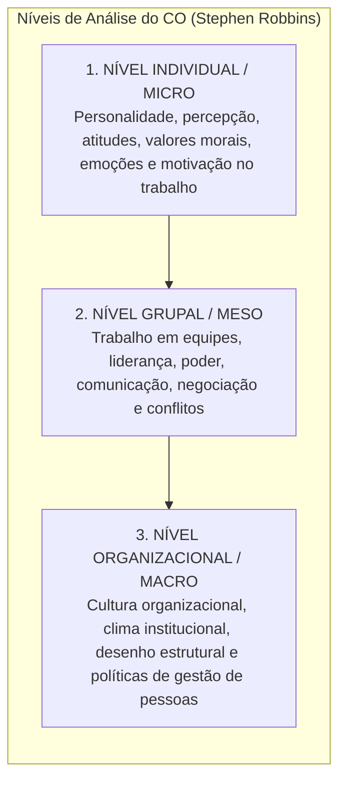
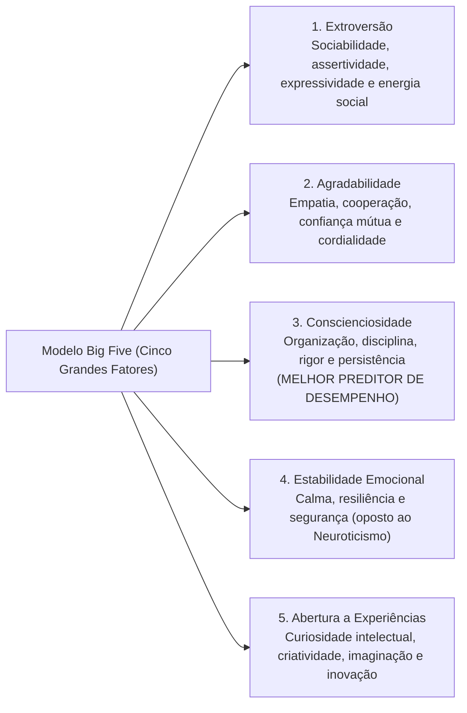
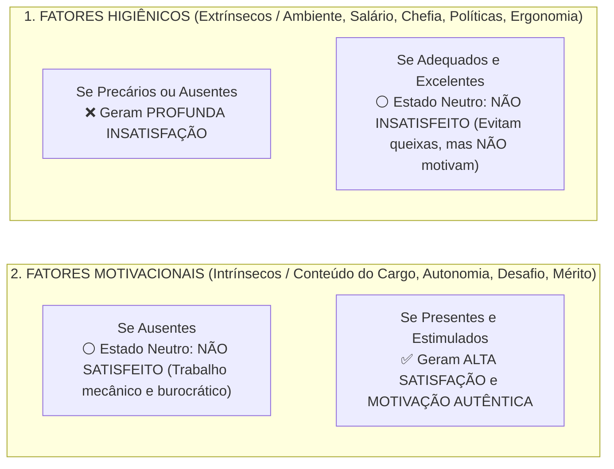

# 01 - Comportamento Individual: Personalidade, Valores, Atitudes e Teorias da Motivação

> **Matéria:** Comportamento Organizacional  
> **Cargo:** A01 – Técnico de Controle Externo – Especialidade: Técnico Administrativo  
> **Arquivo:** `01_individuo_personalidade_valores_atitudes_e_motivacao.md`  


---


## 📌 Ementa / Itens do Edital
- Fundamentos do Comportamento Organizacional (CO): conceito, objetivos científicos (descrever, explicar, prever e controlar o comportamento) e os três níveis de análise de Stephen Robbins (nível individual, grupal e do sistema organizacional);
- O Comportamento Individual nas organizações:
    - Personalidade: determinantes (hereditariedade vs. ambiente), o modelo dos Cinco Grandes Fatores (*Big Five*: Extroversão, Agradabilidade, Conscienciosidade, Estabilidade Emocional e Abertura a Experiências);
    - Traços de personalidade específicos: *Locus* de controle interno versus externo, autoeficácia (Bandura), maquiavelismo, autoestima e automonitoramento;
    - Emoções e sentimentos no ambiente de trabalho; o conceito de Inteligência Emocional (Daniel Goleman);
- Valores, Atitudes e Satisfação no Trabalho:
    - Atitudes: componentes cognitivo (crença/saber), afetivo (sentimento) e comportamental (intenção de ação);
    - Dissonância Cognitiva (Leon Festinger): desconforto mental e estratégias de harmonização interna;
    - Satisfação no trabalho e as três dimensões do Comprometimento Organizacional (Meyer e Allen: Afetivo, Instrumental/Continuação e Normativo);
- Teorias da Motivação no Trabalho:
    - **Teorias de Conteúdo (O que motiva as pessoas?):**
    - Hierarquia das Necessidades Humanas de Abraham Maslow;
    - Teoria dos Dois Fatores de Frederick Herzberg (Fatores Higiênicos vs. Fatores Motivacionais);
    - Teoria ERC de Clayton Alderfer (Existência, Relacionamento e Crescimento) e o princípio de frustração-regressão;
    - Teoria das Necessidades Adquiridas de David McClelland (Realização, Poder e Afiliação);
    - **Teorias de Processo (Como ocorre a dinâmica motivacional?):**
    - Teoria da Expectativa / Expectância de Victor Vroom (Força Motivacional = Expectativa $\times$ Instrumentalidade $\times$ Valência);
    - Teoria da Equidade de J. Stacy Adams (comparação da relação insumos/recompensas com os pares);
    - Teoria do Estabelecimento de Metas de Edwin Locke (metas específicas e desafiadoras com *feedback*);
    - Teoria do Reforço de B.F. Skinner (reforço positivo, negativo, punição e extinção).

---

## 🧭 Sumário

1. [Fundamentos do Comportamento Organizacional (CO)](#1-fundamentos-do-comportamento-organizacional-co)
2. [Personalidade: O Modelo dos Cinco Grandes Fatores (Big Five) e Traços Específicos](#2-personalidade-o-modelo-dos-cinco-grandes-fatores-big-five-e-tracos-especificos)
    1. [Teste 400](#Teste-400)
    2. [Teste 401](#Teste-401)
3. [Atitudes, Dissonância Cognitiva e Comprometimento Organizacional](#3-atitudes-dissonancia-cognitiva-e-comprometimento-organizacional)
    1. [Teste 402](#Teste-402)
    2. [Teste 403](#Teste-403)
4. [Teorias Motivacionais de Conteúdo (Maslow, Herzberg, Alderfer e McClelland)](#4-teorias-motivacionais-de-conteudo-maslow-herzberg-alderfer-e-mcclelland)
    1. [Teste 404](#Teste-404)
    2. [Teste 405](#Teste-405)
5. [Teorias Motivacionais de Processo (Vroom, Adams, Locke e Skinner)](#5-teorias-motivacionais-de-processo-vroom-adams-locke-e-skinner)
    1. [Teste 406](#Teste-406)
    2. [Teste 407](#Teste-407)
    3. [Teste 408](#Teste-408)
    4. [Teste 409](#Teste-409)
6. [Fontes Oficiais e Referências Bibliográficas](#6-fontes-oficiais-e-referencias-bibliograficas)

---

## 1. Fundamentos do Comportamento Organizacional (CO)

O Comportamento Organizacional (CO) é um campo interdisciplinar que investiga o impacto que indivíduos, grupos e a estrutura exercem sobre o comportamento dentro das instituições, com a finalidade prática de aprimorar a eficácia, a produtividade e a qualidade de vida no trabalho.

Stephen Robbins estrutura o estudo do CO em **três níveis de análise concêntricos e interdependentes**:



---

---

## 2. Personalidade: O Modelo dos Cinco Grandes Fatores (Big Five) e Traços Específicos

A personalidade é a constelação dinâmica de traços psicológicos que determinam a forma única como cada indivíduo se adapta e reage aos ambientes em que vive. É condicionada tanto pela **hereditariedade** (carga genética) quanto pelo **ambiente** (cultura, educação, experiências de vida).



#### Traços Psicológicos Específicos de Alto Impacto Organizacional:
* **Locus de Controle Interno:** O indivíduo acredita firmemente que é o condutor de seu próprio destino; atribui seus êxitos ou insucessos à sua dedicação pessoal, inteligência e esforço.
* **Locus de Controle Externo:** O indivíduo acredita que seus resultados são determinados pelo acaso, pela sorte, pelo destino ou por terceiros poderosos sobre os quais não tem controle.
* **Autoeficácia (Albert Bandura):** A convicção pessoal que um colaborador tem em sua própria capacidade de desempenhar com sucesso uma tarefa específica. Servidores com alta autoeficácia reagem a dificuldades com maior perseverança.
* **Maquiavelismo:** Traço caracterizado pelo pragmatismo frio, cálculo emocional e crença de que os fins justificam os meios em disputas corporativas.

> ⭐ **IMPORTANTE (O MELHOR PREDITOR NO BIG FIVE):**  
> Grave o fator que mais cai nas provas da FCC: no modelo dos Cinco Grandes Fatores (*Big Five*), o traço com maior poder preditivo de alto desempenho profissional consistente em praticamente qualquer profissão é a **CONSCIENCIOSIDADE** (disciplina, foco em resultados, persistência e responsabilidade).

---

### Teste 400
**(FCC – TRT-6 – Analista Judiciário - Tecnologia da Informação – 2012)**
Para fazer um trabalho, um professor vai dividir os seus 86  alunos em 15 grupos, alguns formados por cinco, outros formados  
por seis alunos. Dessa forma, sendo C o número de grupos formados por cinco e S o número de grupos formados por seis 
alunos, o produto C⋅S será igual a

* **A)** 56.
* **B)** 54.
* **C)** 50.
* **D)** 44.
* **E)** 36.

---

> **Comentário Detalhado:**
>
> - **A)** Incorreta. Discrepa das diretrizes normativas e jurisprudenciais aplicáveis ao tema objeto do item.
> - **B)** Correta. Representa com precisão a disciplina do tema e o entendimento pacificado adotado pela banca (FCC).
> - **C)** Incorreta. Discrepa das diretrizes normativas e jurisprudenciais aplicáveis ao tema objeto do item.
> - **D)** Incorreta. Discrepa das diretrizes normativas e jurisprudenciais aplicáveis ao tema objeto do item.
> - **E)** Incorreta. Discrepa das diretrizes normativas e jurisprudenciais aplicáveis ao tema objeto do item.
>
> **Gabarito: B**

---
### Teste 401
**(FGV – TJ-AP – Analista Judiciário - Tecnologia da Informação – 2023)**
As ferramentas de colaboração online revolucionaram a maneira 
com que equipes e empresas interagem e trabalham, permitindo 
uma comunicação mais eficiente, coordenação de tarefas e 
compartilhamento de informações em tempo real.  
Em relação ao assunto, são e xemplos de ferramentas de 
colaboração:

* **A)** Jira, WhatsApp e YouTube;
* **B)** Dropbox, LinkedIn e Twitter;
* **C)** Basecamp, Discord e Pinterest;
* **D)** Slack, Trello e Microsoft Teams;
* **E)** Google Docs, Facebook e Instagram.

---

> **Comentário Detalhado:**
>
> - **A)** Incorreta. Discrepa das diretrizes normativas e jurisprudenciais aplicáveis ao tema objeto do item.
> - **B)** Correta. Representa com precisão a disciplina do tema e o entendimento pacificado adotado pela banca (FGV).
> - **C)** Incorreta. Discrepa das diretrizes normativas e jurisprudenciais aplicáveis ao tema objeto do item.
> - **D)** Incorreta. Discrepa das diretrizes normativas e jurisprudenciais aplicáveis ao tema objeto do item.
> - **E)** Incorreta. Discrepa das diretrizes normativas e jurisprudenciais aplicáveis ao tema objeto do item.
>
> **Gabarito: B**

---
## 3. Atitudes, Dissonância Cognitiva e Comprometimento Organizacional

Uma **atitude** é um estado mental de prontidão organizado pela experiência, manifestado em juízos avaliativos (favoráveis ou desfavoráveis) sobre objetos, pessoas ou eventos. Estrutura-se em três componentes indissociáveis:

* **Componente Cognitivo:** O saber, a crença, a opinião ou o conhecimento fático sobre o objeto (ex.: "A auditoria pública combate a corrupção").
* **Componente Afetivo:** A dimensão emocional ou sentimento em relação ao objeto (ex.: "Tenho orgulho de atuar no Tribunal de Contas").
* **Componente Comportamental:** A intenção explícita de agir ou se comportar de determinado modo (ex.: "Vou me dedicar com rigor na elaboração do relatório de fiscalização").

#### Dissonância Cognitiva (Leon Festinger):
Fenômeno caracterizado por desconforto e tensão psicológica profunda quando o indivíduo percebe inconsistência entre duas atitudes ou entre sua atitude pessoal e seu comportamento concreto. Para mitigar essa tensão interna, o sujeito tende a:

1. Mudar o seu comportamento concreto;
2. Alterar a sua crença/atitude pessoal para justificar o ato; ou
3. Desenvolver justificativas racionais e argumentos atenuantes.

#### As Três Dimensões do Comprometimento Organizacional (Meyer e Allen):
1. **Comprometimento Afetivo:** O servidor permanece na instituição pública porque **ele quer**. Há identificação emocional autêntica, orgulho corporativo e adesão genuína à missão institucional.
2. **Comprometimento Instrumental / De Continuação:** O servidor permanece porque **ele precisa**. Pesa racionalmente os custos financeiros, estabilidade e perdas pecuniárias decorrentes de um eventual desligamento.
3. **Comprometimento Normativo:** O servidor permanece porque **ele sente que deve**. É movido por um senso de obrigação moral, gratidão ou lealdade ética perante o órgão público.

> 📌 **NOTA EXPLICATIVA (DISSONÂNCIA COGNITIVA):**  
> A dissonância cognitiva (Leon Festinger) ocorre quando um indivíduo tem duas crenças contraditórias ou quando seu comportamento viola sua própria atitude moral. Para aliviar a tensão psicológica, a pessoa tende a mudar seu comportamento, alterar sua atitude ou criar justificativas racionais que acomodem a contradição.

---

### Teste 402
**(FCC – TRT – Analista Judiciário - Tecnologia da Informação – 2009)**
Transpondo-se para a voz passiva a frase passaríamos a 
imaginar coisas, a forma verbal resultante será

* **A)** haveremos de passar a imaginar.
* **B)** passariam a ser imaginadas.
* **C)** passariam sendo imaginadas.
* **D)** teríamos passado a imaginar.
* **E)** teriam passado a imaginar. 
Atenção:  As questões de números 11 a 20 referem-se ao tex-
to seguinte. 

A respeito do termo etnia 

Por etnia entende-se um grupo de pessoas que parti-
lham vários atributos, como espaço geográfico, língua, costu-
mes e valores, e que reivindicam para si o mesmo nome étnico 
e a mesma ascendência. Mas sempre há nisso grande dose de 
subjetividade. Daí ser difícil estabelecer fronteiras claras entre 
as etnias e quantificar os grupos étnicos existentes no planeta. 
A língua, por exemplo, que parece um critério objetivo, não é 
suficiente para determinar diversas etnias, se tomada isolada-
mente, pois muitos grupos étnicos usam o mesmo idioma. 
O moderno conceito de etnia desenvolveu-se no século 
XX, em oposição às teorias racistas que evocavam argumentos 
de ordem biológica para justificar a dominação de um grupo 
humano sobre outros. A ciência considera incorreto falar em 
diferentes raças quando se trata de seres humanos. Todos os 
homens pertencem ao gênero Homo e à espécie Homo sapiens. 
Eventuais  variações genéticas são mínimas e insuficientes para 
configurar diferenciações raciais. 
Os homens agrupam-se socialmente, e as semelhanças 
e diferenças que estabelecem entre si decorrem de processos 
históricos, sempre culturais, jamais naturais. Fundamentalmen-
te, um indivíduo pertence a determinada etnia porque acredita 
nisso, e tal crença é compartilhada pelos demais indivíduos que 
compõem o mesmo grupo. 
A existência de vários grupos étnicos no interior das 
mesmas fronteiras nacionais é uma situação comum, pois as 
populações humanas não são homogêneas, em razão das mi-
grações no decorrer da história. Mas as diferenças étnicas, em 
diversos casos, são manipuladas para acirrar conflitos de fundo 
político ou econômico. O próprio conceito de raça humana, há 
muito não admitido pela antropologia moderna, serviu (e por 
vezes ainda serve) de pretexto para justificar as mais cruéis 
manifestações de preconceito, violência e barbárie. 
(Adaptado do Almanaque Abril Cultural 2009, p. 123)

---

> **Comentário Detalhado:**
>
> - **A)** Incorreta. Discrepa das diretrizes normativas e jurisprudenciais aplicáveis ao tema objeto do item.
> - **B)** Correta. Representa com precisão a disciplina do tema e o entendimento pacificado adotado pela banca (FCC).
> - **C)** Incorreta. Discrepa das diretrizes normativas e jurisprudenciais aplicáveis ao tema objeto do item.
> - **D)** Incorreta. Discrepa das diretrizes normativas e jurisprudenciais aplicáveis ao tema objeto do item.
> - **E)** Incorreta. Discrepa das diretrizes normativas e jurisprudenciais aplicáveis ao tema objeto do item.
>
> **Gabarito: B**

---
### Teste 403
**(FGV – TCE-PA – Auditor de Controle Externo – 2024)**
No âmbito das normas internacionais voltadas para o combate à 
corrupção, a Convenção das Nações Unidas contra o Crime 
Organizado Transnacional, objeto do Decreto nº 5.015/2004, é 
designada como Convenção de

* **A)** Palermo.
* **B)** Nagoya.
* **C)** Estocolmo.
* **D)** Mérida.
* **E)** Tóquio. 

AUDITOR DE CONTROLE EXTERNO - FISCALIZAÇÃO - CONTABILIDADE  – MANHÃ  TIPO  BRANCA – PÁGINA 6

---

> **Comentário Detalhado:**
>
> - **A)** Correta. Representa com precisão a disciplina do tema e o entendimento pacificado adotado pela banca (FGV).
> - **B)** Incorreta. Discrepa das diretrizes normativas e jurisprudenciais aplicáveis ao tema objeto do item.
> - **C)** Incorreta. Discrepa das diretrizes normativas e jurisprudenciais aplicáveis ao tema objeto do item.
> - **D)** Incorreta. Discrepa das diretrizes normativas e jurisprudenciais aplicáveis ao tema objeto do item.
> - **E)** Incorreta. Discrepa das diretrizes normativas e jurisprudenciais aplicáveis ao tema objeto do item.
>
> **Gabarito: A**

---
## 4. Teorias Motivacionais de Conteúdo (Maslow, Herzberg, Alderfer e McClelland)

As **teorias de conteúdo** buscam identificar e explicar *o que* motiva as pessoas, mapeando as necessidades internas que orientam a conduta humana:

#### A) Hierarquia das Necessidades Humanas de Abraham Maslow:
As necessidades humanas organizam-se em uma pirâmide progressiva e hierárquica:

1. **Necessidades Fisiológicas (Base):** Alimentação, repouso, sono, abrigo e conforto térmico.
2. **Necessidades de Segurança:** Estabilidade no cargo, proteção física, remuneração previsível e plano de saúde.
3. **Necessidades Sociais (Amor/Afiliação):** Amizades no setor, aceitação pelos pares e clima harmônico de trabalho.
4. **Necessidades de Estima:** Reconhecimento profissional, status funcional, prestígio e respeito dos superiores.
5. **Necessidades de Autorrealização (Topo):** Pleno desenvolvimento do potencial próprio, autonomia criativa e desafios intelectuais.

* *Premissa de Maslow:* Uma necessidade superior só passa a motivar o comportamento quando a necessidade imediatamente inferior estiver substancialmente satisfeita.

#### B) Teoria dos Dois Fatores de Frederick Herzberg:
Herzberg demonstrou que a satisfação e a insatisfação no trabalho são fenômenos governados por dois conjuntos completamente independentes de fatores:



* **Fatores Higiênicos (Extrínsecos):** Referem-se ao **contexto do trabalho** (salário, condições físicas, segurança, benefícios e tipo de supervisão). Sua presença apenas evita a insatisfação funcional; não tem o poder de gerar motivação duradoura.
* **Fatores Motivacionais (Intrínsecos):** Referem-se ao **conteúdo do trabalho** (complexidade da tarefa, realização, responsabilidade, desafios intelectuais e desenvolvimento). São os únicos capazes de provocar satisfação plena e motivação autêntica.

> 🚨 **ALERTA DE PROVA / PEGADINHA FCC (SALÁRIO MOTIVA SEGUNDO HERZBERG?):**  
> Pegadinha clássica em provas da FCC: afirmar que na teoria de Herzberg o aumento de remuneração é um fator motivacional primordial. **FALSO!** Salário é um **Fator Higiênico (Extrínseco)**. O salário baixo gera insatisfação, mas o salário alto apenas neutraliza o descontentamento; ele **não possui o poder de produzir motivação duradoura**!

---

### Teste 404
**(FGV – TCE-PA – Auditor de Controle Externo – 2024)**
No âmbito das normas internacionais voltadas para o combate à 
corrupção, a Convenção das Nações Unidas contra o Crime 
Organizado Transnacional, objeto do Decreto nº 5.015/2004, é 
designada como Convenção de

* **A)** Palermo.
* **B)** Nagoya.
* **C)** Estocolmo.
* **D)** Mérida.
* **E)** Tóquio. 

AUDITOR DE CONTROLE EXTERNO - FISCALIZAÇÃO - CIÊNCIAS ATUARIAIS – MANHÃ  TIPO  BRANCA – PÁGINA 6

---

> **Comentário Detalhado:**
>
> - **A)** Correta. Representa com precisão a disciplina do tema e o entendimento pacificado adotado pela banca (FGV).
> - **B)** Incorreta. Discrepa das diretrizes normativas e jurisprudenciais aplicáveis ao tema objeto do item.
> - **C)** Incorreta. Discrepa das diretrizes normativas e jurisprudenciais aplicáveis ao tema objeto do item.
> - **D)** Incorreta. Discrepa das diretrizes normativas e jurisprudenciais aplicáveis ao tema objeto do item.
> - **E)** Incorreta. Discrepa das diretrizes normativas e jurisprudenciais aplicáveis ao tema objeto do item.
>
> **Gabarito: A**

---
### Teste 405
**(FGV – TRT – Analista Judiciário - Tecnologia da Informação – 2024)**
A figura  a seguir ilustra os escoamentos que ocorrem em um 
trocador de calor. 

Fonte: Incropera et al, “Fundamentos de  
Transferência de Calor e de Massa”, pg. 425  
Esse trocador de calor é do tipo

* **A)** tubular com escoamento cruzado aletado.
* **B)** de tubos concêntricos e escoamento paralelo.
* **C)** tubular com escoamento cruzado não aletado.
* **D)** de tubos concêntricos e escoamento contracorrente.
* **E)** casco e tubos, com um passe no casco e outro nos tubos.

---

> **Comentário Detalhado:**
>
> - **A)** Incorreta. Discrepa das diretrizes normativas e jurisprudenciais aplicáveis ao tema objeto do item.
> - **B)** Incorreta. Discrepa das diretrizes normativas e jurisprudenciais aplicáveis ao tema objeto do item.
> - **C)** Incorreta. Discrepa das diretrizes normativas e jurisprudenciais aplicáveis ao tema objeto do item.
> - **D)** Correta. Representa com precisão a disciplina do tema e o entendimento pacificado adotado pela banca (FGV).
> - **E)** Incorreta. Discrepa das diretrizes normativas e jurisprudenciais aplicáveis ao tema objeto do item.
>
> **Gabarito: D**

---
## 5. Teorias Motivacionais de Processo (Vroom, Adams, Locke e Skinner)

As **teorias de processo** investigam a dinâmica cognitiva e os mecanismos mentais por meio dos quais o comportamento humano é estimulado, direcionado e mantido no tempo:

#### A) Teoria da Expectativa / Expectância de Victor Vroom (Modelo VIE):
A motivação resulta de um cálculo mental ponderado que encadeia três elementos fundamentais:

$$\mathbf{\text{Força Motivacional} = \text{Expectativa (E)} \times \text{Instrumentalidade (I)} \times \text{Valência (V)}}$$

```mermaid
flowchart LR
    Esforco["ESFORÇO<br/>DO SERVIDOR"] -->|1. EXPECTATIVA (E)<br/>'Se eu me esforçar, alcanço a meta?'| Desempenho["DESEMPENHO /<br/>ENTREGA DA META"]
    Desempenho -->|2. INSTRUMENTALIDADE (I)<br/>'Se eu bater a meta, receberei o prêmio?'| Recompensa["RECOMPENSA<br/>INSTITUCIONAL"]
    Recompensa -->|3. VALÊNCIA (V)<br/>'Essa recompensa é atrativa para mim?'| Metas["METAS E VALORES<br/>PESSOAIS"]
```

1. **Expectativa ($E$):** Relação **Esforço $\rightarrow$ Desempenho**. A crença subjetiva do indivíduo de que seu esforço resultará no atingimento do padrão de desempenho exigido.
2. **Instrumentalidade ($I$):** Relação **Desempenho $\rightarrow$ Recompensa**. A crença de que a organização realmente cumprirá o acordado e entregará a recompensa prometida se o desempenho for alcançado.
3. **Valência ($V$):** Relação **Recompensa $\rightarrow$ Metas Pessoais**. O valor atrativo, positivo ou negativo, que o servidor atribui ao resultado ou recompensa oferecida.

* **Propriedade Multiplicativa:** Tratando-se de uma multiplicação, **se qualquer uma das três variáveis for igual a zero, a motivação final será nula!**

> 🛑 **ATENÇÃO (PRODUTO MULTIPLICATIVO DE VROOM):**  
> Na teoria da expectância de Vroom, se um servidor quer muito a promoção (Valência alta) e sabe que consegue bater a meta (Expectativa alta), mas sabe que o chefe vai promover um parente por nepotismo (Instrumentalidade = zero), a força motivacional do servidor será **ZERO**!

---

### Teste 406
**(FGV – TRT – Analista Judiciário - Tecnologia da Informação – 2024)**
A concepção mais antiga de liderança, conhecida como a teoria 
dos traços, buscava identificar características de personalidade 
distintivas em líderes notáveis, como Napoleão e Lincoln. Embora 
esses líderes se destacassem por qualidades pessoais únicas, a 
teoria dos traços foi desacreditada devido a problemas teóricos, 
dificuldades de me nsuração e a falta de consideração da 
adequação comportamental em diversas situações. 
Atualmente, acredita -se que certos traços de personalidade, 
combinados com outros aspectos da liderança, influenciam a 
percepção e aprovação dos líderes em muitas organizações. 
Assinale a opção que descreve um traço de liderança tradicional.

* **A)** Assimilador.
* **B)** Inovador.
* **C)** Mentoring.
* **D)** Orientação doméstica.
* **E)** Perspectiva global.

---

> **Comentário Detalhado:**
>
> - **A)** Incorreta. Discrepa das diretrizes normativas e jurisprudenciais aplicáveis ao tema objeto do item.
> - **B)** Incorreta. Discrepa das diretrizes normativas e jurisprudenciais aplicáveis ao tema objeto do item.
> - **C)** Correta. Representa com precisão a disciplina do tema e o entendimento pacificado adotado pela banca (FGV).
> - **D)** Incorreta. Discrepa das diretrizes normativas e jurisprudenciais aplicáveis ao tema objeto do item.
> - **E)** Incorreta. Discrepa das diretrizes normativas e jurisprudenciais aplicáveis ao tema objeto do item.
>
> **Gabarito: C**

---
### Teste 407
**(FGV – TRT – Analista Judiciário - Tecnologia da Informação – 2024)**
A pesquisa de comportamento organizacional beneficia -se 
amplamente das ciências comportamentais, proporcionando uma 
base robusta para teorias e práticas que melhoram os p rocessos 
relacionados aos grupos. 
Assinale a opção que melhor identifica a ciência que contribui 
com estudos sobre poder, conflito e política organizacional.

* **A)** Ciência política.
* **B)** Psicologia social.
* **C)** Antropologia.
* **D)** Sociologia
* **E)** Economia.

---

> **Comentário Detalhado:**
>
> - **A)** Incorreta. Discrepa das diretrizes normativas e jurisprudenciais aplicáveis ao tema objeto do item.
> - **B)** Incorreta. Discrepa das diretrizes normativas e jurisprudenciais aplicáveis ao tema objeto do item.
> - **C)** Incorreta. Discrepa das diretrizes normativas e jurisprudenciais aplicáveis ao tema objeto do item.
> - **D)** Correta. Representa com precisão a disciplina do tema e o entendimento pacificado adotado pela banca (FGV).
> - **E)** Incorreta. Discrepa das diretrizes normativas e jurisprudenciais aplicáveis ao tema objeto do item.
>
> **Gabarito: D**

---
### Teste 408
**(FCC – TRT-4 – Analista Judiciário - Tecnologia da Informação – 2015)**
O conceito de vergonha recobre um campo de significados bastante amplo e rico. Para o Dicionário Aurélio, por 
exemplo, vergonha significa: a) desonra humilhante; opróbrio, ignomínia; b) sentimento penoso de desonra, humilhação ou 
rebaixamento diante de outrem; c) sentimento de insegurança provocada pelo medo do ridículo, por escrúpulos etc.; 
timidez, acanhamento; d) sentimento da própria dignidade, brio, honra . O Dicionário Larousse traz aproximadamente as 
mesmas definições, mas acrescenta novas associações como: medo da desonra e embaraço. O Dicionário Lexis apresenta 
ainda algumas definições com nuanças diferentes: indignidade, sentimento penoso de baixeza, de confusão, sentimento de 
desconforto provocado pela modéstia, sentimento de remorso . O que chama a atenção nas definições de vergonha é não 
somente a diversidade dos significados atribuídos a este sentimento, mas também, e sobretudo, o fato de alguns destes 
significados serem opostos: desonra/honra, indignidade/dignidade, humilhação/brio. Tal oposição, observada por Harkot-de-
-La-Taille, faz esta autora perguntar-se que palavra é esta que recobre o não e o sim, a ausência e a presença, o temível e 
o desejável. 
Uma forma comum de pensar este sentimento é afirmar que ele é simplesmente desencadeado pela opinião de 
outrem. É o que, por exemplo, sugere a definição de Spinoza segundo a qual a vergonha é a tristeza que acompanha a 
ideia de alguma ação que imaginamos censurada pelos outros. E é o que, explicitamente, a antropóloga Benedict afirma em 
seu estudo sobre a sociedade japonesa. Para ela, as culturas da vergonha enfatizam as sanções externas, opondo-se às 
verdadeiras culturas da culpa, que interiorizam a convicção do pecado. Quanto ao sentimento de vergonha, escreve que 
alguém poderá envergonhar-se quando é ridicularizado abertamente, ou quando criar a fantasia para si mesmo de que o 
tenha sido. Todavia, não acreditamos que tudo esteja dito assim; a vergonha pressupõe um controle interno: quem sente 
vergonha julga a si próprio. Lembremos o fato notável de que a vergonha pode ser despertada pela simples exposição, 
mesmo que não acompanhada de juízo negativo por parte dos observadores. Com efeito, certas pessoas sentem vergonha 
pelo simples fato de estarem sendo observadas. O rubor pode subir às faces de alguém que está sendo objeto da atenção 
de uma plateia, mesmo que esta atenção seja motivada pelo elogio, pelo recebimento de um prêmio, portanto 
acompanhada de um juízo positivo. Este tipo de vergonha não deixa de ser psicologicamente misterioso: por que 
será que as pessoas sentem desconforto ao serem “apenas” observadas, mesmo que esta observação não contenha 
ameaças precisas, mesmo que ela seja lisonjeira? 
(Adaptado de: LA TAILLE, Y. O sentimento de vergonha e suas relações com a moralidade. Psicologia: Reflexão e Crítica, São 
Paulo: Scielo, 2002, 15(1), p. 13-25). 


9. O primeiro parágrafo do texto autoriza afirmar:

* **A)** 368
* **B)** 6.
* **C)** 5.
* **D)** 2.
* **E)** 3.   
17. Em um município, a razão entre o número de homens e de mulheres é 91:92, e entre o número de mulheres e o de crianças é 
23:5. Nesse município, a razão entre o número de crianças e o de homens é igual a

---

> **Comentário Detalhado:**
>
> - **A)** Incorreta. Discrepa das diretrizes normativas e jurisprudenciais aplicáveis ao tema objeto do item.
> - **B)** Correta. Representa com precisão a disciplina do tema e o entendimento pacificado adotado pela banca (FCC).
> - **C)** Incorreta. Discrepa das diretrizes normativas e jurisprudenciais aplicáveis ao tema objeto do item.
> - **D)** Incorreta. Discrepa das diretrizes normativas e jurisprudenciais aplicáveis ao tema objeto do item.
> - **E)** Incorreta. Discrepa das diretrizes normativas e jurisprudenciais aplicáveis ao tema objeto do item.
>
> **Gabarito: B**

---
### Teste 409
**(FGV – TRT-1 – Analista Judiciário - Tecnologia da Informação – 2024)**
A frase abaixo que mostra uma visão negativa do ato religioso de 
crer é:

* **A)** Só as grandes crenças proporcionam grandes emoções;
* **B)** Quem crê é forte; quem duvida é fraco. Fortes convicções 
precedem grandes ações;
* **C)** Quem perdeu a crença já nada mais pode perder;
* **D)** Acredite em milagres, mas não dependa deles;
* **E)** É preciso ver algumas coisas para se poder crer nelas.

---

> **Comentário Detalhado:**
>
> - **A)** Correta. Representa com precisão a disciplina do tema e o entendimento pacificado adotado pela banca (FGV).
> - **B)** Incorreta. Discrepa das diretrizes normativas e jurisprudenciais aplicáveis ao tema objeto do item.
> - **C)** Incorreta. Discrepa das diretrizes normativas e jurisprudenciais aplicáveis ao tema objeto do item.
> - **D)** Incorreta. Discrepa das diretrizes normativas e jurisprudenciais aplicáveis ao tema objeto do item.
> - **E)** Incorreta. Discrepa das diretrizes normativas e jurisprudenciais aplicáveis ao tema objeto do item.
>
> **Gabarito: A**

---
## 6. Fontes Oficiais e Referências Bibliográficas

* [Constituição Federal de 1988 - Arts. 37 a 41 (Regime dos Servidores e Princípios da Administração)](https://www.planalto.gov.br/ccivil_03/constituicao/constituicao.htm#art37) - Direitos, estabilidade e regime de responsabilidade dos servidores públicos.
* [Decreto Federal nº 1.171/1994 (Código de Ética Profissional do Servidor Público Civil)](https://www.planalto.gov.br/ccivil_03/decreto/d1171.htm) - Padrões éticos, atitudes e valores esperados no exercício da função pública.
* [Lei Estadual nº 20.756/2020 (Deveres e Regime Disciplinar dos Servidores de Goiás)](https://legisla.casacivil.go.gov.br/pesquisa_legislacao/100979/lei-20756) - Conduta ética, deveres funcionais e proibições aplicáveis aos servidores estaduais.
* [TCE-GO - Código de Ética e Conduta dos Servidores](https://portal.tce.go.gov.br/documents/20181/574123/C%C3%B3digo+de+%C3%89tica/056863be-6768-4c35-a6e8-ccdd40421211) - Diretrizes deontológicas e compromisso com o interesse público no TCE-GO.
* [Decreto Federal nº 9.991/2019 (Desenvolvimento de Pessoas e Motivação no Trabalho)](https://www.planalto.gov.br/ccivil_03/_ato2019-2022/2019/decreto/d9991.htm) - Valorização, crescimento profissional e incentivo à qualificação do servidor.
* ROBBINS, Stephen P.; JUDGE, Timothy A.; SOBRAL, Filipe. **Comportamento Organizacional: Teoria e Prática no Contexto Brasileiro**. 14. ed. São Paulo: Pearson Prentice Hall, 2010. (Cap. 3 - Atitudes e Satisfação no Trabalho; Cap. 4 - Personalidade e Valores; Cap. 7 - Conceitos Básicos de Motivação).
* CHIAVENATO, Idalberto. **Comportamento Organizacional: A Dinâmica do Sucesso das Organizações**. 4. ed. São Paulo: Atlas, 2021. (Cap. 3 - Personalidade e Atitudes; Cap. 5 - Teoria da Motivação: Maslow, Herzberg e McClelland).
* HERZBERG, Frederick. **One More Time: How Do You Motivate Employees?**. Harvard Business Review, v. 46, n. 1, p. 53-62, 1968.
