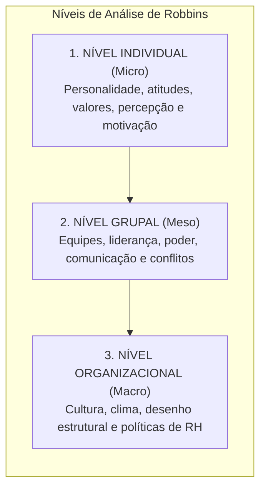
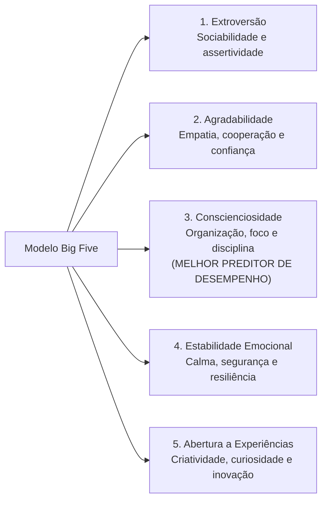
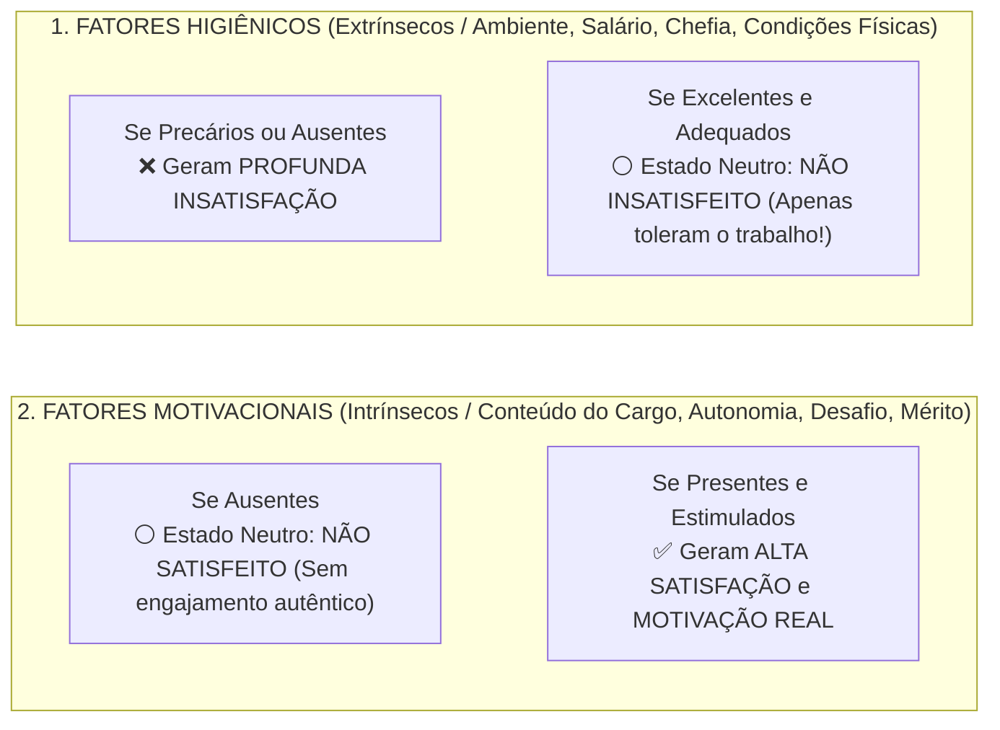

# 01 - Comportamento Individual: Personalidade, Valores, Atitudes e Teorias da Motivação

> **Matéria:** Comportamento Organizacional  
> **Cargo:** A01 – Técnico de Controle Externo – Especialidade: Técnico Administrativo  
> **Arquivo:** `01_individuo_personalidade_valores_atitudes_e_motivacao.md`  

---

## 📌 Ementa / Itens do Edital
- Fundamentos do Comportamento Organizacional (CO): conceito, objetivos científicos (descrever, explicar, prever e controlar o comportamento) e os três níveis de análise de Stephen Robbins (nível individual, grupal e do sistema organizacional);
- O Comportamento Individual nas organizações:
  - Personalidade: determinantes (hereditariedade vs. ambiente), o modelo dos Cinco Grandes Fatores (*Big Five*: Extroversão, Agradabilidade, Conscienciosidade, Estabilidade Emocional e Abertura a Experiências);
  - Traços de personalidade específicos: *Locus* de controle interno versus externo, autoeficácia (Bandura), maquiavelismo, autoestima e automonitoramento;
  - Emoções e sentimentos no ambiente de trabalho; o conceito de Inteligência Emocional (Daniel Goleman);
- Valores, Atitudes e Satisfação no Trabalho:
  - Atitudes: componentes cognitivo (crença/saber), afetivo (sentimento) e comportamental (intenção de ação);
  - Dissonância Cognitiva (Leon Festinger): desconforto mental e estratégias de harmonização interna;
  - Satisfação no trabalho e as três dimensões do Comprometimento Organizacional (Meyer e Allen: Afetivo, Instrumental/Continuação e Normativo);
- Teorias da Motivação no Trabalho:
  - **Teorias de Conteúdo (O que motiva as pessoas?):**
    - Hierarquia das Necessidades Humanas de Abraham Maslow;
    - Teoria dos Dois Fatores de Frederick Herzberg (Fatores Higiênicos vs. Fatores Motivacionais);
    - Teoria ERC de Clayton Alderfer (Existência, Relacionamento e Crescimento) e o princípio de frustração-regressão;
    - Teoria das Necessidades Adquiridas de David McClelland (Realização, Poder e Afiliação);
  - **Teorias de Processo (Como ocorre a dinâmica motivacional?):**
    - Teoria da Expectativa / Expectância de Victor Vroom (Força Motivacional = Expectativa $\times$ Instrumentalidade $\times$ Valência);
    - Teoria da Equidade de J. Stacy Adams (comparação da relação insumos/recompensas com os pares);
    - Teoria do Estabelecimento de Metas de Edwin Locke (metas específicas e desafiadoras com *feedback*);
    - Teoria do Reforço de B.F. Skinner (reforço positivo, negativo, punição e extinção).

---

## 🌳 Classificação Hierárquica

```text
1. Comportamento Individual, Personalidade e Dinâmica da Motivação
├── 1.1 Fundamentos do Comportamento Organizacional (CO)
│   ├── 1.1.1 Definição: Estudo do impacto de indivíduos, grupos e estrutura sobre a conduta organizacional
│   └── 1.1.2 Os Três Níveis de Análise de Stephen Robbins:
│       ├── Nível Micro / Individual (Personalidade, atitudes, percepção, emoções e motivação)
│       ├── Nível Meso / Grupal (Equipes, comunicação, liderança, poder e conflitos)
│       └── Nível Macro / Organizacional (Cultura, clima, desenho estrutural e políticas de gestão de pessoas)
├── 1.2 Personalidade, Traços Psicológicos e Atitudes
│   ├── 1.2.1 O Modelo dos Cinco Grandes Fatores (Big Five):
│   │   ├── 1. Extroversão (Sociabilidade, assertividade e comunicação)
│   │   ├── 2. Agradabilidade / Afabilidade (Empatia, cooperação, confiança e calor humano)
│   │   ├── 3. Conscienciosidade / Realização (Organização, disciplina e persistência - melhor preditor de desempenho)
│   │   ├── 4. Estabilidade Emocional vs. Neuroticismo (Segurança e calma vs. ansiedade e vulnerabilidade)
│   │   └── 5. Abertura a Experiências (Criatividade, curiosidade intelectual e flexibilidade)
│   ├── 1.2.2 Locus de Controle: Interno (o indivíduo crê controlar seu destino) vs. Externo (atribuição à sorte ou acaso)
│   ├── 1.2.3 Os Três Componentes da Atitude: Cognitivo (pensamento), Afetivo (emoção) e Comportamental (ação)
│   ├── 1.2.4 Dissonância Cognitiva (Leon Festinger): Conflito interno entre crenças e atitudes
│   └── 1.2.5 Comprometimento Organizacional (Meyer & Allen): Afetivo (quer), Instrumental (precisa) e Normativo (deve)
├── 1.3 Teorias Motivacionais de Conteúdo (Estáticas - O que motiva)
│   ├── 1.3.1 Hierarquia de Maslow: Fisiológicas -> Segurança -> Sociais -> Estima -> Autorrealização
│   ├── 1.3.2 Teoria Bifatorial de Frederick Herzberg:
│   │   ├── Fatores Higiênicos (Extrínsecos): Salário, ambiente físico, chefia -> Evitam a insatisfação, mas NÃO motivam
│   │   └── Fatores Motivacionais (Intrínsecos): Desafio, responsabilidade, reconhecimento -> Geram MOTIVAÇÃO autêntica
│   ├── 1.3.3 Teoria ERC de Alderfer: Existência, Relacionamento e Crescimento (admite frustração-regressão)
│   └── 1.3.4 Necessidades Adquiridas de McClelland: Realização (nAch), Poder (nPow) e Afiliação (nAff)
└── 1.4 Teorias Motivacionais de Processo (Dinâmicas - Como ocorre a motivação)
    ├── 1.4.1 Teoria da Expectativa de Victor Vroom (Modelo VIE):
    │   ├── Expectativa (E): Esforço -> Desempenho ("Se eu me esforçar, alcançarei a meta?")
    │   ├── Instrumentalidade (I): Desempenho -> Recompensa ("Se eu bater a meta, receberei o prêmio?")
    │   └── Valência (V): Recompensa -> Valor Pessoal ("Essa recompensa é realmente valiosa para mim?")
    │   └── Fórmula Multiplicativa: Motivação = E x I x V (se qualquer termo for zero, a motivação é nula)
    ├── 1.4.2 Teoria da Equidade de J. Stacy Adams: Comparação social da razão Recompensas/Insumos
    ├── 1.4.3 Teoria do Estabelecimento de Metas de Edwin Locke: Metas difíceis e específicas superam metas genéricas
    └── 1.4.4 Teoria do Reforço de Skinner: Modificação do comportamento por reforços positivos e negativos
```

---

## 📖 Resumo Teórico Aprofundado & Esquematizado

### 1. Os Três Níveis de Análise do Comportamento Organizacional

Stephen Robbins estrutura o estudo do comportamento nas organizações em três níveis concêntricos e interdependentes:



---

### 2. O Modelo dos Cinco Grandes Fatores de Personalidade (*Big Five*)

O modelo dos Cinco Grandes é a estrutura mais validada pela psicologia moderna para avaliar a personalidade nas organizações:



#### Traços Específicos e Atitudes Relevantes:
* **Locus de Controle Interno:** O indivíduo acredita que é o senhor do seu próprio destino, atribuindo seus sucessos e fracassos às suas próprias competências e esforços.
* **Locus de Controle Externo:** O indivíduo acredita que os acontecimentos de sua vida dependem da sorte, do acaso, da política ou de outras pessoas poderosas.
* **As Três Dimensões do Comprometimento Organizacional (Meyer e Allen):**
  1. *Comprometimento Afetivo:* O servidor permanece na instituição porque **quer** (identificação emocional genuína com a missão do órgão).
  2. *Comprometimento Instrumental / De Continuação:* O servidor permanece porque **precisa** (consciência dos custos financeiros e perdas que teria ao sair).
  3. *Comprometimento Normativo:* O servidor permanece porque **sente que deve** (senso de dever moral, obrigação ou lealdade ética).

---

### 3. A Teoria dos Dois Fatores de Frederick Herzberg

Herzberg comprovou empiricamente que satisfação e insatisfação no trabalho não são polos opostos da mesma escala, mas sim dimensões governadas por fatores inteiramente distintos:



> 🛑 **ATENÇÃO:**  
> Aumentar o salário, trocar o ar-condicionado ou comprar mesas novas **não motiva ninguém** segundo Herzberg! Tais medidas apenas removem o descontentamento e a insatisfação. Para gerar motivação autêntica, é obrigatório mexer no **conteúdo do cargo** (enriquecimento do trabalho, concessão de maior responsabilidade e desafios intelectuais).

---

### 4. A Teoria da Expectativa de Victor Vroom (Modelo VIE)

A Teoria da Expectativa estabelece que a motivação humana para agir decorre de um cálculo cognitivo racional estruturado em três elos encadeados:

$$\mathbf{\text{Motivação} = \text{Expectativa (E)} \times \text{Instrumentalidade (I)} \times \text{Valência (V)}}$$

```mermaid
flowchart LR
    Esforco["ESFORÇO<br/>DO INDIVÍDUO"] -->|1. EXPECTATIVA (E)<br/>'Consigo alcançar o resultado?'| Desempenho["DESEMPENHO /<br/>ALCANCE DA META"]
    Desempenho -->|2. INSTRUMENTALIDADE (I)<br/>'A recompensa será entregue?'| Recompensa["RECOMPENSA<br/>ORGANIZACIONAL"]
    Recompensa -->|3. VALÊNCIA (V)<br/>'Essa recompensa é valiosa para mim?'| Objetivos["OBJETIVOS<br/>PESSOAIS"]
```

1. **Expectativa ($E$):** Relação **Esforço $\rightarrow$ Desempenho**. A crença subjetiva do servidor de que o seu empenho e dedicação resultarão na entrega do desempenho exigido.
2. **Instrumentalidade ($I$):** Relação **Desempenho $\rightarrow$ Recompensa**. A confiança do servidor de que a organização realmente cumprirá o prometido e entregará a recompensa pactuada se o desempenho for atingido.
3. **Valência ($V$):** Relação **Recompensa $\rightarrow$ Metas Pessoais**. O valor atrativo, positivo ou negativo, que o indivíduo atribui à recompensa oferecida.
* **Regra Matemática Vital:** Como a motivação é o produto ($E \times I \times V$), **se qualquer um dos três fatores for zero, a motivação final será NULA!**

---

### 5. Outras Teorias Centrais da Motivação: Adams e Locke

* **Teoria da Equidade (J. Stacy Adams):** Os servidores comparam constantemente a proporção entre os seus esforços (tempo, dedicação, competência) e suas recompensas (remuneração, prestígio, elogios) com a proporção de outros colegas de referência:
  $$\frac{\text{Recompensas Próprias}}{\text{Esforços Próprios}} \quad \text{versus} \quad \frac{\text{Recompensas do Colega}}{\text{Esforços do Colega}}$$
  Se perceber iniquidade desfavorável (ganhar menos do que quem trabalha igual ou menos), o servidor sente tensão e tende a reduzir a produtividade, faltar ao trabalho ou pedir remoção.
* **Teoria do Estabelecimento de Metas (Edwin Locke):** Demonstra que:
  - Metas **específicas e desafiadoras** produzem desempenho significativamente superior a metas fáceis ou genéricas ("faça o melhor que puder");
  - O fornecimento de **feedback constante** sobre o progresso é indispensável para manter o engajamento do colaborador;
  - O comprometimento com a meta aumenta quando o servidor participa da sua fixação.

---

## 🚨 Alertas de Prova & Pegadinhas da FCC

> 🚨 **ALERTA DE PROVA / PEGADINHA FCC (SALÁRIO MOTIVA SEGUNDO HERZBERG?):**  
> Pegadinha clássica em provas da FCC: afirmar que na teoria de Herzberg o aumento de remuneração é um fator motivacional primordial. **FALSO!** Salário é um **Fator Higiênico (Extrínseco)**. O salário baixo gera insatisfação, mas o salário alto apenas neutraliza o descontentamento; ele **não possui o poder de produzir motivação duradoura**!

> ⭐ **IMPORTANTE (O MELHOR PREDITOR NO BIG FIVE):**  
> Grave o fator que mais cai nas provas: no modelo dos Cinco Grandes Fatores (*Big Five*), o traço com maior poder preditivo de alto desempenho profissional consistente em praticamente qualquer profissão é a **CONSCIENCIOSIDADE** (disciplina, foco em resultados, persistência e responsabilidade).

> 🛑 **ATENÇÃO (PRODUTO MULTIPLICATIVO DE VROOM):**  
> Na teoria da expectância de Vroom, se um servidor quer muito a promoção (Valência alta) e sabe que consegue bater a meta (Expectativa alta), mas sabe que o chefe vai promover um parente por nepotismo (Instrumentalidade = zero), a força motivacional do servidor será **ZERO**!

> 📌 **NOTA EXPLICATIVA (DISSONÂNCIA COGNITIVA):**  
> A dissonância cognitiva (Leon Festinger) ocorre quando um indivíduo tem duas crenças contraditórias ou quando seu comportamento viola sua própria atitude moral. Para aliviar a tensão psicológica, a pessoa tende a mudar seu comportamento, alterar sua atitude ou criar justificativas racionais que acomodem a contradição.

---

## 🌐 Fontes Oficiais e Referências Bibliográficas

* [ROBBINS, Stephen P.; JUDGE, Timothy A.; SOBRAL, Filipe. Comportamento Organizacional: teoria e prática no contexto brasileiro. 16ª Edição. Editora Pearson.](https://www.pearson.com).
* [HERZBERG, Frederick. Mais uma vez: como você motiva seus funcionários? Harvard Business Review.](https://hbr.org).
* [MASLOW, Abraham H. Motivação e Personalidade. Editora Harper & Row.](https://www.harpercollins.com).
* [VROOM, Victor H. Gestão e Motivação. John Wiley & Sons.](https://www.wiley.com).
* [LOCKE, Edwin A.; LATHAM, Gary P. A Theory of Goal Setting & Task Performance. Prentice-Hall.](https://www.pearson.com).

---

## 📝 Questões de Concurso FCC Comentadas

### Questão 01
**(FCC – TCE-PI – Auditor de Controle Externo)**  
Determinado gestor público, objetivando elevar a motivação dos servidores do setor de protocolo, promoveu uma reforma completa no ambiente físico do trabalho, instalando mobiliário ergonômico moderno, ar-condicionado de última geração e ampliando a remuneração com novo benefício de alimentação. Não obstante as medidas adotadas, os índices de proatividade e dedicação às tarefas intelectuais do setor permaneceram inalterados após alguns meses. Sob a perspectiva da Teoria dos Dois Fatores formulada por Frederick Herzberg, a ausência de elevação da motivação explica-se porque:

* **A)** As medidas implementadas atuaram exclusivamente sobre os fatores higiênicos, os quais são capazes de evitar a insatisfação funcional, mas não possuem a propriedade de gerar motivação genuína.
* **B)** A melhoria das condições físicas viola o princípio da equidade distributiva ao desconsiderar a valência das recompensas pecuniárias.
* **C)** O gestor ignorou a necessidade de autoafirmação primária prevista na base da pirâmide de Clayton Alderfer.
* **D)** O ambiente físico e o salário constituem fatores motivacionais de conteúdo que só produzem efeito quando associados a punições disciplinares.
* **E)** O mobiliário moderno reduz a expectativa de esforço, eliminando a instrumentalidade postulada por Victor Vroom.

> **Gabarito: A**  
> **Comentário Detalhado:**  
> - **A) CORRETA.** Segundo Frederick Herzberg, aspectos como ergonomia, ar-condicionado, condições de higiene predial e benefícios remuneratórios são **Fatores Higiênicos (Extrínsecos)**. A presença desses fatores em excelente nível é indispensável para evitar a insatisfação e reclamações dos servidores, mas é absolutamente incapaz de gerar motivação ou dedicação espontânea acima da média. A motivação decorre unicamente dos **Fatores Motivacionais (Intrínsecos)**, que dizem respeito ao desafio intelectual, responsabilidade, utilidade da tarefa e reconhecimento.  
> - **B) Incorreta.** Trata-se da teoria bifatorial de Herzberg, não da equidade de Adams.  
> - **C) Incorreta.** Alderfer dividiu as necessidades em Existência, Relacionamento e Crescimento.  
> - **D) Incorreta.** Salário e ambiente são fatores higiênicos, e não motivacionais.  
> - **E) Incorreta.** Mistura teorias de autores e premissas distintas.

---

### Questão 02
**(FCC – TCE-RS – Auditor de Controle Externo)**  
Segundo a Teoria da Expectativa desenvolvida por Victor Vroom, a motivação de um indivíduo para se dedicar com afinco a uma atividade profissional resulta da interação cognitiva entre três variáveis fundamentais. A convicção pessoal de um servidor de que o alcance do desempenho esperado e a conclusão da meta pactuada serão efetivamente seguidos pela entrega da recompensa institucional prometida pela organização traduz o conceito de:

* **A)** Valência.
* **B)** Instrumentalidade.
* **C)** Expectativa.
* **D)** Equidade comparativa.
* **E)** Locus de controle externo.

> **Gabarito: B**  
> **Comentário Detalhado:**  
> - **A) Incorreta.** Valência é o grau de atratividade e valor pessoal que a recompensa possui para o servidor.  
> - **B) CORRETA.** No modelo de Victor Vroom:  
>   - *Expectativa:* É a crença de que o **Esforço levará ao Desempenho** (acreditar na própria competência para atingir a meta).  
>   - **Instrumentalidade:** É a crença de que o **Desempenho alcançado levará à Recompensa prometida** (confiança de que a instituição entregará o benefício prometido se a meta for batida).  
>   - *Valência:* É a relação entre a **Recompensa e os Objetivos Pessoais** (o apreço subjetivo pelo benefício).  
> - **C) Incorreta.** Expectativa refere-se à relação esforço-desempenho.  
> - **D) Incorreta.** Equidade pertence à teoria de J. Stacy Adams.  
> - **E) Incorreta.** Locus de controle é conceito de traço de personalidade.

---

### Questão 03
**(FCC – TRT-20ª Região – Analista Judiciário: Área Administrativa)**  
No modelo dos Cinco Grandes Fatores de Personalidade (*Big Five*), amplamente adotado nas pesquisas contemporâneas de comportamento organizacional, o traço que se revelou empiricamente como o preditor mais consistente e fidedigno de alto desempenho profissional na ampla maioria das ocupações é a:

* **A)** Extroversão.
* **B)** Conscienciosidade.
* **C)** Agradabilidade.
* **D)** Abertura a Experiências.
* **E)** Estabilidade Emocional.

> **Gabarito: B**  
> **Comentário Detalhado:**  
> - **A) Incorreta.** A extroversão prediz desempenho em funções comerciais e de liderança política, mas não de modo universal.  
> - **B) CORRETA.** Centenas de pesquisas em Comportamento Organizacional comprovam que a **Conscienciosidade** (associada a alto senso de responsabilidade, rigor, organização, persistência, confiabilidade e foco em metas) é o fator do *Big Five* que possui correlação positiva mais forte e consistente com o bom desempenho profissional em quase todas as carreiras.  
> - **C) Incorreta.** A agradabilidade favorece o trabalho em equipe, mas não é o principal preditor geral.  
> - **D) Incorreta.** Abertura a experiências correlaciona-se com criatividade e adaptabilidade, mas não com desempenho padronizado contínuo.  
> - **E) Incorreta.** Estabilidade emocional evita estresse, mas não garante disciplina produtiva.

---

### Questão 04
**(FCC – SEFAZ-PE – Auditor Fiscal do Tesouro Estadual)**  
Um auditor fiscal estadual constatou que um colega recém-empossado na mesma gerência, desempenhando idênticas tarefas de fiscalização tributária e possuindo formação equivalente, foi contemplado com uma gratificação especial de produtividade 50% superior sem justificativa plausível de mérito. O auditor sentiu-se revoltado e passou a reduzir propositalmente seu ritmo diário de autuações e a faltar com frequência aos plantões fiscais. O comportamento adotado pelo auditor é explicado primordialmente pela:

* **A)** Teoria da Dissonância Comportamental de Skinner.
* **B)** Teoria da Hierarquia das Necessidades de Maslow.
* **C)** Teoria da Equidade de J. Stacy Adams.
* **D)** Teoria X de Douglas McGregor.
* **E)** Teoria da Racionalidade Absoluta dos Processos.

> **Gabarito: C**  
> **Comentário Detalhado:**  
> - **A) Incorreta.** Skinner é o autor da teoria do reforço operante.  
> - **B) Incorreta.** Maslow trata da hierarquia fisiológica até autorrealização.  
> - **C) CORRETA.** A **Teoria da Equidade de J. Stacy Adams** postula que os indivíduos comparam sua relação Resultados/Insumos com a relação de outros profissionais comparáveis. Ao constatar que o colega recebe recompensa desproporcionalmente maior para o mesmo esforço (iniquidade negativa sentida), o trabalhador busca restaurar o equilíbrio reduzindo seus insumos de trabalho (diminuindo o ritmo e faltando ao serviço).  
> - **D) Incorreta.** A Teoria X de McGregor retrata pressupostos gerenciais autoritários sobre trabalhadores preguiçosos.  
> - **E) Incorreta.** Opção sem respaldo teórico na psicologia motivacional.

---

### Questão 05
**(FCC – DPE-RS – Analista: Área Administrativa)**  
A respeito das dimensões do comprometimento organizacional formuladas por John Meyer e Natalie Allen, considere a situação em que um servidor público federal recusa uma proposta de trabalho na iniciativa privada porque sente que a organização em que atua cumpriu um papel fundamental na sua formação profissional inicial, experimentando um profundo senso de obrigação moral e lealdade ética de permanecer servindo àquela instituição pública. Trata-se de um exemplo de comprometimento:

* **A)** Instrumental.
* **B)** De Continuação.
* **C)** Normativo.
* **D)** Dissonante.
* **E)** Reativo.

> **Gabarito: C**  
> **Comentário Detalhado:**  
> - **A) e B) Incorretas.** O comprometimento instrumental (ou de continuação) baseia-se na dependência financeira e no receio dos custos de deixar o emprego (permanece porque precisa).  
> - **C) CORRETA.** O **Comprometimento Normativo** reflete a obrigação moral e o sentimento de dever ético de permanecer na organização (o indivíduo fica porque **sente que deve**, movido por lealdade ou gratidão pela entidade).  
> - **D) e E) Incorretas.** Termos não contemplados no modelo de três componentes de Meyer e Allen (que são: Afetivo, Instrumental e Normativo).
