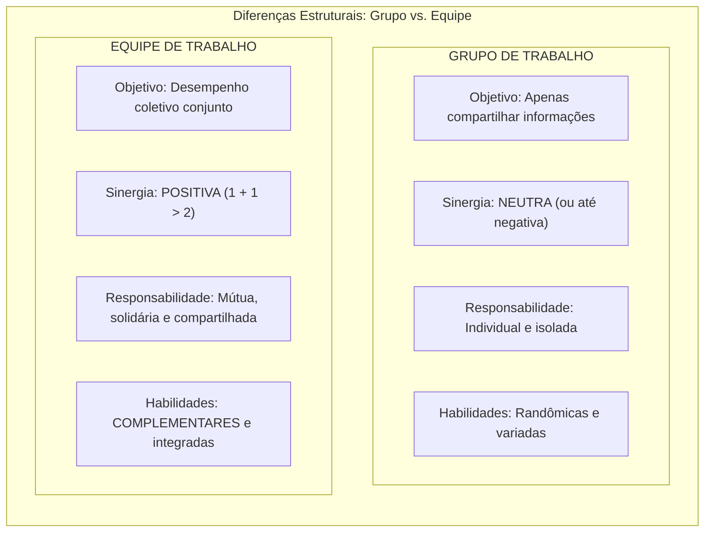
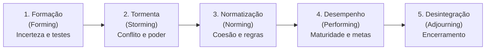
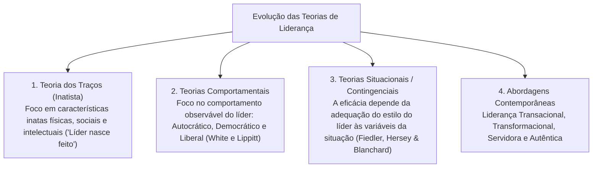
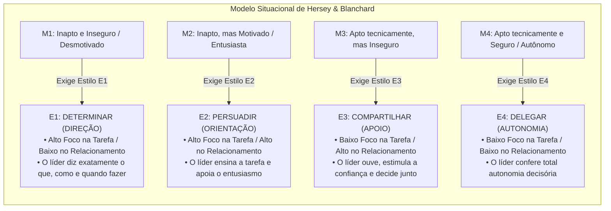
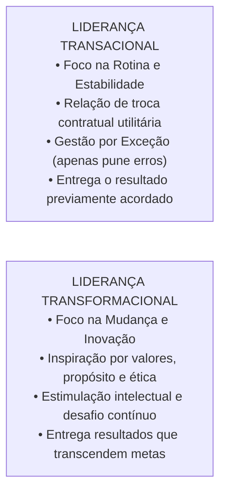
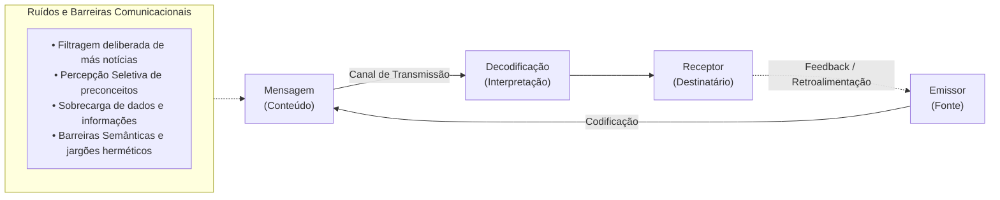

# 02 - Grupos, Equipes de Trabalho, Teorias da Liderança e Comunicação Organizacional

> **Matéria:** Comportamento Organizacional  
> **Cargo:** A01 – Técnico de Controle Externo – Especialidade: Técnico Administrativo  
> **Arquivo:** `02_grupos_equipes_lideranca_e_comunicacao_organizacional.md`  

---

## 📌 Ementa / Itens do Edital
- Grupos versus Equipes de Trabalho nas organizações:
    - Conceito de grupo (interação social para compartilhar informações) versus equipe de trabalho (sinergia positiva, esforço coordenado e responsabilidade mútua compartilhada);
    - Tipologia das equipes: equipes de resolução de problemas, equipes autogerenciadas, equipes multifuncionais (*cross-functional*) e equipes virtuais;
    - O modelo de desenvolvimento de grupos de Bruce Tuckman: Formação (*Forming*), Conflito/Tormenta (*Storming*), Normatização (*Norming*), Desempenho (*Performing*) e Desintegração (*Adjourning*);
- Teorias e Estilos de Liderança:
    - Conceito de liderança e a distinção clássica entre Líder (influência legítima conquistada) e Chefe/Gerente (autoridade formal outorgada);
    - Teoria dos Traços de Personalidade e suas limitações históricas;
    - Teorias Comportamentais: estilos clássicos de White e Lippitt (Autocrática, Democrática e Liberal / *Laissez-Faire*); o *Grid Gerencial* de Blake e Mouton (tarefa vs. pessoas);
    - Teorias Situacionais e Contingenciais:
    - O Modelo de Fred Fiedler (escala CMP e favorabilidade situacional);
    - A Teoria da Liderança Situacional de Paul Hersey e Kenneth Blanchard (maturidade dos liderados M1 a M4: Determinar, Persuadir, Compartilhar e Delegar);
    - Teoria Caminho-Meta (*Path-Goal*) de Robert House (diretivo, apoiador, participativo e orientado para conquista);
    - Abordagens Contemporâneas de Liderança:
    - Liderança Transacional (troca de recompensas contingentes e gestão por exceção) versus Liderança Transformacional (os 4 Is de Bass: influência idealizada, motivação inspiradora, estimulação intelectual e consideração individualizada);
    - Liderança Servidora (*Servant Leadership*) e Liderança Autêntica;
- Processo de Comunicação Organizacional:
    - Elementos do processo comunicacional: emissor, codificação, mensagem, canal, ruído, decodificação, receptor e *feedback*;
    - Fluxos e redes de comunicação: descendente, ascendente, horizontal/lateral e diagonal;
    - Barreiras à comunicação interpessoal: filtragem deliberada, percepção seletiva, sobrecarga informacional, desconfiança e barreiras semânticas.

---

## 🧭 Sumário

1. [Resumo Teórico Aprofundado & Esquematizado](#resumo-teorico-aprofundado-esquematizado)
    1. [Grupos de Trabalho versus Equipes de Trabalho](#1-grupos-de-trabalho-versus-equipes-de-trabalho)
    2. [Teste 410](#Teste-410)
    3. [Teste 411](#Teste-411)
    4. [O Modelo de Desenvolvimento de Grupos de Bruce Tuckman](#2-o-modelo-de-desenvolvimento-de-grupos-de-bruce-tuckman)
    5. [Teste 412](#Teste-412)
    6. [Teste 413](#Teste-413)
    7. [Evolução das Teorias de Liderança e a Liderança Situacional](#3-evolucao-das-teorias-de-lideranca-e-a-lideranca-situacional)
    8. [Teste 414](#Teste-414)
    9. [Teste 415](#Teste-415)
    10. [Liderança Transacional vs. Liderança Transformacional](#4-lideranca-transacional-vs-lideranca-transformacional)
    11. [Teste 416](#Teste-416)
    12. [O Processo de Comunicação Organizacional e suas Barreiras](#5-o-processo-de-comunicacao-organizacional-e-suas-barreiras)
    13. [Teste 417](#Teste-417)
    14. [Teste 418](#Teste-418)
    15. [Teste 419](#Teste-419)
    16. [Fontes Oficiais e Referências Bibliográficas](#6-fontes-oficiais-e-referencias-bibliograficas)

---

## 📖 Resumo Teórico Aprofundado & Esquematizado

### 1. Grupos de Trabalho versus Equipes de Trabalho

A distinção teórica entre grupo e equipe de trabalho é um dos pilares mais frequentes em provas de Comportamento Organizacional:

#### Tabela Comparativa Analítica:

| Dimensão | Grupo de Trabalho | Equipe de Trabalho |
| :--- | :--- | :--- |
| **Objetivo Central** | Compartilhar informações e tomar decisões para apoiar o desempenho individual de cada membro. | Desempenho coletivo e entrega conjunta de metas institucionais comuns. |
| **Padrão de Sinergia** | **Neutra** (às vezes negativa, decorrente de descoordenação ou conflitos disfuncionais). | **Positiva** ($1 + 1 > 2$: o resultado coletivo excede a soma das partes). |
| **Responsabilidade** | Individual e isolada (cada um responde unicamente por seu quinhão). | **Mútua e solidária** (todos respondem pelo sucesso ou insucesso da entrega). |
| **Habilidades** | Aleatórias, sobrepostas ou desarticuladas. | **Complementares** (conhecimentos técnicos diversos que se completam). |

#### Tipologia das Equipes nas Organizações:
1. **Equipes de Resolução de Problemas:** Grupos temporários formados por servidores do mesmo setor que se reúnem semanalmente para propor melhorias em processos e rotinas.
2. **Equipes Autogerenciadas:** Equipes autônomas com elevado poder decisório, que executam tarefas operacionais completas, elegem seus líderes rotativos e planejam suas próprias escalas de trabalho sem supervisão hierárquica direta constante.
3. **Equipes Multifuncionais (*Cross-Functional*):** Reúnem profissionais de diferentes áreas funcionais (ex.: auditor contábil, analista de TI, engenheiro de obras e procurador jurídico) para trabalhar em projetos interdisciplinares complexos.
4. **Equipes Virtuais:** Utilizam tecnologias de colaboração online para conectar servidores geograficamente dispersos em prol de objetivos comuns.

> ⭐ **IMPORTANTE (SINERGIA POSITIVA EM EQUIPES):**  
> Em provas da FCC, lembre-se de que a **sinergia positiva ($1 + 1 > 2$)** é o traço distintivo nuclear das **Equipes de Trabalho**. Em meros **Grupos de Trabalho**, a sinergia é **neutra** (a soma dos desempenhos individuais é apenas a soma aritmética de cada um) ou até negativa.

---

### Teste 410
**(FCC – DPE-RS – Analista: Área Administrativa)**  
A respeito da distinção conceitual entre Grupos de Trabalho e Equipes de Trabalho segundo a literatura especializada de comportamento organizacional, assinale a opção correta:

* **A)** Em um grupo de trabalho, a responsabilidade pelos resultados é solidária e mútua entre todos os integrantes, inexistindo metas isoladas.
* **B)** As equipes de trabalho caracterizam-se por apresentar sinergia positiva, na qual o desempenho coletivo conjunto é superior à soma das contribuições individuais isoladas.
* **C)** Os grupos de trabalho dependem compulsoriamente de habilidades técnicas altamente complementares entre seus membros.
* **D)** Em uma equipe de trabalho, a sinergia é sempre neutra, limitando-se os integrantes a trocar informações de rotina sem compromisso mútuo com as metas.
* **E)** As equipes autogerenciadas são aquelas nas quais o gestor superior centraliza todas as decisões operacionais sem delegar autoridade aos membros.

---

> **Comentário Detalhado:**  
>
> - **A) Incorreta.** A responsabilidade no grupo de trabalho é puramente individual; na equipe é que ela é mútua e compartilhada.  
> - **B) CORRETA.** As **Equipes de Trabalho** caracterizam-se pela **sinergia positiva** ($1 + 1 > 2$), o que significa que o esforço coordenado e integrado dos membros resulta em um patamar de entrega e desempenho global muito superior à mera soma aritmética das ações individuais isoladas.  
> - **C) Incorreta.** As habilidades complementares são requisito essencial das **equipes**, ao passo que nos grupos as habilidades são aleatórias.  
> - **D) Incorreta.** A sinergia neutra e a mera troca de dados caracterizam os grupos, e não as equipes.  
> - **E) Incorreta.** As equipes autogerenciadas possuem altíssima autonomia decisória, operando sem supervisão direta diária.  
> 
> **Gabarito: B**

---

### Teste 411
**(FCC - Adaptada / Analista de Gestão Pública)**
No Comportamento Organizacional, a distinção entre **Grupo de Trabalho** e **Equipe de Trabalho** é fundamental para a gestão de pessoas.

Constitui característica essencial e distintiva de uma **Equipe de Trabalho** de alto desempenho:

* **A)** A sinergia positiva gerada pelo esforço coordenado dos membros, resultando em um nível de desempenho coletivo maior do que a simples soma das contribuições individuais, com responsabilidade tanto individual quanto mútua.
* **B)** A independência estrita de objetivos, de tal modo que o sucesso de um membro prescinda do esforço dos demais.
* **C)** A concentração exclusiva das decisões na figura do chefe hierárquico formal, sem participação da equipe.
* **D)** A inexistência de complementaridade de habilidades técnicas entre os colaboradores.
* **E)** O foco exclusivo na produtividade individual isolada sem metas coletivas compartilhadas.

---

> **Comentário Detalhado:**
>
> - **A)** Correta. Diferença crucial: em um **Grupo de Trabalho**, o objetivo é apenas compartilhar informações e a sinergia é neutra (às vezes negativa), com responsabilidade apenas individual; em uma **Equipe de Trabalho**, há metas coletivas claras, habilidades complementares, responsabilidade mútua/compartilhada e **sinergia positiva** (o todo é superior à soma das partes).
> - **B), C), D), E)** Incorretas. Descrevem grupos de trabalho tradicionais ou unidades individualizadas.
> 
> **Gabarito: A**

---

### 2. O Modelo de Desenvolvimento de Grupos de Bruce Tuckman

Bruce Tuckman demonstrou que os grupos não nascem prontos e produtivos; eles atravessam **cinco estágios sequenciais de maturação psicossocial**:

1. **Formação (*Forming*):** Estágio caracterizado por grande incerteza quanto à missão, regras e papéis do grupo. Os integrantes exploram os limites e testam comportamentos para descobrir o que é aceitável.
2. **Tormenta / Conflito (*Storming*):** Estágio de atritos e resistências internas. Os integrantes aceitam a existência do grupo, mas resistem às limitações que a convivência impõe à sua individualidade; surgem disputas declaradas pelo controle e pela liderança da equipe.
3. **Normatização (*Norming*):** O conflito é superado, restabelecendo-se a harmonia. Desenvolvem-se relacionamentos estreitos, camaradagem e forte senso de coesão, formalizando-se as regras e expectativas mútuas de conduta.
4. **Desempenho (*Performing*):** O grupo atinge sua plena maturidade funcional. A energia dos participantes não é mais desperdiçada em disputas interpessoais, canalizando-se diretamente para a execução com excelência das tarefas e projetos.
5. **Desintegração / Encerramento (*Adjourning*):** Aplica-se a equipes temporárias (forças-tarefa, comissões de concurso, grupos de trabalho). O foco desloca-se do alto rendimento para a conclusão das pendências, documentação final e dissolução formal do grupo.

---

### Teste 412
**(FCC – TRT-2ª Região – Analista Judiciário: Área Administrativa)**  
De acordo com o modelo de desenvolvimento de pequenos grupos concebido por Bruce Tuckman, o estágio em que surgem conflitos explícitos entre os participantes, disputas internas pelo controle do grupo e resistências à liderança formal pré-estabelecida é denominado:

* **A)** Estágio de Formação (*Forming*).
* **B)** Estágio de Tormenta ou Conflito (*Storming*).
* **C)** Estágio de Normatização (*Norming*).
* **D)** Estágio de Desempenho (*Performing*).
* **E)** Estágio de Desintegração (*Adjourning*).

---

> **Comentário Detalhado:**  
>
> - **A) Incorreta.** Formação é a fase inicial de reconhecimento mútuo e incerteza.  
> - **B) CORRETA.** O estágio de **Tormenta (ou Conflito / *Storming*)** é caracterizado exatamente pelo surgimento de embates internos de poder e discordâncias quanto às regras; os participantes aceitam a existência do grupo, mas resistem ao controle exercido sobre eles e disputam a liderança até que a hierarquia de papéis se estabilize.  
> - **C) Incorreta.** Normatização é a fase posterior em que a coesão é restabelecida e surgem regras claras.  
> - **D) Incorreta.** Desempenho é a fase em que o grupo atinge a produtividade máxima e maturidade funcional.  
> - **E) Incorreta.** Desintegração é a fase final de dissolução do grupo após a entrega dos resultados.  
> 
> **Gabarito: B**

---

### Teste 413
**(FCC - Adaptada / Auditor de Controle Externo)**
Bruce Tuckman propôs um modelo seminal que descreve os cinco estágios universais pelos quais passam os grupos e equipes ao longo de seu ciclo de desenvolvimento.

O estágio em que o grupo supera conflitos internos de poder, estabelece coesão, define normas claras de convivência e desenvolve forte sentimento de identidade e camaradagem mútua é denominado:

* **A)** Normatização (Norming).
* **B)** Formação (Forming).
* **C)** Conflito / Tempestade (Storming).
* **D)** Desempenho (Performing).
* **E)** Desintegração / Dissolução (Adjourning).

---

> **Comentário Detalhado:**
>
> - **A)** Correta. Os 5 estágios de Tuckman: (1) **Formação (Forming)**: incerteza e orientação inicial; (2) **Tempestade/Conflito (Storming)**: disputas de liderança e atritos interpessoais; (3) **Normatização (Norming)**: estabelecimento de coesão, normas aceitas, alinhamento e regras de conduta; (4) **Desempenho (Performing)**: energia focada na execução produtiva da tarefa; (5) **Desintegração (Adjourning)**: conclusão e encerramento dos trabalhos.
> - **B), C), D), E)** Incorretas. Referem-se a outros estágios do ciclo de Tuckman.
> 
> **Gabarito: A**

---

### 3. Evolução das Teorias de Liderança e a Liderança Situacional

A liderança é o processo social de exercer influência legítima e voluntária sobre indivíduos e grupos para direcioná-los ao alcance de metas. Difere da chefia formal: o gerente/chefe possui **autoridade formal** outorgada pela hierarquia; o líder possui **influência pessoal** legitimada pelos liderados.

#### A Teoria da Liderança Situacional de Paul Hersey e Kenneth Blanchard:
Postula que não existe um estilo único e universal de liderança. O estilo ideal **depende da prontidão ou maturidade** dos liderados, categorizada em quatro níveis:

> 🚨 **ALERTA DE PROVA / PEGADINHA FCC (DELEGAÇÃO NA LIDERANÇA SITUACIONAL):**  
> Questão favorita da banca: afirmar que "o líder exemplar deve sempre adotar o estilo de delegação, conferindo autonomia ampla a todos os servidores subordinados". **FALSO!** A delegação só é correta e eficaz quando o liderado apresenta **maturidade M4** (alta competência técnica e alta confiança). Se delegar a um servidor novato M1 (sem conhecimento das rotinas), haverá frustração e erro operacional grave. A liderança eficaz **depende da situação**!

> 📌 **NOTA EXPLICATIVA (LÍDER VS. GERENTE):**  
> O gerente tem **autoridade formal** outorgada pelo cargo institucional; o líder possui **influência pessoal e legítima** conquistada pelo respeito, admiração e confiança das pessoas. Um chefe pode não ser líder, e um líder pode não ocupar cargo formal de chefia.

---

### Teste 414
**(FCC – TCE-PI – Auditor de Controle Externo)**  
A respeito da Teoria da Liderança Situacional proposta por Paul Hersey e Kenneth Blanchard, considere um grupo de servidores recém-aprovados em concurso público que acaba de ser lotado em uma gerência de fiscalização contábil. Os novos servidores apresentam grande entusiasmo e disposição para aprender, todavia desconhecem completamente as normas regimentais específicas e as ferramentas operacionais do sistema informatizado de controle externo (nível de maturidade M2). De acordo com a teoria, o estilo de liderança mais apropriado a ser adotado pelo gestor da unidade é:

* **A)** Estilo de Delegação (baixo comportamento de tarefa e baixo comportamento de relacionamento).
* **B)** Estilo de Persuasão / Orientação (alto comportamento de tarefa e alto comportamento de relacionamento).
* **C)** Estilo de Não Intervenção / Laissez-Faire (isenção de qualquer comando diretivo ou cobrança de metas).
* **D)** Estilo Apoiador Exclusivo (baixo comportamento de tarefa e alto comportamento de relacionamento).
* **E)** Estilo de Imposição Burocrática Inflexível sem concessão de explicações pedagógicas.

---

> **Comentário Detalhado:**  
>
> - **A) Incorreta.** Delegar (E4) aplica-se exclusivamente a liderados com maturidade M4 (altamente competentes e autônomos).  
> - **B) CORRETA.** No modelo de Hersey e Blanchard, liderados com nível de prontidão **M2** (possuem entusiasmo e motivação, mas ainda não têm competência técnica prática consolidada) exigem o estilo **E2 - Persuadir / Orientar / Vender**, que combina **alto comportamento de tarefa** (o líder ensina, direciona e dá instruções de trabalho) com **alto comportamento de relacionamento** (o líder apoia, dialoga e mantém acesa a motivação do servidor).  
> - **C) Incorreta.** Laissez-faire é a ausência de liderança, prejudicial para iniciantes.  
> - **D) Incorreta.** O estilo apoiador (E3) destina-se a pessoas aptas tecnicamente, mas inseguras (M3).  
> - **E) Incorreta.** O mero autoritarismo mina a motivação e não transmite competência.  
> 
> **Gabarito: B**

---

### Teste 415
**(FCC - Adaptada / Analista de Planejamento e Controle)**
Na Teoria da Liderança Situacional formulada por Paul Hersey e Kenneth Blanchard, o estilo de liderança mais eficaz não é fixo, mas depende do nível de **prontidão (ou maturidade)** dos liderados para desempenhar uma tarefa específica.

Quando os liderados apresentam **baixa competência e alto comprometimento/motivação** (estágio de maturidade M1), o estilo de liderança mais indicado pelo modelo é:

* **A)** Determinar / Direcionar (E1 - Direção), caracterizado por alto comportamento para a tarefa e baixo comportamento para o relacionamento (instruções claras e supervisão estrita).
* **B)** Delegar (E4 - Delegação), retirando toda a supervisão e deixando o liderado agir por conta própria.
* **C)** Apoiar / Participar (E3 - Apoio), com foco exclusivo em suporte afetivo e baixa orientação sobre como executar a tarefa.
* **D)** Autocracia repressiva punitiva com ameaça de abertura de processo administrativo.
* **E)** Demissão sumária por insuficiência de capacitação técnica.

---

> **Comentário Detalhado:**
>
> - **A)** Correta. No modelo de Hersey e Blanchard: para subordinados **M1** (iniciantes entusiastas, com baixa competência na tarefa, mas dispostos), o líder deve adotar o estilo **E1 - Direcionar/Determinar** (alto foco na tarefa e baixo em relacionamento): define papéis, ensina o passo a passo, dá instruções detalhadas e monitora o cumprimento.
> - **B)** Incorreta. Delegação (E4) exige maturidade máxima (M4 - alta competência e alto comprometimento).
> - **C)** Incorreta. Apoiar (E3) aplica-se a liderados com alta competência, mas segurança/motivação vacilante (M3).
> - **D), E)** Incorretas. Não fazem parte dos pressupostos teóricos do modelo situacional.
> 
> **Gabarito: A**

---

### 4. Liderança Transacional vs. Liderança Transformacional

#### Os Quatro Pilares da Liderança Transformacional (Bernard Bass - Os "4 Is"):
1. **Influência Idealizada (Carisma):** O líder atua como modelo ético e moral a ser imitado, despertando orgulho institucional, respeito incondicional e lealdade nos subordinados.
2. **Motivação Inspiradora:** O líder comunica uma visão estimulante do futuro com entusiasmo e energia contagiante, demonstrando como o esforço de cada analista contribui para um propósito grandioso.
3. **Estimulação Intelectual:** O líder encoraja os liderados a desafiarem o conformismo e o comodismo do *status quo*, instigando-os a repensar processos burocráticos e a sugerir soluções inovadoras sem medo de errar.
4. **Consideração Individualizada:** O líder presta atenção personalizada às particularidades de cada colaborador, identificando suas necessidades singulares de crescimento e atuando ativamente como mentor ou conselheiro.

---

### Teste 416
**(FCC – TCE-RS – Auditor de Controle Externo)**  
No âmbito dos estudos sobre liderança nas organizações contemporâneas, o modelo de Liderança Transformacional diferencia-se da Liderança Transacional fundamentalmente porque:

* **A)** A liderança transformacional fundamenta-se estritamente na concessão de incentivos financeiros contingentes ao atingimento das metas contratuais acordadas.
* **B)** O líder transformacional inspira e estimula seus seguidores a transcenderem seus interesses individuais em prol da missão e dos valores superiores da organização, promovendo profundas mudanças culturais.
* **C)** A liderança transacional rejeita qualquer tipo de recompensa ou cobrança de cumprimento de rotinas operacionais.
* **D)** O líder transformacional restringe sua atuação à gestão por exceção, intervindo unicamente quando ocorrem falhas graves na linha de montagem.
* **E)** A liderança transformacional é restrita a estruturas organizacionais mecanicistas e lineares do setor militar.

---

> **Comentário Detalhado:**  
>
> - **A) Incorreta.** O uso de incentivos pecuniários contingentes por metas pactuadas caracteriza a liderança **transacional**.  
> - **B) CORRETA.** A **Liderança Transformacional** vai além da troca transacional imediata; por meio dos quatro pilares clássicos (carisma, consideração individualizada, inspiração motivacional e estimulação intelectual), o líder transformacional motiva os seguidores a superarem seus interesses individuais em benefício do propósito coletivo da instituição, fomentando transformações culturais perenes.  
> - **C) Incorreta.** A liderança transacional apoia-se exatamente na cobrança de rotinas e trocas formais de incentivos.  
> - **D) Incorreta.** Gestão por exceção é atributo típico da liderança **transacional**.  
> - **E) Incorreta.** A liderança transformacional é amplamente aplicada e valorizada em órgãos públicos modernos e democráticos.  
> 
> **Gabarito: B**

---

### 5. O Processo de Comunicação Organizacional e suas Barreiras

A comunicação é a transferência e compreensão de significados entre um emissor e um receptor. Seu fluxo operacional organiza-se nas seguintes etapas fundamentais:

#### A) Direções dos Fluxos de Comunicação:
* **Fluxo Descendente (Top-Down):** Da cúpula para a base (diretrizes estratégicas, políticas regimentais, ordens de serviço e memorandos de chefia).
* **Fluxo Ascendente (Bottom-Up):** Da base operacional para a alta direção (relatórios de fiscalização, sugestões de melhoria, queixas e pedidos de esclarecimento).
* **Fluxo Horizontal / Lateral:** Entre colegas de trabalho do mesmo nível hierárquico (coordenação interdisciplinar e alinhamento mútuo entre auditores).
* **Fluxo Diagonal:** Entre setores e níveis hierárquicos distintos (ex.: auditor de campo comunicando-se diretamente com o diretor de TI para ajustar um software).

#### B) Principais Barreiras Comunicacionais Cobradas pela FCC:
* **Filtragem:** Manipulação deliberada da mensagem pelo emissor para que ela seja recebida de modo mais favorável ou menos punitivo pelo superior hierárquico (ex.: servidor que oculta intencionalmente atrasos de cronograma em seu relatório para não se indispor com o diretor).
* **Percepção Seletiva:** Tendência psicológica pela qual o receptor escuta e decodifica a mensagem com base em seus próprios preconceitos, interesses pessoais, necessidades ou histórico de vida, ignorando partes cruciais do conteúdo.
* **Sobrecarga de Informação:** Ocorre quando o volume de dados e despachos supera a capacidade cognitiva de processamento do servidor, gerando esquecimentos, estresse e atrasos processuais.
* **Barreiras Semânticas:** Utilização de termos ambíguos, abreviações herméticas ou jargões excessivamente técnicos que impedem o receptor de decodificar com precisão o que foi emitido.

> 🛑 **ATENÇÃO (FILTRAGEM NA COMUNICAÇÃO):**  
> Se a questão descrever um servidor que altera os relatórios antes de entregar ao diretor, omitindo dados negativos para que a situação pareça sob controle, o conceito técnico é a **FILTRAGEM** da informação!

---

### Teste 417
**(FCC – ARTESP – Especialista em Regulação de Transportes)**  
Durante a elaboração de um relatório de fiscalização, determinado analista deliberadamente omitiu informações cruciais sobre irregularidades graves na conservação da malha rodoviária, selecionando e apresentando apenas dados favoráveis à concessionária, com o objetivo expresso de evitar atritos com seu superior hierárquico e fazer com que o documento parecesse positivo. No processo de comunicação organizacional, a conduta desse servidor materializa a barreira denominada:

* **A)** Sobrecarga informacional.
* **B)** Filtragem da informação.
* **C)** Barreira de decodificação receptiva.
* **D)** Ruído semântico involuntário.
* **E)** Percepção sensorial dilatada.

---

> **Comentário Detalhado:**  
>
> - **A) Incorreta.** Sobrecarga ocorre quando o volume de dados ultrapassa a capacidade de processamento mental.  
> - **B) CORRETA.** A **Filtragem** é a manipulação deliberada da mensagem pelo emissor para que ela seja vista de modo mais favorável pelo receptor (muito comum em organizações hierarquizadas quando o subordinado omite más notícias para agradar a chefia ou não se indispor com superiores).  
> - **C) Incorreta.** A omissão partiu do emissor no momento do envio, e não da decodificação pelo receptor.  
> - **D) Incorreta.** Ruídos semânticos dizem respeito a palavras ambíguas ou jargões incompreendidos, sem má-fé deliberada.  
> - **E) Incorreta.** Conceito sem pertinência técnica com o processo de comunicação.  
> 
> **Gabarito: B**

---

### Teste 418
**(FCC - Adaptada / TCE-PI - Auditor de Controle Externo)**
Na moderna literatura sobre liderança, Bernard Bass consagrou a contraposição entre **Liderança Transacional** e **Liderança Transformacional**.

Constitui característica marcante da **Liderança Transformacional**:

* **A)** Inspirar e motivar os liderados a transcender seus interesses individuais em prol da missão coletiva da organização, estimulando a inovação, o questionamento construtivo e o desenvolvimento pessoal por meio da consideração individualizada e do estímulo intelectual.
* **B)** Basear-se exclusivamente em trocas contratuais de curto prazo, onde o líder apenas concede recompensas financeiras em troca do cumprimento estrito de metas.
* **C)** Utilizar primordialmente a gestão por exceção passiva, intervindo apenas quando falhas graves já ocorreram.
* **D)** Concentrar todo o poder e evitar que os servidores desenvolvam pensamento crítico autônomo.
* **E)** Punir severamente os liderados que apresentarem ideias inovadoras contrárias aos regulamentos tradicionais.

---

> **Comentário Detalhado:**
>
> - **A)** Correta. A **Liderança Transformacional** fundamenta-se nos quatro pilares clássicos ("Os 4 Is" de Bass): Influência Idealizada (carisma e credibilidade), Motivação Inspiracional (visão de futuro compartilhada), Estímulo Intelectual (incentivo à criatividade e solução de problemas) e Consideração Individualizada (atenção personalizada às necessidades de cada liderado).
> - **B), C)** Incorretas. Características definidoras da **Liderança Transacional** (recompensa contingente e gerência por exceção).
> - **D), E)** Incorretas. Posturas de chefia autoritária e punitiva.
> 
> **Gabarito: A**

---

### Teste 419
**(FCC - Adaptada / TCE-GO - Analista de Controle Externo)**
No processo de comunicação organizacional, a barreira que ocorre quando o emissor manipula deliberadamente as informações para que sejam vistas de modo mais favorável e lisonjeiro pelo receptor (muito comum em relações verticais ascendentes em que subordinados ocultam más notícias de seus chefes) é denominada:

* **A)** Filtragem.
* **B)** Percepção Seletiva.
* **C)** Sobrecarga de Informação.
* **D)** Ruído Semântico.
* **E)** Linguagem Não Verbal Involuntária.

---

> **Comentário Detalhado:**
>
> - **A)** Correta. A **Filtragem** é a manipulação consciente ou inconsciente da informação antes de transmiti-la, de forma a torná-la palatável ao superior hierárquico. Quanto mais vertical e autoritária a organização, maior a tendência de os subordinados filtrarem más notícias para evitar punições ou desagradar a chefia.
> - **B)** Incorreta. Percepção Seletiva ocorre no receptor, que ouve apenas o que se alinha aos seus interesses.
> - **C)** Incorreta. Sobrecarga é a incapacidade de processar o excesso de mensagens.
> - **D)** Incorreta. Ruído semântico decorre de palavras com duplo sentido ou jargões incompreendidos.
> - **E)** Incorreta. Gestos corporais e expressões faciais.
> 
> **Gabarito: A**

---

### 6. Fontes Oficiais e Referências Bibliográficas

* [Decreto Federal nº 9.203/2017 (Mecanismo de Liderança na Governança)](https://www.planalto.gov.br/ccivil_03/_ato2015-2018/2017/decreto/d9203.htm) - Práticas para desenvolvimento de líderes, comunicação transparente e conduta ética.
* [TCU - Referencial Básico de Governança: Práticas do Mecanismo de Liderança](https://portal.tcu.gov.br/governanca/governanca-no-tcu/) - Competências de liderança e papel dos gestores na motivação de equipes públicas.
* [TCE-GO - Código de Ética e Relações Interpessoais](https://portal.tce.go.gov.br/documents/20181/574123/C%C3%B3digo+de+%C3%89tica/056863be-6768-4c35-a6e8-ccdd40421211) - Normas de respeito interpessoal, cooperação e comunicação interna no tribunal.
* [Scrum Guide 2020 Oficial (Liderança Servidora e Equipes)](https://scrumguides.org/docs/scrumguide/v2020/2020-Scrum-Guide-PortugueseBR-3.0.pdf) - Princípios de liderança servidora, autogestão e dinâmicas de colaboração em equipes.
* [Decreto Federal nº 11.072/2022 (Gestão de Equipes no Teletrabalho e PGD)](https://www.planalto.gov.br/ccivil_03/_ato2019-2022/2022/decreto/d11072.htm) - Planejamento e comunicação de equipes que operam em regime presencial e remoto.
* ROBBINS, Stephen P.; JUDGE, Timothy A.; SOBRAL, Filipe. **Comportamento Organizacional: Teoria e Prática no Contexto Brasileiro**. 14. ed. São Paulo: Pearson Prentice Hall, 2010. (Cap. 9 - Comportamento em Grupo; Cap. 10 - Equipes de Trabalho; Cap. 11 - Comunicação; Cap. 12 - Liderança).
* CHIAVENATO, Idalberto. **Comportamento Organizacional: A Dinâmica do Sucesso das Organizações**. 4. ed. São Paulo: Atlas, 2021. (Cap. 9 - Equipes de Alto Desempenho; Cap. 11 - Liderança, Poder e Influência).
* TUCKMAN, Bruce W. **Developmental Sequence in Small Groups**. Psychological Bulletin, v. 63, n. 6, p. 384-399, 1965.
