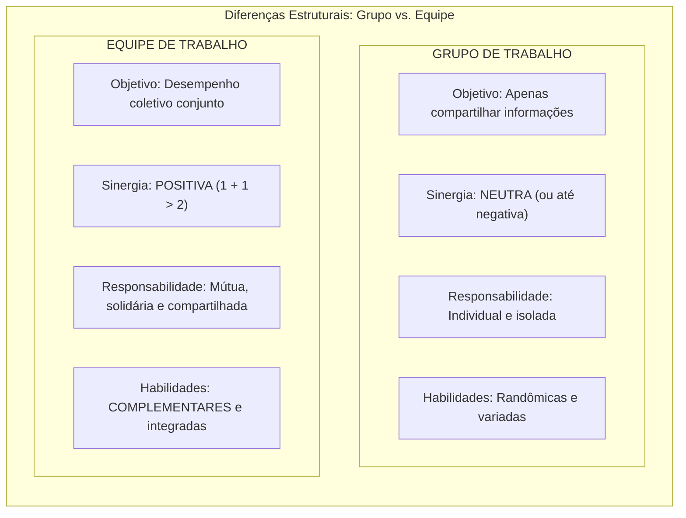
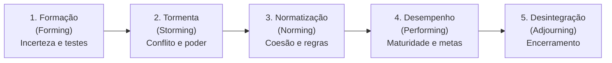
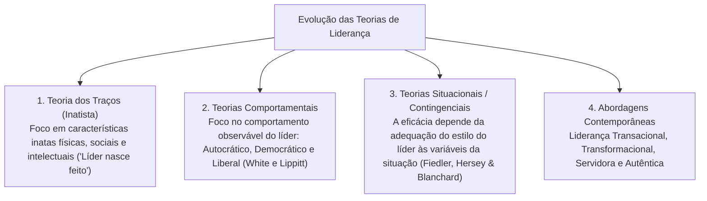
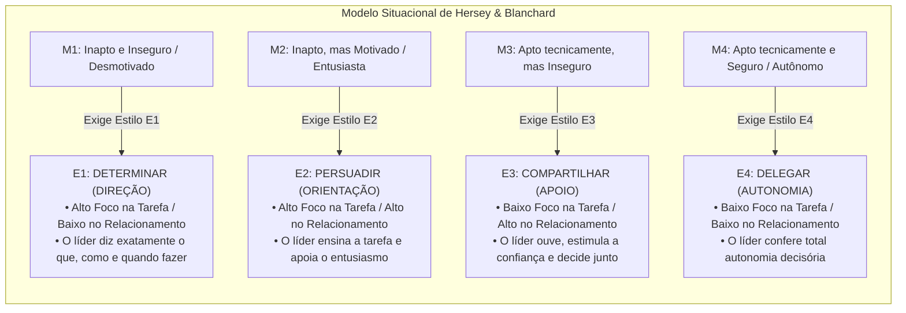
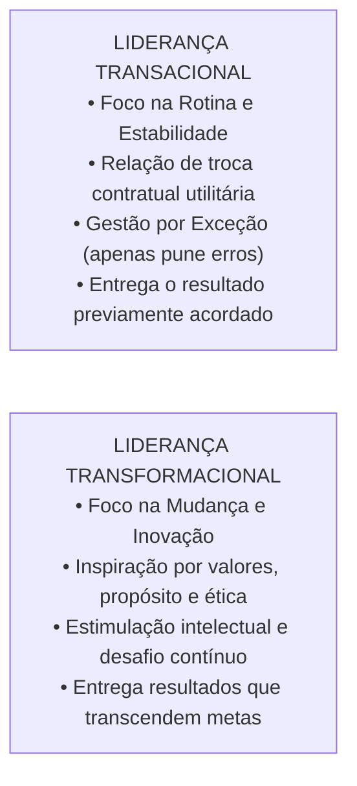
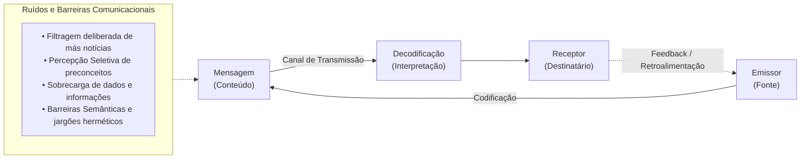

# 02 - Grupos, Equipes de Trabalho, Teorias da Liderança e Comunicação Organizacional

> **Matéria:** Comportamento Organizacional  
> **Cargo:** A01 – Técnico de Controle Externo – Especialidade: Técnico Administrativo  
> **Arquivo:** `02_grupos_equipes_lideranca_e_comunicacao_organizacional.md`  

---

## 📌 Ementa / Itens do Edital
- Grupos versus Equipes de Trabalho nas organizações:
    - Conceito de grupo (interação social para compartilhar informações) versus equipe de trabalho (sinergia positiva, esforço coordenado e responsabilidade mútua compartilhada);
    - Tipologia das equipes: equipes de resolução de problemas, equipes autogerenciadas, equipes multifuncionais (*cross-functional*) e equipes virtuais;
    - O modelo de desenvolvimento de grupos de Bruce Tuckman: Formação (*Forming*), Conflito/Tormenta (*Storming*), Normatização (*Norming*), Desempenho (*Performing*) e Desintegração (*Adjourning*);
- Teorias e Estilos de Liderança:
    - Conceito de liderança e a distinção clássica entre Líder (influência legítima conquistada) e Chefe/Gerente (autoridade formal outorgada);
    - Teoria dos Traços de Personalidade e suas limitações históricas;
    - Teorias Comportamentais: estilos clássicos de White e Lippitt (Autocrática, Democrática e Liberal / *Laissez-Faire*); o *Grid Gerencial* de Blake e Mouton (tarefa vs. pessoas);
    - Teorias Situacionais e Contingenciais:
    - O Modelo de Fred Fiedler (escala CMP e favorabilidade situacional);
    - A Teoria da Liderança Situacional de Paul Hersey e Kenneth Blanchard (maturidade dos liderados M1 a M4: Determinar, Persuadir, Compartilhar e Delegar);
    - Teoria Caminho-Meta (*Path-Goal*) de Robert House (diretivo, apoiador, participativo e orientado para conquista);
    - Abordagens Contemporâneas de Liderança:
    - Liderança Transacional (troca de recompensas contingentes e gestão por exceção) versus Liderança Transformacional (os 4 Is de Bass: influência idealizada, motivação inspiradora, estimulação intelectual e consideração individualizada);
    - Liderança Servidora (*Servant Leadership*) e Liderança Autêntica;
- Processo de Comunicação Organizacional:
    - Elementos do processo comunicacional: emissor, codificação, mensagem, canal, ruído, decodificação, receptor e *feedback*;
    - Fluxos e redes de comunicação: descendente, ascendente, horizontal/lateral e diagonal;
    - Barreiras à comunicação interpessoal: filtragem deliberada, percepção seletiva, sobrecarga informacional, desconfiança e barreiras semânticas.

---

## 🧭 Sumário

1. [Grupos de Trabalho versus Equipes de Trabalho](#1-grupos-de-trabalho-versus-equipes-de-trabalho)
    1. [Teste 410](#Teste-410)
    2. [Teste 411](#Teste-411)
2. [O Modelo de Desenvolvimento de Grupos de Bruce Tuckman](#2-o-modelo-de-desenvolvimento-de-grupos-de-bruce-tuckman)
    1. [Teste 412](#Teste-412)
    2. [Teste 413](#Teste-413)
3. [Evolução das Teorias de Liderança e a Liderança Situacional](#3-evolucao-das-teorias-de-lideranca-e-a-lideranca-situacional)
    1. [Teste 414](#Teste-414)
    2. [Teste 415](#Teste-415)
4. [Liderança Transacional vs. Liderança Transformacional](#4-lideranca-transacional-vs-lideranca-transformacional)
    1. [Teste 416](#Teste-416)
5. [O Processo de Comunicação Organizacional e suas Barreiras](#5-o-processo-de-comunicacao-organizacional-e-suas-barreiras)
    1. [Teste 417](#Teste-417)
    2. [Teste 418](#Teste-418)
    3. [Teste 419](#Teste-419)
6. [Fontes Oficiais e Referências Bibliográficas](#6-fontes-oficiais-e-referencias-bibliograficas)

---

## 1. Grupos de Trabalho versus Equipes de Trabalho

A distinção teórica entre grupo e equipe de trabalho é um dos pilares mais frequentes em provas de Comportamento Organizacional:

#### Tabela Comparativa Analítica:

| Dimensão | Grupo de Trabalho | Equipe de Trabalho |
| :--- | :--- | :--- |
| **Objetivo Central** | Compartilhar informações e tomar decisões para apoiar o desempenho individual de cada membro. | Desempenho coletivo e entrega conjunta de metas institucionais comuns. |
| **Padrão de Sinergia** | **Neutra** (às vezes negativa, decorrente de descoordenação ou conflitos disfuncionais). | **Positiva** ($1 + 1 > 2$: o resultado coletivo excede a soma das partes). |
| **Responsabilidade** | Individual e isolada (cada um responde unicamente por seu quinhão). | **Mútua e solidária** (todos respondem pelo sucesso ou insucesso da entrega). |
| **Habilidades** | Aleatórias, sobrepostas ou desarticuladas. | **Complementares** (conhecimentos técnicos diversos que se completam). |

#### Tipologia das Equipes nas Organizações:
1. **Equipes de Resolução de Problemas:** Grupos temporários formados por servidores do mesmo setor que se reúnem semanalmente para propor melhorias em processos e rotinas.
2. **Equipes Autogerenciadas:** Equipes autônomas com elevado poder decisório, que executam tarefas operacionais completas, elegem seus líderes rotativos e planejam suas próprias escalas de trabalho sem supervisão hierárquica direta constante.
3. **Equipes Multifuncionais (*Cross-Functional*):** Reúnem profissionais de diferentes áreas funcionais (ex.: auditor contábil, analista de TI, engenheiro de obras e procurador jurídico) para trabalhar em projetos interdisciplinares complexos.
4. **Equipes Virtuais:** Utilizam tecnologias de colaboração online para conectar servidores geograficamente dispersos em prol de objetivos comuns.

> ⭐ **IMPORTANTE (SINERGIA POSITIVA EM EQUIPES):**  
> Em provas da FCC, lembre-se de que a **sinergia positiva ($1 + 1 > 2$)** é o traço distintivo nuclear das **Equipes de Trabalho**. Em meros **Grupos de Trabalho**, a sinergia é **neutra** (a soma dos desempenhos individuais é apenas a soma aritmética de cada um) ou até negativa.

---

### Teste 410
**(FGV – TRT – Analista Judiciário - Tecnologia da Informação – 2024)**
Teresa, servidora pública estadual goiana, ocupava cargo efetivo, 
atuava em Planaltina/GO e veio a falecer num trágico acidente. 
Fabio se apresentará perante a GOIASPREV para noticiar a morte, 
informar ser companheiro e único sucessor da finada e reivindicar 
a pensão por morte.  
Marque a afirmativa que contempla em quanto tempo, pela Lei 
Complementar estadual 161/20, Fabio deverá informar o 
falecimento de Te resa e que período deverá ser observado na 
prova da união estável e da dependência econômica para que seu 
pleito tenha sucesso.

* **A)** 10 (dez) dias; período não superior a 24 (vinte e quatro) meses 
anterior à data do óbito.
* **B)** 30 (trinta) dias; 30 (trinta) dias anteriores à data do 
falecimento.
* **C)** 30 (trinta) dias; período não superior a 12 (doze) meses 
anterior à data do óbito.
* **D)** 90 (noventa) dias; 90 (noventa) dias anteriores à data do 
falecimento.
* **E)** 60 (sessenta) dias; período não superior a 36 (trinta e seis) 
meses anterior à data do óbito. 

Direito Financeiro

---

> **Comentário Detalhado:**
>
> - **A)** Correta. Representa com precisão a disciplina do tema e o entendimento pacificado adotado pela banca (FGV).
> - **B)** Incorreta. Discrepa das diretrizes normativas e jurisprudenciais aplicáveis ao tema objeto do item.
> - **C)** Incorreta. Discrepa das diretrizes normativas e jurisprudenciais aplicáveis ao tema objeto do item.
> - **D)** Incorreta. Discrepa das diretrizes normativas e jurisprudenciais aplicáveis ao tema objeto do item.
> - **E)** Incorreta. Discrepa das diretrizes normativas e jurisprudenciais aplicáveis ao tema objeto do item.
>
> **Gabarito: A**

---
### Teste 411
**(FGV – TRT – Analista Judiciário - Tecnologia da Informação – 2024)**
Rosangela é servidora pública do Estado de Goiás, ocupando cargo 
efetivo, e atua em Jataí/GO. Em seu contracheque constam 
diversas parcelas e Rosangela está em dúvida sobre a forma de 
cálculo da contribuição previdenciária.  
Das parcelas abaixo, retiradas do contracheque de Rosangela, 
marque aquela sobre a qual haverá recolhimento de contribuição 
previdenciária da servidora em comento.

* **A)** Diárias para viagens.
* **B)** Gratificação natalina.
* **C)** Ajuda de custo.
* **D)** Auxílio-alimentação.
* **E)** Abono de permanência.

---

> **Comentário Detalhado:**
>
> - **A)** Incorreta. Discrepa das diretrizes normativas e jurisprudenciais aplicáveis ao tema objeto do item.
> - **B)** Incorreta. Discrepa das diretrizes normativas e jurisprudenciais aplicáveis ao tema objeto do item.
> - **C)** Correta. Representa com precisão a disciplina do tema e o entendimento pacificado adotado pela banca (FGV).
> - **D)** Incorreta. Discrepa das diretrizes normativas e jurisprudenciais aplicáveis ao tema objeto do item.
> - **E)** Incorreta. Discrepa das diretrizes normativas e jurisprudenciais aplicáveis ao tema objeto do item.
>
> **Gabarito: C**

---
## 2. O Modelo de Desenvolvimento de Grupos de Bruce Tuckman

Bruce Tuckman demonstrou que os grupos não nascem prontos e produtivos; eles atravessam **cinco estágios sequenciais de maturação psicossocial**:

1. **Formação (*Forming*):** Estágio caracterizado por grande incerteza quanto à missão, regras e papéis do grupo. Os integrantes exploram os limites e testam comportamentos para descobrir o que é aceitável.
2. **Tormenta / Conflito (*Storming*):** Estágio de atritos e resistências internas. Os integrantes aceitam a existência do grupo, mas resistem às limitações que a convivência impõe à sua individualidade; surgem disputas declaradas pelo controle e pela liderança da equipe.
3. **Normatização (*Norming*):** O conflito é superado, restabelecendo-se a harmonia. Desenvolvem-se relacionamentos estreitos, camaradagem e forte senso de coesão, formalizando-se as regras e expectativas mútuas de conduta.
4. **Desempenho (*Performing*):** O grupo atinge sua plena maturidade funcional. A energia dos participantes não é mais desperdiçada em disputas interpessoais, canalizando-se diretamente para a execução com excelência das tarefas e projetos.
5. **Desintegração / Encerramento (*Adjourning*):** Aplica-se a equipes temporárias (forças-tarefa, comissões de concurso, grupos de trabalho). O foco desloca-se do alto rendimento para a conclusão das pendências, documentação final e dissolução formal do grupo.

---

### Teste 412
**(FGV – TCE-PA – Auditor de Controle Externo – 2024)**
Manifestada no ambiente de trabalho, normas de comunicação, 
rituais e políticas, uma cultura forte promove identidade, coesão 
e motivação entre empregados. Contudo, uma cultura 
inadequada pode levar à baixa moral, resistência a mudanças e 
diminuição da eficácia organizacional.  
Com relação à cultura organizacional, avalie as afirmativas a 
seguir: 
I. O conceito de cultura implica estabilidade estrutural, 
profundidade, extensão e padrões, refletindo que a cultura é 
um fenômeno aprendido para um grupo, assim c omo a 
personalidade e o caráter são para um indivíduo. 
II. A integração é uma característica implícita da cultura, pois 
sugere a união dos elementos em uma "gestalt" que conecta 
os diversos componentes em um nível mais profundo. 
III. Cultura sugere estabil idade estrutural no grupo, significando 
que algo "cultural" é compartilhado e estável, definindo o 
grupo.  
Está correto o que se afirma em

* **A)** I, apenas.
* **B)** I e II, apenas.
* **C)** I e III, apenas.
* **D)** II e III, apenas.
* **E)** I, II e III. 

AUDITOR DE CONTROLE EXTERNO – ÁREA ADMINISTRATIVA - ADMINISTRAÇÃO – MANHÃ  TIPO  BRANCA – PÁGINA 21

---

> **Comentário Detalhado:**
>
> - **A)** Incorreta. Discrepa das diretrizes normativas e jurisprudenciais aplicáveis ao tema objeto do item.
> - **B)** Incorreta. Discrepa das diretrizes normativas e jurisprudenciais aplicáveis ao tema objeto do item.
> - **C)** Correta. Representa com precisão a disciplina do tema e o entendimento pacificado adotado pela banca (FGV).
> - **D)** Incorreta. Discrepa das diretrizes normativas e jurisprudenciais aplicáveis ao tema objeto do item.
> - **E)** Incorreta. Discrepa das diretrizes normativas e jurisprudenciais aplicáveis ao tema objeto do item.
>
> **Gabarito: C**

---
### Teste 413
**(FGV – TRT – Analista Judiciário - Tecnologia da Informação – 2024)**
Cultura organizacional é o conjunto de valores, crenças, 
comportamentos e práticas que caracterizam uma organização, 
moldado ao longo do tempo e influenciando as interações 
internas e externas.  
Assinale a opção que apresenta a sensação transmitida em um 
grupo pelo layout físico e o modo como os membros da 
organização interagem entre si, com clientes ou outros públicos 
externos.

* **A)** Rituais.
* **B)** Clima.
* **C)** Símbolos de integração.
* **D)** Celebrações formais.
* **E)** Regras do jogo.

---

> **Comentário Detalhado:**
>
> - **A)** Correta. Representa com precisão a disciplina do tema e o entendimento pacificado adotado pela banca (FGV).
> - **B)** Incorreta. Discrepa das diretrizes normativas e jurisprudenciais aplicáveis ao tema objeto do item.
> - **C)** Incorreta. Discrepa das diretrizes normativas e jurisprudenciais aplicáveis ao tema objeto do item.
> - **D)** Incorreta. Discrepa das diretrizes normativas e jurisprudenciais aplicáveis ao tema objeto do item.
> - **E)** Incorreta. Discrepa das diretrizes normativas e jurisprudenciais aplicáveis ao tema objeto do item.
>
> **Gabarito: A**

---
## 3. Evolução das Teorias de Liderança e a Liderança Situacional

A liderança é o processo social de exercer influência legítima e voluntária sobre indivíduos e grupos para direcioná-los ao alcance de metas. Difere da chefia formal: o gerente/chefe possui **autoridade formal** outorgada pela hierarquia; o líder possui **influência pessoal** legitimada pelos liderados.

#### A Teoria da Liderança Situacional de Paul Hersey e Kenneth Blanchard:
Postula que não existe um estilo único e universal de liderança. O estilo ideal **depende da prontidão ou maturidade** dos liderados, categorizada em quatro níveis:

> 🚨 **ALERTA DE PROVA / PEGADINHA FCC (DELEGAÇÃO NA LIDERANÇA SITUACIONAL):**  
> Questão favorita da banca: afirmar que "o líder exemplar deve sempre adotar o estilo de delegação, conferindo autonomia ampla a todos os servidores subordinados". **FALSO!** A delegação só é correta e eficaz quando o liderado apresenta **maturidade M4** (alta competência técnica e alta confiança). Se delegar a um servidor novato M1 (sem conhecimento das rotinas), haverá frustração e erro operacional grave. A liderança eficaz **depende da situação**!

> 📌 **NOTA EXPLICATIVA (LÍDER VS. GERENTE):**  
> O gerente tem **autoridade formal** outorgada pelo cargo institucional; o líder possui **influência pessoal e legítima** conquistada pelo respeito, admiração e confiança das pessoas. Um chefe pode não ser líder, e um líder pode não ocupar cargo formal de chefia.

---

### Teste 414
**(FGV – TRT-DA 24-REGIÃO – Analista Judiciário - Tecnologia da Informação – 2025)**
A respeito de controle de situações de conflito , avalie as 
afirmativas a seguir. 
I. Um atirador de um pelotão destinado a controlar uma situação 
de conflito pode proferir disparos sem autorização formal, se 
perceber a necessidade de realizá-los. 
II. O escudeiro e o lançador de granadas agem sob o comando da 
tropa da qual eles fazem parte, sem improvisações. 
III. O armamento de fogo não deve ser de dotação de todos os 
militares operando em uma situação de conflito.  
É correto o que se apresenta em

* **A)** I, apenas.
* **B)** II, apenas.
* **C)** I e II, apenas.
* **D)** II e III, apenas.
* **E)** I, II e III. 
Tribunal Regional do Trabalho da 24ª Região (TRT-24)  FGV CONHECIMENTO

---

> **Comentário Detalhado:**
>
> - **A)** Incorreta. Discrepa das diretrizes normativas e jurisprudenciais aplicáveis ao tema objeto do item.
> - **B)** Incorreta. Discrepa das diretrizes normativas e jurisprudenciais aplicáveis ao tema objeto do item.
> - **C)** Correta. Representa com precisão a disciplina do tema e o entendimento pacificado adotado pela banca (FGV).
> - **D)** Incorreta. Discrepa das diretrizes normativas e jurisprudenciais aplicáveis ao tema objeto do item.
> - **E)** Incorreta. Discrepa das diretrizes normativas e jurisprudenciais aplicáveis ao tema objeto do item.
>
> **Gabarito: C**

---
### Teste 415
**(FGV – TRT – Analista Judiciário - Tecnologia da Informação – 2025)**
A formulação de uma política pública envolve definir os objetivos 
e as estratégias e avaliar as possíveis consequências de cada 
alternativa. O policymaker usa diferentes mecanismos genéricos 
para induzir o comportamento desejado em uma política pública. 
Assinale a opção que exemplifica o uso da coerção como 
mecanismo de indução de comportamento.

* **A)** Implementar multas para quem descumprir leis de trânsito.
* **B)** Oferecer incentivos fiscais a empresas que adotam práticas 
sustentáveis.
* **C)** Lançar campanhas de conscientização sobre a importância da 
vacinação.
* **D)** Distribuir prêmios para os servidores públicos com melhor 
desempenho anual.
* **E)** Desenvolver novas tecnologias para facilitar o cumprimento 
de normas de segurança no trabalho.

---

> **Comentário Detalhado:**
>
> - **A)** Correta. Representa com precisão a disciplina do tema e o entendimento pacificado adotado pela banca (FGV).
> - **B)** Incorreta. Discrepa das diretrizes normativas e jurisprudenciais aplicáveis ao tema objeto do item.
> - **C)** Incorreta. Discrepa das diretrizes normativas e jurisprudenciais aplicáveis ao tema objeto do item.
> - **D)** Incorreta. Discrepa das diretrizes normativas e jurisprudenciais aplicáveis ao tema objeto do item.
> - **E)** Incorreta. Discrepa das diretrizes normativas e jurisprudenciais aplicáveis ao tema objeto do item.
>
> **Gabarito: A**

---
## 4. Liderança Transacional vs. Liderança Transformacional

#### Os Quatro Pilares da Liderança Transformacional (Bernard Bass - Os "4 Is"):
1. **Influência Idealizada (Carisma):** O líder atua como modelo ético e moral a ser imitado, despertando orgulho institucional, respeito incondicional e lealdade nos subordinados.
2. **Motivação Inspiradora:** O líder comunica uma visão estimulante do futuro com entusiasmo e energia contagiante, demonstrando como o esforço de cada analista contribui para um propósito grandioso.
3. **Estimulação Intelectual:** O líder encoraja os liderados a desafiarem o conformismo e o comodismo do *status quo*, instigando-os a repensar processos burocráticos e a sugerir soluções inovadoras sem medo de errar.
4. **Consideração Individualizada:** O líder presta atenção personalizada às particularidades de cada colaborador, identificando suas necessidades singulares de crescimento e atuando ativamente como mentor ou conselheiro.

---

### Teste 416
**(FGV – TRT – Analista Judiciário - Tecnologia da Informação – 2024)**
As primeiras experiências sobre liderança remontam à 
antiguidade, onde líderes eram frequentemente esco lhidos com 
base em sua força, coragem e habilidade em batalha. Essas 
experiências iniciais lançaram as bases para os diversos estilos e 
teorias de liderança que se desenvolveriam nos séculos 
seguintes, à medida que as sociedades se tornavam mais 
complexas e organizadas. 
Assinale a opção que descreve a liderança democrática.

* **A)** O líder ajusta seu comportamento e estratégias de liderança 
com base na maturidade e motivação dos seguidores.
* **B)** O líder ajusta seu comportamento e estratégias de liderança 
com base nas exigências da tarefa.
* **C)** O líder dá ordens claras e espera obediência inquestionável, 
com pouca contribuição dos membros da equipe.
* **D)** O líder fornece pouca ou nenhuma orientação direta e 
permite que os membros do grupo tomem decisões.
* **E)** O líder é atuante, consultivo, define objetivos e orienta as 
decisões a serem tomadas em conjunto com os subordinados.

---

> **Comentário Detalhado:**
>
> - **A)** Incorreta. Discrepa das diretrizes normativas e jurisprudenciais aplicáveis ao tema objeto do item.
> - **B)** Correta. Representa com precisão a disciplina do tema e o entendimento pacificado adotado pela banca (FGV).
> - **C)** Incorreta. Discrepa das diretrizes normativas e jurisprudenciais aplicáveis ao tema objeto do item.
> - **D)** Incorreta. Discrepa das diretrizes normativas e jurisprudenciais aplicáveis ao tema objeto do item.
> - **E)** Incorreta. Discrepa das diretrizes normativas e jurisprudenciais aplicáveis ao tema objeto do item.
>
> **Gabarito: B**

---
## 5. O Processo de Comunicação Organizacional e suas Barreiras

A comunicação é a transferência e compreensão de significados entre um emissor e um receptor. Seu fluxo operacional organiza-se nas seguintes etapas fundamentais:

#### A) Direções dos Fluxos de Comunicação:
* **Fluxo Descendente (Top-Down):** Da cúpula para a base (diretrizes estratégicas, políticas regimentais, ordens de serviço e memorandos de chefia).
* **Fluxo Ascendente (Bottom-Up):** Da base operacional para a alta direção (relatórios de fiscalização, sugestões de melhoria, queixas e pedidos de esclarecimento).
* **Fluxo Horizontal / Lateral:** Entre colegas de trabalho do mesmo nível hierárquico (coordenação interdisciplinar e alinhamento mútuo entre auditores).
* **Fluxo Diagonal:** Entre setores e níveis hierárquicos distintos (ex.: auditor de campo comunicando-se diretamente com o diretor de TI para ajustar um software).

#### B) Principais Barreiras Comunicacionais Cobradas pela FCC:
* **Filtragem:** Manipulação deliberada da mensagem pelo emissor para que ela seja recebida de modo mais favorável ou menos punitivo pelo superior hierárquico (ex.: servidor que oculta intencionalmente atrasos de cronograma em seu relatório para não se indispor com o diretor).
* **Percepção Seletiva:** Tendência psicológica pela qual o receptor escuta e decodifica a mensagem com base em seus próprios preconceitos, interesses pessoais, necessidades ou histórico de vida, ignorando partes cruciais do conteúdo.
* **Sobrecarga de Informação:** Ocorre quando o volume de dados e despachos supera a capacidade cognitiva de processamento do servidor, gerando esquecimentos, estresse e atrasos processuais.
* **Barreiras Semânticas:** Utilização de termos ambíguos, abreviações herméticas ou jargões excessivamente técnicos que impedem o receptor de decodificar com precisão o que foi emitido.

> 🛑 **ATENÇÃO (FILTRAGEM NA COMUNICAÇÃO):**  
> Se a questão descrever um servidor que altera os relatórios antes de entregar ao diretor, omitindo dados negativos para que a situação pareça sob controle, o conceito técnico é a **FILTRAGEM** da informação!

---

### Teste 417
**(FGV – TCE-PA – Auditor de Controle Externo – 2024)**
A liderança é a capacidade de influenciar e guiar indivíduos ou 
equipes para alcançar objetivos comuns. E nvolve comunicação 
eficaz, tomada de decisão, empatia e a habilidade de motivar e 
inspirar os outros.  
Assinale a opção que apresenta o tipo de liderança em que o líder 
deixa o grupo à vontade e não participa das decisões.

* **A)** Autocrática.
* **B)** Liberal.
* **C)** Democrática.
* **D)** Transacional.
* **E)** Situacional. 

AUDITOR DE CONTROLE EXTERNO – ÁREA ADMINISTRATIVA - ADMINISTRAÇÃO – MANHÃ  TIPO  BRANCA – PÁGINA 20

---

> **Comentário Detalhado:**
>
> - **A)** Incorreta. Discrepa das diretrizes normativas e jurisprudenciais aplicáveis ao tema objeto do item.
> - **B)** Incorreta. Discrepa das diretrizes normativas e jurisprudenciais aplicáveis ao tema objeto do item.
> - **C)** Incorreta. Discrepa das diretrizes normativas e jurisprudenciais aplicáveis ao tema objeto do item.
> - **D)** Incorreta. Discrepa das diretrizes normativas e jurisprudenciais aplicáveis ao tema objeto do item.
> - **E)** Correta. Representa com precisão a disciplina do tema e o entendimento pacificado adotado pela banca (FGV).
>
> **Gabarito: E**

---
### Teste 418
**(FGV – TRT – Analista Judiciário - Suporte e Infraestrutura de TI – 2022)**
As interfaces dos equipamentos de uma rede local podem atuar 
com diferentes velocidades de transmissão. Contudo, se o 
emissor transmitir em velocidade muito superior à do receptor 
poderá sobrecarregar o buffer do receptor.  
Para controle de flu xo, no padrão Ethernet é implementado o 
mecanismo de quadros:

* **A)** STOP;
* **B)** REDUCING;
* **C)** PAUSE;
* **D)** JUMBO;
* **E)** RUNT.

---

> **Comentário Detalhado:**
>
> - **A)** Incorreta. Discrepa das diretrizes normativas e jurisprudenciais aplicáveis ao tema objeto do item.
> - **B)** Correta. Representa com precisão a disciplina do tema e o entendimento pacificado adotado pela banca (FGV).
> - **C)** Incorreta. Discrepa das diretrizes normativas e jurisprudenciais aplicáveis ao tema objeto do item.
> - **D)** Incorreta. Discrepa das diretrizes normativas e jurisprudenciais aplicáveis ao tema objeto do item.
> - **E)** Incorreta. Discrepa das diretrizes normativas e jurisprudenciais aplicáveis ao tema objeto do item.
>
> **Gabarito: B**

---
### Teste 419
**(FCC – TRT-6 – Analista Judiciário - Tecnologia da Informação – 2012)**
Em um torneio de futebol, as equipes ganham 3 pontos por vitória, 1 ponto por empate e nenhum ponto em caso de derrota. Na 
1a fase desse torneio, as equipes são divididas em grupos de quatro, realizando um total de seis jogos (dois contra cada um dos 
outros três times do grupo). Classificam-se para a 2 a fase as duas equipes com o maior número de pontos. Em caso de empate 
no número de pontos entre duas equipes, prevalece aquela com o maior número de vitórias. 

A tabela resume o desempenho dos times de um dos grupos do torneio, após cada um ter 
disputado cinco jogos.  
Equipe Jogos realizados Vitórias Empates Derrotas 
Arranca Toco 5 3 1 1 
Bola Murcha 5 2 0 3 
Canela Fina 5 1 3 1 
Espanta Sapo 5 1 2 2 

Sabendo que, na última rodada desse grupo, serão realizados os jogos Arranca Toco X Espanta Sapo e Bola Murcha X Canela 
Fina, avalie as afirmações a seguir. 

 I. A equipe Arranca Toco já está classificada para a 2 a fase, independentemente dos resultados da última rodada. 

 II. Para que a equipe Canela Fina se classifique para a 2 a fase, é necessário que ela vença sua partida, mas pode não ser 
suficiente. 

 III. Para que a equipe Espanta Sapo se classifique para a 2 a fase, é necessário que ela vença sua partida, mas pode não ser 
suficiente. 

Está correto o que se afirma em

* **A)** I, II e III.
* **B)** I, apenas.
* **C)** I e II, apenas.
* **D)** II e III, apenas.
* **E)** I e III, apenas.

---

> **Comentário Detalhado:**
>
> - **A)** Incorreta. Discrepa das diretrizes normativas e jurisprudenciais aplicáveis ao tema objeto do item.
> - **B)** Incorreta. Discrepa das diretrizes normativas e jurisprudenciais aplicáveis ao tema objeto do item.
> - **C)** Incorreta. Discrepa das diretrizes normativas e jurisprudenciais aplicáveis ao tema objeto do item.
> - **D)** Incorreta. Discrepa das diretrizes normativas e jurisprudenciais aplicáveis ao tema objeto do item.
> - **E)** Correta. Representa com precisão a disciplina do tema e o entendimento pacificado adotado pela banca (FCC).
>
> **Gabarito: E**

---
## 6. Fontes Oficiais e Referências Bibliográficas

* [Decreto Federal nº 9.203/2017 (Mecanismo de Liderança na Governança)](https://www.planalto.gov.br/ccivil_03/_ato2015-2018/2017/decreto/d9203.htm) - Práticas para desenvolvimento de líderes, comunicação transparente e conduta ética.
* [TCU - Referencial Básico de Governança: Práticas do Mecanismo de Liderança](https://portal.tcu.gov.br/governanca/governanca-no-tcu/) - Competências de liderança e papel dos gestores na motivação de equipes públicas.
* [TCE-GO - Código de Ética e Relações Interpessoais](https://portal.tce.go.gov.br/documents/20181/574123/C%C3%B3digo+de+%C3%89tica/056863be-6768-4c35-a6e8-ccdd40421211) - Normas de respeito interpessoal, cooperação e comunicação interna no tribunal.
* [Scrum Guide 2020 Oficial (Liderança Servidora e Equipes)](https://scrumguides.org/docs/scrumguide/v2020/2020-Scrum-Guide-PortugueseBR-3.0.pdf) - Princípios de liderança servidora, autogestão e dinâmicas de colaboração em equipes.
* [Decreto Federal nº 11.072/2022 (Gestão de Equipes no Teletrabalho e PGD)](https://www.planalto.gov.br/ccivil_03/_ato2019-2022/2022/decreto/d11072.htm) - Planejamento e comunicação de equipes que operam em regime presencial e remoto.
* ROBBINS, Stephen P.; JUDGE, Timothy A.; SOBRAL, Filipe. **Comportamento Organizacional: Teoria e Prática no Contexto Brasileiro**. 14. ed. São Paulo: Pearson Prentice Hall, 2010. (Cap. 9 - Comportamento em Grupo; Cap. 10 - Equipes de Trabalho; Cap. 11 - Comunicação; Cap. 12 - Liderança).
* CHIAVENATO, Idalberto. **Comportamento Organizacional: A Dinâmica do Sucesso das Organizações**. 4. ed. São Paulo: Atlas, 2021. (Cap. 9 - Equipes de Alto Desempenho; Cap. 11 - Liderança, Poder e Influência).
* TUCKMAN, Bruce W. **Developmental Sequence in Small Groups**. Psychological Bulletin, v. 63, n. 6, p. 384-399, 1965.
