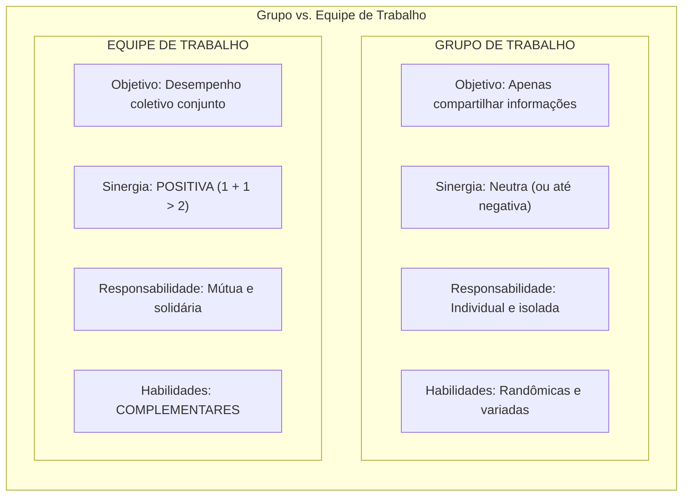
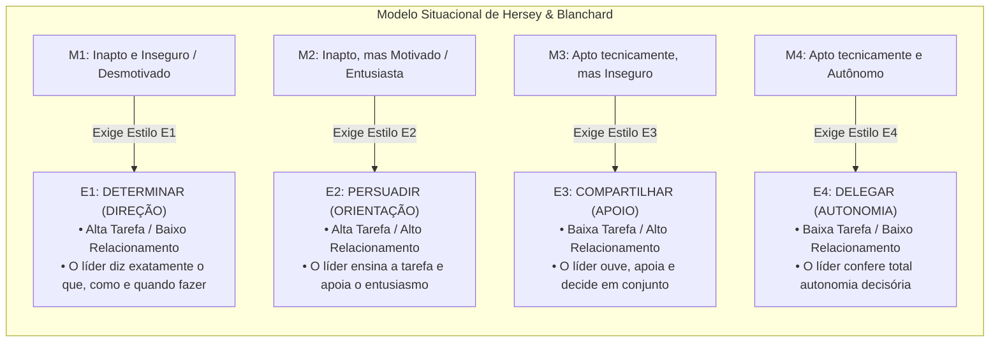
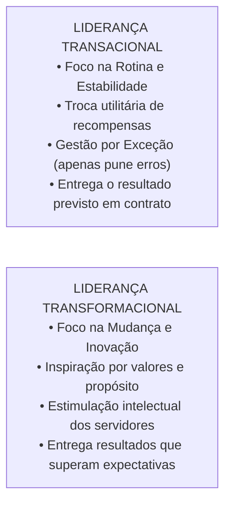
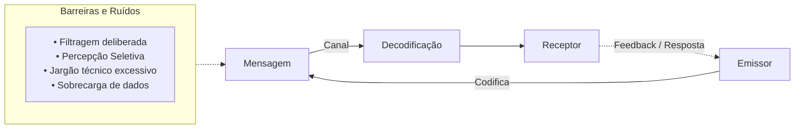

# 02 - Grupos, Equipes de Trabalho, Teorias da Liderança e Comunicação Organizacional

> **Matéria:** Comportamento Organizacional  
> **Cargo:** A01 – Técnico de Controle Externo – Especialidade: Técnico Administrativo  
> **Arquivo:** `02_grupos_equipes_lideranca_e_comunicacao_organizacional.md`  

---

## 📌 Ementa / Itens do Edital
- Grupos versus Equipes de Trabalho nas organizações:
  - Conceito de grupo (interação social para compartilhar informações) versus equipe de trabalho (sinergia positiva, esforço coordenado e responsabilidade mútua compartilhada);
  - Tipologia das equipes: equipes de resolução de problemas, equipes autogerenciadas, equipes multifuncionais (*cross-functional*) e equipes virtuais;
  - O modelo de desenvolvimento de grupos de Bruce Tuckman: Formação (*Forming*), Conflito/Tormenta (*Storming*), Normatização (*Norming*), Desempenho (*Performing*) e Desintegração (*Adjourning*);
- Teorias e Estilos de Liderança:
  - Conceito de liderança e a distinção clássica entre Líder (influência legítima conquistada) e Chefe/Gerente (autoridade formal outorgada);
  - Teoria dos Traços de Personalidade e suas limitações históricas;
  - Teorias Comportamentais: estilos clássicos de White e Lippitt (Autocrática, Democrática e Liberal / *Laissez-Faire*); o *Grid Gerencial* de Blake e Mouton (tarefa vs. pessoas);
  - Teorias Situacionais e Contingenciais:
    - O Modelo de Fred Fiedler (escala CMP e favorabilidade situacional);
    - A Teoria da Liderança Situacional de Paul Hersey e Kenneth Blanchard (maturidade dos liderados M1 a M4: Determinar, Persuadir, Compartilhar e Delegar);
    - Teoria Caminho-Meta (*Path-Goal*) de Robert House (diretivo, apoiador, participativo e orientado para conquista);
  - Abordagens Contemporâneas de Liderança:
    - Liderança Transacional (troca de recompensas contingentes e gestão por exceção) versus Liderança Transformacional (os 4 Is de Bass: influência idealizada, motivação inspiradora, estimulação intelectual e consideração individualizada);
    - Liderança Servidora (*Servant Leadership*) e Liderança Autêntica;
- Processo de Comunicação Organizacional:
  - Elementos do processo comunicacional: emissor, codificação, mensagem, canal, ruído, decodificação, receptor e *feedback*;
  - Fluxos e redes de comunicação: descendente, ascendente, horizontal/lateral e diagonal;
  - Barreiras à comunicação interpessoal: filtragem deliberada, percepção seletiva, sobrecarga informacional, desconfiança e barreiras semânticas.

---

## 🌳 Classificação Hierárquica

```text
2. Dinâmica de Grupos, Equipes, Liderança e Processo de Comunicação
├── 2.1 Grupos e Equipes de Trabalho
│   ├── 2.1.1 Grupo de Trabalho: Metas individuais, responsabilidade isolada e sinergia neutra ou negativa
│   ├── 2.1.2 Equipe de Trabalho: Desempenho coletivo, responsabilidade solidária mútua e SINERGIA POSITIVA
│   ├── 2.1.3 Tipos de Equipes: Autogerenciadas (alta autonomia), Multifuncionais (interdisciplinares) e Virtuais
│   └── 2.1.4 Ciclo de Desenvolvimento do Grupo (Modelo de Tuckman):
│       ├── 1. Formação (Forming): Incerteza inicial, testes e conhecimento mútuo
│       ├── 2. Tormenta / Conflito (Storming): Disputas internas por liderança e papéis
│       ├── 3. Normatização (Norming): Coesão grupal, camaradagem e regras consolidadas
│       ├── 4. Desempenho (Performing): Estrutura funcional e canalização de energia para as metas
│       └── 5. Desintegração / Encerramento (Adjourning): Conclusão dos trabalhos e dissolução do grupo
├── 2.2 Evolução das Teorias de Liderança
│   ├── 2.2.1 Teoria dos Traços (Quem o líder é?): Foco em traços físicos e intelectuais inatos (nascido líder)
│   ├── 2.2.2 Teorias Comportamentais (O que o líder faz?):
│   │   ├── Estilos de White e Lippitt: Autocrático (centralizador), Democrático (participativo) e Liberal (Laissez-Faire)
│   │   └── Grid Gerencial de Blake & Mouton: Matriz 9x9 (1.1 Empobrecido, 9.1 Tarefa, 1.9 Clube de Campo, 9.9 Equipe)
│   ├── 2.2.3 Teorias Contingenciais / Situacionais (Como a situação molda o líder?):
│   │   ├── Liderança Situacional de Hersey & Blanchard (Maturidade / Prontidão M1 a M4):
│   │   │   ├── M1 (Inapto / Inseguro) -> E1: DETERMINAR (Alta Tarefa / Baixo Relacionamento)
│   │   │   ├── M2 (Inapto / Motivado) -> E2: PERSUADIR (Alta Tarefa / Alto Relacionamento)
│   │   │   ├── M3 (Apto / Inseguro) -> E3: COMPARTILHAR (Baixa Tarefa / Alto Relacionamento)
│   │   │   └── M4 (Apto / Confiante) -> E4: DELEGAR (Baixa Tarefa / Baixo Relacionamento)
│   │   └── Teoria Caminho-Meta (Path-Goal - House): Líder desobstrui obstáculos no caminho da meta
│   └── 2.2.4 Liderança Contemporânea:
│       ├── Liderança Transacional: Recompensa contingente e gestão por exceção (foco na manutenção da rotina)
│       ├── Liderança Transformacional: Carisma, inspiração e visão (foco na superação e inovação)
│       └── Liderança Servidora: Foco primordial nas necessidades dos liderados e no valor público
└── 2.3 Comunicação Organizacional e Barreiras
    ├── 2.3.1 O Circuito da Comunicação: Emissor -> Codificação -> Canal (+ Ruído) -> Decodificação -> Receptor -> Feedback
    ├── 2.3.2 Direções dos Fluxos de Informação:
    │   ├── Fluxo Descendente: Políticas, instruções e ordens da chefia para a base
    │   ├── Fluxo Ascendente: Relatórios de desempenho, dúvidas, sugestões e queixas da base para o topo
    │   ├── Fluxo Horizontal / Lateral: Coordenação e cooperação entre colegas do mesmo escalão
    │   └── Fluxo Diagonal: Comunicação intersetorial entre diferentes níveis funcionais
    └── 2.3.3 Principais Barreiras Comunicacionais: Filtragem da informação, percepção seletiva e ruídos semânticos
```

---

## 📖 Resumo Teórico Aprofundado & Esquematizado

### 1. Grupos de Trabalho versus Equipes de Trabalho

A diferença entre grupo e equipe é uma das distinções conceituais mais cobradas pela FCC:



#### As Cinco Etapas de Desenvolvimento do Grupo (Bruce Tuckman):
1. **Formação (*Forming*):** Estágio caracterizado por grande incerteza quanto aos propósitos, normas e liderança do grupo. Os membros testam quais comportamentos são aceitáveis.
2. **Tormenta / Conflito (*Storming*):** Marcado por conflitos internos. Os membros aceitam o grupo, mas resistem às limitações que ele impõe à individualidade; disputam-se posições de liderança.
3. **Normatização (*Norming*):** Desenvolvem-se relacionamentos estreitos e forte coesão. Cria-se um senso de identidade grupal e normas claras de conduta.
4. **Desempenho (*Performing*):** A estrutura torna-se plenamente funcional e aceita por todos. A energia do grupo desloca-se do conhecimento mútuo para a execução focada das tarefas.
5. **Desintegração / Encerramento (*Adjourning*):** Aplica-se a equipes temporárias (comissões, forças-tarefa). O foco desloca-se do alto desempenho para a finalização das pendências e dissolução do grupo.

---

### 2. A Teoria da Liderança Situacional de Hersey e Blanchard

Paul Hersey e Kenneth Blanchard demonstraram que o líder de excelência não mantém um comportamento estático, mas sim **adapta seu estilo ao nível de maturidade (prontidão)** de seus subordinados:



---

### 3. Liderança Transacional vs. Liderança Transformacional



#### Os "4 Is" da Liderança Transformacional (Bernard Bass):
1. **Influência Idealizada (Carisma):** O líder serve de modelo ético e moral a ser seguido, despertando orgulho, respeito e lealdade nos subordinados.
2. **Motivação Inspiradora:** Comunica uma visão de futuro estimulante com otimismo contagiante, dando sentido e significado ao trabalho cotidiano.
3. **Estimulação Intelectual:** Incentiva os liderados a questionarem o *status quo*, repensarem métodos obsoletos e proporem soluções inovadoras sem medo de errar.
4. **Consideração Individualizada:** Dispensa atenção personalizada às necessidades singulares de crescimento de cada membro, atuando como mentor ou *coach*.

---

### 4. O Processo de Comunicação Organizacional e Barreiras



#### As Principais Barreiras Comunicacionais na Prova da FCC:
* **Filtragem:** Manipulação intencional da informação pelo emissor para que ela chegue ao superior de forma mais atraente ou menos prejudicial (ex.: auditor que esconde problemas crônicos para não gerar atrito com a chefia).
* **Percepção Seletiva:** O receptor enxerga e interpreta a mensagem através das lentes de seus próprios preconceitos, interesses, necessidades ou histórico pessoal.
* **Sobrecarga de Informação:** Ocorre quando o volume de comunicações recebido excede a capacidade cognitiva de processamento do indivíduo, provocando lentidão, estresse e omissão de dados essenciais.
* **Linguagem / Barreiras Semânticas:** Utilização de jargões técnicos excessivamente herméticos ou palavras com significados ambíguos que dificultam a decodificação da mensagem pelo interlocutor leigo.

---

## 🚨 Alertas de Prova & Pegadinhas da FCC

> 🚨 **ALERTA DE PROVA / PEGADINHA FCC (DELEGAÇÃO NA LIDERANÇA SITUACIONAL):**  
> Questão favorita da banca: afirmar que "o líder ideal deve sempre adotar o estilo de delegação, conferindo autonomia a todos os servidores subordinados". **FALSO!** A delegação só é correta e eficaz quando o liderado apresenta **maturidade M4** (alta competência técnica e alta disposição/confiança). Se delegar a um servidor novato M1 (sem conhecimento das rotinas), haverá falha e frustração. A liderança eficaz **depende da situação**!

> ⭐ **IMPORTANTE (SINERGIA POSITIVA EM EQUIPES):**  
> Em provas, lembre-se de que a **sinergia positiva ($1 + 1 > 2$)** é o traço distintivo das **Equipes de Trabalho**. Em meros **Grupos de Trabalho**, a sinergia é **neutra** (a soma dos desempenhos individuais é apenas a soma aritmética de cada um) ou até negativa.

> 🛑 **ATENÇÃO (FILTRAGEM NA COMUNICAÇÃO):**  
> Se a questão descrever um servidor que altera os relatórios antes de entregar ao diretor, omitindo dados negativos para que a situação pareça sob controle, o conceito técnico é a **FILTRAGEM** da informação!

> 📌 **NOTA EXPLICATIVA (LÍDER VS. GERENTE):**  
> O gerente tem **autoridade formal** outorgada pelo cargo; o líder possui **influência pessoal e legítima** conquistada pelo respeito e confiança das pessoas. Um chefe pode não ser líder, e um líder pode não ocupar cargo de chefia.

---

## 🌐 Fontes Oficiais e Referências Bibliográficas

* [ROBBINS, Stephen P.; JUDGE, Timothy A. Comportamento Organizacional. 18ª Edição. Editora Pearson.](https://www.pearson.com) - Capítulos sobre Grupos, Equipes, Liderança e Comunicação.
* [HERSEY, Paul; BLANCHARD, Kenneth H. Psicologia para Administradores: a teoria e as técnicas da liderança situacional. EPU.](https://www.grupogen.com.br).
* [BASS, Bernard M.; AVOLIO, Bruce J. Improving Organizational Effectiveness Through Transformational Leadership. SAGE Publications.](https://us.sagepub.com).
* [TUCKMAN, Bruce W. Developmental Sequence in Small Groups. Psychological Bulletin.](https://www.apa.org).
* [CHIAVENATO, Idalberto. Comportamento Organizacional: a dinâmica do sucesso das organizações. Atlas.](https://www.grupogen.com.br).

---

## 📝 Questões de Concurso FCC Comentadas

### Questão 01
**(FCC – TCE-PI – Auditor de Controle Externo)**  
A respeito da Teoria da Liderança Situacional proposta por Paul Hersey e Kenneth Blanchard, considere um grupo de servidores recém-aprovados em concurso público que acaba de ser lotado em uma gerência de fiscalização contábil. Os novos servidores apresentam grande entusiasmo e disposição para aprender, todavia desconhecem completamente as normas regimentais específicas e as ferramentas operacionais do sistema informatizado de controle externo (nível de maturidade M2). De acordo com a teoria, o estilo de liderança mais apropriado a ser adotado pelo gestor da unidade é:

* **A)** Estilo de Delegação (baixo comportamento de tarefa e baixo comportamento de relacionamento).
* **B)** Estilo de Persuasão / Orientação (alto comportamento de tarefa e alto comportamento de relacionamento).
* **C)** Estilo de Não Intervenção / Laissez-Faire (isenção de qualquer comando diretivo ou cobrança de metas).
* **D)** Estilo Apoiador Exclusivo (baixo comportamento de tarefa e alto comportamento de relacionamento).
* **E)** Estilo de Imposição Burocrática Inflexível sem concessão de explicações pedagógicas.

> **Gabarito: B**  
> **Comentário Detalhado:**  
> - **A) Incorreta.** Delegar (E4) aplica-se exclusivamente a liderados com maturidade M4 (altamente competentes e autônomos).  
> - **B) CORRETA.** No modelo de Hersey e Blanchard, liderados com nível de prontidão **M2** (possuem entusiasmo e motivação, mas ainda não têm competência técnica prática consolidada) exigem o estilo **E2 - Persuadir / Orientar / Vender**, que combina **alto comportamento de tarefa** (o líder ensina, direciona e dá instruções de trabalho) com **alto comportamento de relacionamento** (o líder apoia, dialoga e mantém acesa a motivação do servidor).  
> - **C) Incorreta.** Laissez-faire é a ausência de liderança, prejudicial para iniciantes.  
> - **D) Incorreta.** O estilo apoiador (E3) destina-se a pessoas aptas tecnicamente, mas inseguras (M3).  
> - **E) Incorreta.** O mero autoritarismo mina a motivação e não transmite competência.

---

### Questão 02
**(FCC – TCE-RS – Auditor de Controle Externo)**  
No âmbito dos estudos sobre liderança nas organizações contemporâneas, o modelo de Liderança Transformacional diferencia-se da Liderança Transacional fundamentalmente porque:

* **A)** A liderança transformacional fundamenta-se estritamente na concessão de incentivos financeiros contingentes ao atingimento das metas contratuais acordadas.
* **B)** O líder transformacional inspira e estimula seus seguidores a transcenderem seus interesses individuais em prol da missão e dos valores superiores da organização, promovendo profundas mudanças culturais.
* **C)** A liderança transacional rejeita qualquer tipo de recompensa ou cobrança de cumprimento de rotinas operacionais.
* **D)** O líder transformacional restringe sua atuação à gestão por exceção, intervindo unicamente quando ocorrem falhas graves na linha de montagem.
* **E)** A liderança transformacional é restrita a estruturas organizacionais mecanicistas e lineares do setor militar.

> **Gabarito: B**  
> **Comentário Detalhado:**  
> - **A) Incorreta.** O uso de incentivos pecuniários contingentes por metas pactuadas caracteriza a liderança **transacional**.  
> - **B) CORRETA.** A **Liderança Transformacional** vai além da troca transacional imediata; por meio dos quatro pilares clássicos (carisma, consideração individualizada, inspiração motivacional e estimulação intelectual), o líder transformacional motiva os seguidores a superarem seus interesses individuais em benefício do propósito coletivo da instituição, fomentando transformações culturais perenes.  
> - **C) Incorreta.** A liderança transacional apoia-se exatamente na cobrança de rotinas e trocas formais de incentivos.  
> - **D) Incorreta.** Gestão por exceção é atributo típico da liderança **transacional**.  
> - **E) Incorreta.** A liderança transformacional é amplamente aplicada e valorizada em órgãos públicos modernos e democráticos.

---

### Questão 03
**(FCC – TRT-2ª Região – Analista Judiciário: Área Administrativa)**  
De acordo com o modelo de desenvolvimento de pequenos grupos concebido por Bruce Tuckman, o estágio em que surgem conflitos explícitos entre os participantes, disputas internas pelo controle do grupo e resistências à liderança formal pré-estabelecida é denominado:

* **A)** Estágio de Formação (*Forming*).
* **B)** Estágio de Tormenta ou Conflito (*Storming*).
* **C)** Estágio de Normatização (*Norming*).
* **D)** Estágio de Desempenho (*Performing*).
* **E)** Estágio de Desintegração (*Adjourning*).

> **Gabarito: B**  
> **Comentário Detalhado:**  
> - **A) Incorreta.** Formação é a fase inicial de reconhecimento mútuo e incerteza.  
> - **B) CORRETA.** O estágio de **Tormenta (ou Conflito / *Storming*)** é caracterizado exatamente pelo surgimento de embates internos de poder e discordâncias quanto às regras; os participantes aceitam a existência do grupo, mas resistem ao controle exercido sobre eles e disputam a liderança até que a hierarquia de papéis se estabilize.  
> - **C) Incorreta.** Normatização é a fase posterior em que a coesão é restabelecida e surgem regras claras.  
> - **D) Incorreta.** Desempenho é a fase em que o grupo atinge a produtividade máxima e maturidade funcional.  
> - **E) Incorreta.** Desintegração é a fase final de dissolução do grupo após a entrega dos resultados.

---

### Questão 04
**(FCC – DPE-RS – Analista: Área Administrativa)**  
A respeito da distinção conceitual entre Grupos de Trabalho e Equipes de Trabalho segundo a literatura especializada de comportamento organizacional, assinale a opção correta:

* **A)** Em um grupo de trabalho, a responsabilidade pelos resultados é solidária e mútua entre todos os integrantes, inexistindo metas isoladas.
* **B)** As equipes de trabalho caracterizam-se por apresentar sinergia positiva, na qual o desempenho coletivo conjunto é superior à soma das contribuições individuais isoladas.
* **C)** Os grupos de trabalho dependem compulsoriamente de habilidades técnicas altamente complementares entre seus membros.
* **D)** Em uma equipe de trabalho, a sinergia é sempre neutra, limitando-se os integrantes a trocar informações de rotina sem compromisso mútuo com as metas.
* **E)** As equipes autogerenciadas são aquelas nas quais o gestor superior centraliza todas as decisões operacionais sem delegar autoridade aos membros.

> **Gabarito: B**  
> **Comentário Detalhado:**  
> - **A) Incorreta.** A responsabilidade no grupo de trabalho é puramente individual; na equipe é que ela é mútua e compartilhada.  
> - **B) CORRETA.** As **Equipes de Trabalho** caracterizam-se pela **sinergia positiva** ($1 + 1 > 2$), o que significa que o esforço coordenado e integrado dos membros resulta em um patamar de entrega e desempenho global muito superior à mera soma aritmética das ações individuais isoladas.  
> - **C) Incorreta.** As habilidades complementares são requisito essencial das **equipes**, ao passo que nos grupos as habilidades são aleatórias.  
> - **D) Incorreta.** A sinergia neutra e a mera troca de dados caracterizam os grupos, e não as equipes.  
> - **E) Incorreta.** As equipes autogerenciadas possuem altíssima autonomia decisória, operando sem supervisão direta diária.

---

### Questão 05
**(FCC – ARTESP – Especialista em Regulação de Transportes)**  
Durante a elaboração de um relatório de fiscalização, determinado analista deliberadamente omitiu informações cruciais sobre irregularidades graves na conservação da malha rodoviária, selecionando e apresentando apenas dados favoráveis à concessionária, com o objetivo expresso de evitar atritos com seu superior hierárquico e fazer com que o documento parecesse positivo. No processo de comunicação organizacional, a conduta desse servidor materializa a barreira denominada:

* **A)** Sobrecarga informacional.
* **B)** Filtragem da informação.
* **C)** Barreira de decodificação receptiva.
* **D)** Ruído semântico involuntário.
* **E)** Percepção sensorial dilatada.

> **Gabarito: B**  
> **Comentário Detalhado:**  
> - **A) Incorreta.** Sobrecarga ocorre quando o volume de dados ultrapassa a capacidade de processamento mental.  
> - **B) CORRETA.** A **Filtragem** é a manipulação deliberada da mensagem pelo emissor para que ela seja vista de modo mais favorável pelo receptor (muito comum em organizações hierarquizadas quando o subordinado omite más notícias para agradar a chefia ou não se indispor com superiores).  
> - **C) Incorreta.** A omissão partiu do emissor no momento do envio, e não da decodificação pelo receptor.  
> - **D) Incorreta.** Ruídos semânticos dizem respeito a palavras ambíguas ou jargões incompreendidos, sem má-fé deliberada.  
> - **E) Incorreta.** Conceito sem pertinência técnica com o processo de comunicação.
