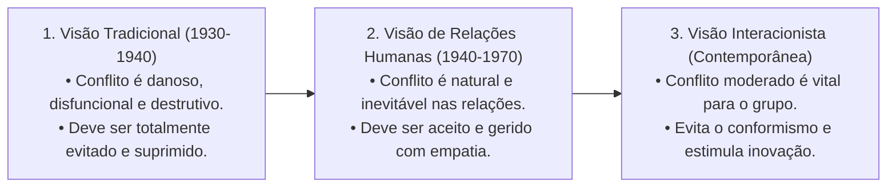
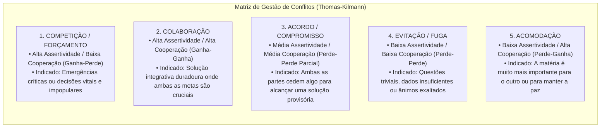
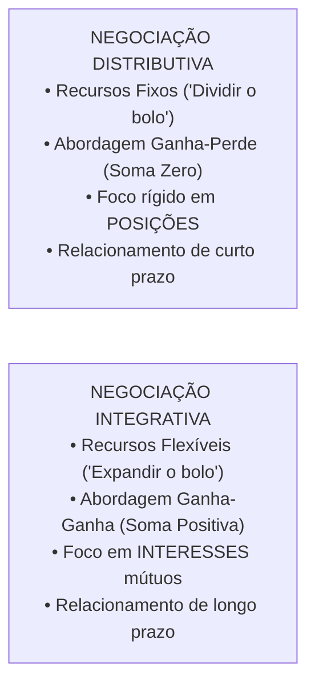
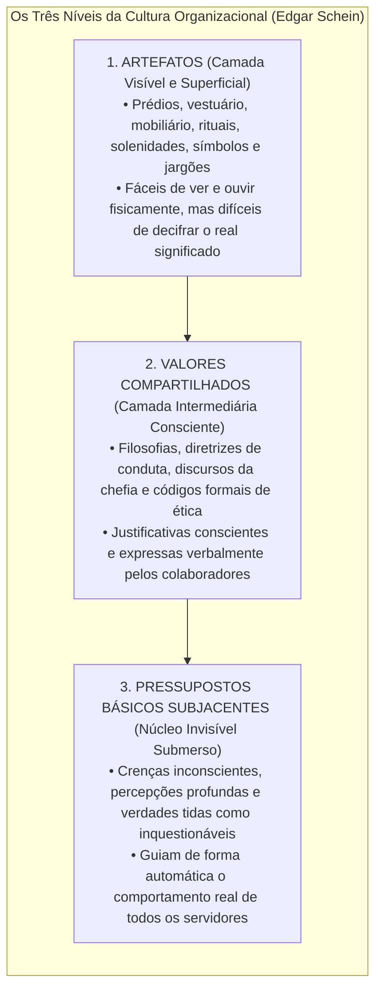
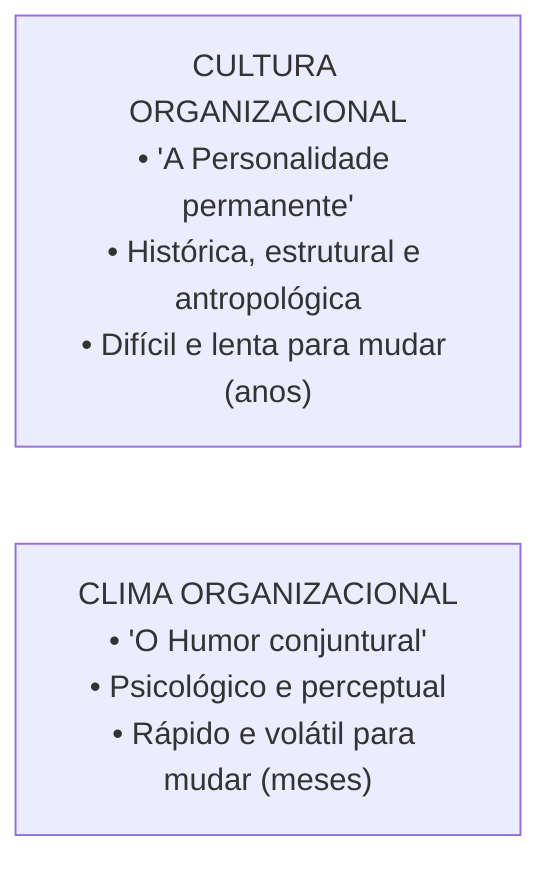
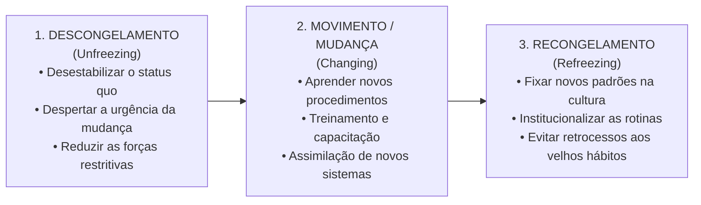

# 03 - Conflito, Negociação, Cultura, Clima e Desenvolvimento Organizacional

> **Matéria:** Comportamento Organizacional  
> **Cargo:** A01 – Técnico de Controle Externo – Especialidade: Técnico Administrativo  
> **Arquivo:** `03_conflito_negociacao_cultura_clima_e_desenvolvimento_organizacional.md`  

---

## 📌 Ementa / Itens do Edital
- Conflito Organizacional:
    - Evolução das correntes teóricas sobre o conflito: Visão Tradicional (disfuncional e prejudicial), Visão de Relações Humanas (natural e inevitável) e Visão Interacionista (positivo e indispensável para evitar acomodação);
    - Conflito Funcional (construtivo, fomenta inovação e debate sadio) versus Conflito Disfuncional (destrutivo, desagrega equipes e bloqueia metas);
    - Tipos de conflito por conteúdo: Conflito de Tarefa, Conflito de Processo e Conflito de Relacionamento (quase sempre disfuncional);
    - Estilos de gestão de conflitos no modelo bidimensional de Kenneth Thomas e Ralph Kilmann (Competição/Forçamento, Colaboração, Acordo/Compromisso, Evitação/Fuga e Acomodação);
- Técnicas de Negociação Organizacional:
    - Negociação Distributiva (modelo "ganha-perde", soma zero, foco em posições antagônicas e partilha de recursos fixos);
    - Negociação Integrativa (modelo "ganha-ganha", expansão do valor global, foco nos interesses mútuos subjacentes e relacionamentos duradouros);
    - Zona de Possível Acordo (ZOPA) e Melhor Alternativa para um Acordo Negociado (MAPAN / BATNA - *Best Alternative to a Negotiated Agreement*);
- Cultura Organizacional:
    - Conceito, funções, transmissão cultural (histórias, rituais, símbolos materiais e linguagem);
    - Os três níveis da cultura organizacional de Edgar Schein: Artefatos (superficiais e visíveis), Valores Compartilhados (justificativas conscientes) e Pressupostos Básicos Subjacentes (núcleo invisível e inquestionável);
    - Culturas organizacionais fortes versus culturas fracas;
- Clima Organizacional:
    - Definição: atmosfera psicológica e percepções compartilhadas dos membros sobre o ambiente funcional;
    - Diferenças fundamentais entre Cultura (permanente, antropológica e duradoura) e Clima (mutável, conjuntural e reflexo do momento);
- Desenvolvimento Organizacional (DO) e Gestão da Mudança:
    - O modelo de mudança planejada em três fases de Kurt Lewin: Descongelamento (*Unfreezing*), Mudança/Movimento (*Moving*) e Recongelamento (*Refreezing*);
    - Análise do Campo de Forças de Lewin: forças propulsoras/impulsoras versus forças restritivas;
    - Fontes de resistência à mudança individuais e organizacionais.

---

## 🧭 Sumário Interativo
- [1. Evolução Teórica do Conflito e Tipologias por Conteúdo](#1-evolução-teórica-do-conflito-e-tipologias-por-conteúdo)
- [2. Estilos de Administração de Conflitos (Thomas-Kilmann)](#2-estilos-de-administração-de-conflitos-thomas-kilmann)
- [3. Técnicas de Negociação: Distributiva vs. Integrativa (Modelo Harvard)](#3-técnicas-de-negociação-distributiva-vs-integrativa-modelo-harvard)
- [4. Cultura Organizacional e os Três Níveis de Edgar Schein](#4-cultura-organizacional-e-os-três-níveis-de-edgar-schein)
- [5. Cultura Organizacional versus Clima Organizacional](#5-cultura-organizacional-versus-clima-organizacional)
- [6. Desenvolvimento Organizacional e Gestão da Mudança (Kurt Lewin)](#6-desenvolvimento-organizacional-e-gestão-da-mudança-kurt-lewin)
- [7. Fontes Oficiais e Referências Bibliográficas](#7-fontes-oficiais-e-referências-bibliográficas)
- [8. Questões de Concurso FCC Comentadas](#8-questões-de-concurso-fcc-comentadas)

---

## 📖 Resumo Teórico Aprofundado & Esquematizado

### 1. Evolução Teórica do Conflito e Tipologias por Conteúdo

O conflito é um processo que se inicia quando uma das partes percebe que a outra afetou ou está prestes a afetar negativamente algo que lhe é importante. A compreensão do conflito evoluiu em três correntes históricas fundamentais:

* **Conflito Funcional (Construtivo):** Apoia as metas organizacionais, desafia o conformismo, promove a revisão crítica de rotinas ultrapassadas e aperfeiçoa as decisões da equipe.
* **Conflito Disfuncional (Destrutivo):** Atrapalha o desempenho da instituição, alimenta hostilidades pessoais, reduz a comunicação interna, destrói a coesão e paralisa as entregas de valor público.

#### Classificação dos Conflitos por Conteúdo:
1. **Conflito de Tarefa:** Envolve divergências quanto ao conteúdo, às metas e aos resultados almejados no trabalho. Em níveis moderados, costuma ser **funcional e positivo** para o surgimento de novas ideias.
2. **Conflito de Processo:** Refere-se a divergências sobre *como* o trabalho deve ser executado e quem deve assumir cada responsabilidade operacional. Costuma ser produtivo apenas em níveis muito baixos.
3. **Conflito de Relacionamento:** Focado em incompatibilidades interpessoais, antipatias afetivas e atritos emocionais entre servidores. É **quase invariavelmente DISFUNCIONAL**, desestabilizando o ambiente e destruindo a cooperação mútua.

> 🛑 **ATENÇÃO (O CONFLITO DE RELACIONAMENTO É DISFUNCIONAL):**  
> A visão interacionista afirma que o conflito de tarefas pode ser funcional, mas alerta categoricamente que o **conflito de relacionamento (interpessoal/afetivo) é quase sempre DISFUNCIONAL**, pois desgasta a convivência, destrói a confiança mútua e paralisa as entregas públicas!

---

### 2. Estilos de Administração de Conflitos (Thomas-Kilmann)

Kenneth Thomas e Ralph Kilmann estruturaram a resolução de conflitos sobre dois eixos comportamentais fundamentais: **Assertividade** (grau em que o sujeito busca fazer valer seus próprios interesses) e **Cooperatividade** (grau em que busca atender às necessidades da contraparte):

---

### 3. Técnicas de Negociação: Distributiva vs. Integrativa (Modelo Harvard)

A negociação é um processo dialógico de tomada de decisão conjunta em que duas ou mais partes interdependentes procuram formular um acordo:

#### Fundamentos do Projeto de Negociação de Harvard:
1. **Separar as Pessoas do Problema:** Ser firme e assertivo com o conteúdo da divergência, porém empático, cordial e respeitoso com o interlocutor.
2. **Focar nos Interesses, não nas Posições:** As **posições** correspondem àquilo que as partes declaram verbalmente que querem; os **interesses** expressam as necessidades reais, motivações e anseios subjacentes que motivam tais posições.
3. **Criar Opções de Ganho Mútuo:** Exercício de criatividade conjunta antes de bater o martelo para encontrar soluções que agreguem valor para ambos os lados.
4. **ZOPA (Zona de Possível Acordo):** Faixa de intersecção compreendida entre os valores de reserva (pontos de recuo) dos negociadores. Havendo sobreposição favorável, a ZOPA é positiva e existe viabilidade negocial concreta.
5. **BATNA / MAPAN (*Best Alternative to a Negotiated Agreement* / Melhor Alternativa para um Acordo Negociado):** A melhor opção de contingência que o negociador possui fora da mesa se as tratativas terminarem sem consenso. Quanto mais forte e atrativo for o BATNA, maior será o poder de barganha do negociador.

---

### 4. Cultura Organizacional e os Três Níveis de Edgar Schein

A cultura organizacional é o sistema de significados compartilhados, valores, crenças e normas que diferenciam uma instituição de todas as outras. Edgar Schein concebeu a cultura como uma estrutura em camadas, assemelhada a um *iceberg*:

1. **Artefatos:** Manifestações físicas, visuais e auditivas observáveis (o modelo de mesas no TCE-GO, o uniforme, a forma de tratamento entre os servidores, a tecnologia em uso). São fáceis de constatar, mas a interpretação de seu significado profundo exige cautela analítica.
2. **Valores Compartilhados:** Valores conscientemente explicitados, regras de convivência social e discursos oficiais adotados pelos líderes para justificar suas decisões.
3. **Pressupostos Básicos Subjacentes:** O núcleo central e mais profundo da cultura. São verdades tão enraizadas e óbvias para o grupo que já se tornaram automáticas, inconscientes e inquestionáveis, ditando como os membros percebem a realidade e agem no cotidiano.

> 🚨 **ALERTA DE PROVA / PEGADINHA FCC (PRESSUPOSTOS BÁSICOS DE SCHEIN):**  
> Questão predileta da FCC: afirmar que "os pressupostos básicos da cultura organizacional são formalmente redigidos no código de ética e afixados nos murais da entidade". **FALSO!** Códigos formais e murais são **Artefatos** ou **Valores Compartilhados** expressos. Os **Pressupostos Básicos Subjacentes** são **inconscientes, tácitos e invisíveis**, operando de modo automático e natural na mente dos membros!

---

### 5. Cultura Organizacional versus Clima Organizacional

#### Tabela Comparativa Analítica:

| Dimensão | Cultura Organizacional | Clima Organizacional |
| :--- | :--- | :--- |
| **Origem e Natureza** | Histórica, antropológica e estrutural da organização. | Psicológica, conjuntural e perceptual dos servidores. |
| **Estabilidade no Tempo** | **Perene e altamente estável:** Demora décadas para se enraizar e anos para se transformar. | **Transitório e volátil:** Pode mudar rapidamente com a troca de um diretor, reformas prediais ou novo plano salarial. |
| **Objeto de Análise** | Valores morais, crenças, mitos, rituais e pressupostos básicos inconscientes. | Sentimentos, motivação momentânea e percepções compartilhadas sobre o ambiente de trabalho. |
| **Metáfora Clássica** | É o **DNA e a Personalidade** duradoura da instituição. | É o **Estado de Espírito e o Humor** momentâneo da equipe. |

> ⭐ **IMPORTANTE (CULTURA VS. CLIMA ORGANIZACIONAL):**  
> - Se o enunciado relatar o moral da equipe, a atmosfera vivenciada após uma nomeação ou o nível momentâneo de entusiasmo com um bônus: trata-se de **CLIMA**.  
> - Se relatar tradições institucionais de décadas, rituais históricos consolidados, crenças profundas e valores compartilhados: trata-se de **CULTURA**.

---

### 6. Desenvolvimento Organizacional e Gestão da Mudança (Kurt Lewin)

O Desenvolvimento Organizacional (DO) é uma abordagem planejada de longo prazo voltada para transformar as atitudes, valores, processos e estruturas da organização, assegurando sua adaptabilidade contínua.

Kurt Lewin formulou o clássico **Modelo de Mudança Planejada em Três Fases**:

1. **Descongelamento (*Unfreezing*):** A liderança quebra a inércia e desafia o *status quo* vigente, conscientizando os servidores de que as rotinas antigas estão superadas, criando a prontidão psicológica indispensável para a mudança.
2. **Movimento / Mudança (*Changing*):** Fase de transição e implementação prática; os servidores recebem capacitação, assimilam novos softwares e passam a adotar novos processos de trabalho.
3. **Recongelamento (*Refreezing*):** Estabilização e institucionalização das novas práticas no cotidiano e na cultura do órgão, assegurando que o novo padrão se torne permanente e evitando a regressão aos velhos hábitos.
* **Análise do Campo de Forças (Lewin):** Toda mudança organizacional decorre do equilíbrio dinâmico entre **Forças Propulsoras/Impulsoras** (que estimulam a transformação) e **Forças Restritivas** (que resistem à inovação e buscam manter a inércia). Gestores eficientes concentram esforços em **atenuar e reduzir as forças restritivas**, mitigando o medo do desconhecido e o estresse da equipe.

> 📌 **NOTA EXPLICATIVA (O PAPEL DO RECONGELAMENTO DE LEWIN):**  
> Sem a terceira etapa de **Recongelamento**, a organização sofre regressão natural aos velhos hábitos assim que a pressão inicial da chefia diminui. Recongelar significa institucionalizar as novas rotinas e premiar a conformidade com o novo padrão.

---

### 7. Fontes Oficiais e Referências Bibliográficas

* [SCHEIN, Edgar H. Cultura Organizacional e Liderança. Editora Atlas.](https://www.grupogen.com.br) - A teoria dos três níveis da cultura.
* [LEWIN, Kurt. Teoria de Campo em Ciência Social. Pioneira Thomson Learning.](https://www.grupogen.com.br) - Modelo de mudança planejada.
* [ROBBINS, Stephen P.; JUDGE, Timothy A. Comportamento Organizacional. Pearson.](https://www.pearson.com) - Conflitos, negociação e cultura.
* [FISHER, Roger; URY, William; PATTON, Bruce. Como Chegar ao Sim: a negociação baseada em princípios. Editora Sextante.](https://www.sextante.com.br).
* [THOMAS, Kenneth W.; KILMANN, Ralph H. Conflict Mode Instrument (TKI)](https://kilmanndiagnostics.com) - Estilos de conflito.

---

### 8. Questões de Concurso FCC Comentadas

### Questão 01
**(FCC – TCE-PI – Auditor de Controle Externo)**  
Segundo a teoria dos níveis da cultura organizacional desenvolvida por Edgar Schein, os elementos mais profundos, enraizados e invisíveis da cultura, constituídos por crenças e percepções tidas como verdades absolutas e inquestionáveis que orientam o comportamento dos colaboradores sem que eles sequer tomem consciência disso, denominam-se:

* **A)** Artefatos visíveis.
* **B)** Valores compartilhados adotados.
* **C)** Símbolos materiais e cerimoniais.
* **D)** Pressupostos básicos subjacentes.
* **E)** Códigos formais de ética institucional.

> **Comentário Detalhado:**  
> - **A) Incorreta.** Artefatos são os elementos superficiais e plenamente visíveis da cultura (prédios, vestuário, mobília, slogans).  
> - **B) Incorreta.** Valores compartilhados são premissas conscientes verbalizadas pela liderança.  
> - **C) Incorreta.** Símbolos materiais integram o nível dos artefatos.  
> - **D) CORRETA.** No modelo concebido por Edgar Schein, o nível mais profundo do *iceberg* cultural é composto pelos **Pressupostos Básicos Subjacentes**, que representam crenças inconscientes, valores internalizados e verdades tidas como certas e inquestionáveis, as quais moldam a forma como a organização percebe e reage ao ambiente.  
> - **E) Incorreta.** Códigos de ética são documentos normativos formais e conscientes (valores/artefatos).  
> 
> **Gabarito: D**

---

### Questão 02
**(FCC – TCE-RS – Auditor de Controle Externo)**  
No modelo clássico de gestão da mudança organizacional formulado por Kurt Lewin, a fase em que a liderança da instituição cria intencionalmente a necessidade percebida de mudança, desestabilizando o *status quo* vigente e quebrando velhos hábitos arraigados na equipe para prepará-la para o aprendizado de novas práticas operacionais, é denominada:

* **A)** Descongelamento (*Unfreezing*).
* **B)** Recongelamento (*Refreezing*).
* **C)** Movimento (*Moving*).
* **D)** Entropia negativa.
* **E)** Institucionalização de valor.

> **Comentário Detalhado:**  
> - **A) CORRETA.** A fase de **Descongelamento (*Unfreezing*)** no modelo de Kurt Lewin visa precisamente desafiar e quebrar a inércia do *status quo*, conscientizando os servidores de que os procedimentos atuais são obsoletos ou ineficazes e gerando a prontidão psicológica indispensável para assimilar novos hábitos.  
> - **B) Incorreta.** O recongelamento é a fase final de estabilização e padronização da nova conduta aprendida.  
> - **C) Incorreta.** O movimento é a etapa intermediária de transição e assimilação dos novos métodos.  
> - **D) Incorreta.** Entropia negativa é conceito da Teoria Geral dos Sistemas.  
> - **E) Incorreta.** Termo sem pertinência com o modelo tridimensional de Lewin.  
> 
> **Gabarito: A**

---

### Questão 03
**(FCC – TRT-2ª Região – Analista Judiciário: Área Administrativa)**  
A respeito da diferença essencial entre Cultura Organizacional e Clima Organizacional, assinale a afirmativa correta:

* **A)** O clima organizacional é duradouro e perene, demandando décadas de história para ser alterado, ao passo que a cultura organizacional é efêmera e flutua semanalmente.
* **B)** A cultura organizacional reflete as percepções momentâneas e o estado de ânimo conjuntural dos colaboradores, ao passo que o clima constitui o DNA estrutural da entidade.
* **C)** A cultura organizacional é a personalidade e o alicerce antropológico profundo da instituição, enquanto o clima organizacional é a atmosfera psicológica conjuntural e perceptual do momento.
* **D)** A cultura e o clima são termos estritamente sinônimos na teoria das organizações, distinguindo-se apenas quanto ao nível hierárquico dos avaliados.
* **E)** O clima organizacional manifesta-se exclusivamente através dos pressupostos básicos subjacentes inconscientes descritos por Edgar Schein.

> **Comentário Detalhado:**  
> - **A) Incorreta.** A cultura é duradoura e perene; o clima é transitório e mutável.  
> - **B) Incorreta.** A questão inverteu os conceitos de cultura e clima.  
> - **C) CORRETA.** A **Cultura Organizacional** corresponde ao DNA, à personalidade estável e aos valores históricos da instituição; o **Clima Organizacional** traduz o estado de espírito, o "humor" momentâneo e as percepções transitórias compartilhadas pelos servidores em dado período (como após uma reestruturação ou atraso salarial).  
> - **D) Incorreta.** Não são sinônimos; possuem fundamentos conceituais e horizontes temporais distintos.  
> - **E) Incorreta.** Os pressupostos básicos subjacentes pertencem ao núcleo da **cultura organizacional**.  
> 
> **Gabarito: C**

---

### Questão 04
**(FCC – DPE-RS – Analista: Área Administrativa)**  
No âmbito da teoria contemporânea de gestão de conflitos, a abordagem Interacionista defende que:

* **A)** Todo conflito em qualquer nível é intrinsicamente danoso e prejudicial à eficácia da instituição, devendo ser erradicado sumariamente pela chefia.
* **B)** A ausência absoluta de conflitos é o indicador supremo de maturidade e inovação contínua de uma organização.
* **C)** Um nível controlado de conflito funcional de tarefas deve ser incentivado, pois estimula a autocrítica, desafia ideias acomodadas e fomenta a criatividade e a inovação.
* **D)** Os conflitos de relacionamento interpessoal devem ser estimulados pela direção para desarticular a coesão de grupos corporativos informais.
* **E)** As organizações que operam sob a abordagem interacionista eliminam a figura do líder para permitir conflitos ilimitados e irrestritos.

> **Comentário Detalhado:**  
> - **A) Incorreta.** Essa é a Visão Tradicional do conflito (anos 1930/40).  
> - **B) Incorreta.** A ausência total de conflitos sinaliza apatia, estagnação e pensamento grupal acrítico (*groupthink*).  
> - **C) CORRETA.** A **Visão Interacionista** preconiza que um nível **mínimo e moderado de conflito funcional** (focado no conteúdo das tarefas) é saudável e indispensável para manter o grupo vivo, criativo e inovador, impedindo que a equipe caia na estagnação e no comodismo.  
> - **D) Incorreta.** O conflito de relacionamento (choque interpessoal) é quase sempre disfuncional e altamente prejudicial à cooperação.  
> - **E) Incorreta.** O conflito interacionista deve ser monitorado e gerido por lideranças competentes.  
> 
> **Gabarito: C**

---

### Questão 05
**(FCC – ARTESP – Especialista em Regulação de Transportes)**  
Durante uma negociação contratual complexa entre um órgão público e uma empresa concessionária de serviços, as partes optaram por adotar os preceitos da Negociação Integrativa (*Ganha-Ganha*). Essa modalidade negocial caracteriza-se essencialmente por:

* **A)** Focar exclusivamente na defesa intransigente de posições antagônicas pré-fixadas e na partilha de recursos fixos em regime de soma zero.
* **B)** Buscar a expansão do valor total disponível e a construção de soluções colaborativas que atendam aos interesses subjacentes de ambas as partes, preservando o relacionamento de longo prazo.
* **C)** Exigir que uma das partes capitule integralmente em suas pretensões econômicas em favor da outra para viabilizar o acordo.
* **D)** Eliminar a Zona de Possível Acordo (ZOPA) e desconsiderar o valor de reserva estipulado no termo de referência.
* **E)** Restringir-se a transações mercantis esporádicas de compra imediata, nas quais a única variável relevante é o menor preço à vista.

> **Comentário Detalhado:**  
> - **A) Incorreta.** Foco em posições fixas e partilha de soma zero caracterizam a negociação **distributiva**.  
> - **B) CORRETA.** A **Negociação Integrativa (Ganha-Ganha / *Win-Win*)** foca nos **interesses subjacentes** mútuos das partes, buscando "aumentar o bolo" (criar valor conjunto) por meio de opções criativas que satisfaçam as necessidades de ambos os lados e fortaleçam a parceria institucional de longo prazo.  
> - **C) Incorreta.** Capitulação unilateral corresponde ao estilo de acomodação ou perda forçada, oposto ao ganha-ganha.  
> - **D) Incorreta.** A negociação bem-sucedida pressupõe a existência e aproveitamento de uma ZOPA positiva.  
> - **E) Incorreta.** Transações frias baseadas unicamente no preço caracterizam a negociação distributiva transacional.  
> 
> **Gabarito: B**
