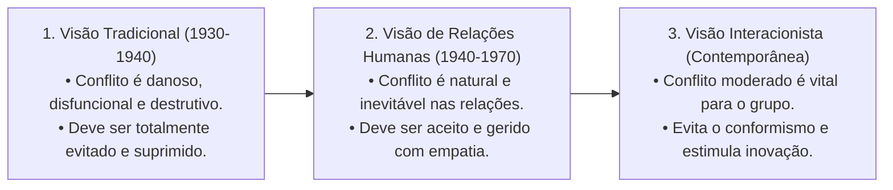
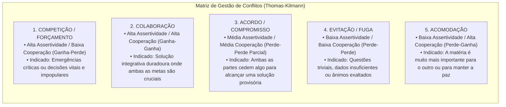
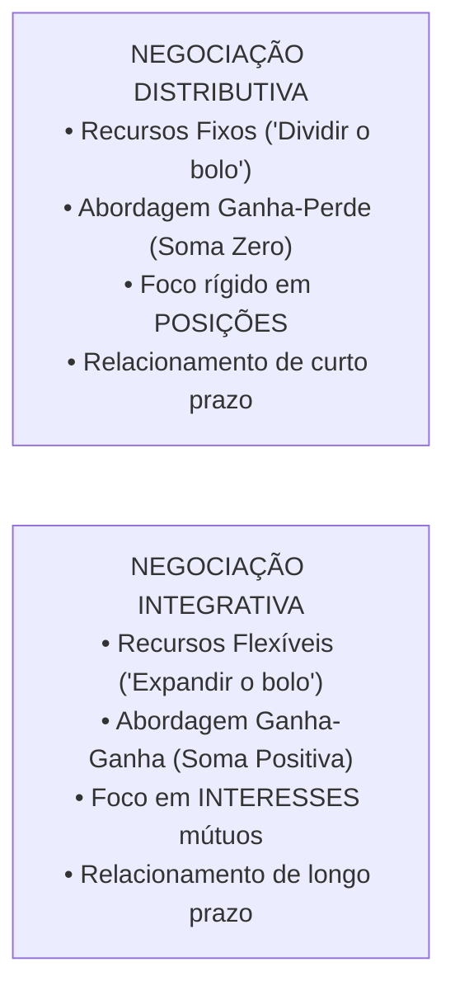
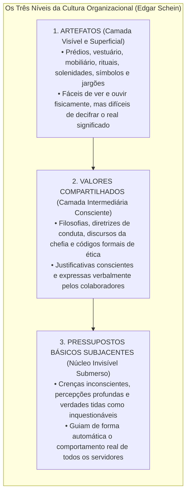
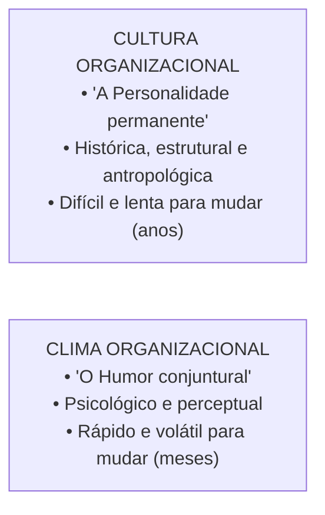
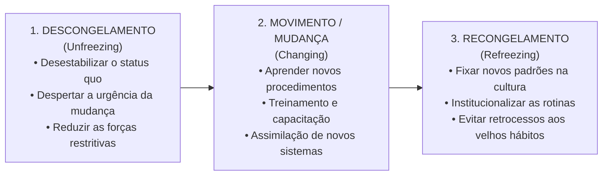

# 03 - Conflito, Negociação, Cultura, Clima e Desenvolvimento Organizacional

> **Matéria:** Comportamento Organizacional  
> **Cargo:** A01 – Técnico de Controle Externo – Especialidade: Técnico Administrativo  
> **Arquivo:** `03_conflito_negociacao_cultura_clima_e_desenvolvimento_organizacional.md`  

---

## 📌 Ementa / Itens do Edital
- Conflito Organizacional:
    - Evolução das correntes teóricas sobre o conflito: Visão Tradicional (disfuncional e prejudicial), Visão de Relações Humanas (natural e inevitável) e Visão Interacionista (positivo e indispensável para evitar acomodação);
    - Conflito Funcional (construtivo, fomenta inovação e debate sadio) versus Conflito Disfuncional (destrutivo, desagrega equipes e bloqueia metas);
    - Tipos de conflito por conteúdo: Conflito de Tarefa, Conflito de Processo e Conflito de Relacionamento (quase sempre disfuncional);
    - Estilos de gestão de conflitos no modelo bidimensional de Kenneth Thomas e Ralph Kilmann (Competição/Forçamento, Colaboração, Acordo/Compromisso, Evitação/Fuga e Acomodação);
- Técnicas de Negociação Organizacional:
    - Negociação Distributiva (modelo "ganha-perde", soma zero, foco em posições antagônicas e partilha de recursos fixos);
    - Negociação Integrativa (modelo "ganha-ganha", expansão do valor global, foco nos interesses mútuos subjacentes e relacionamentos duradouros);
    - Zona de Possível Acordo (ZOPA) e Melhor Alternativa para um Acordo Negociado (MAPAN / BATNA - *Best Alternative to a Negotiated Agreement*);
- Cultura Organizacional:
    - Conceito, funções, transmissão cultural (histórias, rituais, símbolos materiais e linguagem);
    - Os três níveis da cultura organizacional de Edgar Schein: Artefatos (superficiais e visíveis), Valores Compartilhados (justificativas conscientes) e Pressupostos Básicos Subjacentes (núcleo invisível e inquestionável);
    - Culturas organizacionais fortes versus culturas fracas;
- Clima Organizacional:
    - Definição: atmosfera psicológica e percepções compartilhadas dos membros sobre o ambiente funcional;
    - Diferenças fundamentais entre Cultura (permanente, antropológica e duradoura) e Clima (mutável, conjuntural e reflexo do momento);
- Desenvolvimento Organizacional (DO) e Gestão da Mudança:
    - O modelo de mudança planejada em três fases de Kurt Lewin: Descongelamento (*Unfreezing*), Mudança/Movimento (*Moving*) e Recongelamento (*Refreezing*);
    - Análise do Campo de Forças de Lewin: forças propulsoras/impulsoras versus forças restritivas;
    - Fontes de resistência à mudança individuais e organizacionais.

---

## 🧭 Sumário

1. [Evolução Teórica do Conflito e Tipologias por Conteúdo](#1-evolucao-teorica-do-conflito-e-tipologias-por-conteudo)
    1. [Teste 420](#Teste-420)
    2. [Teste 421](#Teste-421)
2. [Estilos de Administração de Conflitos (Thomas-Kilmann)](#2-estilos-de-administracao-de-conflitos-thomas-kilmann)
    1. [Teste 422](#Teste-422)
3. [Técnicas de Negociação: Distributiva vs. Integrativa (Modelo Harvard)](#3-tecnicas-de-negociacao-distributiva-vs-integrativa-modelo-harvard)
    1. [Teste 423](#Teste-423)
    2. [Teste 424](#Teste-424)
4. [Cultura Organizacional e os Três Níveis de Edgar Schein](#4-cultura-organizacional-e-os-tres-niveis-de-edgar-schein)
    1. [Teste 425](#Teste-425)
5. [Cultura Organizacional versus Clima Organizacional](#5-cultura-organizacional-versus-clima-organizacional)
    1. [Teste 426](#Teste-426)
6. [Desenvolvimento Organizacional e Gestão da Mudança (Kurt Lewin)](#6-desenvolvimento-organizacional-e-gestao-da-mudanca-kurt-lewin)
    1. [Teste 427](#Teste-427)
    2. [Teste 428](#Teste-428)
    3. [Teste 429](#Teste-429)
7. [Fontes Oficiais e Referências Bibliográficas](#7-fontes-oficiais-e-referencias-bibliograficas)

---

## 1. Evolução Teórica do Conflito e Tipologias por Conteúdo

O conflito é um processo que se inicia quando uma das partes percebe que a outra afetou ou está prestes a afetar negativamente algo que lhe é importante. A compreensão do conflito evoluiu em três correntes históricas fundamentais:

* **Conflito Funcional (Construtivo):** Apoia as metas organizacionais, desafia o conformismo, promove a revisão crítica de rotinas ultrapassadas e aperfeiçoa as decisões da equipe.
* **Conflito Disfuncional (Destrutivo):** Atrapalha o desempenho da instituição, alimenta hostilidades pessoais, reduz a comunicação interna, destrói a coesão e paralisa as entregas de valor público.

#### Classificação dos Conflitos por Conteúdo:
1. **Conflito de Tarefa:** Envolve divergências quanto ao conteúdo, às metas e aos resultados almejados no trabalho. Em níveis moderados, costuma ser **funcional e positivo** para o surgimento de novas ideias.
2. **Conflito de Processo:** Refere-se a divergências sobre *como* o trabalho deve ser executado e quem deve assumir cada responsabilidade operacional. Costuma ser produtivo apenas em níveis muito baixos.
3. **Conflito de Relacionamento:** Focado em incompatibilidades interpessoais, antipatias afetivas e atritos emocionais entre servidores. É **quase invariavelmente DISFUNCIONAL**, desestabilizando o ambiente e destruindo a cooperação mútua.

> 🛑 **ATENÇÃO (O CONFLITO DE RELACIONAMENTO É DISFUNCIONAL):**  
> A visão interacionista afirma que o conflito de tarefas pode ser funcional, mas alerta categoricamente que o **conflito de relacionamento (interpessoal/afetivo) é quase sempre DISFUNCIONAL**, pois desgasta a convivência, destrói a confiança mútua e paralisa as entregas públicas!

---

### Teste 420
**(FGV – TRT-DA 24-REGIÃO – Analista Judiciário - Tecnologia da Informação – 2025)**
A posse dar-se-á pela assinatura do respectivo termo, no qual 
deverão constar as atribuições, os deveres, as responsabilidades e 
os direitos inerentes ao cargo ocupado, que não poderão ser 
alterados unilateralmente, por qualquer das partes, ressalvados os 
atos de ofício previstos em lei. 
Sobre a posse, considerando as disposições da Lei n.° 8.112/1990, 
analise as afirmativas a seguir. 
I. A posse ocorrerá no prazo de trinta dias contados da 
publicação do ato de provimento. 
II. A posse poderá se dar mediante procuração específica. 
III. No ato da posse, o servidor apresentará declaração de bens e 
valores que constituem seu patrimônio e declaração quanto ao 
exercício ou não de outro cargo, emprego ou função pública. 
Está correto o que se afirma em

* **A)** I, apenas.
* **B)** I e II, apenas.
* **C)** I e III, apenas.
* **D)** II e III, apenas.
* **E)** I, II e III.

---

> **Comentário Detalhado:**
>
> - **A)** Incorreta. Discrepa das diretrizes normativas e jurisprudenciais aplicáveis ao tema objeto do item.
> - **B)** Incorreta. Discrepa das diretrizes normativas e jurisprudenciais aplicáveis ao tema objeto do item.
> - **C)** Correta. Representa com precisão a disciplina do tema e o entendimento pacificado adotado pela banca (FGV).
> - **D)** Incorreta. Discrepa das diretrizes normativas e jurisprudenciais aplicáveis ao tema objeto do item.
> - **E)** Incorreta. Discrepa das diretrizes normativas e jurisprudenciais aplicáveis ao tema objeto do item.
>
> **Gabarito: C**

---
### Teste 421
**(FGV – TRT-DA 24-REGIÃO – Analista Judiciário - Tecnologia da Informação – 2025)**
A informação de que Pedro, servidor público federal de escalão 
hierárquico superior, teria praticado uma infração disciplinar, 
chegou ao conhecimento da autoridade competente. 
Além de ser informado por seus assessores imediatos sobre a 
necessidade de instaurar o respectivo processo administrativo 
disciplinar, também lhe foi sugerida a possibilidade de 
afastamento preventivo, em razão do risco de que ele influísse na 
apuração do ilícito administrativo. 
Em relação ao sugerido afastamento de Pedro, considerando os 
balizamentos estabelecidos pela Lei nº 8.112/1990, assinale a 
afirmativa correta.

* **A)** É vedado, considerando a presunção de inocência.
* **B)** Pode se estender pelo prazo máximo de cento e oitenta dias.
* **C)** Caso seja decretado, acarretará a suspensão da remuneração 
durante a sua vigência.
* **D)** Somente é possível em se tratando de infração disciplinar que 
possa acarretar a sanção de demissão.
* **E)** Deve cessar, uma vez ultrapassado o limite temporal fixado em 
lei, ainda que não concluído o processo disciplinar.

---

> **Comentário Detalhado:**
>
> - **A)** Incorreta. Discrepa das diretrizes normativas e jurisprudenciais aplicáveis ao tema objeto do item.
> - **B)** Correta. Representa com precisão a disciplina do tema e o entendimento pacificado adotado pela banca (FGV).
> - **C)** Incorreta. Discrepa das diretrizes normativas e jurisprudenciais aplicáveis ao tema objeto do item.
> - **D)** Incorreta. Discrepa das diretrizes normativas e jurisprudenciais aplicáveis ao tema objeto do item.
> - **E)** Incorreta. Discrepa das diretrizes normativas e jurisprudenciais aplicáveis ao tema objeto do item.
>
> **Gabarito: B**

---
## 2. Estilos de Administração de Conflitos (Thomas-Kilmann)

Kenneth Thomas e Ralph Kilmann estruturaram a resolução de conflitos sobre dois eixos comportamentais fundamentais: **Assertividade** (grau em que o sujeito busca fazer valer seus próprios interesses) e **Cooperatividade** (grau em que busca atender às necessidades da contraparte):

---

### Teste 422
**(FGV – TRT-DA 24-REGIÃO – Analista Judiciário - Tecnologia da Informação – 2025)**
João, servidor ocupante de cargo de provimento efetivo no 
Tribunal Regional do Trabalho da Região X, em razão de patologia 
estritamente relacionada ao exercício funcional, teve deferida a 
aposentadoria por incapacidade permanente para o trabalho. 
Em momento posterior, constatou-se a acentuada regressão da 
referida patologia, o que acarretou o restabelecimento da 
capacidade laborativa do servidor, ainda que em intensidade um 
pouco inferior à originária. Por tal razão, a Administração Pública 
decidiu que João deveria retornar ao serviço ativo. 
Sobre a hipótese, à luz da Lei nº 8.112/1990, assinale a afirmativa 
correta.

* **A)** João deve ocupar algum cargo da mesma carreira do cargo 
originário.
* **B)** João deve retornar ao cargo que ocupava por ocasião da 
aposentadoria.
* **C)** Caso inexista cargo vago, João deve ser posto em 
disponibilidade.
* **D)** Caso inexista cargo vago, deve ser postergado o retorno de 
João ao serviço ativo.
* **E)** Caso inexista cargo vago, João exercerá suas atribuições como 
excedente, até a ocorrência de vaga. 

TRIBUNAL REGIONAL DO TRABALHO DA 24ª REGIÃO (TRT-24) – REAPLICAÇÃO FGV CONHECIMENTO

---

> **Comentário Detalhado:**
>
> - **A)** Incorreta. Discrepa das diretrizes normativas e jurisprudenciais aplicáveis ao tema objeto do item.
> - **B)** Incorreta. Discrepa das diretrizes normativas e jurisprudenciais aplicáveis ao tema objeto do item.
> - **C)** Incorreta. Discrepa das diretrizes normativas e jurisprudenciais aplicáveis ao tema objeto do item.
> - **D)** Incorreta. Discrepa das diretrizes normativas e jurisprudenciais aplicáveis ao tema objeto do item.
> - **E)** Correta. Representa com precisão a disciplina do tema e o entendimento pacificado adotado pela banca (FGV).
>
> **Gabarito: E**

---
## 3. Técnicas de Negociação: Distributiva vs. Integrativa (Modelo Harvard)

A negociação é um processo dialógico de tomada de decisão conjunta em que duas ou mais partes interdependentes procuram formular um acordo:

#### Fundamentos do Projeto de Negociação de Harvard:
1. **Separar as Pessoas do Problema:** Ser firme e assertivo com o conteúdo da divergência, porém empático, cordial e respeitoso com o interlocutor.
2. **Focar nos Interesses, não nas Posições:** As **posições** correspondem àquilo que as partes declaram verbalmente que querem; os **interesses** expressam as necessidades reais, motivações e anseios subjacentes que motivam tais posições.
3. **Criar Opções de Ganho Mútuo:** Exercício de criatividade conjunta antes de bater o martelo para encontrar soluções que agreguem valor para ambos os lados.
4. **ZOPA (Zona de Possível Acordo):** Faixa de intersecção compreendida entre os valores de reserva (pontos de recuo) dos negociadores. Havendo sobreposição favorável, a ZOPA é positiva e existe viabilidade negocial concreta.
5. **BATNA / MAPAN (*Best Alternative to a Negotiated Agreement* / Melhor Alternativa para um Acordo Negociado):** A melhor opção de contingência que o negociador possui fora da mesa se as tratativas terminarem sem consenso. Quanto mais forte e atrativo for o BATNA, maior será o poder de barganha do negociador.

---

### Teste 423
**(FCC – TRT-9 – Analista Judiciário - Tecnologia da Informação – 2015)**
Sobre os Direitos e Deveres Individuais e Coletivos previs-
tos na Constituição Federal, é correto afirmar:

* **A)** É livre a locomoção no território nacional a qualquer 
tempo, podendo qualquer pessoa, nos termos da lei, 
nele entrar, permanecer ou dele sair com seus bens.
* **B)** A criação de associações e, na forma da lei, de co-
operativas depende de autorização.
* **C)** A lei estabelecerá o procedimento para desapropria-
ção por necessidade ou utilidade pública, ou por in-
teresse social, mediante justa e prévia indenização, 
que poderá ser em dinheiro ou títulos do governo.
* **D)** No caso de iminente perigo público, a autoridade 
competente poderá usar de propriedade particular, 
assegurada ao proprietário indenização ulterior, se 
houver dano.
* **E)** São asseguradas, nos termos da lei, a proteção às 
participações individuais em obras coletivas e à re-
produção da imagem e voz humanas, exceto nas ati-
vidades desportivas. 
_________________________________________________________

---

> **Comentário Detalhado:**
>
> - **A)** Correta. Representa com precisão a disciplina do tema e o entendimento pacificado adotado pela banca (FCC).
> - **B)** Incorreta. Discrepa das diretrizes normativas e jurisprudenciais aplicáveis ao tema objeto do item.
> - **C)** Incorreta. Discrepa das diretrizes normativas e jurisprudenciais aplicáveis ao tema objeto do item.
> - **D)** Incorreta. Discrepa das diretrizes normativas e jurisprudenciais aplicáveis ao tema objeto do item.
> - **E)** Incorreta. Discrepa das diretrizes normativas e jurisprudenciais aplicáveis ao tema objeto do item.
>
> **Gabarito: A**

---
### Teste 424
**(FCC – TRT-6 – Analista Judiciário - Tecnologia da Informação – 2012)**
A pontuação está plenamente adequada no período:

* **A)** Muito se debate, nos dias de hoje, acerca do espaço 
que o ensino religioso deve ou não ocupar dentro ou 
fora das escolas públicas; há quem não admita in-
terferência do Estado nas questões de fé, como há 
quem lembre a obrigação que ele tem de orientar as 
crianças em idade escolar.
* **B)** Muito se debate nos dias de hoje, acerca do espaço, 
que o ensino religioso deve ou não ocupar dentro ou 
fora das escolas públicas: há quem não admita in-
terferência do Estado, nas questões de fé, como há 
quem lembre, a obrigação que ele tem de orientar as 
crianças em idade escolar.
* **C)** Muito se debate nos dias de hoje, acerca do espaço 
que o ensino religioso, deve ou não ocupar dentro 
ou fora das escolas públicas, há quem não admita 
interferência do Estado nas questões de fé, como há 
quem lembre a obrigação: que ele tem de orientar as 
crianças em idade escolar.
* **D)** Muito se debate, nos dias de hoje, acerca do espaço 
que o ensino religioso deve, ou não, ocupar dentro, 
ou fora, das escolas públicas; há quem não admita 
interferência, do Estado, nas questões de fé; como 
há quem lembre a obrigação, que ele tem de orientar 
as crianças em idade escolar.
* **E)** Muito se debate, nos dias de hoje acerca do espaço 
que o ensino religioso deve, ou não, ocupar dentro 
ou fora das escolas públicas: há quem não admita 
interferência do Estado, nas questões de fé, como 
há quem lembre, a obrigação, que ele tem de orien-
tar as crianças, em idade escolar. 
_________________________________________________________

---

> **Comentário Detalhado:**
>
> - **A)** Incorreta. Discrepa das diretrizes normativas e jurisprudenciais aplicáveis ao tema objeto do item.
> - **B)** Incorreta. Discrepa das diretrizes normativas e jurisprudenciais aplicáveis ao tema objeto do item.
> - **C)** Incorreta. Discrepa das diretrizes normativas e jurisprudenciais aplicáveis ao tema objeto do item.
> - **D)** Correta. Representa com precisão a disciplina do tema e o entendimento pacificado adotado pela banca (FCC).
> - **E)** Incorreta. Discrepa das diretrizes normativas e jurisprudenciais aplicáveis ao tema objeto do item.
>
> **Gabarito: D**

---
## 4. Cultura Organizacional e os Três Níveis de Edgar Schein

A cultura organizacional é o sistema de significados compartilhados, valores, crenças e normas que diferenciam uma instituição de todas as outras. Edgar Schein concebeu a cultura como uma estrutura em camadas, assemelhada a um *iceberg*:

1. **Artefatos:** Manifestações físicas, visuais e auditivas observáveis (o modelo de mesas no TCE-GO, o uniforme, a forma de tratamento entre os servidores, a tecnologia em uso). São fáceis de constatar, mas a interpretação de seu significado profundo exige cautela analítica.
2. **Valores Compartilhados:** Valores conscientemente explicitados, regras de convivência social e discursos oficiais adotados pelos líderes para justificar suas decisões.
3. **Pressupostos Básicos Subjacentes:** O núcleo central e mais profundo da cultura. São verdades tão enraizadas e óbvias para o grupo que já se tornaram automáticas, inconscientes e inquestionáveis, ditando como os membros percebem a realidade e agem no cotidiano.

> 🚨 **ALERTA DE PROVA / PEGADINHA FCC (PRESSUPOSTOS BÁSICOS DE SCHEIN):**  
> Questão predileta da FCC: afirmar que "os pressupostos básicos da cultura organizacional são formalmente redigidos no código de ética e afixados nos murais da entidade". **FALSO!** Códigos formais e murais são **Artefatos** ou **Valores Compartilhados** expressos. Os **Pressupostos Básicos Subjacentes** são **inconscientes, tácitos e invisíveis**, operando de modo automático e natural na mente dos membros!

---

### Teste 425
**(FGV – TJ-AP – Analista Judiciário - Tecnologia da Informação – 2023)**
Eliane, servidora ocupante de cargo de provimento efetivo, em 
atuação em determinado órgão do Poder Executivo do Estado do 
Amapá, consultou o Departamento de Recursos Humanos em 
relação à possibilidade de requerer a sua “movimentação”, a 
pedido, para outro órgão do Poder Executivo. 
Na situação descrita na  narrativa, a “movimentação” almejada 
por Eliane é:

* **A)** admitida, sendo denominada remoção;
* **B)** admitida, sendo denominada realocação;
* **C)** admitida, sendo denominada transferência;
* **D)** denominada relotação e tem sempre caráter temporário;
* **E)** expressamente vedada, por importar em burla à exigência de 
prévia aprovação em concurso público.

---

> **Comentário Detalhado:**
>
> - **A)** Incorreta. Discrepa das diretrizes normativas e jurisprudenciais aplicáveis ao tema objeto do item.
> - **B)** Incorreta. Discrepa das diretrizes normativas e jurisprudenciais aplicáveis ao tema objeto do item.
> - **C)** Correta. Representa com precisão a disciplina do tema e o entendimento pacificado adotado pela banca (FGV).
> - **D)** Incorreta. Discrepa das diretrizes normativas e jurisprudenciais aplicáveis ao tema objeto do item.
> - **E)** Incorreta. Discrepa das diretrizes normativas e jurisprudenciais aplicáveis ao tema objeto do item.
>
> **Gabarito: C**

---
## 5. Cultura Organizacional versus Clima Organizacional

#### Tabela Comparativa Analítica:

| Dimensão | Cultura Organizacional | Clima Organizacional |
| :--- | :--- | :--- |
| **Origem e Natureza** | Histórica, antropológica e estrutural da organização. | Psicológica, conjuntural e perceptual dos servidores. |
| **Estabilidade no Tempo** | **Perene e altamente estável:** Demora décadas para se enraizar e anos para se transformar. | **Transitório e volátil:** Pode mudar rapidamente com a troca de um diretor, reformas prediais ou novo plano salarial. |
| **Objeto de Análise** | Valores morais, crenças, mitos, rituais e pressupostos básicos inconscientes. | Sentimentos, motivação momentânea e percepções compartilhadas sobre o ambiente de trabalho. |
| **Metáfora Clássica** | É o **DNA e a Personalidade** duradoura da instituição. | É o **Estado de Espírito e o Humor** momentâneo da equipe. |

> ⭐ **IMPORTANTE (CULTURA VS. CLIMA ORGANIZACIONAL):**  
>
> - Se o enunciado relatar o moral da equipe, a atmosfera vivenciada após uma nomeação ou o nível momentâneo de entusiasmo com um bônus: trata-se de **CLIMA**.  
> - Se relatar tradições institucionais de décadas, rituais históricos consolidados, crenças profundas e valores compartilhados: trata-se de **CULTURA**.

---

### Teste 426
**(FGV – TJ-AP – Analista Judiciário - Segurança da Informação – 2023)**
Eliane, servidora ocupante de cargo de provimento efetivo, em 
atuação em determinado órgão do Poder Executivo do Estado do 
Amapá, consultou o Departamento de Recursos Humanos em 
relação à possibilidade de requerer a sua “movimentação”, a 
pedido, para outro órgão do Poder Executivo. 
Na situação descrita na  narrativa, a “movimentação” almejada 
por Eliane é:

* **A)** admitida, sendo denominada remoção;
* **B)** admitida, sendo denominada realocação;
* **C)** admitida, sendo denominada transferência;
* **D)** denominada relotação e tem sempre caráter temporário;
* **E)** expressamente vedada, por importar em burla à exigência de 
prévia aprovação em concurso público.

---

> **Comentário Detalhado:**
>
> - **A)** Incorreta. Discrepa das diretrizes normativas e jurisprudenciais aplicáveis ao tema objeto do item.
> - **B)** Incorreta. Discrepa das diretrizes normativas e jurisprudenciais aplicáveis ao tema objeto do item.
> - **C)** Correta. Representa com precisão a disciplina do tema e o entendimento pacificado adotado pela banca (FGV).
> - **D)** Incorreta. Discrepa das diretrizes normativas e jurisprudenciais aplicáveis ao tema objeto do item.
> - **E)** Incorreta. Discrepa das diretrizes normativas e jurisprudenciais aplicáveis ao tema objeto do item.
>
> **Gabarito: C**

---
## 6. Desenvolvimento Organizacional e Gestão da Mudança (Kurt Lewin)

O Desenvolvimento Organizacional (DO) é uma abordagem planejada de longo prazo voltada para transformar as atitudes, valores, processos e estruturas da organização, assegurando sua adaptabilidade contínua.

Kurt Lewin formulou o clássico **Modelo de Mudança Planejada em Três Fases**:

1. **Descongelamento (*Unfreezing*):** A liderança quebra a inércia e desafia o *status quo* vigente, conscientizando os servidores de que as rotinas antigas estão superadas, criando a prontidão psicológica indispensável para a mudança.
2. **Movimento / Mudança (*Changing*):** Fase de transição e implementação prática; os servidores recebem capacitação, assimilam novos softwares e passam a adotar novos processos de trabalho.
3. **Recongelamento (*Refreezing*):** Estabilização e institucionalização das novas práticas no cotidiano e na cultura do órgão, assegurando que o novo padrão se torne permanente e evitando a regressão aos velhos hábitos.

* **Análise do Campo de Forças (Lewin):** Toda mudança organizacional decorre do equilíbrio dinâmico entre **Forças Propulsoras/Impulsoras** (que estimulam a transformação) e **Forças Restritivas** (que resistem à inovação e buscam manter a inércia). Gestores eficientes concentram esforços em **atenuar e reduzir as forças restritivas**, mitigando o medo do desconhecido e o estresse da equipe.

> 📌 **NOTA EXPLICATIVA (O PAPEL DO RECONGELAMENTO DE LEWIN):**  
> Sem a terceira etapa de **Recongelamento**, a organização sofre regressão natural aos velhos hábitos assim que a pressão inicial da chefia diminui. Recongelar significa institucionalizar as novas rotinas e premiar a conformidade com o novo padrão.

---

### Teste 427
**(FGV – TJ-AP – Analista Judiciário - Banco de Dados – 2023)**
Eliane, servidora ocupante de cargo de provimento efetivo, em 
atuação em determinado órgão do Poder Executivo do Estado do 
Amapá, consultou o Departamento de Recursos Humanos em 
relação à possibilidade de requerer a sua “movimentação”, a 
pedido, para outro órgão do Poder Executivo. 
Na situação descrita na  narrativa, a “movimentação” almejada 
por Eliane é:

* **A)** admitida, sendo denominada remoção;
* **B)** admitida, sendo denominada realocação;
* **C)** admitida, sendo denominada transferência;
* **D)** denominada relotação e tem sempre caráter temporário;
* **E)** expressamente vedada, por importar em burla à exigência de 
prévia aprovação em concurso público.

---

> **Comentário Detalhado:**
>
> - **A)** Incorreta. Discrepa das diretrizes normativas e jurisprudenciais aplicáveis ao tema objeto do item.
> - **B)** Incorreta. Discrepa das diretrizes normativas e jurisprudenciais aplicáveis ao tema objeto do item.
> - **C)** Correta. Representa com precisão a disciplina do tema e o entendimento pacificado adotado pela banca (FGV).
> - **D)** Incorreta. Discrepa das diretrizes normativas e jurisprudenciais aplicáveis ao tema objeto do item.
> - **E)** Incorreta. Discrepa das diretrizes normativas e jurisprudenciais aplicáveis ao tema objeto do item.
>
> **Gabarito: C**

---
### Teste 428
**(FGV – TRT – Analista Judiciário - Tecnologia da Informação – 2024)**
João, servidor público ocupante de cargo em comissão no âmbito 
do poder Executivo do Estado de Goiás, foi afastado da direção do 
órgão público X, em razão de permissivo constante da Lei estadual 
nº 20.756/2020. Maria, por sua vez, que dirigia o órgão público Y, 
foi informada que iria substituir João. 
Nessa situação, é correto afirmar que Maria, ao ser designada para 
substituir João

* **A)** continuará no órgão público Y, e receberá a integralidade da 
retribuição estipendial do cargo de João, paga 
proporcionalmente aos dias de efetiva substituição.
* **B)** continuará no órgão público Y, e poderá optar pela 
remuneração integral do cargo de João, ao invés daquel a 
correspondente ao cargo que ocupa.
* **C)** continuará no órgão publico Y, e receberá 60% da retribuição 
estipendial do cargo de João, paga proporcionalmente aos dias 
de efetiva substituição.
* **D)** continuará no órgão público Y, e não fará jus a qualquer 
retribuição estipendial pela acumulação do órgão público X.
* **E)** será afastada do órgão público Y, em razão da vedação à 
acumulação de cargos.

---

> **Comentário Detalhado:**
>
> - **A)** Incorreta. Discrepa das diretrizes normativas e jurisprudenciais aplicáveis ao tema objeto do item.
> - **B)** Incorreta. Discrepa das diretrizes normativas e jurisprudenciais aplicáveis ao tema objeto do item.
> - **C)** Correta. Representa com precisão a disciplina do tema e o entendimento pacificado adotado pela banca (FGV).
> - **D)** Incorreta. Discrepa das diretrizes normativas e jurisprudenciais aplicáveis ao tema objeto do item.
> - **E)** Incorreta. Discrepa das diretrizes normativas e jurisprudenciais aplicáveis ao tema objeto do item.
>
> **Gabarito: C**

---
### Teste 429
**(FGV – TCE-GO – Analista de Controle Externo - Tecnologia da Informação – 2024)**
Pedro, servidor ocupante de cargo de provimento efetivo no 
Estado de Goiás, em exercício há cinco anos ininterruptos, após 
regular processo administrativo-disciplinar, veio a ser demitido. O 
cargo que ocupava, por sua vez, de nomenclatura X, foi 
transformado no cargo Y, que passou a ser ocupado por Maria. A 
demissão de Pedro, no entanto, foi invalidada pelo Poder 
Judiciário. 
De acordo com a Lei Estadual nº 20.756/2020, é correto afirmar 
que ocorrerá

* **A)** a recondução de Pedro.
* **B)** a reintegração de Pedro.
* **C)** a disponibilidade de Pedro.
* **D)** o reaproveitamento de Pedro.
* **E)** o retorno de Pedro, e Maria será exonerada.

---

> **Comentário Detalhado:**
>
> - **A)** Incorreta. Discrepa das diretrizes normativas e jurisprudenciais aplicáveis ao tema objeto do item.
> - **B)** Correta. Representa com precisão a disciplina do tema e o entendimento pacificado adotado pela banca (FGV).
> - **C)** Incorreta. Discrepa das diretrizes normativas e jurisprudenciais aplicáveis ao tema objeto do item.
> - **D)** Incorreta. Discrepa das diretrizes normativas e jurisprudenciais aplicáveis ao tema objeto do item.
> - **E)** Incorreta. Discrepa das diretrizes normativas e jurisprudenciais aplicáveis ao tema objeto do item.
>
> **Gabarito: B**

---
## 7. Fontes Oficiais e Referências Bibliográficas

* [Lei nº 13.140/2015 (Lei de Mediação e Autocomposição de Conflitos)](https://www.planalto.gov.br/ccivil_03/_ato2015-2018/2015/lei/l13140.htm) - Disciplina a autocomposição e negociação consensual de conflitos no âmbito da administração pública.
* [Decreto Federal nº 1.171/1994 (Conduta Ética e Clima Organizacional)](https://www.planalto.gov.br/ccivil_03/decreto/d1171.htm) - Prevenção de assédio, preservação do clima de trabalho harmonioso e zelo funcional.
* [TCE-GO - Código de Ética e Ouvidoria Institucional](https://portal.tce.go.gov.br/documents/20181/574123/C%C3%B3digo+de+%C3%89tica/056863be-6768-4c35-a6e8-ccdd40421211) - Canais de denúncia, ouvidoria e mecanismos de mediação interna no TCE-GO.
* [TCU - Governança Institucional e Gestão do Clima Ético](https://portal.tcu.gov.br/governanca/governanca-no-tcu/) - Referencial para mitigação de conflitos e fomento à cultura de integridade pública.
* [Lei Estadual nº 20.756/2020 (Comissões Disciplinares e Soluções Consensuais)](https://legisla.casacivil.go.gov.br/pesquisa_legislacao/100979/lei-20756) - Termos de ajustamento de conduta funcional (TAC) e resolução de pendências disciplinares em Goiás.
* ROBBINS, Stephen P.; JUDGE, Timothy A.; SOBRAL, Filipe. **Comportamento Organizacional: Teoria e Prática no Contexto Brasileiro**. 14. ed. São Paulo: Pearson Prentice Hall, 2010. (Cap. 14 - Conflito e Negociação; Cap. 16 - Cultura Organizacional; Cap. 18 - Mudança Organizacional).
* SCHEIN, Edgar H. **Cultura Organizacional e Liderança**. São Paulo: Atlas, 2009. (Cap. 1 e 2 - Os Níveis da Cultura Organizacional: Artefatos, Crenças e Pressupostos Básicos).
* FISHER, Roger; URY, William; PATTON, Bruce. **Como Chegar ao Sim: A Negociação de Acordos sem Concessões**. 3. ed. Rio de Janeiro: Imago, 2005. (Cap. 1 a 3 - Negociação Baseada em Princípios).
