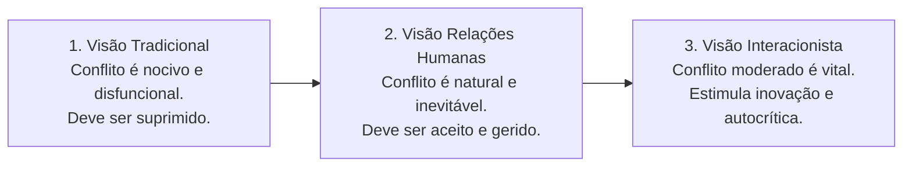
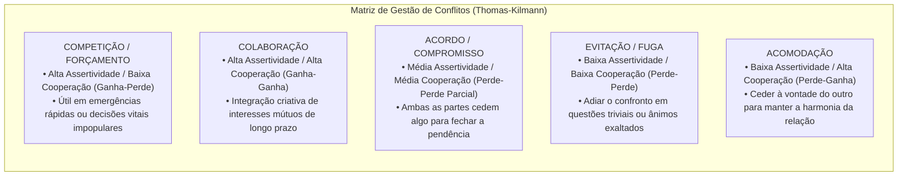
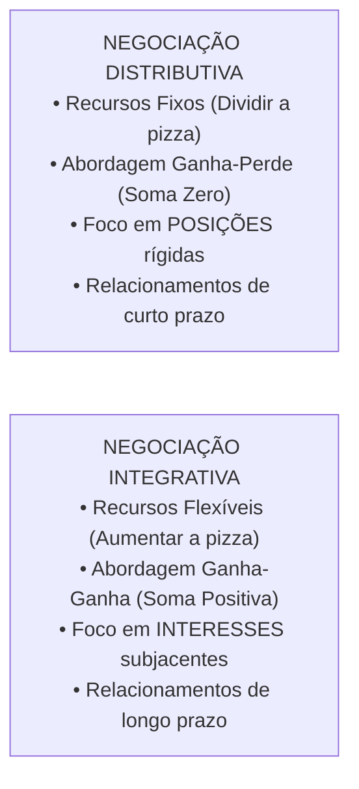
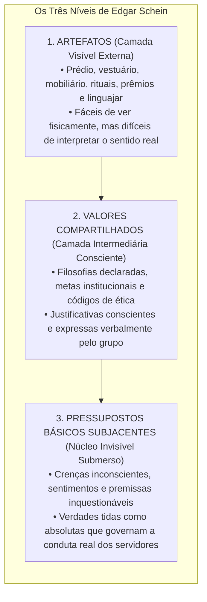
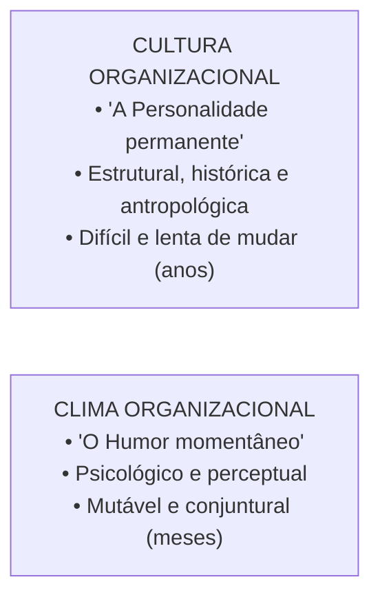
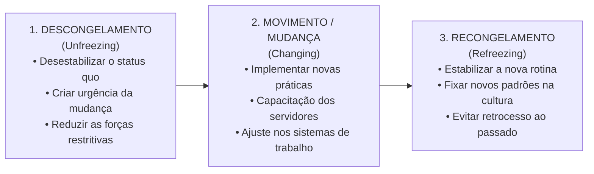

# 03 - Conflito, Negociação, Cultura, Clima e Desenvolvimento Organizacional

> **Matéria:** Comportamento Organizacional  
> **Cargo:** A01 – Técnico de Controle Externo – Especialidade: Técnico Administrativo  
> **Arquivo:** `03_conflito_negociacao_cultura_clima_e_desenvolvimento_organizacional.md`  

---

## 📌 Ementa / Itens do Edital
- Conflito Organizacional:
  - Evolução das correntes teóricas sobre o conflito: Visão Tradicional (disfuncional e prejudicial), Visão de Relações Humanas (natural e inevitável) e Visão Interacionista (positivo e indispensável para evitar acomodação);
  - Conflito Funcional (construtivo, fomenta inovação e debate sadio) versus Conflito Disfuncional (destrutivo, desagrega equipes e bloqueia metas);
  - Tipos de conflito por conteúdo: Conflito de Tarefa, Conflito de Processo e Conflito de Relacionamento (quase sempre disfuncional);
  - Estilos de gestão de conflitos no modelo bidimensional de Kenneth Thomas e Ralph Kilmann (Competição/Forçamento, Colaboração, Acordo/Compromisso, Evitação/Fuga e Acomodação);
- Técnicas de Negociação Organizacional:
  - Negociação Distributiva (modelo "ganha-perde", soma zero, foco em posições antagônicas e partilha de recursos fixos);
  - Negociação Integrativa (modelo "ganha-ganha", expansão do valor global, foco nos interesses mútuos subjacentes e relacionamentos duradouros);
  - Zona de Possível Acordo (ZOPA) e Melhor Alternativa para um Acordo Negociado (MAPAN / BATNA - *Best Alternative to a Negotiated Agreement*);
- Cultura Organizacional:
  - Conceito, funções, transmissão cultural (histórias, rituais, símbolos materiais e linguagem);
  - Os três níveis da cultura organizacional de Edgar Schein: Artefatos (superficiais e visíveis), Valores Compartilhados (justificativas conscientes) e Pressupostos Básicos Subjacentes (núcleo invisível e inquestionável);
  - Culturas organizacionais fortes versus culturas fracas;
- Clima Organizacional:
  - Definição: atmosfera psicológica e percepções compartilhadas dos membros sobre o ambiente funcional;
  - Diferenças fundamentais entre Cultura (permanente, antropológica e duradoura) e Clima (mutável, conjuntural e reflexo do momento);
- Desenvolvimento Organizacional (DO) e Gestão da Mudança:
  - O modelo de mudança planejada em três fases de Kurt Lewin: Descongelamento (*Unfreezing*), Mudança/Movimento (*Moving*) e Recongelamento (*Refreezing*);
  - Análise do Campo de Forças de Lewin: forças propulsoras/impulsoras versus forças restritivas;
  - Fontes de resistência à mudança individuais e organizacionais.

---

## 🌳 Classificação Hierárquica

```text
3. Gestão de Conflitos, Negociação, Cultura, Clima e Mudança Organizacional
├── 3.1 Teoria do Conflito Organizacional
│   ├── 3.1.1 Evolução das Abordagens Teóricas:
│   │   ├── Visão Tradicional (Anos 1930-1940): Conflito é ruim, destrutivo e deve ser erradicado
│   │   ├── Visão de Relações Humanas (Anos 1940-1970): Conflito é natural e inevitável nas relações
│   │   └── Visão Interacionista (Contemporânea): Nível mínimo de conflito funcional é indispensável
│   ├── 3.1.2 Conflito Funcional (Construtivo) vs. Disfuncional (Destrutivo)
│   ├── 3.1.3 Tipos de Conflito por Conteúdo:
│   │   ├── Conflito de Tarefa: Divergências sobre conteúdo e metas (funcional em nível moderado)
│   │   ├── Conflito de Processo: Divergências sobre como executar o trabalho (funcional em baixo nível)
│   │   └── Conflito de Relacionamento: Atritos interpessoais e antipatias (quase sempre disfuncional)
│   └── 3.1.4 Estilos de Tratamento de Conflitos (Thomas-Kilmann):
│       ├── Competição / Forçamento: Alta assertividade e baixa cooperação (emergências: Ganha-Perde)
│       ├── Colaboração: Alta assertividade e alta cooperação (solução integrativa: Ganha-Ganha)
│       ├── Acordo / Compromisso: Níveis intermediários de assertividade e cooperação (ambos cedem)
│       ├── Evitação / Fuga: Baixa assertividade e baixa cooperação (questão trivial: Perde-Perde)
│       └── Acomodação: Baixa assertividade e alta cooperação (ceder para manter harmonia: Perde-Ganha)
├── 3.2 Negociação Estratégica
│   ├── 3.2.1 Negociação Distributiva: Foco em posições, partilha de recursos fixos (dividir a pizza / soma zero)
│   ├── 3.2.2 Negociação Integrativa: Foco em interesses mútuos, criação de valor (expandir a pizza / ganha-ganha)
│   └── 3.2.3 Ferramentas Metodológicas de Harvard:
│       ├── ZOPA: Zona de Possível Acordo (faixa entre os pontos de reserva de ambas as partes)
│       └── BATNA / MAPAN: Melhor alternativa de contingência fora da mesa de negociação
├── 3.3 Cultura Organizacional (Os Três Níveis de Edgar Schein)
│   ├── 3.3.1 Nível 1 - Artefatos (Visíveis): Layout físico, vestuário, rituais, jargões (fáceis de ver, difíceis de decifrar)
│   ├── 3.3.2 Nível 2 - Valores Compartilhados: Filosofias, metas adotadas conscientemente e discursos da liderança
│   └── 3.3.3 Nível 3 - Pressupostos Básicos (Invisíveis): Crenças inconscientes, intocáveis e tidas como certas
├── 3.4 Clima Organizacional
│   ├── 3.4.1 Atmosfera psicológica vivenciada e percebida pelos membros em determinado período
│   └── 3.4.2 Cultura vs. Clima: Cultura é a "personalidade duradoura"; Clima é o "humor conjuntural momentâneo"
└── 3.5 Desenvolvimento Organizacional e Gestão da Mudança (Kurt Lewin)
    ├── 3.5.1 Fase 1: Descongelamento (Desestabilizar o status quo e criar prontidão para a mudança)
    ├── 3.5.2 Fase 2: Movimento / Mudança (Aprendizado de novos comportamentos e novas ferramentas operacionais)
    ├── 3.5.3 Fase 3: Recongelamento (Institucionalização das novas rotinas na cultura para evitar retrocesso)
    └── 3.5.4 Forças Impulsoras vs. Forças Restritivas (Análise do Campo de Forças)
```

---

## 📖 Resumo Teórico Aprofundado & Esquematizado

### 1. Evolução do Pensamento sobre o Conflito e Tipologias

A postura gerencial perante o conflito sofreu profunda transformação teórica ao longo das décadas:



* **Conflito Funcional (Construtivo):** Apoia os objetivos da organização, estimula o debate crítico de ideias, evita o conformismo cego (*pensamento de grupo / groupthink*) e oxigena os processos de trabalho.
* **Conflito Disfuncional (Destrutivo):** Obstrui o desempenho, drena o tempo dos servidores com intrigas, gera animosidade e compromete a cooperação institucional.

#### Os Três Tipos de Conflito segundo a Matéria:
1. **Conflito de Tarefa:** Refere-se ao conteúdo e às metas do trabalho (quando moderado, costuma ser **funcional**).
2. **Conflito de Processo:** Refere-se a *como* o trabalho deve ser realizado e quem deve executar cada etapa (funcional apenas em níveis muito baixos).
3. **Conflito de Relacionamento:** Concentra-se nas relações interpessoais, choques de personalidade e atritos afetivos (**quase sempre disfuncional e destrutivo**).

---

### 2. Estilos de Administração de Conflitos (Thomas e Kilmann)

Kenneth Thomas e Ralph Kilmann estruturaram a resolução de conflitos a partir de duas dimensões comportamentais: **Assertividade** (grau em que o indivíduo busca satisfazer seus próprios interesses) e **Cooperatividade** (grau em que busca satisfazer os interesses da contraparte):



---

### 3. Técnicas de Negociação: Distributiva vs. Integrativa



#### Ferramentas Centrais do Projeto de Negociação de Harvard:
* **Separar as Pessoas do Problema:** Ser firme com o mérito da questão e amável/respeitoso com as pessoas.
* **Focar nos Interesses, não nas Posições:** As posições são o que as partes dizem que querem; os interesses são as necessidades reais e motivos subjacentes que explicam suas posições.
* **ZOPA (Zona de Possível Acordo):** Faixa de intersecção delimitada pelos valores de reserva das partes. Se o valor máximo que o comprador aceita pagar for superior ao valor mínimo que o vendedor aceita receber, a ZOPA é positiva e existe viabilidade econômica para o acordo.
* **BATNA / MAPAN (*Best Alternative to a Negotiated Agreement*):** É a melhor opção externa disponível caso a negociação na mesa termine sem acordo. Quem possui um BATNA forte entra na negociação com elevado poder de barganha e segurança.

---

### 4. Os Três Níveis da Cultura Organizacional (Edgar Schein)

Edgar Schein demonstrou que a cultura organizacional funciona como um *iceberg*, composto por três camadas de profundidade:



---

### 5. Cultura Organizacional vs. Clima Organizacional



| Dimensão | Cultura Organizacional | Clima Organizacional |
| :--- | :--- | :--- |
| **Origem e Natureza** | Histórica, antropológica e estrutural. | Psicológica, perceptual e conjuntural. |
| **Estabilidade no Tempo** | **Altamente estável e duradoura:** Leva décadas para se consolidar e anos para mudar. | **Volátil e transitório:** Pode mudar rapidamente com uma nova chefia ou após uma reforma. |
| **Objeto de Análise** | Valores, crenças, símbolos, tradições e pressupostos básicos inconscientes. | Sentimentos e percepções dos servidores sobre condições de trabalho, justiça e remuneração. |
| **Metáfora Clássica** | É o **DNA e a Personalidade** da organização. | É o **Estado de Espírito e o Humor** momentâneo da equipe. |

---

### 6. O Modelo de Mudança em Três Etapas de Kurt Lewin



* **Análise do Campo de Forças (Lewin):** Qualquer situação de mudança é resultado do confronto entre **Forças Propulsoras/Impulsoras** (que empurram em direção à mudança) e **Forças Restritivas** (que resistem e buscam preservar o *status quo*). Para que a mudança ocorra, o gestor deve aumentar as forças propulsoras ou, preferencialmente, **reduzir as forças restritivas** que geram resistência.

---

## 🚨 Alertas de Prova & Pegadinhas da FCC

> 🚨 **ALERTA DE PROVA / PEGADINHA FCC (PRESSUPOSTOS BÁSICOS DE SCHEIN):**  
> Questão favorita da FCC: afirmar que "os pressupostos básicos da cultura organizacional são formalmente redigidos no código de ética e afixados nos murais do órgão". **FALSO!** Códigos de ética e murais são **Artefatos** ou **Valores Compartilhados** conscientes. Os **Pressupostos Básicos Subjacentes** são **inconscientes, tácitos e invisíveis**, operando de forma automática na mente das pessoas!

> ⭐ **IMPORTANTE (CULTURA VS. CLIMA ORGANIZACIONAL):**  
> - Se o enunciado fala de sentimentos pontuais, moral da equipe e percepções momentâneas após uma mudança de gestão: trata-se de **CLIMA**.  
> - Se fala de tradições históricas, ritos institucionais de décadas, crenças enraizadas e pressupostos compartilhados: trata-se de **CULTURA**.

> 🛑 **ATENÇÃO (O CONFLITO DE RELACIONAMENTO É DISFUNCIONAL):**  
> A visão interacionista afirma que o conflito de tarefas pode ser funcional, mas alerta que o **conflito de relacionamento (interpessoal/afetivo) é quase invariavelmente DISFUNCIONAL**, pois desgasta a convivência, destrói a confiança mútua e paralisa as entregas públicas.

> 📌 **NOTA EXPLICATIVA (O PAPEL DO RECONGELAMENTO DE LEWIN):**  
> Sem a terceira etapa de **Recongelamento**, a organização sofre regressão natural aos velhos hábitos assim que a pressão inicial da chefia diminui. Recongelar significa institucionalizar as novas rotinas e premiar a conformidade com o novo padrão.

---

## 🌐 Fontes Oficiais e Referências Bibliográficas

* [SCHEIN, Edgar H. Cultura Organizacional e Liderança. Editora Atlas.](https://www.grupogen.com.br) - A teoria dos três níveis da cultura.
* [LEWIN, Kurt. Teoria de Campo em Ciência Social. Pioneira Thomson Learning.](https://www.grupogen.com.br) - Modelo de mudança planejada.
* [ROBBINS, Stephen P.; JUDGE, Timothy A. Comportamento Organizacional. Pearson.](https://www.pearson.com) - Conflitos, negociação e cultura.
* [FISHER, Roger; URY, William; PATTON, Bruce. Como Chegar ao Sim: a negociação baseada em princípios. Editora Sextante.](https://www.sextante.com.br).
* [THOMAS, Kenneth W.; KILMANN, Ralph H. Conflict Mode Instrument (TKI)](https://kilmanndiagnostics.com) - Estilos de conflito.

---

## 📝 Questões de Concurso FCC Comentadas

### Questão 01
**(FCC – TCE-PI – Auditor de Controle Externo)**  
Segundo a teoria dos níveis da cultura organizacional desenvolvida por Edgar Schein, os elementos mais profundos, enraizados e invisíveis da cultura, constituídos por crenças e percepções tidas como verdades absolutas e inquestionáveis que orientam o comportamento dos colaboradores sem que eles sequer tomem consciência disso, denominam-se:

* **A)** Artefatos visíveis.
* **B)** Valores compartilhados adotados.
* **C)** Símbolos materiais e cerimoniais.
* **D)** Pressupostos básicos subjacentes.
* **E)** Códigos formais de ética institucional.

> **Gabarito: D**  
> **Comentário Detalhado:**  
> - **A) Incorreta.** Artefatos são os elementos superficiais e plenamente visíveis da cultura (prédios, vestuário, mobília, slogans).  
> - **B) Incorreta.** Valores compartilhados são premissas conscientes verbalizadas pela liderança.  
> - **C) Incorreta.** Símbolos materiais integram o nível dos artefatos.  
> - **D) CORRETA.** No modelo concebido por Edgar Schein, o nível mais profundo do *iceberg* cultural é composto pelos **Pressupostos Básicos Subjacentes**, que representam crenças inconscientes, valores internalizados e verdades tidas como certas e inquestionáveis, as quais moldam a forma como a organização percebe e reage ao ambiente.  
> - **E) Incorreta.** Códigos de ética são documentos normativos formais e conscientes (valores/artefatos).

---

### Questão 02
**(FCC – TCE-RS – Auditor de Controle Externo)**  
No modelo clássico de gestão da mudança organizacional formulado por Kurt Lewin, a fase em que a liderança da instituição cria intencionalmente a necessidade percebida de mudança, desestabilizando o *status quo* vigente e quebrando velhos hábitos arraigados na equipe para prepará-la para o aprendizado de novas práticas operacionais, é denominada:

* **A)** Descongelamento (*Unfreezing*).
* **B)** Recongelamento (*Refreezing*).
* **C)** Movimento (*Moving*).
* **D)** Entropia negativa.
* **E)** Institucionalização de valor.

> **Gabarito: A**  
> **Comentário Detalhado:**  
> - **A) CORRETA.** A fase de **Descongelamento (*Unfreezing*)** no modelo de Kurt Lewin visa precisamente desafiar e quebrar a inércia do *status quo*, conscientizando os servidores de que os procedimentos atuais são obsoletos ou ineficazes e gerando a prontidão psicológica indispensável para assimilar novos hábitos.  
> - **B) Incorreta.** O recongelamento é a fase final de estabilização e padronização da nova conduta aprendida.  
> - **C) Incorreta.** O movimento é a etapa intermediária de transição e assimilação dos novos métodos.  
> - **D) Incorreta.** Entropia negativa é conceito da Teoria Geral dos Sistemas.  
> - **E) Incorreta.** Termo sem pertinência com o modelo tridimensional de Lewin.

---

### Questão 03
**(FCC – TRT-2ª Região – Analista Judiciário: Área Administrativa)**  
A respeito da diferença essencial entre Cultura Organizacional e Clima Organizacional, assinale a afirmativa correta:

* **A)** O clima organizacional é duradouro e perene, demandando décadas de história para ser alterado, ao passo que a cultura organizacional é efêmera e flutua semanalmente.
* **B)** A cultura organizacional reflete as percepções momentâneas e o estado de ânimo conjuntural dos colaboradores, ao passo que o clima constitui o DNA estrutural da entidade.
* **C)** A cultura organizacional é a personalidade e o alicerce antropológico profundo da instituição, enquanto o clima organizacional é a atmosfera psicológica conjuntural e perceptual do momento.
* **D)** A cultura e o clima são termos estritamente sinônimos na teoria das organizações, distinguindo-se apenas quanto ao nível hierárquico dos avaliados.
* **E)** O clima organizacional manifesta-se exclusivamente através dos pressupostos básicos subjacentes inconscientes descritos por Edgar Schein.

> **Gabarito: C**  
> **Comentário Detalhado:**  
> - **A) Incorreta.** A cultura é duradoura e perene; o clima é transitório e mutável.  
> - **B) Incorreta.** A questão inverteu os conceitos de cultura e clima.  
> - **C) CORRETA.** A **Cultura Organizacional** corresponde ao DNA, à personalidade estável e aos valores históricos da instituição; o **Clima Organizacional** traduz o estado de espírito, o "humor" momentâneo e as percepções transitórias compartilhadas pelos servidores em dado período (como após uma reestruturação ou atraso salarial).  
> - **D) Incorreta.** Não são sinônimos; possuem fundamentos conceituais e horizontes temporais distintos.  
> - **E) Incorreta.** Os pressupostos básicos subjacentes pertencem ao núcleo da **cultura organizacional**.

---

### Questão 04
**(FCC – DPE-RS – Analista: Área Administrativa)**  
No âmbito da teoria contemporânea de gestão de conflitos, a abordagem Interacionista defende que:

* **A)** Todo conflito em qualquer nível é intrinsicamente danoso e prejudicial à eficácia da instituição, devendo ser erradicado sumariamente pela chefia.
* **B)** A ausência absoluta de conflitos é o indicador supremo de maturidade e inovação contínua de uma organização.
* **C)** Um nível controlado de conflito funcional de tarefas deve ser incentivado, pois estimula a autocrítica, desafia ideias acomodadas e fomenta a criatividade e a inovação.
* **D)** Os conflitos de relacionamento interpessoal devem ser estimulados pela direção para desarticular a coesão de grupos corporativos informais.
* **E)** As organizações que operam sob a abordagem interacionista eliminam a figura do líder para permitir conflitos ilimitados e irrestritos.

> **Gabarito: C**  
> **Comentário Detalhado:**  
> - **A) Incorreta.** Essa é a Visão Tradicional do conflito (anos 1930/40).  
> - **B) Incorreta.** A ausência total de conflitos sinaliza apatia, estagnação e pensamento grupal acrítico (*groupthink*).  
> - **C) CORRETA.** A **Visão Interacionista** preconiza que um nível **mínimo e moderado de conflito funcional** (focado no conteúdo das tarefas) é saudável e indispensável para manter o grupo vivo, criativo e inovador, impedindo que a equipe caia na estagnação e no comodismo.  
> - **D) Incorreta.** O conflito de relacionamento (choque interpessoal) é quase sempre disfuncional e altamente prejudicial à cooperação.  
> - **E) Incorreta.** O conflito interacionista deve ser monitorado e gerido por lideranças competentes.

---

### Questão 05
**(FCC – ARTESP – Especialista em Regulação de Transportes)**  
Durante uma negociação contratual complexa entre um órgão público e uma empresa concessionária de serviços, as partes optaram por adotar os preceitos da Negociação Integrativa (*Ganha-Ganha*). Essa modalidade negocial caracteriza-se essencialmente por:

* **A)** Focar exclusivamente na defesa intransigente de posições antagônicas pré-fixadas e na partilha de recursos fixos em regime de soma zero.
* **B)** Buscar a expansão do valor total disponível e a construção de soluções colaborativas que atendam aos interesses subjacentes de ambas as partes, preservando o relacionamento de longo prazo.
* **C)** Exigir que uma das partes capitule integralmente em suas pretensões econômicas em favor da outra para viabilizar o acordo.
* **D)** Eliminar a Zona de Possível Acordo (ZOPA) e desconsiderar o valor de reserva estipulado no termo de referência.
* **E)** Restringir-se a transações mercantis esporádicas de compra imediata, nas quais a única variável relevante é o menor preço à vista.

> **Gabarito: B**  
> **Comentário Detalhado:**  
> - **A) Incorreta.** Foco em posições fixas e partilha de soma zero caracterizam a negociação **distributiva**.  
> - **B) CORRETA.** A **Negociação Integrativa (Ganha-Ganha / *Win-Win*)** foca nos **interesses subjacentes** mútuos das partes, buscando "aumentar o bolo" (criar valor conjunto) por meio de opções criativas que satisfaçam as necessidades de ambos os lados e fortaleçam a parceria institucional de longo prazo.  
> - **C) Incorreta.** Capitulação unilateral corresponde ao estilo de acomodação ou perda forçada, oposto ao ganha-ganha.  
> - **D) Incorreta.** A negociação bem-sucedida pressupõe a existência e aproveitamento de uma ZOPA positiva.  
> - **E) Incorreta.** Transações frias baseadas unicamente no preço caracterizam a negociação distributiva transacional.
