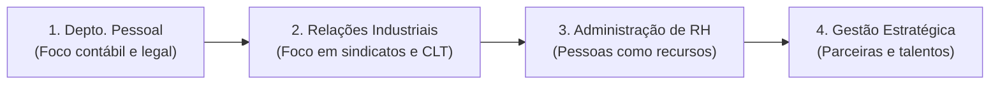
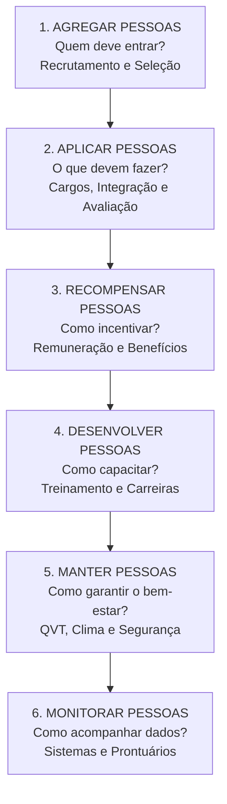
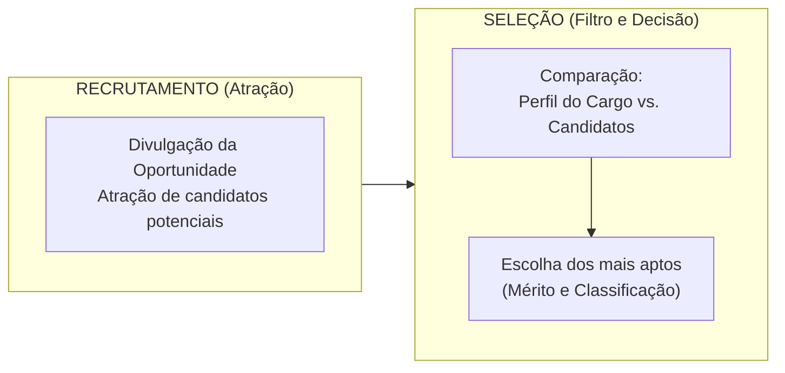
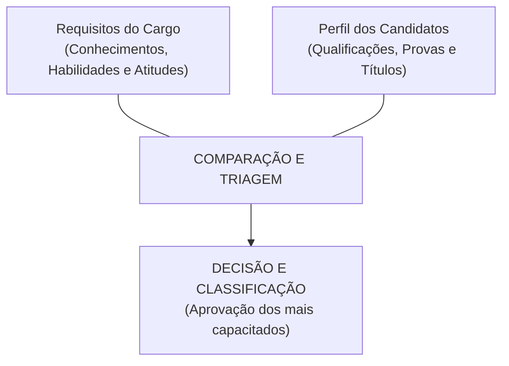
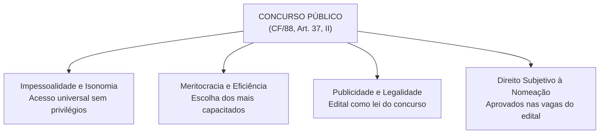
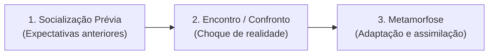

# 01 - Processos de Gestão de Pessoas, Recrutamento, Seleção e Integração

> **Matéria:** Gestão de Pessoas  
> **Cargo:** A01 – Técnico de Controle Externo – Especialidade: Técnico Administrativo (TCE-GO)  
> **Conteúdo Oficial:** Processos de Gestão de Pessoas (modelo de Chiavenato); Recrutamento e Seleção de Pessoas; Rotinas de Departamento Pessoal; O Concurso Público como Instrumento Republicano; Socialização e Integração Organizacional (*Onboarding*).

---

## 📌 Ementa & Delimitação do Conteúdo

1. **Evolução Histórica dos Paradigmas de Pessoas:**
    - Fase Contábil / Departamento Pessoal: foco estritamente legal, registro de ponto, apuração de folha de pagamento e custos operacionais; pessoas tratadas como engrenagens mecânicas e mão de obra passiva.
    - Fase Legal / Relações Industriais: impacto da legislação trabalhista e relações sindicais; conciliação de conflitos corporativos.
    - Fase Clássica / Administração de Recursos Humanos (ARH): pessoas vistas como insumos e recursos produtivos homogêneos sujeitos a comando e controle.
    - Fase Estratégica / Gestão Estratégica de Pessoas (GEP): pessoas como parceiras ativas do negócio, sujeitos dotados de competências, inteligência, iniciativa e capital intelectual indispensável para a entrega de valor público.

2. **Os Seis Processos da Gestão de Pessoas (Modelo de Idalberto Chiavenato):**
    - **Agregar Pessoas:** quem deve trabalhar na organização (recrutamento, seleção e planejamento de RH).
    - **Aplicar Pessoas:** o que as pessoas farão na organização (desenho de cargos, análise funcional, orientação/socialização organizacional e avaliação de desempenho).
    - **Recompensar Pessoas:** como incentivar e motivar os colaboradores (vencimento, remuneração, benefícios e incentivos).
    - **Desenvolver Pessoas:** como capacitar e aprimorar competências (treinamento, desenvolvimento funcional, aprendizagem organizacional e planos de carreira).
    - **Manter Pessoas:** como criar condições ambientais e psicológicas de permanência (clima organizacional, cultura, higiene, segurança e qualidade de vida no trabalho - QVT).
    - **Monitorar Pessoas:** como acompanhar e controlar as atividades e informações de pessoal (banco de dados, sistemas de informação gerencial de RH e auditoria de pessoal).

3. **Rotinas Administrativas do Departamento de Pessoal no Setor Público:**
    - Admissão, posse e exercício funcional; controle de assiduidade e pontualidade; processamento de folha de pagamento (vencimento básico, adicionais, gratificações e limites do teto constitucional); escala e concessão de férias; assentamentos individuais e prontuário funcional.

4. **O Processo de Agregar Pessoas — Recrutamento e Seleção:**
    - Recrutamento: mercado de trabalho vs. mercado de recursos humanos; técnicas de atração.
    - Recrutamento Interno vs. Recrutamento Externo vs. Recrutamento Misto: conceitos, vantagens e desvantagens de cada modalidade (destaque para a *endogamia cultural* no interno e os custos/tempo no externo).
    - Seleção de Pessoas como processo de comparação e decisão: requisitos do cargo (perfil de competências) vs. qualificações do candidato.
    - Técnicas e instrumentos de seleção: provas de conhecimentos e habilidades, entrevistas estruturadas e comportamentais por competências (técnica STAR), testes de aptidão e personalidade, dinâmicas de grupo e avaliação de títulos.
    - O Concurso Público (CF/88, art. 37, II): regime constitucional, princípios da impessoalidade, publicidade, isonomia e meritocracia; validade, prorrogação e direito subjetivo à nomeação dos aprovados no número de vagas.

5. **Processo de Socialização e Integração Organizacional (*Onboarding*):**
    - Conceito, relevância para a administração pública e aceleração do período de estágio probatório.
    - As três fases da socialização organizacional (Socialização Antecipatória, Encontro/Confronto e Metamorfose/Adaptação).
    - Práticas de integração: manuais do servidor, programas de boas-vindas, tutoria/mentoria institucional e cursos de formação da Escola de Contas.

---

## 🧭 Sumário Interativo
- [1. Evolução Histórica dos Paradigmas de Gestão de Pessoas](#1-evolucao-historica-dos-paradigmas-de-gestao-de-pessoas)
- [2. Os Seis Processos da Gestão de Pessoas (Chiavenato)](#2-os-seis-processos-da-gestao-de-pessoas-chiavenato)
- [3. Rotinas Administrativas do Departamento de Pessoal no Setor Público](#3-rotinas-administrativas-do-departamento-de-pessoal-no-setor-publico)
- [4. O Processo de Agregar Pessoas: Recrutamento e Seleção](#4-o-processo-de-agregar-pessoas-recrutamento-e-selecao)
- [5. O Concurso Público como Instrumento Republicano (CF/88, art. 37)](#5-o-concurso-publico-como-instrumento-republicano-cf88-art-37)
- [6. Processo de Socialização e Integração Organizacional (Onboarding)](#6-processo-de-socializacao-e-integracao-organizacional-onboarding)
- [7. Fontes Oficiais e Referências Bibliográficas](#7-fontes-oficiais-e-referencias-bibliograficas)
- [8. Questões de Concurso FCC Comentadas](#8-questoes-de-concurso-fcc-comentadas)

---

## 📖 Resumo Teórico Aprofundado & Esquematizado

### 1. Evolução Histórica dos Paradigmas de Gestão de Pessoas

A administração do trabalho humano passou por profundas transformações ao longo dos séculos XX e XXI, transitando de uma visão puramente mecanicista e punitiva para uma abordagem estratégica voltada ao desenvolvimento de competências.

#### Comparativo Histórico: As Quatro Eras

| Característica | Departamento Pessoal (Fase Contábil) | Relações Industriais (Fase Legal) | Recursos Humanos (Fase Clássica) | Gestão Estratégica de Pessoas (Atual) |
| :--- | :--- | :--- | :--- | :--- |
| **Período Predominante** | Início do século XX (Teoria Clássica / Taylorismo). | Décadas de 1930 a 1950 (Pós-Revolução de 30 / CLT). | Décadas de 1960 a 1980 (Abordagem Sistêmica / Contingencial). | Década de 1990 em diante (Era do Conhecimento). |
| **Concepção das Pessoas** | Engrenagens mecânicas, mão de obra braçal e geradoras de custo estrito. | Funcionários tutelados por normas estatais e sindicais. | Recursos produtivos padronizados a serem geridos e alocados. | **Parceiras estratégicas**, fontes de inteligência, competência e diferenciação. |
| **Foco de Atuação** | Registro mecânico de ponto, livros de registro e apuração de folha. | Cumprimento de leis trabalhistas, contratos coletivos e litígios. | Técnicas operacionais especializadas (cargos, salários, testes). | **Alinhamento com a estratégia**, geração de valor público e gestão do conhecimento. |
| **Papel da Liderança** | Fiscalização, vigilância e aplicação de punições regimentais. | Intermediação de acordos e gestão do cumprimento legal. | Supervisão hierárquica e controle burocrático de procedimentos. | Liderança coach, facilitação do desenvolvimento e delegação de autoridade (*empowerment*). |

#### Pessoas como Recursos vs. Pessoas como Parceiras (Idalberto Chiavenato)

* **Pessoas como Recursos:**
    * Tratadas como elementos passivos e estáticos de produção;
    * Devem ser rigidamente controladas, padronizadas e subordinadas à hierarquia;
    * Consideradas exclusivamente como centro de custos que consome verbas orçamentárias;
    * Foco na execução mecânica de tarefas predefinidas, sem incentivo à iniciativa própria.
* **Pessoas como Parceiras (Capital Intelectual):**
    * Tratadas como agentes proativos, autônomos e dotados de inteligência emocional e técnica;
    * Consideradas o ativo mais valioso e geradoras diretas de valor institucional;
    * Investimento prioritário da organização para a melhoria dos serviços públicos;
    * Estimuladas a inovar, assumir responsabilidade pelos resultados e compartilhar conhecimento.

---

### 2. Os Seis Processos da Gestão de Pessoas (Chiavenato)

Idalberto Chiavenato estrutura a gestão de pessoas como um sistema integrado composto por seis grandes macroprocessos dinâmicos e interdependentes:

| Macroprocesso | Questão Central | Ações, Ferramentas e Subsistemas Compreendidos |
| :--- | :--- | :--- |
| **1. Agregar Pessoas** | *Quem deve ingressar na organização?* | Planejamento de recursos humanos, recrutamento (interno/externo), seleção de pessoas e concurso público. |
| **2. Aplicar Pessoas** | *O que as pessoas farão na organização?* | Desenho organizacional de cargos, descrição e análise de funções, **socialização organizacional (integração)** e **avaliação de desempenho funcional**. |
| **3. Recompensar Pessoas** | *Como remunerar e incentivar o trabalho?* | Remuneração direta (vencimento básico), remuneração indireta, gratificações, adicionais pecuniários e benefícios sociais. |
| **4. Desenvolver Pessoas** | *Como capacitar e expandir o potencial?* | Diagnóstico de necessidades de treinamento (LNT), programas de capacitação, desenvolvimento gerencial, gestão do conhecimento e planos de carreira. |
| **5. Manter Pessoas** | *Como reter os servidores e assegurar bem-estar?* | Clima e cultura organizacional, programas de Qualidade de Vida no Trabalho (QVT), higiene, ergonomia, medicina do trabalho e relações sindicais. |
| **6. Monitorar Pessoas** | *Como registrar e acompanhar as informações?* | Bancos de dados funcionais, prontuários do servidor, sistemas integrados de gestão de RH (SIRH) e auditoria de pessoal. |

> 🚨 **ALERTA DE PROVA / PEGADINHA FCC (MACROPROCESSOS DE CHIAVENATO):**  
> A Fundação Carlos Chagas cobra com frequência pegadinhas sobre a alocação de subsistemas nesse modelo:  
>
> 1. A **Avaliação de Desempenho** pertence ao macroprocesso de **APLICAR PESSOAS** (e NÃO a "Monitorar pessoas" nem a "Desenvolver pessoas"). Aplicar significa verificar o que as pessoas fazem e como estão desempenhando suas atribuições.  
> 2. A **Integração / Socialização Organizacional** também integra os processos de **APLICAR PESSOAS**, pois orienta o servidor sobre como exercer seu cargo e agir dentro da instituição.  
> 3. O macroprocesso de **Monitorar Pessoas** restringe-se a cadastros, bancos de dados, relatórios gerenciais e auditoria de regularidade funcional.

---

### 3. Rotinas Administrativas do Departamento de Pessoal no Setor Público

Mesmo sob uma ótica estratégica, as rotinas operacionais de pessoal são indispensáveis para garantir a estrita legalidade e conformidade dos atos de gestão pública:

1. **Admissão e Investidura:**
    - Conferência de documentos pessoais e habilitação legal;
    - Realização de perícia médica oficial e aferição de aptidão física/mental;
    - Lavratura do termo de posse pela autoridade competente e registro do início do efetivo exercício.

2. **Controle de Frequência e Assiduidade:**
    - Acompanhamento do registro biométrico ou eletrônico de ponto;
    - Gestão de escalas de trabalho, compensações e banco de horas autorizadas;
    - Processamento de justificativas legais, faltas abonadas e desconto em folha decorrente de ausências não justificadas.

3. **Elaboração e Processamento da Folha de Pagamento:**
    - Apuração do vencimento básico atribuído ao cargo e padrão da carreira;
    - Lançamento de vantagens funcionais (quinquênios, gratificações de desempenho, adicionais de titulação, auxílio-alimentação e transporte);
    - Cálculo e retenção de descontos obrigatórios (Previdência Própria / Regime Geral e Imposto de Renda Retido na Fonte - IRRF);
    - Gestão de consignações facultativas em folha (empréstimos consignados, planos de saúde, mensalidades sindicais);
    - Aplicação e corte de remunerações que excedam o **teto remuneratório constitucional** (CF/88, art. 37, XI).

4. **Escala e Concessão de Férias:**
    - Controle do período aquisitivo (12 meses de efetivo exercício) e período concessivo;
    - Elaboração da escala anual de férias para evitar descontinuidade do serviço público;
    - Pagamento obrigatório do terço constitucional de férias.

5. **Assentamentos Individuais e Prontuário Funcional:**
    - Registro histórico de toda a vida funcional do servidor (designações, licenças, afastamentos, progressões, penalidades e elogios);
    - Averbação de tempo de contribuição prévio para fins de aposentadoria e disponibilidade.

---

### 4. O Processo de Agregar Pessoas: Recrutamento e Seleção

O processo de agregar pessoas inicia-se com o diagnóstico de necessidades de pessoal e desdobra-se em duas etapas interdependentes: o recrutamento (atração) e a seleção (escolha).

#### Recrutamento Interno vs. Recrutamento Externo vs. Recrutamento Misto

| Critério de Análise | Recrutamento Interno | Recrutamento Externo | Recrutamento Misto |
| :--- | :--- | :--- | :--- |
| **Origem dos Candidatos** | Colaboradores que já integram a instituição (promoções, relotações). | Candidatos externos disponíveis no mercado ou em outros órgãos. | Combina candidatos internos e externos na mesma disputa. |
| **Custo Financeiro** | **Muito baixo:** dispensa editais complexos e publicidade massiva. | **Elevado:** publicação de editais, contratação de bancas examinadoras. | Custo intermediário ou alto. |
| **Tempo de Execução** | **Rápido:** os colaboradores já são conhecidos e estão cadastrados. | **Lento e moroso:** prazos de inscrição, recursos e homologação. | Médio a longo. |
| **Impacto na Motivação** | Eleva a motivação interna e valoriza a carreira funcional. | Pode desmotivar servidores internos que almejavam a oportunidade. | Equilibra estímulo interno e ampliação de horizontes. |
| **Inovação Cultural** | **Risco de Endogamia Cultural (*Inbreeding*):** cristaliza velhos hábitos e rotinas. | **Renovação (*Sangue Novo*):** agrega novos saberes e rompe paradigmas. | Permite conciliar estabilidade institucional e inovação. |
| **Aplicação no Setor Público** | Restrito a funções de confiança e cargos em comissão privativos de efetivos. | **Regra Geral Constitucional:** Concurso Público de Provas ou Provas e Títulos. | Seleções internas prévias seguidas de concurso se deserto o quadro. |

> ⭐ **IMPORTANTE — CONCEITO DE ENDOGAMIA CULTURAL:**  
> A FCC adora cobrar o fenômeno da **endogamia organizacional** (ou cultural). Trata-se da tendência de um órgão ou empresa, ao recrutar exclusivamente membros de seus próprios quadros internos, de perpetuar os mesmos padrões de pensamento, cristalizar defeitos e inibir o surgimento de ideias inovadoras. O recrutamento externo atua justamente como antídoto à endogamia.

#### Seleção de Pessoas: O Modelo de Comparação e Decisão

Enquanto o recrutamento visa atrair o maior número possível de candidatos qualificados (processo positivo), a **seleção de pessoas é um processo de triagem, restrição e escolha (processo negativo ou de afunilamento)**.

* **A Seleção como Comparação:** confronta os requisitos exigidos pelo cargo (*Job Description* / perfil de competências) com o perfil de competências oferecido pelos candidatos (*Job Profile*).
* **A Seleção como Decisão:** escolha técnica fundamentada em critérios objetivos para preenchimento da vaga.

#### Técnicas de Seleção de Pessoas

1. **Provas de Conhecimentos ou de Capacidade:**
    - Avaliam o nível de conhecimento teórico e prático exigido para a função;
    - Podem ser objetivas (múltipla escolha, verdadeiro/falso) ou discursivas (estudo de caso, redação técnica);
    - Constituem o núcleo central do concurso público brasileiro.

2. **Entrevistas de Seleção:**
    - **Não estruturadas:** livres, sem roteiro prévio (baixa confiabilidade);
    - **Estruturadas / Padronizadas:** roteiro rígido de perguntas iguais para todos os candidatos (alta comparabilidade);
    - **Entrevista Comportamental com Foco em Competências (Técnica STAR):** busca evidências de comportamentos passados para prever desempenhos futuros:
    - **S** (*Situação*): contexto fático enfrentado pelo candidato;
    - **T** (*Tarefa*): responsabilidade ou desafio que cabia a ele resolver;
    - **A** (*Ação*): atitudes e procedimentos concretos adotados pelo profissional;
    - **R** (*Resultado*): impactos qualitativos e quantitativos alcançados.

3. **Testes Psicológicos e de Aptidão:**
    - **Testes Psicométricos:** mensuram aptidões intelectuais, raciocínio lógico, atenção concentrada e memória;
    - **Testes de Personalidade:** avaliam traços de caráter, temperamento, equilíbrio emocional e maturidade (ex.: testes projetivos e expressivos, devidamente validados pelo Conselho Federal de Psicologia).

4. **Técnicas Vivenciais / Dinâmicas de Grupo:**
    - Simulação de situações reais de trabalho, dramatizações (*role-playing*) e jogos de negócios para observar liderança, trabalho em equipe e comunicação interpessoal.

5. **Avaliação de Títulos:**
    - Pontuação objetiva de títulos acadêmicos (especialização, mestrado, doutorado) e experiência profissional prévia. *No setor público, a avaliação de títulos tem caráter estritamente classificatório, nunca eliminatório (CF/88, art. 37, II).*

---

### 5. O Concurso Público como Instrumento Republicano (CF/88, art. 37)

No Estado Democrático de Direito, o concurso público é a ferramenta primordial para democratizar o acesso aos cargos públicos e garantir um corpo funcional competente e impessoal.

* **Exigência Constitucional (Art. 37, II):** A investidura em cargo ou emprego público depende de aprovação prévia em concurso público de provas ou de provas e títulos, de acordo com a natureza e a complexidade do cargo ou emprego, na forma prevista em lei.
* **Exceções Constitucionais Expressas:**
    1. *Cargos em comissão declarados em lei de livre nomeação e exoneração* (destinados exclusivamente às atribuições de direção, chefia e assessoramento — art. 37, II e V);
    2. *Contratação por tempo determinado* para atender a necessidade temporária de excepcional interesse público (Processo Seletivo Simplificado - PSS, art. 37, IX);
    3. *Agentes Comunitários de Saúde e de Combate às Endemias* (processo seletivo público específico, art. 198, § 4º).

* **Prazo de Validade (Art. 37, III):** Até dois anos, prorrogável uma vez por igual período (critério de discricionariedade da administração, dentro do período inicial).
* **Direito Subjetivo à Nomeação (Jurisprudência Vinculante do STF - Tema 161 / RE 598.099):** O candidato aprovado dentro do número de vagas previsto originariamente no edital do concurso público possui **direito público subjetivo à nomeação** durante o prazo de validade do certame. A recusa da administração só é admitida em hipóteses excepcionalíssimas (superveniência, imprevisibilidade, gravidade extrema e necessidade inafastável).

> 🚨 **ALERTA DE PROVA / PEGADINHA FCC (PROVA DE TÍTULOS E VALIDADE):**  
> A banca adora questionar os **critérios de validade da prova de títulos**. Memorize: no concurso público, a fase de avaliação de títulos possui caráter **estritamente classificatório**, sendo terminantemente inconstitucional conferir-lhe caráter eliminatório!  
> Além disso, o art. 37, III da CF/88 estabelece que o concurso terá validade de **até 2 anos**, prorrogável uma vez por igual período. A prorrogação deve ser pelo **mesmo prazo** fixado no edital original (se o edital fixou 1 ano, prorroga-se por mais 1 ano; se fixou 6 meses, prorroga-se por 6 meses).

> ⭐ **IMPORTANTE — CONCURSO PÚBLICO E CARGOS COMISSIONADOS:**  
> A investidura mediante concurso é a regra para **cargos de provimento efetivo** e empregos públicos. Funções de confiança e cargos comissionados dispensam concurso público formal, mas as funções de confiança são reservadas **exclusivamente a servidores ocupantes de cargo efetivo**, enquanto os cargos em comissão possuem um percentual mínimo legal reservado a servidores de carreira (CF/88, art. 37, V).

---

### 6. Processo de Socialização e Integração Organizacional (*Onboarding*)

A socialização organizacional é o processo formativo e cultural por meio do qual o novo servidor aprende os valores essenciais, regras informais, jargões, posturas e competências exigidas pelo órgão.

#### As Três Etapas da Socialização Organizacional (Stephen Robbins)

1. **Fase 1: Socialização Prévia (ou Antecipatória):**
    - Ocorre antes do ingresso formal do servidor na repartição;
    - O indivíduo traz consigo valores acadêmicos, crenças sociais e expectativas idealizadas a respeito da carreira e do órgão público.

2. **Fase 2: Encontro (ou Confronto):**
    - Ocorre no momento em que o servidor toma posse e entra em efetivo exercício;
    - Há um inevitável confronto entre suas expectativas prévias e a realidade concreta da repartição (rotinas burocráticas, sistemas informatizados, hierarquias);
    - Programas formais de acolhimento reduzem o risco de choque cultural traumático.

3. **Fase 3: Metamorfose (ou Adaptação Permanente):**
    - O novo servidor internaliza as normas, compreende a linguagem corporativa e ajusta seu comportamento aos padrões institucionais;
    - Desenvolve sensação de pertencimento, segurança psicológica e alinhamento com a missão do Tribunal de Contas.

#### Práticas Institucionais de Socialização no Setor Público

* **Programa de Boas-Vindas e Ambientação:** Acolhida institucional pelos gestores e pela área de Gestão de Pessoas no primeiro dia de trabalho.
* **Manual de Integração do Servidor:** Guia contendo missão institucional, direitos e deveres, canais de ouvidoria, regras de conduta ética e estrutura organizacional.
* **Tutoria e Mentoria (*Buddy Program*):** Designação de um servidor experiente para acompanhar o novato nas rotinas diárias e sanar dúvidas operacionais.
* **Cursos de Formação Inicial:** Aulas e oficinas práticas promovidas pela Escola de Contas/Governo para instrumentalizar o servidor nos sistemas corporativos e procedimentos processuais de controle externo.

---

### 7. Fontes Oficiais e Referências Bibliográficas

* [Constituição da República Federativa do Brasil de 1988](https://www.planalto.gov.br/ccivil_03/constituicao/constituicao.htm) - Art. 37 (Princípios da administração pública, concurso público e provimento de cargos).
* [CHIAVENATO, Idalberto. Gestão de Pessoas: o novo papel dos recursos humanos nas organizações. 5ª Edição. Rio de Janeiro: GEN Atlas, 2020](https://www.grupogen.com.br).
* [DUTRA, Joel Souza. Gestão de Pessoas: modelo, processos, tendências e perspectivas. 2ª Edição. São Paulo: Atlas, 2017](https://www.grupogen.com.br).
* [ROBBINS, Stephen P.; JUDGE, Timothy A. Comportamento Organizacional. 18ª Edição. Pearson, 2020](https://www.pearson.com).
* [Supremo Tribunal Federal - Tema 161 da Repercussão Geral (RE 598.099/MS)](https://portal.stf.jus.br) - Direito subjetivo à nomeação de candidato aprovado dentro do número de vagas.

---

### 8. Questões de Concurso FCC Comentadas

### Questão 01
**(FCC – Analista de Controle Externo – TCE-GO)**  
No âmbito da literatura clássica de Gestão de Pessoas formulada por Idalberto Chiavenato, os macroprocessos organizacionais integram um conjunto articulado de subsistemas interconectados. Ao estruturar os processos de gestão, o desenho de cargos, a socialização organizacional dos novos colaboradores e a sistemática de avaliação de desempenho funcional integram expressamente o macroprocesso de:

* **A)** Agregar Pessoas.
* **B)** Aplicar Pessoas.
* **C)** Recompensar Pessoas.
* **D)** Desenvolver Pessoas.
* **E)** Monitorar Pessoas.

> **Comentário Detalhado:**  
>
> - **A) Incorreta.** O macroprocesso de Agregar Pessoas engloba unicamente as atividades de atração e seleção (planejamento da força de trabalho, recrutamento e seleção/concurso).  
> - **B) CORRETA.** Os **Processos de Aplicar Pessoas** dizem respeito a como as pessoas operam na organização e o que realizam. Chiavenato engloba expressamente neste macroprocesso: o desenho e especificação de cargos/tarefas, a orientação e socialização organizacional (integração dos admitidos) e a **avaliação periódica de desempenho**.  
> - **C) Incorreta.** Recompensar Pessoas envolve folha de pagamento, estrutura de vencimentos, adicionais e benefícios sociais.  
> - **D) Incorreta.** Desenvolver Pessoas compreende treinamento, capacitação contínua, aprendizagem organizacional e planos de carreira.  
> - **E) Incorreta.** Monitorar Pessoas refere-se aos bancos de dados, cadastros funcionais e sistemas de informação de pessoal (SIRH).  
> 
> **Gabarito: B**

---

### Questão 02
**(FCC – Auditor de Controle Externo – TCE-RO)**  
Uma entidade pública estadual necessita preencher posições funcionais de gestão interna. Ao optar prioritariamente pelo recrutamento interno em detrimento do recrutamento externo, a organização colhe benefícios relevantes, porém sujeita-se a uma vulnerabilidade conceitual frequentemente apontada pela literatura, consubstanciada na:

* **A)** morosidade excessiva para disponibilizar o profissional e elevadíssimo dispêndio orçamentário com editais públicos e bancas examinadoras.
* **B)** desmotivação crônica dos profissionais da casa, que visualizam o processo como um obstáculo intransponível à sua própria ascensão profissional.
* **C)** ocorrência do fenômeno da endogamia cultural (*inbreeding*), marcada pela recirculação contínua dos mesmos vícios, soluções e práticas preexistentes, com bloqueio à inovação.
* **D)** exigência legal obrigatória de reabertura imediata de concurso público para a investidura nas atribuições funcionais correlatas.
* **E)** incapacidade operacional de avaliar previamente as competências comportamentais dos candidatos que já compõem o quadro institucional.

> **Comentário Detalhado:**  
>
> - **A) Incorreta.** O recrutamento interno destaca-se exatamente por ser **ágil e econômico**, não demandando editais caros nem contratação de bancas examinadoras externas.  
> - **B) Incorreta.** O recrutamento interno **eleva a motivação** dos colaboradores internos, pois oferece perspectivas concretas de carreira e reconhecimento funcional.  
> - **C) CORRETA.** A clássica desvantagem técnica do recrutamento exclusivamente interno é a **endogamia cultural (*inbreeding*)**: como a organização se alimenta apenas de seus próprios membros, há o risco de reproduzir continuadamente as mesmas ideias, manter velhos vícios e blindar a instituição contra visões renovadas e saberes trazidos pelo ambiente externo.  
> - **D) Incorreta.** Funções de chefia interna e cargos de confiança privativos de servidores de carreira são preenchidos por designação/ato interno discricionário, sem necessidade de novo concurso público para cada relotação.  
> - **E) Incorreta.** No recrutamento interno, a organização já conhece o histórico de desempenho e o perfil comportamental dos candidatos, o que constitui uma das principais vantagens do processo.  
> 
> **Gabarito: C**

---

### Questão 03
**(FCC – Analista Administrativo – DPE-SP)**  
Em uma entrevista de seleção baseada na gestão por competências, o examinador formula a seguinte questão ao candidato: *"Descreva uma ocasião em seu trabalho anterior na qual um prazo orçamentário complexo estava na iminência de se esgotar, detalhe qual era o desafio sob sua responsabilidade direta, as ações práticas que você implementou para contornar o obstáculo e quais foram os resultados mensuráveis obtidos"*. A técnica de seleção adotada classifica-se como:

* **A)** Entrevista não diretiva e livre de avaliação projetiva.
* **B)** Técnica de simulação psicodramática por imersão relacional.
* **C)** Prova situacional de aptidão psicométrica abstrata.
* **D)** Entrevista comportamental por competências estruturada sob o método STAR.
* **E)** Teste de personalidade expressiva para verificação de temperamento frouxo.

> **Comentário Detalhado:**  
>
> - **A) Incorreta.** A entrevista não diretiva é desestruturada e aberta, sem perguntas previamente padronizadas nem foco em dados fáticos estruturados.  
> - **B) Incorreta.** A simulação psicodramática (*role-playing*) exige encenação de papéis interpessoais em dinâmica de grupo, não sendo uma entrevista individual reflexiva.  
> - **C) Incorreta.** Provas psicométricas são testes formais de raciocínio lógico, atenção ou inteligência que geram escores quantitativos padronizados.  
> - **D) CORRETA.** O enunciado retrata perfeitamente a técnica **STAR**: o examinador pede ao candidato que relate uma **Situação** fática do passado, sua **Tarefa** específica, a **Ação** concreta executada e o **Resultado** atingido. Baseia-se na premissa de que o comportamento passado em situações similares é o melhor preditor do desempenho futuro.  
> - **E) Incorreta.** Testes de personalidade expressivos (como PMK ou Palográfico) utilizam traçados gráficos sob supervisão de psicólogos e não perguntas de entrevista funcional.  
> 
> **Gabarito: D**

---

### Questão 04
**(FCC – Analista de Controle Externo – TCE-GO)**  
De acordo com os preceitos expressos no art. 37 da Constituição Federal de 1988 e a jurisprudência sumulada e vinculante dos Tribunais Superiores acerca do concurso público:

* **A)** A realização de prova de títulos em concursos públicos pode ostentar caráter classificatório ou eliminatório, a exclusivo critério discricionário do edital regulamentador.
* **B)** O candidato regularmente aprovado e classificado dentro do número de vagas originariamente previsto no edital possui mera expectativa de direito à nomeação, podendo a administração desconsiderar sua aprovação a qualquer tempo sem motivação extraordinária.
* **C)** É prescindível a realização de concurso público para a contratação temporária destinada a atender a necessidade de excepcional interesse público, na forma disciplinada em legislação específica.
* **D)** O prazo de validade do concurso público será de até quatro anos, improrrogável, admitindo-se apenas a celebração de novos editais quando esgotada a vigência.
* **E)** O provimento originário em cargos públicos efetivos independe de prévia aprovação em concurso, desde que o servidor comprove exercício temporário anterior superior a dez anos.

> **Comentário Detalhado:**  
>
> - **A) Incorreta.** A prova de títulos tem caráter **estritamente classificatório**, sendo vedada a eliminação de candidatos com base exclusiva na ausência ou pontuação insuficiente de títulos.  
> - **B) Incorreta.** Conforme pacificado pelo STF no Tema 161 (RE 598.099), o candidato aprovado dentro do número de vagas possui **direito público subjetivo à nomeação** durante a vigência do certame, salvo situações imprevisíveis, supervenientes e extraordinárias fundamentadamente comprovadas.  
> - **C) CORRETA.** O art. 37, IX da CF/88 prevê expressamente que a lei estabelecerá os casos de contratação temporária para atender a necessidade de excepcional interesse público, dispensando o concurso público tradicional e viabilizando o Processo Seletivo Simplificado (PSS).  
> - **D) Incorreta.** Conforme o art. 37, III da CF/88, o prazo de validade é de **até dois anos**, prorrogável uma única vez por igual período.  
> - **E) Incorreta.** A investidura em cargo ou emprego público efetivo exige obrigatoriamente concurso público prévio (art. 37, II), sendo inconstitucional qualquer tentativa de efetivação sem certame republicano.  
> 
> **Gabarito: C**

---

### Questão 05
**(FCC – Técnico Judiciário – Área Administrativa – TRT-24ª)**  
O processo de socialização organizacional compreende o conjunto de mecanismos pelos quais a instituição transmite sua cultura, crenças e normas aos novos colaboradores. Segundo a doutrina de comportamento organizacional e gestão de pessoas, o momento em que o servidor recém-empossado ingressa na repartição e depara-se com as rotinas práticas, confrontando suas expectativas prévias com a realidade fática do ambiente de trabalho, denomina-se:

* **A)** Estágio de Metamorfose Cultural.
* **B)** Fase de Encontro ou Confronto.
* **C)** Socialização Prévia ou Antecipatória.
* **D)** Recrutamento Passivo Instrumental.
* **E)** Desinstitucionalização Funcional.

> **Comentário Detalhado:**  
>
> - **A) Incorreta.** A metamorfose é a fase final, na qual o colaborador já ajustou suas atitudes, assimilou a cultura institucional e alcançou estabilidade funcional e produtiva.  
> - **B) CORRETA.** A **fase de Encontro (ou Confronto)** ocorre precisamente no momento do ingresso formal na instituição. É nela que o indivíduo vivencia a realidade concreta da organização e confronta suas expectativas e idealizações prévias com as regras práticas, rotinas diárias e dinâmicas interpessoais da unidade. É a fase crítica onde programas de acolhimento e ambientação exercem papel fundamental.  
> - **C) Incorreta.** A socialização prévia (ou antecipatória) ocorre antes da entrada do servidor no órgão, envolvendo o aprendizado de conhecimentos gerais e as expectativas construídas durante a fase preparatória de estudos.  
> - **D) Incorreta.** Termo descabido; recrutamento é fase prévia de atração.  
> - **E) Incorreta.** Desinstitucionalização refere-se ao rompimento de laços organizacionais e não ao processo de integração de novos servidores.  
> 
> **Gabarito: B**
