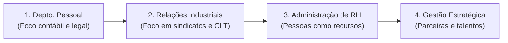
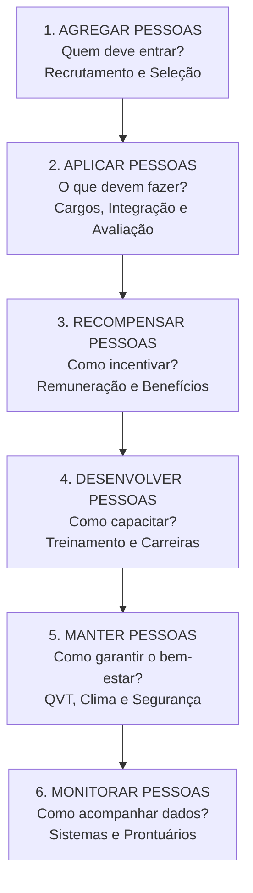
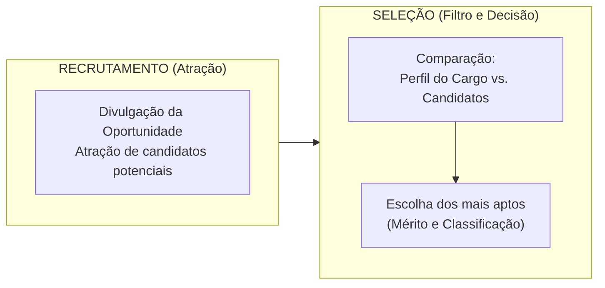
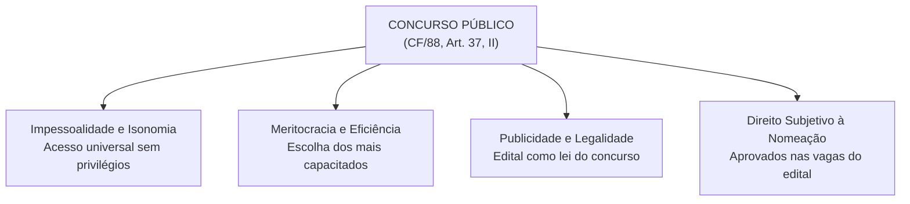
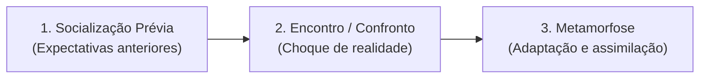

# 01 - Processos de Gestão de Pessoas, Recrutamento, Seleção e Integração

> **Matéria:** Gestão de Pessoas  
> **Cargo:** A01 – Técnico de Controle Externo – Especialidade: Técnico Administrativo (TCE-GO)  
> **Conteúdo Oficial:** Processos de Gestão de Pessoas (modelo de Chiavenato); Recrutamento e Seleção de Pessoas; Rotinas de Departamento Pessoal; O Concurso Público como Instrumento Republicano; Socialização e Integração Organizacional (*Onboarding*).

---

## 📌 Ementa & Delimitação do Conteúdo

1. **Evolução Histórica dos Paradigmas de Pessoas:**
    - Fase Contábil / Departamento Pessoal: foco estritamente legal, registro de ponto, apuração de folha de pagamento e custos operacionais; pessoas tratadas como engrenagens mecânicas e mão de obra passiva.
    - Fase Legal / Relações Industriais: impacto da legislação trabalhista e relações sindicais; conciliação de conflitos corporativos.
    - Fase Clássica / Administração de Recursos Humanos (ARH): pessoas vistas como insumos e recursos produtivos homogêneos sujeitos a comando e controle.
    - Fase Estratégica / Gestão Estratégica de Pessoas (GEP): pessoas como parceiras ativas do negócio, sujeitos dotados de competências, inteligência, iniciativa e capital intelectual indispensável para a entrega de valor público.

2. **Os Seis Processos da Gestão de Pessoas (Modelo de Idalberto Chiavenato):**
    - **Agregar Pessoas:** quem deve trabalhar na organização (recrutamento, seleção e planejamento de RH).
    - **Aplicar Pessoas:** o que as pessoas farão na organização (desenho de cargos, análise funcional, orientação/socialização organizacional e avaliação de desempenho).
    - **Recompensar Pessoas:** como incentivar e motivar os colaboradores (vencimento, remuneração, benefícios e incentivos).
    - **Desenvolver Pessoas:** como capacitar e aprimorar competências (treinamento, desenvolvimento funcional, aprendizagem organizacional e planos de carreira).
    - **Manter Pessoas:** como criar condições ambientais e psicológicas de permanência (clima organizacional, cultura, higiene, segurança e qualidade de vida no trabalho - QVT).
    - **Monitorar Pessoas:** como acompanhar e controlar as atividades e informações de pessoal (banco de dados, sistemas de informação gerencial de RH e auditoria de pessoal).

3. **Rotinas Administrativas do Departamento de Pessoal no Setor Público:**
    - Admissão, posse e exercício funcional; controle de assiduidade e pontualidade; processamento de folha de pagamento (vencimento básico, adicionais, gratificações e limites do teto constitucional); escala e concessão de férias; assentamentos individuais e prontuário funcional.

4. **O Processo de Agregar Pessoas — Recrutamento e Seleção:**
    - Recrutamento: mercado de trabalho vs. mercado de recursos humanos; técnicas de atração.
    - Recrutamento Interno vs. Recrutamento Externo vs. Recrutamento Misto: conceitos, vantagens e desvantagens de cada modalidade (destaque para a *endogamia cultural* no interno e os custos/tempo no externo).
    - Seleção de Pessoas como processo de comparação e decisão: requisitos do cargo (perfil de competências) vs. qualificações do candidato.
    - Técnicas e instrumentos de seleção: provas de conhecimentos e habilidades, entrevistas estruturadas e comportamentais por competências (técnica STAR), testes de aptidão e personalidade, dinâmicas de grupo e avaliação de títulos.
    - O Concurso Público (CF/88, art. 37, II): regime constitucional, princípios da impessoalidade, publicidade, isonomia e meritocracia; validade, prorrogação e direito subjetivo à nomeação dos aprovados no número de vagas.

5. **Processo de Socialização e Integração Organizacional (*Onboarding*):**
    - Conceito, relevância para a administração pública e aceleração do período de estágio probatório.
    - As três fases da socialização organizacional (Socialização Antecipatória, Encontro/Confronto e Metamorfose/Adaptação).
    - Práticas de integração: manuais do servidor, programas de boas-vindas, tutoria/mentoria institucional e cursos de formação da Escola de Contas.

---

## 🧭 Sumário

1. [Evolução Histórica dos Paradigmas de Gestão de Pessoas](#1-evolucao-historica-dos-paradigmas-de-gestao-de-pessoas)
2. [Os Seis Processos da Gestão de Pessoas (Chiavenato)](#2-os-seis-processos-da-gestao-de-pessoas-chiavenato)
    1. [Teste 430](#Teste-430)
    2. [Teste 431](#Teste-431)
3. [Rotinas Administrativas do Departamento de Pessoal no Setor Público](#3-rotinas-administrativas-do-departamento-de-pessoal-no-setor-publico)
4. [O Processo de Agregar Pessoas: Recrutamento e Seleção](#4-o-processo-de-agregar-pessoas-recrutamento-e-selecao)
    1. [Teste 432](#Teste-432)
    2. [Teste 433](#Teste-433)
    3. [Teste 434](#Teste-434)
5. [O Concurso Público como Instrumento Republicano (CF/88, art. 37)](#5-o-concurso-publico-como-instrumento-republicano-cf88-art-37)
    1. [Teste 435](#Teste-435)
    2. [Teste 436](#Teste-436)
6. [Processo de Socialização e Integração Organizacional (*Onboarding*)](#6-processo-de-socializacao-e-integracao-organizacional-onboarding)
    1. [Teste 437](#Teste-437)
    2. [Teste 438](#Teste-438)
    3. [Teste 439](#Teste-439)
7. [Fontes Oficiais e Referências Bibliográficas](#7-fontes-oficiais-e-referencias-bibliograficas)

---

## 1. Evolução Histórica dos Paradigmas de Gestão de Pessoas

A administração do trabalho humano passou por profundas transformações ao longo dos séculos XX e XXI, transitando de uma visão puramente mecanicista e punitiva para uma abordagem estratégica voltada ao desenvolvimento de competências.

#### Comparativo Histórico: As Quatro Eras

| Característica | Departamento Pessoal (Fase Contábil) | Relações Industriais (Fase Legal) | Recursos Humanos (Fase Clássica) | Gestão Estratégica de Pessoas (Atual) |
| :--- | :--- | :--- | :--- | :--- |
| **Período Predominante** | Início do século XX (Teoria Clássica / Taylorismo). | Décadas de 1930 a 1950 (Pós-Revolução de 30 / CLT). | Décadas de 1960 a 1980 (Abordagem Sistêmica / Contingencial). | Década de 1990 em diante (Era do Conhecimento). |
| **Concepção das Pessoas** | Engrenagens mecânicas, mão de obra braçal e geradoras de custo estrito. | Funcionários tutelados por normas estatais e sindicais. | Recursos produtivos padronizados a serem geridos e alocados. | **Parceiras estratégicas**, fontes de inteligência, competência e diferenciação. |
| **Foco de Atuação** | Registro mecânico de ponto, livros de registro e apuração de folha. | Cumprimento de leis trabalhistas, contratos coletivos e litígios. | Técnicas operacionais especializadas (cargos, salários, testes). | **Alinhamento com a estratégia**, geração de valor público e gestão do conhecimento. |
| **Papel da Liderança** | Fiscalização, vigilância e aplicação de punições regimentais. | Intermediação de acordos e gestão do cumprimento legal. | Supervisão hierárquica e controle burocrático de procedimentos. | Liderança coach, facilitação do desenvolvimento e delegação de autoridade (*empowerment*). |

#### Pessoas como Recursos vs. Pessoas como Parceiras (Idalberto Chiavenato)

* **Pessoas como Recursos:**
    * Tratadas como elementos passivos e estáticos de produção;
    * Devem ser rigidamente controladas, padronizadas e subordinadas à hierarquia;
    * Consideradas exclusivamente como centro de custos que consome verbas orçamentárias;
    * Foco na execução mecânica de tarefas predefinidas, sem incentivo à iniciativa própria.
* **Pessoas como Parceiras (Capital Intelectual):**
    * Tratadas como agentes proativos, autônomos e dotados de inteligência emocional e técnica;
    * Consideradas o ativo mais valioso e geradoras diretas de valor institucional;
    * Investimento prioritário da organização para a melhoria dos serviços públicos;
    * Estimuladas a inovar, assumir responsabilidade pelos resultados e compartilhar conhecimento.

---

---

## 2. Os Seis Processos da Gestão de Pessoas (Chiavenato)

Idalberto Chiavenato estrutura a gestão de pessoas como um sistema integrado composto por seis grandes macroprocessos dinâmicos e interdependentes:

| Macroprocesso | Questão Central | Ações, Ferramentas e Subsistemas Compreendidos |
| :--- | :--- | :--- |
| **1. Agregar Pessoas** | *Quem deve ingressar na organização?* | Planejamento de recursos humanos, recrutamento (interno/externo), seleção de pessoas e concurso público. |
| **2. Aplicar Pessoas** | *O que as pessoas farão na organização?* | Desenho organizacional de cargos, descrição e análise de funções, **socialização organizacional (integração)** e **avaliação de desempenho funcional**. |
| **3. Recompensar Pessoas** | *Como remunerar e incentivar o trabalho?* | Remuneração direta (vencimento básico), remuneração indireta, gratificações, adicionais pecuniários e benefícios sociais. |
| **4. Desenvolver Pessoas** | *Como capacitar e expandir o potencial?* | Diagnóstico de necessidades de treinamento (LNT), programas de capacitação, desenvolvimento gerencial, gestão do conhecimento e planos de carreira. |
| **5. Manter Pessoas** | *Como reter os servidores e assegurar bem-estar?* | Clima e cultura organizacional, programas de Qualidade de Vida no Trabalho (QVT), higiene, ergonomia, medicina do trabalho e relações sindicais. |
| **6. Monitorar Pessoas** | *Como registrar e acompanhar as informações?* | Bancos de dados funcionais, prontuários do servidor, sistemas integrados de gestão de RH (SIRH) e auditoria de pessoal. |

> 🚨 **ALERTA DE PROVA / PEGADINHA FCC (MACROPROCESSOS DE CHIAVENATO):**  
> A Fundação Carlos Chagas cobra com frequência pegadinhas sobre a alocação de subsistemas nesse modelo:  
>
> 1. A **Avaliação de Desempenho** pertence ao macroprocesso de **APLICAR PESSOAS** (e NÃO a "Monitorar pessoas" nem a "Desenvolver pessoas"). Aplicar significa verificar o que as pessoas fazem e como estão desempenhando suas atribuições.  
> 2. A **Integração / Socialização Organizacional** também integra os processos de **APLICAR PESSOAS**, pois orienta o servidor sobre como exercer seu cargo e agir dentro da instituição.  
> 3. O macroprocesso de **Monitorar Pessoas** restringe-se a cadastros, bancos de dados, relatórios gerenciais e auditoria de regularidade funcional.

---

### Teste 430
**(FGV – TRT – Analista Judiciário - Tecnologia da Informação – 2024)**
A gestão estratégica de pessoas é um enfoque que alinha as 
práticas de gestão de recursos humanos aos objetivos 
organizacionais. Essa abordagem integra planejamento de 
carreira, treinamento e desenvolvimento, avaliação de 
desempenho e recompensas, promovendo um ambiente de 
trabalho motivador e produtivo.  
Com relação à gestão estratégica de pessoas, avalie as afirmativas 
a seguir. 
I. A gestão estratégica de pessoas integra -se à estratégia 
organizacional, atendendo a objetivos  estratégicos, táticos e 
operacionais, todos devidamente interconectados. 
II. Não é necessário ter uma clara ideia do impacto do mercado 
e do ambiente externo em que a empresa está envolvida; a 
organização pode focar apenas em seus processos internos 
sem c onsiderar essas variáveis para a gestão estratégica de 
pessoas. 
III. A avaliação do desempenho e dos resultados é a etapa de 
feedback constante e ágil para medição do que foi planejado 
e realizado. 
Está correto o que se afirma em

* **A)** I, apenas.
* **B)** I e II, apenas.
* **C)** I e III, apenas.
* **D)** II e III, apenas.
* **E)** I, II e III.

---

> **Comentário Detalhado:**
>
> - **A)** Incorreta. Discrepa das diretrizes normativas e jurisprudenciais aplicáveis ao tema objeto do item.
> - **B)** Incorreta. Discrepa das diretrizes normativas e jurisprudenciais aplicáveis ao tema objeto do item.
> - **C)** Incorreta. Discrepa das diretrizes normativas e jurisprudenciais aplicáveis ao tema objeto do item.
> - **D)** Correta. Representa com precisão a disciplina do tema e o entendimento pacificado adotado pela banca (FGV).
> - **E)** Incorreta. Discrepa das diretrizes normativas e jurisprudenciais aplicáveis ao tema objeto do item.
>
> **Gabarito: D**

---
### Teste 431
**(FGV – TJ-BA – Analista Judiciário - Tecnologia da Informação – 2015)**
O texto 1 mostra seguidamente a participação do enunciador no 
assunto veiculado; o segmento em que essa participação está 
exemplificada de forma inadequada é:

* **A)** seleção de adjetivos subjetivos: “grandes tragédias”;
* **B)** dúvida tendenciosa: “motivados por ganância e poder”;
* **C)** opinião particular: “pessoas bem-intencionadas”;
* **D)** parcialidade no julgamento: “catástrofes terríveis”;
* **E)** análise pessoal: “escolhas egoístas”.

---

> **Comentário Detalhado:**
>
> - **A)** Incorreta. Discrepa das diretrizes normativas e jurisprudenciais aplicáveis ao tema objeto do item.
> - **B)** Correta. Representa com precisão a disciplina do tema e o entendimento pacificado adotado pela banca (FGV).
> - **C)** Incorreta. Discrepa das diretrizes normativas e jurisprudenciais aplicáveis ao tema objeto do item.
> - **D)** Incorreta. Discrepa das diretrizes normativas e jurisprudenciais aplicáveis ao tema objeto do item.
> - **E)** Incorreta. Discrepa das diretrizes normativas e jurisprudenciais aplicáveis ao tema objeto do item.
>
> **Gabarito: B**

---
## 3. Rotinas Administrativas do Departamento de Pessoal no Setor Público

Mesmo sob uma ótica estratégica, as rotinas operacionais de pessoal são indispensáveis para garantir a estrita legalidade e conformidade dos atos de gestão pública:

1. **Admissão e Investidura:**
    - Conferência de documentos pessoais e habilitação legal;
    - Realização de perícia médica oficial e aferição de aptidão física/mental;
    - Lavratura do termo de posse pela autoridade competente e registro do início do efetivo exercício.

2. **Controle de Frequência e Assiduidade:**
    - Acompanhamento do registro biométrico ou eletrônico de ponto;
    - Gestão de escalas de trabalho, compensações e banco de horas autorizadas;
    - Processamento de justificativas legais, faltas abonadas e desconto em folha decorrente de ausências não justificadas.

3. **Elaboração e Processamento da Folha de Pagamento:**
    - Apuração do vencimento básico atribuído ao cargo e padrão da carreira;
    - Lançamento de vantagens funcionais (quinquênios, gratificações de desempenho, adicionais de titulação, auxílio-alimentação e transporte);
    - Cálculo e retenção de descontos obrigatórios (Previdência Própria / Regime Geral e Imposto de Renda Retido na Fonte - IRRF);
    - Gestão de consignações facultativas em folha (empréstimos consignados, planos de saúde, mensalidades sindicais);
    - Aplicação e corte de remunerações que excedam o **teto remuneratório constitucional** (CF/88, art. 37, XI).

4. **Escala e Concessão de Férias:**
    - Controle do período aquisitivo (12 meses de efetivo exercício) e período concessivo;
    - Elaboração da escala anual de férias para evitar descontinuidade do serviço público;
    - Pagamento obrigatório do terço constitucional de férias.

5. **Assentamentos Individuais e Prontuário Funcional:**
    - Registro histórico de toda a vida funcional do servidor (designações, licenças, afastamentos, progressões, penalidades e elogios);
    - Averbação de tempo de contribuição prévio para fins de aposentadoria e disponibilidade.

---

---

## 4. O Processo de Agregar Pessoas: Recrutamento e Seleção

O processo de agregar pessoas inicia-se com o diagnóstico de necessidades de pessoal e desdobra-se em duas etapas interdependentes: o recrutamento (atração) e a seleção (escolha).

#### Recrutamento Interno vs. Recrutamento Externo vs. Recrutamento Misto

| Critério de Análise | Recrutamento Interno | Recrutamento Externo | Recrutamento Misto |
| :--- | :--- | :--- | :--- |
| **Origem dos Candidatos** | Colaboradores que já integram a instituição (promoções, relotações). | Candidatos externos disponíveis no mercado ou em outros órgãos. | Combina candidatos internos e externos na mesma disputa. |
| **Custo Financeiro** | **Muito baixo:** dispensa editais complexos e publicidade massiva. | **Elevado:** publicação de editais, contratação de bancas examinadoras. | Custo intermediário ou alto. |
| **Tempo de Execução** | **Rápido:** os colaboradores já são conhecidos e estão cadastrados. | **Lento e moroso:** prazos de inscrição, recursos e homologação. | Médio a longo. |
| **Impacto na Motivação** | Eleva a motivação interna e valoriza a carreira funcional. | Pode desmotivar servidores internos que almejavam a oportunidade. | Equilibra estímulo interno e ampliação de horizontes. |
| **Inovação Cultural** | **Risco de Endogamia Cultural (*Inbreeding*):** cristaliza velhos hábitos e rotinas. | **Renovação (*Sangue Novo*):** agrega novos saberes e rompe paradigmas. | Permite conciliar estabilidade institucional e inovação. |
| **Aplicação no Setor Público** | Restrito a funções de confiança e cargos em comissão privativos de efetivos. | **Regra Geral Constitucional:** Concurso Público de Provas ou Provas e Títulos. | Seleções internas prévias seguidas de concurso se deserto o quadro. |

> ⭐ **IMPORTANTE — CONCEITO DE ENDOGAMIA CULTURAL:**  
> A FCC adora cobrar o fenômeno da **endogamia organizacional** (ou cultural). Trata-se da tendência de um órgão ou empresa, ao recrutar exclusivamente membros de seus próprios quadros internos, de perpetuar os mesmos padrões de pensamento, cristalizar defeitos e inibir o surgimento de ideias inovadoras. O recrutamento externo atua justamente como antídoto à endogamia.

---

### Teste 432
**(FGV – TJ-RR – Analista Judiciário - Suporte e Infraestrutura de TI – 2024)**
Segundo a Resolução nº 400 de 16/06/2021 do Conselho Nacional 
de Justiça, os órgãos do Poder Judiciário devem adotar modelos de 
gestão organizacional com processos estruturados que promovam a 
sustentabilidade, com base em ações ambientalmente corretas, 
economicamente viáveis e socialmente justas e inclusivas, 
culturalmente diversas e pautadas na integridade, em busca de um 
desenvolvimento nacional sustentável. 
De acordo com a referida norma é correto afirmar que

* **A)** contratações compartilhadas são práticas institucionais que 
tenham como objetivo a promoção de comportamentos éticos e 
que contribuam para o desenvolvimento ambiental, social, 
cultural e econômico, melhorando, simultaneamente, o meio  
ambiente e a qualidade de vida do quadro de pessoal e auxiliar 
do Poder Judiciário.
* **B)** as ações socialmente justas e inclusivas têm como objetivo 
respeitar a variedade e a convivência entre ideias, 
características, gêneros e regionalismos no ambiente de 
trabalho.
* **C)** as ações ambientalmente corretas devem ter como objetivo a 
redução do impacto no meio ambiente, tendo como premissas o 
aumento do consumo, com o reaproveitamento e reciclagem de 
materiais e a observância aos modelos de padrão de consumo.
* **D)** as ações economicamente viáveis devem buscar critérios de 
eficiência contínua dos gastos, levando em consideração a real 
necessidade da compra/contratação dentre as propostas mais 
vantajosas (análise custo -benefício) para sustentação da 
instituição, tendo em vista as inovações nos processos de 
trabalho.
* **E)** as ações culturalmente diversas devem fomentar na instituição 
e em ações externas a adoção de comportamentos que 
promovam o equilíbrio e o bem -estar no ambiente de trabalho, 
por meio de atividades voltad as ao cuidado preventivo com a 
saúde, acessibilidade e inclusão social dos quadros de pessoal e 
auxiliar.

---

> **Comentário Detalhado:**
>
> - **A)** Incorreta. Discrepa das diretrizes normativas e jurisprudenciais aplicáveis ao tema objeto do item.
> - **B)** Incorreta. Discrepa das diretrizes normativas e jurisprudenciais aplicáveis ao tema objeto do item.
> - **C)** Incorreta. Discrepa das diretrizes normativas e jurisprudenciais aplicáveis ao tema objeto do item.
> - **D)** Correta. Representa com precisão a disciplina do tema e o entendimento pacificado adotado pela banca (FGV).
> - **E)** Incorreta. Discrepa das diretrizes normativas e jurisprudenciais aplicáveis ao tema objeto do item.
>
> **Gabarito: D**

---
### Teste 433
**(FGV – TJ-RR – Analista Judiciário - Suporte e Infraestrutura de TI – 2024)**
Os princípios da gestão de qualidade incluem os seguintes,  
à exceção de um. Assinale-o.

* **A)** Liderança.
* **B)** Foco no cliente.
* **C)** Envolvimento das pessoas.
* **D)** Abordagem de processo.
* **E)** Inovação estratégica.

---

> **Comentário Detalhado:**
>
> - **A)** Incorreta. Discrepa das diretrizes normativas e jurisprudenciais aplicáveis ao tema objeto do item.
> - **B)** Incorreta. Discrepa das diretrizes normativas e jurisprudenciais aplicáveis ao tema objeto do item.
> - **C)** Incorreta. Discrepa das diretrizes normativas e jurisprudenciais aplicáveis ao tema objeto do item.
> - **D)** Incorreta. Discrepa das diretrizes normativas e jurisprudenciais aplicáveis ao tema objeto do item.
> - **E)** Correta. Representa com precisão a disciplina do tema e o entendimento pacificado adotado pela banca (FGV).
>
> **Gabarito: E**

---
### Teste 434
**(FGV – TJ-RR – Analista Judiciário - Governança e Gestão de TI – 2024)**
Segundo a Resolução nº 400 de 16/06/2021 do Conselho Nacional 
de Justiça, os órgãos do Poder Judiciário devem adotar modelos de 
gestão organizacional com processos estruturados que promovam a 
sustentabilidade, com base em ações ambientalmente corretas, 
economicamente viáveis e socialmente justas e inclusivas, 
culturalmente diversas e pautadas na integridade, em busca de um 
desenvolvimento nacional sustentável. 
De acordo com a referida norma é correto afirmar que

* **A)** contratações compartilhadas são práticas institucionais que 
tenham como objetivo a promoção de comportamentos éticos e 
que contribuam para o desenvolvimento ambiental, social, 
cultural e econômico, melhorando, simultaneamente, o meio  
ambiente e a qualidade de vida do quadro de pessoal e auxiliar 
do Poder Judiciário.
* **B)** as ações socialmente justas e inclusivas têm como objetivo 
respeitar a variedade e a convivência entre ideias, 
características, gêneros e regionalismos no ambiente de 
trabalho.
* **C)** as ações ambientalmente corretas devem ter como objetivo a 
redução do impacto no meio ambiente, tendo como premissas o 
aumento do consumo, com o reaproveitamento e reciclagem de 
materiais e a observância aos modelos de padrão de consumo.
* **D)** as ações economicamente viáveis devem buscar critérios de 
eficiência contínua dos gastos, levando em consideração a real 
necessidade da compra/contratação dentre as propostas mais 
vantajosas (análise custo -benefício) para sustentação da 
instituição, tendo em vista as inovações nos processos de 
trabalho.
* **E)** as ações culturalmente diversas devem fomentar na instituição 
e em ações externas a adoção de comportamentos que 
promovam o equilíbrio e o bem -estar no ambiente de trabalho, 
por meio de atividades voltad as ao cuidado preventivo com a 
saúde, acessibilidade e inclusão social dos quadros de pessoal e 
auxiliar.

---

> **Comentário Detalhado:**
>
> - **A)** Incorreta. Discrepa das diretrizes normativas e jurisprudenciais aplicáveis ao tema objeto do item.
> - **B)** Incorreta. Discrepa das diretrizes normativas e jurisprudenciais aplicáveis ao tema objeto do item.
> - **C)** Incorreta. Discrepa das diretrizes normativas e jurisprudenciais aplicáveis ao tema objeto do item.
> - **D)** Correta. Representa com precisão a disciplina do tema e o entendimento pacificado adotado pela banca (FGV).
> - **E)** Incorreta. Discrepa das diretrizes normativas e jurisprudenciais aplicáveis ao tema objeto do item.
>
> **Gabarito: D**

---
## 5. O Concurso Público como Instrumento Republicano (CF/88, art. 37)

No Estado Democrático de Direito, o concurso público é a ferramenta primordial para democratizar o acesso aos cargos públicos e garantir um corpo funcional competente e impessoal.

* **Exigência Constitucional (Art. 37, II):** A investidura em cargo ou emprego público depende de aprovação prévia em concurso público de provas ou de provas e títulos, de acordo com a natureza e a complexidade do cargo ou emprego, na forma prevista em lei.
* **Exceções Constitucionais Expressas:**
    1. *Cargos em comissão declarados em lei de livre nomeação e exoneração* (destinados exclusivamente às atribuições de direção, chefia e assessoramento — art. 37, II e V);
    2. *Contratação por tempo determinado* para atender a necessidade temporária de excepcional interesse público (Processo Seletivo Simplificado - PSS, art. 37, IX);
    3. *Agentes Comunitários de Saúde e de Combate às Endemias* (processo seletivo público específico, art. 198, § 4º).

* **Prazo de Validade (Art. 37, III):** Até dois anos, prorrogável uma vez por igual período (critério de discricionariedade da administração, dentro do período inicial).
* **Direito Subjetivo à Nomeação (Jurisprudência Vinculante do STF - Tema 161 / RE 598.099):** O candidato aprovado dentro do número de vagas previsto originariamente no edital do concurso público possui **direito público subjetivo à nomeação** durante o prazo de validade do certame. A recusa da administração só é admitida em hipóteses excepcionalíssimas (superveniência, imprevisibilidade, gravidade extrema e necessidade inafastável).

> 🚨 **ALERTA DE PROVA / PEGADINHA FCC (PROVA DE TÍTULOS E VALIDADE):**  
> A banca adora questionar os **critérios de validade da prova de títulos**. Memorize: no concurso público, a fase de avaliação de títulos possui caráter **estritamente classificatório**, sendo terminantemente inconstitucional conferir-lhe caráter eliminatório!  
> Além disso, o art. 37, III da CF/88 estabelece que o concurso terá validade de **até 2 anos**, prorrogável uma vez por igual período. A prorrogação deve ser pelo **mesmo prazo** fixado no edital original (se o edital fixou 1 ano, prorroga-se por mais 1 ano; se fixou 6 meses, prorroga-se por 6 meses).

> ⭐ **IMPORTANTE — CONCURSO PÚBLICO E CARGOS COMISSIONADOS:**  
> A investidura mediante concurso é a regra para **cargos de provimento efetivo** e empregos públicos. Funções de confiança e cargos comissionados dispensam concurso público formal, mas as funções de confiança são reservadas **exclusivamente a servidores ocupantes de cargo efetivo**, enquanto os cargos em comissão possuem um percentual mínimo legal reservado a servidores de carreira (CF/88, art. 37, V).

---

### Teste 435
**(FGV – TJ-RR – Analista Judiciário - Governança e Gestão de TI – 2024)**
Os princípios da gestão de qualidade incluem os seguintes,  
à exceção de um. Assinale-o.

* **A)** Liderança.
* **B)** Foco no cliente.
* **C)** Envolvimento das pessoas.
* **D)** Abordagem de processo.
* **E)** Inovação estratégica.

---

> **Comentário Detalhado:**
>
> - **A)** Incorreta. Discrepa das diretrizes normativas e jurisprudenciais aplicáveis ao tema objeto do item.
> - **B)** Incorreta. Discrepa das diretrizes normativas e jurisprudenciais aplicáveis ao tema objeto do item.
> - **C)** Incorreta. Discrepa das diretrizes normativas e jurisprudenciais aplicáveis ao tema objeto do item.
> - **D)** Incorreta. Discrepa das diretrizes normativas e jurisprudenciais aplicáveis ao tema objeto do item.
> - **E)** Correta. Representa com precisão a disciplina do tema e o entendimento pacificado adotado pela banca (FGV).
>
> **Gabarito: E**

---
### Teste 436
**(FGV – TRT-DA 24-REGIÃO – Analista Judiciário - Tecnologia da Informação – 2025)**
A gestão de pessoas no setor público envolve processos integrados 
de recrutamento, seleção, capacitação, desenvolvimento, 
avaliação de desempenho e gestão de carreiras, com foco na 
valorização dos servidores e na melhoria da qualidade dos serviços 
prestados à sociedade. 
Assinale a opção que apresenta corretamente uma das bases 
fundamentais da gestão do desempenho no setor público.

* **A)** Concentra-se exclusivamente na avaliação de resultados, sem 
considerar o planejamento ou o apoio ao servidor.
* **B)** A revisão do desempenho não deve conter feedbacks ao 
servidor, para preservar a imparcialidade da avaliação.
* **C)** O foco está apenas no cumprimento das metas 
organizacionais, não sendo necessário alinhar objetivos 
departamentais.
* **D)** A definição de objetivos departamentais ocorre após a 
avaliação de desempenho, para garantir o cumprimento dos 
planos de desenvolvimento.
* **E)** A condução do desempenho envolve ações como apoio e 
supervisão, coaching e mentoring, com o objetivo de 
promover o desenvolvimento contínuo do servidor.

---

> **Comentário Detalhado:**
>
> - **A)** Incorreta. Discrepa das diretrizes normativas e jurisprudenciais aplicáveis ao tema objeto do item.
> - **B)** Incorreta. Discrepa das diretrizes normativas e jurisprudenciais aplicáveis ao tema objeto do item.
> - **C)** Incorreta. Discrepa das diretrizes normativas e jurisprudenciais aplicáveis ao tema objeto do item.
> - **D)** Correta. Representa com precisão a disciplina do tema e o entendimento pacificado adotado pela banca (FGV).
> - **E)** Incorreta. Discrepa das diretrizes normativas e jurisprudenciais aplicáveis ao tema objeto do item.
>
> **Gabarito: D**

---
## 6. Processo de Socialização e Integração Organizacional (*Onboarding*)

A socialização organizacional é o processo formativo e cultural por meio do qual o novo servidor aprende os valores essenciais, regras informais, jargões, posturas e competências exigidas pelo órgão.

#### As Três Etapas da Socialização Organizacional (Stephen Robbins)

1. **Fase 1: Socialização Prévia (ou Antecipatória):**
    - Ocorre antes do ingresso formal do servidor na repartição;
    - O indivíduo traz consigo valores acadêmicos, crenças sociais e expectativas idealizadas a respeito da carreira e do órgão público.

2. **Fase 2: Encontro (ou Confronto):**
    - Ocorre no momento em que o servidor toma posse e entra em efetivo exercício;
    - Há um inevitável confronto entre suas expectativas prévias e a realidade concreta da repartição (rotinas burocráticas, sistemas informatizados, hierarquias);
    - Programas formais de acolhimento reduzem o risco de choque cultural traumático.

3. **Fase 3: Metamorfose (ou Adaptação Permanente):**
    - O novo servidor internaliza as normas, compreende a linguagem corporativa e ajusta seu comportamento aos padrões institucionais;
    - Desenvolve sensação de pertencimento, segurança psicológica e alinhamento com a missão do Tribunal de Contas.

---

### Teste 437
**(FGV – TCE-GO – Analista de Controle Externo - Controle Externo – 2024)**
Os princípios de governança pública são fundamentos 
orientadores que promovem a transparência, a responsabilidade, 
a eficácia e a equidade nas ações e decisões do setor público, 
visando ao interesse público e ao desenvolvimento sustentável. 
Assinale, dentre as opções a seguir , a que compreende princípios 
de governança pública.

* **A)** Integridade, melhoria regulatória e transparência.
* **B)** Competência, responsabilidade e transparência.
* **C)** Integridade, liderança e motivação.
* **D)** Competência, integridade e liderança.
* **E)** Integridade, melhoria regulatória e liderança. 
CONCURSO PÚBLICO PARA TRIBUNAL DE CONTAS DO ESTADO DE GOIÁS - NÍVEL SUPERIOR  #organizadora# 

Realização 
DE GOIÁS 
CONCURSO PÚBLICO – EDITAL 01/2024  

TARDE 
JURIDICA 

 NÍVEL SUPERIOR TIPO 1 – BRANCA  

• Além deste caderno contendo 2 (duas) 
discursivas você receberá do fiscal de sala a folha 
de texto definitivo; 
• As questões discursivas deverão ser redigidas em 
até 20 (vinte) linhas.   

•  

• Verifique se seu caderno de questões está completo, 
sem repetição de questões ou falhas. Caso contrário, 
notifique imediatamente o fiscal da sala, para que 
sejam tomadas as devidas providências; 
• Confira seus dados pessoais, especialmente nome, 
número de inscrição e documento de identidade e leia 
atentamente as instruções para preencher a folha de 
texto definitivo; 
• Para o preenchimento das folhas de textos definitivos, 
use somente caneta esferográf ica, fabricada em 
material transparente, com tinta preta ou azul; 
• Assine seu nome apenas nos espaços reservados nas 
folhas de textos definitivos; 
• Confira seu cargo, cor e tipo do caderno de questões. 
Caso tenha recebido caderno de cargo ou cor ou tipo 
diferente do impresso em sua s folhas de texto s 
definitivos, o fiscal de sala deve ser obrigatoriamente 
informado para o devido registro na ata da sala; 
• Reserve tempo suficiente para o preenchimento das 
suas folhas de textos definitivos. O preenchimento é de 
sua responsabilidade e não será permitida a troca 
das folhas de textos definitivos em caso de erro 
cometido pelo candidato; 
• Para fins de avaliação, serão levadas em consideração 
apenas as marcações realizadas nas folhas de textos 
definitivos; 
• A FGV coletará as impressões digitais dos candidatos 
na lista de presença; 
• Os candidatos serão submetidos ao sistema de 
detecção de metais quando do ingresso e da saída de 
sanitários durante a realização das provas. 
• Boa prova! 

• Você dispõe de 2 (duas) horas para a realização 
da prova, já incluído o tempo para o preenchimento 
das folhas de textos definitivos; 
• 1 (uma) hora após o início da prova, é possível 
retirar-se da sala, sem levar o caderno de questões; 
• A partir dos 30 (trinta) minutos anteriores ao 
término da prova é possível retirar -se da sala  
levando o caderno de questões. 

• Qualquer tipo de comunicação entre os candidatos 
durante a aplicação da prova; 
• Anotar informações relativas às respostas em 
qualquer outro meio que não seja o caderno de 
questões; 
• Levantar da cadeira sem autorização do fiscal de 
sala; 
• Usar o sanitário ao término da prova, após deixar 
a sala. 
SUA PROVA 
TEMPO 
NÃO SERÁ PERMITIDO 
INFORMAÇÕES GERAIS 

Jurídica - Discursiva

---

> **Comentário Detalhado:**
>
> - **A)** Incorreta. Discrepa das diretrizes normativas e jurisprudenciais aplicáveis ao tema objeto do item.
> - **B)** Incorreta. Discrepa das diretrizes normativas e jurisprudenciais aplicáveis ao tema objeto do item.
> - **C)** Incorreta. Discrepa das diretrizes normativas e jurisprudenciais aplicáveis ao tema objeto do item.
> - **D)** Correta. Representa com precisão a disciplina do tema e o entendimento pacificado adotado pela banca (FGV).
> - **E)** Incorreta. Discrepa das diretrizes normativas e jurisprudenciais aplicáveis ao tema objeto do item.
>
> **Gabarito: D**

---
### Teste 438
**(FGV – TCE-GO – Analista de Controle Externo - Controle Externo – 2024)**
Relacione os tipos de precipitação a segui r com as respectivas 
definições. 
1 Orográfica. 
2 Convectiva. 
3 Frontal. 
(   ) Ocorre ao longo da linha de descontinuidade, separando duas 
massas de ar de características diferentes. 
(   ) Provocadas pela ascensão de ar devido às diferenças de 
temperatura na camada vizinha da atmosfera. 
(   ) Ocorrem quando o ar é forçado a transpor barreiras de 
montanhas. 
Assinale a opção que indica a relação correta na ordem 
apresentada.

* **A)** 1 – 2 – 3
* **B)** 2 – 1 – 3
* **C)** 2 – 3 – 1
* **D)** 3 – 1 – 2
* **E)** 3 – 2 – 1 

CONCURSO PÚBLICO PARA TRIBUNAL DE CONTAS DO ESTADO DE GOIÁS - NÍVEL SUPERIOR  #organizadora# 

Realização 
DE GOIÁS 
CONCURSO PÚBLICO – EDITAL 01/2024  

TARDE 
ENGENHARIA 

 NÍVEL SUPERIOR TIPO 1 – BRANCA  

• Além deste caderno contendo 2 (duas) 
discursivas você receberá do fiscal de sala a folha 
de texto definitivo; 
• As questões discursivas deverão ser redigidas em 
até 20 (vinte) linhas.   

•  

• Verifique se seu caderno de questões está completo, 
sem repetição de questões ou falhas. Caso contrário, 
notifique imediatamente o fiscal da sala, para que 
sejam tomadas as devidas providências; 
• Confira seus dados pessoais, especialmente nome, 
número de inscrição e documento de identidade e leia 
atentamente as instruções para preencher a folha de 
texto definitivo; 
• Para o preenchimento das folhas de textos definitivos, 
use somente caneta esferográf ica, fabricada em 
material transparente, com tinta preta ou azul; 
• Assine seu nome apenas nos espaços reservados nas 
folhas de textos definitivos; 
• Confira seu cargo, cor e tipo do caderno de questões. 
Caso tenha recebido caderno de cargo ou cor ou tipo 
diferente do impresso em sua s folhas de texto s 
definitivos, o fiscal de sala deve ser obrigatoriamente 
informado para o devido registro na ata da sala; 
• Reserve tempo suficiente para o preenchimento das 
suas folhas de textos definitivos. O preenchimento é de 
sua responsabilidade e não será permitida a troca 
das folhas de textos definitivos em caso de erro 
cometido pelo candidato; 
• Para fins de avaliação, serão levadas em consideração 
apenas as marcações realizadas nas folhas de textos 
definitivos; 
• A FGV coletará as impressões digitais dos candidatos 
na lista de presença; 
• Os candidatos serão submetidos ao sistema de 
detecção de metais quando do ingresso e da saída de 
sanitários durante a realização das provas. 
• Boa prova! 

• Você dispõe de 2 (duas) horas para a realização 
da prova, já incluído o tempo para o preenchimento 
das folhas de textos definitivos; 
• 1 (uma) hora após o início da prova, é possível 
retirar-se da sala, sem levar o caderno de questões; 
• A partir dos 30 (trinta) minutos anteriores ao 
término da prova é possível retirar -se da sala  
levando o caderno de questões. 

• Qualquer tipo de comunicação entre os candidatos 
durante a aplicação da prova; 
• Anotar informações relativas às respostas em 
qualquer outro meio que não seja o caderno de 
questões; 
• Levantar da cadeira sem autorização do fiscal de 
sala; 
• Usar o sanitário ao término da prova, após deixar 
a sala. 
SUA PROVA 
TEMPO 
NÃO SERÁ PERMITIDO 
INFORMAÇÕES GERAIS 

Engenharia - Discursiva

---

> **Comentário Detalhado:**
>
> - **A)** Incorreta. Discrepa das diretrizes normativas e jurisprudenciais aplicáveis ao tema objeto do item.
> - **B)** Incorreta. Discrepa das diretrizes normativas e jurisprudenciais aplicáveis ao tema objeto do item.
> - **C)** Incorreta. Discrepa das diretrizes normativas e jurisprudenciais aplicáveis ao tema objeto do item.
> - **D)** Correta. Representa com precisão a disciplina do tema e o entendimento pacificado adotado pela banca (FGV).
> - **E)** Incorreta. Discrepa das diretrizes normativas e jurisprudenciais aplicáveis ao tema objeto do item.
>
> **Gabarito: D**

---
### Teste 439
**(FGV – TCE-GO – Analista de Controle Externo - Controle Externo – 2024)**
Em relação à Análise da Variância (ANOVA), as afirmativas a seguir 
estão corretas, à exceção de uma. 
Assinale-a.

* **A)** É um método para testar a igualdade de três ou mais médias 
populacionais, baseado na análise das variâncias amostrais.
* **B)** Os dados amostrais são separados em grupos segundo uma 
característica denominada fator. Fator (ou tratamento) é uma 
característica que permite distinguir diferentes populações 
umas das outras.
* **C)** Cada fator contém dois ou mais grupos (classificações).
* **D)** Amostras são aleatórias e mutuamente dependentes.
* **E)** Suposições incluem: populações normalmente distribuídas e 
de mesma variância. 

Realização 
DE GOIÁS 
CONCURSO PÚBLICO – EDITAL 01/2024  

TARDE 
CONTROLE EXTERNO 

 NÍVEL SUPERIOR TIPO 1 – BRANCA  

• Além deste caderno contendo 2 (duas) 
discursivas você receberá do fiscal de sala a folha 
de texto definitivo; 
• As questões discursivas deverão ser redigidas em 
até 20 (vinte) linhas.   

•  

• Verifique se seu caderno de questões está completo, 
sem repetição de questões ou falhas. Caso contrário, 
notifique imediatamente o fiscal da sala, para que 
sejam tomadas as devidas providências; 
• Confira seus dados pessoais, especialmente nome, 
número de inscrição e documento de identidade e leia 
atentamente as instruções para preencher a folha de 
texto definitivo; 
• Para o preenchimento das folhas de textos definitivos, 
use somente caneta esferográf ica, fabricada em 
material transparente, com tinta preta ou azul; 
• Assine seu nome apenas nos espaços reservados nas 
folhas de textos definitivos; 
• Confira seu cargo, cor e tipo do caderno de questões. 
Caso tenha recebido caderno de cargo ou cor ou tipo 
diferente do impresso em sua s folhas de texto s 
definitivos, o fiscal de sala deve ser obrigatoriamente 
informado para o devido registro na ata da sala; 
• Reserve tempo suficiente para o preenchimento das 
suas folhas de textos definitivos. O preenchimento é de 
sua responsabilidade e não será permitida a troca 
das folhas de textos definitivos em caso de erro 
cometido pelo candidato; 
• Para fins de avaliação, serão levadas em consideração 
apenas as marcações realizadas nas folhas de textos 
definitivos; 
• A FGV coletará as impressões digitais dos candidatos 
na lista de presença; 
• Os candidatos serão submetidos ao sistema de 
detecção de metais quando do ingresso e da saída de 
sanitários durante a realização das provas. 
• Boa prova! 

• Você dispõe de 2 (duas) horas para a realização 
da prova, já incluído o tempo para o preenchimento 
das folhas de textos definitivos; 
• 1 (uma) hora após o início da prova, é possível 
retirar-se da sala, sem levar o caderno de questões; 
• A partir dos 30 (trinta) minutos anteriores ao 
término da prova é possível retirar -se da sala  
levando o caderno de questões. 

• Qualquer tipo de comunicação entre os candidatos 
durante a aplicação da prova; 
• Anotar informações relativas às respostas em 
qualquer outro meio que não seja o caderno de 
questões; 
• Levantar da cadeira sem autorização do fiscal de 
sala; 
• Usar o sanitário ao término da prova, após deixar 
a sala. 
SUA PROVA 
TEMPO 
NÃO SERÁ PERMITIDO 
INFORMAÇÕES GERAIS 

Controle Externo - Discursiva

---

> **Comentário Detalhado:**
>
> - **A)** Incorreta. Discrepa das diretrizes normativas e jurisprudenciais aplicáveis ao tema objeto do item.
> - **B)** Incorreta. Discrepa das diretrizes normativas e jurisprudenciais aplicáveis ao tema objeto do item.
> - **C)** Incorreta. Discrepa das diretrizes normativas e jurisprudenciais aplicáveis ao tema objeto do item.
> - **D)** Correta. Representa com precisão a disciplina do tema e o entendimento pacificado adotado pela banca (FGV).
> - **E)** Incorreta. Discrepa das diretrizes normativas e jurisprudenciais aplicáveis ao tema objeto do item.
>
> **Gabarito: D**

---
## 7. Fontes Oficiais e Referências Bibliográficas

* [Constituição Federal de 1988 - Art. 37, II e IX (Concurso Público e Contratação)](https://www.planalto.gov.br/ccivil_03/constituicao/constituicao.htm#art37) - Requisito obrigatório de prévia aprovação em concurso público de provas ou de provas e títulos.
* [Lei Estadual nº 20.756/2020 - Título II (Do Provimento, Concurso e Posse)](https://legisla.casacivil.go.gov.br/pesquisa_legislacao/100979/lei-20756) - Regras estaduais sobre edital de concurso, prazos de validade, nomeação, posse e exercício dos servidores goianos.
* [Lei Estadual nº 15.122/2005 (Plano de Cargos e Carreira dos Servidores do TCE-GO)](https://legisla.casacivil.go.gov.br/pesquisa_legislacao/80023/lei-15122) - Atribuições, requisitos de ingresso e especialidades dos cargos efetivos do tribunal.
* [STF Súmula Vinculante 13 (Vedação ao Nepotismo no Provimento)](https://portal.stf.jus.br/jurisprudencia/sumarios/sumulavinculante.asp?seq=13) - Proíbe nomeação de cônjuge, companheiro ou parente até o terceiro grau para cargo em comissão ou função gratificada.
* [Decreto Federal nº 9.991/2019 (Política de Ingresso e Dimensionamento da Força de Trabalho)](https://www.planalto.gov.br/ccivil_03/_ato2019-2022/2019/decreto/d9991.htm) - Metodologia de planejamento da força de trabalho e competências necessárias no setor público.
* CHIAVENATO, Idalberto. **Gestão de Pessoas: O Novo Papel dos Recursos Humanos nas Organizações**. 5. ed. São Paulo: Atlas, 2020. (Cap. 4 - Recrutamento de Pessoas; Cap. 5 - Seleção de Pessoas; Cap. 6 - Socialização Organizacional).
* MARRAS, Jean Pierre. **Administração de Recursos Humanos: Do Operacional ao Estratégico**. 15. ed. São Paulo: Saraiva, 2016. (Cap. 3 - Recrutamento e Seleção de Pessoal).
* MEIRELLES, Hely Lopes. **Direito Administrativo Brasileiro**. 44. ed. São Paulo: Malheiros, 2020. (Cap. 8 - Servidores Públicos e Concurso Público).
