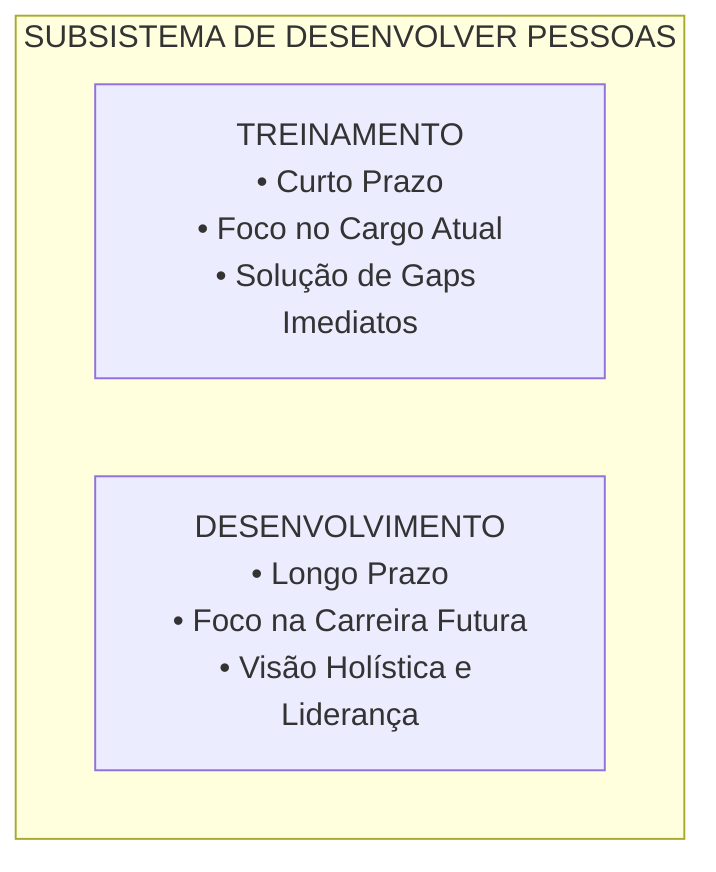
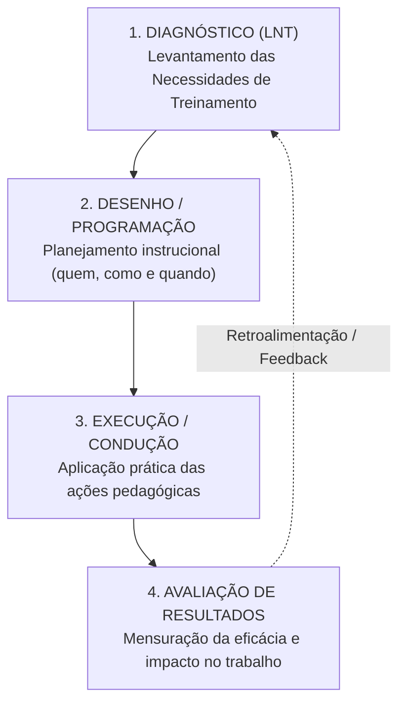
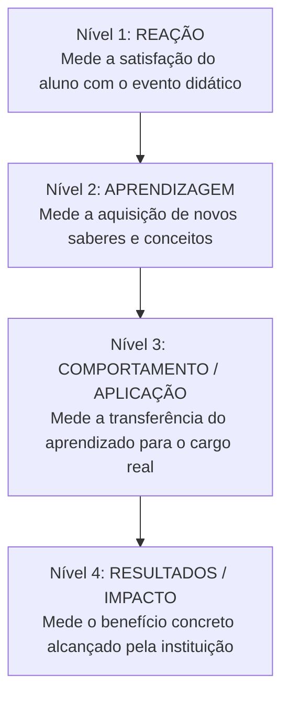
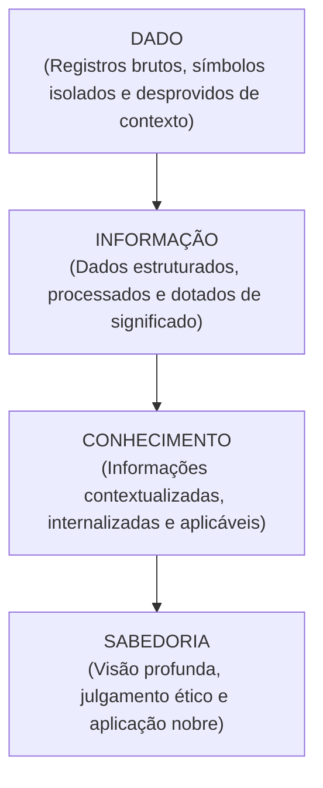
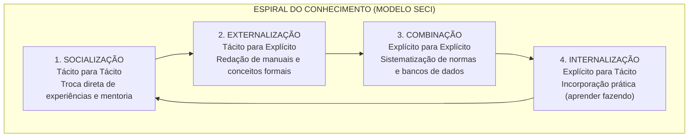

# 02 - Treinamento, Desenvolvimento, Gestão do Conhecimento e Aprendizagem Organizacional

> **Matéria:** Gestão de Pessoas  
> **Cargo:** A01 – Técnico de Controle Externo – Especialidade: Técnico Administrativo (TCE-GO)  
> **Conteúdo Oficial:** Treinamento vs. Desenvolvimento de Pessoas; As Quatro Etapas do Ciclo de Treinamento (LNT, Desenho, Execução e Avaliação de Resultados); Modelo dos 4 Níveis de Kirkpatrick; Gestão do Conhecimento (Tácito vs. Explícito e Modelo SECI de Nonaka e Takeuchi); Aprendizagem Organizacional e as Cinco Disciplinas de Peter Senge; Educação Corporativa e Escolas de Governo.

---

## 📌 Ementa & Delimitação do Conteúdo

1. **Diferenciação Teórica: Treinamento vs. Desenvolvimento de Pessoas:**
    - Critérios de temporalidade (curto prazo vs. longo prazo);
    - Foco do treinamento: cargo atual, suprimento de carências imediatas de desempenho operacional;
    - Foco do desenvolvimento: carreira, ampliação do potencial intelectual e cargos/desafios futuros;
    - Papel de T&D no macroprocesso de **Desenvolver Pessoas** de Idalberto Chiavenato.

2. **O Ciclo Estratégico de Treinamento (4 Etapas Integradas):**
    - **Etapa 1: Diagnóstico / Levantamento de Necessidades de Treinamento (LNT):** análise organizacional, análise da força de trabalho/competências e análise funcional/individual (instrumentos: avaliação de desempenho, observação direta, entrevistas com lideranças e incidentes críticos).
    - **Etapa 2: Desenho e Programação do Treinamento:** os 6 parâmetros do projeto instrucional (*quem deve ser treinado, quem vai treinar, em que treinar, onde treinar, como treinar e quando treinar*).
    - **Etapa 3: Execução e Condução:** metodologias ativas, simulações, oficinas práticas, cursos presenciais e Ensino a Distância (EaD/microlearning).
    - **Etapa 4: Avaliação dos Resultados (Modelo de Donald Kirkpatrick):**
    - Nível 1: Reação e Satisfação;
    - Nível 2: Aprendizado e Retenção Cognitiva;
    - Nível 3: Comportamento no Cargo / Aplicabilidade / Transferência do Aprendizado;
    - Nível 4: Resultados Organizacionais e Impacto Institucional (ampliação de eficiência no controle externo);
    - O Modelo de Jack Phillips: o 5º Nível (*Return on Investment* - ROI financeiro).

3. **Gestão do Conhecimento Organizacional:**
    - A pirâmide cognitiva: Dado $\rightarrow$ Informação $\rightarrow$ Conhecimento $\rightarrow$ Sabedoria (Modelo DIKW);
    - Conhecimento Tácito (subjetivo, pessoal, empírico, interiorizado e difícil de formalizar) vs. Conhecimento Explícito (estruturado, codificado, documentado em manuais, leis e sistemas);
    - O Modelo SECI e a Espiral do Conhecimento (Ikujiro Nonaka e Hirotaka Takeuchi):
    - **Socialização:** Tácito $\rightarrow$ Tácito (compartilhamento de experiências diretas e tutoria);
    - **Externalização:** Tácito $\rightarrow$ Explícito (articulação do saber prático em manuais e conceitos);
    - **Combinação:** Explícito $\rightarrow$ Explícito (cruzamento e sistematização de bases documentais);
    - **Internalização:** Explícito $\rightarrow$ Tácito (incorporação do conteúdo na prática diária - *learning by doing*);
    - O conceito japonês de *Ba* (contexto e espaço compartilhado para geração de conhecimento).

4. **Aprendizagem Organizacional e a Organização que Aprende:**
    - Aprendizagem em Circuito Simples (*Single-Loop Learning*) vs. Aprendizagem em Circuito Duplo (*Double-Loop Learning*) segundo Chris Argyris e Donald Schön;
    - As Cinco Disciplinas de Peter Senge (*A Quinta Disciplina*): Domínio Pessoal, Modelos Mentais, Visão Compartilhada, Aprendizagem em Equipe e Pensamento Sistêmico;
    - Educação Corporativa no Setor Público: Escolas de Governo e a atuação da Escola Superior de Controle do TCE-GO (Instituto Leopoldo de Bulhões - ILB).

---

## 🧭 Sumário

1. [Treinamento vs. Desenvolvimento de Pessoas](#1-treinamento-vs-desenvolvimento-de-pessoas)
    1. [Teste 440](#Teste-440)
    2. [Teste 441](#Teste-441)
2. [O Ciclo de Treinamento em Quatro Etapas e a Avaliação de Kirkpatrick](#2-o-ciclo-de-treinamento-em-quatro-etapas-e-a-avaliacao-de-kirkpatrick)
    1. [Teste 442](#Teste-442)
    2. [Teste 443](#Teste-443)
3. [Gestão do Conhecimento Organizacional e o Modelo SECI](#3-gestao-do-conhecimento-organizacional-e-o-modelo-seci)
    1. [Teste 444](#Teste-444)
    2. [Teste 445](#Teste-445)
4. [Aprendizagem Organizacional e as Cinco Disciplinas de Peter Senge](#4-aprendizagem-organizacional-e-as-cinco-disciplinas-de-peter-senge)
    1. [Teste 446](#Teste-446)
    2. [Teste 447](#Teste-447)
5. [Educação Corporativa e Escolas de Governo (ILB/TCE-GO)](#5-educacao-corporativa-e-escolas-de-governo-ilbtce-go)
    1. [Teste 448](#Teste-448)
    2. [Teste 449](#Teste-449)
6. [Fontes Oficiais e Referências Bibliográficas](#6-fontes-oficiais-e-referencias-bibliograficas)

---

## 1. Treinamento vs. Desenvolvimento de Pessoas

Na moderna gestão de pessoas, capacitação não é evento esporádico, mas processo permanente de agregação de valor. A literatura estabelece uma divisão nítida entre Treinamento e Desenvolvimento:

#### Tabela Comparativa: Treinamento vs. Desenvolvimento

| Critério de Comparação | Treinamento | Desenvolvimento de Pessoas |
| :--- | :--- | :--- |
| **Dimensão Temporal** | **Curto prazo** (ação pontual e imediata). | **Médio e longo prazo** (processo contínuo). |
| **Foco de Atuação** | **Cargo atual:** prepara o servidor para as atribuições que exerce hoje. | **Carreira e organização:** prepara o servidor para cargos futuros e novas atribuições. |
| **Objetivo Primário** | Repassar conhecimentos específicos e sanar deficiências técnicas operacionais. | Expandir capacidades conceituais, competências comportamentais e potencial de liderança. |
| **Escopo do Conteúdo** | Estrito, técnico, procedural e centrado na tarefa (ex.: operar o sistema de protocolo eletrônico). | Amplo, abrangente, reflexivo e estratégico (ex.: programa de governança e ética pública). |
| **Avaliação do Sucesso** | Rápida execução sem erros na rotina diária do posto de trabalho. | Capacidade de inovação, liderança adaptativa e visão sistêmica institucional. |

> 🛑 **ATENÇÃO (TREINAMENTO VS. DESENVOLVIMENTO):**  
> Treinamento refere-se ao **presente** e ao cargo **atual** (objetivo imediato e operacional). Desenvolvimento refere-se ao **futuro** e à **carreira** como um todo (objetivo mediato, estratégico e de liderança).

---

### Teste 440
**(FGV – TRT – Analista Judiciário - Tecnologia da Informação – 2024)**
A gestão de carreiras é o processo pelo qual organizações e 
colaboradores planejam e desenvolvem o percurso profissional 
dentro da organização. A gestão de carreira muitas vezes 
enfrenta o dilema entre priorizar o desempenho atual dos 
colaboradores ou focar no potenci al de desenvolvimento do 
talento. Enquanto o desempenho atual garante resultados 
imediatos e contribui para a eficácia operacional, investir no 
potencial de desenvolvimento pode promover inovação e 
sustentabilidade a longo prazo. 
As organizações precisam e quilibrar essas duas abordagens, 
reconhecendo e recompensando o desempenho, enquanto criam 
oportunidades para o crescimento e desenvolvimento futuro. 
Essa estratégia híbrida não apenas maximiza o engajamento dos 
funcionários, mas também assegura que a empr esa esteja 
preparada para enfrentar desafios futuros com uma equipe 
qualificada e motivada. 
Assinale a opção que apresenta a avaliação de elevado potencial 
e alto desempenho ideal para a sucessão em cargos sêniores.

* **A)** Enigma.
* **B)** Dilema.
* **C)** Colaborador do centro.
* **D)** Futuro líder.
* **E)** Profissional confiável.

---

> **Comentário Detalhado:**
>
> - **A)** Incorreta. Discrepa das diretrizes normativas e jurisprudenciais aplicáveis ao tema objeto do item.
> - **B)** Incorreta. Discrepa das diretrizes normativas e jurisprudenciais aplicáveis ao tema objeto do item.
> - **C)** Incorreta. Discrepa das diretrizes normativas e jurisprudenciais aplicáveis ao tema objeto do item.
> - **D)** Incorreta. Discrepa das diretrizes normativas e jurisprudenciais aplicáveis ao tema objeto do item.
> - **E)** Correta. Representa com precisão a disciplina do tema e o entendimento pacificado adotado pela banca (FGV).
>
> **Gabarito: E**

---
### Teste 441
**(FGV – TRT-DA 24-REGIÃO – Analista Judiciário - Tecnologia da Informação – 2025)**
Silvana iniciou um treinamento com o objetivo de participar de 
uma prova de corrida. 
Ela registrou, em um plano cartesiano, a distância percorrida (em 
quilômetros) e o respectivo tempo gasto (em minutos), em cada 
um dos quatro primeiros dias de treinamento. 

Cada ponto no gráfico corresponde aos registros de um dia de 
treino. 
Sabe-se que, ao longo dos quatro dias, a razão distância/tempo foi 
estritamente crescente. 
Colocando-se esses pontos em ordem cronológica, obtém-se

* **A)** C – A – D – B.
* **B)** B – A – C – D.
* **C)** C – D – A – B.
* **D)** B – C – A – D.
* **E)** A – B – C – D.

---

> **Comentário Detalhado:**
>
> - **A)** Incorreta. Discrepa das diretrizes normativas e jurisprudenciais aplicáveis ao tema objeto do item.
> - **B)** Incorreta. Discrepa das diretrizes normativas e jurisprudenciais aplicáveis ao tema objeto do item.
> - **C)** Incorreta. Discrepa das diretrizes normativas e jurisprudenciais aplicáveis ao tema objeto do item.
> - **D)** Correta. Representa com precisão a disciplina do tema e o entendimento pacificado adotado pela banca (FGV).
> - **E)** Incorreta. Discrepa das diretrizes normativas e jurisprudenciais aplicáveis ao tema objeto do item.
>
> **Gabarito: D**

---
## 2. O Ciclo de Treinamento em Quatro Etapas e a Avaliação de Kirkpatrick

Segundo Idalberto Chiavenato, o treinamento funciona como um ciclo contínuo composto por quatro fases lógicas e sequenciais:

#### A) Etapa 1: Diagnóstico / Levantamento das Necessidades de Treinamento (LNT)
O LNT é o diagnóstico das carências de competências que prejudicam o alcance das metas organizacionais. O diagnóstico ocorre em três níveis de análise:

1. **Análise Organizacional:** examina a missão, a visão de futuro, os planos estratégicos e as metas globais do órgão para identificar quais competências coletivas são essenciais.
2. **Análise dos Recursos Humanos (Competências):** mapeia as competências atuais dos servidores frente às competências exigidas pelo órgão, detectando as lacunas (*skills gaps*).
3. **Análise das Operações e Tarefas (Cargos):** avalia a descrição de cada cargo, os requisitos técnicos e o padrão de excelência esperado para cada função pública.

#### B) Etapa 2: Desenho e Programação do Treinamento
Consiste no planejamento instrucional estruturado, respondendo a seis questões cruciais:

* **Quem deve ser treinado?** (público-alvo / participantes selecionados);
* **Quem vai treinar?** (instrutores internos da Escola de Contas ou consultores externos contratados);
* **Em que treinar?** (conteúdo programático, competências técnicas e comportamentais);
* **Onde treinar?** (salas de aula presenciais, laboratórios ou ambiente virtual EaD);
* **Como treinar?** (métodos pedagógicos: estudos de caso, oficinas, simulações ou palestras expositivas);
* **Quando treinar?** (cronograma, carga horária e período de realização).

#### C) Etapa 3: Execução e Condução do Treinamento
Aplicação prática do plano pedagógico. Exige ambiente físico e tecnológico adequado, motivação dos educandos e domínio didático por parte dos instrutores.

#### D) Etapa 4: Avaliação dos Resultados (Modelo de Donald Kirkpatrick)
Donald Kirkpatrick propôs a metodologia mais consagrada e cobrada em concursos públicos para mensurar a eficácia de programas de capacitação, dividida em quatro níveis sucessivos de complexidade:

| Nível de Kirkpatrick | Objeto de Avaliação | Momento da Avaliação | Instrumento Típico de Medição |
| :--- | :--- | :--- | :--- |
| **Nível 1: Reação** | Avalia o grau de satisfação dos participantes com o curso, material, didática e infraestrutura. | Aplicado imediatamente no encerramento da aula. | Questionário de pesquisa de satisfação (escala Likert). |
| **Nível 2: Aprendizagem** | Avalia a aquisição e fixação de novos conhecimentos, habilidades e atitudes. | Durante ou logo após o término do curso. | Testes teóricos, provas de conhecimento e exames práticos (pré-teste e pós-teste). |
| **Nível 3: Comportamento no Cargo (Transferência)** | Avalia se o participante modificou sua conduta no posto de trabalho e aplica o que aprendeu. | Aplicado semanas ou meses após o retorno à rotina (30 a 90 dias). | Observação em serviço, relatórios de produtividade e avaliação da chefia imediata. |
| **Nível 4: Resultados / Impacto Organizacional** | Avalia os impactos macroinstitucionais obtidos pelo órgão (redução de custos, agilidade processual). | Longo prazo (semestral ou anual). | Indicadores de desempenho, relatórios gerenciais e metas institucionais atingidas. |
| **Nível 5: ROI (Jack Phillips)** | Avalia a relação financeira entre o custo do treinamento e os benefícios monetários gerados. | Pós-implementação. | Fórmula do ROI: $\text{ROI (\%)} = \frac{\text{Benefícios Líquidos}}{\text{Custos do Treinamento}} \times 100$. |

> 🚨 **ALERTA DE PROVA / PEGADINHA FCC (NÍVEIS DE KIRKPATRICK):**  
> A banca frequentemente afirma que *"uma avaliação de reação altamente positiva comprova que os servidores assimilaram o conteúdo e melhorarão a produtividade da instituição"*. **ERRADO!** O Nível 1 mede apenas se os participantes gostaram da aula e das instalações. Uma reação excelente pode conviver com zero aprendizagem (Nível 2) ou zero aplicação no trabalho (Nível 3).  
> Além disso, lembre-se: provas de conhecimentos teóricos ao final do curso medem **Aprendizagem (Nível 2)** e NÃO comportamento no trabalho (Nível 3).

---

### Teste 442
**(FGV – TRT-1 – Analista Judiciário - Tecnologia da Informação – 2024)**
A figura abaixo mostra uma matriz do tipo “Nine Box” com parte 
das saídas de uma avaliação de desempenho com foco em 
competências realizada em certa organização. O gráfico mostra 
as entregas confrontadas com as capacidades 
(conhecimento/habilidades) de cinco profissionais (A, B, C, D e E), 
com a seguinte escala: 1 (não atende); 2 (em desenvolvimento); 
3 a 5 (atende) e 6 (supera). 

A diretora de RH da organização está analisando esses resultados 
para propor possíveis ações de gestão de pessoas. Em relação aos 
profissionais, os dados da matriz indicam as seguintes situações e 
possibilidades de ação adequadas:

* **A)** A é um profissional pouco experiente: indicar para 
treinamento comportamental;
* **B)** B supera as exigências de capacitação, mas tem entregas 
insatisfatórias: reavaliar a área ou posição de atuação;
* **C)** C é um profissional com capacitação e entrega adequadas: 
requer orientação imediata do líder em relação às 
expectativas de entrega e deve priorizar a complementação 
técnica;
* **D)** D e E mostram excelente entrega: indicar para promoção;
* **E)** A e B atendem parcialmente aos requisitos: atribuir mais 
desafios com vistas a assumir atribuições mais complexas.

---

> **Comentário Detalhado:**
>
> - **A)** Incorreta. Discrepa das diretrizes normativas e jurisprudenciais aplicáveis ao tema objeto do item.
> - **B)** Incorreta. Discrepa das diretrizes normativas e jurisprudenciais aplicáveis ao tema objeto do item.
> - **C)** Incorreta. Discrepa das diretrizes normativas e jurisprudenciais aplicáveis ao tema objeto do item.
> - **D)** Correta. Representa com precisão a disciplina do tema e o entendimento pacificado adotado pela banca (FGV).
> - **E)** Incorreta. Discrepa das diretrizes normativas e jurisprudenciais aplicáveis ao tema objeto do item.
>
> **Gabarito: D**

---
### Teste 443
**(FGV – TRT-1 – Analista Judiciário - Tecnologia da Informação – 2024)**
Um decreto federal assegurou à pessoa com deficiência 
tratamento prioritário. Dispôs e le que: 1) ficaria assegurada à 
pessoa com deficiência física, mental ou sensorial a prioridade de 
vaga em escola pública que estivesse localizada mais próxima de 
sua residência; 2) seriam consideradas deficiências todas aquelas 
que necessitassem de assist ência especial, decorrentes de 
problemas visuais, auditivos, mentais, motores, ou má - formação 
congênita; 3) as deficiências dos estudantes beneficiados seriam 
comprovadas por meio de laudo médico fornecido por 
instituições médico -hospitalares públicas e c ompetentes para 
prestar tal comprovação; e, 4) ficariam excluídos da prioridade do 
item 1 os estabelecimentos de ensino que não possuíssem as 
condições necessárias para educação de portadores de 
deficiência mental e sensorial. 
Levando em conta a Agenda 203 0 da Organização das Nações 
Unidas (ONU), os direitos humanos e fundamentais da pessoa 
com deficiência e a Lei nº 13.146/2015, é correto afirmar que:

* **A)** o referido decreto acerta ao dispor de todos os problemas 
(visuais, auditivos, mentais, motores, ou má  formação 
congênita) para fins de consideração da pessoa com 
deficiência, adotando-se o conceito amplo proposto pela Lei 
nº 13.146/2015;
* **B)** a exigência de que as deficiências dos estudantes 
beneficiados sejam comprovadas por meio de laudo médico 
fornecido por instituições médico -hospitalares públicas e 
competentes para prestar tal comprovação atende ao que 
reclama a Lei nº 13.146/2015;
* **C)** o item 4 se choca com a imposição de assegurar um sistema 
educacional inclusivo, estabelecido no sistema constituciona l 
e na Lei nº 13.146/2015, e com o amparo no objetivo de 
desenvolvimento sustentável referente à educação da 
Agenda 2030 da ONU;
* **D)** a Agenda 2030 da ONU não trata do tema educação em 
relação a pessoas com deficiência, de modo que o único 
objetivo de desen volvimento sustentável apto a conferir um 
olhar mais específico à questão é o referente a instituições 
eficazes;
* **E)** a exclusão relacionada aos estabelecimentos de ensino 
estaria corretamente justificada na liberdade de conformação 
legislativa e na discric ionariedade administrativa quando da 
concretização da política pública.

---

> **Comentário Detalhado:**
>
> - **A)** Incorreta. Discrepa das diretrizes normativas e jurisprudenciais aplicáveis ao tema objeto do item.
> - **B)** Incorreta. Discrepa das diretrizes normativas e jurisprudenciais aplicáveis ao tema objeto do item.
> - **C)** Correta. Representa com precisão a disciplina do tema e o entendimento pacificado adotado pela banca (FGV).
> - **D)** Incorreta. Discrepa das diretrizes normativas e jurisprudenciais aplicáveis ao tema objeto do item.
> - **E)** Incorreta. Discrepa das diretrizes normativas e jurisprudenciais aplicáveis ao tema objeto do item.
>
> **Gabarito: C**

---
## 3. Gestão do Conhecimento Organizacional e o Modelo SECI

A gestão do conhecimento é o conjunto integrado de processos que criam, organizam, disseminam e aplicam saberes para alavancar a eficiência organizacional.

#### A) A Pirâmide DIKW (Hierarquia do Saber)

* **Dado:** Registro numérico ou textual isolado, sem interpretação (ex.: "R\$ 1.500.000,00").
* **Informação:** Dados organizados em determinado contexto, dotados de sentido e propósito (ex.: "Contrato de TI no valor de R\$ 1.500.000,00 celebrado com dispensa indevida de licitação").
* **Conhecimento:** Informação processada pela mente humana, combinada com experiência, valores e intuição, capacitando o indivíduo para a tomada de decisão (ex.: "Auditor identifica irregularidade na dispensa com base no histórico do fornecedor e na Lei 14.133/2021").
* **Sabedoria:** Capacidade superior de aplicar o conhecimento com prudência, discernimento ético e visão de longo prazo em prol da sociedade.

#### B) Conhecimento Tácito vs. Conhecimento Explícito

| Dimensão | Conhecimento Tácito | Conhecimento Explícito |
| :--- | :--- | :--- |
| **Origem e Natureza** | Subjetivo, pessoal, intuitivo e empírico. | Objetivo, racional, formal e lógico. |
| **Localização** | Armazenado na mente e na experiência dos indivíduos (*know-how*). | Registrado em suportes físicos ou digitais (manuais, livros, leis, normas e sistemas). |
| **Facilidade de Transmissão** | Difícil de verbalizar, codificar e formalizar por escrito. | Fácil de estruturar, armazenar, duplicar e compartilhar em rede. |
| **Forma de Aprendizado** | Aprendizado prático por convivência, mentoria, tutoria e imitação. | Leitura de documentos, estudo de normas e consulta a bancos de dados. |

#### C) O Modelo SECI e a Espiral do Conhecimento (Ikujiro Nonaka & Hirotaka Takeuchi)
Segundo Nonaka e Takeuchi, o conhecimento institucional é criado a partir da interação dinâmica e ininterrupta entre o conhecimento tácito e o explícito, percorrendo quatro modos de conversão:

1. **Socialização (Tácito $\rightarrow$ Tácito):** Compartilhamento de experiências diretas entre pessoas, sem uso necessário da linguagem escrita (ex.: tutoria de um técnico novato por um auditor sênior, conversas informais e observação em campo no *Ba Originário*).
2. **Externalização (Tácito $\rightarrow$ Explícito):** Articulação e tradução do conhecimento tácito em conceitos compreensíveis, modelos visuais, metáforas, manuais operacionais e fluxogramas acessíveis a todos (no *Ba Interativo*).
3. **Combinação (Explícito $\rightarrow$ Explícito):** Agrupamento, classificação, análise e cruzamento de diferentes fontes de conhecimentos já codificados (ex.: compilar acórdãos e pareceres para redigir uma Instrução Normativa consolidada do TCE-GO no *Ba Cibernético*).
4. **Internalização (Explícito $\rightarrow$ Tácito):** Incorporação do conhecimento explícito recém-produzido na mente e nos hábitos de trabalho do servidor por meio do "aprender fazendo" (*learning by doing* no *Ba Exercitante*).

> ⭐ **IMPORTANTE (HISTORINHAS PRÁTICAS DO MODELO SECI):**  
> A FCC adora cobrar o Modelo SECI por meio de situações hipotéticas de trabalho:  
>
> - Se o auditor experiente passa dicas práticas e intuições para um estagiário durante uma fiscalização em campo: **SOCIALIZAÇÃO (Tácito para Tácito)**.  
> - Se esse auditor redige uma apostila ou manual de auditoria com seus métodos: **EXTERNALIZAÇÃO (Tácito para Explícito)**.  
> - Se o setor reúne manuais de diversos tribunais e publica um guia analítico unificado: **COMBINAÇÃO (Explícito para Explícito)**.  
> - Se os novos servidores leem o guia e passam a aplicá-lo automaticamente na rotina: **INTERNALIZAÇÃO (Explícito para Tácito)**.

---

### Teste 444
**(FGV – TRT-DA 24-REGIÃO – Analista Judiciário - Tecnologia da Informação – 2025)**
Silvana iniciou um treinamento com o objetivo de participar de 
uma prova de corrida. 
Ela registrou, em um plano cartesiano, a distância percorrida (em 
quilômetros) e o respectivo tempo gasto (em minutos), em cada 
um dos quatro primeiros dias de treinamento. 

Cada ponto no gráfico corresponde aos registros de um dia de 
treino. 
Sabe-se que, ao longo dos quatro dias, a razão distância/tempo foi 
estritamente crescente. 
Colocando-se esses pontos em ordem cronológica, obtém-se

* **A)** C – A – D – B.
* **B)** B – A – C – D.
* **C)** C – D – A – B.
* **D)** B – C – A – D.
* **E)** A – B – C – D.

---

> **Comentário Detalhado:**
>
> - **A)** Incorreta. Discrepa das diretrizes normativas e jurisprudenciais aplicáveis ao tema objeto do item.
> - **B)** Incorreta. Discrepa das diretrizes normativas e jurisprudenciais aplicáveis ao tema objeto do item.
> - **C)** Incorreta. Discrepa das diretrizes normativas e jurisprudenciais aplicáveis ao tema objeto do item.
> - **D)** Correta. Representa com precisão a disciplina do tema e o entendimento pacificado adotado pela banca (FGV).
> - **E)** Incorreta. Discrepa das diretrizes normativas e jurisprudenciais aplicáveis ao tema objeto do item.
>
> **Gabarito: D**

---
### Teste 445
**(FGV – TRT-DA 24-REGIÃO – Analista Judiciário - Tecnologia da Informação – 2025)**
Silvana iniciou um treinamento com o objetivo de participar de 
uma prova de corrida. 
Ela registrou, em um plano cartesiano, a distância percorrida (em 
quilômetros) e o respectivo tempo gasto (em minutos), em cada 
um dos quatro primeiros dias de treinamento. 

Cada ponto no gráfico corresponde aos registros de um dia de 
treino. 
Sabe-se que, ao longo dos quatro dias, a razão distância/tempo foi 
estritamente crescente. 
Colocando-se esses pontos em ordem cronológica, obtém-se

* **A)** C – A – D – B.
* **B)** B – A – C – D.
* **C)** C – D – A – B.
* **D)** B – C – A – D.
* **E)** A – B – C – D.

---

> **Comentário Detalhado:**
>
> - **A)** Incorreta. Discrepa das diretrizes normativas e jurisprudenciais aplicáveis ao tema objeto do item.
> - **B)** Incorreta. Discrepa das diretrizes normativas e jurisprudenciais aplicáveis ao tema objeto do item.
> - **C)** Incorreta. Discrepa das diretrizes normativas e jurisprudenciais aplicáveis ao tema objeto do item.
> - **D)** Correta. Representa com precisão a disciplina do tema e o entendimento pacificado adotado pela banca (FGV).
> - **E)** Incorreta. Discrepa das diretrizes normativas e jurisprudenciais aplicáveis ao tema objeto do item.
>
> **Gabarito: D**

---
## 4. Aprendizagem Organizacional e as Cinco Disciplinas de Peter Senge

A aprendizagem organizacional ocorre quando o aprendizado individual e coletivo é incorporado aos processos, valores, estruturas e cultura permanente da organização.

#### A) Circuito Simples vs. Circuito Duplo (Chris Argyris e Donald Schön)
* **Aprendizagem em Circuito Simples (*Single-Loop Learning*):** A organização detecta um erro e corrige os procedimentos imediatos, **sem questionar as premissas, normas ou políticas básicas** que originaram a falha (comportamento de mero "termostato").
* **Aprendizagem em Circuito Duplo (*Double-Loop Learning*):** A organização detecta o erro e **reexamina criticamente as regras subjacentes, objetivos fundamentais e premissas culturais**, promovendo mudanças estruturais profundas e inovação transformadora.

> 📌 **NOTA EXPLICATIVA — CIRCUITO DUPLO DE ARGYRIS:**  
> A diferença fundamental reside no questionamento das premissas:  
>
> - Circuito simples: corrige a rota sem questionar o destino (mantém os valores vigentes);  
> - Circuito duplo: questiona se o destino e as normas prévias ainda fazem sentido no contexto atual.

---

### Teste 446
**(FCC – TRT-6 – Analista Judiciário - Tecnologia da Informação – 2012)**
A concordância verbal está plenamente observada na 
frase:

* **A)** Provocam muitas polêmicas, entre crentes e ma-
terialistas, o posicionamento de alguns religiosos e 
parlamentares acerca da educação religiosa nas 
escolas públicas.
* **B)** Sempre deverão haver bons motivos, junto àqueles 
que são contra a obrigatoriedade do ensino religioso, 
para se reservar essa prática a setores da iniciativa 
privada.
* **C)** Um dos argumentos trazidos pelo autor do texto, 
contra os que votam a favor do ensino religioso na 
escola pública, consistem nos altos custos econô-
micos que acarretarão tal medida.
* **D)** O número de templos em atividade na cidade de 
São Paulo vêm gradativamente aumentando, em 
proporção maior do que ocorrem com o número de 
escolas públicas.
* **E)** Tanto a Lei de Diretrizes e Bases da Educação 
como a regulação natural do mercado sinalizam para 
as inconveniências que adviriam da adoção do en-
sino religioso nas escolas públicas. 
_________________________________________________________

---

> **Comentário Detalhado:**
>
> - **A)** Correta. Representa com precisão a disciplina do tema e o entendimento pacificado adotado pela banca (FCC).
> - **B)** Incorreta. Discrepa das diretrizes normativas e jurisprudenciais aplicáveis ao tema objeto do item.
> - **C)** Incorreta. Discrepa das diretrizes normativas e jurisprudenciais aplicáveis ao tema objeto do item.
> - **D)** Incorreta. Discrepa das diretrizes normativas e jurisprudenciais aplicáveis ao tema objeto do item.
> - **E)** Incorreta. Discrepa das diretrizes normativas e jurisprudenciais aplicáveis ao tema objeto do item.
>
> **Gabarito: A**

---
### Teste 447
**(FCC – TRT – Analista Judiciário - Tecnologia da Informação – 2009)**
O principal requisito para um bem-sucedido convênio de 
intercâmbio é

* **A)** o apoio da alta cúpula da instituição mantenedora da 
biblioteca.
* **B)** o desejo de diminuir o custo interno de aquisição de 
materiais.
* **C)** a existência de um interesse mútuo na troca de 
publicações.
* **D)** a existência de um departamento ou seção com 
responsabilidade exclusiva por essa atividade.
* **E)** a manutenção de registros detalhados e confiáveis. 
Caderno de Prova ’E05’, Tipo 001

16 TCEGO-Anal.Con.Ext-Gestão Conhecimento-CEI-E05

---

> **Comentário Detalhado:**
>
> - **A)** Incorreta. Discrepa das diretrizes normativas e jurisprudenciais aplicáveis ao tema objeto do item.
> - **B)** Incorreta. Discrepa das diretrizes normativas e jurisprudenciais aplicáveis ao tema objeto do item.
> - **C)** Incorreta. Discrepa das diretrizes normativas e jurisprudenciais aplicáveis ao tema objeto do item.
> - **D)** Incorreta. Discrepa das diretrizes normativas e jurisprudenciais aplicáveis ao tema objeto do item.
> - **E)** Correta. Representa com precisão a disciplina do tema e o entendimento pacificado adotado pela banca (FCC).
>
> **Gabarito: E**

---
## 5. Educação Corporativa e Escolas de Governo (ILB/TCE-GO)

No setor público moderno, a visão fragmentada de "cursos isolados" foi substituída pelo modelo de **Educação Corporativa**:

* **Universidade Corporativa / Escolas de Governo:** Unidades educacionais estratégicas vinculadas diretamente aos órgãos públicos com a missão de desenvolver competências institucionais essenciais alinhadas aos objetivos estratégicos de Estado.
* **Escola Superior de Controle do TCE-GO (Instituto Leopoldo de Bulhões - ILB):** Unidade de formação e capacitação que promove o contínuo aperfeiçoamento dos servidores do Tribunal de Contas do Estado de Goiás e a orientação pedagógica dos gestores municipais e estaduais jurisdicionados, funcionando como vetor de controle preventivo e pedagógico.

---

### Teste 448
**(FCC – TRT – Analista Judiciário - Tecnologia da Informação – 2009)**
Sobre a atividade de conservação e observação do estado 
físico do acervo, considere: 

 I. Preservação − Profilaxia, conscientização. 

 II. Conservação − Cirurgia feita por especialistas.  

 III. Restauração − Medicamentos, curativos. 

 Das definições apresentadas,

* **A)** apenas a II está incorreta, uma vez que a conser-
vação envolve o trabalho educativo e não suben-
tende qualquer tipo de intervenção no material.
* **B)** apenas a I está correta, as II e III estão troca-
das.
* **C)** as I e II estão corretas; a III não tem qualquer 
significado.
* **D)** apenas a III está correta; as I e II tiveram suas 
definições trocadas.
* **E)** a I está incorreta, pois a profilaxia não faz parte das 
atividades de preservação. 
Caderno de Prova ’E05’, Tipo 001

TCEGO-Anal.Con.Ext-Gestão Conhecimento-CEI-E05 15

---

> **Comentário Detalhado:**
>
> - **A)** Correta. Representa com precisão a disciplina do tema e o entendimento pacificado adotado pela banca (FCC).
> - **B)** Incorreta. Discrepa das diretrizes normativas e jurisprudenciais aplicáveis ao tema objeto do item.
> - **C)** Incorreta. Discrepa das diretrizes normativas e jurisprudenciais aplicáveis ao tema objeto do item.
> - **D)** Incorreta. Discrepa das diretrizes normativas e jurisprudenciais aplicáveis ao tema objeto do item.
> - **E)** Incorreta. Discrepa das diretrizes normativas e jurisprudenciais aplicáveis ao tema objeto do item.
>
> **Gabarito: A**

---
### Teste 449
**(FCC – TRT – Analista Judiciário - Tecnologia da Informação – 2009)**
Ao planejar e implantar serviços reprográficos em uma 
biblioteca, além dos aspectos administrativos, físicos e 
financeiros, deve-se considerar

* **A)** a hierarquia e a cultura organizacionais.
* **B)** o impacto socioambiental na instituição.
* **C)** a legislação sobre direitos autorais.
* **D)** a utilização das normas da ABNT para documentação.
* **E)** a aptidão técnica dos funcionários. 
Caderno de Prova ’E05’, Tipo 001

TCEGO-Anal.Con.Ext-Gestão Conhecimento-CEI-E05 13

---

> **Comentário Detalhado:**
>
> - **A)** Incorreta. Discrepa das diretrizes normativas e jurisprudenciais aplicáveis ao tema objeto do item.
> - **B)** Incorreta. Discrepa das diretrizes normativas e jurisprudenciais aplicáveis ao tema objeto do item.
> - **C)** Incorreta. Discrepa das diretrizes normativas e jurisprudenciais aplicáveis ao tema objeto do item.
> - **D)** Incorreta. Discrepa das diretrizes normativas e jurisprudenciais aplicáveis ao tema objeto do item.
> - **E)** Correta. Representa com precisão a disciplina do tema e o entendimento pacificado adotado pela banca (FCC).
>
> **Gabarito: E**

---
## 6. Fontes Oficiais e Referências Bibliográficas

* [Decreto Federal nº 9.991/2019 (Política Nacional de Desenvolvimento de Pessoas - PNDP)](https://www.planalto.gov.br/ccivil_03/_ato2019-2022/2019/decreto/d9991.htm) - Diretrizes, instrumentos e regras para ações de desenvolvimento e capacitação contínua de servidores.
* [Lei Estadual nº 20.756/2020 - Do Aperfeiçoamento e Capacitação dos Servidores](https://legisla.casacivil.go.gov.br/pesquisa_legislacao/100979/lei-20756) - Disposições sobre afastamento para estudo, cursos de capacitação e incentivos de qualificação no Estado de Goiás.
* [TCE-GO - Instituto Leopoldo de Bulhões (Escola Superior de Controle Externo)](https://portal.tce.go.gov.br/institucional/instituto-leopoldo-de-bulhoes) - Escola de contas do TCE-GO responsável pelas ações de capacitação, pós-graduação e gestão do conhecimento institucional.
* [TCU - Governança da Educação Corporativa e Gestão do Conhecimento](https://portal.tcu.gov.br/governanca/governanca-no-tcu/) - Referencial técnico para gestão do capital intelectual e aprendizagem organizacional no setor público.
* [Constituição Federal de 1988 - Art. 39, § 2º (Escolas de Governo)](https://www.planalto.gov.br/ccivil_03/constituicao/constituicao.htm#art37) - Previsão da manutenção de escolas de governo para formação e aperfeiçoamento dos servidores públicos.
* CHIAVENATO, Idalberto. **Gestão de Pessoas: O Novo Papel dos Recursos Humanos nas Organizações**. 5. ed. São Paulo: Atlas, 2020. (Cap. 11 - Treinamento; Cap. 12 - Desenvolvimento de Pessoas e de Organizações).
* NONAKA, Ikujiro; TAKEUCHI, Hirotaka. **Criação de Conhecimento na Empresa: Como as Empresas Japonesas Geram a Dinâmica da Inovação**. 23. ed. Rio de Janeiro: Elsevier/Campus, 1997. (Cap. 3 - Teoria da Criação do Conhecimento Organizacional e Modelo SECI).
* SENGE, Peter M. **A Quinta Disciplina: A Arte e a Prática da Organização que Aprende**. 32. ed. Rio de Janeiro: Best Seller, 2018. (Cap. 1 a 4 - As Cinco Disciplinas da Aprendizagem Organizacional).
