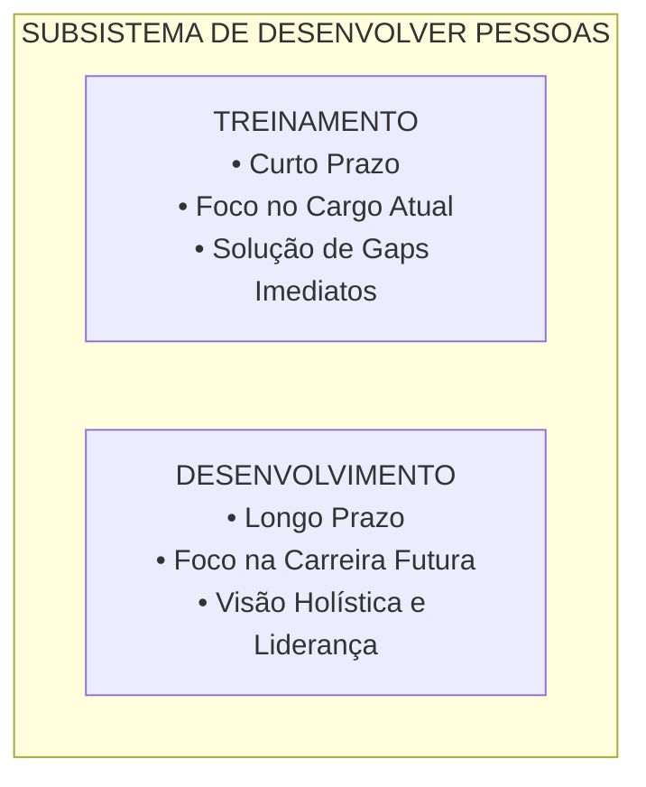
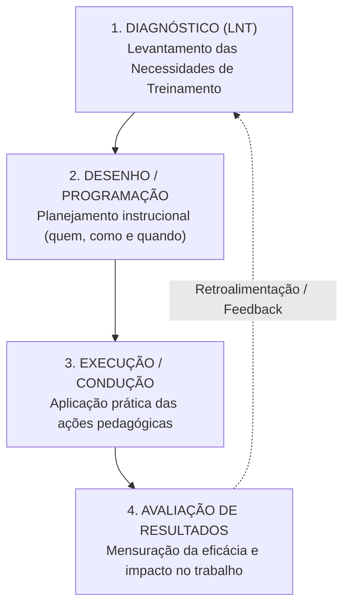
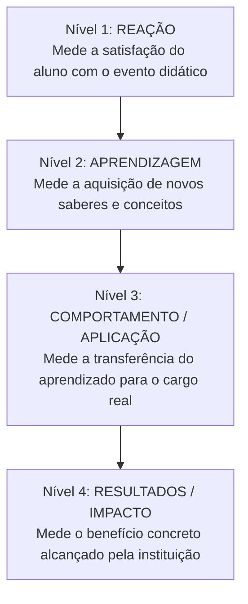
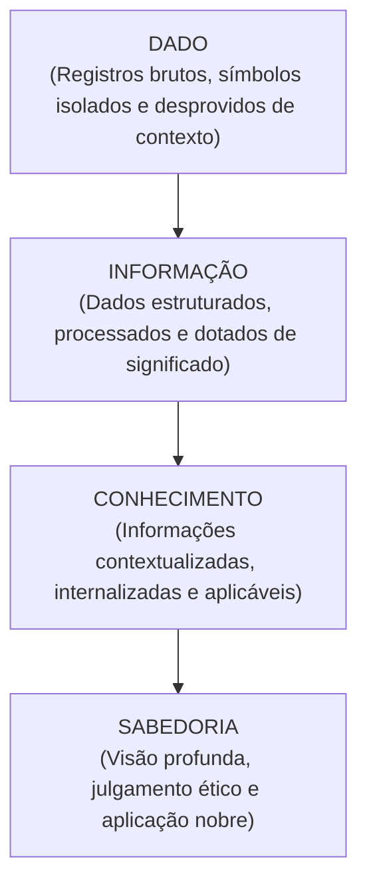
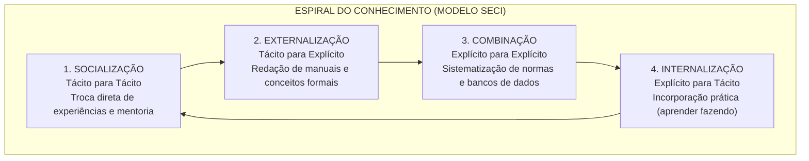
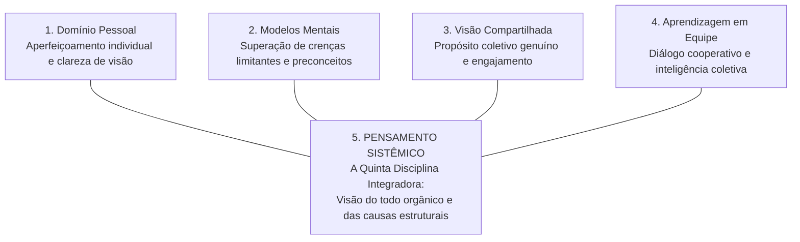

# 02 - Treinamento, Desenvolvimento, Gestão do Conhecimento e Aprendizagem Organizacional

> **Matéria:** Gestão de Pessoas  
> **Cargo:** A01 – Técnico de Controle Externo – Especialidade: Técnico Administrativo (TCE-GO)  
> **Conteúdo Oficial:** Treinamento vs. Desenvolvimento de Pessoas; As Quatro Etapas do Ciclo de Treinamento (LNT, Desenho, Execução e Avaliação de Resultados); Modelo dos 4 Níveis de Kirkpatrick; Gestão do Conhecimento (Tácito vs. Explícito e Modelo SECI de Nonaka e Takeuchi); Aprendizagem Organizacional e as Cinco Disciplinas de Peter Senge; Educação Corporativa e Escolas de Governo.

---

## 📌 Ementa & Delimitação do Conteúdo

1. **Diferenciação Teórica: Treinamento vs. Desenvolvimento de Pessoas:**
    - Critérios de temporalidade (curto prazo vs. longo prazo);
    - Foco do treinamento: cargo atual, suprimento de carências imediatas de desempenho operacional;
    - Foco do desenvolvimento: carreira, ampliação do potencial intelectual e cargos/desafios futuros;
    - Papel de T&D no macroprocesso de **Desenvolver Pessoas** de Idalberto Chiavenato.

2. **O Ciclo Estratégico de Treinamento (4 Etapas Integradas):**
    - **Etapa 1: Diagnóstico / Levantamento de Necessidades de Treinamento (LNT):** análise organizacional, análise da força de trabalho/competências e análise funcional/individual (instrumentos: avaliação de desempenho, observação direta, entrevistas com lideranças e incidentes críticos).
    - **Etapa 2: Desenho e Programação do Treinamento:** os 6 parâmetros do projeto instrucional (*quem deve ser treinado, quem vai treinar, em que treinar, onde treinar, como treinar e quando treinar*).
    - **Etapa 3: Execução e Condução:** metodologias ativas, simulações, oficinas práticas, cursos presenciais e Ensino a Distância (EaD/microlearning).
    - **Etapa 4: Avaliação dos Resultados (Modelo de Donald Kirkpatrick):**
    - Nível 1: Reação e Satisfação;
    - Nível 2: Aprendizado e Retenção Cognitiva;
    - Nível 3: Comportamento no Cargo / Aplicabilidade / Transferência do Aprendizado;
    - Nível 4: Resultados Organizacionais e Impacto Institucional (ampliação de eficiência no controle externo);
    - O Modelo de Jack Phillips: o 5º Nível (*Return on Investment* - ROI financeiro).

3. **Gestão do Conhecimento Organizacional:**
    - A pirâmide cognitiva: Dado $\rightarrow$ Informação $\rightarrow$ Conhecimento $\rightarrow$ Sabedoria (Modelo DIKW);
    - Conhecimento Tácito (subjetivo, pessoal, empírico, interiorizado e difícil de formalizar) vs. Conhecimento Explícito (estruturado, codificado, documentado em manuais, leis e sistemas);
    - O Modelo SECI e a Espiral do Conhecimento (Ikujiro Nonaka e Hirotaka Takeuchi):
    - **Socialização:** Tácito $\rightarrow$ Tácito (compartilhamento de experiências diretas e tutoria);
    - **Externalização:** Tácito $\rightarrow$ Explícito (articulação do saber prático em manuais e conceitos);
    - **Combinação:** Explícito $\rightarrow$ Explícito (cruzamento e sistematização de bases documentais);
    - **Internalização:** Explícito $\rightarrow$ Tácito (incorporação do conteúdo na prática diária - *learning by doing*);
    - O conceito japonês de *Ba* (contexto e espaço compartilhado para geração de conhecimento).

4. **Aprendizagem Organizacional e a Organização que Aprende:**
    - Aprendizagem em Circuito Simples (*Single-Loop Learning*) vs. Aprendizagem em Circuito Duplo (*Double-Loop Learning*) segundo Chris Argyris e Donald Schön;
    - As Cinco Disciplinas de Peter Senge (*A Quinta Disciplina*): Domínio Pessoal, Modelos Mentais, Visão Compartilhada, Aprendizagem em Equipe e Pensamento Sistêmico;
    - Educação Corporativa no Setor Público: Escolas de Governo e a atuação da Escola Superior de Controle do TCE-GO (Instituto Leopoldo de Bulhões - ILB).

---

## 🧭 Sumário

1. [Treinamento vs. Desenvolvimento de Pessoas](#1-treinamento-vs-desenvolvimento-de-pessoas)
    1. [Teste 440](#Teste-440)
    2. [Teste 441](#Teste-441)
2. [O Ciclo de Treinamento em Quatro Etapas e a Avaliação de Kirkpatrick](#2-o-ciclo-de-treinamento-em-quatro-etapas-e-a-avaliacao-de-kirkpatrick)
    1. [Teste 442](#Teste-442)
    2. [Teste 443](#Teste-443)
3. [Gestão do Conhecimento Organizacional e o Modelo SECI](#3-gestao-do-conhecimento-organizacional-e-o-modelo-seci)
    1. [Teste 444](#Teste-444)
    2. [Teste 445](#Teste-445)
4. [Aprendizagem Organizacional e as Cinco Disciplinas de Peter Senge](#4-aprendizagem-organizacional-e-as-cinco-disciplinas-de-peter-senge)
    1. [Teste 446](#Teste-446)
    2. [Teste 447](#Teste-447)
5. [Educação Corporativa e Escolas de Governo (ILB/TCE-GO)](#5-educacao-corporativa-e-escolas-de-governo-ilbtce-go)
    1. [Teste 448](#Teste-448)
    2. [Teste 449](#Teste-449)
6. [Fontes Oficiais e Referências Bibliográficas](#6-fontes-oficiais-e-referencias-bibliograficas)

---

## 1. Treinamento vs. Desenvolvimento de Pessoas

Na moderna gestão de pessoas, capacitação não é evento esporádico, mas processo permanente de agregação de valor. A literatura estabelece uma divisão nítida entre Treinamento e Desenvolvimento:

#### Tabela Comparativa: Treinamento vs. Desenvolvimento

| Critério de Comparação | Treinamento | Desenvolvimento de Pessoas |
| :--- | :--- | :--- |
| **Dimensão Temporal** | **Curto prazo** (ação pontual e imediata). | **Médio e longo prazo** (processo contínuo). |
| **Foco de Atuação** | **Cargo atual:** prepara o servidor para as atribuições que exerce hoje. | **Carreira e organização:** prepara o servidor para cargos futuros e novas atribuições. |
| **Objetivo Primário** | Repassar conhecimentos específicos e sanar deficiências técnicas operacionais. | Expandir capacidades conceituais, competências comportamentais e potencial de liderança. |
| **Escopo do Conteúdo** | Estrito, técnico, procedural e centrado na tarefa (ex.: operar o sistema de protocolo eletrônico). | Amplo, abrangente, reflexivo e estratégico (ex.: programa de governança e ética pública). |
| **Avaliação do Sucesso** | Rápida execução sem erros na rotina diária do posto de trabalho. | Capacidade de inovação, liderança adaptativa e visão sistêmica institucional. |

> 🛑 **ATENÇÃO (TREINAMENTO VS. DESENVOLVIMENTO):**  
> Treinamento refere-se ao **presente** e ao cargo **atual** (objetivo imediato e operacional). Desenvolvimento refere-se ao **futuro** e à **carreira** como um todo (objetivo mediato, estratégico e de liderança).

---

### Teste 440
**(FCC – Técnico de Controle Externo – Área Administrativa – TCE-AP)**  
No âmbito da administração de recursos humanos, as ações voltadas para Treinamento e as ações voltadas para Desenvolvimento de Pessoas distinguem-se primordialmente em razão de seus horizontes temporais e de seus objetivos funcionais. Assinale a opção que caracteriza com precisão uma ação clássica de **Desenvolvimento de Pessoas**:

* **A)** Realização de oficina prática de 4 horas para ensinar os servidores recém-lotados a emitir certidões no módulo de protocolo recém-implantado.
* **B)** Aplicação de curso intensivo para operadores de máquinas de reprografia sanarem problemas mecânicos frequentes em seus aparelhos.
* **C)** Implementação de um programa corporativo de liderança transformadora e governança pública voltado a preparar analistas para assumirem funções de direção e planejamento estratégico nos próximos anos.
* **D)** Instrução sumária da equipe de atendimento sobre como cadastrar visitantes no balcão da portaria do edifício-sede.
* **E)** Treinamento emergencial sobre normas de combate a incêndio promovido pela brigada de segurança predial.

---

> **Comentário Detalhado:**  
>
> - **A) Incorreta.** Trata-se de ação típica de **Treinamento**: foco no cargo atual, curto prazo e suprimento de carência operacional pontual.  
> - **B) Incorreta.** Foco exclusivo na execução de tarefas do posto de trabalho atual com finalidade corretiva imediata (treinamento operacional).  
> - **C) CORRETA.** O **Desenvolvimento de Pessoas** caracteriza-se pelo foco no **longo prazo**, na expansão de competências abrangentes, no crescimento intelectual contínuo e na preparação dos servidores para **cargos futuros**, desafios estratégicos e planos de sucessão institucional, como demonstrado pelo programa de liderança e governança.  
> - **D) Incorreta.** Instrução técnica e pontual vinculada estritamente às tarefas rotineiras do cargo presente (treinamento operacional).  
> - **E) Incorreta.** Capacitação específica de curto prazo para segurança física no local de trabalho (treinamento instrucional).  
> 
> **Gabarito: C**

---

### Teste 441
**(FCC - Adaptada / Analista de Gestão Pública)**
Na gestão de pessoas, **Treinamento** e **Desenvolvimento de Pessoas (T&D)** são processos distintos, embora complementares.

A distinção conceitual precisa entre Treinamento e Desenvolvimento reside em:

* **A)** O treinamento tem foco no curto prazo e visa capacitar o indivíduo para o desempenho eficaz de suas funções e tarefas no cargo atual; enquanto o desenvolvimento foca o médio e longo prazo, visando ao crescimento integral do potencial humano e à preparação do servidor para desafios, papéis e cargos futuros.
* **B)** O treinamento é privativo de cargos comissionados e o desenvolvimento é restrito a servidores estagiários.
* **C)** O treinamento não pode utilizar tecnologias digitais e o desenvolvimento é sempre presencial em sala de aula.
* **D)** O treinamento extingue a necessidade de avaliação de desempenho funcional posterior.
* **E)** O desenvolvimento visa unicamente à redução salarial em situações de limite prudencial da LRF.

---

> **Comentário Detalhado:**
>
> - **A)** Correta. Diferenciação clássica: **Treinamento**: curto prazo, focado nas exigências técnicas imediatas do cargo atual, adaptando o servidor às rotinas de hoje; **Desenvolvimento**: longo prazo, visa à ampliação de competências globais, liderança, visão holística e crescimento pessoal para carreiras e posições futuras.
> - **B), C), D), E)** Incorretas. Distorções sem embasamento na literatura de gestão de pessoas.
> 
> **Gabarito: A**

---

## 2. O Ciclo de Treinamento em Quatro Etapas e a Avaliação de Kirkpatrick

Segundo Idalberto Chiavenato, o treinamento funciona como um ciclo contínuo composto por quatro fases lógicas e sequenciais:

#### A) Etapa 1: Diagnóstico / Levantamento das Necessidades de Treinamento (LNT)
O LNT é o diagnóstico das carências de competências que prejudicam o alcance das metas organizacionais. O diagnóstico ocorre em três níveis de análise:

1. **Análise Organizacional:** examina a missão, a visão de futuro, os planos estratégicos e as metas globais do órgão para identificar quais competências coletivas são essenciais.
2. **Análise dos Recursos Humanos (Competências):** mapeia as competências atuais dos servidores frente às competências exigidas pelo órgão, detectando as lacunas (*skills gaps*).
3. **Análise das Operações e Tarefas (Cargos):** avalia a descrição de cada cargo, os requisitos técnicos e o padrão de excelência esperado para cada função pública.

#### B) Etapa 2: Desenho e Programação do Treinamento
Consiste no planejamento instrucional estruturado, respondendo a seis questões cruciais:

* **Quem deve ser treinado?** (público-alvo / participantes selecionados);
* **Quem vai treinar?** (instrutores internos da Escola de Contas ou consultores externos contratados);
* **Em que treinar?** (conteúdo programático, competências técnicas e comportamentais);
* **Onde treinar?** (salas de aula presenciais, laboratórios ou ambiente virtual EaD);
* **Como treinar?** (métodos pedagógicos: estudos de caso, oficinas, simulações ou palestras expositivas);
* **Quando treinar?** (cronograma, carga horária e período de realização).

#### C) Etapa 3: Execução e Condução do Treinamento
Aplicação prática do plano pedagógico. Exige ambiente físico e tecnológico adequado, motivação dos educandos e domínio didático por parte dos instrutores.

#### D) Etapa 4: Avaliação dos Resultados (Modelo de Donald Kirkpatrick)
Donald Kirkpatrick propôs a metodologia mais consagrada e cobrada em concursos públicos para mensurar a eficácia de programas de capacitação, dividida em quatro níveis sucessivos de complexidade:

| Nível de Kirkpatrick | Objeto de Avaliação | Momento da Avaliação | Instrumento Típico de Medição |
| :--- | :--- | :--- | :--- |
| **Nível 1: Reação** | Avalia o grau de satisfação dos participantes com o curso, material, didática e infraestrutura. | Aplicado imediatamente no encerramento da aula. | Questionário de pesquisa de satisfação (escala Likert). |
| **Nível 2: Aprendizagem** | Avalia a aquisição e fixação de novos conhecimentos, habilidades e atitudes. | Durante ou logo após o término do curso. | Testes teóricos, provas de conhecimento e exames práticos (pré-teste e pós-teste). |
| **Nível 3: Comportamento no Cargo (Transferência)** | Avalia se o participante modificou sua conduta no posto de trabalho e aplica o que aprendeu. | Aplicado semanas ou meses após o retorno à rotina (30 a 90 dias). | Observação em serviço, relatórios de produtividade e avaliação da chefia imediata. |
| **Nível 4: Resultados / Impacto Organizacional** | Avalia os impactos macroinstitucionais obtidos pelo órgão (redução de custos, agilidade processual). | Longo prazo (semestral ou anual). | Indicadores de desempenho, relatórios gerenciais e metas institucionais atingidas. |
| **Nível 5: ROI (Jack Phillips)** | Avalia a relação financeira entre o custo do treinamento e os benefícios monetários gerados. | Pós-implementação. | Fórmula do ROI: $\text{ROI (\%)} = \frac{\text{Benefícios Líquidos}}{\text{Custos do Treinamento}} \times 100$. |

> 🚨 **ALERTA DE PROVA / PEGADINHA FCC (NÍVEIS DE KIRKPATRICK):**  
> A banca frequentemente afirma que *"uma avaliação de reação altamente positiva comprova que os servidores assimilaram o conteúdo e melhorarão a produtividade da instituição"*. **ERRADO!** O Nível 1 mede apenas se os participantes gostaram da aula e das instalações. Uma reação excelente pode conviver com zero aprendizagem (Nível 2) ou zero aplicação no trabalho (Nível 3).  
> Além disso, lembre-se: provas de conhecimentos teóricos ao final do curso medem **Aprendizagem (Nível 2)** e NÃO comportamento no trabalho (Nível 3).

---

### Teste 442
**(FCC – Analista de Gestão Pública – DPE-RS)**  
Para avaliar o impacto de um programa de treinamento sobre a nova Lei de Licitações e Contratos (Lei nº 14.133/2021) ofertado aos pregoeiros de uma entidade governamental, a área de Gestão de Pessoas realizou uma pesquisa formal 60 dias após o encerramento do curso, acompanhando a redução do índice de despachos devolvidos por vícios formais e observando se as minutas contratuais elaboradas pelos servidores incorporavam os novos entendimentos ensinados. Consoante a metodologia de avaliação de treinamento em quatro níveis desenvolvida por Donald Kirkpatrick, a medição realizada corresponde ao:

* **A)** Nível 1 – Reação.
* **B)** Nível 2 – Aprendizagem.
* **C)** Nível 3 – Comportamento no Cargo (Transferência).
* **D)** Nível 4 – Retorno Financeiro sobre o Investimento (ROI).
* **E)** Nível 5 – Clima Institucional e Motivação Relacional.

---

> **Comentário Detalhado:**  
>
> - **A) Incorreta.** O Nível 1 (Reação) afere a satisfação dos alunos com o instrutor e as instalações ao término da aula (pesquisa de opinião imediata).  
> - **B) Incorreta.** O Nível 2 (Aprendizagem) avalia a retenção de conceitos mediante provas aplicadas imediatamente ao final do treinamento.  
> - **C) CORRETA.** O **Nível 3 (Comportamento no Cargo ou Transferência do Aprendizado)** avalia a extensão em que os participantes aplicaram e transferiram efetivamente os novos saberes para as suas rotinas diárias no posto de trabalho. Ao verificar, após 60 dias de prática real, se as minutas e condutas dos servidores foram alteradas, a organização está medindo a modificação comportamental funcional.  
> - **D) Incorreta.** O Nível 4 (Resultados) avalia impactos globais institucionais na estratégia corporativa, e o ROI financeiro foi estruturado como 5º nível por Jack Phillips.  
> - **E) Incorreta.** O modelo original de Kirkpatrick contempla 4 níveis e não prevê clima institucional como nível autônomo de avaliação.  
> 
> **Gabarito: C**

---

### Teste 443
**(FCC - Adaptada / Auditor de Controle Externo)**
Donald Kirkpatrick concebeu o modelo mais utilizado internacionalmente para avaliação da eficácia de programas de capacitação, estruturado em quatro níveis sucessivos de impacto.

O **Nível 3 (Comportamento no Cargo / Aplicação)** do modelo de Kirkpatrick avalia:

* **A)** O grau em que os participantes efetivamente transferiram e aplicaram os novos conhecimentos, habilidades e atitudes no seu dia a dia profissional real após o retorno ao local de trabalho.
* **B)** A satisfação imediata dos participantes com as instalações físicas, a pontualidade e o coffee-break do evento.
* **C)** O aumento formal de retenção de conceitos verificado por meio de prova teórica aplicada ao final da aula.
* **D)** O cálculo monetário estrito do retorno financeiro sobre o investimento (*ROI*) obtido pelo Tesouro Estadual.
* **E)** A pontualidade da entrega do diploma de conclusão emitido pelo órgão realizador.

---

> **Comentário Detalhado:**
>
> - **A)** Correta. Os 4 níveis de Kirkpatrick: (1) **Reação**: satisfação e percepção imediata dos alunos com o curso; (2) **Aprendizado**: retenção teórica e assimilação de conhecimentos (testes no fim do curso); (3) **Comportamento (Aplicação/Transferência)**: se os novos conhecimentos são efetivamente aplicados na prática do trabalho real; (4) **Resultados**: impacto final produzido nos indicadores e objetivos estratégicos da organização. Jack Phillips adicionou o 5º nível: ROI.
> - **B)** Incorreta. Refere-se ao Nível 1 (Reação).
> - **C)** Incorreta. Refere-se ao Nível 2 (Aprendizado).
> - **D)** Incorreta. Refere-se ao Nível 5 (ROI de Phillips) ou Nível 4 (Resultados).
> - **E)** Incorreta. Trâmite meramente burocrático de certificação.
> 
> **Gabarito: A**

---

## 3. Gestão do Conhecimento Organizacional e o Modelo SECI

A gestão do conhecimento é o conjunto integrado de processos que criam, organizam, disseminam e aplicam saberes para alavancar a eficiência organizacional.

#### A) A Pirâmide DIKW (Hierarquia do Saber)

* **Dado:** Registro numérico ou textual isolado, sem interpretação (ex.: "R\$ 1.500.000,00").
* **Informação:** Dados organizados em determinado contexto, dotados de sentido e propósito (ex.: "Contrato de TI no valor de R\$ 1.500.000,00 celebrado com dispensa indevida de licitação").
* **Conhecimento:** Informação processada pela mente humana, combinada com experiência, valores e intuição, capacitando o indivíduo para a tomada de decisão (ex.: "Auditor identifica irregularidade na dispensa com base no histórico do fornecedor e na Lei 14.133/2021").
* **Sabedoria:** Capacidade superior de aplicar o conhecimento com prudência, discernimento ético e visão de longo prazo em prol da sociedade.

#### B) Conhecimento Tácito vs. Conhecimento Explícito

| Dimensão | Conhecimento Tácito | Conhecimento Explícito |
| :--- | :--- | :--- |
| **Origem e Natureza** | Subjetivo, pessoal, intuitivo e empírico. | Objetivo, racional, formal e lógico. |
| **Localização** | Armazenado na mente e na experiência dos indivíduos (*know-how*). | Registrado em suportes físicos ou digitais (manuais, livros, leis, normas e sistemas). |
| **Facilidade de Transmissão** | Difícil de verbalizar, codificar e formalizar por escrito. | Fácil de estruturar, armazenar, duplicar e compartilhar em rede. |
| **Forma de Aprendizado** | Aprendizado prático por convivência, mentoria, tutoria e imitação. | Leitura de documentos, estudo de normas e consulta a bancos de dados. |

#### C) O Modelo SECI e a Espiral do Conhecimento (Ikujiro Nonaka & Hirotaka Takeuchi)
Segundo Nonaka e Takeuchi, o conhecimento institucional é criado a partir da interação dinâmica e ininterrupta entre o conhecimento tácito e o explícito, percorrendo quatro modos de conversão:

1. **Socialização (Tácito $\rightarrow$ Tácito):** Compartilhamento de experiências diretas entre pessoas, sem uso necessário da linguagem escrita (ex.: tutoria de um técnico novato por um auditor sênior, conversas informais e observação em campo no *Ba Originário*).
2. **Externalização (Tácito $\rightarrow$ Explícito):** Articulação e tradução do conhecimento tácito em conceitos compreensíveis, modelos visuais, metáforas, manuais operacionais e fluxogramas acessíveis a todos (no *Ba Interativo*).
3. **Combinação (Explícito $\rightarrow$ Explícito):** Agrupamento, classificação, análise e cruzamento de diferentes fontes de conhecimentos já codificados (ex.: compilar acórdãos e pareceres para redigir uma Instrução Normativa consolidada do TCE-GO no *Ba Cibernético*).
4. **Internalização (Explícito $\rightarrow$ Tácito):** Incorporação do conhecimento explícito recém-produzido na mente e nos hábitos de trabalho do servidor por meio do "aprender fazendo" (*learning by doing* no *Ba Exercitante*).

> ⭐ **IMPORTANTE (HISTORINHAS PRÁTICAS DO MODELO SECI):**  
> A FCC adora cobrar o Modelo SECI por meio de situações hipotéticas de trabalho:  
>
> - Se o auditor experiente passa dicas práticas e intuições para um estagiário durante uma fiscalização em campo: **SOCIALIZAÇÃO (Tácito para Tácito)**.  
> - Se esse auditor redige uma apostila ou manual de auditoria com seus métodos: **EXTERNALIZAÇÃO (Tácito para Explícito)**.  
> - Se o setor reúne manuais de diversos tribunais e publica um guia analítico unificado: **COMBINAÇÃO (Explícito para Explícito)**.  
> - Se os novos servidores leem o guia e passam a aplicá-lo automaticamente na rotina: **INTERNALIZAÇÃO (Explícito para Tácito)**.

---

### Teste 444
**(FCC – Auditor de Controle Externo – TCE-GO)**  
O Tribunal de Contas do Estado de Goiás, buscando consolidar as melhores práticas desenvolvidas pelos seus auditores sêniores na detecção de fraudes em licitações públicas informatizadas, organizou oficinas temáticas nas quais esses profissionais veteranos estruturaram conceitos, descreveram rotinas investigativas e redigiram detalhados manuais de procedimentos e fluxogramas operacionais para consulta geral. De acordo com o modelo de criação do conhecimento organizacional proposto por Ikujiro Nonaka e Hirotaka Takeuchi (Modelo SECI), o processo de conversão do conhecimento verificado nessa iniciativa classifica-se como:

* **A)** Socialização.
* **B)** Externalização.
* **C)** Combinação.
* **D)** Internalização.
* **E)** Aprendizagem em circuito simples.

---

> **Comentário Detalhado:**  
>
> - **A) Incorreta.** A socialização ocorre na troca direta de experiências de indivíduo para indivíduo (tácito para tácito), sem formalização por escrito.  
> - **B) CORRETA.** A **Externalização** é exatamente a conversão do conhecimento **Tácito em Explícito**. Ocorre quando os profissionais conseguem expressar suas vivências intuitivas, julgamentos e saberes práticos sob a forma de conceitos compreensíveis, manuais de procedimentos, roteiros escritos, fluxogramas e documentos formais acessíveis a outros membros.  
> - **C) Incorreta.** A combinação consiste em juntar e cruzar conhecimentos já codificados (explícito para explícito), como compilar duas leis em um documento unificado.  
> - **D) Incorreta.** A internalização é a conversão de explícito em tácito, quando os indivíduos leem os manuais e os transformam em rotinas mentais por meio da prática (*aprender fazendo*).  
> - **E) Incorreta.** A aprendizagem em circuito simples é conceito de Argyris e Schön voltado à correção operacional mecânica de desvios, estranho aos modos de conversão da teoria de Nonaka e Takeuchi.  
> 
> **Gabarito: B**

---

### Teste 445
**(FCC - Adaptada / Analista de Tecnologia e Controle)**
Ikujiro Nonaka e Hirotaka Takeuchi desenvolveram o consagrado modelo **SECI** para explicar a criação e a conversão do conhecimento organizacional através da interação entre o conhecimento tácito e o conhecimento explícito.

A modalidade de conversão do conhecimento que consiste em transformar o **conhecimento tácito em conhecimento explícito** (por exemplo, quando um auditor experiente redige um manual detalhado de auditoria de obras sistematizando seus anos de intuição e prática para toda a equipe) é a:

* **A)** Externalização.
* **B)** Socialização.
* **C)** Combinação.
* **D)** Internalização.
* **E)** Desintermediação.

---

> **Comentário Detalhado:**
>
> - **A)** Correta. As quatro formas de conversão do modelo SECI: (1) **Socialização** (Tácito para Tácito): compartilhamento de experiências e observação direta; (2) **Externalização** (Tácito para Explícito): articulação do saber tácito em conceitos, modelos, manuais e regras escritas; (3) **Combinação** (Explícito para Explícito): junção, edição e sistematização de diferentes bases de dados e documentos; (4) **Internalização** (Explícito para Tácito): assimilação do conhecimento documentado na rotina mental prática (*learning by doing*).
> - **B), C), D)** Incorretas. Representam as outras etapas de conversão do modelo SECI.
> - **E)** Incorreta. Conceito econômico de exclusão de intermediários.
> 
> **Gabarito: A**

---

## 4. Aprendizagem Organizacional e as Cinco Disciplinas de Peter Senge

A aprendizagem organizacional ocorre quando o aprendizado individual e coletivo é incorporado aos processos, valores, estruturas e cultura permanente da organização.

#### A) Circuito Simples vs. Circuito Duplo (Chris Argyris e Donald Schön)
* **Aprendizagem em Circuito Simples (*Single-Loop Learning*):** A organização detecta um erro e corrige os procedimentos imediatos, **sem questionar as premissas, normas ou políticas básicas** que originaram a falha (comportamento de mero "termostato").
* **Aprendizagem em Circuito Duplo (*Double-Loop Learning*):** A organização detecta o erro e **reexamina criticamente as regras subjacentes, objetivos fundamentais e premissas culturais**, promovendo mudanças estruturais profundas e inovação transformadora.

> 📌 **NOTA EXPLICATIVA — CIRCUITO DUPLO DE ARGYRIS:**  
> A diferença fundamental reside no questionamento das premissas:  
>
> - Circuito simples: corrige a rota sem questionar o destino (mantém os valores vigentes);  
> - Circuito duplo: questiona se o destino e as normas prévias ainda fazem sentido no contexto atual.

---

### Teste 446
**(FCC – Analista Judiciário – Área Judiciária – TRT-15ª)**  
Dois teóricos fundamentais do comportamento organizacional, Chris Argyris e Donald Schön, formularam a distinção seminal entre a aprendizagem em circuito simples (*single-loop*) e a aprendizagem em circuito duplo (*double-loop*). Assinale a afirmativa que define corretamente a **aprendizagem em circuito duplo**:

* **A)** Ocorre quando o gestor, diante de um erro processual, limita-se a punir o servidor faltoso e aumentar a vigilância sobre as planilhas existentes sem alterar fluxos.
* **B)** Consiste na mera repetição mecânica de rotinas operacionais até que a taxa de erro estatístico atinja níveis próximos de zero.
* **C)** Verifica-se quando os atores organizacionais identificam uma anomalia e modificam as rotinas imediatas sem qualquer reflexão sobre os valores e objetivos fundantes da instituição.
* **D)** Caracteriza-se pelo processo em que a organização, ao detectar erros e desvios, confronta e questiona criticamente as premissas subjacentes, as normas vigentes e os valores orientadores das políticas institucionais, reformulando seus padrões estruturais.
* **E)** Representa a aquisição estritamente individual de novos conhecimentos teóricos pelo colaborador sem qualquer possibilidade de compartilhamento coletivo com seus pares.

---

> **Comentário Detalhado:**  
>
> - **A) Incorreta.** Punição burocrática e controle disciplinar não constituem aprendizagem em circuito duplo.  
> - **B) Incorreta.** A repetição mecânica de rotinas é condicionamento instrumental pavloviano, oposto da aprendizagem reflexiva.  
> - **C) Incorreta.** Modificar rotinas sem questionar valores e políticas subjacentes é a definição exata de **aprendizagem em circuito simples (*single-loop*)**.  
> - **D) CORRETA.** A **aprendizagem em circuito duplo (*double-loop*)** ocorre precisamente quando a organização não se contenta em aplicar correções superficiais em procedimentos prévios, mas **questiona criticamente as normas, valores, objetivos e premissas fundamentais** que orientavam a conduta anterior, reestruturando a lógica do próprio sistema organizacional.  
> - **E) Incorreta.** A aprendizagem individual isolada não reflete a dimensão da aprendizagem em circuito duplo descrita por Argyris e Schön.  
> 
> **Gabarito: D**

---

#### B) As Cinco Disciplinas de Peter Senge (*A Quinta Disciplina*)
Para Peter Senge, uma **Organização que Aprende** (*Learning Organization*) baseia-se na prática contínua de cinco disciplinas essenciais:

1. **Domínio Pessoal:** Busca contínua pelo aprimoramento e autodesenvolvimento, com clareza dos objetivos de vida e visão realista das próprias forças e fragilidades.
2. **Modelos Mentais:** Capacidade de identificar, questionar e transformar as imagens e preconceitos internos enraizados que condicionam nossa percepção do mundo organizacional.
3. **Visão Compartilhada:** Construção de um senso coletivo de propósito e destino comum, substituindo o mero cumprimento de ordens pelo compromisso entusiasmado com a missão pública.
4. **Aprendizagem em Equipe:** Prática do diálogo autêntico entre os membros do grupo, superando disputas de vaidade e gerando soluções muito superiores à inteligência individual isolada.
5. **Pensamento Sistêmico (A 5ª Disciplina):** É a disciplina integradora que conecta as outras quatro. Permite enxergar a organização não como partes fragmentadas, mas como uma rede viva de inter-relações e interdependências mútuas, focando nas causas estruturais dos problemas em vez de remediar sintomas superficiais.

---

### Teste 447
**(FCC – Analista de Controle Externo – TCE-RO)**  
Em sua consagrada obra sobre organizações que aprendem (*Learning Organizations*), Peter Senge afirma que uma disciplina específica atua como a pedra angular e a força integradora de todas as demais, permitindo aos líderes e gestores compreenderem que a organização pública é um sistema vivo composto por inter-relações interdependentes, no qual as soluções fáceis que atacam apenas sintomas de curto prazo costumam agravar os problemas estruturais de longo prazo. Essa disciplina integradora é denominada por Senge de:

* **A)** Domínio Pessoal.
* **B)** Modelos Mentais.
* **C)** Visão Compartilhada.
* **D)** Aprendizagem em Equipe.
* **E)** Pensamento Sistêmico.

---

> **Comentário Detalhado:**  
>
> - **A) Incorreta.** O Domínio Pessoal é a disciplina voltada ao crescimento e autoconhecimento individual.  
> - **B) Incorreta.** Os Modelos Mentais referem-se à capacidade de expor e questionar pressupostos e crenças internalizadas sobre como a realidade funciona.  
> - **C) Incorreta.** A Visão Compartilhada é a construção de um objetivo e identidade coletivos que mobilizam o compromisso autêntico da equipe.  
> - **D) Incorreta.** A Aprendizagem em Equipe fundamenta-se no diálogo honesto para gerar inteligência coletiva superior.  
> - **E) CORRETA.** O **Pensamento Sistêmico (a Quinta Disciplina)** é expressamente definido por Peter Senge como a **disciplina conceitual e integradora** que reúne todas as demais em um corpo coerente de teoria e prática. É o método de pensar que permite enxergar padrões, estruturas subjacentes e ciclos de feedback interdependentes, em vez de instantâneos estáticos e causas lineares isoladas.  
> 
> **Gabarito: E**

---

## 5. Educação Corporativa e Escolas de Governo (ILB/TCE-GO)

No setor público moderno, a visão fragmentada de "cursos isolados" foi substituída pelo modelo de **Educação Corporativa**:

* **Universidade Corporativa / Escolas de Governo:** Unidades educacionais estratégicas vinculadas diretamente aos órgãos públicos com a missão de desenvolver competências institucionais essenciais alinhadas aos objetivos estratégicos de Estado.
* **Escola Superior de Controle do TCE-GO (Instituto Leopoldo de Bulhões - ILB):** Unidade de formação e capacitação que promove o contínuo aperfeiçoamento dos servidores do Tribunal de Contas do Estado de Goiás e a orientação pedagógica dos gestores municipais e estaduais jurisdicionados, funcionando como vetor de controle preventivo e pedagógico.

---

### Teste 448
**(FCC - Adaptada / TCE-PI - Auditor de Controle Externo)**
Na obra clássica *A Quinta Disciplina*, Peter Senge apresenta os fundamentos necessários para a construção de organizações que aprendem (*learning organizations*).

A disciplina que Senge considera a "pedra angular" e a mais integradora de todas, por permitir que os gestores enxerguem as inter-relações e os padrões de mudança sistêmicos em vez de eventos estáticos e isolados, é o:

* **A)** Pensamento Sistêmico.
* **B)** Domínio Pessoal.
* **C)** Modelos Mentais.
* **D)** Visão Compartilhada.
* **E)** Aprendizado em Equipe.

---

> **Comentário Detalhado:**
>
> - **A)** Correta. Peter Senge formulou cinco disciplinas: Domínio Pessoal, Modelos Mentais, Visão Compartilhada, Aprendizagem em Equipe e **Pensamento Sistêmico**. O Pensamento Sistêmico é a quinta disciplina que integra todas as outras, permitindo enxergar as causas profundas e as estruturas interdependentes em vez de sintomas superficiais de problemas.
> - **B), C), D), E)** Incorretas. São as outras quatro disciplinas que são potencializadas pelo pensamento sistêmico.
> 
> **Gabarito: A**

---

### Teste 449
**(FCC - Adaptada / TCE-GO - Analista de Controle Externo)**
No modelo de aprendizagem organizacional de Chris Argyris e Donald Schön, a **Aprendizagem de Circuito Duplo** (*Double-Loop Learning*) ocorre quando a organização:

* **A)** Questiona e modifica os valores, premissas fundamentais, normas e políticas subjacentes que definem as metas da instituição, em vez de apenas corrigir erros superficiais mantendo as regras inalteradas.
* **B)** Repete as mesmas tarefas rotineiras duas vezes para garantir conformidade contábil.
* **C)** Exige que dois auditores assinem conjuntamente o mesmo relatório preliminar.
* **D)** Mantém os procedimentos tradicionais inalterados independentemente de variações no ambiente externo.
* **E)** Contrata duas consultorias externas concorrentes para emitir pareceres conflitantes.

---

> **Comentário Detalhado:**
>
> - **A)** Correta. Distinção essencial: **Circuito Simples (*Single-Loop*)**: a organização detecta o erro e o corrige sem alterar as regras e objetivos vigentes (adaptação mecânica); **Circuito Duplo (*Double-Loop*)**: a instituição vai à raiz do problema e questiona as próprias premissas, normas, valores e paradigmas que balizam o plano de ação, reestruturando a lógica operacional.
> - **B), C), D), E)** Incorretas. Interpretações literais errôneas da expressão "circuito duplo".
> 
> **Gabarito: A**

---

## 6. Fontes Oficiais e Referências Bibliográficas

* [Decreto Federal nº 9.991/2019 (Política Nacional de Desenvolvimento de Pessoas - PNDP)](https://www.planalto.gov.br/ccivil_03/_ato2019-2022/2019/decreto/d9991.htm) - Diretrizes, instrumentos e regras para ações de desenvolvimento e capacitação contínua de servidores.
* [Lei Estadual nº 20.756/2020 - Do Aperfeiçoamento e Capacitação dos Servidores](https://legisla.casacivil.go.gov.br/pesquisa_legislacao/100979/lei-20756) - Disposições sobre afastamento para estudo, cursos de capacitação e incentivos de qualificação no Estado de Goiás.
* [TCE-GO - Instituto Leopoldo de Bulhões (Escola Superior de Controle Externo)](https://portal.tce.go.gov.br/institucional/instituto-leopoldo-de-bulhoes) - Escola de contas do TCE-GO responsável pelas ações de capacitação, pós-graduação e gestão do conhecimento institucional.
* [TCU - Governança da Educação Corporativa e Gestão do Conhecimento](https://portal.tcu.gov.br/governanca/governanca-no-tcu/) - Referencial técnico para gestão do capital intelectual e aprendizagem organizacional no setor público.
* [Constituição Federal de 1988 - Art. 39, § 2º (Escolas de Governo)](https://www.planalto.gov.br/ccivil_03/constituicao/constituicao.htm#art37) - Previsão da manutenção de escolas de governo para formação e aperfeiçoamento dos servidores públicos.
* CHIAVENATO, Idalberto. **Gestão de Pessoas: O Novo Papel dos Recursos Humanos nas Organizações**. 5. ed. São Paulo: Atlas, 2020. (Cap. 11 - Treinamento; Cap. 12 - Desenvolvimento de Pessoas e de Organizações).
* NONAKA, Ikujiro; TAKEUCHI, Hirotaka. **Criação de Conhecimento na Empresa: Como as Empresas Japonesas Geram a Dinâmica da Inovação**. 23. ed. Rio de Janeiro: Elsevier/Campus, 1997. (Cap. 3 - Teoria da Criação do Conhecimento Organizacional e Modelo SECI).
* SENGE, Peter M. **A Quinta Disciplina: A Arte e a Prática da Organização que Aprende**. 32. ed. Rio de Janeiro: Best Seller, 2018. (Cap. 1 a 4 - As Cinco Disciplinas da Aprendizagem Organizacional).
