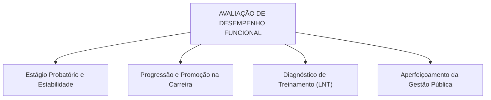
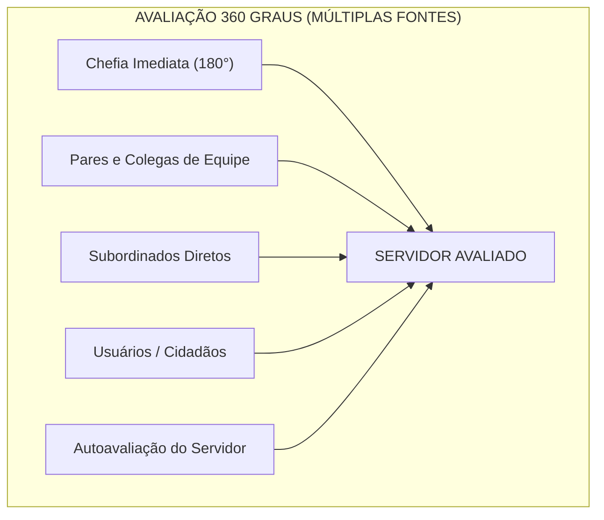
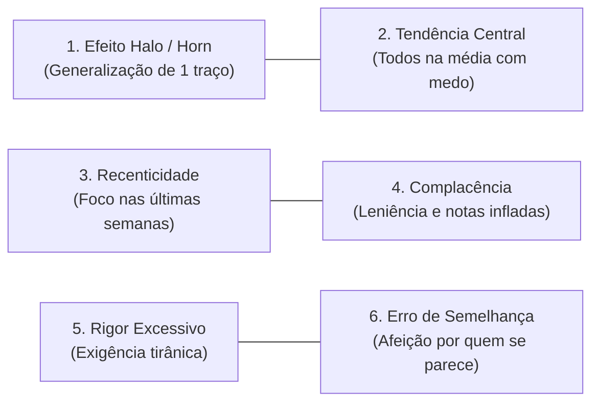
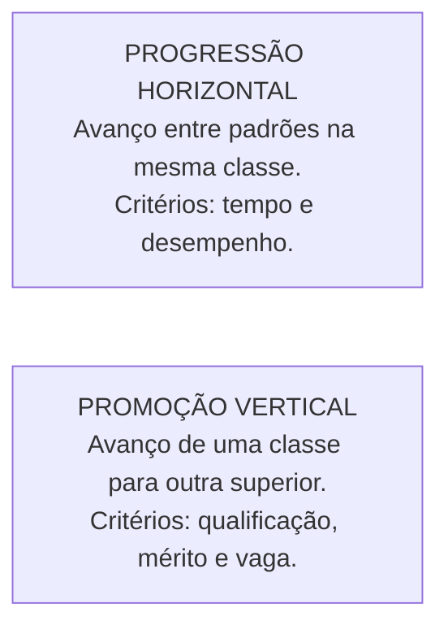
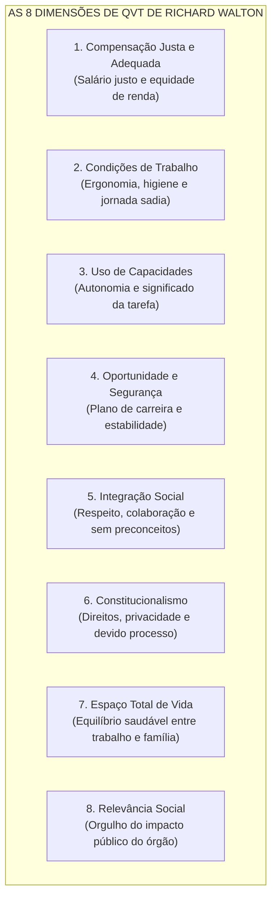

# 03 - Avaliação de Desempenho, Remuneração, Qualidade de Vida no Trabalho e Teletrabalho

> **Matéria:** Gestão de Pessoas  
> **Cargo:** A01 – Técnico de Controle Externo – Especialidade: Técnico Administrativo (TCE-GO)  
> **Conteúdo Oficial:** Gestão e Avaliação de Desempenho no Setor Público; Métodos Tradicionais e Modernos de Avaliação; Erros e Vieses Cognitivos do Avaliador; Estrutura Remuneratória e o Regime de Subsídio Constitucional; Qualidade de Vida no Trabalho (Modelo das 8 Dimensões de Richard Walton); Novas Modalidades de Trabalho (Teletrabalho, Gestão por Resultados e Direito à Desconexão).

---

## 📌 Ementa & Delimitação do Conteúdo

1. **Gestão e Avaliação de Desempenho Funcional:**
    - Conceito, objetivos e finalidades na administração pública: subsídio para o estágio probatório, concessão de progressões e promoções funcionais, diagnóstico de necessidades de treinamento e melhoria dos serviços aos cidadãos;
    - Alocação no macroprocesso de **Aplicar Pessoas** (modelo de Idalberto Chiavenato);
    - Os papéis na avaliação: autoavaliação, avaliação pelo gestor imediato, avaliação pela equipe e avaliação institucional.

2. **Métodos de Avaliação de Desempenho:**
    - **Métodos Tradicionais:**
    - *Escalas Gráficas:* tabela de dupla entrada, fatores de avaliação graduados; simplicidade operacional vs. alta subjetividade e superficialidade;
    - *Escolha Forçada:* blocos de frases alternativas (positivas e neutras) com escolha obrigatória; mitigação de complacência vs. impossibilidade de feedback construtivo;
    - *Incidentes Críticos:* anotação exclusiva de comportamentos extremos altamente positivos ou falhas graves; foco em dados reais vs. omissão da rotina habitual;
    - *Pesquisa de Campo:* condução por especialista de RH em conjunto com cada chefia direta; profundidade diagnóstica vs. elevado custo orçamentário e morosidade operacional;
    - *Listas de Verificação (Checklists).*
    - **Métodos Modernos e Participativos:**
    - *Avaliação por Objetivos / Metas (APO Participativa):* pactuação prévia e consensual de metas, acompanhamento contínuo e autoavaliação orientada ao futuro;
    - *Avaliação 360 Graus (Circular ou Múltiplas Fontes):* visão sistêmica envolvendo superior imediato, pares, subordinados, usuários do serviço e autoavaliação; riqueza de perspectivas vs. risco de complacência ou alianças espúrias.

3. **Erros, Vieses e Distorções Cognitivas do Avaliador:**
    - Efeito Halo (*halo effect*) e Efeito Horn: contaminação generalizada a partir de um traço positivo ou negativo isolado;
    - Tendência Central: receio de atribuir notas extremas, nivelando todos os servidores na nota mediana;
    - Erro de Recenticidade (Recência): supervalorização dos eventos das últimas semanas em detrimento do desempenho anual;
    - Complacência / Leniência: atribuição benevolente de notas máximas para evitar atritos com a equipe;
    - Rigor Excessivo / Severidade: exigência implacável e atribuição generalizada de notas rebaixadas;
    - Erro de Semelhança (*Similar-to-me*) e Erro de Contraste: comparação do servidor consigo mesmo ou com o colega avaliado anteriormente.

4. **Remuneração, Benefícios e Planos de Carreira:**
    - Componentes remuneratórios no setor público: vencimento básico vs. vantagens pecuniárias de caráter pessoal e funcional;
    - O regime jurídico do **Subsídio Constitucional** em parcela única (CF/88, art. 39, § 4º): vedações a acréscimos pecuniários e ressalva expressa às verbas indenizatórias;
    - O Teto Remuneratório Constitucional (CF/88, art. 37, XI) e o abate-teto;
    - Progressão funcional (horizontal, na mesma classe) vs. Promoção (vertical, entre classes da mesma carreira).

5. **Qualidade de Vida no Trabalho (QVT):**
    - As 8 dimensões conceituais do modelo clássico de Richard Walton: Compensação justa e adequada, Condições de segurança e saúde, Uso e desenvolvimento de capacidades, Oportunidade de crescimento e segurança, Integração social, Constitucionalismo organizacional, Espaço total de vida e Relevância social da instituição.

6. **Teletrabalho e Trabalho Híbrido no Setor Público:**
    - Deslocamento do controle tradicional de ponto biométrico para a **gestão por resultados, metas pactuadas e entregas concretas**;
    - Vantagens institucionais: racionalização de despesas prediais, flexibilidade, retenção de talentos e sustentabilidade ambiental;
    - Riscos e cuidados ergonômicos: isolamento social, segurança cibernética de autos processuais e garantia do **direito à desconexão** contra a Síndrome de *Burnout*.

---

## 🧭 Sumário

1. [Gestão e Métodos de Avaliação de Desempenho](#1-gestao-e-metodos-de-avaliacao-de-desempenho)
    1. [Teste 450](#Teste-450)
    2. [Teste 451](#Teste-451)
2. [Erros, Vieses e Distorções Cognitivas do Avaliador](#2-erros-vieses-e-distorcoes-cognitivas-do-avaliador)
    1. [Teste 452](#Teste-452)
    2. [Teste 453](#Teste-453)
3. [Remuneração e Planos de Carreira no Setor Público](#3-remuneracao-e-planos-de-carreira-no-setor-publico)
    1. [Teste 454](#Teste-454)
    2. [Teste 455](#Teste-455)
4. [Qualidade de Vida no Trabalho (QVT): Modelo de Richard Walton](#4-qualidade-de-vida-no-trabalho-qvt-modelo-de-richard-walton)
    1. [Teste 456](#Teste-456)
5. [Teletrabalho e Trabalho Híbrido no Setor Público](#5-teletrabalho-e-trabalho-hibrido-no-setor-publico)
    1. [Teste 457](#Teste-457)
    2. [Teste 458](#Teste-458)
    3. [Teste 459](#Teste-459)
6. [Fontes Oficiais e Referências Bibliográficas](#6-fontes-oficiais-e-referencias-bibliograficas)

---

## 1. Gestão e Métodos de Avaliação de Desempenho

A avaliação de desempenho é uma apreciação sistemática do comportamento e da entrega funcional do servidor no exercício de suas atribuições. Integra o macroprocesso de **Aplicar Pessoas** (Chiavenato).

#### Comparativo Completo dos Métodos de Avaliação de Desempenho

| Método de Avaliação | Como Funciona na Prática | Principais Vantagens | Principais Críticas / Desvantagens |
| :--- | :--- | :--- | :--- |
| **Escalas Gráficas** | Formulário em matriz: linhas com fatores predefinidos (ex.: produtividade, assiduidade) e colunas com notas em escala (ótimo, bom, regular, fraco). | Simples de elaborar, muito fácil de preencher e baixo custo financeiro. | Extremamente superficial; estimula a **tendência central** e o **efeito halo**; trata o avaliado de modo padronizado. |
| **Escolha Forçada** | Blocos de duas ou quatro frases descritivas (positivas/neutras). O gestor é obrigado a escolher a frase que mais descreve e a que menos descreve o servidor. | **Neutraliza a subjetividade**, o favoritismo pessoal e a complacência do gestor. | Método complexo de montar; gera desconfiança no gestor; **não permite fornecer feedback claro** (pesos estatísticos secretos). |
| **Incidentes Críticos** | O avaliador mantém um registro sistemático de comportamentos excepcionais extremos (sucessos notáveis ou falhas graves). | Baseado em fatos concretos reais comprovados, afastando opiniões genéricas. | Ignora a rotina mediana de desempenho; avaliador assume postura de "policial" fiscalizador de erros. |
| **Pesquisa de Campo** | Um analista técnico de Gestão de Pessoas vai até cada setor e entrevista o chefe imediato para avaliar conjuntamente cada colaborador. | Alta padronização, profundo rigor técnico, orienta a chefia sobre planos de melhoria. | Método de **altíssimo custo**, extrema lentidão e inviável para quadros muito volumosos. |
| **Avaliação por Objetivos (APO Participativa)** | Chefia e servidor sentam juntos, negociam metas quantitativas/qualitativas para o ciclo, acompanham periodicamente e realizam autoavaliação final. | Alto engajamento, estímulo à autonomia, foco em entregas futuras e resultados concretos. | Risco de conflito na fixação de metas; exige elevada maturidade gerencial; foco excessivo no quantitativo em detrimento de valores. |
| **Avaliação 360 Graus (Circular)** | O servidor é avaliado por múltiplos observadores: superior imediato, pares/colegas, subordinados diretos, usuários/cidadãos e sua própria autoavaliação. | Visão global, abrangente e democrática; atenua preconceitos de um único avaliador. | Muito trabalhosa de tabular; pode gerar pactos de conivência ("eu dou nota 10 para você e você para mim") ou vinganças internas. |

> 🚨 **ALERTA DE PROVA / PEGADINHA FCC (FEEDBACK NA ESCOLHA FORÇADA):**  
> A banca frequentemente afirma que o método da **Escolha Forçada** é o mais indicado quando o objetivo central do órgão é promover sessões ricas de *feedback* individual entre o chefe e o subordinado. **ERRADO!** Esse é um dos maiores "peguenhas" da FCC! A Escolha Forçada **NÃO serve para fornecer feedback**, pois o avaliador desconhece a pontuação estatística das frases preenchidas, o que impossibilita justificar detalhadamente a avaliação para o servidor.

---

### Teste 450
**(FGV – TJ-RR – Analista Judiciário - Suporte e Infraestrutura de TI – 2024)**
Diante de sua regular investidura no cargo de Analista do Tribunal de 
Justiça do Estado de Roraima, Renato decidiu verificar quais parcelas 
de sua remuneração estão incluídas no teto remuneratório, de 
acordo com o disposto no Regime Jurídico dos Servidores Públicos 
Civis do Estado de Roraima (Lei Complementar Estadual nº 53/2001, 
com as alterações supervenientes), vindo a concluir corretamente 
que entre elas pode ser apontada

* **A)** a gratificação natalina.
* **B)** o adicional de férias.
* **C)** o adicional noturno.
* **D)** o adicional pela prestação de serviços extraordinários.
* **E)** a retribuição pelo exercício de função de direção, chefia e 
assessoramento. 

NORMAS APLICADAS AO 
PODER JUDICIÁRIO

---

> **Comentário Detalhado:**
>
> - **A)** Incorreta. Discrepa das diretrizes normativas e jurisprudenciais aplicáveis ao tema objeto do item.
> - **B)** Incorreta. Discrepa das diretrizes normativas e jurisprudenciais aplicáveis ao tema objeto do item.
> - **C)** Incorreta. Discrepa das diretrizes normativas e jurisprudenciais aplicáveis ao tema objeto do item.
> - **D)** Incorreta. Discrepa das diretrizes normativas e jurisprudenciais aplicáveis ao tema objeto do item.
> - **E)** Correta. Representa com precisão a disciplina do tema e o entendimento pacificado adotado pela banca (FGV).
>
> **Gabarito: E**

---
### Teste 451
**(FGV – TJ-RR – Analista Judiciário - Suporte e Infraestrutura de TI – 2024)**
Ao analisar o ciclo da gestão de desempenho por competências 
delineado na Resolução TJRR/TP nº 28/2023, João concluiu 
corretamente que

* **A)** o planejamento anual das qualificações a serem oferecidas pela 
Escola do Poder Judiciário deverá co ntemplar o conteúdo dos 
planos de desenvolvimento individual (PDI).
* **B)** a gestão de desempenho por competências é realizada em ciclos 
mensais, composto das seguintes fases: acordo de desempenho, 
avaliação do desempenho, feedback pós-avaliação; e planos de 
desenvolvimento.
* **C)** o feedback poderá ser realizado de forma individual ou por 
grupo de servidores sob a mesma chefia, sendo vedada a 
alteração das notas inicialmente atribuídas na avaliação de 
desempenho.
* **D)** os planos de desenvolvimento consistem em com promissos 
firmados entre servidor e chefia imediata quanto aos resultados 
e comportamentos esperados no período a ser avaliado.
* **E)** a avaliação de desempenho é a aferição sistemática das 
competências das pessoas, expressadas pelo conjunto de 
aptidões e con hecimentos demonstrados no ambiente de 
trabalho, não podendo ser composta da autoavaliação.

---

> **Comentário Detalhado:**
>
> - **A)** Correta. Representa com precisão a disciplina do tema e o entendimento pacificado adotado pela banca (FGV).
> - **B)** Incorreta. Discrepa das diretrizes normativas e jurisprudenciais aplicáveis ao tema objeto do item.
> - **C)** Incorreta. Discrepa das diretrizes normativas e jurisprudenciais aplicáveis ao tema objeto do item.
> - **D)** Incorreta. Discrepa das diretrizes normativas e jurisprudenciais aplicáveis ao tema objeto do item.
> - **E)** Incorreta. Discrepa das diretrizes normativas e jurisprudenciais aplicáveis ao tema objeto do item.
>
> **Gabarito: A**

---
## 2. Erros, Vieses e Distorções Cognitivas do Avaliador

A subjetividade humana constitui o maior obstáculo à precisão da avaliação de desempenho:

1. **Efeito Halo (*Halo Effect*) e Efeito Horn:**
    - *Halo:* O avaliador projeta uma característica altamente positiva (ex.: o servidor é pontual ou simpático) sobre todo o desempenho, atribuindo notas excelentes em fatores técnicos que sequer avaliou.
    - *Horn:* Uma falha isolada contamina negativamente todos os demais quesitos, rotulando o servidor como inteiramente inapto.

2. **Tendência Central:** O avaliador tem receio de prejudicar os maus colaboradores ou gerar atritos ao destacar os melhores; por comodismo ou insegurança, atribui notas medianas ("bom" ou "regular") a todos.
3. **Erro de Recenticidade (Recência):** O avaliador deixa-se influenciar desproporcionalmente por fatos ocorridos nos últimos 15 ou 30 dias que antecedem a avaliação, ignorando os comportamentos dos 11 meses anteriores.
4. **Complacência / Leniência:** Tendência sistemática de conceder notas infladas a todos os subordinados para evitar descontentamento, atritos pessoais ou conversas difíceis de feedback.
5. **Rigor Excessivo / Severidade:** O avaliador estabelece padrões de exigência inalcançáveis, atribuindo notas baixas de forma generalizada por considerar que "ninguém faz mais do que a obrigação".
6. **Erro de Semelhança (*Similar-to-me*):** Tendência de avaliar mais favoravelmente indivíduos que compartilham dos mesmos valores, formação acadêmica, estilo pessoal ou interesses do próprio avaliador.
7. **Erro de Contraste:** O avaliador julga o servidor comparando-o diretamente com o indivíduo avaliado logo antes, e não confrontando seu desempenho com os padrões objetivos do cargo.

> 🛑 **ATENÇÃO — EFEITO HALO VS. RECÊNCIA:**  
>
> - **Efeito Halo:** distorção decorrente de uma **única característica ou traço marcante** que cega o avaliador sobre os demais quesitos;  
> - **Erro de Recência:** distorção de ordem **temporal**, em que o avaliador recorda apenas dos acontecimentos dos **últimos dias ou semanas** do ciclo avaliativo.

---

### Teste 452
**(FGV – TJ-RR – Analista Judiciário - Governança e Gestão de TI – 2024)**
Os órgãos do Poder Judiciário devem realizar a gestão do respectivo 
Plano de Logística Sustentável (PLS). O PLS deverá ser composto, no 
mínimo, pelos indicadores de desempenho relacionados aos 
seguintes temas, à exceção de um. Assinale-o.

* **A)** Logística reversa.
* **B)** Energia elétrica.
* **C)** Água e esgoto.
* **D)** Gestão de resíduos.
* **E)** Qualidade de vida no ambiente de trabalho.

---

> **Comentário Detalhado:**
>
> - **A)** Correta. Representa com precisão a disciplina do tema e o entendimento pacificado adotado pela banca (FGV).
> - **B)** Incorreta. Discrepa das diretrizes normativas e jurisprudenciais aplicáveis ao tema objeto do item.
> - **C)** Incorreta. Discrepa das diretrizes normativas e jurisprudenciais aplicáveis ao tema objeto do item.
> - **D)** Incorreta. Discrepa das diretrizes normativas e jurisprudenciais aplicáveis ao tema objeto do item.
> - **E)** Incorreta. Discrepa das diretrizes normativas e jurisprudenciais aplicáveis ao tema objeto do item.
>
> **Gabarito: A**

---
### Teste 453
**(FGV – TJ-RR – Analista Judiciário - Governança e Gestão de TI – 2024)**
Diante de sua regular investidura no cargo de Analista do Tribunal de 
Justiça do Estado de Roraima, Renato decidiu verificar quais parcelas 
de sua remuneração estão incluídas no teto remuneratório, de 
acordo com o disposto no Regime Jurídico dos Servidores Públicos 
Civis do Estado de Roraima (Lei Complementar Estadual nº 53/2001, 
com as alterações supervenientes), vindo a concluir corretamente 
que entre elas pode ser apontada

* **A)** a gratificação natalina.
* **B)** o adicional de férias.
* **C)** o adicional noturno.
* **D)** o adicional pela prestação de serviços extraordinários.
* **E)** a retribuição pelo exercício de função de direção, chefia e 
assessoramento. 

NORMAS APLICADAS AO 
PODER JUDICIÁRIO

---

> **Comentário Detalhado:**
>
> - **A)** Incorreta. Discrepa das diretrizes normativas e jurisprudenciais aplicáveis ao tema objeto do item.
> - **B)** Incorreta. Discrepa das diretrizes normativas e jurisprudenciais aplicáveis ao tema objeto do item.
> - **C)** Incorreta. Discrepa das diretrizes normativas e jurisprudenciais aplicáveis ao tema objeto do item.
> - **D)** Incorreta. Discrepa das diretrizes normativas e jurisprudenciais aplicáveis ao tema objeto do item.
> - **E)** Correta. Representa com precisão a disciplina do tema e o entendimento pacificado adotado pela banca (FGV).
>
> **Gabarito: E**

---
## 3. Remuneração e Planos de Carreira no Setor Público

A remuneração no serviço público subordina-se a rígidos parâmetros constitucionais de legalidade e moralidade:

* **Vencimento Básico:** Retribuição pecuniária fixada em lei devida ao servidor pelo efetivo exercício de cargo público.
* **Remuneração:** O vencimento do cargo efetivo acrescido das vantagens pecuniárias permanentes estabelecidas em lei (adicionais por tempo de serviço, gratificações de titulação, etc.).
* **Regime de Subsídio Constitucional (CF/88, art. 39, § 4º):**
    - Fixado em **parcela única**, sendo expressamente **vedado o acréscimo de qualquer gratificação, adicional, abono, prêmio, verba de representação** ou outra espécie remuneratória;
    - Obrigatório para membros de Poder, detentores de mandato eletivo, Ministros/Secretários e membros da Magistratura, Ministério Público, Defensoria Pública e carreiras policiais;
    - **Exceção Constitucional:** O subsídio não impede o pagamento de parcelas de natureza **estritamente indenizatória** previstas em lei (como diárias, ajuda de custo para mudança de sede e indenização de transporte).
* **Teto Remuneratório Constitucional (CF/88, art. 37, XI):** Limite máximo de retribuição no serviço público, correspondente ao subsídio mensal dos Ministros do Supremo Tribunal Federal (STF). Qualquer valor excedente deve ser retido pela aplicação do instituto do **abate-teto**.

#### Dinâmica dos Planos de Cargos e Carreiras

* **Progressão:** Passagem do servidor de um padrão remuneratório para o seguinte, dentro da mesma classe de seu cargo efetivo (foco na senioridade e avaliações periódicas).
* **Promoção:** Elevação do servidor de uma classe para a classe imediatamente superior dentro da mesma carreira, dependendo de merecimento, capacitação continuada e vacância. *Não se confunde com ascensão ou transposição (formas de provimento derivado banidas pela CF/88).*

> 📌 **NOTA EXPLICATIVA — SUBSÍDIO CONSTITUCIONAL:**  
> O subsídio em parcela única (art. 39, § 4º da CF/88) **proíbe gratificações e adicionais de natureza remuneratória**, mas **NÃO impede verbas estritamente indenizatórias** (como diárias de viagem a serviço e ajuda de custo para transporte), visto que verbas indenizatórias apenas ressarcem despesas extraordinárias do agente e não integram a base remuneratória.

---

### Teste 454
**(FGV – TJ-RR – Analista Judiciário - Governança e Gestão de TI – 2024)**
Ao analisar o ciclo da gestão de desempenho por competências 
delineado na Resolução TJRR/TP nº 28/2023, João concluiu 
corretamente que

* **A)** o planejamento anual das qualificações a serem oferecidas pela 
Escola do Poder Judiciário deverá co ntemplar o conteúdo dos 
planos de desenvolvimento individual (PDI).
* **B)** a gestão de desempenho por competências é realizada em ciclos 
mensais, composto das seguintes fases: acordo de desempenho, 
avaliação do desempenho, feedback pós-avaliação; e planos de 
desenvolvimento.
* **C)** o feedback poderá ser realizado de forma individual ou por 
grupo de servidores sob a mesma chefia, sendo vedada a 
alteração das notas inicialmente atribuídas na avaliação de 
desempenho.
* **D)** os planos de desenvolvimento consistem em com promissos 
firmados entre servidor e chefia imediata quanto aos resultados 
e comportamentos esperados no período a ser avaliado.
* **E)** a avaliação de desempenho é a aferição sistemática das 
competências das pessoas, expressadas pelo conjunto de 
aptidões e con hecimentos demonstrados no ambiente de 
trabalho, não podendo ser composta da autoavaliação.

---

> **Comentário Detalhado:**
>
> - **A)** Correta. Representa com precisão a disciplina do tema e o entendimento pacificado adotado pela banca (FGV).
> - **B)** Incorreta. Discrepa das diretrizes normativas e jurisprudenciais aplicáveis ao tema objeto do item.
> - **C)** Incorreta. Discrepa das diretrizes normativas e jurisprudenciais aplicáveis ao tema objeto do item.
> - **D)** Incorreta. Discrepa das diretrizes normativas e jurisprudenciais aplicáveis ao tema objeto do item.
> - **E)** Incorreta. Discrepa das diretrizes normativas e jurisprudenciais aplicáveis ao tema objeto do item.
>
> **Gabarito: A**

---
### Teste 455
**(FGV – TRT-DA 24-REGIÃO – Analista Judiciário - Tecnologia da Informação – 2025)**
Segundo o Manual de Redação da Presidência da República, a 
objetividade é uma das marcas de um texto de redação oficial. 
Para que essa objetividade seja atingida, é aconselhável, entre 
outras coisas,

* **A)** eliminar marcas de caráter informativo.
* **B)** mostrar a organização textual dos conteúdos.
* **C)** usar digressões temáticas.
* **D)** empregar linguagem culta ou erudita.
* **E)** construir textos longos em parágrafos extensos. 

TRIBUNAL REGIONAL DO TRABALHO DA 24ª REGIÃO (TRT-24) – REAPLICAÇÃO FGV CONHECIMENTO  

Questão Discursiva  
Você foi recém-nomeado para o cargo de Analista Judiciário em uma unidade administrativa do Poder Judiciário Federal. Após os primeiros 
meses de ambientação, identificou que o clima organizacional da unidade é tenso, com sinais evidentes de insatisfação dos servidores, que 
mostram alto índice de afastamentos por problemas de saúde mental, baixa motivação, comunicação falha entre as equipes, resistência a 
mudanças, alta rotatividade e produtividade em declínio. Conversando com colegas e líderes da unidade, percebeu que a organização ainda 
não possui uma política estruturada voltada para a promoção da Qualidade de Vida no Trabalho (QVT). 
Diante disso, e considerando os cinco grupos de fatores condicionantes da QVT (de primeira a quinta ordem), você foi convidado pela chefia 
a propor ações práticas para melhorar a qualidade de vida dos servidores da unidade. 

Com base nos seus conhecimentos sobre QVT, responda aos questionamentos a seguir. 
A) Identifique, pelo menos, três fatores (de ordens diferentes) que podem estar impactando negativamente a QVT na unidade. 
B) Indique duas ações práticas que poderiam ser implementadas para melhorar o clima organizacional e aumentar a motivação dos 
servidores, justificando sua escolha. 

TRIBUNAL REGIONAL DO TRABALHO DA 24ª REGIÃO (TRT-24) – REAPLICAÇÃO FGV CONHECIMENTO

---

> **Comentário Detalhado:**
>
> - **A)** Incorreta. Discrepa das diretrizes normativas e jurisprudenciais aplicáveis ao tema objeto do item.
> - **B)** Incorreta. Discrepa das diretrizes normativas e jurisprudenciais aplicáveis ao tema objeto do item.
> - **C)** Incorreta. Discrepa das diretrizes normativas e jurisprudenciais aplicáveis ao tema objeto do item.
> - **D)** Correta. Representa com precisão a disciplina do tema e o entendimento pacificado adotado pela banca (FGV).
> - **E)** Incorreta. Discrepa das diretrizes normativas e jurisprudenciais aplicáveis ao tema objeto do item.
>
> **Gabarito: D**

---
## 4. Qualidade de Vida no Trabalho (QVT): Modelo de Richard Walton

O modelo formulado por Richard Walton (1973) é a principal referência doutrinária exigida em provas sobre o bem-estar no ambiente corporativo e público. Walton estruturou a QVT em **oito dimensões conceituais**:

1. **Compensação Justa e Adequada:** Remuneração que garanta uma vida digna ao trabalhador e que observe a equidade interna (mesmo valor para atribuições equivalentes) e externa (mercado).
2. **Condições de Segurança e Saúde no Trabalho:** Instalações físicas saudáveis, equipamentos ergonômicos, prevenção de acidentes, ausência de insalubridade e limites saudáveis de jornada laboral.
3. **Utilização e Desenvolvimento de Capacidades:** Oportunidade dada ao colaborador de exercer autonomia intelectual, aplicar habilidades cognitivas, planejar seu trabalho e obter feedback claro.
4. **Oportunidade de Crescimento Contínuo e Segurança:** Perspectiva concreta de progressão na carreira, investimento institucional em capacitação e garantia de estabilidade funcional no emprego.
5. **Integração Social na Organização:** Clima colaborativo e acolhedor, ausência de discriminações de raça, gênero ou orientação sexual, respeito interpessoal e senso de pertencimento grupal.
6. **Constitucionalismo na Organização:** Vigência das garantias do Estado de Direito dentro da instituição: respeito à intimidade e privacidade do servidor, liberdade de expressão e direito à ampla defesa e contraditório contra atos punitivos internos.
7. **Espaço Total de Vida:** Equilíbrio sadio entre a dedicação às atividades profissionais e o tempo reservado ao convívio familiar, lazer, descanso e vida pessoal (prevenção ao esgotamento).
8. **Relevância Social do Trabalho:** Percepção e orgulho do servidor de que o trabalho de sua instituição gera valor real, protege o interesse público e contribui para o bem comum da sociedade.

> ⭐ **IMPORTANTE — CONSTITUCIONALISMO DE RICHARD WALTON:**  
> Em provas de tribunais e controladorias, a dimensão do **Constitucionalismo** desponta com enorme frequência. Ela significa assegurar os **direitos civis do trabalhador** dentro dos muros da repartição (privacidade de dados, liberdade de discordância respeitosa, equidade e devido processo em sindicâncias).

---

### Teste 456
**(FGV – TRT-DA 24-REGIÃO – Analista Judiciário - Tecnologia da Informação – 2025)**
A Qualidade de Vida no Trabalho (QVT) no setor público visa 
promover um ambiente organizacional saudável, equilibrado e 
motivador, que valorize o servidor, melhore o desempenho 
institucional e fortaleça o compromisso com o serviço à sociedade. 
Assinale a opção que apresenta corretamente um fator-chave da 
QVT no setor público, relacionado à satisfação de clientes internos 
e externos.

* **A)** Compensação: associada à inovação, variedade e ritmo de 
trabalho.
* **B)** Moral: envolve bonificações, benefícios sociais e participação 
nos lucros.
* **C)** Organização do trabalho: relaciona-se à saúde ocupacional e à 
educação preventiva.
* **D)** Participação: refere-se à criatividade, à expressão pessoal e 
aos programas de capacitação.
* **E)** Comunicação: está ligada ao apoio psicossocial, à orientação 
técnica e ao gerenciamento pelo exemplo.

---

> **Comentário Detalhado:**
>
> - **A)** Incorreta. Discrepa das diretrizes normativas e jurisprudenciais aplicáveis ao tema objeto do item.
> - **B)** Incorreta. Discrepa das diretrizes normativas e jurisprudenciais aplicáveis ao tema objeto do item.
> - **C)** Correta. Representa com precisão a disciplina do tema e o entendimento pacificado adotado pela banca (FGV).
> - **D)** Incorreta. Discrepa das diretrizes normativas e jurisprudenciais aplicáveis ao tema objeto do item.
> - **E)** Incorreta. Discrepa das diretrizes normativas e jurisprudenciais aplicáveis ao tema objeto do item.
>
> **Gabarito: C**

---
## 5. Teletrabalho e Trabalho Híbrido no Setor Público

A consolidação do regime de teletrabalho transformou a dinâmica das instituições de controle externo (como os Tribunais de Contas):

* **Superação do Paradigma Cartorial:** Substituição definitiva da mera fiscalização da presença física e batimento de ponto pelo modelo contemporâneo de **Pacto de Resultados e Metas Mensuráveis**:
    - O servidor em teletrabalho não se subordina ao controle tradicional de frequência horária;
    - Deve entregar metas previamente pactuadas com a chefia imediata (frequentemente estipuladas com produtividade superior à exigida no trabalho presencial).
* **Vantagens para a Administração Pública:**
    1. Redução expressiva dos custos fixos de manutenção predial (energia elétrica, água, insumos de escritório, mobiliário);
    2. Aumento comprovado de produtividade na análise minuciosa de processos licitatórios e relatórios de auditoria que demandam concentração prolongada;
    3. Atração e fixação de quadros técnicos qualificados;
    4. Redução da pegada de carbono e melhoria na mobilidade urbana das cidades.

* **Desafios e Riscos Gerenciais:**
    - **Sensação de Isolamento Social e Afastamento Cultural:** Risco de o servidor perder o senso de identidade e comunhão com a missão do órgão;
    - **Segurança da Informação e Sigilo de Processos:** Necessidade de criptografia avançada, redes privadas virtuais (VPN) e certificação digital;
    - **Direito à Desconexão e Síndrome de *Burnout*:** Risco de o servidor trabalhar ininterruptamente no espaço doméstico. A administração pública deve estabelecer políticas rígidas de respeito aos períodos de repouso e desconexão digital fora do expediente pactuado.

---

### Teste 457
**(FGV – TRT – Analista Judiciário - Tecnologia da Informação – 2024)**
Ao estudar a remuneração, direit os e vantagens no âmbito da 
remuneração dos agentes públicos, Helena verificou que o 
subsídio é uma espécie remuneratória que tem definição 
constitucional, de modo que decidiu aprofundar os estudos acerca 
das respectivas peculiaridades. 
Nesse contexto, con siderando o disposto na CRFB/88 e a 
orientação do Supremo Tribunal Federal acerca do tema, é correto 
afirmar que o subsídio

* **A)** não é a espécie remuneratória dos Secretários de Estado.
* **B)** não deve obedecer ao teto constitucional de remuneração.
* **C)** pode ser instituído e majorado por Decreto.
* **D)** não pode ser utilizado para a remuneração dos servidores de 
carreira.
* **E)** não abarca as parcelas indenizatórias pagas aos agentes 
públicos. 

Administração Financeira e 
Orçamentária

---

> **Comentário Detalhado:**
>
> - **A)** Incorreta. Discrepa das diretrizes normativas e jurisprudenciais aplicáveis ao tema objeto do item.
> - **B)** Incorreta. Discrepa das diretrizes normativas e jurisprudenciais aplicáveis ao tema objeto do item.
> - **C)** Correta. Representa com precisão a disciplina do tema e o entendimento pacificado adotado pela banca (FGV).
> - **D)** Incorreta. Discrepa das diretrizes normativas e jurisprudenciais aplicáveis ao tema objeto do item.
> - **E)** Incorreta. Discrepa das diretrizes normativas e jurisprudenciais aplicáveis ao tema objeto do item.
>
> **Gabarito: C**

---
### Teste 458
**(FGV – TRT – Analista Judiciário - Tecnologia da Informação – 2024)**
Ao estudar a remu neração, direitos e vantagens no âmbito da 
remuneração dos agentes públicos, Helena verificou que o 
subsídio é uma espécie remuneratória que tem definição 
constitucional, de modo que decidiu aprofundar os estudos acerca 
das respectivas peculiaridades. 
Nesse contexto, considerando o disposto na CRFB/88 e a 
orientação do Supremo Tribunal Federal acerca do tema, é correto 
afirmar que o subsídio

* **A)** não é a espécie remuneratória dos Secretários de Estado.
* **B)** não deve obedecer ao teto constitucional de remuneração.
* **C)** pode ser instituído e majorado por Decreto.
* **D)** não pode ser utilizado para a remuneração dos servidores de 
carreira.
* **E)** não abarca as parcelas indenizatórias pagas aos agentes 
públicos.

---

> **Comentário Detalhado:**
>
> - **A)** Incorreta. Discrepa das diretrizes normativas e jurisprudenciais aplicáveis ao tema objeto do item.
> - **B)** Incorreta. Discrepa das diretrizes normativas e jurisprudenciais aplicáveis ao tema objeto do item.
> - **C)** Correta. Representa com precisão a disciplina do tema e o entendimento pacificado adotado pela banca (FGV).
> - **D)** Incorreta. Discrepa das diretrizes normativas e jurisprudenciais aplicáveis ao tema objeto do item.
> - **E)** Incorreta. Discrepa das diretrizes normativas e jurisprudenciais aplicáveis ao tema objeto do item.
>
> **Gabarito: C**

---
### Teste 459
**(FGV – TRT – Analista Judiciário - Tecnologia da Informação – 2024)**
Ao estudar a remuneração, direitos e vantagens no âmbito da 
remuneração dos agentes públicos, Helena verificou que o 
subsídio é uma espécie remuneratória que tem definição 
constitucional, de modo que decidiu aprofundar os estudos acerca 
das respectivas peculiaridades. 
Nesse contexto, considerando o disposto na CRFB/88 e a 
orientação do Supremo Tribunal Federal acerca do tema, é correto 
afirmar que o subsídio

* **A)** não é a espécie remuneratória dos Secretários de Estado.
* **B)** não deve obedecer ao teto constitucional de remuneração.
* **C)** pode ser instituído e majorado por Decreto.
* **D)** não pode ser utilizado para a remuneração dos servidores de 
carreira.
* **E)** não abarca as parcelas indenizatórias pagas aos agentes 
públicos. 

Administração Financeira e 
Orçamentária

---

> **Comentário Detalhado:**
>
> - **A)** Incorreta. Discrepa das diretrizes normativas e jurisprudenciais aplicáveis ao tema objeto do item.
> - **B)** Incorreta. Discrepa das diretrizes normativas e jurisprudenciais aplicáveis ao tema objeto do item.
> - **C)** Correta. Representa com precisão a disciplina do tema e o entendimento pacificado adotado pela banca (FGV).
> - **D)** Incorreta. Discrepa das diretrizes normativas e jurisprudenciais aplicáveis ao tema objeto do item.
> - **E)** Incorreta. Discrepa das diretrizes normativas e jurisprudenciais aplicáveis ao tema objeto do item.
>
> **Gabarito: C**

---
## 6. Fontes Oficiais e Referências Bibliográficas

* [Decreto Federal nº 11.072/2022 (Programa de Gestão e Desempenho - PGD e Teletrabalho)](https://www.planalto.gov.br/ccivil_03/_ato2019-2022/2022/decreto/d11072.htm) - Disciplina o teletrabalho, planos de trabalho individuais, metas de produtividade e qualidade das entregas.
* [Constituição Federal de 1988 - Art. 41, § 1º, III (Avaliação Periódica de Desempenho)](https://www.planalto.gov.br/ccivil_03/constituicao/constituicao.htm#art37) - Condição constitucional para perda de cargo do servidor estável mediante procedimento de avaliação periódica de desempenho.
* [Lei Estadual nº 20.756/2020 - Da Avaliação Especial e Periódica de Desempenho](https://legisla.casacivil.go.gov.br/pesquisa_legislacao/100979/lei-20756) - Critérios de estágio probatório, avaliação periódica e teletrabalho para servidores públicos de Goiás.
* [Lei Estadual nº 15.122/2005 (Estrutura Remuneratória e Progressão no TCE-GO)](https://legisla.casacivil.go.gov.br/pesquisa_legislacao/80023/lei-15122) - Vencimentos, progressões, promoções por mérito e gratificações dos servidores do TCE-GO.
* [TCU - Governança da Gestão de Pessoas e Teletrabalho](https://portal.tcu.gov.br/governanca/governanca-no-tcu/) - Referencial de boas práticas para acompanhamento do desempenho individual e institucional.
* CHIAVENATO, Idalberto. **Gestão de Pessoas: O Novo Papel dos Recursos Humanos nas Organizações**. 5. ed. São Paulo: Atlas, 2020. (Cap. 8 - Avaliação do Desempenho Humano; Cap. 9 - Remuneração; Cap. 13 - Qualidade de Vida no Trabalho).
* MARRAS, Jean Pierre. **Administração de Recursos Humanos: Do Operacional ao Estratégico**. 15. ed. São Paulo: Saraiva, 2016. (Cap. 7 - Avaliação de Desempenho; Cap. 8 - Remuneração e Benefícios).
* LIMONGI-FRANÇA, Ana Cristina. **Qualidade de Vida no Trabalho - QVT: Conceitos e Práticas nas Empresas da Sociedade Pós-Industrial**. 2. ed. São Paulo: Atlas, 2012. (Cap. 2 - Modelos de QVT: Walton e Nadler-Lawler).
