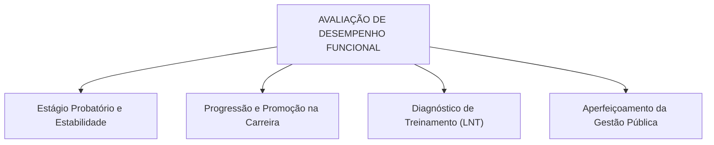
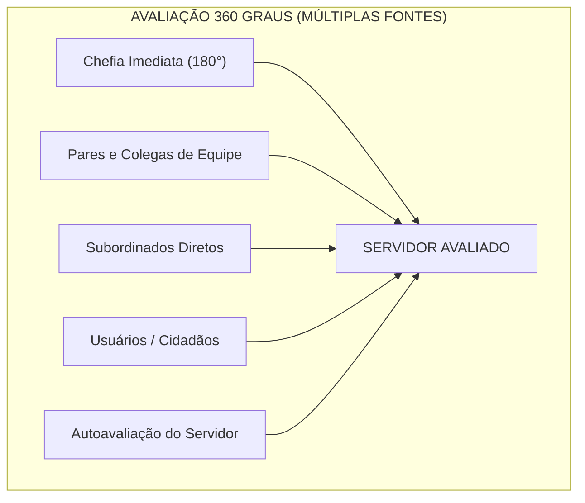
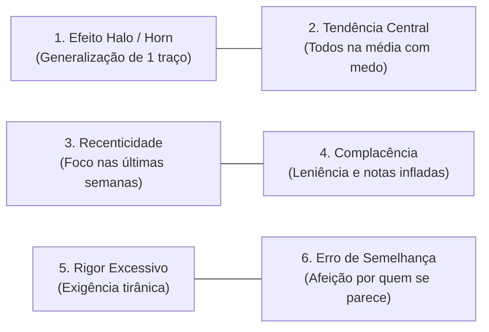
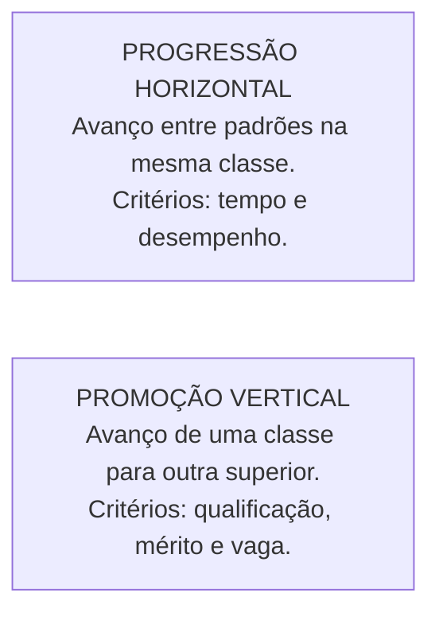
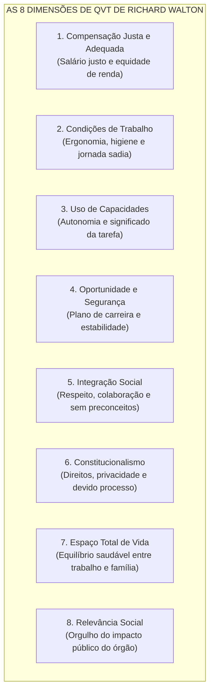

# 03 - Avaliação de Desempenho, Remuneração, Qualidade de Vida no Trabalho e Teletrabalho

> **Matéria:** Gestão de Pessoas  
> **Cargo:** A01 – Técnico de Controle Externo – Especialidade: Técnico Administrativo (TCE-GO)  
> **Conteúdo Oficial:** Gestão e Avaliação de Desempenho no Setor Público; Métodos Tradicionais e Modernos de Avaliação; Erros e Vieses Cognitivos do Avaliador; Estrutura Remuneratória e o Regime de Subsídio Constitucional; Qualidade de Vida no Trabalho (Modelo das 8 Dimensões de Richard Walton); Novas Modalidades de Trabalho (Teletrabalho, Gestão por Resultados e Direito à Desconexão).

---

## 📌 Ementa & Delimitação do Conteúdo

1. **Gestão e Avaliação de Desempenho Funcional:**
    - Conceito, objetivos e finalidades na administração pública: subsídio para o estágio probatório, concessão de progressões e promoções funcionais, diagnóstico de necessidades de treinamento e melhoria dos serviços aos cidadãos;
    - Alocação no macroprocesso de **Aplicar Pessoas** (modelo de Idalberto Chiavenato);
    - Os papéis na avaliação: autoavaliação, avaliação pelo gestor imediato, avaliação pela equipe e avaliação institucional.

2. **Métodos de Avaliação de Desempenho:**
    - **Métodos Tradicionais:**
    - *Escalas Gráficas:* tabela de dupla entrada, fatores de avaliação graduados; simplicidade operacional vs. alta subjetividade e superficialidade;
    - *Escolha Forçada:* blocos de frases alternativas (positivas e neutras) com escolha obrigatória; mitigação de complacência vs. impossibilidade de feedback construtivo;
    - *Incidentes Críticos:* anotação exclusiva de comportamentos extremos altamente positivos ou falhas graves; foco em dados reais vs. omissão da rotina habitual;
    - *Pesquisa de Campo:* condução por especialista de RH em conjunto com cada chefia direta; profundidade diagnóstica vs. elevado custo orçamentário e morosidade operacional;
    - *Listas de Verificação (Checklists).*
    - **Métodos Modernos e Participativos:**
    - *Avaliação por Objetivos / Metas (APO Participativa):* pactuação prévia e consensual de metas, acompanhamento contínuo e autoavaliação orientada ao futuro;
    - *Avaliação 360 Graus (Circular ou Múltiplas Fontes):* visão sistêmica envolvendo superior imediato, pares, subordinados, usuários do serviço e autoavaliação; riqueza de perspectivas vs. risco de complacência ou alianças espúrias.

3. **Erros, Vieses e Distorções Cognitivas do Avaliador:**
    - Efeito Halo (*halo effect*) e Efeito Horn: contaminação generalizada a partir de um traço positivo ou negativo isolado;
    - Tendência Central: receio de atribuir notas extremas, nivelando todos os servidores na nota mediana;
    - Erro de Recenticidade (Recência): supervalorização dos eventos das últimas semanas em detrimento do desempenho anual;
    - Complacência / Leniência: atribuição benevolente de notas máximas para evitar atritos com a equipe;
    - Rigor Excessivo / Severidade: exigência implacável e atribuição generalizada de notas rebaixadas;
    - Erro de Semelhança (*Similar-to-me*) e Erro de Contraste: comparação do servidor consigo mesmo ou com o colega avaliado anteriormente.

4. **Remuneração, Benefícios e Planos de Carreira:**
    - Componentes remuneratórios no setor público: vencimento básico vs. vantagens pecuniárias de caráter pessoal e funcional;
    - O regime jurídico do **Subsídio Constitucional** em parcela única (CF/88, art. 39, § 4º): vedações a acréscimos pecuniários e ressalva expressa às verbas indenizatórias;
    - O Teto Remuneratório Constitucional (CF/88, art. 37, XI) e o abate-teto;
    - Progressão funcional (horizontal, na mesma classe) vs. Promoção (vertical, entre classes da mesma carreira).

5. **Qualidade de Vida no Trabalho (QVT):**
    - As 8 dimensões conceituais do modelo clássico de Richard Walton: Compensação justa e adequada, Condições de segurança e saúde, Uso e desenvolvimento de capacidades, Oportunidade de crescimento e segurança, Integração social, Constitucionalismo organizacional, Espaço total de vida e Relevância social da instituição.

6. **Teletrabalho e Trabalho Híbrido no Setor Público:**
    - Deslocamento do controle tradicional de ponto biométrico para a **gestão por resultados, metas pactuadas e entregas concretas**;
    - Vantagens institucionais: racionalização de despesas prediais, flexibilidade, retenção de talentos e sustentabilidade ambiental;
    - Riscos e cuidados ergonômicos: isolamento social, segurança cibernética de autos processuais e garantia do **direito à desconexão** contra a Síndrome de *Burnout*.

---

## 🧭 Sumário Interativo
- [1. Gestão e Métodos de Avaliação de Desempenho](#1-gestao-e-metodos-de-avaliacao-de-desempenho)
- [2. Erros, Vieses e Distorções Cognitivas do Avaliador](#2-erros-vieses-e-distorcoes-cognitivas-do-avaliador)
- [3. Remuneração e Planos de Carreira no Setor Público](#3-remuneracao-e-planos-de-carreira-no-setor-publico)
- [4. Qualidade de Vida no Trabalho (QVT): Modelo de Richard Walton](#4-qualidade-de-vida-no-trabalho-qvt-modelo-de-richard-walton)
- [5. Teletrabalho e Trabalho Híbrido no Setor Público](#5-teletrabalho-e-trabalho-hibrido-no-setor-publico)
- [6. Fontes Oficiais e Referências Bibliográficas](#6-fontes-oficiais-e-referencias-bibliograficas)

---

## 📖 Resumo Teórico Aprofundado & Esquematizado

### 1. Gestão e Métodos de Avaliação de Desempenho

A avaliação de desempenho é uma apreciação sistemática do comportamento e da entrega funcional do servidor no exercício de suas atribuições. Integra o macroprocesso de **Aplicar Pessoas** (Chiavenato).

#### Comparativo Completo dos Métodos de Avaliação de Desempenho

| Método de Avaliação | Como Funciona na Prática | Principais Vantagens | Principais Críticas / Desvantagens |
| :--- | :--- | :--- | :--- |
| **Escalas Gráficas** | Formulário em matriz: linhas com fatores predefinidos (ex.: produtividade, assiduidade) e colunas com notas em escala (ótimo, bom, regular, fraco). | Simples de elaborar, muito fácil de preencher e baixo custo financeiro. | Extremamente superficial; estimula a **tendência central** e o **efeito halo**; trata o avaliado de modo padronizado. |
| **Escolha Forçada** | Blocos de duas ou quatro frases descritivas (positivas/neutras). O gestor é obrigado a escolher a frase que mais descreve e a que menos descreve o servidor. | **Neutraliza a subjetividade**, o favoritismo pessoal e a complacência do gestor. | Método complexo de montar; gera desconfiança no gestor; **não permite fornecer feedback claro** (pesos estatísticos secretos). |
| **Incidentes Críticos** | O avaliador mantém um registro sistemático de comportamentos excepcionais extremos (sucessos notáveis ou falhas graves). | Baseado em fatos concretos reais comprovados, afastando opiniões genéricas. | Ignora a rotina mediana de desempenho; avaliador assume postura de "policial" fiscalizador de erros. |
| **Pesquisa de Campo** | Um analista técnico de Gestão de Pessoas vai até cada setor e entrevista o chefe imediato para avaliar conjuntamente cada colaborador. | Alta padronização, profundo rigor técnico, orienta a chefia sobre planos de melhoria. | Método de **altíssimo custo**, extrema lentidão e inviável para quadros muito volumosos. |
| **Avaliação por Objetivos (APO Participativa)** | Chefia e servidor sentam juntos, negociam metas quantitativas/qualitativas para o ciclo, acompanham periodicamente e realizam autoavaliação final. | Alto engajamento, estímulo à autonomia, foco em entregas futuras e resultados concretos. | Risco de conflito na fixação de metas; exige elevada maturidade gerencial; foco excessivo no quantitativo em detrimento de valores. |
| **Avaliação 360 Graus (Circular)** | O servidor é avaliado por múltiplos observadores: superior imediato, pares/colegas, subordinados diretos, usuários/cidadãos e sua própria autoavaliação. | Visão global, abrangente e democrática; atenua preconceitos de um único avaliador. | Muito trabalhosa de tabular; pode gerar pactos de conivência ("eu dou nota 10 para você e você para mim") ou vinganças internas. |

> 🚨 **ALERTA DE PROVA / PEGADINHA FCC (FEEDBACK NA ESCOLHA FORÇADA):**  
> A banca frequentemente afirma que o método da **Escolha Forçada** é o mais indicado quando o objetivo central do órgão é promover sessões ricas de *feedback* individual entre o chefe e o subordinado. **ERRADO!** Esse é um dos maiores "peguenhas" da FCC! A Escolha Forçada **NÃO serve para fornecer feedback**, pois o avaliador desconhece a pontuação estatística das frases preenchidas, o que impossibilita justificar detalhadamente a avaliação para o servidor.

---

### Questão 01
**(FCC – Técnico de Controle Externo – Gestão Pública – TCE-AP)**  
Em determinado órgão público estadual, a diretoria de Recursos Humanos decidiu substituir o método tradicional de escalas gráficas pelo método da Escolha Forçada, visando conferir maior neutralidade aos resultados avaliativos. Todavia, após a primeira rodada de avaliação, diversos gestores setoriais queixaram-se publicamente da nova ferramenta. À luz da teoria de Gestão de Pessoas, a principal limitação técnica inerente ao método da **Escolha Forçada** consiste em:

* **A)** exigir pesados custos com a contratação permanente de psicólogos clínicos para entrevistar cada servidor individualmente.
* **B)** apresentar acentuada vulnerabilidade à subjetividade pessoal do avaliador, facilitando o favorecimento sistemático de protegidos políticos.
* **C)** impedir que os gestores forneçam um feedback formativo e transparente aos avaliados, visto que os pesos ponderados das frases são apurados estatisticamente pelo RH e não divulgados ao avaliador.
* **D)** fixar compulsoriamente todas as avaliações no patamar intermediário de notas, provocando uma distorção generalizada por tendência central.
* **E)** restringir-se exclusivamente à apuração de dados financeiros e orçamentários, sendo inaplicável a cargos de suporte administrativo.

> **Comentário Detalhado:**  
>
> - **A) Incorreta.** A contratação de especialistas para entrevistas detalhadas é a característica marcante do método da Pesquisa de Campo, não da Escolha Forçada.  
> - **B) Incorreta.** A maior vantagem da Escolha Forçada é precisamente **eliminar a subjetividade**, o favoritismo e a complacência, obrigando a escolha entre blocos de frases pré-definidas.  
> - **C) CORRETA.** A crítica clássica e mais cobrada em concursos em relação ao método da **Escolha Forçada** é a sua **incapacidade de gerar feedback construtivo**: como as combinações de frases possuem ponderações estatísticas matemáticas tabuladas privativamente pela área de RH, a chefia imediata preenche o formulário sem saber exatamente como o servidor pontuou em cada quesito, impossibilitando orientá-lo sobre onde e como melhorar seu desempenho no trabalho.  
> - **D) Incorreta.** A tendência central é a marca do método das Escalas Gráficas.  
> - **E) Incorreta.** A Escolha Forçada é um método geral de avaliação comportamental, perfeitamente utilizável na área administrativa.  
> 
> **Gabarito: C**

---

### Questão 02 (FCC - Adaptada / Analista de Gestão Pública)
Dentre as metodologias clássicas e modernas de Avaliação de Desempenho Humano nas organizações, a **Avaliação 360 Graus (ou Feedback Circular / Multirrequisital)** caracteriza-se por:

* **A)** Coletar avaliações estruturadas sobre o desempenho do colaborador provenientes de todas as direções de relacionamento: do superior hierárquico, dos pares de trabalho (colegas), dos subordinados, dos clientes/usuários externos e da autoavaliação do próprio servidor.
* **B)** Basear-se exclusivamente no julgamento autocrático e secreto do chefe imediato da repartição.
* **C)** Classificar os servidores por meio de uma curva forçada em que obrigatoriamente 20% são classificados como insuficientes.
* **D)** Avaliar apenas aspectos relacionados à pontualidade de registro do ponto biométrico eletrônico.
* **E)** Limitar-se à medição de força física e aptidão cardiorrespiratória dos novos contratados.

> **Comentário Detalhado:**
>
> - **A)** Correta. A **Avaliação 360 Graus** proporciona visão holística e rica do colaborador, coletando feedback de todos os agentes que interagem com ele: chefe imediato, subordinados diretos, pares de equipe, clientes internos/externos e a própria autoavaliação.
> - **B)** Incorreta. Refere-se à avaliação tradicional unilateral por superior hierárquico (90 graus).
> - **C)** Incorreta. Refere-se ao método da distribuição forçada (*forced distribution*).
> - **D), E)** Incorretas. Distorções que não representam o escopo da avaliação 360 graus.
> 
> **Gabarito: A**

---

### 2. Erros, Vieses e Distorções Cognitivas do Avaliador

A subjetividade humana constitui o maior obstáculo à precisão da avaliação de desempenho:

1. **Efeito Halo (*Halo Effect*) e Efeito Horn:**
    - *Halo:* O avaliador projeta uma característica altamente positiva (ex.: o servidor é pontual ou simpático) sobre todo o desempenho, atribuindo notas excelentes em fatores técnicos que sequer avaliou.
    - *Horn:* Uma falha isolada contamina negativamente todos os demais quesitos, rotulando o servidor como inteiramente inapto.

2. **Tendência Central:** O avaliador tem receio de prejudicar os maus colaboradores ou gerar atritos ao destacar os melhores; por comodismo ou insegurança, atribui notas medianas ("bom" ou "regular") a todos.
3. **Erro de Recenticidade (Recência):** O avaliador deixa-se influenciar desproporcionalmente por fatos ocorridos nos últimos 15 ou 30 dias que antecedem a avaliação, ignorando os comportamentos dos 11 meses anteriores.
4. **Complacência / Leniência:** Tendência sistemática de conceder notas infladas a todos os subordinados para evitar descontentamento, atritos pessoais ou conversas difíceis de feedback.
5. **Rigor Excessivo / Severidade:** O avaliador estabelece padrões de exigência inalcançáveis, atribuindo notas baixas de forma generalizada por considerar que "ninguém faz mais do que a obrigação".
6. **Erro de Semelhança (*Similar-to-me*):** Tendência de avaliar mais favoravelmente indivíduos que compartilham dos mesmos valores, formação acadêmica, estilo pessoal ou interesses do próprio avaliador.
7. **Erro de Contraste:** O avaliador julga o servidor comparando-o diretamente com o indivíduo avaliado logo antes, e não confrontando seu desempenho com os padrões objetivos do cargo.

> 🛑 **ATENÇÃO — EFEITO HALO VS. RECÊNCIA:**  
>
> - **Efeito Halo:** distorção decorrente de uma **única característica ou traço marcante** que cega o avaliador sobre os demais quesitos;  
> - **Erro de Recência:** distorção de ordem **temporal**, em que o avaliador recorda apenas dos acontecimentos dos **últimos dias ou semanas** do ciclo avaliativo.

---

### Questão 03
**(FCC – Analista de Controle Externo – TCE-GO)**  
Um diretor de fiscalização do Tribunal de Contas realizou a avaliação anual de desempenho de um técnico administrativo recém-lotado em sua gerência. Ao analisar a pontualidade impecável e a cortesia no atendimento demonstradas pelo servidor no dia a dia, o diretor atribuiu pontuação máxima em todos os itens da avaliação, inclusive naqueles relativos a domínio técnico avançado de auditoria de obras e redação de relatórios complexos, competências que sequer haviam sido desempenhadas ou verificadas no período. A falha cognitiva que maculou o procedimento avaliativo configura o denominado:

* **A)** Erro de tendência central.
* **B)** Efeito Halo.
* **C)** Erro de rigor excessivo.
* **D)** Viés de recência funcional.
* **E)** Falso consenso heurístico.

> **Comentário Detalhado:**  
>
> - **A) Incorreta.** O erro de tendência central ocorre quando o avaliador evita notas extremas e coloca todos os subordinados na nota média intermediária.  
> - **B) CORRETA.** O **Efeito Halo (*Halo Effect*)** é a distorção perceptiva na qual o avaliador permite que uma impressão positiva isolada a respeito de uma característica específica (neste caso, a pontualidade e simpatia) irradie e contamine favoravelmente o julgamento de todas as demais dimensões de competência técnica do avaliado, atribuindo-lhe notas excelentes em itens que sequer foram testados.  
> - **C) Incorreta.** O rigor excessivo é a conduta implacável de conceder notas rebaixadas para praticamente toda a equipe.  
> - **D) Incorreta.** O viés de recência refere-se à supervalorização de episódios temporais recentes (últimos dias do ciclo), esquecendo o restante do período.  
> - **E) Incorreta.** O falso consenso é a presunção equivocada de que os outros indivíduos compartilham dos mesmos julgamentos e crenças do avaliador.  
> 
> **Gabarito: B**

---

### Questão 04 (FCC - Adaptada / Auditor de Controle Externo)
No processo de Avaliação de Desempenho, o avaliador está sujeito a vieses cognitivos e distorções perceptivas involuntárias que podem comprometer a fidedignidade dos resultados.

A distorção conhecida como **Efeito de Halo (ou Halo Effect)** ocorre quando:

* **A)** O avaliador generaliza uma única característica marcante (positiva ou negativa) do avaliado para julgar de forma contaminada todos os demais fatores e competências de seu desempenho.
* **B)** O avaliador atribui notas medianas a todos os avaliados para evitar conflitos interpessoais (*tendência central*).
* **C)** O avaliador considera apenas os fatos ocorridos na última semana antes da avaliação, esquecendo o restante do ano (*efeito de recência*).
* **D)** O avaliador avalia melhor os indivíduos que possuem perfil, origens e opiniões semelhantes às suas (*erro de semelhança*).
* **E)** O avaliador é excessivamente rigoroso com todos os seus subordinados (*severidade excessiva*).

> **Comentário Detalhado:**
>
> - **A)** Correta. O **Efeito de Halo** (ou Efeito Horn, quando negativo) é a contaminação generalizada da avaliação por um único traço saliente: se o servidor é muito simpático ou pontual, o chefe presume precipitadamente que ele é ótimo em todas as demais competências (planejamento, rigor técnico, redação).
> - **B)** Incorreta. Refere-se ao vício de **Tendência Central**.
> - **C)** Incorreta. Refere-se ao erro de **Recência**.
> - **D)** Incorreta. Refere-se ao viés de **Semelhança** (*similar-to-me*).
> - **E)** Incorreta. Refere-se ao vício de **Severidade/Rigor excessivo**.
> 
> **Gabarito: A**

---

### 3. Remuneração e Planos de Carreira no Setor Público

A remuneração no serviço público subordina-se a rígidos parâmetros constitucionais de legalidade e moralidade:

* **Vencimento Básico:** Retribuição pecuniária fixada em lei devida ao servidor pelo efetivo exercício de cargo público.
* **Remuneração:** O vencimento do cargo efetivo acrescido das vantagens pecuniárias permanentes estabelecidas em lei (adicionais por tempo de serviço, gratificações de titulação, etc.).
* **Regime de Subsídio Constitucional (CF/88, art. 39, § 4º):**
    - Fixado em **parcela única**, sendo expressamente **vedado o acréscimo de qualquer gratificação, adicional, abono, prêmio, verba de representação** ou outra espécie remuneratória;
    - Obrigatório para membros de Poder, detentores de mandato eletivo, Ministros/Secretários e membros da Magistratura, Ministério Público, Defensoria Pública e carreiras policiais;
    - **Exceção Constitucional:** O subsídio não impede o pagamento de parcelas de natureza **estritamente indenizatória** previstas em lei (como diárias, ajuda de custo para mudança de sede e indenização de transporte).
* **Teto Remuneratório Constitucional (CF/88, art. 37, XI):** Limite máximo de retribuição no serviço público, correspondente ao subsídio mensal dos Ministros do Supremo Tribunal Federal (STF). Qualquer valor excedente deve ser retido pela aplicação do instituto do **abate-teto**.

#### Dinâmica dos Planos de Cargos e Carreiras

* **Progressão:** Passagem do servidor de um padrão remuneratório para o seguinte, dentro da mesma classe de seu cargo efetivo (foco na senioridade e avaliações periódicas).
* **Promoção:** Elevação do servidor de uma classe para a classe imediatamente superior dentro da mesma carreira, dependendo de merecimento, capacitação continuada e vacância. *Não se confunde com ascensão ou transposição (formas de provimento derivado banidas pela CF/88).*

> 📌 **NOTA EXPLICATIVA — SUBSÍDIO CONSTITUCIONAL:**  
> O subsídio em parcela única (art. 39, § 4º da CF/88) **proíbe gratificações e adicionais de natureza remuneratória**, mas **NÃO impede verbas estritamente indenizatórias** (como diárias de viagem a serviço e ajuda de custo para transporte), visto que verbas indenizatórias apenas ressarcem despesas extraordinárias do agente e não integram a base remuneratória.

---

### Questão 05
**(FCC – Auditor de Controle Externo – TCE-RO)**  
Nos termos do art. 39, § 4º da Constituição Federal de 1988, determinadas categorias de agentes públicos devem ser remuneradas exclusivamente pelo regime de subsídio. A respeito dessa disciplina constitucional, é correto afirmar:

* **A)** O subsídio é fixado em parcela única, sendo constitucionalmente lícito o pagamento cumulativo de gratificações de produtividade e adicionais de tempo de serviço.
* **B)** O regime de subsídio veda o acréscimo de qualquer gratificação, adicional, abono, prêmio ou verba de representação, ressalvado o pagamento de parcelas de natureza estritamente indenizatória previstas em lei.
* **C)** O subsídio mensal dos servidores públicos estaduais não se subordina ao teto remuneratório constitucional, tendo em vista a autonomia federativa ampla dos Estados-membros.
* **D)** O pagamento de diárias e de ajuda de custo para ressarcir despesas extraordinárias com deslocamento a serviço é terminantemente vedado aos agentes remunerados por subsídio.
* **E)** O subsídio pode ser instituído discricionariamente mediante portaria interna expedida pelo Presidente do Tribunal de Contas, prescindindo de lei formal específica.

> **Comentário Detalhado:**  
>
> - **A) Incorreta.** O subsídio veda terminantemente a inclusão de gratificações por tempo de serviço ou adicionais de produtividade típicos da remuneração composta.  
> - **B) CORRETA.** Conforme a redação expressa do art. 39, § 4º da CF/88, o subsídio é fixado em **parcela única, vedado o acréscimo de qualquer gratificação, adicional, abono, prêmio, verba de representação** ou outra espécie remuneratória. A jurisprudência consolidada do STF ressalva expressamente que essa vedação **não atinge parcelas de natureza estritamente indenizatória** (como diárias e indenização de transporte), pois elas visam ressarcir despesas suportadas pelo agente público no interesse do serviço e não constituem ganho patrimonial.  
> - **C) Incorreta.** Todos os subsídios subordinam-se expressamente ao teto remuneratório constitucional previsto no art. 37, XI da CF/88.  
> - **D) Incorreta.** Diárias e ajuda de custo são parcelas indenizatórias legítimas e plenamente compatíveis com o regime de subsídio.  
> - **E) Incorreta.** A fixação ou alteração de subsídios exige obrigatoriamente lei formal específica (princípio da reserva legal).  
> 
> **Gabarito: B**

---

### Questão 06 (FCC - Adaptada / Analista de Planejamento e Controle)
No estudo da Qualidade de Vida no Trabalho (QVT), o modelo conceitual mais abrangente e citado na literatura administrativa foi proposto por Richard Walton (1973), estruturado em oito dimensões clássicas.

Constitui uma das oito dimensões do modelo de QVT de **Richard Walton**:

* **A)** Constitucionalismo na Organização (respeito aos direitos dos trabalhadores, privacidade, liberdade de expressão e normas de equidade no trabalho).
* **B)** Remuneração salarial indexada exclusivamente à variação cambial do dólar americano.
* **C)** Proibição de concessão de férias e licenças no primeiro ano do mandato do governador.
* **D)** Instauração obrigatória de sindicância sumária em qualquer alteração de rotina.
* **E)** Exigência de cumprimento de horas extras diárias de forma compulsória sem descanso semanal.

> **Comentário Detalhado:**
>
> - **A)** Correta. As 8 dimensões de QVT de Walton: (1) Compensação justa e adequada; (2) Condições de trabalho seguras e saudáveis; (3) Uso e desenvolvimento de capacidades; (4) Oportunidade de crescimento contínuo e segurança; (5) Integração social na organização; (6) **Constitucionalismo na organização** (direitos, privacidade, contraditório); (7) Trabalho e o espaço total de vida (equilíbrio trabalho-família); (8) Relevância social do trabalho na sociedade.
> - **B), C), D), E)** Incorretas. Distorções que violam os preceitos de bem-estar e dignidade do trabalho.
> 
> **Gabarito: A**

---

### 4. Qualidade de Vida no Trabalho (QVT): Modelo de Richard Walton

O modelo formulado por Richard Walton (1973) é a principal referência doutrinária exigida em provas sobre o bem-estar no ambiente corporativo e público. Walton estruturou a QVT em **oito dimensões conceituais**:

1. **Compensação Justa e Adequada:** Remuneração que garanta uma vida digna ao trabalhador e que observe a equidade interna (mesmo valor para atribuições equivalentes) e externa (mercado).
2. **Condições de Segurança e Saúde no Trabalho:** Instalações físicas saudáveis, equipamentos ergonômicos, prevenção de acidentes, ausência de insalubridade e limites saudáveis de jornada laboral.
3. **Utilização e Desenvolvimento de Capacidades:** Oportunidade dada ao colaborador de exercer autonomia intelectual, aplicar habilidades cognitivas, planejar seu trabalho e obter feedback claro.
4. **Oportunidade de Crescimento Contínuo e Segurança:** Perspectiva concreta de progressão na carreira, investimento institucional em capacitação e garantia de estabilidade funcional no emprego.
5. **Integração Social na Organização:** Clima colaborativo e acolhedor, ausência de discriminações de raça, gênero ou orientação sexual, respeito interpessoal e senso de pertencimento grupal.
6. **Constitucionalismo na Organização:** Vigência das garantias do Estado de Direito dentro da instituição: respeito à intimidade e privacidade do servidor, liberdade de expressão e direito à ampla defesa e contraditório contra atos punitivos internos.
7. **Espaço Total de Vida:** Equilíbrio sadio entre a dedicação às atividades profissionais e o tempo reservado ao convívio familiar, lazer, descanso e vida pessoal (prevenção ao esgotamento).
8. **Relevância Social do Trabalho:** Percepção e orgulho do servidor de que o trabalho de sua instituição gera valor real, protege o interesse público e contribui para o bem comum da sociedade.

> ⭐ **IMPORTANTE — CONSTITUCIONALISMO DE RICHARD WALTON:**  
> Em provas de tribunais e controladorias, a dimensão do **Constitucionalismo** desponta com enorme frequência. Ela significa assegurar os **direitos civis do trabalhador** dentro dos muros da repartição (privacidade de dados, liberdade de discordância respeitosa, equidade e devido processo em sindicâncias).

---

### Questão 07
**(FCC – Analista Judiciário – TRT-21ª)**  
O modelo conceitual de Qualidade de Vida no Trabalho (QVT) estruturado por Richard Walton estabelece oito dimensões fundamentais para a criação de um ecossistema laboral saudável e motivador. A dimensão que prevê expressamente o respeito à privacidade dos colaboradores, a vigência de regras claras e transparentes de conduta funcional, a liberdade de expressão responsável e a garantia do devido processo legal e ampla defesa diante de averiguações funcionais é denominada por Walton de:

* **A)** Espaço Total de Vida.
* **B)** Relevância Social do Trabalho.
* **C)** Integração Social na Organização.
* **D)** Constitucionalismo na Organização.
* **E)** Compensação Justa e Adequada.

> **Comentário Detalhado:**  
>
> - **A) Incorreta.** O Espaço Total de Vida diz respeito ao equilíbrio sadio entre as demandas laborais e a vida pessoal, social e familiar do empregado.  
> - **B) Incorreta.** A Relevância Social do Trabalho analisa o orgulho que o trabalhador ostenta quanto à contribuição ética e ao valor público que a instituição entrega à sociedade.  
> - **C) Incorreta.** A Integração Social na Organização envolve a ausência de discriminações e preconceitos e o fortalecimento de laços de companheirismo e cooperação mútua.  
> - **D) CORRETA.** No modelo de Richard Walton, o **Constitucionalismo na Organização** é a dimensão que estabelece a vigência dos direitos civis e das garantias de cidadania dentro da corporação. Envolve o respeito aos direitos trabalhistas, regras institucionais claras, proteção da intimidade/privacidade, liberdade de opinião e o cumprimento inafastável do contraditório e da ampla defesa antes da imposição de sanções disciplinares.  
> - **E) Incorreta.** A Compensação Justa e Adequada compreende renda condizente com a dignidade e critérios de equidade interna e externa.  
> 
> **Gabarito: D**

---

### 5. Teletrabalho e Trabalho Híbrido no Setor Público

A consolidação do regime de teletrabalho transformou a dinâmica das instituições de controle externo (como os Tribunais de Contas):

* **Superação do Paradigma Cartorial:** Substituição definitiva da mera fiscalização da presença física e batimento de ponto pelo modelo contemporâneo de **Pacto de Resultados e Metas Mensuráveis**:
    - O servidor em teletrabalho não se subordina ao controle tradicional de frequência horária;
    - Deve entregar metas previamente pactuadas com a chefia imediata (frequentemente estipuladas com produtividade superior à exigida no trabalho presencial).
* **Vantagens para a Administração Pública:**
    1. Redução expressiva dos custos fixos de manutenção predial (energia elétrica, água, insumos de escritório, mobiliário);
    2. Aumento comprovado de produtividade na análise minuciosa de processos licitatórios e relatórios de auditoria que demandam concentração prolongada;
    3. Atração e fixação de quadros técnicos qualificados;
    4. Redução da pegada de carbono e melhoria na mobilidade urbana das cidades.

* **Desafios e Riscos Gerenciais:**
    - **Sensação de Isolamento Social e Afastamento Cultural:** Risco de o servidor perder o senso de identidade e comunhão com a missão do órgão;
    - **Segurança da Informação e Sigilo de Processos:** Necessidade de criptografia avançada, redes privadas virtuais (VPN) e certificação digital;
    - **Direito à Desconexão e Síndrome de *Burnout*:** Risco de o servidor trabalhar ininterruptamente no espaço doméstico. A administração pública deve estabelecer políticas rígidas de respeito aos períodos de repouso e desconexão digital fora do expediente pactuado.

---

### Questão 08
**(FCC – Analista de Gestão Pública – DPE-RS)**  
Com o avanço da transformação digital na administração pública, o regime de teletrabalho consolidou-se como instrumento relevante de modernização gerencial. Sob a ótica do planejamento e gestão de pessoas, a correta implementação do teletrabalho no setor público pressupõe:

* **A)** a intensificação dos mecanismos cartoriais de fiscalização contínua de horários por meio de relógios de ponto virtuais e acionamento de câmeras de vídeo a cada 30 minutos.
* **B)** a supressão definitiva de qualquer responsabilidade da instituição governamental quanto a padrões ergonômicos e segurança cibernética de seus dados.
* **C)** a substituição do controle formal e presencial de frequência por um modelo fundamentado na pactuação prévia de metas mensuráveis e entregas de resultados de valor público.
* **D)** o cancelamento compulsório de todos os programas institucionais de capacitação continuada para os servidores admitidos na modalidade remota.
* **E)** a proibição legal do retorno do servidor ao regime de trabalho presencial, dado o caráter irrevogável do termo de adesão ao teletrabalho.

> **Comentário Detalhado:**  
>
> - **A) Incorreta.** O teletrabalho moderno rompe exatamente com a lógica cartorial de vigiar horários mecânicos, substituindo-a pelo foco em resultados e produtividade.  
> - **B) Incorreta.** O órgão mantém a obrigação de orientar sobre práticas ergonômicas e instituir mecanismos rígidos de governança e segurança da informação (VPN, sigilo funcional).  
> - **C) CORRETA.** O fundamento primordial do teletrabalho e do trabalho híbrido no setor público reside na transição paradigmática do controle de presença física e cumprimento estrito de horas no relógio para a **gestão por resultados**, orientada por metas quantitativas e qualitativas claras, com prazos e entregas concretas pactuadas no plano de trabalho institucional.  
> - **D) Incorreta.** Servidores em teletrabalho permanecem com pleno direito e necessidade de qualificação por meio de educação corporativa (EaD e cursos).  
> - **E) Incorreta.** A permanência em teletrabalho não constitui direito adquirido; trata-se de regime precário e revogável por necessidade do serviço ou interesse da administração pública a qualquer momento.  
> 
> **Gabarito: C**

---

### Questão 09 (FCC - Adaptada / TCE-PI - Auditor de Controle Externo)
Com a regulamentação do teletrabalho e do trabalho híbrido no serviço público brasileiro (Decreto Federal nº 11.072/2022 - Programa de Gestão e Desempenho e normativos do TCE-GO), a dinâmica da gestão funcional passou por transformações estruturais.

No regime de teletrabalho regulamentado pelo poder público, a gestão do servidor público fundamenta-se prioritariamente:

* **A)** No acompanhamento de entregas, metas de produtividade pactuadas formalmente em plano de trabalho individual e resultados acordados, em substituição ao controle puramente físico e cronológico de frequência e assiduidade por ponto eletrônico.
* **B)** No monitoramento contínuo da imagem do servidor por câmera de vigilância durante oito horas ininterruptas.
* **C)** Na proibição total de comparecimento do servidor às dependências físicas do Tribunal de Contas sob pena de demissão.
* **D)** Na redução proporcional de 50% de seus vencimentos básicos em virtude da ausência no prédio público.
* **E)** Na transferência integral da responsabilidade fiscal do órgão para o servidor teletrabalhador.

> **Comentário Detalhado:**
>
> - **A)** Correta. A transição trazida pelos Programas de Gestão e Desempenho (PGD) e resoluções do setor público: o controle migra da lógica clássica de "presença e controle de horas no ponto" para a **gestão por resultados e cumprimento de metas de entregas mensuráveis**, expressas em Planos de Trabalho com prazos e padrões de qualidade definidos.
> - **B), C), D), E)** Incorretas. Posturas ilegais ou distorcidas que violam a regulamentação do teletrabalho no setor público.
> 
> **Gabarito: A**

---

### Questão 10 (FCC - Adaptada / TCE-GO - Analista de Controle Externo)
No tocante à estrutura do Sistema de Remuneração no Setor Público e aos Planos de Cargos, Carreiras e Vencimentos (PCCV), a contraprestação pecuniária mensal devida ao servidor pelo efetivo exercício do cargo público, fixada em lei, desprovida de quaisquer adicionais ou gratificações, denomina-se:

* **A)** Vencimento básico (ou padrão).
* **B)** Remuneração integral.
* **C)** Diária de deslocamento eventual.
* **D)** Ajuda de custo para transferência de domicílio.
* **E)** Indenização de transporte funcional.

> **Comentário Detalhado:**
>
> - **A)** Correta. Distinção essencial estatutária (Lei Estadual nº 20.756/2020 e Lei Federal nº 8.112/1990): **Vencimento básico** é a retribuição pecuniária básica fixada em lei devida pelo exercício do cargo; **Remuneração** é o vencimento básico acrescido das vantagens pecuniárias permanentes (adicionais e gratificações) estabelecidas em lei.
> - **B)** Incorreta. Remuneração inclui vencimento mais vantagens adicionais.
> - **C), D), E)** Incorretas. São parcelas de caráter puramente indenizatório, não salarial.
> 
> **Gabarito: A**

---

### 6. Fontes Oficiais e Referências Bibliográficas

* [Decreto Federal nº 11.072/2022 (Programa de Gestão e Desempenho - PGD e Teletrabalho)](https://www.planalto.gov.br/ccivil_03/_ato2019-2022/2022/decreto/d11072.htm) - Disciplina o teletrabalho, planos de trabalho individuais, metas de produtividade e qualidade das entregas.
* [Constituição Federal de 1988 - Art. 41, § 1º, III (Avaliação Periódica de Desempenho)](https://www.planalto.gov.br/ccivil_03/constituicao/constituicao.htm#art37) - Condição constitucional para perda de cargo do servidor estável mediante procedimento de avaliação periódica de desempenho.
* [Lei Estadual nº 20.756/2020 - Da Avaliação Especial e Periódica de Desempenho](https://legisla.casacivil.go.gov.br/pesquisa_legislacao/100979/lei-20756) - Critérios de estágio probatório, avaliação periódica e teletrabalho para servidores públicos de Goiás.
* [Lei Estadual nº 15.122/2005 (Estrutura Remuneratória e Progressão no TCE-GO)](https://legisla.casacivil.go.gov.br/pesquisa_legislacao/80023/lei-15122) - Vencimentos, progressões, promoções por mérito e gratificações dos servidores do TCE-GO.
* [TCU - Governança da Gestão de Pessoas e Teletrabalho](https://portal.tcu.gov.br/governanca/governanca-no-tcu/) - Referencial de boas práticas para acompanhamento do desempenho individual e institucional.
* CHIAVENATO, Idalberto. **Gestão de Pessoas: O Novo Papel dos Recursos Humanos nas Organizações**. 5. ed. São Paulo: Atlas, 2020. (Cap. 8 - Avaliação do Desempenho Humano; Cap. 9 - Remuneração; Cap. 13 - Qualidade de Vida no Trabalho).
* MARRAS, Jean Pierre. **Administração de Recursos Humanos: Do Operacional ao Estratégico**. 15. ed. São Paulo: Saraiva, 2016. (Cap. 7 - Avaliação de Desempenho; Cap. 8 - Remuneração e Benefícios).
* LIMONGI-FRANÇA, Ana Cristina. **Qualidade de Vida no Trabalho - QVT: Conceitos e Práticas nas Empresas da Sociedade Pós-Industrial**. 2. ed. São Paulo: Atlas, 2012. (Cap. 2 - Modelos de QVT: Walton e Nadler-Lawler).
