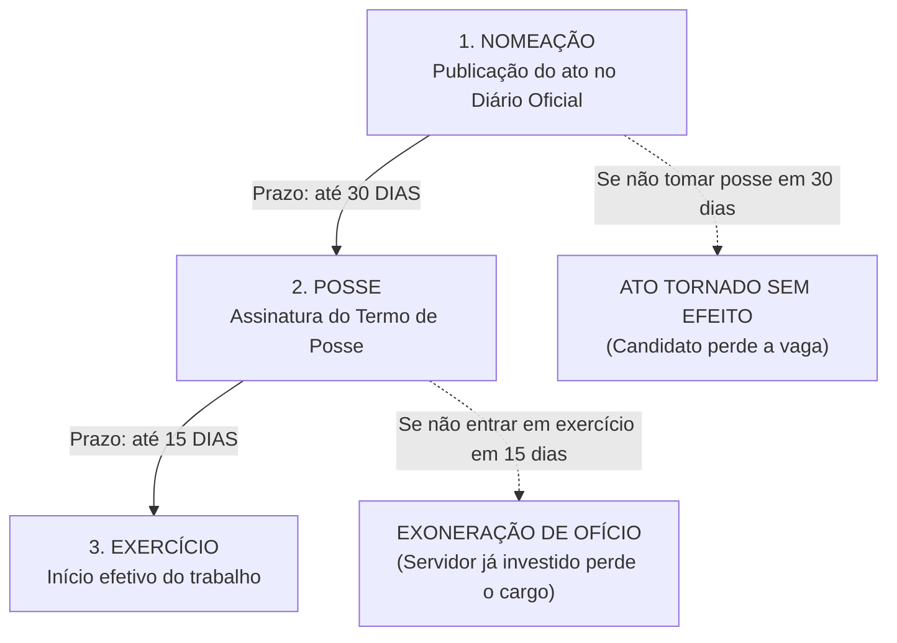
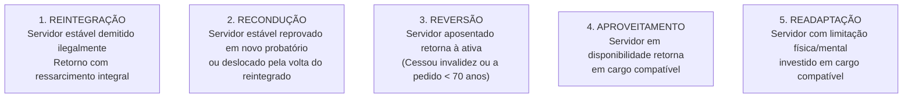
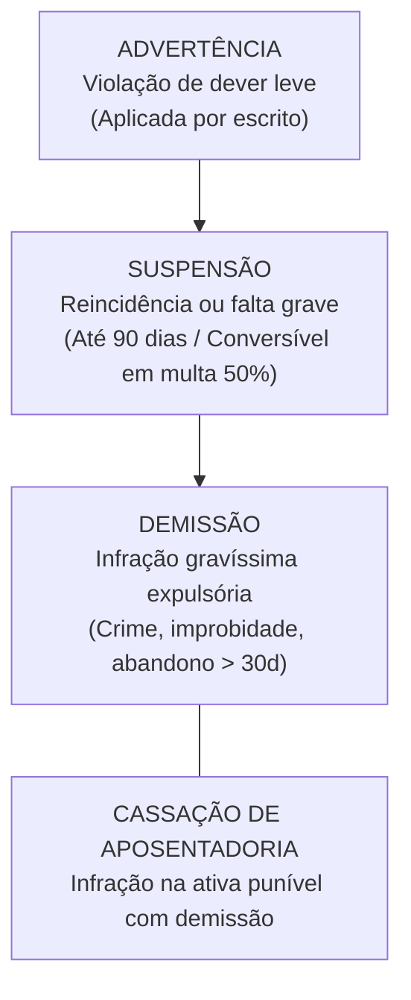
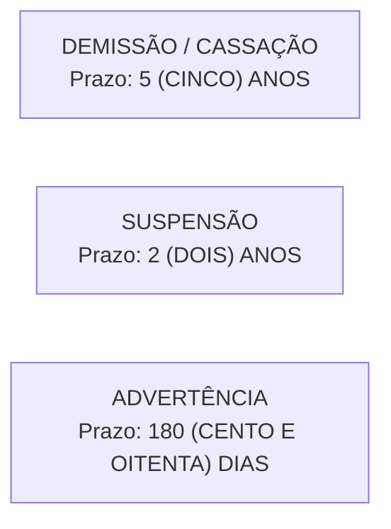

# 04 - Regime Jurídico dos Servidores Públicos Civis do Estado de Goiás (Lei Estadual nº 20.756/2020)

> **Matéria:** Gestão de Pessoas  
> **Cargo:** A01 – Técnico de Controle Externo – Especialidade: Técnico Administrativo (TCE-GO)  
> **Conteúdo Oficial:** Lei Estadual de Goiás nº 20.756/2020 (Estatuto dos Servidores Públicos Civis do Estado de Goiás); Formas de Provimento (Nomeação, Posse e Exercício); Estágio Probatório e Estabilidade; Formas Derivadas de Provimento; Vacância; Direitos, Vantagens e Licenças; Regime Disciplinar, Sanções e Prazos de Prescrição; Sindicância e PAD.

---

## 📌 Ementa & Delimitação do Conteúdo

1. **Disposições Preliminares e Conceitos Fundamentais:**
   - Servidor Público: pessoa legalmente investida em cargo público de provimento efetivo ou em comissão;
   - Cargo Público: unidade básica de atribuições e responsabilidades cometidas a um servidor, criada por lei, com denominação própria, quantidade certa e remuneração paga pelos cofres estaduais;
   - Função de Confiança (exclusiva de servidores de cargo efetivo) vs. Cargo em Comissão (livre nomeação e exoneração, com percentual mínimo para servidores de carreira).
2. **Provimento de Cargos Públicos:**
   - Requisitos básicos para investidura em cargo público estadual (nacionalidade, gozo dos direitos políticos, quitação militar e eleitoral, nível de escolaridade exigido, idade mínima de 18 anos e higidez física e mental);
   - A Nomeação (provimento originário);
   - A Posse: formalização da investidura mediante assinatura do termo; prazo legal improrrogável de **30 (trinta) dias** da publicação do ato de nomeação no DOE; consequência do descumprimento: o ato de nomeação é **tornado sem efeito**;
   - O Exercício: início do efetivo desempenho das funções; prazo legal de **15 (quinze) dias** contados da posse; consequência do descumprimento: o servidor empossado é **exonerado de ofício**.
3. **Estágio Probatório e Estabilidade Constitucional:**
   - Período de **3 (três) anos de efetivo exercício** em cargo de provimento efetivo;
   - Fatores de avaliação especial de desempenho: assiduidade, pontualidade, disciplina, capacidade de iniciativa, produtividade e responsabilidade;
   - Comissão Especial de Avaliação de Desempenho;
   - Consequência da inabilitação no probatório: **exoneração de ofício** (se não estável anteriormente) ou **recondução ao cargo de origem** (se servidor já estável em outro cargo público estadual);
   - Hipóteses constitucionais de perda do cargo pelo servidor estável (CF/88, art. 41 e art. 169).
4. **Formas Derivadas de Provimento:**
   - **Reintegração:** retorno do servidor estável indevidamente demitido (anulação judicial ou administrativa), com recomposição financeira retroativa integral;
   - **Recondução:** retorno do servidor estável ao cargo anteriormente ocupado por inabilitação em probatório de outro cargo ou reintegração do titular;
   - **Reversão:** retorno à atividade do servidor aposentado (de ofício por cessação da incapacidade ou a pedido no interesse público);
   - **Aproveitamento:** retorno compulsório do servidor estável em disponibilidade remunerada para cargo de natureza equivalente;
   - **Readaptação:** investidura em cargo de complexidade compatível com limitação física ou mental comprovada em perícia médica oficial, sem redução salarial.
5. **Vacância do Cargo Público:**
   - Exoneração (*a pedido* do servidor ou *de ofício* por inabilitação no estágio probatório ou descumprimento do prazo de exercício) vs. Demissão (penalidade disciplinar punitiva);
   - Outras causas de vacância: readaptação, aposentadoria, posse em outro cargo inacumulável e falecimento.
6. **Direitos, Vantagens Pecuniárias e Licenças:**
   - Vencimento básico vs. Remuneração (vencimento acrescido de vantagens de caráter permanente e transitório);
   - Indenizações (caráter não incorporável e não sujeito ao abate-teto): Ajuda de Custo (deslocamento para nova sede no interesse da administração), Diárias (hospedagem e alimentação em missão fora da sede) e Indenização de Transporte;
   - Férias anuais e acréscimo de um terço constitucional;
   - Licenças: para tratamento de saúde, por motivo de doença em pessoa da família, maternidade e paternidade, para capacitação profissional (até 3 meses a cada quinquênio, com remuneração integral) e para tratar de interesses particulares (até 3 anos consecutivos, sem remuneração, condicionada à estabilidade prévia).
7. **Regime Disciplinar, Sanções e Prescrição (Lei nº 20.756/2020):**
   - Responsabilidade civil, penal e administrativa (independência relativa das instâncias e reflexo imediato da absolvição criminal que nega a autoria ou a existência do fato);
   - Deveres funcionais e proibições estatutárias;
   - Penalidades disciplinares: **advertência** (escrita), **suspensão** (máximo de 90 dias, conversível em multa de 50% por dia trabalhado), **demissão**, **cassação de aposentadoria ou de disponibilidade** e **destituição de cargo em comissão**;
   - Hipóteses de demissão: crime contra a administração, improbidade administrativa com dolo, abandono de cargo (mais de 30 dias consecutivos), inassiduidade habitual (60 dias interpolados em 12 meses), corrupção passiva e lesão aos cofres públicos;
   - Prazos de prescrição da ação disciplinar: **5 anos** (demissão e cassação), **2 anos** (suspensão) e **180 dias** (advertência);
   - Sindicância e Processo Administrativo Disciplinar (PAD): comissão composta por 3 servidores estáveis, contraditório, ampla defesa e revisão disciplinar.

---

## 🌳 Classificação Hierárquica do Conteúdo

```text
4. Estatuto dos Servidores Públicos Civis de Goiás (Lei nº 20.756/2020)
├── 4.1 Ingresso, Provimento e Exercício
│   ├── 4.1.1 Requisitos Legais Básicos de Acesso
│   ├── 4.1.2 Nomeação: Ato originário de chamamento público
│   ├── 4.1.3 Posse: Prazo de 30 DIAS da publicação (Descumprimento: Torna sem efeito)
│   └── 4.1.4 Exercício: Prazo de 15 DIAS da posse (Descumprimento: Exoneração de ofício)
├── 4.2 Estágio Probatório e Estabilidade
│   ├── 4.2.1 Duração: 3 (três) anos de efetivo exercício
│   ├── 4.2.2 Fatores de Avaliação: Assiduidade, pontualidade, disciplina, iniciativa e produtividade
│   ├── 4.2.3 Inabilitação no Probatório: Exoneração ou Recondução (se estável no cargo prévio)
│   └── 4.2.4 Garantias da Estabilidade (CF/88, art. 41) e Hipóteses de Perda do Cargo
├── 4.3 Formas Derivadas de Provimento
│   ├── 4.3.1 Reintegração (demissão anulada por via judicial ou administrativa com ressarcimento integral)
│   ├── 4.3.2 Recondução (retorno do servidor estável ao cargo anterior)
│   ├── 4.3.3 Reversão (retorno do servidor aposentado à ativa)
│   ├── 4.3.4 Aproveitamento (retorno do servidor em disponibilidade remunerada)
│   └── 4.3.5 Readaptação (investidura em cargo compatível com limitação de saúde)
├── 4.4 Vacância do Cargo Público
│   ├── 4.4.1 Exoneração (a pedido ou de ofício; ato não punitivo)
│   ├── 4.4.2 Demissão (sanção punitiva gravíssima)
│   └── 4.4.3 Readaptação, Aposentadoria, Posse em cargo inacumulável e Falecimento
├── 4.5 Vantagens Pecuniárias e Licenças
│   ├── 4.5.1 Indenizações: Ajuda de custo, diárias e transporte (não incorporam ao teto)
│   ├── 4.5.2 Licença para Capacitação: Até 3 meses por quinquênio, remunerada
│   └── 4.5.3 Licença para Interesses Particulares: Até 3 anos, não remunerada (exige estabilidade)
└── 4.6 Regime Disciplinar e Processo Sancionador
    ├── 4.6.1 Deveres e Proibições Funcionais
    ├── 4.6.2 Penalidades: Advertência, Suspensão (até 90 dias), Demissão e Cassação
    ├── 4.6.3 Prescrição da Ação Disciplinar: 5 anos (demissão), 2 anos (suspensão) e 180 dias (advertência)
    └── 4.6.4 Sindicância e PAD: Comissão de 3 servidores estáveis e garantia da ampla defesa
```

---

## 📖 Resumo Teórico Aprofundado & Esquematizado

### 1. Dinâmica de Ingresso: Nomeação, Posse e Exercício

A investidura e o início efetivo do trabalho no serviço público goiano obedecem a uma trilha temporal rígida disciplinada pela Lei Estadual nº 20.756/2020:



* **Nomeação:** Ato administrativo formal pelo qual a autoridade competente convoca o candidato aprovado no concurso público para preencher o cargo.
* **Posse (Investidura):** Momento solene e formal em que se consuma a investidura no cargo público, mediante a aceitação expressa das atribuições, deveres, responsabilidades e direitos inerentes ao cargo, firmando-se o respectivo termo de posse.
  - **Prazo:** A posse ocorrerá no prazo improrrogável de **30 (trinta) dias**, contados da publicação oficial do ato de provimento.
  - **Consequência do Descumprimento:** Decorrido o prazo legal sem que a posse tenha ocorrido, o ato de nomeação será **tornado sem efeito**.
* **Exercício:** O efetivo desempenho das atribuições do cargo público pelo servidor.
  - **Prazo:** O início do exercício dar-se-á no prazo de **15 (quinze) dias**, contados da data da posse.
  - **Consequência do Descumprimento:** O servidor empossado que não entrar em exercício dentro do prazo legal será **exonerado de ofício**.

> 🚨 **ALERTA DE PROVA / PEGADINHA FCC:**  
> A banca adora inverter os efeitos do decurso dos prazos:  
> - Se **não toma posse** no prazo de 30 dias $\rightarrow$ **Torna-se sem efeito o ato de nomeação** (o candidato sequer chegou a ser servidor).  
> - Se tomou posse mas **não entra em exercício** no prazo de 15 dias $\rightarrow$ **Exoneração de ofício** (o indivíduo já havia sido formalmente investido no cargo mediante a posse, logo necessita de ato de vacância para desinvestir-se do cargo).

---

### 2. Estágio Probatório e Estabilidade

* **Duração do Estágio Probatório:** Ao entrar em exercício, o servidor nomeado para cargo de provimento efetivo sujeita-se a estágio probatório pelo período de **3 (três) anos (36 meses) de efetivo exercício**, durante o qual sua aptidão e capacidade funcional serão objeto de avaliação especial.
* **Fatores de Avaliação Especial de Desempenho (Lei nº 20.756/2020):**
  1. *Assiduidade;*
  2. *Pontualidade;*
  3. *Disciplina;*
  4. *Capacidade de iniciativa;*
  5. *Produtividade;*
  6. *Responsabilidade.*
* **Comissão Especial de Avaliação:** A avaliação especial é conduzida por comissão composta por servidores estáveis e homologada pela autoridade competente antes de findo o triênio.
* **Desfecho da Inabilitação no Estágio Probatório:**
  - Se o servidor for inabilitado na avaliação especial de desempenho, ser-lhe-á assegurada ampla defesa e contraditório;
  - Se inabilitado e **não possuir estabilidade prévia** em outro cargo estadual $\rightarrow$ **Exoneração de ofício** (ato sem cunho punitivo);
  - Se inabilitado e **já for estável em outro cargo público estadual** $\rightarrow$ **Recondução de ofício ao cargo de origem**.
* **Estabilidade Constitucional (CF/88, art. 41):** São estáveis após **3 (três) anos de efetivo exercício** os servidores nomeados para cargo de provimento efetivo em virtude de concurso público, mediante prévia aprovação em avaliação especial de desempenho.
* **Hipóteses Constitucionais de Perda do Cargo do Servidor Estável:**
  1. Sentença judicial transitada em julgado;
  2. Processo administrativo disciplinar (PAD) no qual lhe seja assegurada ampla defesa;
  3. Procedimento de avaliação periódica de desempenho, na forma de lei complementar, assegurada ampla defesa;
  4. Redução excessiva de despesas de pessoal para enquadramento nos limites da Lei de Responsabilidade Fiscal (CF/88, art. 169, § 4º).

---

### 3. As Formas Derivadas de Provimento (Quadro Comparativo)

Enquanto a nomeação é a única modalidade de provimento originário, a Lei nº 20.756/2020 disciplina cinco vias de provimento derivado:



| Modalidade Derivada | Hipótese e Mecanismo Legal | Consequência Pecuniária e Requisitos |
| :--- | :--- | :--- |
| **Reintegração** | Retorno do **servidor estável** ao cargo anteriormente ocupado, quando declarada a **nulidade da sua demissão** por decisão administrativa ou sentença judicial transitada em julgado. | **Ressarcimento integral de todos os vencimentos e vantagens retroativas.** O eventual ocupante da vaga é reconduzido ao cargo anterior (sem direito à indenização), aproveitado em outro cargo ou posto em disponibilidade. |
| **Recondução** | Retorno do **servidor estável** ao cargo que ocupava anteriormente no serviço público goiano. | Ocorre em duas hipóteses: 1) Inabilitação em estágio probatório de outro cargo público; ou 2) Reintegração do anterior ocupante do cargo. |
| **Reversão** | Retorno à atividade do servidor **aposentado**. | Ocorre em duas modalidades: 1) *De ofício:* quando junta médica oficial constatar insubsistentes os motivos da aposentadoria por incapacidade; 2) *A pedido:* no interesse da administração, desde que voluntária a aposentadoria, estável na atividade, existindo cargo vago e idade inferior a 70 anos. |
| **Aproveitamento** | Retorno compulsório ao serviço ativo de servidor **estável colocado em disponibilidade remunerada**. | Dá-se em cargo de atribuições e vencimentos estritamente compatíveis com o anteriormente ocupado. Se o servidor for convocado e não entrar em exercício sem justificativa médica, a disponibilidade é cassada. |
| **Readaptação** | Investidura do servidor em cargo de atribuições e responsabilidades compatíveis com a **limitação física ou mental** que tenha sofrido, comprovada em perícia oficial. | Exige laudo médico da Junta Médica Oficial do Estado; o servidor readaptado **mantém a remuneração do seu cargo de origem**, sendo vedado qualquer decesso salarial. |

---

### 4. Vacância do Cargo Público

Vacância é o ato ou fato administrativo que deixa o cargo público sem titular. As hipóteses taxativas previstas na legislação goiana são:
1. **Exoneração:** Extinção do vínculo funcional sem caráter punitivo. Ocorre *a pedido* do próprio servidor ou *de ofício* (por inabilitação no estágio probatório ou não entrada em exercício no prazo legal de 15 dias);
2. **Demissão:** Penalidade administrativa disciplinar expulsória aplicada em razão do cometimento de infração funcional gravíssima;
3. **Readaptação:** Provoca a vacância do cargo de origem no instante em que opera o provimento no novo cargo adaptado;
4. **Aposentadoria:** Extingue o provimento ativo, abrindo a vaga no quadro de pessoal;
5. **Posse em outro cargo inacumulável:** Desocupa o cargo primitivo;
6. **Falecimento:** Vacância natural decorrente do óbito do titular;
7. **Destituição de cargo em comissão:** Extinção do vínculo comissionado de confiança.

---

### 5. Direitos, Vantagens Pecuniárias e Licenças Estatutárias

* **Vencimento Básico vs. Remuneração:**
  - Vencimento básico: valor pecuniário fixado em lei para cada padrão funcional;
  - Remuneração: vencimento básico acrescido das vantagens pecuniárias de caráter permanente ou temporário estabelecidas em lei.
* **Indenizações Estatutárias:**
  - Valores pecuniários concedidos para ressarcir despesas suportadas pelo servidor em razão do exercício de suas funções;
  - **Não se incorporam ao vencimento básico**, não servem de base para incidência de contribuição previdenciária e não se submetem ao teto remuneratório constitucional;
  - Espécies: **Ajuda de Custo** (compensação de mudança de domicílio para nova sede em caráter permanente), **Diárias** (indenização de despesas com alimentação e pousada em deslocamento eventual a serviço) e **Indenização de Transporte** (ressarcimento de uso de veículo próprio para serviço de fiscalização externa).
* **Licenças no Estatuto de Goiás (Lei nº 20.756/2020):**
  - **Licença para Capacitação Profissional:** Após cada quinquênio de efetivo exercício ininterrupto, o servidor poderá usufruir até **3 (três) meses de licença**, com **remuneração integral**, para participar de curso de aperfeiçoamento profissional de interesse do órgão. *Não é acumulável de um período para o outro.*
  - **Licença para Tratar de Interesses Particulares:** A critério discricionário da administração, poderá ser concedida ao servidor **estável** licença para o trato de assuntos particulares pelo prazo de **até 3 (três) anos consecutivos**, **sem qualquer remuneração**. Não pode ser concedida a servidor que ainda esteja cumprindo estágio probatório.

---

### 6. Regime Disciplinar: Penalidades, Prescrição e Processo Disciplinar

O regime disciplinar da Lei Estadual de Goiás nº 20.756/2020 assegura a integridade funcional e a proteção da moralidade administrativa.

#### As Penalidades Disciplinares



1. **Advertência:** Aplicada formalmente e por escrito em casos de descumprimento de dever funcional ou violação de proibições leves que não justifiquem sanção mais severa.
2. **Suspensão:** Aplicada em caso de reincidência em faltas punidas com advertência ou por violação de deveres funcionais graves que não cominem demissão.
   - **Prazo Máximo:** Não poderá exceder de **90 (noventa) dias**;
   - **Conversão em Multa:** Quando houver conveniência para o serviço público, a penalidade de suspensão poderá ser convertida em multa na base de **50% (cinquenta por cento) por dia de remuneração**, ficando o servidor obrigado a cumprir integralmente sua jornada normal de trabalho.
3. **Demissão:** Penalidade administrativa expulsória aplicada compulsoriamente nas seguintes infrações graves:
   - Crime contra a administração pública;
   - Ato de improbidade administrativa doloso comprovado;
   - **Abandono de Cargo:** ausência intencional do servidor ao serviço por **mais de 30 (trinta) dias consecutivos**;
   - **Inassiduidade Habitual:** falta ao serviço, sem causa justificada, por **60 (sessenta) dias interpolados** durante o período de 12 (doze) meses;
   - Corrupção passiva e aceitação de propinas ou vantagens indevidas;
   - Insubordinação grave em serviço e ofensa física a outrem na repartição;
   - Aplicação irregular de dinheiros públicos e lesão aos cofres estaduais.
4. **Cassação de Aposentadoria ou de Disponibilidade:** Aplicada ao servidor inativo que houver praticado, na atividade, falta passível de punição com demissão.

#### Prazos de Prescrição da Ação Disciplinar

A pretensão punitiva disciplinar do Estado de Goiás prescreve nos seguintes prazos legais, contados a partir da data em que o fato se tornou conhecido pela autoridade competente para instaurar o procedimento:



* **5 (cinco) anos:** para as infrações funcionais cominadas com **demissão**, **cassação de aposentadoria** ou de disponibilidade;
* **2 (dois) anos:** para as infrações puníveis com **suspensão**;
* **180 (cento e oitenta) dias:** para as infrações puníveis com **advertência**.
* *Infração capitulada como crime:* a prescrição da sanção disciplinar regular-se-á pelo prazo da lei penal brasileira.

#### Sindicância e Processo Administrativo Disciplinar (PAD)

* **Comissão Processante:** O PAD é conduzido por uma comissão disciplinar composta por **3 (três) servidores estáveis**, designados pela autoridade instauradora, que indicará, dentre eles, o presidente (que deverá ocupar cargo de nível igual ou superior ao do indiciado).
* **Fases Básicas do PAD:** Instauração (portaria inaugural), Instrução Probatória (oitiva de testemunhas, juntada de documentos e interrogatório), Defesa Escrita (após indiciação formal), Relatório Conclusivo e Julgamento pela autoridade competente.

---

## ⚠️ Alertas de Prova & Pegadinhas da FCC

> 🚨 **ALERTA DE PROVA / PEGADINHA FCC:**  
> A caracterização de **abandono de cargo** e de **inassiduidade habitual** na Lei nº 20.756/2020 é cobrada ao pé da letra pela banca:  
> - **Abandono de cargo:** ausência intencional por **mais de 30 (trinta) dias consecutivos**;  
> - **Inassiduidade habitual:** ausência injustificada por **60 (sessenta) dias interpolados** no período de **12 meses**.  
> Cuidado: 30 dias exatos consecutivos NÃO é abandono (a lei exige *mais de trinta dias*)!

> ⭐ **IMPORTANTE — PRAZOS PRESCRICIONAIS:**  
> Memorize o trio prescricional goiano:  
> - Demissão / Cassação: **5 anos**;  
> - Suspensão: **2 anos**;  
> - Advertência: **180 dias**.  
> A abertura de sindicância ou instauração de PAD interrompe o curso do prazo prescricional.

> 📌 **NOTA EXPLICATIVA — ESTABILIDADE E RECONDUÇÃO:**  
> A recondução pressupõe que o servidor seja **estável no cargo primitivo**. Se um servidor novato, ainda em estágio probatório, for aprovado em outro concurso e reprovado no segundo estágio, ele **não será reconduzido** (será simplesmente exonerado), pois nunca adquiriu estabilidade no cargo público de origem!

> 🛑 **ATENÇÃO — INDEPENDÊNCIA DAS INSTÂNCIAS:**  
> As sanções civis, penais e administrativas são independentes e podem cumular-se. Todavia, a absolvição penal **extingue a responsabilidade administrativa** quando a sentença judicial criminal reconhecer categoricamente a **inexistência do fato** ou que o réu **não foi o autor do crime** (negativa de autoria). A falta de provas penais para condenação criminal não afasta a punição disciplinar administrativa!

---

## 🌐 Fontes Oficiais e Referências Bibliográficas

* [Lei Estadual de Goiás nº 20.756/2020](https://legisla.casacivil.go.gov.br/pesquisa_legislacao/103195/lei-20756) - Dispõe sobre o regime jurídico dos servidores públicos civis do Estado de Goiás.
* [Constituição da República Federativa do Brasil de 1988](https://www.planalto.gov.br/ccivil_03/constituicao/constituicao.htm) - Art. 37 a 41 (Da Administração Pública e Servidores Públicos).
* [Constituição do Estado de Goiás](https://legisla.casacivil.go.gov.br) - Capítulo VII (Dos Servidores Públicos Civis).
* [CARVALHO FILHO, José dos Santos. Manual de Direito Administrativo. 36ª Edição. Atlas, 2022](https://www.grupogen.com.br).
* [MELLO, Celso Antônio Bandeira de. Curso de Direito Administrativo. Malheiros](https://www.editorajuspodivm.com.br).

---

## 📝 Questões de Concurso FCC Comentadas

### Questão 01
**(FCC – Analista de Controle Externo – TCE-GO)**  
Um cidadão regularmente aprovado em concurso público para o cargo de Técnico de Controle Externo do Tribunal de Contas do Estado de Goiás teve sua nomeação publicada no Diário Oficial do Estado no dia 1º de março. Ele compareceu à Diretoria de Gestão de Pessoas e tomou posse formal no dia 20 de março. De acordo com as disposições expressas da Lei Estadual de Goiás nº 20.756/2020, o prazo legal máximo para que esse servidor entre em efetivo exercício e a consequência administrativa caso ele não o faça dentro do prazo são, respectivamente:

* **A)** 30 dias contados da posse; e a sua demissão administrativa por abandono de cargo.
* **B)** 15 dias contados da posse; e a anulação preliminar do concurso público.
* **C)** 15 dias contados da data da posse; e a sua exoneração de ofício do cargo público.
* **D)** 30 dias contados da posse; e o cancelamento do termo de homologação final.
* **E)** 10 dias contados da nomeação; e a transformação do ato em disponibilidade remunerada proporcional.

> **Gabarito: C**  
> **Comentário Passo a Passo:**  
> - **A) Incorreta.** O prazo de exercício é de 15 dias e a demissão é penalidade disciplinar com rito próprio que pressupõe infração funcional de quem já exercia as funções.  
> - **B) Incorreta.** O não comparecimento de um empossado afeta unicamente sua situação jurídica individual e não o concurso homologado.  
> - **C) CORRETA.** Nos exatos termos da Lei Estadual nº 20.756/2020:  
>   - O exercício dar-se-á no prazo improrrogável de **15 (quinze) dias**, contados da data da posse;  
>   - Se o servidor empossado não entrar em efetivo exercício no prazo legal, ele será **exonerado de ofício** (visto que a posse operou a investidura, exigindo ato formal de exoneração para desconstituí-la).  
> - **D) Incorreta.** Prazo e consequências em desacordo com a lei goiana.  
> - **E) Incorreta.** A disponibilidade é instituto protetivo exclusivo de servidores estáveis cujo cargo fora extinto.

---

### Questão 02
**(FCC – Auditor de Controle Externo – TCE-RO)**  
Rodrigo, servidor público estável do Estado de Goiás, foi demitido da repartição após processo disciplinar sumário. Inconformado, Rodrigo ajuizou ação ordinária e obteve sentença judicial transitada em julgado que declarou a manifesta nulidade do ato demissório por cerceamento do direito de ampla defesa. No momento em que Rodrigo retornou ao órgão público, constatou-se que seu cargo original estava regularmente ocupado por Marcos, outro servidor público estável que havia sido promovido legitimamente. Consoante a disciplina da Lei Estadual nº 20.756/2020, o retorno de Rodrigo ao serviço ativo e a situação jurídica de Marcos configuram, respectivamente:

* **A)** Recondução de Rodrigo com ressarcimento integral; e exoneração compulsória de Marcos sem direito a indenização.
* **B)** Reversão de Rodrigo com vencimentos proporcionais; e transferência de Marcos para a administração indireta.
* **C)** Reintegração de Rodrigo com ressarcimento de todos os direitos e vantagens pecuniárias retroativas; e recondução de Marcos ao cargo anterior, sem direito a indenização, ou seu aproveitamento em outro cargo.
* **D)** Readaptação de Rodrigo com redução de jornada; e colocação imediata de Marcos em demissão administrativa.
* **E)** Aproveitamento de Rodrigo em cargo em comissão; e manutenção definitiva de Marcos no cargo efetivo em disputa.

> **Gabarito: C**  
> **Comentário Passo a Passo:**  
> - **A) Incorreta.** O retorno do servidor demitido ilegalmente denomina-se reintegração (e não recondução); além disso, servidor estável que ocupava a vaga não pode ser sumariamente exonerado.  
> - **B) Incorreta.** Reversão é o retorno do aposentado.  
> - **C) CORRETA.** Nos termos da Lei Estadual nº 20.756/2020 e do art. 41, § 2º da CF/88:  
>   - O retorno do servidor estável em virtude de anulação administrativa ou judicial de sua demissão denomina-se **Reintegração**, com direito ao ressarcimento integral de todos os vencimentos e vantagens pecuniárias que deixou de auferir no período do afastamento ilegal;  
>   - O eventual ocupante da vaga (Marcos), sendo estável, será **reconduzido ao cargo de origem, sem direito a indenização**, ou **aproveitado em outro cargo** compatível, ou ainda posto em disponibilidade com remuneração proporcional ao tempo de contribuição.  
> - **D) Incorreta.** Readaptação refere-se a restrições médicas/físicas e Marcos não cometeu infração disciplinar passível de demissão.  
> - **E) Incorreta.** A reintegração dá-se obrigatoriamente no cargo efetivo de origem do titular reintegrado.

---

### Questão 03
**(FCC – Analista Jurídico – PGE-GO)**  
Um servidor público titular de cargo efetivo da administração direta do Estado de Goiás ausentou-se deliberadamente e sem qualquer justificativa legal de seu posto de trabalho por 35 (trinta e cinco) dias consecutivos durante o mês de janeiro. Ciente do fato, a chefia imediata oficiou à autoridade competente. Conforme o Estatuto dos Servidores Públicos Civis de Goiás (Lei nº 20.756/2020), a conduta do servidor caracteriza:

* **A)** Inassiduidade habitual, cominada com penalidade de suspensão pelo prazo improrrogável de trinta dias.
* **B)** Abandono de cargo público, passível de punição disciplinar com a penalidade de demissão, apurada mediante processo administrativo disciplinar.
* **C)** Falta justificada ficta, sujeita exclusivamente à conversão dos dias em banco de horas compensatório.
* **D)** Desobediência hierárquica atenuada, sancionada unicamente com repreensão oral lavrada em ata interna.
* **E)** Inaptidão probatória superveniente, ensejando a aposentadoria compulsória do agente com proventos integrais.

> **Gabarito: B**  
> **Comentário Passo a Passo:**  
> - **A) Incorreta.** Inassiduidade habitual configura-se pela ausência injustificada por 60 dias interpolados em um ciclo de 12 meses, punível também com demissão.  
> - **B) CORRETA.** A Lei Estadual nº 20.756/2020 define expressamente o **Abandono de Cargo** como a ausência voluntária e injustificada do servidor ao serviço por **mais de 30 (trinta) dias consecutivos**. Como o servidor faltou 35 dias consecutivos, incorreu na tipificação legal de abandono, conduta infracional gravíssima cominada expressamente com a sanção de **demissão**, a ser apurada mediante regular Processo Administrativo Disciplinar (PAD), assegurados o contraditório e a ampla defesa.  
> - **C) Incorreta.** Ausência injustificada superior a 30 dias é ilícito gravíssimo e não admite mero ajuste de banco de horas.  
> - **D) Incorreta.** A lei não prevê repreensão oral para faltas consecutivas dessa magnitude.  
> - **E) Incorreta.** Aposentadoria compulsória aos 75 anos de idade decorre de limite de idade constitucional e não de sanção disciplinar punitiva.

---

### Questão 04
**(FCC – Técnico de Controle Externo – Área Administrativa – TCE-GO)**  
Nos moldes da Lei Estadual nº 20.756/2020, o servidor público estável poderá obter autorização administrativa para afastar-se de suas funções a fim de tratar de interesses particulares. A respeito dessa licença estatutária, assinale a afirmativa correta:

* **A)** A licença poderá ser concedida pelo prazo de até cinco anos consecutivos, mantido o pagamento integral de seu vencimento básico.
* **B)** A concessão da licença é direito público subjetivo incondicionado do servidor, não podendo a autoridade administrativa negá-la, ainda que haja manifesto prejuízo ao serviço.
* **C)** A licença para o trato de interesses particulares dar-se-á sem remuneração e vigorará pelo prazo de até 3 (três) anos consecutivos, permanecendo condicionada à prévia aquisição de estabilidade funcional e ao juízo de conveniência e oportunidade da administração.
* **D)** O servidor em cumprimento de estágio probatório faz jus à referida licença após completar doze meses de efetivo exercício no cargo.
* **E)** Durante o período de fruição da licença sem vencimentos, o servidor continuará computando o tempo integralmente para efeitos de promoção por merecimento funcional.

> **Gabarito: C**  
> **Comentário Passo a Passo:**  
> - **A) Incorreta.** A licença é **sem remuneração** e tem prazo máximo de **até 3 anos consecutivos**.  
> - **B) Incorreta.** Trata-se de ato discricionário submetido à conveniência e oportunidade da administração pública, que pode indeferi-la por imperativo do serviço.  
> - **C) CORRETA.** Nos termos expressos do Estatuto de Goiás (Lei nº 20.756/2020), a **licença para tratar de interesses particulares**:  
>   - É concedida **sem remuneração**;  
>   - Vigora pelo prazo de **até 3 (três) anos consecutivos**;  
>   - Exige que o servidor já tenha adquirido a **estabilidade funcional** no serviço público (vedada em estágio probatório);  
>   - Encontra-se submetida ao **interesse e juízo de conveniência da administração pública**.  
> - **D) Incorreta.** A lei veda expressamente a concessão dessa licença a servidor não estável em cumprimento de estágio probatório.  
> - **E) Incorreta.** O período de licença para interesse particular sem remuneração não é computado para fins de promoção ou progressão por merecimento.

---

### Questão 05
**(FCC – Analista de Controle Externo – Gestão Governamental – TCE-AP)**  
Em matéria de poder disciplinar sancionador preconizado na Lei Estadual de Goiás nº 20.756/2020, a pretensão disciplinar da administração pública estadual para punir o servidor prescreve, respectivamente, nos seguintes prazos, a contar da data em que o fato se tornou conhecido pela autoridade competente:

* **A)** Em 5 anos, para faltas puníveis com demissão; em 2 anos, para a penalidade de suspensão; e em 180 dias, para a penalidade de advertência.
* **B)** Em 10 anos, para a demissão; em 5 anos, para a suspensão; e em 1 ano, para a advertência escrita.
* **C)** Em 4 anos para quaisquer penalidades disciplinares, tendo em vista o princípio da uniformidade processual do Estado federado.
* **D)** Em 5 anos, para as infrações puníveis com advertência; e imprescritível para as infrações que cominem demissão e improbidade.
* **E)** Em 180 dias para a demissão; e em 30 dias para a suspensão funcional de servidores de controle.

> **Gabarito: A**  
> **Comentário Passo a Passo:**  
> - **A) CORRETA.** Os prazos de prescrição da ação disciplinar expressos na Lei Estadual nº 20.756/2020 são taxativos:  
>   - **5 (cinco) anos:** para infrações puníveis com **demissão**, **cassação de aposentadoria ou de disponibilidade** e destituição de cargo em comissão;  
>   - **2 (dois) anos:** para infrações puníveis com **suspensão**;  
>   - **180 (cento e oitenta) dias:** para infrações puníveis com **advertência**.  
> - **B), C), D) e E) Incorretas.** Todas trazem prazos equivocados e em flagrante descompasso com o texto da lei estatutária goiana.
