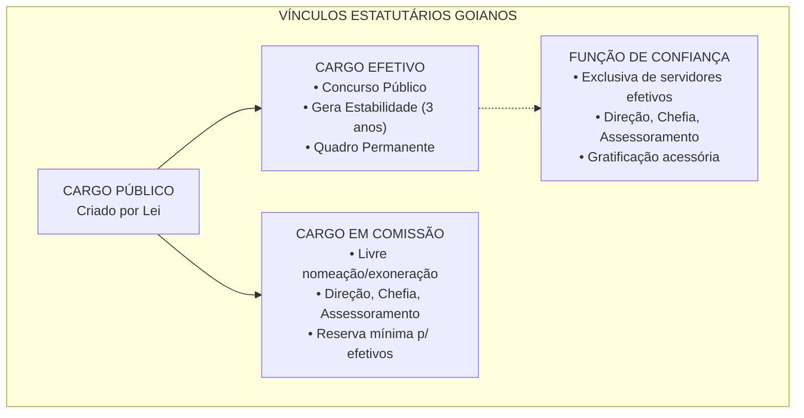
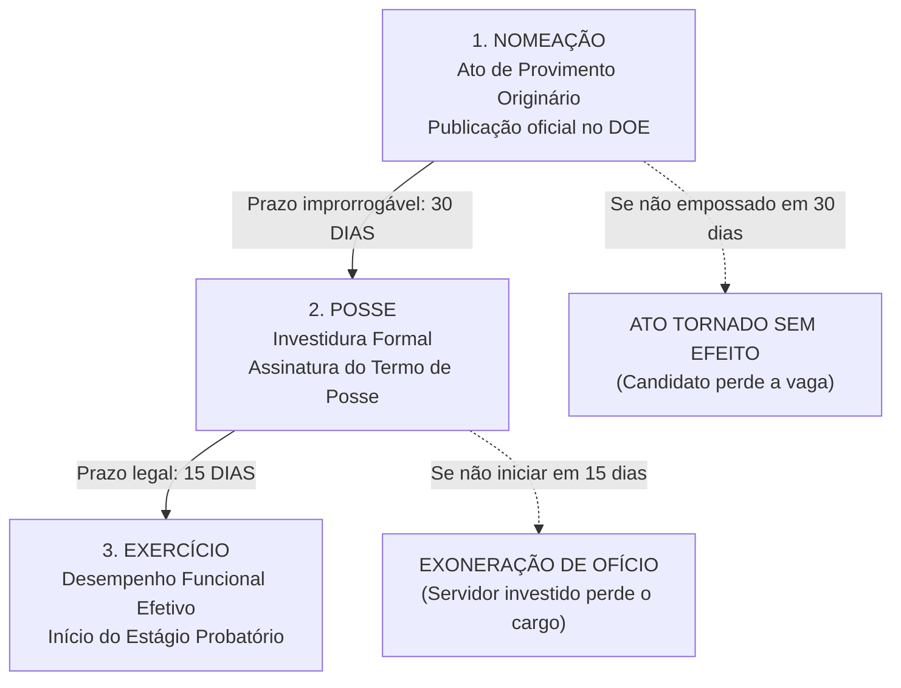
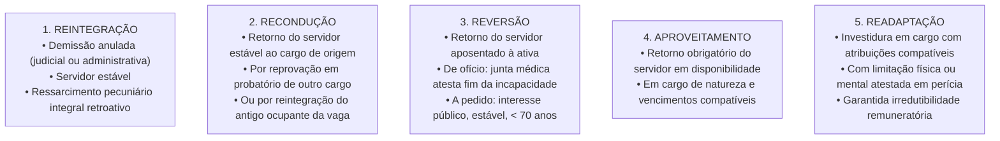
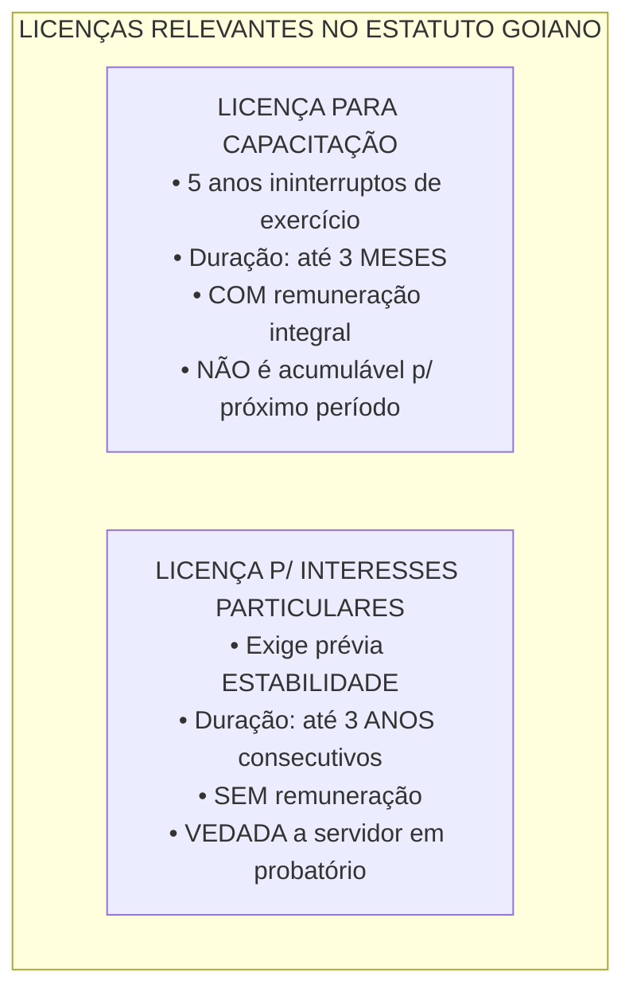
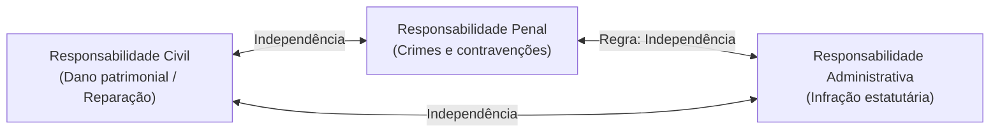
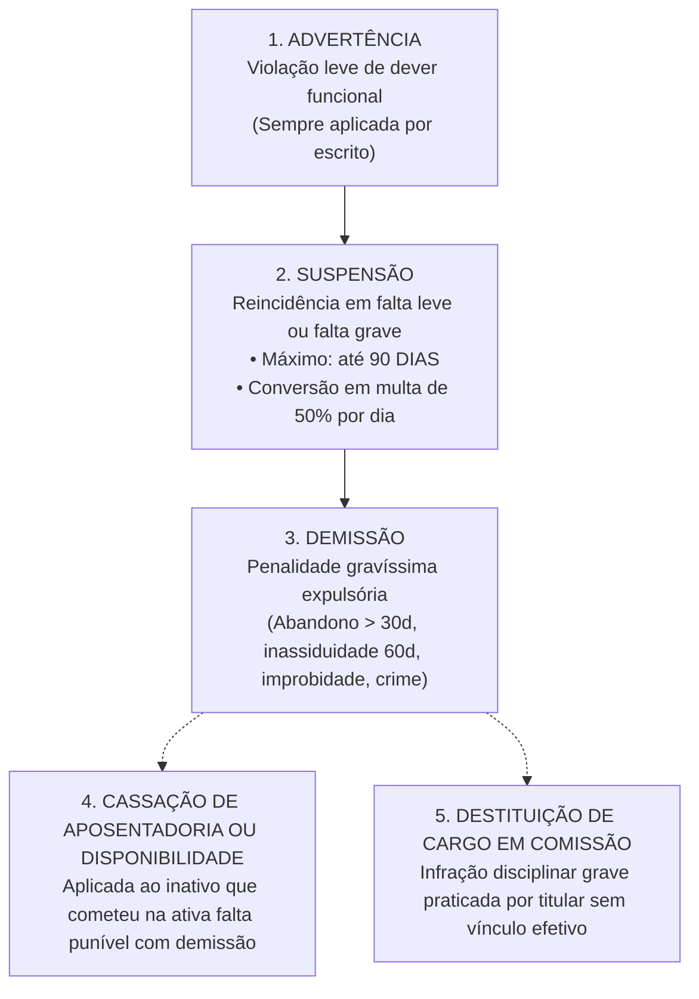
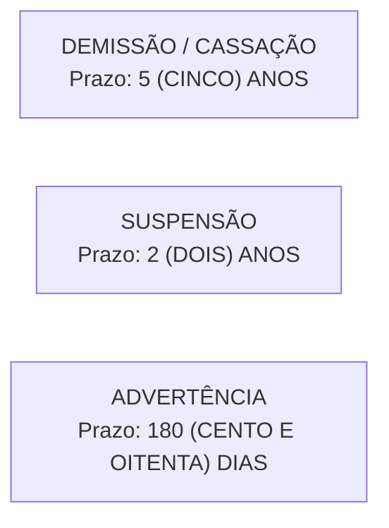

# 04 - Regime Jurídico dos Servidores Públicos Civis do Estado de Goiás (Lei Estadual nº 20.756/2020)

> **Matéria:** Gestão de Pessoas  
> **Cargo:** A01 – Técnico de Controle Externo – Especialidade: Técnico Administrativo (TCE-GO)  
> **Conteúdo Oficial:** Lei Estadual de Goiás nº 20.756/2020 (Estatuto dos Servidores Públicos Civis do Estado de Goiás); Formas de Provimento (Nomeação, Posse e Exercício); Estágio Probatório e Estabilidade; Formas Derivadas de Provimento; Vacância; Direitos, Vantagens e Licenças; Regime Disciplinar, Sanções e Prazos de Prescrição; Sindicância e PAD.

---

## 📌 Ementa & Delimitação do Conteúdo

1. **Disposições Preliminares e Conceitos Fundamentais:**
    - Servidor Público: pessoa legalmente investida em cargo público de provimento efetivo ou em comissão;
    - Cargo Público: unidade básica de atribuições e responsabilidades cometidas a um servidor, criada por lei, com denominação própria, quantidade certa e remuneração paga pelos cofres estaduais;
    - Função de Confiança (exclusiva de servidores de cargo efetivo) vs. Cargo em Comissão (livre nomeação e exoneração, com percentual mínimo reservado para servidores de carreira).

2. **Provimento de Cargos Públicos:**
    - Requisitos básicos para investidura em cargo público estadual (nacionalidade brasileira, gozo dos direitos políticos, quitação militar e eleitoral, nível de escolaridade exigido, idade mínima de 18 anos e higidez física e mental);
    - A Nomeação (provimento originário em caráter efetivo ou em comissão);
    - A Posse: formalização da investidura mediante assinatura do respectivo termo; prazo legal improrrogável de **30 (trinta) dias** contados da publicação oficial do ato de nomeação no Diário Oficial; consequência do descumprimento: o ato de nomeação é **tornado sem efeito**;
    - O Exercício: início do efetivo desempenho das funções cometidas ao cargo; prazo legal de **15 (quinze) dias** contados da posse; consequência do descumprimento: o servidor empossado é **exonerado de ofício**.

3. **Estágio Probatório e Estabilidade Constitucional:**
    - Período de **3 (três) anos (36 meses) de efetivo exercício** em cargo de provimento efetivo;
    - Fatores de avaliação especial de desempenho: assiduidade, pontualidade, disciplina, capacidade de iniciativa, produtividade e responsabilidade;
    - Comissão Especial de Avaliação de Desempenho;
    - Consequência da inabilitação no probatório: **exoneração de ofício** (se não estável anteriormente no serviço público estadual) ou **recondução ao cargo de origem** (se já estável em outro cargo público estadual);
    - Hipóteses constitucionais de perda do cargo pelo servidor estável (CF/88, art. 41 e art. 169).

4. **Formas Derivadas de Provimento:**
    - **Reintegração:** retorno do servidor estável indevidamente demitido por via de anulação judicial ou administrativa, com recomposição financeira retroativa integral;
    - **Recondução:** retorno do servidor estável ao cargo anteriormente ocupado por inabilitação em probatório de outro cargo ou reintegração do titular precedente;
    - **Reversão:** retorno à atividade do servidor aposentado (de ofício por cessação da incapacidade em junta médica ou a pedido no interesse público);
    - **Aproveitamento:** retorno compulsório do servidor estável em disponibilidade remunerada para cargo de natureza e vencimentos compatíveis;
    - **Readaptação:** investidura em cargo de complexidade compatível com limitação física ou mental comprovada em perícia médica oficial, assegurada a irredutibilidade remuneratória (sem decesso).

5. **Vacância do Cargo Público:**
    - Exoneração (*a pedido* do servidor ou *de ofício* por inabilitação no estágio probatório ou descumprimento do prazo de exercício) vs. Demissão (penalidade disciplinar punitiva gravíssima);
    - Outras hipóteses legais de vacância: readaptação, aposentadoria, posse em outro cargo inacumulável, falecimento e destituição de cargo em comissão.

6. **Direitos, Vantagens Pecuniárias e Licenças:**
    - Vencimento básico vs. Remuneração (vencimento acrescido de vantagens de caráter permanente e transitório);
    - Indenizações (caráter não incorporável, não previdenciário e não sujeito ao abate-teto): Ajuda de Custo (deslocamento para nova sede no interesse da administração), Diárias (hospedagem e alimentação em missão fora da sede) e Indenização de Transporte;
    - Férias anuais e acréscimo de um terço constitucional;
    - Licenças estatutárias: para tratamento de saúde, por motivo de doença em pessoa da família, maternidade e paternidade, para capacitação profissional (até 3 meses a cada quinquênio, com remuneração integral) e para tratar de interesses particulares (até 3 anos consecutivos, sem remuneração, condicionada à estabilidade prévia).

7. **Regime Disciplinar, Sanções e Prescrição (Lei nº 20.756/2020):**
    - Responsabilidade civil, penal e administrativa (independência relativa das instâncias e reflexo imediato da absolvição criminal que nega a autoria ou a existência do fato);
    - Deveres funcionais e proibições estatutárias;
    - Penalidades disciplinares: **advertência** (escrita), **suspensão** (máximo de 90 dias, conversível em multa de 50% por dia trabalhado), **demissão**, **cassação de aposentadoria ou de disponibilidade** e **destituição de cargo em comissão**;
    - Hipóteses de demissão: crime contra a administração, improbidade administrativa dolosa, abandono de cargo (mais de 30 dias consecutivos), inassiduidade habitual (60 dias interpolados em 12 meses), corrupção passiva e lesão aos cofres públicos;
    - Prazos de prescrição da ação disciplinar: **5 anos** (demissão e cassação), **2 anos** (suspensão) e **180 dias** (advertência);
    - Sindicância e Processo Administrativo Disciplinar (PAD): comissão composta por 3 servidores estáveis, contraditório, ampla defesa e revisão disciplinar.

---

## 🧭 Sumário Interativo
- [1. Disposições Gerais e Conceitos Estruturais](#1-disposicoes-gerais-e-conceitos-estruturais)
    - [1.1 Servidor Público e Cargo Público](#11-servidor-publico-e-cargo-publico)
    - [1.2 Cargos de Provimento Efetivo, em Comissão e Funções de Confiança](#12-cargos-de-provimento-efetivo-em-comissao-e-funcoes-de-confianca)
    - [1.3 Requisitos Básicos para Investidura](#13-requisitos-basicos-para-investidura)
- [2. Dinâmica de Ingresso: Nomeação, Posse e Exercício](#2-dinamica-de-ingresso-nomeacao-posse-e-exercicio)
    - [2.1 A Trilha Temporal de Investidura](#21-a-trilha-temporal-de-investidura)
    - [2.2 Consequências Jurídicas do Descumprimento dos Prazos](#22-consequencias-juridicas-do-descumprimento-dos-prazos)
- [3. Estágio Probatório e Estabilidade Constitucional](#3-estagio-probatorio-e-estabilidade-constitucional)
    - [3.1 Requisitos e Fatores de Avaliação Especial](#31-requisitos-e-fatores-de-avaliacao-especial)
    - [3.2 Desfechos da Avaliação Especial: Exoneração vs. Recondução](#32-desfechos-da-avaliacao-especial-exoneracao-vs-reconducao)
    - [3.3 Hipóteses Constitucionais de Perda do Cargo do Servidor Estável](#33-hipoteses-constitucionais-de-perda-do-cargo-do-servidor-estavel)
- [4. Provimento Derivado e Vacância de Cargos Públicos](#4-provimento-derivado-e-vacancia-de-cargos-publicos)
    - [4.1 Formas Derivadas de Provimento (Quadro Comparativo)](#41-formas-derivadas-de-provimento-quadro-comparativo)
    - [4.2 Hipóteses Legais de Vacância](#42-hipoteses-legais-de-vacancia)
- [5. Direitos, Vantagens Pecuniárias e Licenças Estatutárias](#5-direitos-vantagens-pecuniarias-e-licencas-estatutarias)
    - [5.1 Sistema Remuneratório: Vencimento, Remuneração e Indenizações](#51-sistema-remuneratorio-vencimento-remuneracao-e-indenizacoes)
    - [5.2 Regime de Férias](#52-regime-de-ferias)
    - [5.3 Licenças Estatutárias: Capacitação vs. Interesses Particulares](#53-licencas-estatutarias-capacitacao-vs-interesses-particulares)
- [6. Regime Disciplinar e Processo Sancionador](#6-regime-disciplinar-e-processo-sancionador)
    - [6.1 Responsabilidade Funcional e Independência Relativa das Instâncias](#61-responsabilidade-funcional-e-independencia-relativa-das-instancias)
    - [6.2 As Penalidades Disciplinares e Hipóteses de Demissão](#62-as-penalidades-disciplinares-e-hipoteses-de-demissao)
    - [6.3 Prazos de Prescrição da Pretensão Punitiva](#63-prazos-de-prescricao-da-pretensao-punitiva)
    - [6.4 Sindicância e Processo Administrativo Disciplinar (PAD)](#64-sindicancia-e-processo-administrativo-disciplinar-pad)
- [7. Fontes Oficiais e Referências Bibliográficas](#7-fontes-oficiais-e-referencias-bibliograficas)
- [8. Questões de Concurso FCC Comentadas](#8-questoes-de-concurso-fcc-comentadas)

---

## 1. Disposições Gerais e Conceitos Estruturais

A **Lei Estadual de Goiás nº 20.756, de 28 de janeiro de 2020**, estabeleceu o novo regime jurídico dos servidores públicos civis do Estado de Goiás, das suas autarquias e fundações públicas, modernizando os institutos estatutários e revogando a antiga Lei Estadual nº 10.460/1988.

### 1.1 Servidor Público e Cargo Público

Nos termos do Estatuto Goiano:

* **Servidor Público:** é a pessoa física legalmente investida em cargo público, de provimento efetivo ou em comissão.
* **Cargo Público:** é a unidade básica de estrutura organizacional, criada exclusivamente por **lei**, com denominação própria, quantidade certa, atribuições e responsabilidades cometidas a um titular, com remuneração paga pelos cofres estaduais.
    - Os cargos públicos são acessíveis a todos os brasileiros natos ou naturalizados, bem como aos estrangeiros na forma estipulada em lei complementar ou ordinária de regência (CF/88, art. 37, I).

### 1.2 Cargos de Provimento Efetivo, em Comissão e Funções de Confiança

A estrutura de cargos e funções públicas no Estado de Goiás desdobra-se em três modalidades jurídicas distintas, alinhadas ao art. 37, V, da CF/88:

1. **Cargos de Provimento Efetivo:**
    - Exigem aprovação prévia em **concurso público** de provas ou de provas e títulos;
    - Destinam-se ao corpo permanente da administração direta, autárquica e fundacional;
    - Proporcionam a aquisição de **estabilidade** após 3 anos de efetivo exercício e aprovação em avaliação especial de desempenho.

2. **Cargos em Comissão:**
    - Declarados em lei de **livre nomeação e livre exoneração** (*ad nutum*);
    - Destinam-se exclusivamente às atribuições de **direção, chefia e assessoramento**;
    - Não conferem estabilidade sob nenhuma hipótese;
    - A legislação goiana exige a destinação de um percentual mínimo desses cargos aos servidores titulares de cargos efetivos de carreira.

3. **Funções de Confiança (ou Funções Gratificadas):**
    - Exercidas **exclusivamente por servidores ocupantes de cargo de provimento efetivo**;
    - Destinadas exclusivamente às atribuições de direção, chefia e assessoramento intermediários;
    - Remuneradas mediante gratificação acessória paga enquanto perdurar a designação formal.



### 1.3 Requisitos Básicos para Investidura

Para a investidura em cargo público civil do Estado de Goiás, exige-se o preenchimento cumulativo dos seguintes requisitos básicos:

1. **Nacionalidade brasileira** (ou estrangeira, nos termos da lei específica);
2. **Gozo dos direitos políticos;**
3. **Quitação com as obrigações militares e eleitorais;**
4. **Nível de escolaridade e habilitação profissional** exigidos para o exercício do cargo;
5. **Idade mínima de 18 (dezoito) anos** completos na data da posse;
6. **Aptidão física e mental**, devidamente atestada pela Junta Médica Oficial do Estado de Goiás.

> 🚨 **ALERTA DE PROVA / PEGADINHA FCC:**  
> A comprovação dos requisitos de investidura (escolaridade, idade, registro em conselho) é exigida no momento da **POSSE** e não da inscrição no concurso público, em estrita consonância com a Súmula nº 266 do STJ (*"O diploma ou habilitação legal para o exercício do cargo deve ser exigido na posse e não na inscrição para o concurso público"*). Exceção única: quando a lei ou edital exigir expressamente a comprovação de tempo de prática forense ou atividade jurídica prévia já no ato da inscrição definitiva em carreiras jurídicas específicas.

---

## 2. Dinâmica de Ingresso: Nomeação, Posse e Exercício

### 2.1 A Trilha Temporal de Investidura

A investidura e o início formal do vínculo laboral do servidor com o Estado de Goiás seguem uma rigorosa cadeia cronológica de atos administrativos:



1. **Nomeação:**
    - É o ato administrativo formal pelo qual o Chefe do Poder ou autoridade competente convoca o candidato aprovado no certame para preencher a vaga existente;
    - Trata-se da única modalidade de **provimento originário** no ordenamento jurídico brasileiro pós-1988;
    - Realiza-se em caráter efetivo (para cargos que exigem concurso) ou em comissão (para cargos declarados de livre provimento).

2. **Posse:**
    - É o momento solene e formal em que se **consuma a investidura** no cargo público;
    - Formaliza-se pela assinatura do termo de posse, no qual o nomeado declara expressamente aceitar as atribuições, deveres, responsabilidades e direitos inerentes ao cargo;
    - Ocorre no prazo improrrogável de **30 (trinta) dias**, contados da data da publicação oficial do ato de nomeação no Diário Oficial do Estado (DOE);
    - A posse pode dar-se mediante procuração específica em casos excepcionais previstos no regulamento.

3. **Exercício:**
    - É o efetivo desempenho das atribuições e encargos do cargo público pelo servidor;
    - O prazo para o servidor empossado entrar em exercício é de **15 (quinze) dias**, contados da data da posse;
    - A contagem do tempo de serviço público e do estágio probatório tem início na exata data em que o servidor entra em efetivo exercício.

### 2.2 Consequências Jurídicas do Descumprimento dos Prazos

O desrespeito aos prazos legais acarreta efeitos administrativos substancialmente distintos, frequentemente cobrados pela banca FCC:

| Situação Administrativa | Prazo Legal Aplicável | Efeito do Descumprimento | Fundamento Jurídico |
| :--- | :--- | :--- | :--- |
| **Candidato Nomeado NÃO toma posse** | **30 dias** contados da publicação no DOE | **O ato de nomeação é tornado sem efeito** | O candidato ainda não havia ingressado no serviço público; logo, desconstitui-se o chamamento administrativo primitivo. |
| **Servidor Empossado NÃO entra em exercício** | **15 dias** contados da assinatura do termo de posse | **Exoneração de ofício do servidor** | A investidura já ocorreu formalmente com a posse. Como o indivíduo já é juridicamente servidor público, exige-se ato de desprovimento/vacância (exoneração de ofício). |

> 🚨 **ALERTA DE PROVA / PEGADINHA FCC:**  
> A banca frequentemente troca as consequências:  
>
> - Ela afirma que o candidato nomeado que não toma posse será *exonerado* (**FALSO**, pois a nomeação é tornada sem efeito);  
> - Ela afirma que o empossado que não entra em exercício terá sua posse *anulada* ou será *demitido* (**FALSO**, a demissão é punição disciplinar que pressupõe PAD, ao passo que a consequência legal é a **exoneração de ofício**).

---

## 3. Estágio Probatório e Estabilidade Constitucional

### 3.1 Requisitos e Fatores de Avaliação Especial

Ao entrar em efetivo exercício, o servidor nomeado para cargo de provimento efetivo sujeita-se a **estágio probatório** pelo período obrigatório de **3 (três) anos (36 meses) de efetivo exercício**, durante o qual sua aptidão, capacitação e dedicação funcional serão avaliadas para fins de aquisição da estabilidade.

A Lei Estadual nº 20.756/2020 consagra taxativamente **6 (seis) fatores** que norteiam a avaliação especial de desempenho:


* **Comissão Especial de Avaliação:** A avaliação especial é obrigatoriamente realizada por comissão instituída com essa finalidade específica, integrada por **servidores públicos efetivos e estáveis**.
* A avaliação deve ser concluída e homologada pela autoridade competente antes de findo o prazo do triênio, assegurando-se ao servidor contraditório e ampla defesa em caso de parecer desfavorável.

### 3.2 Desfechos da Avaliação Especial: Exoneração vs. Recondução

A inabilitação funcional no estágio probatório acarreta consequências distintas em função da situação jurídica prévia do avaliado:

```mermaid
flowchart TD
    INAB["SERVIDOR INABILITADO NO ESTÁGIO PROBATÓRIO<br/>(Assegurada Ampla Defesa Técnica)"]
    
    INAB --> COND1{"Era servidor ESTÁVEL<br/>em cargo público anterior<br/>do Estado de Goiás?"}
    
    COND1 -->|NÃO (Primeiro cargo ou não estável)| EXON["EXONERAÇÃO DE OFÍCIO<br/>• Extinção do vínculo funcional<br/>• Ato sem caráter punitivo"]
    COND1 -->|SIM (Possui estabilidade no cargo de origem)| RECOND["RECONDUÇÃO DE OFÍCIO<br/>• Retorno ao cargo de origem<br/>• Veda direito à indenização"]
```

1. **Servidor Não Estável no Serviço Público Goiano:**
    - Inabilitado na avaliação especial de desempenho $\rightarrow$ **Exoneração de ofício**;
    - Não se trata de demissão disciplinar, mas de rescisão administrativa unilateral decorrente da constatação objetiva de falta de aptidão para a carreira.

2. **Servidor Previamente Estável em Outro Cargo Estadual:**
    - Inabilitado no novo estágio probatório $\rightarrow$ **Recondução ao cargo primitivo**;
    - O instituto protege a estabilidade conquistada no cargo anterior, permitindo que o servidor retorne ao seu posto de origem sem qualquer prejuízo pecuniário, mas sem direito a indenizações.

> 📌 **NOTA EXPLICATIVA — ESTABILIDADE E RECONDUÇÃO:**  
> A recondução pressupõe que o servidor seja **estável no cargo primitivo**. Se um servidor novato, ainda cumprindo estágio probatório no primeiro cargo, passar em outro concurso estadual e for inabilitado neste segundo estágio, ele **não terá direito à recondução** (será simplesmente exonerado de ofício), visto que jamais adquiriu a estabilidade no serviço público!

### 3.3 Hipóteses Constitucionais de Perda do Cargo do Servidor Estável

Conforme o art. 41, § 1º, e o art. 169, § 4º, da Constituição Federal de 1988, combinados com o Estatuto Estadual, o servidor público goiano estável **só perderá o cargo** em 4 (quatro) hipóteses taxativas:

1. **Sentença judicial transitada em julgado;**
2. **Processo Administrativo Disciplinar (PAD)** no qual lhe seja assegurada ampla defesa;
3. **Procedimento de avaliação periódica de desempenho**, na forma de lei complementar, assegurada ampla defesa;
4. **Corte de despesas de pessoal para cumprimento dos limites da LRF** (CF/88, art. 169, § 4º): após a redução de pelo menos 20% das despesas com cargos em comissão e funções de confiança e a exoneração prévia de servidores não estáveis, se as despesas ainda superarem os limites da Lei de Responsabilidade Fiscal, o servidor estável poderá perder o cargo, fazendo jus à indenização de 1 (um) mês de remuneração por ano de serviço.

---

## 4. Provimento Derivado e Vacância de Cargos Públicos

### 4.1 Formas Derivadas de Provimento (Quadro Comparativo)

Enquanto a nomeação é a única forma de provimento originário (inaugura a relação jurídica do indivíduo com o Estado), o provimento derivado pressupõe um vínculo funcional precedente. A Lei Estadual nº 20.756/2020 disciplina cinco modalidades de provimento derivado:



| Modalidade Derivada | Conceito e Hipóteses Legais de Cabimento | Direitos Pecuniários e Destino do Ocupante da Vaga |
| :--- | :--- | :--- |
| **Reintegração** | Retorno do **servidor estável** ao cargo anteriormente ocupado quando for declarada a **invalidade da sua demissão** por decisão administrativa ou sentença judicial transitada em julgado. | **Ressarcimento integral** de todos os vencimentos e vantagens retroativas a que faria jus. O eventual ocupante da vaga, se estável, será **reconduzido ao cargo de origem sem indenização**, aproveitado em outro cargo ou posto em disponibilidade remunerada proporcional. |
| **Recondução** | Retorno do **servidor estável** ao cargo que ocupava anteriormente no serviço público do Estado de Goiás. | Cabível em duas hipóteses expressas: 1) Inabilitação em estágio probatório relativo a outro cargo público estadual; 2) Deslocamento provocado pela **reintegração** do anterior titular do cargo. Não gera direito a nenhuma indenização financeira. |
| **Reversão** | Retorno à atividade do servidor público **aposentado**. | Ocorre em duas modalidades: 1) *De ofício:* quando a Junta Médica Oficial declarar insubsistentes os motivos determinantes da aposentadoria por incapacidade permanente; 2) *A pedido:* a critério e interesse da administração, desde que a aposentadoria tenha sido voluntária, o servidor fosse estável na atividade, haja cargo vago e conte com idade inferior a 70 anos. |
| **Aproveitamento** | Retorno compulsório ao exercício ativo do servidor público **estável colocado em disponibilidade remunerada**. | Opera-se imediatamente em cargo de atribuições e vencimentos estritamente compatíveis com o anteriormente ocupado. Se convocado regularmente e não entrar em exercício (sem motivo de força maior ou doença comprovada), sua disponibilidade é sumariamente cassada. |
| **Readaptação** | Investidura do servidor em cargo de atribuições e responsabilidades compatíveis com a **limitação funcional que tenha sofrido em sua capacidade física ou mental**, verificada em perícia médica oficial. | Exige laudo pericial conclusivo da Junta Médica Oficial do Estado. O servidor readaptado **mantém a remuneração integral de seu cargo de origem**, sendo vedado qualquer decesso remuneratório. |

> 🚨 **ALERTA DE PROVA / PEGADINHA FCC:**  
> A FCC adora cobrar a situação do terceiro que estava ocupando a vaga do servidor que foi reintegrado:  
>
> - Se o ocupante da vaga **NÃO for estável**: é sumariamente **exonerado** sem qualquer indenização.  
> - Se o ocupante da vaga **FOR estável**: ele tem três caminhos sucessivos:  
>   1º) É **reconduzido** ao seu cargo anterior (sem direito à indenização);  
>   2º) É **aproveitado** em outro cargo de atribuições e vencimentos equivalentes;  
>   3º) Se não houver vaga disponível para recondução ou aproveitamento, é posto em **disponibilidade remunerada proporcional** ao tempo de contribuição.

### 4.2 Hipóteses Legais de Vacância

Vacância é o ato ou fato administrativo que extingue o provimento, tornando desocupado o cargo público. No Estatuto Goiano (Lei nº 20.756/2020), as hipóteses de vacância são:

1. **Exoneração:** desprovimento sem conotação sancionatória/punitiva. Dá-se:
    - *A pedido* do próprio servidor;
    - *De ofício:* quando não satisfeitas as condições do estágio probatório ou quando o servidor empossado não entrar em exercício no prazo legal de 15 dias; ou ainda para desocupação de cargo em comissão.

2. **Demissão:** sanção disciplinar punitiva expulsória aplicada em razão do cometimento de falta funcional gravíssima apurada em regular PAD.
3. **Readaptação:** gera vacância do cargo originário no momento em que o servidor é investido no cargo adaptado às suas limitações.
4. **Aposentadoria:** extingue o provimento ativo, abrindo vaga no quadro funcional.
5. **Posse em outro cargo inacumulável:** desocupa o cargo originário quando o servidor assume nova titularidade estatutária que veda a cumulação (CF/88, art. 37, XVI).
6. **Falecimento:** extinção natural decorrente da morte biológica do titular.
7. **Destituição de cargo em comissão:** desvinculação punitiva ou formal do titular de cargo comissionado sem vínculo efetivo.

---

## 5. Direitos, Vantagens Pecuniárias e Licenças Estatutárias

### 5.1 Sistema Remuneratório: Vencimento, Remuneração e Indenizações

A Lei nº 20.756/2020 estabelece rigorosa distinção técnica conceitual no âmbito pecuniário:

* **Vencimento Básico:** é a retribuição pecuniária mensal fixada em lei para o exercício de cargo público de acordo com o padrão e classe funcional, sendo irredutível (salvo o disposto em convenções constitucionais do art. 37, XV).
* **Remuneração:** é o valor global formado pelo vencimento básico acrescido das vantagens pecuniárias permanentes ou temporárias instituídas em lei.
* **Indenizações Estatutárias:**
    - Destinam-se exclusivamente a **ressarcir o servidor por despesas extraordinárias** suportadas em razão do desempenho das atribuições de seu cargo;
    - **Não se incorporam ao vencimento básico** sob nenhuma hipótese;
    - **Não servem de base de cálculo** para a incidência de contribuição previdenciária;
    - **Não se sujeitam ao teto remuneratório constitucional** (abate-teto do art. 37, XI, CF/88);
    - As principais indenizações no Estatuto Goiano são:
        1. **Ajuda de Custo:** destina-se a compensar as despesas de instalação e transporte do servidor que passa a ter exercício em nova sede funcional, por necessidade do serviço e com mudança de domicílio em caráter permanente;
        2. **Diárias:** concedidas ao servidor que se deslocar da sede em caráter eventual ou transitório no interesse do serviço público para cobrir custos de alimentação, transporte urbano e hospedagem;
        3. **Indenização de Transporte:** paga ao servidor que realiza despesas com a utilização de meio próprio de locomoção para a execução de serviços externos de fiscalização e auditoria inerentes ao cargo.

### 5.2 Regime de Férias

* O servidor público estadual adquire direito a **30 (trinta) dias consecutivos de férias** a cada período de 12 (doze) meses de efetivo exercício funcional (período aquisitivo).
* Por ocasião das férias, é assegurado o pagamento do **adicional de um terço (1/3)** constitucional, calculado sobre a remuneração ordinária do período de fruição.
* É permitida a fragmentação das férias anuais em até **3 (três) períodos**, sendo que nenhum deles poderá ser inferior a 10 (dez) dias, no interesse da administração pública.
* É vedada a conversão de férias em dinheiro (indenização), exceto nos casos de exoneração ou aposentadoria relativamente aos períodos adquiridos e não usufruídos por necessidade indeferida do serviço.

### 5.3 Licenças Estatutárias: Capacitação vs. Interesses Particulares

Dentre o rol de licenças disciplinadas no Estatuto de Goiás, duas merecem destaque primordial para as provas da FCC por suas regras restritivas e peculiaridades temporais:

| Critério de Comparação | Licença para Capacitação Profissional | Licença para Tratar de Interesses Particulares |
| :--- | :--- | :--- |
| **Requisito Temporal Prévio** | Cumprimento de **quinquênio de efetivo exercício** ininterrupto no cargo. | Aquisição prévia de **estabilidade funcional** (3 anos de exercício e aprovação em probatório). |
| **Duração Máxima** | **Até 3 (três) meses** a cada período aquisitivo de 5 anos. | **Até 3 (três) anos consecutivos**. |
| **Remuneração** | **Remunerada integralmente** (mantém vencimentos e vantagens permanentes). | **Totalmente SEM remuneração**. |
| **Natureza do Ato** | Ato discricionário, condicionado à compatibilidade do curso com os interesses do órgão estadual. | Ato discricionário, condicionado ao juízo de conveniência e oportunidade da administração. |
| **Acúmulo de Períodos** | **VEDADO o acúmulo**: o período não usufruído não pode ser acumulado para o quinquênio seguinte. | Pode ser prorrogada ou solicitada novamente após regular retorno, observado o teto legal. |
| **Concessão a Não Estável** | Permitida (desde que complete os 5 anos de exercício exigidos por lei). | **TERMINANTEMENTE PROIBIDA** a servidores não estáveis (em cumprimento de probatório). |



---

## 6. Regime Disciplinar e Processo Sancionador

### 6.1 Responsabilidade Funcional e Independência Relativa das Instâncias

O servidor público estadual responde **civil, penal e administrativamente** pelo exercício irregular de suas atribuições:

* **Responsabilidade Civil:** decorre de conduta comissiva ou omissiva, dolosa ou culposa, que importe em prejuízo ao erário ou a terceiros. Tratando-se de dano causado a particular, o Estado responde objetivamente e move ação de regresso contra o servidor caso este tenha agido com dolo ou culpa (CF/88, art. 37, § 6º);
* **Responsabilidade Penal:** decorre do cometimento de crimes funcionais tipificados no Código Penal e legislação extravagante;
* **Responsabilidade Administrativa:** resulta da violação de deveres ou proibições estatutárias capituladas na Lei nº 20.756/2020.



> 🛑 **ATENÇÃO — INDEPENDÊNCIA DAS INSTÂNCIAS E REFLEXO DA ABSOLVIÇÃO PENAL:**  
> A regra é a independência e comunicabilidade mitigada das esferas sancionatórias. No entanto, há duas exceções constitucionais e estatutárias em que a **decisão penal vincula obrigatoriamente a esfera administrativa**:  
>
> 1. Quando o juízo criminal absolver o servidor por **inexistência categórica do fato** material;  
> 2. Quando o juízo criminal declarar expressamente a **negativa de autoria** (o fato existiu, mas o réu não foi o seu autor).  
> Nessas duas hipóteses, a absolvição penal anula sumariamente qualquer punição administrativa disciplinar pelo mesmo fato!  
> **Cuidado com a pegadinha FCC:** A absolvição criminal por *ausência de provas suficientes para a condenação* ou por *atipicidade penal da conduta* **NÃO vincula** a administração, podendo o servidor ser regularmente demitido ou suspenso administrativamente com base nas provas do PAD.

### 6.2 As Penalidades Disciplinares e Hipóteses de Demissão

A Lei Estadual de Goiás nº 20.756/2020 prevê as seguintes sanções disciplinares, aplicadas em ordem de gravidade:



1. **Advertência:**
    - Aplicada formalmente **por escrito** (não existe sanção verbal no Estatuto Goiano);
    - Cabível em casos de inobservância de dever funcional previsto em lei, regulamento ou norma interna, bem como em proibições leves que não justifiquem imposição de suspensão.

2. **Suspensão:**
    - Aplicada em caso de reincidência nas faltas punidas com advertência ou por violação de deveres funcionais graves que não cominem demissão;
    - **Prazo Máximo:** não poderá exceder a **90 (noventa) dias**;
    - **Conversão Pecuniária em Multa:** quando houver comprovada conveniência para a continuidade do serviço público, a penalidade de suspensão poderá ser convertida em multa pecuniária à razão de **50% (cinquenta por cento) por dia de remuneração**, permanecendo o servidor no exercício obrigatório de suas atividades funcionais normais.

3. **Demissão:**
    - Sanção disciplinar máxima e expulsória, obrigatoriamente precedida de regular Processo Administrativo Disciplinar (PAD);
    - Hipóteses taxativas de demissão na Lei nº 20.756/2020:
        1. Prática de crime contra a administração pública;
        2. Prática dolosa de ato de improbidade administrativa;
        3. **Abandono de Cargo:** caracterizado pela ausência intencional e injustificada do servidor ao serviço por **mais de 30 (trinta) dias consecutivos**;
        4. **Inassiduidade Habitual:** configurada pela falta injustificada ao serviço por **60 (sessenta) dias interpolados** no interregno temporal de 12 (doze) meses;
        5. Recebimento de propina, comissão ou vantagem indevida em razão das atribuições do cargo (corrupção funcional);
        6. Aplicação irregular de recursos públicos com lesão ao erário;
        7. Insubordinação grave em serviço ou ofensa física comissiva em serviço contra outrem (salvo em legítima defesa);
        8. Revelação dolosa de segredo funcional da repartição.
4. **Cassação de Aposentadoria ou de Disponibilidade:**
    - Aplicada ao servidor aposentado ou posto em disponibilidade remunerada que houver praticado, enquanto ainda em atividade funcional, falta gravíssima punível originariamente com demissão.

5. **Destituição de Cargo em Comissão:**
    - Aplicada a ocupante de cargo comissionado sem vínculo efetivo que praticar infração punível com suspensão ou demissão.

> 🚨 **ALERTA DE PROVA / PEGADINHA FCC:**  
> A caracterização de **abandono de cargo** e de **inassiduidade habitual** na Lei nº 20.756/2020 é cobrada ao pé da letra pela banca:  
>
> - **Abandono de cargo:** ausência intencional por **mais de 30 (trinta) dias consecutivos**;  
> - **Inassiduidade habitual:** ausência injustificada por **60 (sessenta) dias interpolados** no período de **12 meses**.  
> Cuidado com cascas de banana da FCC: 30 dias exatos consecutivos NÃO é abandono (a lei exige expressamente *mais de 30 dias*, ou seja, a partir do 31º dia consecutivo)!

### 6.3 Prazos de Prescrição da Pretensão Punitiva

A pretensão disciplinar punitiva da administração estadual prescreve nos seguintes prazos legais, contados da data em que a autoridade competente para instaurar o processo toma formalmente conhecimento da infração:



* **5 (cinco) anos:** para infrações capituladas com sanção de **demissão**, **cassação de aposentadoria ou de disponibilidade** e destituição de cargo em comissão;
* **2 (dois) anos:** para infrações puníveis com **suspensão**;
* **180 (cento e oitenta) dias:** para faltas leves puníveis com **advertência**.
* *Falta funcional tipificada simultaneamente como crime:* o prazo prescricional da ação disciplinar regula-se pelo mesmo prazo prescricional estipulado na lei penal ordinária para o respectivo delito (CP, art. 109).
* *Interrupção da Prescrição:* a portaria de instauração da sindicância punitiva ou do processo administrativo disciplinar (PAD) **interrompe o curso do prazo de prescrição** até a decisão final proferida pela autoridade competente.

### 6.4 Sindicância e Processo Administrativo Disciplinar (PAD)

* **Sindicância Administrativa:**
    - Procedimento sumário de apuração instaurado quando não houver indícios suficientes de autoria ou materialidade da infração;
    - Pode resultar em: arquivamento sumário dos autos, aplicação de penalidade de advertência ou suspensão de até 30 dias, ou recomendação de instauração obrigatória de PAD.
* **Processo Administrativo Disciplinar (PAD):**
    - Rito obrigatório para aplicação de penalidade de **suspensão superior a 30 dias**, **demissão**, **cassação de aposentadoria/disponibilidade** e **destituição de cargo comissionado**;
    - **Comissão Processante:** composta obrigatoriamente por **3 (três) servidores públicos estáveis**, designados pela autoridade instauradora, que indicará dentre eles o Presidente (que deve ocupar cargo efetivo de nível igual ou superior ao do indiciado);
    - **Fases Procedimentais Básicas:**
        1. *Instauração:* publicação da portaria que designa os membros da comissão;
        2. *Inquérito Administrativo:* instrução probatória ampla (oitiva de testemunhas, perícias, vistorias e interrogatório do acusado), indiciação formal com descrição detalhada dos fatos imputados, e apresentação de defesa escrita pelo servidor indiciado;
        3. *Relatório Conclusivo:* elaboração do relatório final pela comissão, apreciando as provas e opinando pela absolvição ou condenação do indiciado;
        4. *Julgamento:* decisão proferida pela autoridade competente.

* **Garantias Constitucionais:** asseguram-se ao servidor indiciado o contraditório, ampla defesa, acompanhamento por advogado constituído ou defensor dativo, vista aos autos e o direito de requerer novas provas relevantes e pertinentes.

---

## 7. Fontes Oficiais e Referências Bibliográficas

* [Lei Estadual nº 20.756/2020 (Estatuto dos Servidores Públicos Civis de Goiás)](https://legisla.casacivil.go.gov.br/pesquisa_legislacao/100979/lei-20756) - Texto oficial compilado na Casa Civil/GO com o regime de provimento, vacância, direitos, deveres, PAD e regime disciplinar.
* [Constituição do Estado de Goiás - Seção III (Dos Servidores Públicos Civis)](https://legisla.casacivil.go.gov.br/constituicao-estadual) - Normas constitucionais estaduais sobre direitos funcionais, regime previdenciário e estabilidade dos servidores.
* [Constituição Federal de 1988 - Arts. 37 a 41 (Regime Constitucional dos Servidores)](https://www.planalto.gov.br/ccivil_03/constituicao/constituicao.htm#art37) - Diretrizes gerais da administração pública aplicáveis a todas as esferas federativas.
* [Lei Estadual nº 15.122/2005 (Carreira e Quadro Permanente dos Servidores do TCE-GO)](https://legisla.casacivil.go.gov.br/pesquisa_legislacao/80023/lei-15122) - Plano de carreira dos analistas e técnicos do Tribunal de Contas de Goiás.
* [TCE-GO - Competências Institucionais e Regime dos Servidores](https://portal.tce.go.gov.br/competencias) - Informações institucionais sobre direitos e prerrogativas funcionais do quadro de pessoal.
* CARVALHO FILHO, José dos Santos. **Manual de Direito Administrativo**. 38. ed. Rio de Janeiro: Atlas, 2024. (Cap. 9 - Servidores Públicos: Provimento, Vacância, Direitos e Regime Disciplinar).
* DI PIETRO, Maria Sylvia Zanella. **Direito Administrativo**. 37. ed. Rio de Janeiro: Forense, 2024. (Cap. 14 - Servidores Públicos e Processo Administrativo Disciplinar).
* MEIRELLES, Hely Lopes. **Direito Administrativo Brasileiro**. 44. ed. São Paulo: Malheiros, 2020. (Cap. 8 - O Estatuto dos Servidores e Deveres Funcionais).


## 8. Questões de Concurso FCC Comentadas

### Questão 01
**(FCC – Analista de Controle Externo – TCE-GO)**  
Um cidadão regularmente aprovado em concurso público para o cargo de Técnico de Controle Externo do Tribunal de Contas do Estado de Goiás teve sua nomeação publicada no Diário Oficial do Estado no dia 1º de março. Ele compareceu à Diretoria de Gestão de Pessoas e tomou posse formal no dia 20 de março. De acordo com as disposições expressas da Lei Estadual de Goiás nº 20.756/2020, o prazo legal máximo para que esse servidor entre em efetivo exercício e a consequência administrativa caso ele não o faça dentro do prazo são, respectivamente:

* **A)** 30 dias contados da posse; e a sua demissão administrativa por abandono de cargo.
* **B)** 15 dias contados da posse; e a anulação preliminar do concurso público.
* **C)** 15 dias contados da data da posse; e a sua exoneração de ofício do cargo público.
* **D)** 30 dias contados da posse; e o cancelamento do termo de homologação final.
* **E)** 10 dias contados da nomeação; e a transformação do ato em disponibilidade remunerada proporcional.

> **Comentário Detalhado:**
>
> - **A)** Incorreta. O prazo legal para entrada em efetivo exercício após a posse é de 15 dias (e não 30 dias). Além disso, a demissão é sanção disciplinar punitiva gravíssima que pressupõe infração funcional apurada em PAD para servidor em atividade funcional.
> - **B)** Incorreta. A inércia de um indivíduo empossado repercute unicamente em sua própria esfera jurídica individual de investidura, não afetando a validade ou a homologação do certame público.
> - **C)** **CORRETA.** Conforme preceitua a Lei Estadual nº 20.756/2020:
>     - O exercício é o início do desempenho efetivo das atribuições do cargo e dar-se-á no prazo improrrogável de **15 (quinze) dias**, contados da assinatura do termo de posse;
>     - Como a posse já consumou a investidura formal no cargo público, se o servidor empossado não entrar em exercício dentro do prazo legal, a administração expedirá ato de **exoneração de ofício** (desprovimento formal sem caráter punitivo).
> - **D)** Incorreta. O prazo de 30 dias aplica-se à posse (contado da nomeação), e a inobservância não enseja cancelamento de termo homologatório.
> - **E)** Incorreta. A disponibilidade remunerada é instituto garantido a servidores estáveis quando da extinção de cargo ou declaração de sua desnecessidade.
> 
> **Gabarito: C**

---

### Questão 02
**(FCC – Auditor de Controle Externo – TCE-RO)**  
Rodrigo, servidor público estável do Estado de Goiás, foi demitido da repartição após processo disciplinar sumário. Inconformado, Rodrigo ajuizou ação ordinária e obteve sentença judicial transitada em julgado que declarou a manifesta nulidade do ato demissório por cerceamento do direito de ampla defesa. No momento em que Rodrigo retornou ao órgão público, constatou-se que seu cargo original estava regularmente ocupado por Marcos, outro servidor público estável que havia sido promovido legitimamente. Consoante a disciplina da Lei Estadual nº 20.756/2020, o retorno de Rodrigo ao serviço ativo e a situação jurídica de Marcos configuram, respectivamente:

* **A)** Recondução de Rodrigo com ressarcimento integral; e exoneração compulsória de Marcos sem direito a indenização.
* **B)** Reversão de Rodrigo com vencimentos proporcionais; e transferência de Marcos para a administração indireta.
* **C)** Reintegração de Rodrigo com ressarcimento de todos os direitos e vantagens pecuniárias retroativas; e recondução de Marcos ao cargo anterior, sem direito a indenização, ou seu aproveitamento em outro cargo.
* **D)** Readaptação de Rodrigo com redução de jornada; e colocação imediata de Marcos em demissão administrativa.
* **E)** Aproveitamento de Rodrigo em cargo em comissão; e manutenção definitiva de Marcos no cargo efetivo em disputa.

> **Comentário Detalhado:**
>
> - **A)** Incorreta. O retorno de servidor demitido ilegalmente denomina-se reintegração (e não recondução); ademais, servidor estável que ocupava a vaga em disputa não pode sofrer exoneração compulsória sumária.
> - **B)** Incorreta. Reversão é a modalidade de retorno do servidor aposentado à ativa funcional.
> - **C)** **CORRETA.** Consoante o art. 41, § 2º, da Constituição Federal e as normas da Lei Estadual nº 20.756/2020:
>     - O retorno do servidor estável em decorrência de decisão judicial ou administrativa que anula sua demissão ilegal denomina-se **Reintegração**, com recomposição patrimonial retroativa e ressarcimento de todos os direitos e vantagens que deixou de auferir;
>     - O eventual ocupante da vaga (Marcos), sendo estável, será **reconduzido ao cargo de origem, sem direito a indenização**, ou **aproveitado em outro cargo** de atribuições e vencimentos equivalentes, ou posto em disponibilidade remunerada proporcional ao tempo de contribuição.
> - **D)** Incorreta. Readaptação refere-se exclusivamente a limitações de ordem física ou psíquica atestadas em perícia médica oficial, e Marcos não cometeu ilícito apto a demissão.
> - **E)** Incorreta. A reintegração dá-se compulsoriamente no cargo efetivo de origem titularizado pelo servidor reintegrado.
> 
> **Gabarito: C**

---

### Questão 03
**(FCC – Analista Jurídico – PGE-GO)**  
Um servidor público titular de cargo efetivo da administração direta do Estado de Goiás ausentou-se deliberadamente e sem qualquer justificativa legal de seu posto de trabalho por 35 (trinta e cinco) dias consecutivos durante o mês de janeiro. Ciente do fato, a chefia imediata oficiou à autoridade competente. Conforme o Estatuto dos Servidores Públicos Civis de Goiás (Lei nº 20.756/2020), a conduta do servidor caracteriza:

* **A)** Inassiduidade habitual, cominada com penalidade de suspensão pelo prazo improrrogável de trinta dias.
* **B)** Abandono de cargo público, passível de punição disciplinar com a penalidade de demissão, apurada mediante processo administrativo disciplinar.
* **C)** Falta justificada ficta, sujeita exclusivamente à conversão dos dias em banco de horas compensatório.
* **D)** Desobediência hierárquica atenuada, sancionada unicamente com repreensão oral lavrada em ata interna.
* **E)** Inaptidão probatória superveniente, ensejando a aposentadoria compulsória do agente com proventos integrais.

> **Comentário Detalhado:**
>
> - **A)** Incorreta. Inassiduidade habitual caracteriza-se pela falta injustificada ao trabalho por 60 dias interpolados no período de 12 meses, conduta igualmente apenada com demissão.
> - **B)** **CORRETA.** A Lei Estadual nº 20.756/2020 define expressamente o **Abandono de Cargo** como a ausência voluntária e injustificada do servidor ao serviço por **mais de 30 (trinta) dias consecutivos**. Como o servidor permaneceu 35 dias consecutivos ausente, tipificou-se o abandono funcional, conduta gravíssima sancionada obrigatoriamente com a pena de **demissão**, cuja imposição exige prévio Processo Administrativo Disciplinar (PAD) com observância do contraditório e da ampla defesa.
> - **C)** Incorreta. Ausência imotivada contínua superior a 30 dias constitui ilícito funcional expulsório de extrema gravidade, inadmitindo qualquer compensação em banco de horas.
> - **D)** Incorreta. O regime estatutário goiano não admite advertência ou repreensão oral, aplicando-se apenas sanções escritas após rito procedimental.
> - **E)** Incorreta. A aposentadoria compulsória decorre da idade limite constitucional (75 anos) e não de infração funcional dolosa.
> 
> **Gabarito: B**

---

### Questão 04
**(FCC – Técnico de Controle Externo – Área Administrativa – TCE-GO)**  
Nos moldes da Lei Estadual nº 20.756/2020, o servidor público estável poderá obter autorização administrativa para afastar-se de suas funções a fim de tratar de interesses particulares. A respeito dessa licença estatutária, assinale a afirmativa correta:

* **A)** A licença poderá ser concedida pelo prazo de até cinco anos consecutivos, mantido o pagamento integral de seu vencimento básico.
* **B)** A concessão da licença é direito público subjetivo incondicionado do servidor, não podendo a autoridade administrativa negá-la, ainda que haja manifesto prejuízo ao serviço.
* **C)** A licença para o trato de interesses particulares dar-se-á sem remuneração e vigorará pelo prazo de até 3 (três) anos consecutivos, permanecendo condicionada à prévia aquisição de estabilidade funcional e ao juízo de conveniência e oportunidade da administração.
* **D)** O servidor em cumprimento de estágio probatório faz jus à referida licença após completar doze meses de efetivo exercício no cargo.
* **E)** Durante o período de fruição da licença sem vencimentos, o servidor continuará computando o tempo integralmente para efeitos de promoção por merecimento funcional.

> **Comentário Detalhado:**
>
> - **A)** Incorreta. A licença é concedida **sem remuneração** e pelo período de **até 3 (três) anos consecutivos** (e não cinco anos com remuneração).
> - **B)** Incorreta. Trata-se de ato eminentemente discricionário, cabendo à autoridade competente avaliar a conveniência e oportunidade do afastamento frente às necessidades de serviço do órgão.
> - **C)** **CORRETA.** De acordo com as disposições literais da Lei Estadual nº 20.756/2020, a **licença para tratar de interesses particulares**:
>     - É usufruída **sem qualquer remuneração**;
>     - Tem prazo de **até 3 (três) anos consecutivos**;
>     - Exige que o servidor já seja titular de **estabilidade funcional**;
>     - Submete-se ao juízo discricionário de conveniência e oportunidade da administração estadual.
> - **D)** Incorreta. O estatuto veda terminantemente a outorga da referida licença a servidor que ainda esteja cumprindo período de estágio probatório.
> - **E)** Incorreta. Durante o afastamento não remunerado para fins particulares, suspende-se o cômputo de tempo para efeitos de evolução funcional, progressão e promoção por merecimento.
> 
> **Gabarito: C**

---

### Questão 05
**(FCC – Analista de Controle Externo – Gestão Governamental – TCE-AP)**  
Em matéria de poder disciplinar sancionador preconizado na Lei Estadual de Goiás nº 20.756/2020, a pretensão disciplinar da administração pública estadual para punir o servidor prescreve, respectivamente, nos seguintes prazos, a contar da data em que o fato se tornou conhecido pela autoridade competente:

* **A)** Em 5 anos, para faltas puníveis com demissão; em 2 anos, para a penalidade de suspensão; e em 180 dias, para a penalidade de advertência.
* **B)** Em 10 anos, para a demissão; em 5 anos, para a suspensão; e em 1 ano, para a advertência escrita.
* **C)** Em 4 anos para quaisquer penalidades disciplinares, tendo em vista o princípio da uniformidade processual do Estado federado.
* **D)** Em 5 anos, para as infrações puníveis com advertência; e imprescritível para as infrações que cominem demissão e improbidade.
* **E)** Em 180 dias para a demissão; e em 30 dias para a suspensão funcional de servidores de controle.

> **Comentário Detalhado:**
>
> - **A)** **CORRETA.** Os prazos de prescrição da pretensão punitiva disciplinar na Lei Estadual nº 20.756/2020 são estipulados taxativamente conforme a gravidade da sanção:
>     - **5 (cinco) anos:** para as infrações cominadas com **demissão**, **cassação de aposentadoria ou de disponibilidade** e destituição de cargo em comissão;
>     - **2 (dois) anos:** para as infrações puníveis com **suspensão**;
>     - **180 (cento e oitenta) dias:** para as faltas leves sancionadas com **advertência**.
> - **B)** Incorreta. Prazos incompatíveis com a sistemática legal goiana.
> - **C)** Incorreta. A lei estabelece prazos graduados de acordo com a gravidade da pena e não um prazo genérico e uniforme de 4 anos.
> - **D)** Incorreta. A ação disciplinar prescreve em prazos certos, sendo 180 dias para advertência e 5 anos para demissão.
> - **E)** Incorreta. Inversão e encurtamento aberrante dos prazos estatutários.
> 
> **Gabarito: A**
