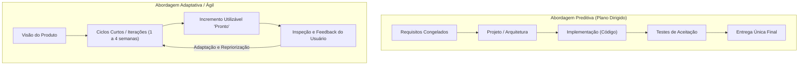
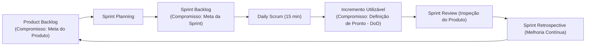

# 01 - Ciclo de Vida e Metodologias Ágeis

> **Matéria:** Engenharia de Software  
> **Cargo:** B02 – Técnico de Controle Externo – Especialidade: Tecnologia da Informação  
> **Arquivo:** `01_ciclo_de_vida_e_metodologias_ageis.md`  

---

## 📌 Ementa / Itens do Edital
- Fundamentos da engenharia de software
- Ciclo de vida de software
- Abordagens de ciclo de vida preditiva, iterativa, incremental e adaptativa/ágil (e abordagens híbridas)
- Abordagens, métodos e frameworks ágeis: Scrum, Kanban, Lean Software Development e Extreme Programming (XP)

---

## 🧭 Sumário
- [1. Fundamentos de Engenharia de Software e Processos](#1-fundamentos-de-engenharia-de-software-e-processos)
  - [1.1 Escopo da Engenharia de Software e a Crise do Software](#11-escopo-da-engenharia-de-software-e-a-crise-do-software)
  - [1.2 Atividades Genéricas de Processo de Software](#12-atividades-genéricas-de-processo-de-software)
  - [1.3 Modelos de Maturidade de Processo (CMMI e MPS.BR)](#13-modelos-de-maturidade-de-processo-cmmi-e-mpsbr)
- [2. Modelos de Ciclo de Vida de Software](#2-modelos-de-ciclo-de-vida-de-software)
  - [2.1 Abordagem Preditiva: Modelo Cascata (Waterfall) e Modelo V](#21-abordagem-preditiva-modelo-cascata-waterfall-e-modelo-v)
  - [2.2 Abordagem Iterativa e Incremental: Modelo Espiral e RUP](#22-abordagem-iterativa-e-incremental-modelo-espiral-e-rup)
  - [2.3 Abordagem Adaptativa / Ágil: O Manifesto Ágil de 2001](#23-abordagem-adaptativa--ágil-o-manifesto-ágil-de-2001)
  - [2.4 Abordagens Híbridas de Desenvolvimento](#24-abordagens-híbridas-de-desenvolvimento)
- [3. O Framework Scrum (Guia Scrum 2020)](#3-o-framework-scrum-guia-scrum-2020)
  - [3.1 Pilares do Empirismo e Valores Fundamentais](#31-pilares-do-empirismo-e-valores-fundamentais)
  - [3.2 Estrutura do Scrum Team e Responsabilidades](#32-estrutura-do-scrum-team-e-responsabilidades)
  - [3.3 Eventos Formais do Scrum e Regras de Time-box](#33-eventos-formais-do-scrum-e-regras-de-time-box)
  - [3.4 Artefatos Oficiais e seus Três Compromissos Formais](#34-artefatos-oficiais-e-seus-três-compromissos-formais)
  - [3.5 Métricas e Gráficos de Acompanhamento (Burndown e Burnup)](#35-métricas-e-gráficos-de-acompanhamento-burndown-e-burnup)
- [4. Método Kanban e Gestão do Fluxo de Valor](#4-método-kanban-e-gestão-do-fluxo-de-valor)
  - [4.1 Princípios e Práticas Gerais do Kanban](#41-princípios-e-práticas-gerais-do-kanban)
  - [4.2 Limites de Trabalho em Progresso (WIP) e Gargalos](#42-limites-de-trabalho-em-progresso-wip-e-gargalos)
  - [4.3 Métricas de Fluxo: Lead Time, Cycle Time, Throughput e CFD](#43-métricas-de-fluxo-lead-time-cycle-time-throughput-e-cfd)
- [5. Extreme Programming (XP) e Lean Software Development](#5-extreme-programming-xp-e-lean-software-development)
  - [5.1 Extreme Programming: Valores e Práticas de Engenharia](#51-extreme-programming-valores-e-práticas-de-engenharia)
  - [5.2 Lean Software Development e Eliminação dos 7 Desperdícios](#52-lean-software-development-e-eliminação-dos-7-desperdícios)
- [6. Fontes Oficiais e Referências Bibliográficas](#6-fontes-oficiais-e-referências-bibliográficas)
- [7. Questões de Concurso FCC Comentadas](#7-questões-de-concurso-fcc-comentadas)

---

## 1. Fundamentos de Engenharia de Software e Processos

### 1.1 Escopo da Engenharia de Software e a Crise do Software
A Engenharia de Software é a disciplina de engenharia dedicada ao estabelecimento e uso de sólidos princípios e métodos sistemáticos, disciplinados e quantificáveis para o desenvolvimento, operação e manutenção de software de alta qualidade dentro de custos e prazos previsíveis.
- **A Crise do Software:** O termo emergiu formalmente na Conferência da OTAN (NATO Conference) em 1968, em Garmisch, motivado pela incapacidade sistemática da indústria de entregar sistemas confiáveis dentro do orçamento e cronograma. Os projetos sofriam rotineiramente com estouros orçamentários astronômicos, atrasos severos, código repleto de defeitos e sistemas que não atendiam às necessidades reais dos usuários.
- **Fatores da Complexidade do Software (Frederick Brooks - *No Silver Bullet*):** Brooks dividiu a complexidade em duas dimensões:
  - *Complexidade Essencial:* Intrínseca à natureza do software (conformidade legal mutável, invisibilidade, complexidade inerente ao domínio do negócio);
  - *Complexidade Acidental:* Relacionada às limitações transitórias da tecnologia utilizada (compiladores rudimentares, falta de ferramentas de integração ou linguagens de baixo nível). Não há "bala de prata" tecnológica capaz de quadruplicar a produtividade por si só.

---

### 1.2 Atividades Genéricas de Processo de Software
Independentemente do ciclo de vida adotado (preditivo, iterativo ou ágil), a literatura clássica de engenharia de software (Pressman e Sommerville) mapeia cinco atividades genéricas de processo:
1. **Comunicação:** Cooperação contínua e levantamento de requisitos junto a clientes e partes interessadas (*stakeholders*);
2. **Planejamento:** Estimativas de esforço, alocação de recursos, definição de entregáveis, cronograma e análise de riscos;
3. **Modelagem:** Elaboração de arquitetura de software, diagramação de modelos conceituais, fluxos de dados e especificações detalhadas de design;
4. **Construção:** Atividades conjugadas de codificação (programação) e testes automatizados/manuais de software;
5. **Implantação (Deployment):** Disponibilização do software em ambiente operacional, homologação pelo usuário final, suporte técnico e coleta de feedback.

---

### 1.3 Modelos de Maturidade de Processo (CMMI e MPS.BR)
- **CMMI (Capability Maturity Model Integration):** Desenvolvido pelo SEI (Software Engineering Institute), estrutura a capacidade e maturidade de organizações em 5 níveis escalonados:
  - *Nível 1 (Inicial):* Processos imprevisíveis, reativos e caóticos; o sucesso depende do esforço heróico individual;
  - *Nível 2 (Gerenciado):* Projetos planejados, medidos e controlados em nível de projeto;
  - *Nível 3 (Definido):* Processos corporativos padronizados e integrados em toda a organização;
  - *Nível 4 (Quantitativamente Gerenciado):* Processos controlados estatisticamente mediante métricas rigorosas de desempenho;
  - *Nível 5 (Em Otimização):* Foco na melhoria contínua e inovação sistemática de processos.
- **MPS.BR (Melhoria de Processo do Software Brasileiro):** Modelo nacional alinhado às normas ISO/IEC 12207 e 15504, subdividido em 7 níveis de maturidade decrescentes em letras (do nível G - Parcialmente Gerenciado até o nível A - Em Otimização).

---

## 2. Modelos de Ciclo de Vida de Software

### 2.1 Abordagem Preditiva: Modelo Cascata (Waterfall) e Modelo V
- **Modelo Cascata (Royce, 1970):** Caracteriza-se por uma progressão linear, estritamente sequencial entre as fases do ciclo de vida. Uma fase subsequente somente é iniciada quando todos os artefatos da fase anterior estiverem totalmente concluídos, documentados e formalmente aprovados (*gates* de transição).
  - *Vantagens:* Estrutura rígida de fácil controle gerencial para projetos com requisitos absolutamente estáveis, bem compreendidos e sem previsão de mudanças tecnológicas.
  - *Desvantagens:* Inflexibilidade severa para absorver mudanças; o software só ganha forma executável nas fases finais do projeto, postergando a percepção de valor e a identificação de defeitos críticos para o encerramento do cronograma.
- **Modelo V (Verificação e Validação):** Variação direta do modelo cascata que explicita o pareamento simétrico entre cada fase de especificação/desenvolvimento e a sua correspondente fase de testes:
  - Requisitos de Negócio $\longleftrightarrow$ Testes de Aceitação;
  - Requisitos de Sistema $\longleftrightarrow$ Testes de Sistema;
  - Design Arquitetural $\longleftrightarrow$ Testes de Integração;
  - Design Detalhado de Módulos $\longleftrightarrow$ Testes Unitários.

---

### 2.2 Abordagem Iterativa e Incremental: Modelo Espiral e RUP
- **Conceito de Iteração vs. Incremento:**
  - *Iterativo:* O software é desenvolvido por meio de repetições sucessivas de ciclos de desenvolvimento, refinando progressivamente a solução.
  - *Incremental:* A cada ciclo concluído, uma porção utilizável e funcional do software é acrescida à versão anterior.
- **Modelo Espiral (Barry Boehm, 1988):** Modelo orientado a riscos (*risk-driven*), no qual o desenvolvimento progride em ciclos espirais contínuos compostos por quatro quadrantes obrigatórios:
  1. *Determinação de objetivos, alternativas e restrições;*
  2. *Identificação e resolução de riscos* (análise de risco, prototipação e simulações);
  3. *Desenvolvimento e validação do produto do nível atual;*
  4. *Planejamento da próxima fase.*
- **Processo Unificado (RUP - Rational Unified Process):** Metodologia iterativa e incremental orientada por Casos de Uso e centrada na Arquitetura de Software. Estrutura-se em quatro fases temporais sequenciais:
  1. *Iniciação (Inception):* Estabelecimento do escopo de negócio e viabilidade;
  2. *Elaboração (Elaboration):* Mapeamento profundo dos requisitos, mitigação de riscos maiores e estabilização da arquitetura executável básica;
  3. *Construção (Construction):* Desenvolvimento em larga escala e codificação de todos os componentes;
  4. *Transição (Transition):* Implantação, homologação, treinamento dos usuários e passagem para operação.

> 🚨 **ALERTA DE PROVA / PEGADINHA FCC:** A característica mais cobrada pela FCC a respeito do Modelo Espiral de Boehm é a **gestão explícita e sistemática de riscos** (*risk analysis*) em cada espira. Se a questão mencionar "modelo direcionado pela mitigação contínua de riscos através de prototipação em cada volta do ciclo", marque com segurança o **Modelo Espiral**.

---

### 2.3 Abordagem Adaptativa / Ágil: O Manifesto Ágil de 2001
Em fevereiro de 2001, em Snowbird (Utah), dezessete líderes de desenvolvimento de software redigiram o **Manifesto para o Desenvolvimento Ágil de Software**, fundamentado em 4 Valores e 12 Princípios:

| Nós valorizamos mais: | Do que: |
| :--- | :--- |
| **Indivíduos e interações** | Processos e ferramentas |
| **Software em funcionamento** | Documentação abrangente |
| **Colaboração com o cliente** | Negociação de contratos |
| **Responder a mudanças** | Seguir um plano pré-estabelecido |

*A premissa não é eliminar processos, documentação, contratos ou planos, mas reconhecer que os itens à esquerda entregam valor direto superior e adaptabilidade num ambiente de incerteza.*

---

### 2.4 Abordagens Híbridas de Desenvolvimento
Reconhecem que o mundo corporativo raramente opera em extremos absolutos. Um projeto híbrido pode adotar:
- Abordagem preditiva no planejamento macro de escopo, contratação pública e cronograma de alto nível (governança tradicional);
- Abordagem adaptativa/ágil na execução das iterações técnicas pelas equipes de desenvolvimento (com Sprints Scrum, gestão visual Kanban e testes contínuos).

---

## 3. O Framework Scrum (Guia Scrum 2020)

### 3.1 Pilares do Empirismo e Valores Fundamentais
O Scrum é um framework leve que ajuda pessoas, times e organizações a gerar valor por meio de soluções adaptativas para problemas complexos. Alicerça-se no **Empirismo** e no pensamento **Lean**:
- **Três Pilares Empíricos:**
  1. *Transparência:* Processos e artefatos devem ser visíveis para todos os responsáveis pelos resultados;
  2. *Inspeção:* O progresso rumo aos objetivos deve ser examinado com frequência diligente para identificar anomalias;
  3. *Adaptação:* Havendo desvios inaceitáveis, os ajustes operacionais devem ser implementados no menor tempo viável.
- **Cinco Valores do Scrum:** Compromisso (*Commitment*), Foco (*Focus*), Abertura (*Openness*), Respeito (*Respect*) e Coragem (*Courage*).

---

### 3.2 Estrutura do Scrum Team e Responsabilidades
No Guia Scrum oficial de 2020, o **Scrum Team** é a unidade fundamental de trabalho, caracterizado por ser **multifuncional** (possui todas as habilidades necessárias para entregar o incremento) e **autogerenciado** (*self-managing* - a equipe decide internamente *quem*, *o que* e *como* fazer). O time compõe-se de três papéis/responsabilidades:
1. **Product Owner (PO):**
   - Responsável por **maximizar o valor do produto** resultante do trabalho do time;
   - Única pessoa responsável pela gestão eficaz do **Product Backlog** (criação, ordenação, clareza e comunicação dos itens de backlog);
   - Representa os interesses dos stakeholders; suas decisões devem ser respeitadas por toda a organização.
2. **Scrum Master (SM):**
   - Responsável por promover e apoiar o Scrum conforme definido no Guia;
   - Atua como um **líder que serve** (*true leader who serves*);
   - Remove impedimentos externos que bloqueiam o avanço dos Desenvolvedores;
   - Facilita os eventos do Scrum e garante a eficácia e a melhoria dos processos do time.
3. **Desenvolvedores (Developers):**
   - Pessoas do Scrum Team comprometidas em criar qualquer aspecto de um **Incremento utilizável a cada Sprint**;
   - Criam o plano para a Sprint (Sprint Backlog);
   - Adaptam o plano diariamente na Daily Scrum e responsabilizam-se pela qualidade aplicando a Definição de Pronto (*DoD*).

> 🚨 **ALERTA DE PROVA / PEGADINHA FCC:**  
> 1. No Guia 2020 **NÃO existe mais o papel "Time de Desenvolvimento" (Development Team)**. Existe apenas o *Scrum Team*, formado por PO, Scrum Master e Desenvolvedores. Não há subtimes nem hierarquias internas!  
> 2. O Scrum Master **NÃO é um gerente funcional**, não distribui tarefas individualmente e não cobra relatórios de horas.

---

### 3.3 Eventos Formais do Scrum e Regras de Time-box
Todos os eventos no Scrum possuem duração máxima pré-fixada (**time-box**):

| Evento Scrum | Finalidade Central e Participantes | Duração Máxima (Sprint de 1 mês) |
| :--- | :--- | :--- |
| **A Sprint** | Contêiner maior para todos os demais eventos. É o ciclo no qual o trabalho é executado para criar o incremento. | Até **um (1) mês** de duração fixa. |
| **Sprint Planning** | Define o plano de trabalho da Sprint abordando: 1) *Por que a Sprint é valiosa?* 2) *O que pode ser feito?* 3) *Como o trabalho será realizado?* | Máximo de **8 horas**. |
| **Daily Scrum** | Evento de alinhamento diário exclusivo dos **Desenvolvedores** para inspecionar o progresso rumo à Meta da Sprint e adaptar o plano para as próximas 24h. | Exatamente **15 minutos** (fixo, independentemente do tamanho da Sprint). |
| **Sprint Review** | Inspeção do Incremento produzido com os *stakeholders* para adaptar o Product Backlog com base no feedback real. | Máximo de **4 horas**. |
| **Sprint Retrospective** | Planejamento de melhorias na eficácia do time (pessoas, processos, ferramentas e Definição de Pronto). | Máximo de **3 horas**. |

> ⭐ **IMPORTANTE / REGRAS DA SPRINT:** Uma Sprint **nunca é prorrogada**. Se os itens planejados não forem concluídos dentro do time-box, a Sprint encerra-se normalmente; os itens não finalizados voltam para o Product Backlog. Uma Sprint só pode ser **cancelada prematuramente pelo Product Owner**, caso a Meta da Sprint (*Sprint Goal*) se torne obsoleta!

---

### 3.4 Artefatos Oficiais e seus Três Compromissos Formais
Cada um dos três artefatos do Scrum contém um **compromisso formal** associado (introduzido formalmente no Guia 2020) para fornecer transparência e foco:

1. **Product Backlog** $\longrightarrow$ Compromisso: **Meta do Produto (*Product Goal*)**  
   - O Product Backlog é a lista ordenada e emergente de tudo o que é necessário para melhorar o produto. A Meta do Produto descreve o estado futuro que serve como alvo de longo prazo para o Scrum Team.
2. **Sprint Backlog** $\longrightarrow$ Compromisso: **Meta da Sprint (*Sprint Goal*)**  
   - O Sprint Backlog é composto pela Meta da Sprint (o porquê), o conjunto de itens selecionados do Product Backlog (o quê) e o plano de ação detalhado (o como). A Meta da Sprint é o objetivo único acordado para a iteração, que não muda durante a sua execução.
3. **Incremento** $\longrightarrow$ Compromisso: **Definição de Pronto (*Definition of Done - DoD*)**  
   - O Incremento é um degrau concreto rumo à Meta do Produto. No momento em que um item do Product Backlog atende à Definição de Pronto, um novo Incremento nasce. A DoD é a descrição formal dos critérios de qualidade exigidos para que o item seja considerado pronto para uso.

---

### 3.5 Métricas e Gráficos de Acompanhamento (Burndown e Burnup)
- **Sprint Burndown Chart:** Gráfico que exibe a quantidade de **trabalho restante** (geralmente em pontos de história ou horas) em relação ao tempo da Sprint. A inclinação da linha decrescente indica se a equipe concluirá as tarefas no prazo;
- **Burnup Chart:** Gráfico com duas linhas: uma demonstrando o crescimento do escopo total ao longo do tempo e outra demonstrando o trabalho efetivamente concluído (*done*). Excelente para detectar expansão de escopo (*scope creep*).

---

## 4. Método Kanban e Gestão do Fluxo de Valor

### 4.1 Princípios e Práticas Gerais do Kanban
Concebido por David J. Anderson com base no Sistema Toyota de Produção, o método Kanban é uma abordagem evolucionária e não prescritiva para gestão de fluxos de trabalho do conhecimento.
- **Princípios de Gestão de Mudança:** Comece com o que você faz hoje; busque mudança evolucionária e incremental; respeite os papéis, responsabilidades e títulos atuais; incentive liderança em todos os níveis.
- **Práticas Gerais do Kanban:**
  1. *Visualizar o fluxo de trabalho* (quadro Kanban com colunas de status);
  2. *Limitar o Trabalho em Progresso (WIP)*;
  3. *Gerenciar o fluxo*;
  4. *Tornar as políticas de processo explícitas*;
  5. *Implementar ciclos de feedback (cadências)*;
  6. *Melhorar colaborativamente e evoluir experimentalmente*.

---

### 4.2 Limites de Trabalho em Progresso (WIP) e Gargalos
O Kanban opera como um **sistema puxado (*pull system*)**:
- **Limite de WIP (Work In Progress):** Cada coluna do quadro possui um teto máximo de itens permitidos simultaneamente (ex.: a coluna "Testes" com WIP = 3).
- **Efeito Prático:** Impede a sobrecarga da equipe, reduz o desperdício de troca de contexto (*context switching*) e torna imediatamente visíveis os **gargalos** de produção. Se uma coluna atingir o limite de WIP, a etapa anterior é impedida de empurrar novos itens, forçando os membros da equipe a colaborar para destravar o gargalo (*"Pare de começar e comece a terminar!"*).

---

### 4.3 Métricas de Fluxo: Lead Time, Cycle Time, Throughput e CFD
- **Lead Time:** É o tempo total decorrido entre a solicitação inicial da demanda pelo cliente (registro no backlog) até a sua efetiva entrega em ambiente de produção;
- **Cycle Time:** É o tempo em que a equipe técnica esteve ativamente trabalhando no desenvolvimento do item (desde que o cartão foi puxado para a primeira coluna de execução até a conclusão da tarefa);
- **Throughput (Vazão):** Quantidade de itens entregues e concluídos por unidade de tempo (ex.: 12 tarefas por semana);
- **Diagrama de Fluxo Cumulativo (CFD - Cumulative Flow Diagram):** Gráfico de áreas empilhadas que ilustra o número cumulativo de itens em cada fase do processo ao longo do tempo:
  - *Distância Vertical:* Mostra a quantidade de Trabalho em Progresso (WIP) em um dado instante;
  - *Distância Horizontal:* Revela o Lead Time aproximado dos itens. Bandas com inclinação constante indicam fluxo estável e previsível.

---

## 5. Extreme Programming (XP) e Lean Software Development

### 5.1 Extreme Programming: Valores e Práticas de Engenharia
Criado por Kent Beck, o Extreme Programming (XP) é uma metodologia ágil voltada à excelência técnica e engenharia de software para times pequenos e médios submetidos a requisitos vagos e altamente dinâmicos.
- **Cinco Valores do XP:** Comunicação, Simplicidade, Feedback, Coragem e Respeito.
- **Práticas de Engenharia Centrais (Cobrança Constante em Concursos):**
  1. **Programação em Par (*Pair Programming*):** Dois desenvolvedores trabalham simultaneamente em uma única estação de trabalho. O **Driver (Piloto)** assume o teclado e digita o código com foco no detalhe imediato; o **Navigator (Copiloto)** analisa estrategicamente a solução, checa erros de sintaxe, avalia impactos arquiteturais e elabora casos de teste adicionais;
  2. **Test-Driven Development (TDD):** Desenvolvimento guiado por testes mediante o ciclo contínuo **Red-Green-Refactor**:
     - *Red:* Escrever um teste automatizado que falha (pois a funcionalidade ainda não existe);
     - *Green:* Escrever o código mínimo de produção suficiente para fazer o teste passar;
     - *Refactor:* Limpar e aprimorar o código-fonte (eliminando duplicações), garantindo que todos os testes continuem passando;
  3. **Refatoração Contínua (*Refactoring*):** Melhoria da estrutura interna do código sem alterar seu comportamento observável externo;
  4. **Propriedade Coletiva do Código (*Collective Ownership*):** Qualquer desenvolvedor do time tem liberdade e responsabilidade para alterar qualquer módulo do sistema para corrigir defeitos ou implementar melhorias;
  5. **Integração Contínua (*Continuous Integration*):** Código integrado e testado no repositório compartilhado várias vezes ao dia;
  6. **Design Simples:** O código atende a todos os testes, expressa com clareza a intenção, não possui duplicações (DRY - *Don't Repeat Yourself*) e contém o menor número possível de classes e métodos (YAGNI - *You Aren't Gonna Need It*).

---

### 5.2 Lean Software Development e Eliminação dos 7 Desperdícios
Adaptado do Sistema Toyota de Produção por Mary e Tom Poppendieck, o desenvolvimento Lean foca na entrega rápida de valor mediante a **eliminação sistemática de desperdícios (*Muda*)**:

| Desperdício no Lean Software | Manifestação Prática no Desenvolvimento de Sistemas |
| :--- | :--- |
| **1. Trabalho Parcialmente Feito** | Código desenvolvido que permanece semanas em branch aguardando testes ou aprovação de deploy. |
| **2. Recursos Extras (Gold Plating)** | Funcionalidades desenvolvidas que nunca serão utilizadas pelo usuário final (excesso de especificação). |
| **3. Reaprendizado** | Redescoberta de soluções por falta de testes automatizados ou ausência de documentação de código limpo. |
| **4. Passagem de Tarefas (Hand-offs)** | Perda de conhecimento e ruídos de comunicação na transição entre silos (analista $\rightarrow$ arquiteto $\rightarrow$ dev $\rightarrow$ tester). |
| **5. Atrasos / Esperas (Delays)** | Desenvolvedores ociosos aguardando liberação de ambiente, homologação de acessos ou aprovação de comitês. |
| **6. Troca de Contexto (Task Switching)** | Alocar profissionais em múltiplos projetos paralelos, gerando perda massiva de produtividade cognitiva. |
| **7. Defeitos e Bugs** | Falhas que chegam a produção e demandam esforço emergencial de correção e retrabalho. |

- **Princípios Fundamentais do Lean:** Eliminar desperdícios; Amplificar o aprendizado; Decidir o mais tarde possível (manter opções em aberto); Entregar o mais rápido possível; Empoderar o time; Construir integridade intrínseca; e Enxergar o todo (*See the whole*).

---

## 6. Fontes Oficiais e Referências Bibliográficas

* [Scrum Guide Oficial 2020 (Ken Schwaber & Jeff Sutherland)](https://scrumguides.org/scrum-guide.html) - Definição completa do framework, artefatos, compromissos e eventos.
* [Manifesto para o Desenvolvimento Ágil de Software (2001)](https://agilemanifesto.org/iso/ptbr/manifesto.html) - 4 valores e 12 princípios fundamentais.
* [Extreme Programming Explained: Embrace Change (Kent Beck)](http://www.extremeprogramming.org/) - Práticas de engenharia ágil, Pair Programming e TDD.
* [Kanban: Successful Evolutionary Change for Your Technology Business (David J. Anderson)](https://kanban.university/) - Princípios do Kanban, limitação de WIP e métricas de fluxo.
* [Lean Software Development: An Agile Toolkit (Mary & Tom Poppendieck)](https://www.poppendieck.com/) - Adaptação dos princípios enxutos à engenharia de software.

---

## 7. Questões de Concurso FCC Comentadas

### Questão 01
**(FCC – TCE-GO – Analista de Controle Externo / TI)**  
No framework Scrum (segundo a versão oficial do Guia Scrum de 2020), cada um dos três artefatos possui um compromisso formal associado que fornece informações transparentes e foco para a equipe. Os compromissos associados ao Product Backlog, ao Sprint Backlog e ao Incremento são, respectivamente:

* A) Definição de Pronto, Meta da Sprint e Meta do Produto.
* B) Meta do Produto (*Product Goal*), Meta da Sprint (*Sprint Goal*) e Definição de Pronto (*Definition of Done*).
* C) Histórias de Usuário, Tarefas Técnicas e Código em Produção.
* D) Retrospectiva, Planejamento da Sprint e Revisão.
* E) Burndown Chart, Velocidade do Time e Lead Time.

> **Comentário Detalhado:**
> - **A) Incorreta.** Inverteu a ordem de associação dos artefatos com seus respectivos compromissos formais.
> - **B) CORRETA.** O Guia Scrum oficial de 2020 introduziu formalmente a vinculação unívoca de um compromisso para cada artefato:
>   - Para o **Product Backlog**, o compromisso é a **Meta do Produto (*Product Goal*)**;
>   - Para o **Sprint Backlog**, o compromisso é a **Meta da Sprint (*Sprint Goal*)**;
>   - Para o **Incremento**, o compromisso é a **Definição de Pronto (*Definition of Done - DoD*)**.
> - **C) Incorreta.** Histórias de usuário e tarefas constituem técnicas complementares amplamente usadas, mas não são compromissos previstos no Guia Scrum.
> - **D) Incorreta.** Retrospectiva, Planejamento e Revisão são três dos eventos oficiais do Scrum, e não compromissos de artefatos.
> - **E) Incorreta.** Burndown chart, velocidade e lead time são gráficos e métricas analíticas de fluxo e produtividade.
> 
> **Gabarito: B**

---

### Questão 02
**(FCC – TCE-GO – Técnico de Controle Externo / TI)**  
Em relação às metodologias e práticas de engenharia de software ágil, a prática de desenvolvimento que consiste em programar com dois desenvolvedores compartilhando a mesma estação de trabalho (um atuando como "piloto" digitando o código e outro como "copiloto" revisando estrategicamente a solução em tempo real), bem como a técnica de escrever o teste automatizado antes do código de produção (ciclo Red-Green-Refactor), são práticas originárias e mandatórias do:

* A) Scrum.
* B) Método Cascata.
* C) Extreme Programming (XP).
* D) CMMI Nível 5.
* E) Rational Unified Process (RUP).

> **Comentário Detalhado:**
> - **A) Incorreta.** O Scrum é um framework de gestão de trabalho e desenvolvimento de produtos que não dita práticas técnicas específicas de codificação como pareamento ou testes.
> - **B) Incorreta.** O modelo em Cascata prescreve segregação temporal estrita entre fases de especificação, codificação e testes, incompatível com a simultaneidade do pareamento ou testes antes do código.
> - **C) CORRETA.** O **Extreme Programming (XP)**, formulado por Kent Beck, estabelece formalmente a **Programação em Par (*Pair Programming*)** (com as funções de Driver e Navigator) e o **Desenvolvimento Guiado por Testes (*TDD*)**, ao lado de refatoração contínua, integração contínua e propriedade coletiva de código.
> - **D) Incorreta.** O CMMI é um modelo de avaliação de maturidade e capacidade de processos corporativos de engenharia, e não uma metodologia de codificação ágil.
> - **E) Incorreta.** O RUP é um processo iterativo pesado com 4 fases formais dirigido por arquitetura e casos de uso, sem exigir programação em par ou TDD mandatório.
> 
> **Gabarito: C**

---

### Questão 03
**(FCC – TRT – Analista Judiciário / Tecnologia da Informação)**  
No método Kanban aplicado à gestão do fluxo de desenvolvimento de software, duas métricas temporais essenciais para avaliar a eficiência do processo são o *Lead Time* e o *Cycle Time*. A correta distinção conceitual entre essas métricas estabelece que:

* A) O *Lead Time* mede exclusivamente o tempo em que o item esteve bloqueado por impedimentos técnicos, enquanto o *Cycle Time* mede o tempo de reunião diária da equipe.
* B) O *Lead Time* corresponde ao tempo total transcorrido desde a solicitação/criação do item pelo cliente até a sua entrega final; já o *Cycle Time* corresponde ao tempo em que o trabalho esteve efetivamente em progresso ativo pela equipe de desenvolvimento.
* C) O *Cycle Time* sempre engloba o tempo de espera no backlog do cliente, ao passo que o *Lead Time* tem início apenas quando a primeira linha de código é compilada.
* D) O *Lead Time* e o *Cycle Time* são grandezas idênticas em qualquer quadro Kanban que utilize limites estritos de WIP.
* E) O *Throughput* representa a diferença matemática obtida pela subtração do *Cycle Time* pelo *Lead Time*.

> **Comentário Detalhado:**
> - **A) Incorreta.** Confunde métricas de tempo de fluxo com tempos de bloqueio de cartões e cerimônias ágeis.
> - **B) CORRETA.** No método Kanban:
>   - **Lead Time:** É a visão sob a ótica do cliente/usuário, correspondendo ao intervalo total desde o registro formal do pedido até a sua entrega concluída em produção;
>   - **Cycle Time:** É a visão sob a ótica da equipe técnica de desenvolvimento, correspondendo ao intervalo em que o item esteve em andamento ativo (da coluna "Em Progresso" até "Concluído").
> - **C) Incorreta.** Inverte de forma diametral as definições consagradas das duas métricas.
> - **D) Incorreta.** Mesmo com WIP delimitado, as grandezas são distintas, pois o item pode aguardar em filas de espera e refinamento antes de ter sua execução iniciada.
> - **E) Incorreta.** O *Throughput* (vazão) corresponde ao volume quantitativo de itens finalizados por unidade de tempo, não sendo resultado de subtração.
> 
> **Gabarito: B**

---

### Questão 04
**(FCC – DPE – Analista de Sistemas)**  
A respeito do evento *Daily Scrum* estabelecido no Guia Scrum (versão 2020), assinale a afirmativa correta:

* A) É uma reunião de prestação de contas dos desenvolvedores para o Scrum Master e para o Product Owner, que atuam como avaliadores formais do desempenho diário individual.
* B) Tem duração máxima permitida de 45 minutos para Sprints de um mês, admitindo prorrogação formal caso existam impedimentos complexos a serem debatidos.
* C) Trata-se de um evento de 15 minutos para os Desenvolvedores do Scrum Team inspecionarem o progresso em direção à Meta da Sprint e adaptarem o Sprint Backlog conforme necessário.
* D) É obrigatório que cada desenvolvedor responda exclusivamente a três perguntas padronizadas: o que fez ontem, o que fará hoje e quais são os impedimentos.
* E) Caso o Product Owner ou o Scrum Master não possam comparecer presencialmente ao evento, a Daily Scrum deve ser compulsoriamente cancelada naquele dia.

> **Comentário Detalhado:**
> - **A) Incorreta.** A Daily Scrum não é uma reunião de *status report* ou avaliação de chefia; o Scrum Team é autogerenciado.
> - **B) Incorreta.** O time-box da Daily Scrum é fixo em **15 minutos**, independentemente da extensão temporal da Sprint.
> - **C) CORRETA.** Conforme a versão 2020 do Guia Scrum, a Daily Scrum é um evento de **15 minutos** para os **Desenvolvedores do Scrum Team**, com o objetivo de inspecionar o progresso em direção à Meta da Sprint (*Sprint Goal*) e adaptar o Sprint Backlog conforme necessário, ajustando o plano de trabalho para as próximas 24 horas.
> - **D) Incorreta.** O Guia Scrum 2020 aboliu a exigência obrigatória das três clássicas perguntas, conferindo total liberdade aos Desenvolvedores para estruturar a reunião da forma mais eficiente para o time.
> - **E) Incorreta.** O evento é privativo dos Desenvolvedores; se o PO ou o SM não estiverem trabalhando ativamente em tarefas do Sprint Backlog, a sua ausência não impede a realização regular da Daily.
> 
> **Gabarito: C**

---

### Questão 05
**(FCC – TCE – Auditor de Controle Externo / TI)**  
O modelo de ciclo de vida em Espiral, concebido por Barry Boehm, diferencia-se substancialmente do modelo em Cascata tradicional por incorporar formalmente como seu direcionador central e sistemático:

* A) A eliminação de qualquer documentação textual em favor de entregas contínuas em microsserviços.
* B) A análise e a mitigação explícita de riscos em cada ciclo de evolução do software.
* C) O pareamento permanente de programadores em estações de trabalho unificadas.
* D) O congelamento irrevogável dos requisitos do sistema antes de qualquer prototipação.
* E) A substituição de todas as fases de testes por inspeções formais de conformidade jurídica.

> **Comentário Detalhado:**
> - **A) Incorreta.** O modelo em Espiral não dispensa documentação formal e foi proposto muito antes da era dos microsserviços.
> - **B) CORRETA.** A marca distintiva fundamental do **Modelo em Espiral de Barry Boehm** é ser um modelo **dirigido a riscos (*risk-driven*)**, em que cada espira do ciclo de desenvolvimento prevê expressamente uma etapa rigorosa de avaliação, modelagem e mitigação de incertezas e riscos técnicos e operacionais antes de avançar para a fase construtiva.
> - **C) Incorreta.** O pareamento de desenvolvedores é uma prática exclusiva do Extreme Programming (XP).
> - **D) Incorreta.** O congelamento inicial de requisitos caracteriza o modelo Cascata (*Waterfall*); no modelo Espiral, os requisitos evoluem de forma incremental a cada volta da espiral.
> - **E) Incorreta.** Testes, protótipos e validações com usuários são atividades essenciais integradas em cada ciclo espiral.
> 
> **Gabarito: B**
