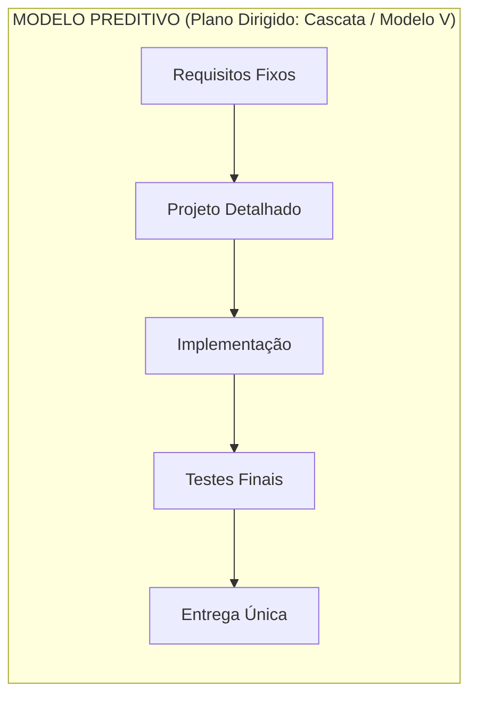
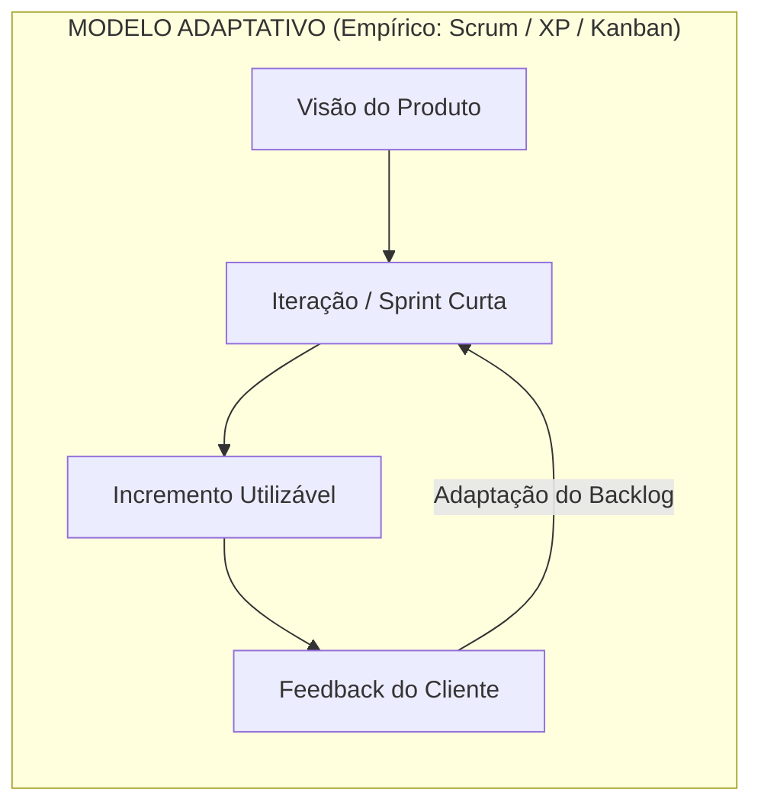
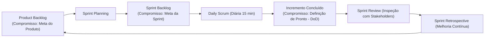

# 01 - Ciclo de Vida e Metodologias Ágeis

> **Matéria:** Engenharia de Software  
> **Cargo:** B02 – Técnico de Controle Externo – Especialidade: Tecnologia da Informação  
> **Arquivo:** `01_ciclo_de_vida_e_metodologias_ageis.md`  

---

## 📌 Ementa / Itens do Edital
- Fundamentos da engenharia de software
- Ciclo de vida de software
- Abordagens de ciclo de vida preditiva, iterativa, incremental e adaptativa/ágil (e abordagens híbridas)
- Abordagens, métodos e frameworks ágeis: Scrum, Kanban, Lean Software Development e Extreme Programming (XP)

---

## 🌳 Classificação Hierárquica

```text
1. Processos de Software, Ciclos de Vida e Metodologias Ágeis
├── 1.1 Fundamentos de Engenharia de Software
│   ├── 1.1.1 Definição, escopo e crise do software
│   ├── 1.1.2 Atividades genéricas do processo: Comunicação, Planejamento, Modelagem, Construção e Implantação
│   └── 1.1.3 Modelos de Maturidade de Processo (visão geral de CMMI e MPS.BR)
├── 1.2 Modelos de Ciclo de Vida de Software
│   ├── 1.2.1 Abordagem Preditiva (Plano Dirigido):
│   │   ├── Modelo Cascata (Waterfall) com fases sequenciais e gates de transição
│   │   └── Modelo V (Verificação e Validação pareadas)
│   ├── 1.2.2 Abordagem Iterativa e Incremental:
│   │   ├── Conceito de Iteração (repetição do ciclo) vs. Incremento (adição de funcionalidade)
│   │   ├── Modelo Espiral de Boehm (foco explícito na análise e mitigação de riscos)
│   │   └── Processo Unificado (RUP: fases Iniciação, Elaboração, Construção, Transição)
│   ├── 1.2.3 Abordagem Adaptativa / Ágil:
│   │   ├── Manifesto Ágil de 2001 (4 valores e 12 princípios)
│   │   └── Características: ciclos curtos, feedback contínuo, resposta à mudança e entrega de valor
│   └── 1.2.4 Abordagens Híbridas (Combinação preditiva em escopo geral com execução ágil em sprints)
├── 1.3 Framework Scrum (Guia Scrum 2020)
│   ├── 1.3.1 Teoria do Scrum: Empirismo (Transparência, Inspeção, Adaptação) e 5 Valores (Compromisso, Foco, Abertura, Respeito, Coragem)
│   ├── 1.3.2 Papéis (Scrum Team):
│   │   ├── Product Owner (PO): Gerenciamento do Product Backlog, maximização do valor do produto
│   │   ├── Scrum Master (SM): Líder que serve, remoção de impedimentos, eficácia do time
│   │   └── Desenvolvedores (Developers): Criação do incremento utilizável a cada Sprint
│   ├── 1.3.3 Eventos do Scrum:
│   │   ├── A Sprint (contêiner de até 1 mês)
│   │   ├── Sprint Planning (O que fazer, Como fazer, Por que a Sprint é valiosa)
│   │   ├── Daily Scrum (15 minutos diários para inspeção de progresso rumo à Sprint Goal)
│   │   ├── Sprint Review (inspeção do incremento e adaptação do Product Backlog com stakeholders)
│   │   └── Sprint Retrospective (melhoria contínua dos processos do time)
│   ├── 1.3.4 Artefatos e seus Compromissos:
│   │   ├── Product Backlog -> Compromisso: Meta do Produto (Product Goal)
│   │   ├── Sprint Backlog -> Compromisso: Meta da Sprint (Sprint Goal)
│   │   └── Incremento -> Compromisso: Definição de Pronto (Definition of Done - DoD)
│   └── 1.3.5 Métricas e Gráficos: Burndown chart (trabalho restante) e Burnup chart (escopo e progresso)
├── 1.4 Método Kanban
│   ├── 1.4.1 Princípios Fundamentais (Comece com o que faz hoje, buscar mudança evolucionária, respeitar papéis atuais)
│   ├── 1.4.2 Práticas Gerais: Visualizar fluxo, Limitar WIP, Gerenciar fluxo, Políticas explícitas, Feedback loops
│   └── 1.4.3 Métricas de Fluxo: Lead Time, Cycle Time, Throughput e Diagrama de Fluxo Cumulativo (CFD)
├── 1.5 Lean Software Development
│   ├── 1.5.1 Origem no Sistema Toyota de Produção e Eliminação de Desperdícios (Muda)
│   ├── 1.5.2 Os 7 Tipos de Desperdício no Software
│   └── 1.5.3 Os 7 Princípios Lean
└── 1.6 Extreme Programming (XP)
    ├── 1.6.1 Valores Centrais: Comunicação, Simplicidade, Feedback, Coragem e Respeito
    ├── 1.6.2 Práticas de Engenharia: Pair Programming, TDD, CI, Refactoring, Propriedade Coletiva, Design Simples
    └── 1.6.3 Práticas de Gestão: Jogo do Planejamento, Pequenos Lançamentos, Ritmo Sustentável, Cliente Presente
```

---

## 📖 Resumo Teórico Aprofundado

### 1. Modelos de Ciclo de Vida: Preditivos vs. Adaptativos





#### 1.1 Matriz Comparativa de Ciclos de Vida
| Critério | Cascata (Waterfall) | RUP / Processo Unificado | Scrum | Kanban | Extreme Programming (XP) |
| :--- | :--- | :--- | :--- | :--- | :--- |
| **Abordagem Central** | Preditivo / Sequencial | Iterativo e Incremental dirigido por Casos de Uso | Adaptativo / Empírico | Fluxo Contínuo puxado | Engenharia Ágil centrada em código |
| **Tratamento de Mudanças** | Alto custo; resiste a alterações | Previsto nas fases Iniciação/Elaboração | Abraçado a cada planejamento de Sprint | Contínuo, a qualquer momento | Abraçado via TDD e refatoração |
| **Frequência de Entrega** | Ao final de todo o projeto | Ao fim de cada iteração nas fases avançadas | A cada Sprint (1 a 4 semanas) | Sob demanda (on-demand / contínua) | Entregas muito frequentes (dias/semanas) |
| **Papéis Prescritos** | Gerente de Projetos, Analista, Dev, Tester | Vários papéis formais da metodologia | PO, Scrum Master, Desenvolvedores | Não impõe papéis formais novos | Programador, Cliente Presente, Coach, Tracker |
| **Foco de Excelência** | Documentação e conformidade de processo | Arquitetura de software e riscos | Gestão e organização de produto | Otimização do fluxo de valor e WIP | Excelência técnica de programação e testes |

---

### 2. Framework Scrum (Guia Scrum 2020)

O Scrum é estruturado sobre o **Empirismo** e o pensamento **Lean**:
1. **Transparência:** O processo e o trabalho devem ser visíveis tanto para quem realiza o trabalho quanto para quem o recebe.
2. **Inspeção:** Os artefatos e o progresso rumo às metas devem ser inspecionados frequentemente para detectar variações indesejadas.
3. **Adaptação:** Se qualquer aspecto se desviar dos limites aceitáveis, o processo ou os itens produzidos devem ser ajustados imediatamente.



#### 2.1 Mapeamento Obrigatório: Artefatos e Compromissos (Guia 2020)
- **Product Backlog** $\rightarrow$ **Meta do Produto** (*Product Goal*): descreve o estado futuro do produto que serve como alvo de longo prazo para o Scrum Team.
- **Sprint Backlog** $\rightarrow$ **Meta da Sprint** (*Sprint Goal*): objetivo único e flexível da iteração, que não muda durante a execução da Sprint.
- **Incremento** $\rightarrow$ **Definição de Pronto** (*Definition of Done - DoD*): descrição formal do estado do incremento quando ele atende às medidas de qualidade requeridas para o produto.

> 🚨 **ALERTA DE PROVA / PEGADINHA FCC:**  
> - **Eliminação do "Development Team":** No Guia Scrum 2020 não existe mais o termo "Time de Desenvolvimento". Existe apenas o **Scrum Team**, composto por três conjuntos de responsabilidades: Product Owner, Scrum Master e Desenvolvedores. Não há subtimes nem hierarquia!  
> - **Autogerenciado vs. Auto-organizado:** O Guia 2020 substituiu "auto-organizado" por **autogerenciado** (*self-managing*), o que significa que o time decide internamente *quem*, *como* e *o que* fazer.

---

### 3. Método Kanban: Métricas de Fluxo

O Kanban baseia-se em um sistema puxado (*pull system*):
- **WIP (Work In Progress):** Limite estrito de itens simultâneos em cada etapa do quadro para evitar gargalos e context switching.
- **Lead Time:** Intervalo total decorrido desde a criação/registro da demanda pelo cliente até a sua efetiva entrega em produção.
- **Cycle Time:** Intervalo de tempo entre o momento em que um desenvolvedor inicia ativamente a execução do item até a sua conclusão.
- **Throughput (Vazão):** Quantidade de itens entregues por unidade de tempo (ex.: 8 histórias por semana).
- **CFD (Cumulative Flow Diagram):** Gráfico de áreas acumuladas ao longo do tempo. Se a distância vertical entre as faixas aumenta, o WIP aumentou; se a distância horizontal aumenta, o Lead Time piorou.

---

### 4. Extreme Programming (XP) e Lean Software Development

#### 4.1 As Práticas de Engenharia do XP
- **TDD (Test-Driven Development):** Ciclo *Red* (escrever teste que falha), *Green* (escrever código mínimo para passar) e *Refactor* (limpar o código mantendo os testes passando).
- **Pair Programming:** Dois desenvolvedores em uma máquina. O *Driver* (piloto) codifica e foca no detalhe; o *Navigator* (copiloto) revisa a sintaxe, pensa na arquitetura e prevê casos de teste.
- **Propriedade Coletiva do Código:** Qualquer desenvolvedor tem autorização e incentivo para alterar qualquer linha de código no repositório para corrigir defeitos ou refatorar.
- **Design Simples:** O código atende a todos os testes atuais, expressa claramente a intenção, não possui duplicações e contém o menor número possível de classes e métodos (YAGNI - *You Aren't Gonna Need It*).

#### 4.2 Os 7 Desperdícios do Lean aplicados ao Software
1. **Trabalho Parcialmente Feito:** Código não testado ou não implantado.
2. **Recursos Extras:** Funcionalidades desenvolvidas que ninguém utiliza.
3. **Reaprendizado:** Falta de documentação viva ou esquecimento técnico.
4. **Passagem de Tarefas (Hand-offs):** Ruído de comunicação entre silos organizacionais.
5. **Atrasos (Delays):** Espera por aprovações burocráticas ou infraestrutura.
6. **Troca de Contexto:** Alocar desenvolvedores em múltiplos projetos simultâneos.
7. **Defeitos:** Bugs que geram retrabalho direto.

---

## ⚠️ Pontos de Atenção (Estilo FCC)

> 🚨 **PEGADINHAS RECORRENTES DA BANCA FCC:**  
> 1. A FCC adora misturar práticas: dizer que *Pair Programming*, *TDD* ou *Refactoring* são nativas do Scrum. São práticas centrais do **XP**! O Scrum não define como codificar.  
> 2. O Scrum Master **NUNCA** atribui tarefas para os desenvolvedores, não fiscaliza horários e não é um gerente funcional. Ele atua como um líder que serve (*servant-leader*).  
> 3. Uma Sprint **nunca é estendida** se o trabalho não for finalizado. O tempo da Sprint é fixo (*time-boxed*). Itens não concluídos voltam para o Product Backlog.

---

## 🌐 Fontes Recomendadas na Internet

- [Scrum Guide Oficial 2020 (Ken Schwaber & Jeff Sutherland)](https://scrumguides.org/scrum-guide.html)
- [Manifesto para o Desenvolvimento Ágil de Software (2001)](https://agilemanifesto.org/iso/ptbr/manifesto.html)
- [Extreme Programming: Rules and Practices (Kent Beck)](http://www.extremeprogramming.org/)
- [Kanban University - Guia de Conceitos Essenciais](https://kanban.university/)

---

## 📝 Questões Comentadas & Exemplos (Padrão FCC)

### Questão 1 (FCC - Analista de TI / Engenharia de Software)
No framework Scrum (segundo a versão oficial do Guia Scrum de 2020), cada um dos três artefatos possui um compromisso formal associado que fornece informações transparentes e foco para a equipe. Os compromissos associados ao Product Backlog, ao Sprint Backlog e ao Incremento são, respectivamente:  
A) Definição de Pronto, Meta da Sprint e Meta do Produto.  
B) Meta do Produto (*Product Goal*), Meta da Sprint (*Sprint Goal*) e Definição de Pronto (*Definition of Done*).  
C) Histórias de Usuário, Tarefas Técnicas e Código em Produção.  
D) Retrospectiva, Planejamento da Sprint e Revisão.  
E) Burndown Chart, Velocidade do Time e Lead Time.  

> **Gabarito: B**  
>  
> **Comentário Analítico Passo a Passo:**  
> - **A) Incorreta:** Inverteu a ordem de todos os artefatos (colocou Definição de Pronto para o Product Backlog).  
> - **B) CORRETA:** Conforme o Guia Scrum 2020: para o Product Backlog o compromisso é a Meta do Produto (*Product Goal*); para o Sprint Backlog é a Meta da Sprint (*Sprint Goal*); para o Incremento é a Definição de Pronto (*Definition of Done*).  
> - **C) Incorreta:** Histórias de usuário e tarefas técnicas são ferramentas de escrita de requisitos comumente utilizadas, não compromissos formais do Guia.  
> - **D) Incorreta:** Retrospectiva, Planejamento e Revisão são Eventos do Scrum, não compromissos de artefatos.  
> - **E) Incorreta:** Burndown chart e Lead Time são métricas/gráficos operacionais, não compromissos.

---

### Questão 2 (FCC - Técnico de Controle Externo / TI)
Em relação às metodologias e práticas de engenharia de software ágil, a prática de desenvolvimento que consiste em programar com dois desenvolvedores compartilhando a mesma estação de trabalho (um atuando como "piloto" digitando o código e outro como "copiloto" revisando estrategicamente a solução em tempo real), bem como a técnica de escrever o teste automatizado antes do código de produção (ciclo Red-Green-Refactor), são práticas originárias e mandatórias do:  
A) Scrum.  
B) Método Cascata.  
C) Extreme Programming (XP).  
D) CMMI Nível 5.  
E) Rational Unified Process (RUP).  

> **Gabarito: C**  
>  
> **Comentário Analítico Passo a Passo:**  
> - **A) Incorreta:** O Scrum é um framework de gestão ágil de produtos que não prescreve nenhuma prática técnica específica de codificação ou testes.  
> - **B) Incorreta:** O Método Cascata é estritamente sequencial e documental, onde a codificação ocorre isoladamente e os testes ocorrem apenas em fases posteriores.  
> - **C) CORRETA:** O Extreme Programming (XP), concebido por Kent Beck, prescreve formalmente a Programação em Par (*Pair Programming*) e o TDD (*Test-Driven Development*), ao lado de refatoração, design simples e integração contínua.  
> - **D) Incorreta:** O CMMI é um modelo de maturidade e capacidade de processos, não uma metodologia de codificação ágil.  
> - **E) Incorreta:** O RUP é um processo iterativo pesado com 4 fases formais (Iniciação, Elaboração, Construção, Transição), dirigido por casos de uso e arquitetura.

---

### Questão 3 (FCC - TRT - Analista Judiciário / Tecnologia da Informação)
No método Kanban aplicado à gestão do fluxo de desenvolvimento de software, duas métricas temporais essenciais para avaliar a eficiência do processo são o *Lead Time* e o *Cycle Time*. A correta distinção conceitual entre essas métricas estabelece que:  
A) O *Lead Time* mede exclusivamente o tempo em que o item esteve bloqueado por impedimentos técnicos, enquanto o *Cycle Time* mede o tempo de reunião diária da equipe.  
B) O *Lead Time* corresponde ao tempo total transcorrido desde a solicitação/criação do item pelo cliente até a sua entrega final; já o *Cycle Time* corresponde ao tempo em que o trabalho esteve efetivamente em progresso ativo pela equipe de desenvolvimento.  
C) O *Cycle Time* sempre engloba o tempo de espera no backlog do cliente, ao passo que o *Lead Time* tem início apenas quando a primeira linha de código é compilada.  
D) O *Lead Time* e o *Cycle Time* são grandezas idênticas em qualquer quadro Kanban que utilize limites estritos de WIP.  
E) O *Throughput* representa a diferença matemática obtida pela subtração do *Cycle Time* pelo *Lead Time*.  

> **Gabarito: B**  
>  
> **Comentário Analítico Passo a Passo:**  
> - **A) Incorreta:** Confunde métricas de fluxo com tempo de bloqueio e cerimônias.  
> - **B) CORRETA:** No Kanban, *Lead Time* é a visão do cliente (da demanda até o produto entregue em produção), enquanto o *Cycle Time* é a visão da equipe técnica (do início do desenvolvimento na coluna "Em Progresso" até a conclusão).  
> - **C) Incorreta:** Inverte completamente as definições de Lead Time e Cycle Time.  
> - **D) Incorreta:** As métricas não se tornam idênticas; mesmo com limites de WIP, o item pode aguardar na fila de triagem/backlog antes de ser puxado para a execução.  
> - **E) Incorreta:** *Throughput* (vazão) é o número de itens entregues por unidade temporal (ex.: itens por semana), e não a subtração dessas métricas.

---

### Questão 4 (FCC - DPE - Analista de Sistemas)
A respeito do evento *Daily Scrum* estabelecido no Guia Scrum (versão 2020), assinale a afirmativa correta:  
A) É uma reunião de prestação de contas dos desenvolvedores para o Scrum Master e para o Product Owner, que atuam como avaliadores formais do desempenho diário individual.  
B) Tem duração máxima permitida de 45 minutos para Sprints de um mês, admitindo prorrogação formal caso existam impedimentos complexos a serem debatidos.  
C) Trata-se de um evento de 15 minutos para os Desenvolvedores do Scrum Team inspecionarem o progresso em direção à Meta da Sprint e adaptarem o Sprint Backlog conforme necessário.  
D) É obrigatório que cada desenvolvedor responda exclusivamente a três perguntas padronizadas: o que fez ontem, o que fará hoje e quais são os impedimentos.  
E) Caso o Product Owner ou o Scrum Master não possam comparecer presencialmente ao evento, a Daily Scrum deve ser compulsoriamente cancelada naquele dia.  

> **Gabarito: C**  
>  
> **Comentário Analítico Passo a Passo:**  
> - **A) Incorreta:** A Daily não é reunião de status report ou prestação de contas para chefias; os desenvolvedores são autogerenciáveis.  
> - **B) Incorreta:** O time-box da Daily é fixo em **15 minutos**, independentemente da duração da Sprint.  
> - **C) CORRETA:** O Guia Scrum 2020 define a Daily como um evento de 15 minutos para os Desenvolvedores inspecionarem o progresso rumo à Meta da Sprint (*Sprint Goal*) e adaptarem o plano de trabalho para as próximas 24 horas.  
> - **D) Incorreta:** O Guia 2020 retirou a obrigatoriedade das três perguntas prescritas; os desenvolvedores podem estruturar a conversa como julgarem mais eficaz, desde que foquem no progresso rumo à Meta da Sprint.  
> - **E) Incorreta:** A Daily é um evento para os **Desenvolvedores**. Se o PO ou SM estiverem ativamente trabalhando em itens do Sprint Backlog, eles participam como desenvolvedores; caso contrário, a ausência deles não cancela o evento.

---

### Questão 5 (FCC - TCE - Auditor de Controle Externo / TI)
O modelo de ciclo de vida em Espiral, concebido por Barry Boehm, diferencia-se substancialmente do modelo em Cascata tradicional por incorporar formalmente como seu direcionador central e sistemático:  
A) A eliminação de qualquer documentação textual em favor de entregas contínuas em microsserviços.  
B) A análise e a mitigação explícita de riscos em cada ciclo de evolução do software.  
C) O pareamento permanente de programadores em estações de trabalho unificadas.  
D) O congelamento irrevogável dos requisitos do sistema antes de qualquer prototipação.  
E) A substituição de todas as fases de testes por inspeções formais de conformidade jurídica.  

> **Gabarito: B**  
>  
> **Comentário Analítico Passo a Passo:**  
> - **A) Incorreta:** O modelo Espiral não elimina documentação nem foi concebido para microsserviços.  
> - **B) CORRETA:** A característica marcante e mais cobrada em concursos do modelo Espiral de Boehm é a **avaliação e gestão explícita de riscos** (*risk-driven*), realizada no segundo quadrante de cada espira (iteração).  
> - **C) Incorreta:** Pareamento de programadores é prática do Extreme Programming (XP).  
> - **D) Incorreta:** O congelamento inicial é uma característica do modelo Cascata, justamente o oposto da abordagem evolucionária do Espiral.  
> - **E) Incorreta:** O modelo Espiral contempla atividades rigorosas de desenvolvimento, prototipação e validação/testes ao final de cada ciclo.
