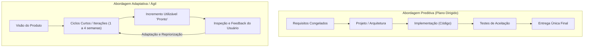
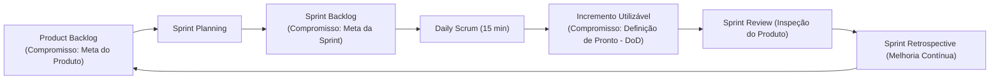

# 01 - Ciclo de Vida e Metodologias Ágeis

> **Matéria:** Engenharia de Software  
> **Cargo:** B02 – Técnico de Controle Externo – Especialidade: Tecnologia da Informação  
> **Arquivo:** `01_ciclo_de_vida_e_metodologias_ageis.md`  

---

## 📌 Ementa / Itens do Edital
- Fundamentos da engenharia de software
- Ciclo de vida de software
- Abordagens de ciclo de vida preditiva, iterativa, incremental e adaptativa/ágil (e abordagens híbridas)
- Abordagens, métodos e frameworks ágeis: Scrum, Kanban, Lean Software Development e Extreme Programming (XP)

---

## 🧭 Sumário

1. [Fundamentos de Engenharia de Software e Processos](#1-fundamentos-de-engenharia-de-software-e-processos)
    1. [Escopo da Engenharia de Software e a Crise do Software](#11-escopo-da-engenharia-de-software-e-a-crise-do-software)
    2. [Atividades Genéricas de Processo de Software](#12-atividades-genericas-de-processo-de-software)
    3. [Modelos de Maturidade de Processo (CMMI e MPS.BR)](#13-modelos-de-maturidade-de-processo-cmmi-e-mpsbr)
    4. [Teste 001](#Teste-001)
2. [Modelos de Ciclo de Vida de Software](#2-modelos-de-ciclo-de-vida-de-software)
    1. [Abordagem Preditiva: Modelo Cascata (Waterfall) e Modelo V](#21-abordagem-preditiva-modelo-cascata-waterfall-e-modelo-v)
    2. [Abordagem Iterativa e Incremental: Modelo Espiral e RUP](#22-abordagem-iterativa-e-incremental-modelo-espiral-e-rup)
    3. [Abordagem Adaptativa / Ágil: O Manifesto Ágil de 2001](#23-abordagem-adaptativa-agil-o-manifesto-agil-de-2001)
    4. [Abordagens Híbridas de Desenvolvimento](#24-abordagens-hibridas-de-desenvolvimento)
    5. [Teste 002](#Teste-002)
    6. [Teste 003](#Teste-003)
    7. [Teste 004](#Teste-004)
3. [O Framework Scrum (Guia Scrum 2020)](#3-o-framework-scrum-guia-scrum-2020)
    1. [Pilares do Empirismo e Valores Fundamentais](#31-pilares-do-empirismo-e-valores-fundamentais)
    2. [Estrutura do Scrum Team e Responsabilidades](#32-estrutura-do-scrum-team-e-responsabilidades)
    3. [Eventos Formais do Scrum e Regras de Time-box](#33-eventos-formais-do-scrum-e-regras-de-time-box)
    4. [Artefatos Oficiais e seus Três Compromissos Formais](#34-artefatos-oficiais-e-seus-tres-compromissos-formais)
    5. [Métricas e Gráficos de Acompanhamento (Burndown e Burnup)](#35-metricas-e-graficos-de-acompanhamento-burndown-e-burnup)
    6. [Teste 005](#Teste-005)
    7. [Teste 006](#Teste-006)
    8. [Teste 007](#Teste-007)
    9. [Teste 008](#Teste-008)
4. [Método Kanban e Gestão do Fluxo de Valor](#4-metodo-kanban-e-gestao-do-fluxo-de-valor)
    1. [Princípios e Práticas Gerais do Kanban](#41-principios-e-praticas-gerais-do-kanban)
    2. [Limites de Trabalho em Progresso (WIP) e Gargalos](#42-limites-de-trabalho-em-progresso-wip-e-gargalos)
    3. [Métricas de Fluxo: Lead Time, Cycle Time, Throughput e CFD](#43-metricas-de-fluxo-lead-time-cycle-time-throughput-e-cfd)
    4. [Teste 009](#Teste-009)
    5. [Teste 010](#Teste-010)
5. [Extreme Programming (XP) e Lean Software Development](#5-extreme-programming-xp-e-lean-software-development)
    1. [Extreme Programming: Valores e Práticas de Engenharia](#51-extreme-programming-valores-e-praticas-de-engenharia)
    2. [Lean Software Development e Eliminação dos 7 Desperdícios](#52-lean-software-development-e-eliminacao-dos-7-desperdicios)
    3. [Teste 011](#Teste-011)
6. [Fontes Oficiais e Referências Bibliográficas](#6-fontes-oficiais-e-referencias-bibliograficas)

---

## 1. Fundamentos de Engenharia de Software e Processos

### 1.1 Escopo da Engenharia de Software e a Crise do Software
A Engenharia de Software é a disciplina de engenharia dedicada ao estabelecimento e uso de sólidos princípios e métodos sistemáticos, disciplinados e quantificáveis para o desenvolvimento, operação e manutenção de software de alta qualidade dentro de custos e prazos previsíveis.

- **A Crise do Software:** O termo emergiu formalmente na Conferência da OTAN (NATO Conference) em 1968, em Garmisch, motivado pela incapacidade sistemática da indústria de entregar sistemas confiáveis dentro do orçamento e cronograma. Os projetos sofriam rotineiramente com estouros orçamentários astronômicos, atrasos severos, código repleto de defeitos e sistemas que não atendiam às necessidades reais dos usuários.
- **Fatores da Complexidade do Software (Frederick Brooks - *No Silver Bullet*):** Brooks dividiu a complexidade em duas dimensões:
    - *Complexidade Essencial:* Intrínseca à natureza do software (conformidade legal mutável, invisibilidade, complexidade inerente ao domínio do negócio);
    - *Complexidade Acidental:* Relacionada às limitações transitórias da tecnologia utilizada (compiladores rudimentares, falta de ferramentas de integração ou linguagens de baixo nível). Não há "bala de prata" tecnológica capaz de quadruplicar a produtividade por si só.

### 1.2 Atividades Genéricas de Processo de Software
Independentemente do ciclo de vida adotado (preditivo, iterativo ou ágil), a literatura clássica de engenharia de software (Pressman e Sommerville) mapeia cinco atividades genéricas de processo:

1. **Comunicação:** Cooperação contínua e levantamento de requisitos junto a clientes e partes interessadas (*stakeholders*);
2. **Planejamento:** Estimativas de esforço, alocação de recursos, definição de entregáveis, cronograma e análise de riscos;
3. **Modelagem:** Elaboração de arquitetura de software, diagramação de modelos conceituais, fluxos de dados e especificações detalhadas de design;
4. **Construção:** Atividades conjugadas de codificação (programação) e testes automatizados/manuais de software;
5. **Implantação (Deployment):** Disponibilização do software em ambiente operacional, homologação pelo usuário final, suporte técnico e coleta de feedback.

### 1.3 Modelos de Maturidade de Processo (CMMI e MPS.BR)
- **CMMI (Capability Maturity Model Integration):** Desenvolvido pelo SEI (Software Engineering Institute), estrutura a capacidade e maturidade de organizações em 5 níveis escalonados:
    - *Nível 1 (Inicial):* Processos imprevisíveis, reativos e caóticos; o sucesso depende do esforço heróico individual;
    - *Nível 2 (Gerenciado):* Projetos planejados, medidos e controlados em nível de projeto;
    - *Nível 3 (Definido):* Processos corporativos padronizados e integrados em toda a organização;
    - *Nível 4 (Quantitativamente Gerenciado):* Processos controlados estatisticamente mediante métricas rigorosas de desempenho;
    - *Nível 5 (Em Otimização):* Foco na melhoria contínua e inovação sistemática de processos.
- **MPS.BR (Melhoria de Processo do Software Brasileiro):** Modelo nacional alinhado às normas ISO/IEC 12207 e 15504, subdividido em 7 níveis de maturidade decrescentes em letras (do nível G - Parcialmente Gerenciado até o nível A - Em Otimização).

---

### Teste 001
**(FCC – TRT-1 – Analista Judiciário (TI) – 2014)**  
Segundo o RUP (Rational Unified Process) a

* **A)** fase de construção pode ser composta por diversas iterações.
* **B)** fase de transição abrange apenas uma única iteração.
* **C)** disciplina de desenvolvimento tem atividade mais intensa na fase de concepção.
* **D)** disciplina de requisitos tem atividade mais intensa na fase de construção.
* **E)** fase de elaboração é composta por, no mínimo, 3 iterações. _________________________________________________________

---

> **Comentário Detalhado:**
>
> - **A)** Incorreta. A fase de Transição não tem como foco principal definir a visão do produto ou o modelo de negócio.
> - **B)** Correta. No RUP (Rational Unified Process), a fase de Concepção (Iniciação) foca em estabelecer o escopo do negócio e a viabilidade do sistema; a fase de Elaboração estabelece a linha de base da arquitetura e gerencia os maiores riscos técnicos; a fase de Construção desenvolve o software de forma iterativa; e a fase de Transição entrega o produto aos usuários finais.
> - **C)** Incorreta. A fase de Elaboração não é dispensável nem foca apenas na codificação final.
> - **D)** Incorreta. O RUP é um processo iterativo e incremental, e não estritamente cascata sequencial.
> - **E)** Incorreta. Os fluxos de trabalho (disciplinas) ocorrem ao longo de todas as fases em intensidades variáveis.
>
> **Gabarito: B**

---

## 2. Modelos de Ciclo de Vida de Software

### 2.1 Abordagem Preditiva: Modelo Cascata (Waterfall) e Modelo V
- **Modelo Cascata (Royce, 1970):** Caracteriza-se por uma progressão linear, estritamente sequencial entre as fases do ciclo de vida. Uma fase subsequente somente é iniciada quando todos os artefatos da fase anterior estiverem totalmente concluídos, documentados e formalmente aprovados (*gates* de transição).
    - *Vantagens:* Estrutura rígida de fácil controle gerencial para projetos com requisitos absolutamente estáveis, bem compreendidos e sem previsão de mudanças tecnológicas.
    - *Desvantagens:* Inflexibilidade severa para absorver mudanças; o software só ganha forma executável nas fases finais do projeto, postergando a percepção de valor e a identificação de defeitos críticos para o encerramento do cronograma.
- **Modelo V (Verificação e Validação):** Variação direta do modelo cascata que explicita o pareamento simétrico entre cada fase de especificação/desenvolvimento e a sua correspondente fase de testes:
    - Requisitos de Negócio $\longleftrightarrow$ Testes de Aceitação;
    - Requisitos de Sistema $\longleftrightarrow$ Testes de Sistema;
    - Design Arquitetural $\longleftrightarrow$ Testes de Integração;
    - Design Detalhado de Módulos $\longleftrightarrow$ Testes Unitários.

### 2.2 Abordagem Iterativa e Incremental: Modelo Espiral e RUP
- **Conceito de Iteração vs. Incremento:**
    - *Iterativo:* O software é desenvolvido por meio de repetições sucessivas de ciclos de desenvolvimento, refinando progressivamente a solução.
    - *Incremental:* A cada ciclo concluído, uma porção utilizável e funcional do software é acrescida à versão anterior.
- **Modelo Espiral (Barry Boehm, 1988):** Modelo orientado a riscos (*risk-driven*), no qual o desenvolvimento progride em ciclos espirais contínuos compostos por quatro quadrantes obrigatórios:
    1. *Determinação de objetivos, alternativas e restrições;*
    2. *Identificação e resolução de riscos* (análise de risco, prototipação e simulações);
    3. *Desenvolvimento e validação do produto do nível atual;*
    4. *Planejamento da próxima fase.*

- **Processo Unificado (RUP - Rational Unified Process):** Metodologia iterativa e incremental orientada por Casos de Uso e centrada na Arquitetura de Software. Estrutura-se em quatro fases temporais sequenciais:
    1. *Iniciação (Inception):* Estabelecimento do escopo de negócio e viabilidade;
    2. *Elaboração (Elaboration):* Mapeamento profundo dos requisitos, mitigação de riscos maiores e estabilização da arquitetura executável básica;
    3. *Construção (Construction):* Desenvolvimento em larga escala e codificação de todos os componentes;
    4. *Transição (Transition):* Implantação, homologação, treinamento dos usuários e passagem para operação.

> 🚨 **ALERTA DE PROVA / PEGADINHA FCC:** A característica mais cobrada pela FCC a respeito do Modelo Espiral de Boehm é a **gestão explícita e sistemática de riscos** (*risk analysis*) em cada espira. Se a questão mencionar "modelo direcionado pela mitigação contínua de riscos através de prototipação em cada volta do ciclo", marque com segurança o **Modelo Espiral**.

### 2.3 Abordagem Adaptativa / Ágil: O Manifesto Ágil de 2001
Em fevereiro de 2001, em Snowbird (Utah), dezessete líderes de desenvolvimento de software redigiram o **Manifesto para o Desenvolvimento Ágil de Software**, fundamentado em 4 Valores e 12 Princípios:

| Nós valorizamos mais: | Do que: |
| :--- | :--- |
| **Indivíduos e interações** | Processos e ferramentas |
| **Software em funcionamento** | Documentação abrangente |
| **Colaboração com o cliente** | Negociação de contratos |
| **Responder a mudanças** | Seguir um plano pré-estabelecido |

*A premissa não é eliminar processos, documentação, contratos ou planos, mas reconhecer que os itens à esquerda entregam valor direto superior e adaptabilidade num ambiente de incerteza.*

### 2.4 Abordagens Híbridas de Desenvolvimento
Reconhecem que o mundo corporativo raramente opera em extremos absolutos. Um projeto híbrido pode adotar:

- Abordagem preditiva no planejamento macro de escopo, contratação pública e cronograma de alto nível (governança tradicional);
- Abordagem adaptativa/ágil na execução das iterações técnicas pelas equipes de desenvolvimento (com Sprints Scrum, gestão visual Kanban e testes contínuos).

---

### Teste 002
**(FCC – TRT-23 – Analista Judiciário (TI) – 2016)**  
O Processo Unificado estabelece que as maiores porções (cargas ou fluxos de trabalho) da Modelagem de Negócios e de Requisitos são realizadas durante as fases de

* **A)** Concepção e Elaboração.
* **B)** Elaboração e Construção.
* **C)** Transição e Construção.
* **D)** Implementação e Transição.
* **E)** Implantação e Implementação.

---

> **Comentário Detalhado:**
>
> - **A)** Incorreta. Na fase de Construção, o maior esforço recai sobre Implementação e Testes.
> - **B)** Incorreta. Na fase de Transição, o foco é Implantação e Treinamento de usuários.
> - **C)** Incorreta. A Modelagem de Negócios tem seu ápice nas fases iniciais do ciclo.
> - **D)** Incorreta. O esforço de Requisitos decresce acentuadamente nas iterações finais da Construção.
> - **E)** Correta. No Processo Unificado, as maiores cargas de trabalho das disciplinas de Modelagem de Negócios e de Requisitos ocorrem predominantemente nas fases de Concepção (Iniciação) e Elaboração, visando estabilizar os objetivos do sistema e mitigar riscos antes da fase de Construção em larga escala.
>
> **Gabarito: E**

---

### Teste 003
**(Questão Inédita / Simulada Estilo FCC – Nível: Controle Externo / TI)**  
O Processo Unificado (*Rational Unified Process* - RUP) é um modelo de ciclo de vida de desenvolvimento de software iterativo e incremental, caracterizado por ser centrado em arquitetura e dirigido por casos de uso. Ao auditar as fases cronológicas de um contrato estruturado sob o RUP, o auditor identifica que a fase cujo objetivo precíua e formalmente estabelecido é mitigar os riscos técnicos mais severos e validar a linha de base arquitetural executável (*executable architectural baseline*) denomina-se:

* **A)** Elaboração (*Elaboration*).
* **B)** Concepção / Iniciação (*Inception*).
* **C)** Construção (*Construction*).
* **D)** Transição (*Transition*).
* **E)** Homologação Operacional (*Acceptance*).

---

> **Comentário Detalhado:**
>
> - **A) CORRETA.** No RUP, a fase de **Elaboração (*Elaboration*)** destina-se a analisar o domínio do problema, estabelecer a baseline da arquitetura executável estável, mitigar os riscos técnicos de maior impacto e especificar detalhadamente a maioria dos casos de uso críticos.
> - **B) Incorreta.** A fase de Concepção (*Inception*) estabelece o escopo de negócio do projeto, a viabilidade econômica preliminar e a visão global da solução.
> - **C) Incorreta.** A fase de Construção (*Construction*) foca na codificação em larga escala, integração sistemática de módulos e desenvolvimento dos casos de uso restantes.
> - **D) Incorreta.** A fase de Transição (*Transition*) destina-se à implantação do sistema no ambiente dos usuários, testes beta, migração de dados e treinamento operacional.
> - **E) Incorreta.** "Homologação Operacional" não é uma das quatro fases canônicas estruturais do RUP.
>
> **Gabarito: A**

---

### Teste 004
**(Questão Inédita / Simulada Estilo FCC – Nível: Controle Externo / TI)**  
O Manifesto para o Desenvolvimento Ágil de Software, marco histórico do movimento ágil firmado em 2001, consagrou 4 valores fundamentais e 12 princípios norteadores. Entre as diretrizes expressamente consagradas nos 12 princípios formais do Manifesto Ágil, insere-se:

* **A)** aceitar alterações de requisitos, mesmo em fases adiantadas do projeto, aproveitando as mudanças para promover vantagem competitiva para o cliente.
* **B)** priorizar a formalização documental detalhada de todas as regras de negócio antes de iniciar a construção dos incrementos funcionais.
* **C)** realizar entregas de incrementos de software executável exclusivamente ao término de cada exercício financeiro da organização.
* **D)** condicionar o avanço do desenvolvimento à validação jurídica de termos de responsabilidade assinados por todas as partes envolvidas.
* **E)** canalizar a troca de informações entre desenvolvedores e gestores prioritariamente por meio de relatórios formais periódicos de status report.

---

> **Comentário Detalhado:**
>
> - **A) CORRETA.** Transcrição do segundo princípio do Manifesto Ágil: *"Aceitar mudanças de requisitos, mesmo no fim do desenvolvimento. Processos ágeis se adequam a mudanças, para que o cliente possa tirar vantagens competitivas"*.
> - **B) Incorreta.** O Manifesto valoriza *"software em funcionamento mais que documentação abrangente"*, repudiando documentações prévias exaustivas que retardem a entrega de valor.
> - **C) Incorreta.** O princípio prescreve *"entregar software funcionando com frequência, na escala de semanas a meses, com preferência aos períodos mais curtos"*, e não intervalos anuais burocráticos.
> - **D) Incorreta.** Falsa burocracia: o valor ágil preconiza *"colaboração com o cliente mais que negociação de contratos"*.
> - **E) Incorreta.** O Manifesto enfatiza que *"o método mais eficiente e eficaz de transmitir informações para e entre uma equipe de desenvolvimento é a conversa face a face"*.
>
> **Gabarito: A**

---

## 3. O Framework Scrum (Guia Scrum 2020)

### 3.1 Pilares do Empirismo e Valores Fundamentais
O Scrum é um framework leve que ajuda pessoas, times e organizações a gerar valor por meio de soluções adaptativas para problemas complexos. Alicerça-se no **Empirismo** e no pensamento **Lean**:

- **Três Pilares Empíricos:**
    1. *Transparência:* Processos e artefatos devem ser visíveis para todos os responsáveis pelos resultados;
    2. *Inspeção:* O progresso rumo aos objetivos deve ser examinado com frequência diligente para identificar anomalias;
    3. *Adaptação:* Havendo desvios inaceitáveis, os ajustes operacionais devem ser implementados no menor tempo viável.

- **Cinco Valores do Scrum:** Compromisso (*Commitment*), Foco (*Focus*), Abertura (*Openness*), Respeito (*Respect*) e Coragem (*Courage*).

### 3.2 Estrutura do Scrum Team e Responsabilidades
No Guia Scrum oficial de 2020, o **Scrum Team** é a unidade fundamental de trabalho, caracterizado por ser **multifuncional** (possui todas as habilidades necessárias para entregar o incremento) e **autogerenciado** (*self-managing* - a equipe decide internamente *quem*, *o que* e *como* fazer). O time compõe-se de três papéis/responsabilidades:

1. **Product Owner (PO):**
    - Responsável por **maximizar o valor do produto** resultante do trabalho do time;
    - Única pessoa responsável pela gestão eficaz do **Product Backlog** (criação, ordenação, clareza e comunicação dos itens de backlog);
    - Representa os interesses dos stakeholders; suas decisões devem ser respeitadas por toda a organização.

2. **Scrum Master (SM):**
    - Responsável por promover e apoiar o Scrum conforme definido no Guia;
    - Atua como um **líder que serve** (*true leader who serves*);
    - Remove impedimentos externos que bloqueiam o avanço dos Desenvolvedores;
    - Facilita os eventos do Scrum e garante a eficácia e a melhoria dos processos do time.

3. **Desenvolvedores (Developers):**
    - Pessoas do Scrum Team comprometidas em criar qualquer aspecto de um **Incremento utilizável a cada Sprint**;
    - Criam o plano para a Sprint (Sprint Backlog);
    - Adaptam o plano diariamente na Daily Scrum e responsabilizam-se pela qualidade aplicando a Definição de Pronto (*DoD*).

> 🚨 **ALERTA DE PROVA / PEGADINHA FCC:**  
>
> 1. No Guia 2020 **NÃO existe mais o papel "Time de Desenvolvimento" (Development Team)**. Existe apenas o *Scrum Team*, formado por PO, Scrum Master e Desenvolvedores. Não há subtimes nem hierarquias internas!  
> 2. O Scrum Master **NÃO é um gerente funcional**, não distribui tarefas individualmente e não cobra relatórios de horas.

### 3.3 Eventos Formais do Scrum e Regras de Time-box
Todos os eventos no Scrum possuem duração máxima pré-fixada (**time-box**):

| Evento Scrum | Finalidade Central e Participantes | Duração Máxima (Sprint de 1 mês) |
| :--- | :--- | :--- |
| **A Sprint** | Contêiner maior para todos os demais eventos. É o ciclo no qual o trabalho é executado para criar o incremento. | Até **um (1) mês** de duração fixa. |
| **Sprint Planning** | Define o plano de trabalho da Sprint abordando: 1) *Por que a Sprint é valiosa?* 2) *O que pode ser feito?* 3) *Como o trabalho será realizado?* | Máximo de **8 horas**. |
| **Daily Scrum** | Evento de alinhamento diário exclusivo dos **Desenvolvedores** para inspecionar o progresso rumo à Meta da Sprint e adaptar o plano para as próximas 24h. | Exatamente **15 minutos** (fixo, independentemente do tamanho da Sprint). |
| **Sprint Review** | Inspeção do Incremento produzido com os *stakeholders* para adaptar o Product Backlog com base no feedback real. | Máximo de **4 horas**. |
| **Sprint Retrospective** | Planejamento de melhorias na eficácia do time (pessoas, processos, ferramentas e Definição de Pronto). | Máximo de **3 horas**. |

> ⭐ **IMPORTANTE / REGRAS DA SPRINT:** Uma Sprint **nunca é prorrogada**. Se os itens planejados não forem concluídos dentro do time-box, a Sprint encerra-se normalmente; os itens não finalizados voltam para o Product Backlog. Uma Sprint só pode ser **cancelada prematuramente pelo Product Owner**, caso a Meta da Sprint (*Sprint Goal*) se torne obsoleta!

### 3.4 Artefatos Oficiais e seus Três Compromissos Formais
Cada um dos três artefatos do Scrum contém um **compromisso formal** associado (introduzido formalmente no Guia 2020) para fornecer transparência e foco:

1. **Product Backlog** $\longrightarrow$ Compromisso: **Meta do Produto (*Product Goal*)**  
    - O Product Backlog é a lista ordenada e emergente de tudo o que é necessário para melhorar o produto. A Meta do Produto descreve o estado futuro que serve como alvo de longo prazo para o Scrum Team.

2. **Sprint Backlog** $\longrightarrow$ Compromisso: **Meta da Sprint (*Sprint Goal*)**  
    - O Sprint Backlog é composto pela Meta da Sprint (o porquê), o conjunto de itens selecionados do Product Backlog (o quê) e o plano de ação detalhado (o como). A Meta da Sprint é o objetivo único acordado para a iteração, que não muda durante a sua execução.

3. **Incremento** $\longrightarrow$ Compromisso: **Definição de Pronto (*Definition of Done - DoD*)**  
    - O Incremento é um degrau concreto rumo à Meta do Produto. No momento em que um item do Product Backlog atende à Definição de Pronto, um novo Incremento nasce. A DoD é a descrição formal dos critérios de qualidade exigidos para que o item seja considerado pronto para uso.

### 3.5 Métricas e Gráficos de Acompanhamento (Burndown e Burnup)
- **Sprint Burndown Chart:** Gráfico que exibe a quantidade de **trabalho restante** (geralmente em pontos de história ou horas) em relação ao tempo da Sprint. A inclinação da linha decrescente indica se a equipe concluirá as tarefas no prazo;
- **Burnup Chart:** Gráfico com duas linhas: uma demonstrando o crescimento do escopo total ao longo do tempo e outra demonstrando o trabalho efetivamente concluído (*done*). Excelente para detectar expansão de escopo (*scope creep*).

---

### Teste 005
**(Questão Inédita / Simulada Estilo FCC – Nível: Controle Externo / TI)**  
A respeito da composição estrutural e das responsabilidades do Scrum Team delineadas na versão oficial do Guia Scrum (2020), considere as seguintes afirmativas:

I. O Scrum Team é uma equipe coesa composta por um Product Owner, um Scrum Master e os Desenvolvedores, caracterizando-se essencialmente por ser multifuncional e autogerenciada.  
II. O Product Owner é o único responsável pela gestão eficaz do Product Backlog e pela maximização do valor decorrente do trabalho executado, não existindo relação de subordinação hierárquica entre ele e os demais integrantes do time.  
III. O Scrum Master atua como chefe executivo do time ágil, cabendo-lhe distribuir privativamente as tarefas diárias nominais e aprovar as horas registradas pelos desenvolvedores.  

Em relação às prescrições normativas do Guia Scrum, está correto o que se afirma em:

* **A)** I e II, apenas.
* **B)** I, apenas.
* **C)** III, apenas.
* **D)** II e III, apenas.
* **E)** I, II e III.

---

> **Comentário Detalhado:**
>
> - **I. Correta.** Conforme o Guia Scrum 2020, o Scrum Team não tem hierarquias internas nem subequipes; é uma unidade autogerenciada (a própria equipe decide quem faz o que, quando e como) e multifuncional (possui internamente todas as competências necessárias para gerar valor em cada Sprint).
> - **II. Correta.** O Product Owner é explicitamente a pessoa responsável por maximizar o valor do produto e gerenciar com transparência o Product Backlog. Ele atua como par colaborativo, inexistindo subordinação hierárquica com o time.
> - **III. Incorreta.** No Scrum, o Scrum Master é um verdadeiro líder que serve (*servant leader*), responsável pela eficácia do Scrum Team e por remover impedimentos organizacionais. Ele **não é chefe/gerente funcional** e não atribui tarefas nominais — os próprios desenvolvedores selecionam e distribuem as tarefas do Sprint Backlog.
>
> **Gabarito: A**

---

### Teste 006
**(FGV – TJ-AP – Analista Judiciário (TI) – 2023)**  
A metodologia Scrum é um framework que apoi a o

desenvolvimento de soluções adaptativas para problemas

complexos utilizando diversos artefatos.

O artefato do Scrum composto pela Meta da Sprint (por que), o

conjunto de itens do Product Backlog selecionados para a Sprint

(o que), bem como um plano de ação para entregar o Incremento

(como) é o:

* **A)** kanban;
* **B)** incremento;
* **C)** sprint backlog;
* **D)** product owner;
* **E)** meta do produto.

---

> **Comentário Detalhado:**
>
> - **A)** Correta. Segundo o Scrum Guide oficial, o Scrum baseia-se no empirismo (transparência, inspeção e adaptação) e no pensamento enxuto (lean), onde um time auto-organizável e multifuncional colabora em iterações de tamanho fixo (Sprints) para gerar valor contínuo e produtos utilizáveis a cada incremento.
> - **B)** Incorreta. O Scrum Master não gerencia pessoas de forma prescritiva nem atribui tarefas individualmente aos desenvolvedores.
> - **C)** Incorreta. O Product Owner não define a estimativa de esforço das tarefas, papel privativo dos Developers.
> - **D)** Incorreta. O Sprint Backlog não é imutável durante o Sprint se o time identificar necessidades de ajuste com o PO.
> - **E)** Incorreta. O Scrum não adota papéis gerenciais tradicionais como Gerente de Projetos dentro do Time Scrum.
>
> **Gabarito: A**

---

### Teste 007
**(FGV – TRT-13 – Analista Judiciário (TI) – 2022)**  
Inspecionar o resultado do Sprint e determinar futuras

adaptações. O time apresenta os resultados do seu trabalho

para as principais partes interessadas, sendo discutido o

progresso em direção ao Produto.

(   ) Sprint de Planejamento

(   ) Sprint de Retrospectiva

(   ) Reunião Diária

(   ) Sprint de Revisão

Assinale a opção que indica a relação correta, na ordem

apresentada.

* **A)** 1 – 2 – 4 – 3.
* **B)** 1 – 3 – 2 – 1.
* **C)** 2 – 3 – 1 – 4.
* **D)** 3 – 4 – 1 – 2.
* **E)** 4 – 1 – 3 – 2.

---

> **Comentário Detalhado:**
>
> - **A)** Incorreta. A Daily Scrum é uma reunião diária interna de alinhamento e sincronização dos Developers com duração de 15 minutos.
> - **B)** Incorreta. A Sprint Planning ocorre no início do Sprint para planejar o trabalho a ser realizado.
> - **C)** Correta. O evento do Scrum cujo objetivo precípuo é inspecionar o resultado do Sprint (o incremento de produto potencialmente utilizável) e determinar futuras adaptações, no qual o Time Scrum apresenta os resultados aos principais stakeholders, é a Revisão do Sprint (Sprint Review).
> - **D)** Incorreta. A Sprint Retrospective ocorre após a Sprint Review e foca na inspeção e melhoria dos processos, pessoas e relacionamentos da equipe, e não na demonstração do incremento aos stakeholders.
> - **E)** Incorreta. O Refinamento do Backlog é uma atividade contínua de detalhamento e estimativa de itens, não um evento formal com stakeholders.
>
> **Gabarito: C**

---

### Teste 008
**(Questão Inédita / Simulada Estilo FCC – Nível: Controle Externo / TI)**  
No acompanhamento visual e na gestão quantitativa do progresso de equipes ágeis em um projeto de fiscalização de TI, utilizam-se com frequência os gráficos *Sprint Burndown* e *Release Burnup*. A respeito da interpretação técnica e das características comparativas desses gráficos, é correto afirmar:

* **A)** no gráfico de *Sprint Burndown*, o eixo vertical quantifica o trabalho restante planejado e o eixo horizontal representa o tempo; quando a linha real situa-se abaixo da linha ideal de tendência, indica que a equipe está com ritmo de entrega adiantado em relação ao cronograma previsto.
* **B)** no gráfico de *Sprint Burndown*, o traçado da linha real deve ascender continuamente até atingir o limite orçamentário previsto para o projeto.
* **C)** o gráfico de *Release Burnup* restringe-se a exibir a quantidade de impedimentos resolvidos, sendo incapaz de sinalizar expansões ou reduções no escopo global do projeto.
* **D)** no gráfico de *Sprint Burndown*, se a linha real mantiver trajetória acima da linha ideal planejada, conclui-se que o ritmo de entrega está superando as estimativas iniciais de vazão da equipe.
* **E)** o gráfico de *Release Burnup* monitora exclusivamente a performance computacional dos servidores de integração contínua durante a compilação do código.

---

> **Comentário Detalhado:**
>
> - **A) CORRETA.** No gráfico de **Burndown**, o objetivo é "queimar" o trabalho restante em direção a zero. O eixo vertical expressa o esforço restante (em pontos de história ou horas) e o horizontal expressa os dias da Sprint. Caso a linha de execução real esteja **abaixo da linha ideal guia**, resta menos trabalho do que o originalmente estimado para aquele dia, indicando que o time está **adiantado**.
> - **B) Incorreta.** O Burndown é descendente (mede trabalho restante decrescendo até zero); o gráfico que acumula entregas para cima de forma ascendente é o *Burnup*.
> - **C) Incorreta.** Uma das grandes vantagens analíticas do *Release Burnup* sobre o Burndown é justamente possuir duas linhas distintas (uma de escopo total e outra de trabalho realizado), tornando imediatamente transparentes acréscimos ou cortes de escopo ao longo da iteração.
> - **D) Incorreta.** Linha real acima da linha ideal em um Burndown indica atraso (resta mais trabalho pendente do que o previsto para aquele momento).
> - **E) Incorreta.** O Burnup é um gráfico de acompanhamento de entrega de escopo de negócio por iteração, não uma métrica de telemetria de infraestrutura.
>
> **Gabarito: A**

---

## 4. Método Kanban e Gestão do Fluxo de Valor

### 4.1 Princípios e Práticas Gerais do Kanban
Concebido por David J. Anderson com base no Sistema Toyota de Produção, o método Kanban é uma abordagem evolucionária e não prescritiva para gestão de fluxos de trabalho do conhecimento.

- **Princípios de Gestão de Mudança:** Comece com o que você faz hoje; busque mudança evolucionária e incremental; respeite os papéis, responsabilidades e títulos atuais; incentive liderança em todos os níveis.
- **Práticas Gerais do Kanban:**
    1. *Visualizar o fluxo de trabalho* (quadro Kanban com colunas de status);
    2. *Limitar o Trabalho em Progresso (WIP)*;
    3. *Gerenciar o fluxo*;
    4. *Tornar as políticas de processo explícitas*;
    5. *Implementar ciclos de feedback (cadências)*;
    6. *Melhorar colaborativamente e evoluir experimentalmente*.

### 4.2 Limites de Trabalho em Progresso (WIP) e Gargalos
O Kanban opera como um **sistema puxado (*pull system*)**:

- **Limite de WIP (Work In Progress):** Cada coluna do quadro possui um teto máximo de itens permitidos simultaneamente (ex.: a coluna "Testes" com WIP = 3).
- **Efeito Prático:** Impede a sobrecarga da equipe, reduz o desperdício de troca de contexto (*context switching*) e torna imediatamente visíveis os **gargalos** de produção. Se uma coluna atingir o limite de WIP, a etapa anterior é impedida de empurrar novos itens, forçando os membros da equipe a colaborar para destravar o gargalo (*"Pare de começar e comece a terminar!"*).

### 4.3 Métricas de Fluxo: Lead Time, Cycle Time, Throughput e CFD
- **Lead Time:** É o tempo total decorrido entre a solicitação inicial da demanda pelo cliente (registro no backlog) até a sua efetiva entrega em ambiente de produção;
- **Cycle Time:** É o tempo em que a equipe técnica esteve ativamente trabalhando no desenvolvimento do item (desde que o cartão foi puxado para a primeira coluna de execução até a conclusão da tarefa);
- **Throughput (Vazão):** Quantidade de itens entregues e concluídos por unidade de tempo (ex.: 12 tarefas por semana);
- **Diagrama de Fluxo Cumulativo (CFD - Cumulative Flow Diagram):** Gráfico de áreas empilhadas que ilustra o número cumulativo de itens em cada fase do processo ao longo do tempo:
    - *Distância Vertical:* Mostra a quantidade de Trabalho em Progresso (WIP) em um dado instante;
    - *Distância Horizontal:* Revela o Lead Time aproximado dos itens. Bandas com inclinação constante indicam fluxo estável e previsível.

---

### Teste 009
**(Questão Inédita / Simulada Estilo FCC – Nível: Controle Externo / TI)**  
Ao auditar o fluxo contínuo de trabalho e os processos operacionais de desenvolvimento de uma entidade pública orientados pelo método Kanban, o auditor de controle externo verificou a instituição de limites explícitos de Trabalho em Progresso (*Work In Progress* - WIP) nas colunas do quadro. Na teoria e na prática do Kanban, o objetivo técnico central dessa restrição é:

* **A)** expor gargalos e bloqueios no fluxo operacional, reduzindo o tempo de ciclo total (*Cycle Time*) e prevenindo o desperdício decorrente da troca constante de contexto (*multitasking*).
* **B)** compelir os desenvolvedores a cumprirem horas extraordinárias sempre que o número de tarefas ultrapassar o limite pré-fixado na coluna.
* **C)** exigir a homologação formal de cada item por um comitê diretivo antes de autorizar sua passagem para a coluna seguinte.
* **D)** dispensar a execução de testes funcionais automatizados para acelerar a taxa de liberação de pacotes em produção.
* **E)** padronizar compulsoriamente para um tamanho idêntico o esforço e a complexidade de todas as demandas recebidas no fluxo.

---

> **Comentário Detalhado:**
>
> - **A) CORRETA.** O princípio orientador do método Kanban sintetiza-se no lema *"pare de começar e comece a terminar"*. A fixação de limites explícitos de WIP restringe o volume de tarefas concorrentes em cada etapa, expõe gargalos operacionais (impedindo que etapas a montante sobrecarreguem etapas a jusante), minimiza a perda de produtividade por troca de contexto e, por consequência direta da **Lei de Little** ($Lead\ Time = WIP / Throughput$), diminui o tempo de ciclo de entrega.
> - **B) Incorreta.** O limite de WIP busca promover ritmo sustentável e balanceamento de capacidade, e não impor sobrecarga ou horas extras artificiais.
> - **C) Incorreta.** Falsa burocracia: a transição entre colunas é orientada por políticas explícitas da equipe (*Definition of Workflow*), e não por atos comitiais formais.
> - **D) Incorreta.** A limitação de WIP foca na elevação da qualidade das entregas, não admitindo a supressão de testes ou controles de engenharia.
> - **E) Incorreta.** O Kanban lida pragmaticamente com itens de tamanhos e naturezas heterogêneas; o limite incide sobre a contagem simultânea de itens na raia/coluna, e não sobre o tamanho fixo da demanda.
>
> **Gabarito: A**

---

### Teste 010
**(Questão Inédita / Simulada Estilo FCC – Nível: Controle Externo / TI)**  
No âmbito da governança e gestão quantitativa de demandas de TI com o método Kanban, duas métricas temporais essenciais para diagnosticar a eficiência e a previsibilidade das entregas aos usuários são o *Lead Time* e o *Cycle Time*. A correta distinção conceitual entre essas grandezas estabelece que:

* **A)** o *Lead Time* compreende o tempo total decorrido desde a solicitação ou registro formal da demanda pelo usuário até sua entrega final em produção, ao passo que o *Cycle Time* mensura o intervalo em que a equipe esteve efetivamente trabalhando no desenvolvimento ativo do item.
* **B)** o *Lead Time* calcula exclusivamente o tempo durante o qual o item permaneceu bloqueado por impedimentos, enquanto o *Cycle Time* afere a duração das reuniões diárias da equipe.
* **C)** o *Cycle Time* abrange desde o momento da idealização pelo cliente até a homologação, enquanto o *Lead Time* tem início apenas com a primeira compilação do código-fonte.
* **D)** o *Lead Time* e o *Cycle Time* são métricas necessariamente coincidentes em qualquer ambiente Kanban que opere com fluxo puxado.
* **E)** o *Throughput* representa a grandeza temporal resultante da subtração matemática do *Cycle Time* pelo *Lead Time*.

---

> **Comentário Detalhado:**
>
> - **A) CORRETA.** No método Kanban:
>     - **Lead Time (Tempo de Atendimento):** Representa a perspectiva do **cliente/usuário**. É o tempo total transcorrido desde o registro formal da necessidade no sistema de chamados/backlog até a entrega do item pronto para uso em produção (engloba tempo de espera em fila + tempo de trabalho ativo);
>     - **Cycle Time (Tempo de Ciclo):** Representa a perspectiva da **equipe técnica**. É o intervalo transcorrido a partir do momento em que o item é puxado para o fluxo de execução ativa ("Em Andamento") até a sua conclusão.
> - **B) Incorreta.** Mistura tempos de fluxo com tempos de bloqueio e cerimônias ágeis.
> - **C) Incorreta.** Inverte diametralmente as definições consagradas das métricas.
> - **D) Incorreta.** São métricas distintas; o Lead Time sempre engloba o tempo de espera nas filas prévias de compromisso, sendo tipicamente superior ao Cycle Time.
> - **E) Incorreta.** *Throughput* (vazão) é uma métrica quantitativa (número de itens concluídos por unidade de tempo, ex.: 15 itens/semana), não o resultado de subtração de tempos.
>
> **Gabarito: A**

---

## 5. Extreme Programming (XP) e Lean Software Development

### 5.1 Extreme Programming: Valores e Práticas de Engenharia
Criado por Kent Beck, o Extreme Programming (XP) é uma metodologia ágil voltada à excelência técnica e engenharia de software para times pequenos e médios submetidos a requisitos vagos e altamente dinâmicos.

- **Cinco Valores do XP:** Comunicação, Simplicidade, Feedback, Coragem e Respeito.
- **Práticas de Engenharia Centrais (Cobrança Constante em Concursos):**
    1. **Programação em Par (*Pair Programming*):** Dois desenvolvedores trabalham simultaneamente em uma única estação de trabalho. O **Driver (Piloto)** assume o teclado e digita o código com foco no detalhe imediato; o **Navigator (Copiloto)** analisa estrategicamente a solução, checa erros de sintaxe, avalia impactos arquiteturais e elabora casos de teste adicionais;
    2. **Test-Driven Development (TDD):** Desenvolvimento guiado por testes mediante o ciclo contínuo **Red-Green-Refactor**:
        - *Red:* Escrever um teste automatizado que falha (pois a funcionalidade ainda não existe);
        - *Green:* Escrever o código mínimo de produção suficiente para fazer o teste passar;
        - *Refactor:* Limpar e aprimorar o código-fonte (eliminando duplicações), garantindo que todos os testes continuem passando;

    3. **Refatoração Contínua (*Refactoring*):** Melhoria da estrutura interna do código sem alterar seu comportamento observável externo;
    4. **Propriedade Coletiva do Código (*Collective Ownership*):** Qualquer desenvolvedor do time tem liberdade e responsabilidade para alterar qualquer módulo do sistema para corrigir defeitos ou implementar melhorias;
    5. **Integração Contínua (*Continuous Integration*):** Código integrado e testado no repositório compartilhado várias vezes ao dia;
    6. **Design Simples:** O código atende a todos os testes, expressa com clareza a intenção, não possui duplicações (DRY - *Don't Repeat Yourself*) e contém o menor número possível de classes e métodos (YAGNI - *You Aren't Gonna Need It*).

### 5.2 Lean Software Development e Eliminação dos 7 Desperdícios
Adaptado do Sistema Toyota de Produção por Mary e Tom Poppendieck, o desenvolvimento Lean foca na entrega rápida de valor mediante a **eliminação sistemática de desperdícios (*Muda*)**:

| Desperdício no Lean Software | Manifestação Prática no Desenvolvimento de Sistemas |
| :--- | :--- |
| **1. Trabalho Parcialmente Feito** | Código desenvolvido que permanece semanas em branch aguardando testes ou aprovação de deploy. |
| **2. Recursos Extras (Gold Plating)** | Funcionalidades desenvolvidas que nunca serão utilizadas pelo usuário final (excesso de especificação). |
| **3. Reaprendizado** | Redescoberta de soluções por falta de testes automatizados ou ausência de documentação de código limpo. |
| **4. Passagem de Tarefas (Hand-offs)** | Perda de conhecimento e ruídos de comunicação na transição entre silos (analista $\rightarrow$ arquiteto $\rightarrow$ dev $\rightarrow$ tester). |
| **5. Atrasos / Esperas (Delays)** | Desenvolvedores ociosos aguardando liberação de ambiente, homologação de acessos ou aprovação de comitês. |
| **6. Troca de Contexto (Task Switching)** | Alocar profissionais em múltiplos projetos paralelos, gerando perda massiva de produtividade cognitiva. |
| **7. Defeitos e Bugs** | Falhas que chegam a produção e demandam esforço emergencial de correção e retrabalho. |

- **Princípios Fundamentais do Lean:** Eliminar desperdícios; Amplificar o aprendizado; Decidir o mais tarde possível (manter opções em aberto); Entregar o mais rápido possível; Empoderar o time; Construir integridade intrínseca; e Enxergar o todo (*See the whole*).

---

### Teste 011
**(Questão Inédita / Simulada Estilo FCC – Nível: Controle Externo / TI)**  
Em uma fiscalização de contratos de fábrica de software de um órgão público, o Auditor de Controle Externo analisou as práticas de engenharia de software preconizadas no Termo de Referência. Entre as práticas exigidas contratualmente, constavam a Programação em Par (*Pair Programming* — dois programadores atuando conjuntamente em uma mesma estação, com papéis de piloto e copiloto), o Desenvolvimento Orientado por Testes (*Test-Driven Development* - TDD, no ciclo Red-Green-Refactor) e a Refatoração Contínua. No rol das metodologias e frameworks ágeis, essas práticas de codificação são originárias e consagradas primariamente pelo:

* **A)** Extreme Programming (XP).
* **B)** Scrum.
* **C)** Rational Unified Process (RUP).
* **D)** Método em Cascata (*Waterfall*).
* **E)** CMMI Nível 5.

---

> **Comentário Detalhado:**
>
> - **A) CORRETA.** O **Extreme Programming (XP)**, formulado por Kent Beck, é a metodologia ágil estritamente focada em **excelência técnica de engenharia e programação**. É a fonte de práticas consagradas como *Pair Programming* (dois desenvolvedores compartilhando teclado/tela), *TDD* (escrever o teste unitário antes do código de produção), *Refactoring* sistemático, integração contínua, metáfora do sistema e propriedade coletiva do código.
> - **B) Incorreta.** O Scrum é um framework holístico de gestão e desenvolvimento de produtos centrado em papéis, eventos e artefatos, não prescrevendo práticas técnicas específicas de codificação como pair programming ou TDD.
> - **C) Incorreta.** O RUP é um processo pesado e prescritivo com 4 fases formais e modelagem intensiva em UML, não tendo como pilares mandatórios o TDD ou o pareamento.
> - **D) Incorreta.** O modelo em Cascata segrega estritamente as fases de especificação, codificação e testes, colidindo com a dinâmica contínua do TDD e da programação em pares.
> - **E) Incorreta.** O CMMI é um modelo conceitual corporativo de avaliação de maturidade e capacidade de processos, não uma metodologia de codificação ágil.
>
> **Gabarito: A**

---

## 6. Fontes Oficiais e Referências Bibliográficas

* [Guia do Scrum Oficial 2020 — Edição Online (Ken Schwaber & Jeff Sutherland)](https://scrumguides.org/scrum-guide.html) - Definição normativa do framework Scrum, pilares empíricos, Scrum Team, eventos e artefatos com seus compromissos.
* [Guia do Scrum 2020 — Documento Oficial em Português do Brasil (PDF)](https://scrumguides.org/docs/scrumguide/v2020/2020-Scrum-Guide-PortugueseBR-3.0.pdf) - Tradução oficial completa da versão 2020 do Guia do Scrum.
* [Manifesto para o Desenvolvimento Ágil de Software (2001)](https://agilemanifesto.org/iso/ptbr/manifesto.html) - Declaração oficial dos quatro valores centrais do desenvolvimento ágil de software.
* [Os 12 Princípios do Software Ágil — Agile Manifesto Oficial](https://agilemanifesto.org/iso/ptbr/principles.html) - Diretrizes fundamentais de entregas contínuas, adaptação a mudanças e excelência técnica.
* [O Guia Oficial do Kanban (Kanban Guides — Português do Brasil)](https://scrumguides.org/docs/scrumguide/v2020/2020-Scrum-Guide-PortugueseBR-3.0.pdf) - Definição formal do método Kanban, práticas de limitação de WIP e métricas de fluxo (Lead Time, Cycle Time e Throughput).
* [Continuous Integration (Martin Fowler — Práticas de Engenharia Ágil e XP)](https://martinfowler.com/articles/continuousIntegration.html) - Fundamentos de integração contínua, automação de builds e práticas técnicas do Extreme Programming (XP).
* SOMMERVILLE, Ian. **Engenharia de Software**. 10. ed. São Paulo: Pearson Education do Brasil, 2019. (Cap. 2 - Processos de Software; Cap. 3 - Desenvolvimento Ágil de Software).
* PRESSMAN, Roger S.; MAXIM, Bruce R. **Engenharia de Software: Uma Abordagem Profissional**. 9. ed. Porto Alegre: AMGH, 2021. (Cap. 2 - Modelos de Processo; Cap. 3 - Agilidade e Processo).
* BECK, Kent; ANDRES, Cynthia. **Extreme Programming Explained: Embrace Change**. 2. ed. Boston: Addison-Wesley Professional, 2004. (Sec. 1 - Values, Principles, and Practices).
