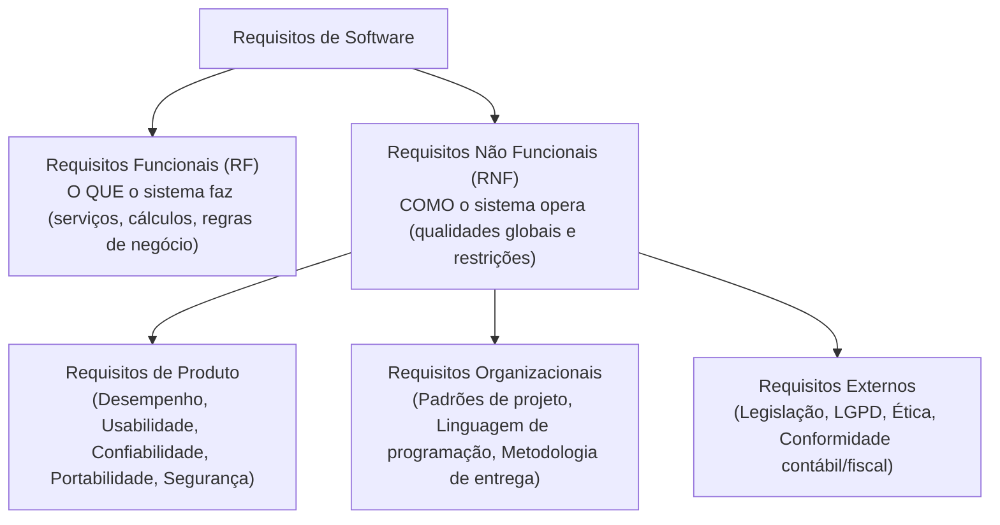
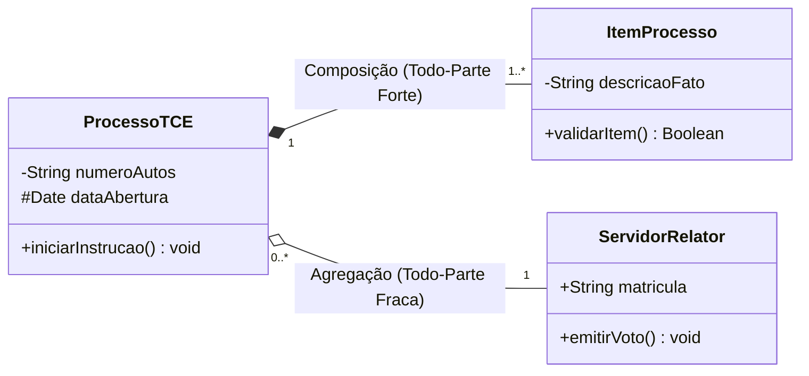
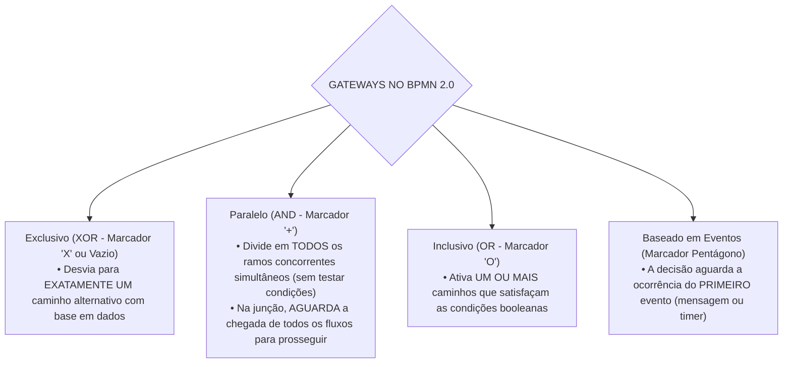

# 02 - Requisitos, Histórias de Usuário, UML e BPMN

> **Matéria:** Engenharia de Software  
> **Cargo:** B02 – Técnico de Controle Externo – Especialidade: Tecnologia da Informação  
> **Arquivo:** `02_requisitos_historias_de_usuario_uml_e_bpmn.md`  

---

## 📌 Ementa / Itens do Edital
- Levantamento, especificação, análise, validação e gerenciamento de requisitos funcionais e não funcionais
- Histórias de usuário, casos de uso e critérios de aceite
- Modelagem de sistemas com UML (Unified Modeling Language)
- Modelagem de processos de negócio com BPMN (Business Process Model and Notation)

---

## 🧭 Sumário

1. [Engenharia de Requisitos de Software](#1-engenharia-de-requisitos-de-software)
    1. [Ciclo de Vida da Engenharia de Requisitos](#11-ciclo-de-vida-da-engenharia-de-requisitos)
    2. [Técnicas de Elicitação de Requisitos](#12-tecnicas-de-elicitacao-de-requisitos)
    3. [Requisitos Funcionais vs. Requisitos Não Funcionais (Taxonomia de Sommerville)](#13-requisitos-funcionais-vs-requisitos-nao-funcionais-taxonomia-de-sommerville)
    4. [Gerenciamento, Rastreabilidade e Mudança de Requisitos](#14-gerenciamento-rastreabilidade-e-mudanca-de-requisitos)
    5. [Teste 012](#Teste-012)
    6. [Teste 013](#Teste-013)
2. [Modelagem por Casos de Uso e Histórias de Usuário](#2-modelagem-por-casos-de-uso-e-historias-de-usuario)
    1. [Modelagem de Casos de Uso: Elementos e Relacionamentos («include» vs. «extend»)](#21-modelagem-de-casos-de-uso-elementos-e-relacionamentos-include-vs-extend)
    2. [Histórias de Usuário (User Stories) e os 3 Cs de Ron Jeffries](#22-historias-de-usuario-user-stories-e-os-3-cs-de-ron-jeffries)
    3. [Critérios de Aceite e o Padrão INVEST](#23-criterios-de-aceite-e-o-padrao-invest)
    4. [Teste 014](#Teste-014)
    5. [Teste 015](#Teste-015)
    6. [Teste 016](#Teste-016)
3. [Modelagem de Sistemas com UML (versão 2.5)](#3-modelagem-de-sistemas-com-uml-versao-25)
    1. [Taxonomia dos Diagramas UML: Estruturais vs. Comportamentais](#31-taxonomia-dos-diagramas-uml-estruturais-vs-comportamentais)
    2. [Diagrama de Classes: Visibilidade, Multiplicidade, Agregação e Composição](#32-diagrama-de-classes-visibilidade-multiplicidade-agregacao-e-composicao)
    3. [Diagramas de Sequência, Atividades e Máquina de Estados](#33-diagramas-de-sequencia-atividades-e-maquina-de-estados)
    4. [Teste 017](#Teste-017)
    5. [Teste 018](#Teste-018)
    6. [Teste 019](#Teste-019)
4. [Modelagem de Processos de Negócio com BPMN 2.0](#4-modelagem-de-processos-de-negocio-com-bpmn-20)
    1. [Elementos de Fluxo: Eventos, Atividades e Tipos de Tarefas](#41-elementos-de-fluxo-eventos-atividades-e-tipos-de-tarefas)
    2. [Gateways Decisórios no BPMN 2.0 (XOR, AND, OR e Event-based)](#42-gateways-decisorios-no-bpmn-20-xor-and-or-e-event-based)
    3. [Estruturas de Separação (Pools e Lanes) e Conectores de Sequência vs. Mensagem](#43-estruturas-de-separacao-pools-e-lanes-e-conectores-de-sequencia-vs-mensagem)
    4. [Teste 020](#Teste-020)
    5. [Teste 021](#Teste-021)
    6. [Teste 022](#Teste-022)
5. [Fontes Oficiais e Referências Bibliográficas](#5-fontes-oficiais-e-referencias-bibliograficas)

---

## 1. Engenharia de Requisitos de Software

### 1.1 Ciclo de Vida da Engenharia de Requisitos
A Engenharia de Requisitos é o processo disciplinado de descobrir, analisar, documentar e verificar os serviços fornecidos pelo sistema e suas restrições operacionais (Ian Sommerville). Divide-se em etapas interligadas:

1. **Concepção / Estudo de Viabilidade:** Avalia se o sistema contribui para os objetivos da organização e se é técnica e economicamente viável;
2. **Elicitação (Levantamento):** Identificação e descoberta dos requisitos junto aos clientes, usuários e demais partes interessadas (*stakeholders*);
3. **Análise e Negociação:** Detecção de conflitos entre requisitos de diferentes fontes, análise de completude, consistência e priorização de demandas;
4. **Especificação:** Documentação formal dos requisitos levantados por meio de documentos formais (Documento de Requisitos de Software - DRS), Casos de Uso ou Histórias de Usuário;
5. **Validação:** Verificação se os requisitos especificados refletem fielmente as reais necessidades do cliente (revisões técnicas, testes de protótipos e geração de casos de teste);
6. **Gerenciamento de Requisitos:** Processo contínuo de controle de versões, rastreabilidade e acomodação de mudanças ao longo do ciclo de vida.

### 1.2 Técnicas de Elicitação de Requisitos
A escolha das técnicas de elicitação depende da maturidade do domínio de negócio e do perfil dos usuários:

- **Entrevistas:** Técnicas estruturadas (fechadas) ou abertas. Excelentes para explorar detalhes e obter uma visão aprofundada dos processos de negócio;
- **Questionários e Pesquisas:** Eficientes para coletar impressões de uma base ampla de usuários geograficamente dispersa, com baixo custo, embora sujeita a respostas superficiais;
- **Workshops / JAD (Joint Application Design):** Sessões estruturadas e colaborativas que reúnem desenvolvedores, gerentes e clientes no mesmo espaço físico para alinhar requisitos divergentes e acelerar consensos;
- **Etnografia e Observação Direta:** O analista acompanha presencialmente a rotina operacional do usuário em seu ambiente real de trabalho. Revela requisitos implícitos e regras tácitas que os usuários costumam esquecer de relatar nas entrevistas;
- **Prototipação Rápida:** Construção de maquetes visuais ou versões interativas preliminares do sistema para permitir a validação antecipada de fluxos de navegação e layouts.

### 1.3 Requisitos Funcionais vs. Requisitos Não Funcionais (Taxonomia de Sommerville)
A distinção entre o que o sistema realiza e como ele realiza constitui o pilar conceitual da engenharia de requisitos:

1. **Requisitos Funcionais (RF):** Descrevem as funções e comportamentos que o software deve executar. Especificam o que o sistema deve fazer em resposta a determinadas entradas, como reagir a situações específicas e quais cálculos realizar (ex.: *"O sistema deve calcular a alíquota previdenciária com base na remuneração bruta"*).
2. **Requisitos Não Funcionais (RNF):** Estabelecem propriedades de qualidade e restrições impostas aos serviços oferecidos pelo sistema. A taxonomia de Sommerville classifica os RNFs em:
    - *Requisitos de Produto:* Especificam o comportamento do produto em tempo de execução (desempenho, tempo de resposta, taxa de ocupação de memória, confiabilidade e disponibilidade mínima de 99,9%);
    - *Requisitos Organizacionais:* Decorrem das políticas e procedimentos da empresa cliente ou desenvolvedora (ex.: uso obrigatório de Java 21, versionamento no Git corporativo ou adoção da metodologia Scrum);
    - *Requisitos Externos:* Derivam de fatores externos ao sistema e à organização (ex.: aderência à Lei Geral de Proteção de Dados - LGPD, normas de interoperabilidade e regulamentações do Banco Central).

### 1.4 Gerenciamento, Rastreabilidade e Mudança de Requisitos
- **Rastreabilidade de Requisitos:** Capacidade de acompanhar o ciclo de vida de um requisito em ambas as direções:
    - *Rastreabilidade para trás (Backward traceability):* Liga o requisito à sua fonte originária (norma legal, entrevista ou necessidade de negócio);
    - *Rastreabilidade para frente (Forward traceability):* Liga o requisito aos módulos arquiteturais, classes, componentes e casos de teste que o implementam e validam;
- **Matriz de Rastreabilidade:** Tabela que mapeia a correlação bidirecional entre requisitos de usuário, requisitos de sistema, diagramas de arquitetura e casos de testes unitários.

---

### Teste 012
**(Questão Inédita / Simulada Estilo FCC – Nível: Controle Externo / TI)**  
Durante os trabalhos de auditoria de conformidade em um sistema de processo eletrônico em fase de homologação em um Tribunal de Contas, a equipe de fiscalização constatou que diversos módulos entregues funcionavam sem erros computacionais aparentes, mas executavam regras de negócio em desacordo com as reais necessidades dos auditores usuários e com os normativos regimentais vigentes. No âmbito da Engenharia de Requisitos, a atividade formal destinada precípua e especificamente a demonstrar se a especificação reflete com exatidão o sistema de que os usuários de fato necessitam — identificando ambiguidades, omissões e conflitos antes ou durante a fase de aceite definitivo — denomina-se:

* **A)** Validação de requisitos.
* **B)** Elicitação de requisitos.
* **C)** Rastreabilidade horizontal de requisitos.
* **D)** Gerenciamento de mudanças de escopo.
* **E)** Engenharia reversa de requisitos.

---

> **Comentário Detalhado:**
>
> - **A) CORRETA.** A **Validação de Requisitos** tem como objetivo demonstrar que a especificação reflete as reais necessidades dos clientes e usuários operacionais (*"construir o sistema certo"*). Ela identifica omissões, ambiguidades e inconsistências antes ou durante o processo de aceite, assegurando a aderência entre a solução entregue e os objetivos de negócio e institucionais.
> - **B) Incorreta.** A Elicitação é a atividade inicial de descoberta, levantamento e coleta das demandas junto às partes interessadas (*stakeholders*).
> - **C) Incorreta.** A Rastreabilidade trata da vinculação lógica e histórica entre requisitos, artefatos de desenho, código e testes.
> - **D) Incorreta.** O Gerenciamento de Mudanças compreende políticas e fluxos para analisar o impacto e controlar solicitações de modificação ao longo do ciclo de vida.
> - **E) Incorreta.** A Engenharia Reversa consiste em examinar o software existente para inferir ou documentar os requisitos a partir de seus componentes técnicos ou códigos.
>
> **Gabarito: A**

---

### Teste 013
**(Questão Inédita / Simulada Estilo FCC – Nível: Controle Externo / TI)**  
Em uma auditoria de governança de tecnologia da informação realizada em um órgão público estadual, a equipe de controle examinou o Termo de Referência da contratação de uma nova plataforma de auditoria eletrônica. No documento de especificação, segundo a taxonomia clássica de Engenharia de Software preconizada por Ian Sommerville, foram identificados os seguintes itens contratuais:

I. O módulo de fiscalização deve gerar e disponibilizar para download relatórios consolidados de achados de auditoria em formatos abertos (CSV e JSON) ao término de cada procedimento de inspeção.  
II. O tráfego de dados entre as estações dos auditores e o cluster corporativo deve utilizar protocolo TLS versão 1.3 com criptografia de chave pública baseada em certificados digitais padrão ICP-Brasil.  
III. O tempo de resposta para a consulta de histórico processual e cruzamento de dados na base fiscal não deve ultrapassar 3 segundos para 95% das consultas realizadas com até 500 conexões concorrentes.  

Com base na taxonomia clássica de requisitos de software, a correta classificação dos itens I, II e III é, respectivamente:

* **A)** Requisito Funcional, Requisito Funcional e Requisito Não Funcional.
* **B)** Requisito Não Funcional, Requisito Funcional e Requisito Não Funcional.
* **C)** Requisito Funcional, Requisito Não Funcional e Requisito Não Funcional.
* **D)** Requisito Não Funcional, Requisito Não Funcional e Requisito Funcional.
* **E)** Requisito Funcional, Requisito Não Funcional e Requisito Funcional.

---

> **Comentário Detalhado:**
>
> - **I. Requisito Funcional (RF):** Descreve uma funcionalidade ou serviço que o sistema deve prover ativamente ao usuário (gerar e exportar relatórios consolidados em formatos abertos ao fim da inspeção).
> - **II. Requisito Não Funcional (RNF):** Estabelece restrição de segurança, protocolo de comunicação e conformidade técnica (TLS 1.3 e certificados ICP-Brasil), limitando a forma como a arquitetura opera sem representar uma ação funcional direta do usuário.
> - **III. Requisito Não Funcional (RNF):** Consiste em atributo de qualidade relacionado ao desempenho (*performance*) e capacidade de vazão sob carga de acessos simultâneos (tempo limite de 3 segundos para 95% das consultas).
>
> **Gabarito: C**

---

## 2. Modelagem por Casos de Uso e Histórias de Usuário

### 2.1 Modelagem de Casos de Uso: Elementos e Relacionamentos («include» vs. «extend»)
Um Caso de Uso descreve uma sequência de interações entre um ator externo (humano ou outro sistema) e o software para atingir um objetivo específico que entregue valor mensurável:

- **Atores:** Papéis desempenhados por entidades externas em relação ao sistema. Podem ser *Atores Primários* (iniciam o caso de uso para atingir um objetivo) ou *Atores Secundários* (fornecem serviços de apoio ao sistema, como um serviço externo de pagamento);
- **Cenários:** Compõe-se de um *Cenário Principal* (fluxo básico ou "caminho feliz" onde tudo ocorre com sucesso) e *Cenários Alternativos/Exceção* (desvios de rota, validações de erro ou falhas).

**Relacionamentos no Diagrama de Casos de Uso (Cobrança Clássica da FCC):**

1. **Associação:** Linha contínua que conecta um ator a um caso de uso, denotando comunicação direta.
2. **Estereótipo `«include»` (Inclusão Obrigatória):**
    - O caso de uso base **depende obrigatoriamente** do caso de uso incluído para completar sua execução com sucesso;
    - Evita duplicação de comportamentos comuns compartilhados por múltiplos casos de uso (ex.: *Emitir Relatório* inclui compulsoriamente *Autenticar Usuário*);
    - **Direção da Seta:** Seta tracejada apontando **do Caso Base para o Caso Incluído** ($\text{Base} \xrightarrow{\ll\text{include}\gg} \text{Incluído}$).

3. **Estereótipo `«extend»` (Extensão Condicional / Opcional):**
    - Modela comportamento acessório, opcional ou excepcional que somente é acionado se determinada condição pré-definida for satisfeita em um **ponto de extensão (*extension point*)**;
    - O caso base executa e conclui com sucesso mesmo se a extensão jamais ocorrer (ex.: *Emitir Notificação Especial* estende o caso base *Processar Pedido* quando o valor for superior a cem mil reais);
    - **Direção da Seta:** Seta tracejada apontando **do Caso Extensor para o Caso Base** ($\text{Extensão} \xrightarrow{\ll\text{extend}\gg} \text{Base}$).

4. **Generalização / Especialização:** Relação de herança representada por uma seta com triângulo vazado na ponta. Pode ocorrer entre casos de uso ou entre atores (ex.: *Auditor de TI* especializa *Auditor Geral*).

> 🚨 **ALERTA DE PROVA / PEGADINHA FCC:**  
> A banca FCC frequentemente inverte a direção das setas e os conceitos:
>
> - No `<<include>>`: A seta aponta do caso base para o incluído ($\text{Base} \rightarrow \text{Incluído}$) e a execução é **obrigatória/incondicional**.
> - No `<<extend>>`: A seta aponta do caso que estende para o caso base ($\text{Extensor} \rightarrow \text{Base}$) e a execução é **opcional/condicional** vinculada a um ponto de extensão.

### 2.2 Histórias de Usuário (User Stories) e os 3 Cs de Ron Jeffries
Em ambientes ágeis, as necessidades de software são expressas através de **Histórias de Usuário**:
$$\text{"Como [papel de usuário], eu quero [funcionalidade/ação], para que [benefício de negócio percebido]"}$$

- **Os 3 Cs de Ron Jeffries:**
    1. **Card (Cartão):** A história é escrita de forma sucinta em um cartão físico ou digital, servindo como lembrete visual de uma funcionalidade a ser construída;
    2. **Conversation (Conversa):** O detalhamento do requisito não é fixado em documentos estáticos, mas refinado por meio de diálogo contínuo entre desenvolvedores, Product Owner e usuários;
    3. **Confirmation (Confirmação):** Critérios de aceite formais e testes que estabelecem a validação inequívoca de que a história foi concluída com sucesso.

### 2.3 Critérios de Aceite e o Padrão INVEST
- **Critérios de Aceite (Formato BDD / Gherkin):** Estruturam-se tipicamente no padrão:  
  *Dado que [contexto inicial], Quando [evento ou ação executada], Então [resultado esperado observável].*
- **Critérios INVEST de Qualidade de Histórias (Bill Wake e Mike Cohn):**

| Letra | Critério INVEST | Significado Técnico na Prática Ágil |
| :---: | :--- | :--- |
| **I** | **Independent** (Independente) | As histórias devem ser desacopladas entre si, permitindo que sejam priorizadas, desenvolvidas e implantadas em qualquer ordem. |
| **N** | **Negotiable** (Negociável) | A história não é um contrato pétreo. Seu escopo de detalhe deve permanecer aberto para negociações e ajustes durante a Sprint. |
| **V** | **Valuable** (Valiosa) | Deve entregar valor tangível e perceptível para o cliente ou usuário final (evitam-se histórias puramente técnicas desvinculadas de valor). |
| **E** | **Estimable** (Estimável) | A equipe deve compreender a complexidade técnica para estimar seu esforço de desenvolvimento em *Story Points* ou horas. |
| **S** | **Small** (Pequena) | A história deve ser dimensionada adequadamente para ser concluída com folga dentro de uma única iteração/sprint. |
| **T** | **Testable** (Testável) | A história deve possuir critérios de aceite objetivos e claros que permitam a validação automatizada ou manual de aprovação. |

---

### Teste 014
**(Questão Inédita / Simulada Estilo FCC – Nível: Controle Externo / TI)**  
Ao auditar os artefatos de desenho e análise orientada a objetos de um sistema integrado de tramitação processual no âmbito de um Tribunal de Contas, um Auditor de TI inspecionou o diagrama de casos de uso modelado na notação UML 2.5. No diagrama, observou o emprego dos relacionamentos com estereótipos «include» e «extend». De acordo com as especificações formais da UML, é correto afirmar:

* **A)** O relacionamento «include» indica que o caso de uso base depende da execução do caso de uso incluído para completar seu objetivo com sucesso, ao passo que o relacionamento «extend» especifica um comportamento condicional e acessório disparado a partir de um ponto de extensão.
* **B)** O relacionamento «extend» estabelece uma inclusão incondicional de comportamento executada obrigatoriamente em todos os cenários de execução do caso de uso base.
* **C)** No relacionamento «extend», o caso de uso base conhece previamente os detalhes e a estrutura do caso de uso extensor, exigindo que a seta tracejada aponte do caso base para o extensor.
* **D)** Ambos os relacionamentos («include» e «extend») conectam atores primários a casos de uso abstratos, sendo vedado seu uso na comunicação direta entre casos de uso concretos.
* **E)** O relacionamento «include» somente pode ser utilizado para descrever situações excepcionais de erro de negócio ou falhas de infraestrutura.

---

> **Comentário Detalhado:**
>
> - **A) CORRETA.** Nos termos da OMG UML 2.5: o estereótipo `«include»` modela dependência obrigatória e incondicional (o fluxo do caso base incorpora o comportamento do caso incluído como etapa indispensável); já o estereótipo `«extend»` modela comportamento acessório ou alternativo que só é acionado se determinada condição pré-definida for satisfeita em um ponto de extensão (*extension point*).
> - **B) Incorreta.** Inversão conceitual: a inclusão incondicional e obrigatória caracteriza o `«include»`, não o `«extend»`.
> - **C) Incorreta.** O caso de uso base é independente do caso extensor e não precisa conhecer seus detalhes; na notação gráfica, a seta tracejada do `«extend»` aponta do caso de uso extensor em direção ao caso de uso base.
> - **D) Incorreta.** Os estereótipos `«include»` e `«extend»` conectam casos de uso entre si, nunca atores a casos de uso. A conexão de atores a casos de uso dá-se por associação simples ou generalização entre atores.
> - **E) Incorreta.** O `«include»` é utilizado para reaproveitar comportamentos comuns e obrigatórios compartilhados entre casos de uso (como autenticação ou validação de sessão), e não apenas para falhas.
>
> **Gabarito: A**

---

### Teste 015
**(Questão Inédita / Simulada Estilo FCC – Nível: Controle Externo / TI)**  
Em um projeto de modernização de sistemas de fiscalização em um Tribunal de Contas gerido por metodologia ágil, a equipe técnica adota o modelo dos "Três Cs" (*Card*, *Conversation* e *Confirmation*), proposto por Ron Jeffries, para estruturar e validar as Histórias de Usuário (*User Stories*). Durante o planejamento da iteração, o papel correspondente ao componente "Confirmation" estabelece que:

* **A)** a história de usuário deve contemplar critérios de aceite objetivos e verificáveis que permitam ao Product Owner e ao time comprovar que a funcionalidade foi satisfatoriamente implementada.
* **B)** o Scrum Master deve obter autorização prévia e expressa do patrocinador do projeto mediante termo formal assinado antes da inclusão de cada história no Sprint Backlog.
* **C)** o detalhamento completo e definitivo de todos os cenários da história deve ser redigido e congelado no cartão físico antes do início de qualquer diálogo técnico.
* **D)** a validação da entrega deve ocorrer exclusivamente por meio de testes funcionais realizados em ambiente de produção pelos usuários finais após o encerramento do Sprint.
* **E)** os desenvolvedores devem demonstrar a história de usuário ao comitê diretivo da organização em sessões deliberativas com duração mínima de quatro horas.

---

> **Comentário Detalhado:**
>
> - **A) CORRETA.** Na abordagem dos "Três Cs" de Ron Jeffries, o **Confirmation** (Confirmação) consubstancia-se nos **critérios de aceite** (*acceptance criteria*) acordados entre o cliente/Product Owner e os desenvolvedores. Tais critérios formalizam os testes e condições que devem ser cumpridos para assegurar que o requisito atendeu ao propósito de negócio.
> - **B) Incorreta.** Falsa burocracia: a dinâmica ágil dispensa termos formais de autorização cartorial ou assinaturas para movimentar itens no Backlog.
> - **C) Incorreta.** O componente *Card* (Cartão) contém apenas um resumo da intenção de negócio; os detalhes emergem da *Conversation* (Conversa contínua), e não de um documento congelado previamente.
> - **D) Incorreta.** A confirmação não se restringe a testes em produção após a Sprint; os critérios de aceite balizam testes automatizados e unitários no fluxo regular de integração contínua (CI/CD) antes da entrega.
> - **E) Incorreta.** A reunião de validação da iteração é a Sprint Review, voltada à inspeção do incremento, sem exigência de formalismos excessivos ou durações mínimas arbitrárias de 4 horas.
>
> **Gabarito: A**

---

### Teste 016
**(Questão Inédita / Simulada Estilo FCC – Nível: Controle Externo / TI)**  
Ao revisar as histórias de usuário registradas no Backlog de um projeto de sistema de controle externo desenvolvido com Scrum, o Auditor de TI constatou que a equipe aplicou os critérios do modelo mnemônico INVEST (proposto por Bill Wake e Mike Cohn) para aferir a qualidade da escrita dos itens. De acordo com o referido modelo, a diretriz correspondente à letra "N" (*Negotiable*) orienta que:

* **A)** a história de usuário deve registrar a essência da funcionalidade sem atuar como um contrato fechado ou imutável, propiciando espaço para diálogo e refinamento entre o Product Owner e a equipe técnica.
* **B)** as datas de entrega e os custos associados à implementação da história de usuário podem ser renegociados livremente com o comitê diretivo após o fechamento do Sprint.
* **C)** a história de usuário deve conter a descrição minuciosa das estruturas de tabelas e cláusulas SQL do banco de dados relacional para viabilizar negociação contratual.
* **D)** o escopo do incremento deve ser homologado mediante termo aditivo formal registrado em ata da Assembleia Geral dos auditores.
* **E)** a história de usuário deve ser descrita de maneira sucinta a ponto de dispensar qualquer estimativa de esforço ou validação por critérios de aceite.

---

> **Comentário Detalhado:**
>
> - **A) CORRETA.** No padrão **INVEST**, a letra **N** corresponde a **Negotiable (Negociável)**. As Histórias de Usuário são concebidas como promessas para conversas futuras; elas capturam a intenção do usuário sem engessá-la como um contrato rígido, permitindo que os detalhes de implementação e regras de negócio sejam dialogados e lapidados colaborativamente durante o refinamento e a Sprint.
> - **B) Incorreta.** Inversão de conceito: negociável refere-se à flexibilidade do escopo funcional no diálogo da equipe, não a prorrogações unilaterais de prazos ou orçamentos junto à diretoria.
> - **C) Incorreta.** Mistura indevida: a especificação técnica de persistência ou tabelas SQL afasta o foco do valor de negócio da história e viola o princípio de simplicidade do desenvolvimento ágil.
> - **D) Incorreta.** Falsa burocracia incompatível com os preceitos ágeis de colaboração e adaptabilidade sobre negociação contratual.
> - **E) Incorreta.** Viola as demais letras do INVEST: a história deve continuar sendo Estimável (*Estimable*) e Testável (*Testable*).
>
> **Gabarito: A**

---

## 3. Modelagem de Sistemas com UML (versão 2.5)

### 3.1 Taxonomia dos Diagramas UML: Estruturais vs. Comportamentais
A UML 2.5 divide seus diagramas em duas categorias fundamentais cobradas rigorosamente pela FCC:

1. **Diagramas Estruturais (Aspectos Estáticos do Sistema):**
    - **Diagrama de Classes** (estruturas de classes, atributos, operações e relações);
    - **Diagrama de Objetos** (instâncias de classes em um dado momento temporal);
    - **Diagrama de Componentes** (módulos executáveis e interfaces de software);
    - **Diagrama de Implantação (*Deployment*)** (arquitetura de hardware, nós de rede e distribuição de artefatos);
    - **Diagrama de Pacotes** (organização lógica de subsistemas);
    - **Diagrama de Estrutura Composta** e **Diagrama de Perfis**.

2. **Diagramas Comportamentais (Aspectos Dinâmicos e Fluxos de Controle):**
    - **Diagrama de Casos de Uso** (interações de atores com funcionalidades);
    - **Diagrama de Atividades** (fluxos de trabalho procedimentais e concorrência);
    - **Diagrama de Máquina de Estados** (estados e transições de ciclo de vida de objetos);
    - **Diagramas de Interação:**
        - **Diagrama de Sequência** (mensagens ordenadas cronologicamente ao longo do tempo);
        - **Diagrama de Comunicação** (interações enfatizando a estrutura dos objetos);
        - **Diagrama de Visão Geral de Interação** e **Diagrama de Tempo (*Timing*)**.

### 3.2 Diagrama de Classes: Visibilidade, Multiplicidade, Agregação e Composição
O Diagrama de Classes é o pilar estrutural da modelagem orientada a objetos:

- **Notação de Visibilidade dos Membros:**
    - `+` **Público (Public):** Acessível por qualquer classe do sistema;
    - `-` **Privado (Private):** Acessível estritamente dentro da própria classe definidora;
    - `#` **Protegido (Protected):** Acessível pela classe definidora e suas subclasses herdadas;
    - `~` **Pacote (Package):** Acessível por qualquer classe que pertença ao mesmo pacote.
- **Diferença Crucial: Agregação vs. Composição (Questão Garantida):**
    - **Agregação (Todo-Parte Fraca - Losango Branco/Vazio):** A existência da parte é independente do todo. O objeto todo agrega referências a objetos que podem existir isoladamente e pertencer a outros agregados (ex.: *Universidade e Professores*).
    - **Composição (Todo-Parte Forte - Losango Preto/Preenchido):** A existência da parte depende compulsoriamente do todo. A parte tem ciclo de vida estritamente atrelado ao todo: se o todo for destruído, todas as suas partes constitutivas são destruídas em cascata (ex.: *Processo e Peças dos Autos*; *Nota Fiscal e Itens da Nota*). A multiplicidade do lado do todo na composição é no máximo 1.

### 3.3 Diagramas de Sequência, Atividades e Máquina de Estados
- **Diagrama de Sequência:** Representa como os objetos colaboram em uma sequência temporal ordenada. Elementos chave:
    - *Linhas de Vida (*Lifelines*):* Linha vertical tracejada que representa a existência do objeto no tempo;
    - *Focos de Controle (*Activation bars*):* Retângulos estreitos que demonstram quando o objeto está executando operações ativas;
    - *Mensagens:* Síncronas (seta com ponta preenchida), Assíncronas (seta com ponta aberta), Retorno (linha tracejada com seta aberta);
    - *Fragmentos Combinados:* Blocos com operadores como `alt` (ramificações alternativas / *if-else*), `opt` (comportamento opcional / *if*) e `loop` (iterações / *for-while*).
- **Diagrama de Atividades:** Modela fluxos de controle e de dados entre atividades procedimentais:
    - Nós de bifurcação e junção (*Fork* e *Join*): barra preta horizontal ou vertical que modela **fluxos concorrentes/paralelos**;
    - Raias (*Swimlanes*): subdivisões verticais ou horizontais que delimitam os papéis organizacionais ou classes responsáveis pela execução de cada ação.
- **Diagrama de Máquina de Estados:** Modela os diferentes estados pelos quais um objeto singular transita durante sua vida útil em resposta a eventos (gatilhos), protegidos por guardas booleanas e disparando ações.

---

### Teste 017
**(Questão Inédita / Simulada Estilo FCC – Nível: Controle Externo / TI)**  
Em conformidade com a especificação normativa da OMG para a linguagem UML 2.5 (*Unified Modeling Language*), os diagramas oficiais são classificados em duas categorias mestras: Diagramas Estruturais (estáticos) e Diagramas Comportamentais (dinâmicos, subdivididos em diagramas de interação). Na elaboração de um relatório de auditoria de arquitetura de software, o auditor deve identificar quais modelos refletem aspectos estáticos da topologia do sistema. Dentre os diagramas listados a seguir, pertencem exclusivamente à categoria dos **Diagramas Estruturais**:

* **A)** Diagrama de Classes, Diagrama de Sequência e Diagrama de Atividades.
* **B)** Diagrama de Casos de Uso, Diagrama de Máquina de Estados e Diagrama de Comunicação.
* **C)** Diagrama de Classes, Diagrama de Componentes e Diagrama de Implantação (*Deployment*).
* **D)** Diagrama de Objetos, Diagrama de Atividades e Diagrama de Pacotes.
* **E)** Diagrama de Sequência, Diagrama de Interação Geral e Diagrama de Tempo (*Timing*).

---

> **Comentário Detalhado:**
>
> - **A) Incorreta.** Diagrama de Sequência e Diagrama de Atividades são diagramas comportamentais (sendo o de Sequência um diagrama de interação).
> - **B) Incorreta.** Todos os três pertencem à categoria de diagramas comportamentais.
> - **C) CORRETA.** Na taxonomia formal da UML 2.5, **Classes**, **Componentes** e **Implantação (*Deployment*)** são diagramas puramente **estruturais** (estáticos), retratando a organização física, lógica e de hardware do sistema sem representar fluxos temporais de execução.
> - **D) Incorreta.** O Diagrama de Atividades é comportamental.
> - **E) Incorreta.** Diagrama de Sequência, Diagrama de Interação Geral e Diagrama de Tempo são diagramas de interação (subgrupo dos comportamentais).
>
> **Gabarito: C**

---

### Teste 018
**(Questão Inédita / Simulada Estilo FCC – Nível: Controle Externo / TI)**  
No Diagrama de Classes da UML 2.5, os relacionamentos de associação podem assumir formas especializadas de acoplamento do tipo "Todo-Parte", conhecidas tecnicamente como Agregação e Composição. Em uma análise técnica dos modelos conceituais de um sistema corporativo do Tribunal de Contas, a caracterização correta desses conceitos estabelece que:

* **A)** na Composição, a destruição do objeto que representa o "Todo" acarreta compulsoriamente a eliminação dos objetos que constituem suas "Partes", decorrente de um ciclo de vida estritamente compartilhado e dependente.
* **B)** a Agregação é graficamente representada por um losango preenchido em preto conectado à extremidade do objeto que atua como "Parte".
* **C)** na Composição, um mesmo objeto "Parte" pode estar vinculado concorrentemente a múltiplos objetos que exercem o papel de "Todo" em tempo de execução.
* **D)** a Agregação estabelece acoplamento mais forte e rígido do que a Composição, impondo multiplicidade obrigatória e exclusiva de 1..1 no lado da Parte.
* **E)** a Composição substitui inteiramente o princípio de herança ao vedar que as classes que representam as partes implementem interfaces polimórficas.

---

> **Comentário Detalhado:**
>
> - **A) CORRETA.** A **Composição** (agregação forte) caracteriza-se pela dependência existencial estrita entre o Todo e as Partes: o objeto "Parte" não sobrevive isoladamente à extinção do objeto "Todo" (possuem ciclo de vida compartilhado e morte em cascata). Exemplo clássico: um *Processo* e suas *Peças Processuais*.
> - **B) Incorreta.** A Agregação é representada por um losango **vazado (branco)** posicionado junto ao Todo; o losango preenchido em preto (sólido) denota a Composição.
> - **C) Incorreta.** Na Composição, a "Parte" pode pertencer a no máximo um "Todo" por vez (a multiplicidade máxima junto ao Todo é estritamente 1).
> - **D) Incorreta.** Inversão: a Composição é o relacionamento de acoplamento forte/rígido; a Agregação é uma associação Todo-Parte fraca, onde as partes mantêm ciclo de vida autônomo.
> - **E) Incorreta.** A composição não restringe a utilização de herança ou polimorfismo entre as classes do modelo.
>
> **Gabarito: A**

---

### Teste 019
**(Questão Inédita / Simulada Estilo FCC – Nível: Controle Externo / TI)**  
Durante a auditoria técnica de um barramento de mensageria corporativo, os auditores examinaram o Diagrama de Sequência da UML 2.5 que documenta a comunicação entre microsserviços. No referido diagrama, a notação gráfica oficial empregada para representar o disparo de uma mensagem assíncrona — na qual a linha de vida remetente envia o sinal e prossegue imediatamente com sua execução sem bloquear ou aguardar a resposta do receptor — é:

* **A)** uma linha contínua finalizada por uma seta preenchida sólida.
* **B)** uma linha contínua terminada por uma seta aberta em ponta de flecha.
* **C)** uma linha tracejada terminada por uma seta aberta em ponta de flecha.
* **D)** uma linha tracejada finalizada por um círculo preenchido em preto.
* **E)** uma linha contínua encimada por um losango vazado na extremidade de origem.

---

> **Comentário Detalhado:**
>
> - **A) Incorreta.** Linha contínua com seta preenchida sólida representa chamada de operação **síncrona** (*synchronous call*), na qual o remetente suspende a execução e aguarda o retorno.
> - **B) CORRETA.** Conforme a notação normativa da UML 2.5, mensagens **assíncronas** (*asynchronous signals/messages*) são desenhadas por uma **linha contínua finalizada por uma seta aberta** em forma de ponta de flecha ($
ightarrow$). O remetente dispara a mensagem e retoma seu processamento sem bloqueio.
> - **C) Incorreta.** Linha tracejada com seta aberta representa mensagens de **retorno** (*reply/return messages*) provenientes de chamadas prévias.
> - **D) Incorreta.** Inexiste essa notação para troca de mensagens em diagramas de sequência da UML.
> - **E) Incorreta.** Losangos são utilizados em diagramas estruturais (associações de agregação e composição), não como pontas de mensagens de sequência.
>
> **Gabarito: B**

---

## 4. Modelagem de Processos de Negócio com BPMN 2.0

### 4.1 Elementos de Fluxo: Eventos, Atividades e Tipos de Tarefas
A notação **BPMN 2.0** (*Business Process Model and Notation*), mantida pelo consórcio OMG, é o padrão global para desenho de processos de negócio:

1. **Eventos (Círculos):** Representam algo que acontece no processo:
    - *Início (Start Event):* Linha de borda fina simples;
    - *Intermediário (Intermediate Event):* Linha de borda dupla;
    - *Fim (End Event):* Linha de borda grossa e preenchida.
    - *Gatilhos de Eventos:* Mensagem (ícone de envelope), Temporizador (ícone de relógio), Erro (ícone de raio) ou Condicional (ícone de documento).

2. **Atividades (Retângulos com Cantos Arredondados):** Trabalho realizado dentro do processo:
    - *Tarefas (Atômicas):* Tarefa de Usuário (*User Task* - mão humana), Tarefa de Serviço (*Service Task* - engrenagem, executada por software automatizado), Tarefa Manual (*Manual Task*) e Tarefa de Script (*Script Task*);
    - *Subprocessos:* Atividades compostas que podem ser visualizadas de forma colapsada (com marcador de cruz "+") ou expandida.

### 4.2 Gateways Decisórios no BPMN 2.0 (XOR, AND, OR e Event-based)
Os Gateways são representados por **Losangos** e controlam a convergência e divergência dos fluxos:

- **Gateway Exclusivo (XOR - "X"):** Seleciona exclusivamente uma única rota entre as disponíveis;
- **Gateway Paralelo (AND - "+"):** Executa todos os caminhos de saída concorrentemente e sincroniza todos os caminhos na junção;
- **Gateway Inclusivo (OR - "O"):** Ativa múltiplos ramos condicionalmente e sincroniza apenas os ramos ativados;
- **Gateway Baseado em Eventos (Pentágono):** O desvio de fluxo depende de qual evento externo intermediário (recebimento de mensagem ou expiração de temporizador) ocorrer primeiro no tempo.

### 4.3 Estruturas de Separação (Pools e Lanes) e Conectores de Sequência vs. Mensagem
- **Piscina (*Pool*):** Representa um participante independente do processo (um ente externo, fornecedor, organização ou empresa). Cada processo de negócio autocontido executa dentro de uma Pool;
- **Raia (*Lane*):** Subdivisão interna de uma Pool, utilizada para alocar tarefas e agrupar responsabilidades por departamentos, funções, setores ou sistemas daquela mesma organização.

**Regras Fundamentais dos Conectores de Fluxo (Muito Cobrado em Prova):**

- **Fluxo de Sequência (*Sequence Flow*):** Representado por **linha sólida contínua com seta preenchida**. Conecta a sequência de atividades dentro da mesma Pool.  
  > 🚨 **REGRA DE OURO DO BPMN:** Um Fluxo de Sequência **NUNCA PODE CRUZAR A BORDA DE UMA POOL PARA OUTRA POOL!** Ele só pode cruzar linhas de Lanes dentro da mesma Pool!
- **Fluxo de Mensagem (*Message Flow*):** Representado por **linha tracejada com um círculo vazado na origem e uma seta aberta no destino**. Utilizado estritamente para modelar comunicação e troca de mensagens **entre duas Pools distintas**.
- **Associação:** Linha pontilhada simples, utilizada para associar dados, artefatos ou anotações de texto a objetos de fluxo.

---

### Teste 020
**(Questão Inédita / Simulada Estilo FCC – Nível: Controle Externo / TI)**  
Na modelagem de processos de trabalho de fiscalização e instrução com a notação BPMN 2.0 (*Business Process Model and Notation*), as tarefas representam atividades de natureza atômica dentro do fluxo. A tarefa que representa um trabalho executado de maneira totalmente automatizada por um serviço de tecnologia da informação (como uma invocação de API REST ou execução de um Web Service) sem qualquer intervenção humana direta classifica-se como:

* **A)** *User Task* (Tarefa de Usuário).
* **B)** *Manual Task* (Tarefa Manual).
* **C)** *Service Task* (Tarefa de Serviço).
* **D)** *Business Rule Task* (Tarefa de Regra de Negócio).
* **E)** *Script Task* (Tarefa de Script).

---

> **Comentário Detalhado:**
>
> - **A) Incorreta.** A *User Task* (ícone de busto/usuário) é executada por um ser humano com suporte direto de uma aplicação de software.
> - **B) Incorreta.** A *Manual Task* (ícone de mãozinha) é realizada manualmente por uma pessoa sem assistência de qualquer motor de fluxo ou sistema de TI.
> - **C) CORRETA.** No padrão BPMN 2.0, a **Service Task** (marcada com um ícone de engrenagens no canto superior esquerdo) é utilizada para modelar tarefas executadas compulsoriamente por serviços automatizados externos, como uma chamada síncrona/assíncrona a um Web Service SOAP ou API REST.
> - **D) Incorreta.** A *Business Rule Task* destina-se à consulta ou cálculo executado por um motor de regras de negócio corporativo (BRMS / DMN).
> - **E) Incorreta.** A *Script Task* executa scripts de código interpretados e processados diretamente pelo próprio motor de execução BPMN (sem integrar serviços externos).
>
> **Gabarito: C**

---

### Teste 021
**(Questão Inédita / Simulada Estilo FCC – Nível: Controle Externo / TI)**  
Ao mapear o fluxo de processamento de denúncias no Tribunal de Contas com base no padrão BPMN 2.0, o Auditor de TI necessita representar uma bifurcação decisória na qual duas rotas de fiscalização subsequentes devam ser iniciadas e executadas concorrentemente (em paralelo), de modo incondicional e independente do teor dos dados da petição. Para atender formalmente a esse requisito de modelagem, deve-se empregar o gateway:

* **A)** Paralelo (marcado com um sinal de adição "+").
* **B)** Exclusivo baseado em dados (marcado com um "X" ou losango vazio).
* **C)** Inclusivo (marcado com um círculo "O").
* **D)** Baseado em eventos (marcado com um pentágono).
* **E)** Complexo (marcado com um asterisco "*").

---

> **Comentário Detalhado:**
>
> - **A) CORRETA.** No BPMN 2.0, o **Gateway Paralelo (AND)**, graficamente caracterizado pelo marcador de **adição "+"** no interior do losango, é empregado para bifurcar o fluxo em múltiplos caminhos concorrentes que são executados simultaneamente e incondicionalmente (sem avaliação de testes lógicos ou dados de entrada). Na junção (*join*), ele sincroniza os fluxos aguardando a finalização de todos os ramos.
> - **B) Incorreta.** O Gateway Exclusivo (XOR - "X") roteia o fluxo para rigorosamente uma única rota de saída com base em condições mutuamente excludentes.
> - **C) Incorreta.** O Gateway Inclusivo (OR - "O") pode disparar múltiplos caminhos, porém subordina cada ramo de saída à avaliação de expressões booleanas sobre dados.
> - **D) Incorreta.** O Gateway Baseado em Eventos direciona o fluxo com base na ocorrência cronológica do primeiro evento intermediário registrado (como recepção de mensagem ou disparo de temporizador).
> - **E) Incorreta.** O Gateway Complexo (*) destina-se a comportamentos de sincronização avançados que não se enquadram nos gateways tradicionais.
>
> **Gabarito: A**

---

### Teste 022
**(Questão Inédita / Simulada Estilo FCC – Nível: Controle Externo / TI)**  
A respeito das regras sintáticas e estruturas de particionamento estabelecidas pela especificação BPMN 2.0 para modelagem e auditoria de processos de negócio corporativos, assinale a afirmativa correta:

* **A)** Uma Piscina (*Pool*) representa um participante independente no processo, enquanto as Raias (*Lanes*) atuam como subdivisões internas destinadas a segregar funções, departamentos ou papéis operacionais daquela organização.
* **B)** Um Fluxo de Sequência (*Sequence Flow*) pode interligar diretamente uma tarefa situada em uma Piscina (*Pool*) a uma tarefa localizada no interior de outra Piscina distinta.
* **C)** O Fluxo de Mensagem (*Message Flow*) é desenhado por meio de uma linha contínua finalizada por uma seta preenchida sólida conectando raias da mesma piscina.
* **D)** A notação proíbe que um processo contenha mais de uma raia (*lane*) caso as atividades façam uso de objetos de dados de leitura e gravação.
* **E)** Os Objetos de Dados (*Data Objects*) são elementos de controle ativo responsáveis por direcionar o desvio e a tomada de decisão das rotas de fluxo.

---

> **Comentário Detalhado:**
>
> - **A) CORRETA.** No metamodelo oficial do BPMN 2.0, a **Piscina (*Pool*)** delimita um participante corporativo autônomo (uma organização, entidade externa ou processo independente). As **Raias (*Lanes*)** funcionam como partições internas da Pool para agrupar e organizar responsabilidades por setores, papéis funcionais ou sistemas operacionais internos daquela entidade.
> - **B) Incorreta.** Regra fundamental e estrita do BPMN: o Fluxo de Sequência (linha contínua) **nunca pode cruzar as fronteiras entre Pools distintas**. A comunicação entre diferentes Pools dá-se obrigatoriamente por Fluxo de Mensagem (*Message Flow*).
> - **C) Incorreta.** O Fluxo de Mensagem é graficamente representado por **linha tracejada com círculo vazado na origem e seta aberta no destino**, conectando elementos entre Pools distintas.
> - **D) Incorreta.** Uma Piscina pode comportar múltiplas raias organizacionais independentemente da presença de objetos de dados.
> - **E) Incorreta.** Objetos de dados têm natureza meramente informacional (mostram quais dados ou documentos são produzidos ou requeridos pelas atividades), não exercendo controle ativo sobre desvios de rota.
>
> **Gabarito: A**

---

## 5. Fontes Oficiais e Referências Bibliográficas

* [OMG Unified Modeling Language (UML 2.5.1) — Especificação Oficial](https://www.omg.org/spec/UML/2.5.1/About-UML) - Especificação normativa da UML 2.5.1 mantida pelo Object Management Group (diagramas estruturais e comportamentais).
* [OMG Business Process Model and Notation (BPMN 2.0.2) — Especificação Oficial](https://www.omg.org/spec/BPMN/2.0.2/About-BPMN) - Especificação formal da notação BPMN 2.0 (eventos, atividades, gateways, pools, lanes e conectores).
* [User Stories and User Story Examples (Mike Cohn — Mountain Goat Software)](https://www.mountaingoatsoftware.com/agile/user-stories) - Guia de referência sobre escrita de Histórias de Usuário, padrão INVEST e os 3 Cs.
* [Bounded Context — Modelagem de Domínio e Requisitos (Martin Fowler)](https://martinfowler.com/bliki/BoundedContext.html) - Delimitação de contextos e linguagem ubíqua na análise e modelagem de sistemas.
* [Os 12 Princípios do Manifesto Ágil — Requisitos Evolutivos e Colaboração](https://agilemanifesto.org/iso/ptbr/principles.html) - Princípios ágeis aplicados ao gerenciamento adaptativo de requisitos e entregas de valor.
* SOMMERVILLE, Ian. **Engenharia de Software**. 10. ed. São Paulo: Pearson Education do Brasil, 2019. (Cap. 4 - Engenharia de Requisitos; Cap. 5 - Modelagem de Sistemas).
* PRESSMAN, Roger S.; MAXIM, Bruce R. **Engenharia de Software: Uma Abordagem Profissional**. 9. ed. Porto Alegre: AMGH, 2021. (Cap. 7 - Compreensão dos Requisitos; Cap. 8 - Modelagem de Requisitos).
* COHN, Mike. **User Stories Applied: For Agile Software Development**. Boston: Addison-Wesley Professional, 2004. (Cap. 2 - Writing Stories; Cap. 6 - Acceptance Testing).
