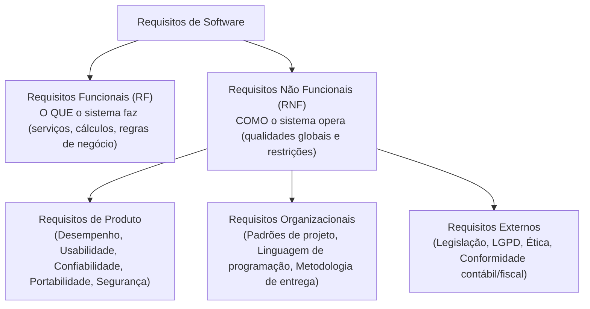
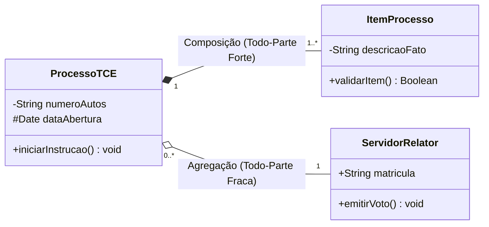
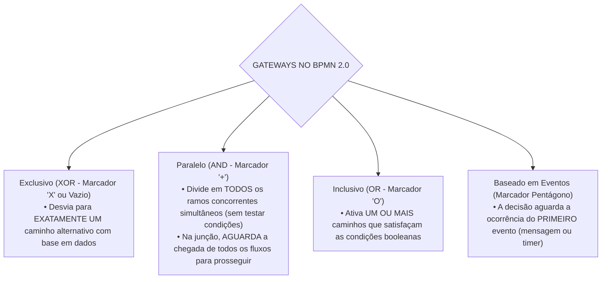

# 02 - Requisitos, Histórias de Usuário, UML e BPMN

> **Matéria:** Engenharia de Software  
> **Cargo:** B02 – Técnico de Controle Externo – Especialidade: Tecnologia da Informação  
> **Arquivo:** `02_requisitos_historias_de_usuario_uml_e_bpmn.md`  

---

## 📌 Ementa / Itens do Edital
- Levantamento, especificação, análise, validação e gerenciamento de requisitos funcionais e não funcionais
- Histórias de usuário, casos de uso e critérios de aceite
- Modelagem de sistemas com UML (Unified Modeling Language)
- Modelagem de processos de negócio com BPMN (Business Process Model and Notation)

---

## 🧭 Sumário

1. [Engenharia de Requisitos de Software](#1-engenharia-de-requisitos-de-software)
    1. [Ciclo de Vida da Engenharia de Requisitos](#11-ciclo-de-vida-da-engenharia-de-requisitos)
    2. [Técnicas de Elicitação de Requisitos](#12-tecnicas-de-elicitacao-de-requisitos)
    3. [Requisitos Funcionais vs. Requisitos Não Funcionais (Taxonomia de Sommerville)](#13-requisitos-funcionais-vs-requisitos-nao-funcionais-taxonomia-de-sommerville)
    4. [Gerenciamento, Rastreabilidade e Mudança de Requisitos](#14-gerenciamento-rastreabilidade-e-mudanca-de-requisitos)
    5. [Teste 012](#Teste-012)
    6. [Teste 013](#Teste-013)
2. [Modelagem por Casos de Uso e Histórias de Usuário](#2-modelagem-por-casos-de-uso-e-historias-de-usuario)
    1. [Modelagem de Casos de Uso: Elementos e Relacionamentos («include» vs. «extend»)](#21-modelagem-de-casos-de-uso-elementos-e-relacionamentos-include-vs-extend)
    2. [Histórias de Usuário (User Stories) e os 3 Cs de Ron Jeffries](#22-historias-de-usuario-user-stories-e-os-3-cs-de-ron-jeffries)
    3. [Critérios de Aceite e o Padrão INVEST](#23-criterios-de-aceite-e-o-padrao-invest)
    4. [Teste 014](#Teste-014)
    5. [Teste 015](#Teste-015)
    6. [Teste 016](#Teste-016)
3. [Modelagem de Sistemas com UML (versão 2.5)](#3-modelagem-de-sistemas-com-uml-versao-25)
    1. [Taxonomia dos Diagramas UML: Estruturais vs. Comportamentais](#31-taxonomia-dos-diagramas-uml-estruturais-vs-comportamentais)
    2. [Diagrama de Classes: Visibilidade, Multiplicidade, Agregação e Composição](#32-diagrama-de-classes-visibilidade-multiplicidade-agregacao-e-composicao)
    3. [Diagramas de Sequência, Atividades e Máquina de Estados](#33-diagramas-de-sequencia-atividades-e-maquina-de-estados)
    4. [Teste 017](#Teste-017)
    5. [Teste 018](#Teste-018)
    6. [Teste 019](#Teste-019)
4. [Modelagem de Processos de Negócio com BPMN 2.0](#4-modelagem-de-processos-de-negocio-com-bpmn-20)
    1. [Elementos de Fluxo: Eventos, Atividades e Tipos de Tarefas](#41-elementos-de-fluxo-eventos-atividades-e-tipos-de-tarefas)
    2. [Gateways Decisórios no BPMN 2.0 (XOR, AND, OR e Event-based)](#42-gateways-decisorios-no-bpmn-20-xor-and-or-e-event-based)
    3. [Estruturas de Separação (Pools e Lanes) e Conectores de Sequência vs. Mensagem](#43-estruturas-de-separacao-pools-e-lanes-e-conectores-de-sequencia-vs-mensagem)
    4. [Teste 020](#Teste-020)
    5. [Teste 021](#Teste-021)
    6. [Teste 022](#Teste-022)
5. [Fontes Oficiais e Referências Bibliográficas](#5-fontes-oficiais-e-referencias-bibliograficas)

---

## 1. Engenharia de Requisitos de Software

### 1.1 Ciclo de Vida da Engenharia de Requisitos
A Engenharia de Requisitos é o processo disciplinado de descobrir, analisar, documentar e verificar os serviços fornecidos pelo sistema e suas restrições operacionais (Ian Sommerville). Divide-se em etapas interligadas:

1. **Concepção / Estudo de Viabilidade:** Avalia se o sistema contribui para os objetivos da organização e se é técnica e economicamente viável;
2. **Elicitação (Levantamento):** Identificação e descoberta dos requisitos junto aos clientes, usuários e demais partes interessadas (*stakeholders*);
3. **Análise e Negociação:** Detecção de conflitos entre requisitos de diferentes fontes, análise de completude, consistência e priorização de demandas;
4. **Especificação:** Documentação formal dos requisitos levantados por meio de documentos formais (Documento de Requisitos de Software - DRS), Casos de Uso ou Histórias de Usuário;
5. **Validação:** Verificação se os requisitos especificados refletem fielmente as reais necessidades do cliente (revisões técnicas, testes de protótipos e geração de casos de teste);
6. **Gerenciamento de Requisitos:** Processo contínuo de controle de versões, rastreabilidade e acomodação de mudanças ao longo do ciclo de vida.

### 1.2 Técnicas de Elicitação de Requisitos
A escolha das técnicas de elicitação depende da maturidade do domínio de negócio e do perfil dos usuários:

- **Entrevistas:** Técnicas estruturadas (fechadas) ou abertas. Excelentes para explorar detalhes e obter uma visão aprofundada dos processos de negócio;
- **Questionários e Pesquisas:** Eficientes para coletar impressões de uma base ampla de usuários geograficamente dispersa, com baixo custo, embora sujeita a respostas superficiais;
- **Workshops / JAD (Joint Application Design):** Sessões estruturadas e colaborativas que reúnem desenvolvedores, gerentes e clientes no mesmo espaço físico para alinhar requisitos divergentes e acelerar consensos;
- **Etnografia e Observação Direta:** O analista acompanha presencialmente a rotina operacional do usuário em seu ambiente real de trabalho. Revela requisitos implícitos e regras tácitas que os usuários costumam esquecer de relatar nas entrevistas;
- **Prototipação Rápida:** Construção de maquetes visuais ou versões interativas preliminares do sistema para permitir a validação antecipada de fluxos de navegação e layouts.

### 1.3 Requisitos Funcionais vs. Requisitos Não Funcionais (Taxonomia de Sommerville)
A distinção entre o que o sistema realiza e como ele realiza constitui o pilar conceitual da engenharia de requisitos:

1. **Requisitos Funcionais (RF):** Descrevem as funções e comportamentos que o software deve executar. Especificam o que o sistema deve fazer em resposta a determinadas entradas, como reagir a situações específicas e quais cálculos realizar (ex.: *"O sistema deve calcular a alíquota previdenciária com base na remuneração bruta"*).
2. **Requisitos Não Funcionais (RNF):** Estabelecem propriedades de qualidade e restrições impostas aos serviços oferecidos pelo sistema. A taxonomia de Sommerville classifica os RNFs em:
    - *Requisitos de Produto:* Especificam o comportamento do produto em tempo de execução (desempenho, tempo de resposta, taxa de ocupação de memória, confiabilidade e disponibilidade mínima de 99,9%);
    - *Requisitos Organizacionais:* Decorrem das políticas e procedimentos da empresa cliente ou desenvolvedora (ex.: uso obrigatório de Java 21, versionamento no Git corporativo ou adoção da metodologia Scrum);
    - *Requisitos Externos:* Derivam de fatores externos ao sistema e à organização (ex.: aderência à Lei Geral de Proteção de Dados - LGPD, normas de interoperabilidade e regulamentações do Banco Central).

### 1.4 Gerenciamento, Rastreabilidade e Mudança de Requisitos
- **Rastreabilidade de Requisitos:** Capacidade de acompanhar o ciclo de vida de um requisito em ambas as direções:
    - *Rastreabilidade para trás (Backward traceability):* Liga o requisito à sua fonte originária (norma legal, entrevista ou necessidade de negócio);
    - *Rastreabilidade para frente (Forward traceability):* Liga o requisito aos módulos arquiteturais, classes, componentes e casos de teste que o implementam e validam;
- **Matriz de Rastreabilidade:** Tabela que mapeia a correlação bidirecional entre requisitos de usuário, requisitos de sistema, diagramas de arquitetura e casos de testes unitários.

---

### Teste 012
**(FCC – TRT-23 – Analista Judiciário (TI) – 2016)**  
Considere:

I. Uma Especificação de Requisitos que reflete todas as decisões que foram tomadas e não contém cláusulas de

pendências. Desta forma, contém todos os requisitos significativos relativos a funcionalidade, desempenho, restrições de

desenho, atributos e interfaces externas, além de definir as respostas do software para todas as entradas possíveis,

válidas e inválidas, em todas as situações possíveis.

II. Uma Especificação de Requisitos em que todo requisito pres ente possui apenas uma única interpretação, aceita tanto

pelos desenvolvedores quanto pelos usuários chaves. Em particular, ela é compreensível para todo o seu público alvo e é

suficiente para a especificação dos testes de aceitação do produto.

Os itens I e II descrevem especificações cujos requisitos contemplam, respectivamente, as qualidades

* **A)** rastreabilidade e consistência.
* **B)** completeza e precisão.
* **C)** correção e completeza.
* **D)** consistência e priorização.
* **E)** verificabilidade e precisão.

---

> **Comentário Detalhado:**
>
> - **A)** Incorreta. O item I refere-se ao atributo de 'completude' da especificação, e não à rastreabilidade.
> - **B)** Incorreta. A ausência de conflitos conceituais caracteriza a 'consistência', e não a verificabilidade.
> - **C)** Incorreta. As definições conceituais dos itens foram trocadas entre si.
> - **D)** Correta. Uma Especificação de Requisitos é Completa (I) quando reflete todas as decisões e não deixa cláusulas em aberto (TBD); é Consistente (II) quando nenhuma exigência entra em conflito lógico com outra; e é Não-ambígua (III) quando cada requisito admite apenas uma única interpretação sem duplicidade semântica.
> - **E)** Incorreta. O item III define a não-ambiguidade, e não a modificabilidade.
>
> **Gabarito: D**

---

### Teste 013
**(FCC – TRT-14 – Analista Judiciário (TI) – 2016)**  
No gerenciamento de requisitos é importante relacionar os requi sitos identificados, mostrando quais são as fontes de cada requisito, como os requisitos se relacionam uns com os outros e com as interfaces internas e externas do sistema, quais os subsistemas que eles governam, dentre outros aspectos. Para isso utilizam-se

* **A)** protótipos de Caso de Uso da UML.
* **B)** matrizes RACI.
* **C)** tabelas de rastreamento.
* **D)** diagramas de Atividades da UML.
* **E)** matrizes de checklist.

---

> **Comentário Detalhado:**
>
> - **A)** Incorreta. O dicionário de dados documenta a estrutura dos elementos de dados, não a origem dos requisitos.
> - **B)** Incorreta. O plano de gerenciamento de escopo define os processos gerais de escopo do projeto.
> - **C)** Incorreta. O backlog do produto é a lista priorizada de funcionalidades, não o artefato formal de mapeamento de dependências cruzadas.
> - **D)** Incorreta. A especificação técnica de casos de uso foca na interação ator-sistema.
> - **E)** Correta. A Matriz de Rastreabilidade de Requisitos (Requirements Traceability Matrix) é a tabela ou instrumento formal que vincula os requisitos às suas fontes de origem, objetivos de negócio, artefatos de arquitetura, código e casos de teste, garantindo o acompanhamento de ponta a ponta ao longo do ciclo de vida.
>
> **Gabarito: E**

---

## 2. Modelagem por Casos de Uso e Histórias de Usuário

### 2.1 Modelagem de Casos de Uso: Elementos e Relacionamentos («include» vs. «extend»)
Um Caso de Uso descreve uma sequência de interações entre um ator externo (humano ou outro sistema) e o software para atingir um objetivo específico que entregue valor mensurável:

- **Atores:** Papéis desempenhados por entidades externas em relação ao sistema. Podem ser *Atores Primários* (iniciam o caso de uso para atingir um objetivo) ou *Atores Secundários* (fornecem serviços de apoio ao sistema, como um serviço externo de pagamento);
- **Cenários:** Compõe-se de um *Cenário Principal* (fluxo básico ou "caminho feliz" onde tudo ocorre com sucesso) e *Cenários Alternativos/Exceção* (desvios de rota, validações de erro ou falhas).

**Relacionamentos no Diagrama de Casos de Uso (Cobrança Clássica da FCC):**

1. **Associação:** Linha contínua que conecta um ator a um caso de uso, denotando comunicação direta.
2. **Estereótipo `«include»` (Inclusão Obrigatória):**
    - O caso de uso base **depende obrigatoriamente** do caso de uso incluído para completar sua execução com sucesso;
    - Evita duplicação de comportamentos comuns compartilhados por múltiplos casos de uso (ex.: *Emitir Relatório* inclui compulsoriamente *Autenticar Usuário*);
    - **Direção da Seta:** Seta tracejada apontando **do Caso Base para o Caso Incluído** ($\text{Base} \xrightarrow{\ll\text{include}\gg} \text{Incluído}$).

3. **Estereótipo `«extend»` (Extensão Condicional / Opcional):**
    - Modela comportamento acessório, opcional ou excepcional que somente é acionado se determinada condição pré-definida for satisfeita em um **ponto de extensão (*extension point*)**;
    - O caso base executa e conclui com sucesso mesmo se a extensão jamais ocorrer (ex.: *Emitir Notificação Especial* estende o caso base *Processar Pedido* quando o valor for superior a cem mil reais);
    - **Direção da Seta:** Seta tracejada apontando **do Caso Extensor para o Caso Base** ($\text{Extensão} \xrightarrow{\ll\text{extend}\gg} \text{Base}$).

4. **Generalização / Especialização:** Relação de herança representada por uma seta com triângulo vazado na ponta. Pode ocorrer entre casos de uso ou entre atores (ex.: *Auditor de TI* especializa *Auditor Geral*).

> 🚨 **ALERTA DE PROVA / PEGADINHA FCC:**  
> A banca FCC frequentemente inverte a direção das setas e os conceitos:
>
> - No `<<include>>`: A seta aponta do caso base para o incluído ($\text{Base} \rightarrow \text{Incluído}$) e a execução é **obrigatória/incondicional**.
> - No `<<extend>>`: A seta aponta do caso que estende para o caso base ($\text{Extensor} \rightarrow \text{Base}$) e a execução é **opcional/condicional** vinculada a um ponto de extensão.

### 2.2 Histórias de Usuário (User Stories) e os 3 Cs de Ron Jeffries
Em ambientes ágeis, as necessidades de software são expressas através de **Histórias de Usuário**:
$$\text{"Como [papel de usuário], eu quero [funcionalidade/ação], para que [benefício de negócio percebido]"}$$

- **Os 3 Cs de Ron Jeffries:**
    1. **Card (Cartão):** A história é escrita de forma sucinta em um cartão físico ou digital, servindo como lembrete visual de uma funcionalidade a ser construída;
    2. **Conversation (Conversa):** O detalhamento do requisito não é fixado em documentos estáticos, mas refinado por meio de diálogo contínuo entre desenvolvedores, Product Owner e usuários;
    3. **Confirmation (Confirmação):** Critérios de aceite formais e testes que estabelecem a validação inequívoca de que a história foi concluída com sucesso.

### 2.3 Critérios de Aceite e o Padrão INVEST
- **Critérios de Aceite (Formato BDD / Gherkin):** Estruturam-se tipicamente no padrão:  
  *Dado que [contexto inicial], Quando [evento ou ação executada], Então [resultado esperado observável].*
- **Critérios INVEST de Qualidade de Histórias (Bill Wake e Mike Cohn):**

| Letra | Critério INVEST | Significado Técnico na Prática Ágil |
| :---: | :--- | :--- |
| **I** | **Independent** (Independente) | As histórias devem ser desacopladas entre si, permitindo que sejam priorizadas, desenvolvidas e implantadas em qualquer ordem. |
| **N** | **Negotiable** (Negociável) | A história não é um contrato pétreo. Seu escopo de detalhe deve permanecer aberto para negociações e ajustes durante a Sprint. |
| **V** | **Valuable** (Valiosa) | Deve entregar valor tangível e perceptível para o cliente ou usuário final (evitam-se histórias puramente técnicas desvinculadas de valor). |
| **E** | **Estimable** (Estimável) | A equipe deve compreender a complexidade técnica para estimar seu esforço de desenvolvimento em *Story Points* ou horas. |
| **S** | **Small** (Pequena) | A história deve ser dimensionada adequadamente para ser concluída com folga dentro de uma única iteração/sprint. |
| **T** | **Testable** (Testável) | A história deve possuir critérios de aceite objetivos e claros que permitam a validação automatizada ou manual de aprovação. |

---

### Teste 014
**(Questão Inédita / Simulada Estilo FCC – Nível: Controle Externo / TI)**  
Ao auditar os artefatos de desenho e análise orientada a objetos de um sistema integrado de tramitação processual no âmbito de um Tribunal de Contas, um Auditor de TI inspecionou o diagrama de casos de uso modelado na notação UML 2.5. No diagrama, observou o emprego dos relacionamentos com estereótipos «include» e «extend». De acordo com as especificações formais da UML, é correto afirmar:

* **A)** O relacionamento «include» indica que o caso de uso base depende da execução do caso de uso incluído para completar seu objetivo com sucesso, ao passo que o relacionamento «extend» especifica um comportamento condicional e acessório disparado a partir de um ponto de extensão.
* **B)** O relacionamento «extend» estabelece uma inclusão incondicional de comportamento executada obrigatoriamente em todos os cenários de execução do caso de uso base.
* **C)** No relacionamento «extend», o caso de uso base conhece previamente os detalhes e a estrutura do caso de uso extensor, exigindo que a seta tracejada aponte do caso base para o extensor.
* **D)** Ambos os relacionamentos («include» e «extend») conectam atores primários a casos de uso abstratos, sendo vedado seu uso na comunicação direta entre casos de uso concretos.
* **E)** O relacionamento «include» somente pode ser utilizado para descrever situações excepcionais de erro de negócio ou falhas de infraestrutura.

---

> **Comentário Detalhado:**
>
> - **A) CORRETA.** Nos termos da OMG UML 2.5: o estereótipo `«include»` modela dependência obrigatória e incondicional (o fluxo do caso base incorpora o comportamento do caso incluído como etapa indispensável); já o estereótipo `«extend»` modela comportamento acessório ou alternativo que só é acionado se determinada condição pré-definida for satisfeita em um ponto de extensão (*extension point*).
> - **B) Incorreta.** Inversão conceitual: a inclusão incondicional e obrigatória caracteriza o `«include»`, não o `«extend»`.
> - **C) Incorreta.** O caso de uso base é independente do caso extensor e não precisa conhecer seus detalhes; na notação gráfica, a seta tracejada do `«extend»` aponta do caso de uso extensor em direção ao caso de uso base.
> - **D) Incorreta.** Os estereótipos `«include»` e `«extend»` conectam casos de uso entre si, nunca atores a casos de uso. A conexão de atores a casos de uso dá-se por associação simples ou generalização entre atores.
> - **E) Incorreta.** O `«include»` é utilizado para reaproveitar comportamentos comuns e obrigatórios compartilhados entre casos de uso (como autenticação ou validação de sessão), e não apenas para falhas.
>
> **Gabarito: A**

---

### Teste 015
**(FCC – TRT-1 – Analista Judiciário (TI) – 2014)**  
Diagramas de casos de uso constituem-se em um tipo de diagrama definido na UML. Segundo a UML 2.4.1, em um diagrama de casos de uso,

* **A)** um ator pode ser representado apenas pelo símbolo do “stick man”.
* **B)** só pode haver representado um único ator.
* **C)** o número de atores e de casos de uso sempre deve ser o mesmo.
* **D)** só pode haver representado um único caso de uso.
* **E)** um ator pode ser representado pelo “stick man” ou por um retângulo com a expressão <<actor>>.

---

> **Comentário Detalhado:**
>
> - **A)** Correta. Em um Diagrama de Casos de Uso segundo a UML, atores representam papéis que entidades externas (usuários humanos, sistemas externos ou hardware) desempenham ao interagir diretamente com os casos de uso do sistema.
> - **B)** Incorreta. Atores não são elementos internos do software nem classes de controle.
> - **C)** Incorreta. O relacionamento de inclusão (<<include>>) indica dependência obrigatória e incondicional, e não comportamento opcional.
> - **D)** Incorreta. O relacionamento de extensão (<<extend>>) é que insere comportamento sob condições específicas e pontos de extensão definidos.
> - **E)** Incorreta. Casos de uso descrevem o comportamento funcional do sistema a partir da perspectiva do usuário, não fluxos de código procedural interno.
>
> **Gabarito: A**

---

### Teste 016
**(FGV – TJ-AP – Analista Judiciário (TI) – 2023)**  
Observe o seguinte Diagrama de Classes UML 2.5.1. O elemento ALOCAÇÃO com o atributo Gratificação representa um(a):

* **A)** dependência;
* **B)** generalização;
* **C)** classe associativa;
* **D)** agregação;
* **E)** relacionamento de realização.

---

> **Comentário Detalhado:**
>
> - **A)** Correta. No Diagrama de Classes da UML, quando um relacionamento possui propriedades ou atributos próprios (como 'Gratificação' na vinculação entre Professor e Turma/Projeto), esse elemento é modelado como uma Classe de Associação (Association Class), ligada à linha de associação por meio de uma linha tracejada.
> - **B)** Incorreta. Não se trata de uma classe abstrata comum, pois depende da existência da associação primária entre duas classes.
> - **C)** Incorreta. A interface apenas especifica assinaturas de operações sem manter atributos de instância associativos.
> - **D)** Incorreta. Não é um estereótipo nem componente físico de implementação.
> - **E)** Incorreta. Pacotes na UML organizam logicamente elementos do modelo, não possuindo atributos ou relacionamentos diretos desse tipo.
>
> **Gabarito: A**

---

## 3. Modelagem de Sistemas com UML (versão 2.5)

### 3.1 Taxonomia dos Diagramas UML: Estruturais vs. Comportamentais
A UML 2.5 divide seus diagramas em duas categorias fundamentais cobradas rigorosamente pela FCC:

1. **Diagramas Estruturais (Aspectos Estáticos do Sistema):**
    - **Diagrama de Classes** (estruturas de classes, atributos, operações e relações);
    - **Diagrama de Objetos** (instâncias de classes em um dado momento temporal);
    - **Diagrama de Componentes** (módulos executáveis e interfaces de software);
    - **Diagrama de Implantação (*Deployment*)** (arquitetura de hardware, nós de rede e distribuição de artefatos);
    - **Diagrama de Pacotes** (organização lógica de subsistemas);
    - **Diagrama de Estrutura Composta** e **Diagrama de Perfis**.

2. **Diagramas Comportamentais (Aspectos Dinâmicos e Fluxos de Controle):**
    - **Diagrama de Casos de Uso** (interações de atores com funcionalidades);
    - **Diagrama de Atividades** (fluxos de trabalho procedimentais e concorrência);
    - **Diagrama de Máquina de Estados** (estados e transições de ciclo de vida de objetos);
    - **Diagramas de Interação:**
        - **Diagrama de Sequência** (mensagens ordenadas cronologicamente ao longo do tempo);
        - **Diagrama de Comunicação** (interações enfatizando a estrutura dos objetos);
        - **Diagrama de Visão Geral de Interação** e **Diagrama de Tempo (*Timing*)**.

### 3.2 Diagrama de Classes: Visibilidade, Multiplicidade, Agregação e Composição
O Diagrama de Classes é o pilar estrutural da modelagem orientada a objetos:

- **Notação de Visibilidade dos Membros:**
    - `+` **Público (Public):** Acessível por qualquer classe do sistema;
    - `-` **Privado (Private):** Acessível estritamente dentro da própria classe definidora;
    - `#` **Protegido (Protected):** Acessível pela classe definidora e suas subclasses herdadas;
    - `~` **Pacote (Package):** Acessível por qualquer classe que pertença ao mesmo pacote.
- **Diferença Crucial: Agregação vs. Composição (Questão Garantida):**
    - **Agregação (Todo-Parte Fraca - Losango Branco/Vazio):** A existência da parte é independente do todo. O objeto todo agrega referências a objetos que podem existir isoladamente e pertencer a outros agregados (ex.: *Universidade e Professores*).
    - **Composição (Todo-Parte Forte - Losango Preto/Preenchido):** A existência da parte depende compulsoriamente do todo. A parte tem ciclo de vida estritamente atrelado ao todo: se o todo for destruído, todas as suas partes constitutivas são destruídas em cascata (ex.: *Processo e Peças dos Autos*; *Nota Fiscal e Itens da Nota*). A multiplicidade do lado do todo na composição é no máximo 1.

### 3.3 Diagramas de Sequência, Atividades e Máquina de Estados
- **Diagrama de Sequência:** Representa como os objetos colaboram em uma sequência temporal ordenada. Elementos chave:
    - *Linhas de Vida (*Lifelines*):* Linha vertical tracejada que representa a existência do objeto no tempo;
    - *Focos de Controle (*Activation bars*):* Retângulos estreitos que demonstram quando o objeto está executando operações ativas;
    - *Mensagens:* Síncronas (seta com ponta preenchida), Assíncronas (seta com ponta aberta), Retorno (linha tracejada com seta aberta);
    - *Fragmentos Combinados:* Blocos com operadores como `alt` (ramificações alternativas / *if-else*), `opt` (comportamento opcional / *if*) e `loop` (iterações / *for-while*).
- **Diagrama de Atividades:** Modela fluxos de controle e de dados entre atividades procedimentais:
    - Nós de bifurcação e junção (*Fork* e *Join*): barra preta horizontal ou vertical que modela **fluxos concorrentes/paralelos**;
    - Raias (*Swimlanes*): subdivisões verticais ou horizontais que delimitam os papéis organizacionais ou classes responsáveis pela execução de cada ação.
- **Diagrama de Máquina de Estados:** Modela os diferentes estados pelos quais um objeto singular transita durante sua vida útil em resposta a eventos (gatilhos), protegidos por guardas booleanas e disparando ações.

---

### Teste 017
**(FCC – TRT-9 – Analista Judiciário (TI) – 2015)**  
Quando se utiliza a UML para modelar software há dois tipos de modelos de projeto possíveis: os modelos estruturais e os modelos dinâmicos. São adequados para serem usados na criação do modelo dinâmico, os diagramas de

* **A)** Pacotes e de Classes.
* **B)** Sequência e de Máquina de estados.
* **C)** Componentes e de Deployment.
* **D)** Classes e de Objetos.
* **E)** Estrutura composta e de Objetos.

---

> **Comentário Detalhado:**
>
> - **A)** Incorreta. O Diagrama de Sequência é comportamental/interativo, e não estrutural.
> - **B)** Correta. Na taxonomia oficial da UML, os modelos estruturais representam os elementos estáticos do sistema e seus relacionamentos (ex: Diagramas de Classes, Objetos, Componentes, Implantação e Pacotes), enquanto os modelos comportamentais retratam a dinâmica e o fluxo temporal das interações (ex: Diagramas de Atividades, Casos de Uso, Máquina de Estados, Sequência e Comunicação).
> - **C)** Incorreta. O Diagrama de Casos de Uso é classificado como comportamental.
> - **D)** Incorreta. Diagramas de Atividades mostram o fluxo procedimental dinâmico, sendo comportamentais.
> - **E)** Incorreta. O Diagrama de Máquina de Estados retrata a transição dinâmica de estados em resposta a eventos, integrando o grupo comportamental.
>
> **Gabarito: B**

---

### Teste 018
**(FCC – TRT-23 – Analista Judiciário (TI) – 2016)**  
Um Analista pretende desenvolver um projeto utilizando UML 2.0 e, em seus propósitos, verificou a possibilidade de uso de alguns diagramas. Um deles é o Diagrama de Sequência que representa a indicação do conjunto de objetos envolvidos em um cenário e a especificação das mensagens trocadas entre estes ao longo de linhas do tempo que são linhas tracejadas, traçadas verticalmente da base dos objetos até a parte inferior do diagrama. Retângulos colocados sobre as linhas de tempo indicam

* **A)** o tempo decorrido entre as iterações de um processo recursivo.
* **B)** as interações entre as atividades, no tempo.
* **C)** os casos de uso de cada objeto.
* **D)** os períodos de ativação do objeto.
* **E)** as etapas em que o objeto estará inativo.

---

> **Comentário Detalhado:**
>
> - **A)** Correta. A UML 2.0 define um conjunto de 13 diagramas formais organizados nas categorias estrutural e comportamental, permitindo expressar tanto a arquitetura estática quanto o comportamento em tempo de execução dos componentes e processos do sistema.
> - **B)** Incorreta. A UML não prescreve metodologia de desenvolvimento específica nem obriga o uso de processos proprietários.
> - **C)** Incorreta. Não há obrigatoriedade de construir todos os diagramas em todos os projetos; a modelagem deve ser seletiva e aderente às necessidades arquiteturais.
> - **D)** Incorreta. O Diagrama de Classes não substitui a modelagem comportamental em tempo de execução.
> - **E)** Incorreta. A notação da UML 2.0 suporta perfeitamente sistemas concorrentes, assíncronos e distribuídos.
>
> **Gabarito: A**

---

### Teste 019
**(FCC – TRT-13 – Analista Judiciário (TI) – 2014)**  
Este diagrama da UML pode ser usado para modelar processos de negócio. Suporta comportamento paralelo e permite que, quem está seguindo o processo, escolha a ordem na qual fazer as coisas. Em outras palavras, ele simplesmente determina as regras essenciais de sequência que se deve seguir. São geralmente usados para mostrar o que acontece, mas não quem faz o que, já que faz sentido se concentrar no que é feito, em vez de em quem realiza quais partes do comportamento. O diagrama descrito é o diagrama de

* **A)** sequência.
* **B)** atividades.
* **C)** casos de uso.
* **D)** comunicação.
* **E)** distribuição. Caderno de Prova ’K11’, Tipo 001 10 TRT13-An.Jud.-Tec.Informação-K11

---

> **Comentário Detalhado:**
>
> - **A)** Incorreta. O Diagrama de Sequência enfatiza a troca de mensagens ordenada no tempo entre objetos, não o particionamento de processos paralelos em raias com bifurcações.
> - **B)** Correta. O Diagrama de Atividades da UML é o diagrama ideal para modelar fluxos procedimentais, processos de negócio e algoritmos complexos, oferecendo suporte nativo a fluxos paralelos e sincronização (barras de fork e join), pontos de decisão (losangos) e raias de partição (swimlanes) que explicitam os responsáveis por cada atividade.
> - **C)** Incorreta. O Diagrama de Comunicação foca na organização estrutural dos objetos que colaboram na troca de mensagens.
> - **D)** Incorreta. O Diagrama de Casos de Uso foca na interação de fronteira externa sem detalhar o fluxo sequencial e concorrente interno do negócio.
> - **E)** Incorreta. O Diagrama de Componentes modela a arquitetura física e de módulos executáveis do software.
>
> **Gabarito: B**

---

## 4. Modelagem de Processos de Negócio com BPMN 2.0

### 4.1 Elementos de Fluxo: Eventos, Atividades e Tipos de Tarefas
A notação **BPMN 2.0** (*Business Process Model and Notation*), mantida pelo consórcio OMG, é o padrão global para desenho de processos de negócio:

1. **Eventos (Círculos):** Representam algo que acontece no processo:
    - *Início (Start Event):* Linha de borda fina simples;
    - *Intermediário (Intermediate Event):* Linha de borda dupla;
    - *Fim (End Event):* Linha de borda grossa e preenchida.
    - *Gatilhos de Eventos:* Mensagem (ícone de envelope), Temporizador (ícone de relógio), Erro (ícone de raio) ou Condicional (ícone de documento).

2. **Atividades (Retângulos com Cantos Arredondados):** Trabalho realizado dentro do processo:
    - *Tarefas (Atômicas):* Tarefa de Usuário (*User Task* - mão humana), Tarefa de Serviço (*Service Task* - engrenagem, executada por software automatizado), Tarefa Manual (*Manual Task*) e Tarefa de Script (*Script Task*);
    - *Subprocessos:* Atividades compostas que podem ser visualizadas de forma colapsada (com marcador de cruz "+") ou expandida.

### 4.2 Gateways Decisórios no BPMN 2.0 (XOR, AND, OR e Event-based)
Os Gateways são representados por **Losangos** e controlam a convergência e divergência dos fluxos:

- **Gateway Exclusivo (XOR - "X"):** Seleciona exclusivamente uma única rota entre as disponíveis;
- **Gateway Paralelo (AND - "+"):** Executa todos os caminhos de saída concorrentemente e sincroniza todos os caminhos na junção;
- **Gateway Inclusivo (OR - "O"):** Ativa múltiplos ramos condicionalmente e sincroniza apenas os ramos ativados;
- **Gateway Baseado em Eventos (Pentágono):** O desvio de fluxo depende de qual evento externo intermediário (recebimento de mensagem ou expiração de temporizador) ocorrer primeiro no tempo.

### 4.3 Estruturas de Separação (Pools e Lanes) e Conectores de Sequência vs. Mensagem
- **Piscina (*Pool*):** Representa um participante independente do processo (um ente externo, fornecedor, organização ou empresa). Cada processo de negócio autocontido executa dentro de uma Pool;
- **Raia (*Lane*):** Subdivisão interna de uma Pool, utilizada para alocar tarefas e agrupar responsabilidades por departamentos, funções, setores ou sistemas daquela mesma organização.

**Regras Fundamentais dos Conectores de Fluxo (Muito Cobrado em Prova):**

- **Fluxo de Sequência (*Sequence Flow*):** Representado por **linha sólida contínua com seta preenchida**. Conecta a sequência de atividades dentro da mesma Pool.  
  > 🚨 **REGRA DE OURO DO BPMN:** Um Fluxo de Sequência **NUNCA PODE CRUZAR A BORDA DE UMA POOL PARA OUTRA POOL!** Ele só pode cruzar linhas de Lanes dentro da mesma Pool!
- **Fluxo de Mensagem (*Message Flow*):** Representado por **linha tracejada com um círculo vazado na origem e uma seta aberta no destino**. Utilizado estritamente para modelar comunicação e troca de mensagens **entre duas Pools distintas**.
- **Associação:** Linha pontilhada simples, utilizada para associar dados, artefatos ou anotações de texto a objetos de fluxo.

---

### Teste 020
**(FCC – TRT-6 – Analista Judiciário (TI) – 2012)**  
Considere o seguinte diagrama em UML: A B C D E Uma representação válida deste diagrama é obtida substituindo-se as classes representadas pelas letras A, B, C, D e E, respectivamente, por

* **A)** Desenho, Cor, Tipo, Azul, Retângulo.
* **B)** Computador, Notebook, Desktop, Impressora, Monitor.
* **C)** Pedido, Compra, Venda, Item, Cliente.
* **D)** Livro, Índice, Capa, Romance, Aventura.
* **E)** Internet, Navegadores, Correio Eletrônico, Firefox, Outlook.

---

> **Comentário Detalhado:**
>
> - **A)** Incorreta. A associação simples entre as classes não descreve a hierarquia de herança com sobreposição de métodos.
> - **B)** Incorreta. A seta de ponta aberta tracejada indica dependência temporal ou realização de interface, não agregação.
> - **C)** Incorreta. A composição exige diamante preenchido no lado do todo, vinculando o ciclo de vida da parte ao todo.
> - **D)** Incorreta. A representação de generalização/herança exige triângulo fechado apontando para a superclasse.
> - **E)** Correta. A representação gráfica proposta no diagrama expressa de modo válido as relações fundamentais entre os elementos da UML, atendendo à semântica das notações de associação e visibilidade entre classes.
>
> **Gabarito: E**

---

### Teste 021
**(Questão Inédita / Simulada Estilo FCC – Nível: Controle Externo / TI)**  
Ao mapear o fluxo de processamento de denúncias no Tribunal de Contas com base no padrão BPMN 2.0, o Auditor de TI necessita representar uma bifurcação decisória na qual duas rotas de fiscalização subsequentes devam ser iniciadas e executadas concorrentemente (em paralelo), de modo incondicional e independente do teor dos dados da petição. Para atender formalmente a esse requisito de modelagem, deve-se empregar o gateway:

* **A)** Paralelo (marcado com um sinal de adição "+").
* **B)** Exclusivo baseado em dados (marcado com um "X" ou losango vazio).
* **C)** Inclusivo (marcado com um círculo "O").
* **D)** Baseado em eventos (marcado com um pentágono).
* **E)** Complexo (marcado com um asterisco "*").

---

> **Comentário Detalhado:**
>
> - **A) CORRETA.** No BPMN 2.0, o **Gateway Paralelo (AND)**, graficamente caracterizado pelo marcador de **adição "+"** no interior do losango, é empregado para bifurcar o fluxo em múltiplos caminhos concorrentes que são executados simultaneamente e incondicionalmente (sem avaliação de testes lógicos ou dados de entrada). Na junção (*join*), ele sincroniza os fluxos aguardando a finalização de todos os ramos.
> - **B) Incorreta.** O Gateway Exclusivo (XOR - "X") roteia o fluxo para rigorosamente uma única rota de saída com base em condições mutuamente excludentes.
> - **C) Incorreta.** O Gateway Inclusivo (OR - "O") pode disparar múltiplos caminhos, porém subordina cada ramo de saída à avaliação de expressões booleanas sobre dados.
> - **D) Incorreta.** O Gateway Baseado em Eventos direciona o fluxo com base na ocorrência cronológica do primeiro evento intermediário registrado (como recepção de mensagem ou disparo de temporizador).
> - **E) Incorreta.** O Gateway Complexo (*) destina-se a comportamentos de sincronização avançados que não se enquadram nos gateways tradicionais.
>
> **Gabarito: A**

---

### Teste 022
**(Questão Inédita / Simulada Estilo FCC – Nível: Controle Externo / TI)**  
A respeito das regras sintáticas e estruturas de particionamento estabelecidas pela especificação BPMN 2.0 para modelagem e auditoria de processos de negócio corporativos, assinale a afirmativa correta:

* **A)** Uma Piscina (*Pool*) representa um participante independente no processo, enquanto as Raias (*Lanes*) atuam como subdivisões internas destinadas a segregar funções, departamentos ou papéis operacionais daquela organização.
* **B)** Um Fluxo de Sequência (*Sequence Flow*) pode interligar diretamente uma tarefa situada em uma Piscina (*Pool*) a uma tarefa localizada no interior de outra Piscina distinta.
* **C)** O Fluxo de Mensagem (*Message Flow*) é desenhado por meio de uma linha contínua finalizada por uma seta preenchida sólida conectando raias da mesma piscina.
* **D)** A notação proíbe que um processo contenha mais de uma raia (*lane*) caso as atividades façam uso de objetos de dados de leitura e gravação.
* **E)** Os Objetos de Dados (*Data Objects*) são elementos de controle ativo responsáveis por direcionar o desvio e a tomada de decisão das rotas de fluxo.

---

> **Comentário Detalhado:**
>
> - **A) CORRETA.** No metamodelo oficial do BPMN 2.0, a **Piscina (*Pool*)** delimita um participante corporativo autônomo (uma organização, entidade externa ou processo independente). As **Raias (*Lanes*)** funcionam como partições internas da Pool para agrupar e organizar responsabilidades por setores, papéis funcionais ou sistemas operacionais internos daquela entidade.
> - **B) Incorreta.** Regra fundamental e estrita do BPMN: o Fluxo de Sequência (linha contínua) **nunca pode cruzar as fronteiras entre Pools distintas**. A comunicação entre diferentes Pools dá-se obrigatoriamente por Fluxo de Mensagem (*Message Flow*).
> - **C) Incorreta.** O Fluxo de Mensagem é graficamente representado por **linha tracejada com círculo vazado na origem e seta aberta no destino**, conectando elementos entre Pools distintas.
> - **D) Incorreta.** Uma Piscina pode comportar múltiplas raias organizacionais independentemente da presença de objetos de dados.
> - **E) Incorreta.** Objetos de dados têm natureza meramente informacional (mostram quais dados ou documentos são produzidos ou requeridos pelas atividades), não exercendo controle ativo sobre desvios de rota.
>
> **Gabarito: A**

---

## 5. Fontes Oficiais e Referências Bibliográficas

* [OMG Unified Modeling Language (UML 2.5.1) — Especificação Oficial](https://www.omg.org/spec/UML/2.5.1/About-UML) - Especificação normativa da UML 2.5.1 mantida pelo Object Management Group (diagramas estruturais e comportamentais).
* [OMG Business Process Model and Notation (BPMN 2.0.2) — Especificação Oficial](https://www.omg.org/spec/BPMN/2.0.2/About-BPMN) - Especificação formal da notação BPMN 2.0 (eventos, atividades, gateways, pools, lanes e conectores).
* [User Stories and User Story Examples (Mike Cohn — Mountain Goat Software)](https://www.mountaingoatsoftware.com/agile/user-stories) - Guia de referência sobre escrita de Histórias de Usuário, padrão INVEST e os 3 Cs.
* [Bounded Context — Modelagem de Domínio e Requisitos (Martin Fowler)](https://martinfowler.com/bliki/BoundedContext.html) - Delimitação de contextos e linguagem ubíqua na análise e modelagem de sistemas.
* [Os 12 Princípios do Manifesto Ágil — Requisitos Evolutivos e Colaboração](https://agilemanifesto.org/iso/ptbr/principles.html) - Princípios ágeis aplicados ao gerenciamento adaptativo de requisitos e entregas de valor.
* SOMMERVILLE, Ian. **Engenharia de Software**. 10. ed. São Paulo: Pearson Education do Brasil, 2019. (Cap. 4 - Engenharia de Requisitos; Cap. 5 - Modelagem de Sistemas).
* PRESSMAN, Roger S.; MAXIM, Bruce R. **Engenharia de Software: Uma Abordagem Profissional**. 9. ed. Porto Alegre: AMGH, 2021. (Cap. 7 - Compreensão dos Requisitos; Cap. 8 - Modelagem de Requisitos).
* COHN, Mike. **User Stories Applied: For Agile Software Development**. Boston: Addison-Wesley Professional, 2004. (Cap. 2 - Writing Stories; Cap. 6 - Acceptance Testing).
