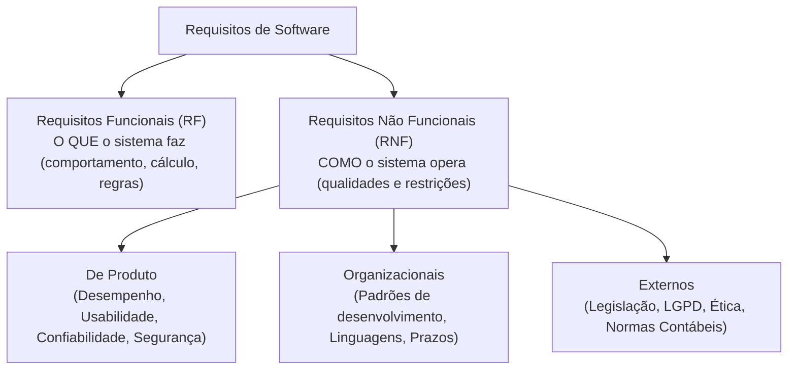
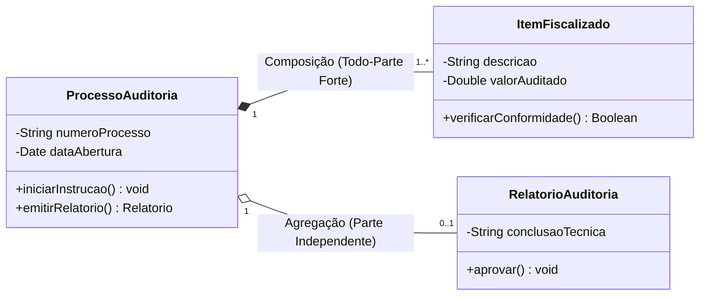
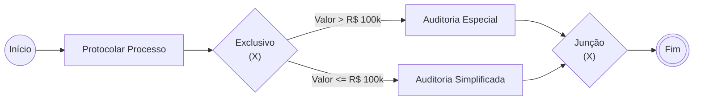

# 02 - Requisitos, Histórias de Usuário, UML e BPMN

> **Matéria:** Engenharia de Software  
> **Cargo:** B02 – Técnico de Controle Externo – Especialidade: Tecnologia da Informação  
> **Arquivo:** `02_requisitos_historias_de_usuario_uml_e_bpmn.md`  

---

## 📌 Ementa / Itens do Edital
- Levantamento, especificação, análise, validação e gerenciamento de requisitos funcionais e não funcionais
- Histórias de usuário, casos de uso e critérios de aceite
- Modelagem de sistemas com UML (Unified Modeling Language)
- Modelagem de processos de negócio com BPMN (Business Process Model and Notation)

---

## 🌳 Classificação Hierárquica

```text
2. Engenharia de Requisitos, Modelagem Orientada a Objetos e Processos
├── 2.1 Engenharia de Requisitos
│   ├── 2.1.1 Fases do Processo: Concepção, Elicitação (Levantamento), Análise, Especificação, Validação e Gerenciamento
│   ├── 2.1.2 Técnicas de Elicitação: Entrevistas, questionários, workshops, observação/etnografia, prototipação, brainstorming
│   ├── 2.1.3 Requisitos Funcionais (RF): O que o sistema deve fazer (comportamento, regras de negócio, entradas e saídas)
│   ├── 2.1.4 Requisitos Não Funcionais (RNF): Restrições e qualidades (desempenho, segurança, portabilidade, usabilidade, confiabilidade)
│   │   └── Classificação segundo Sommerville (de produto, organizacionais e externos)
│   └── 2.1.5 Gerenciamento de Requisitos e Rastreabilidade (matriz de rastreabilidade para frente e para trás, controle de mudanças)
├── 2.2 Especificação por Casos de Uso e Histórias de Usuário
│   ├── 2.2.1 Casos de Uso:
│   │   ├── Elementos: Atores (primários e secundários), Casos de Uso, Cenário Principal (fluxo básico) e Cenários Alternativos/Exceção
│   │   ├── Pré-condições e Pós-condições (garantias de sucesso)
│   │   └── Relacionamentos no Diagrama de Casos de Uso:
│   │       ├── Associação (comunicação entre ator e caso de uso)
│   │       ├── «include» (inclusão mandatória de comportamento comum)
│   │       ├── «extend» (extensão condicional ou opcional com ponto de extensão)
│   │       └── Generalização / Especialização (entre atores ou entre casos de uso)
│   └── 2.2.2 Histórias de Usuário (User Stories):
│       ├── Formato Padrão: "Como [papel], eu quero [ação/funcionalidade], para que [benefício/valor]"
│       ├── Os 3 Cs de Ron Jeffries: Card (cartão), Conversation (conversa), Confirmation (confirmação/testes)
│       ├── Critérios de Aceite (formato Gherkin: Dado que... Quando... Então...)
│       ├── Técnica INVEST (Independente, Negociável, Valiosa, Estimável, Small/Pequena, Testável)
│       └── Épicos, Temas e Decomposição de histórias
├── 2.3 Modelagem Estrutural e Comportamental com UML (versão 2.x)
│   ├── 2.3.1 Visão Geral dos Diagramas UML (Classificação em Estruturais e Comportamentais)
│   ├── 2.3.2 Diagramas Estruturais Principais:
│   │   ├── Diagrama de Classes:
│   │   │   ├── Atributos e Métodos (Visibilidade: + público, - privado, # protegido, ~ pacote)
│   │   │   ├── Multiplicidades (1, 0..1, 1..*, 0..*)
│   │   │   └── Relacionamentos: Associação simples, Associação reflexiva, Classe de associação, Agregação, Composição, Dependência e Generalização/Herança
│   │   ├── Diagrama de Componentes (módulos, interfaces fornecidas e requeridas)
│   │   └── Diagrama de Implantação (Deployment: nós de hardware, artefatos de software, protocolos de comunicação)
│   └── 2.3.3 Diagramas Comportamentais Principais:
│       ├── Diagrama de Sequência (Linhas de vida, ativações, mensagens síncronas, assíncronas, retorno e blocos combinados: alt, opt, loop)
│       ├── Diagrama de Atividades (Ações, nós de decisão/merge, nós de bifurcação/junção - fork/join para concorrência, raias/swimlanes)
│       └── Diagrama de Máquina de Estados (Estados, transições, eventos gatilho, guardas e ações)
└── 2.4 Modelagem de Processos com BPMN (versão 2.0)
    ├── 2.4.1 Objetos de Fluxo (Flow Objects):
    │   ├── Eventos (Início, Intermediário, Fim; tipos: mensagem, temporizador, erro, condicional)
    │   └── Atividades: Tarefas (Usuário, Serviço, Script, Manual) e Subprocessos (embutido ou reutilizável)
    ├── 2.4.2 Gateways (Desvios e Junções de Decisão):
    │   ├── Exclusivo baseado em dados (XOR - X): toma exatamente um caminho
    │   ├── Paralelo (AND - +): todos os caminhos são executados simultaneamente
    │   ├── Inclusivo (OR - O): um ou mais caminhos que satisfaçam a condição
    │   └── Baseado em Eventos (decisão depende do primeiro evento a ocorrer)
    ├── 2.4.3 Objetos de Conexão: Fluxo de Sequência (seta contínua), Fluxo de Mensagem (seta tracejada entre Pools) e Associação
    ├── 2.4.4 Raias de Separação (Swimlanes): Piscinas (Pools) e Raias (Lanes)
    └── 2.4.5 Artefatos e Dados: Objetos de Dados, Depósito de Dados e Grupos/Anotações
```

---

## 📖 Resumo Teórico Aprofundado

### 1. Requisitos: Funcionais (RF) vs. Não Funcionais (RNF)



#### 1.1 Tabela Comparativa de Elicitação de Requisitos
| Técnica | Quando Utilizar | Principais Vantagens | Principais Riscos/Desvantagens |
| :--- | :--- | :--- | :--- |
| **Entrevistas** | No início do projeto, para visão geral e detalhamento | Aprofundamento interpessoal e esclarecimento imediato | Consome muito tempo; viés do entrevistador |
| **Questionários** | Múltiplos usuários geograficamente dispersos | Amplo alcance a baixo custo | Respostas superficiais; baixa taxa de retorno |
| **Workshops / JAD** | Alinhamento entre stakeholders divergentes | Consenso rápido e redução de atritos | Difícil conciliar agendas executivas |
| **Etnografia / Observação** | Entender o trabalho real sem viés do discurso do usuário | Revela requisitos implícitos e hábitos não verbalizados | Custo elevado; o observador pode alterar a rotina |
| **Prototipação** | Requisitos incertos ou interfaces complexas | Validação visual antecipada e redução de mal-entendidos | Risco de o cliente achar que o protótipo é o produto final |

---

### 2. Histórias de Usuário e o Padrão INVEST

Uma História de Usuário sintetiza uma necessidade de negócio sob a perspectiva do usuário final:
$$\text{"Como [papel], eu quero [funcionalidade], para que [benefício]"}$$

- **Os 3 Cs de Ron Jeffries:**
  1. **Card (Cartão):** Descrição física sintética da intenção.
  2. **Conversation (Conversa):** Diálogo contínuo entre desenvolvedores, PO e clientes para esclarecer detalhes.
  3. **Confirmation (Confirmação):** Critérios de aceite formais (testes) que determinam que a história está concluída.

#### 2.1 Critérios INVEST (Mike Cohn)
- **I - Independent:** A história deve ser independente de outras, permitindo priorização e entrega isolada.
- **N - Negotiable:** Não é um contrato rígido; os detalhes são negociáveis na conversa.
- **V - Valuable:** Deve entregar valor perceptível para o cliente ou usuário final.
- **E - Estimable:** O time de desenvolvimento deve conseguir estimar seu esforço técnico.
- **S - Small:** Deve ser dimensionada para caber confortavelmente dentro de uma única iteração/sprint.
- **T - Testable:** Deve conter critérios claros para validação e testes automatizados/manuais.

---

### 3. Modelagem UML 2.5: Diagramas Essenciais



#### 3.1 Relacionamentos Críticos no Diagrama de Classes e Casos de Uso
- **Agregação (Losango Vazio):** Relação todo-parte fraca. A parte pode existir independentemente do todo (ex.: *Gabinete e Auditor*).
- **Composição (Losango Preenchido):** Relação todo-parte forte. A parte pertence exclusivamente ao todo e seu ciclo de vida é atrelado a ele (ex.: *Processo e Peças dos Autos*).
- **«include» (Casos de Uso):** Execução **mandatória e incondicional**. O caso base não se completa sem o caso incluído. A seta tracejada aponta do caso base para o incluído.
- **«extend» (Casos de Uso):** Execução **opcional ou condicional**, ativada em pontos de extensão específicos. A seta tracejada aponta do caso que estende para o caso base.

---

### 4. Modelagem de Processos com BPMN 2.0



#### 4.1 Gateways no BPMN 2.0
- **Exclusivo (XOR - Marcador "X" ou Vazio):** Seleciona **apenas um** caminho de saída com base em condições mutuamente excludentes.
- **Paralelo (AND - Marcador "+"):** Cria ramos simultâneos concorrentes sem avaliar condições de dados. Na convergência, aguarda a chegada de todos os fluxos de entrada para prosseguir.
- **Inclusivo (OR - Marcador "O"):** Ativa **um ou mais** caminhos simultaneamente caso satisfaçam suas respectivas condições lógicas.
- **Baseado em Eventos (Marcador Pentágono):** A decisão é tomada com base no primeiro evento intermediário (mensagem ou temporizador) que ocorrer no tempo.

---

## ⚠️ Pontos de Atenção (Estilo FCC)

> 🚨 **PEGADINHAS RECORRENTES DA BANCA FCC:**  
> 1. **Cruzamento de Fluxos em BPMN:** O **Fluxo de Sequência** (seta contínua) NUNCA pode cruzar as bordas de uma *Pool* (piscina) para outra! Entre pools distintas, utiliza-se estritamente o **Fluxo de Mensagem** (seta tracejada com círculo na ponta de origem).  
> 2. **Direção das setas em Casos de Uso:** No `<<include>>`, a seta aponta do caso base para o incluído (Base $\rightarrow$ Incluído). No `<<extend>>`, a seta aponta do caso extensor para o caso base (Extensão $\rightarrow$ Base).  
> 3. **Diagramas Estruturais vs. Comportamentais:** A FCC adora cobrar a classificação formal da UML:
>    - **Estruturais:** Classes, Objetos, Componentes, Implantação, Pacotes, Estrutura Composta, Perfil.
>    - **Comportamentais:** Casos de Uso, Atividades, Estados, Sequência, Comunicação, Interação Geral, Tempo.

---

## 🌐 Fontes Recomendadas na Internet

- [OMG UML 2.5 Specification Official Resource](https://www.omg.org/spec/UML/)
- [OMG BPMN 2.0 Official Specification](https://www.omg.org/spec/BPMN/2.0/)
- [Camunda BPMN 2.0 Reference Poster](https://camunda.com/bpmn/)
- [Mountain Goat Software - Mike Cohn: User Stories Applied](https://www.mountaingoatsoftware.com/agile/user-stories)

---

## 📝 Questões Comentadas & Exemplos (Padrão FCC)

### Questão 1 (FCC - Analista de TI / Desenvolvimento)
Em um diagrama de casos de uso da UML (versão 2.5), os relacionamentos entre casos de uso podem ser representados por estereótipos como «include» e «extend». A respeito desses relacionamentos, é correto afirmar que:  
A) O relacionamento «extend» representa uma inclusão incondicional e obrigatória de comportamento em todos os fluxos de execução do caso de uso base.  
B) O relacionamento «include» indica que a execução do caso de uso incluído é obrigatória para que o caso de uso base seja completado com sucesso, enquanto o relacionamento «extend» representa um comportamento opcional ou condicional que é disparado a partir de um ponto de extensão.  
C) As setas tracejadas de ambos os relacionamentos apontam sempre do caso de uso estendido/incluído em direção ao ator primário.  
D) O relacionamento «include» só pode ocorrer entre atores do sistema, não entre casos de uso.  
E) O relacionamento «extend» impede a ocorrência de cenários alternativos no caso de uso base.  

> **Gabarito: B**  
>  
> **Comentário Analítico Passo a Passo:**  
> - **A) Incorreta:** Essa é a definição de `<<include>>`, e não de `<<extend>>`.  
> - **B) CORRETA:** O relacionamento `<<include>>` modela uma dependência obrigatória e reutilizável de comportamento (o caso base não se completa sem o incluído). Já o `<<extend>>` modela comportamento opcional ou excepcional, condicionado a um ponto de extensão (*extension point*).  
> - **C) Incorreta:** Os estereótipos `<<include>>` e `<<extend>>` ligam casos de uso entre si, nunca casos de uso a atores primários.  
> - **D) Incorreta:** O relacionamento entre atores é a generalização/especialização, nunca `<<include>>`.  
> - **E) Incorreta:** O `<<extend>>` não restringe fluxos alternativos, apenas adiciona funcionalidade opcional.

---

### Questão 2 (FCC - Técnico de Controle Externo / TI)
Na modelagem de processos de negócio com a notação BPMN 2.0, um analista precisa representar uma bifurcação no fluxo em que duas atividades subsequentes devem ser executadas simultaneamente (em paralelo), independentemente de qualquer condição ou teste de dados. Para essa finalidade, deve-se empregar o gateway:  
A) Exclusivo baseado em dados (marcado com um "X").  
B) Paralelo (marcado com um sinal de soma "+").  
C) Inclusivo (marcado com um círculo "O").  
D) Complexo (marcado com um asterisco "*").  
E) Baseado em eventos (marcado com um pentágono).  

> **Gabarito: B**  
>  
> **Comentário Analítico Passo a Passo:**  
> - **A) Incorreta:** O gateway exclusivo (XOR) toma estritamente um único caminho alternativo com base em dados.  
> - **B) CORRETA:** O gateway paralelo (AND) é identificado pelo marcador "+" no interior do losango e divide o fluxo em múltiplos ramos executados concorrentemente, sem testar condições lógicas.  
> - **C) Incorreta:** O gateway inclusivo (OR - círculo) ativa um ou mais caminhos, dependendo da avaliação de condições booleanas.  
> - **D) Incorreta:** O gateway complexo (*) é usado para regras de sincronização não padronizadas.  
> - **E) Incorreta:** O gateway baseado em eventos decide o caminho com base na primeira mensagem ou timer disparado.

---

### Questão 3 (FCC - TRF - Analista Judiciário / TI)
No Diagrama de Classes da UML 2.5, os relacionamentos de associação podem assumir formas especializadas de acoplamento do tipo Todo-Parte conhecidas como Agregação e Composição. Sobre esses conceitos, assinale a afirmação correta:  
A) Na Composição, a destruição do objeto que representa o "Todo" acarreta obrigatoriamente a destruição dos objetos que compõem suas "Partes", caracterizando um ciclo de vida estritamente compartilhado e dependente.  
B) A Agregação é visualmente representada por um losango preenchido em preto conectado ao objeto da "Parte".  
C) Na Composição, as "Partes" podem pertencer simultaneamente a múltiplos objetos "Todo" em tempo de execução.  
D) A Agregação representa um acoplamento mais forte e rígido do que a Composição, exigindo obrigatoriamente multiplicidade de 1..1.  
E) Na UML, a generalização entre classes concretas substitui integralmente a necessidade de composição quando se deseja implementar herança múltipla.  

> **Gabarito: A**  
>  
> **Comentário Analítico Passo a Passo:**  
> - **A) CORRETA:** A Composição é uma agregação forte de dependência existencial: a existência da Parte depende do Todo. Se o Todo for destruído (ex.: Nota Fiscal), as Partes (Itens da Nota) deixam de existir.  
> - **B) Incorreta:** O losango preenchido em preto (cheio) representa a Composição; a Agregação é representada por um losango vazio/branco.  
> - **C) Incorreta:** Na Composição, a Parte pertence a no máximo um único Todo de cada vez (multiplicidade máxima do lado do todo é 1).  
> - **D) Incorreta:** A Composição é que representa o acoplamento forte; a Agregação é um acoplamento fraco onde a parte tem ciclo de vida independente.  
> - **E) Incorreta:** A generalização é o relacionamento de herança ("é um"), enquanto a composição é o relacionamento de contenção ("tem um").

---

### Questão 4 (FCC - TCE - Auditor de Controle Externo / TI)
No que diz respeito à notação BPMN 2.0 e suas regras formais de modelagem de processos corporativos, assinale a afirmativa correta:  
A) Um Fluxo de Sequência (*Sequence Flow*) pode conectar diretamente uma atividade contida em uma Piscina (*Pool*) a uma atividade contida em outra Piscina distinta.  
B) Uma Piscina (*Pool*) representa uma organização ou participante independente no processo, enquanto as Raias (*Lanes*) são subdivisões internas usadas para separar funções ou departamentos daquela organização.  
C) Mensagens trocadas entre diferentes participantes de um processo devem ser modeladas obrigatoriamente utilizando linhas sólidas com setas preenchidas.  
D) Um evento de início do tipo Temporizador só pode ser posicionado dentro de um subprocesso de eventos com gatilho de erro fatal.  
E) Os objetos de dados (*Data Objects*) são elementos de execução que controlam ativamente o redirecionamento das rotas do processo de negócio.  

> **Gabarito: B**  
>  
> **Comentário Analítico Passo a Passo:**  
> - **A) Incorreta:** Regra fundamental do BPMN: Fluxos de Sequência (setas contínuas) NUNCA podem cruzar a fronteira entre duas Pools distintas.  
> - **B) CORRETA:** A Pool representa um processo participante isolado (uma entidade externa ou corporativa), e as Lanes subdividem a Pool em papéis, setores ou sistemas internos.  
> - **C) Incorreta:** O Fluxo de Mensagem (*Message Flow*) é desenhado estritamente com **linha tracejada**, com um círculo na origem e uma seta aberta no destino.  
> - **D) Incorreta:** Eventos de temporizador podem atuar como eventos de início normais de processos programados (ex.: rotina executada todo dia 1º).  
> - **E) Incorreta:** Objetos de dados fornecem informações sobre o que as atividades requerem ou produzem; eles não controlam rotas nem alteram a sequência de execução.

---

### Questão 5 (FCC - SEFAZ - Auditor Fiscal da Receita Estadual)
Ao redigir Histórias de Usuário (*User Stories*) em projetos orientados por metodologias ágeis, os analistas empregam o acrônimo INVEST para avaliar a qualidade técnica das histórias escritas. A letra "N" do referido acrônimo estabelece que a história deve ser:  
A) Notável (*Notable*), ou seja, deve figurar obrigatoriamente entre as três principais prioridades estratégicas da diretoria da organização.  
B) Negociável (*Negotiable*), demonstrando que a história não representa um contrato rígido ou imutável, devendo deixar espaço para debate e refinamento entre o cliente e os desenvolvedores.  
C) Normalizada (*Normalized*), seguindo rigorosamente a terceira forma normal de banco de dados relacional.  
D) Nominal (*Nominal*), contendo a assinatura formal em cartório do patrocinador do projeto antes do início de cada Sprint.  
E) Não-funcional (*Non-functional*), priorizando exclusivamente requisitos de segurança e volumetria de infraestrutura.  

> **Gabarito: B**  
>  
> **Comentário Analítico Passo a Passo:**  
> - **A) Incorreta:** "N" no modelo INVEST não significa Notável.  
> - **B) CORRETA:** No acrônimo INVEST de Mike Cohn/Bill Wake, a letra **N** corresponde a **Negotiable** (Negociável). Histórias de usuário são lembretes para conversas; elas capturam a essência do requisito sem engessá-lo em especificações contratuais fixas antes da iteração.  
> - **C) Incorreta:** Normalização relacional é conceito de banco de dados, alheio a histórias ágeis.  
> - **D) Incorreta:** Assinatura formal contradiz o valor ágil de "colaboração com o cliente mais que negociação de contratos".  
> - **E) Incorreta:** A maioria das histórias de usuário captura requisitos funcionais que entregam valor ao negócio.
