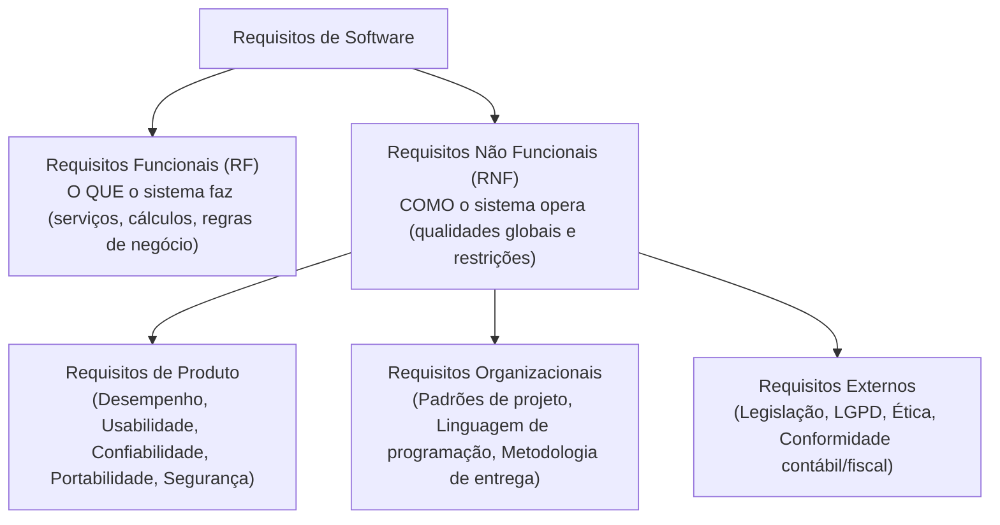
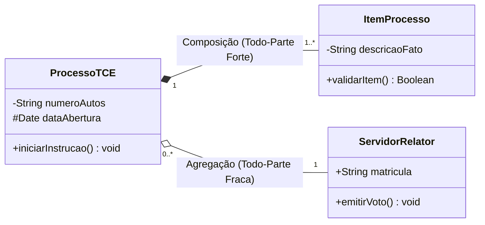
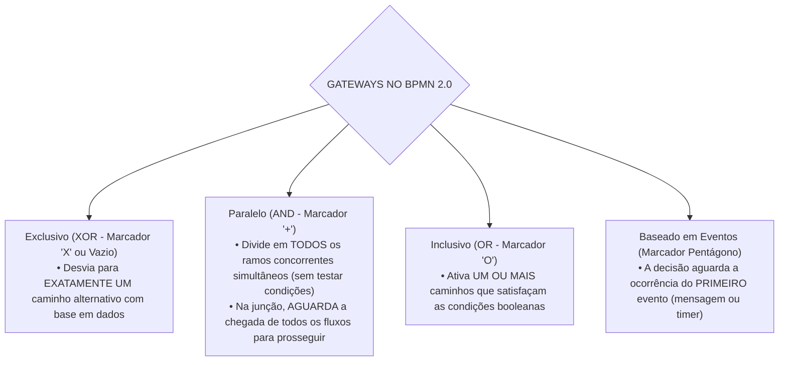

# 02 - Requisitos, Histórias de Usuário, UML e BPMN

> **Matéria:** Engenharia de Software  
> **Cargo:** B02 – Técnico de Controle Externo – Especialidade: Tecnologia da Informação  
> **Arquivo:** `02_requisitos_historias_de_usuario_uml_e_bpmn.md`  

---

## 📌 Ementa / Itens do Edital
- Levantamento, especificação, análise, validação e gerenciamento de requisitos funcionais e não funcionais
- Histórias de usuário, casos de uso e critérios de aceite
- Modelagem de sistemas com UML (Unified Modeling Language)
- Modelagem de processos de negócio com BPMN (Business Process Model and Notation)

---

## 🧭 Sumário
- [1. Engenharia de Requisitos de Software](#1-engenharia-de-requisitos-de-software)
    - [1.1 Ciclo de Vida da Engenharia de Requisitos](#11-ciclo-de-vida-da-engenharia-de-requisitos)
    - [1.2 Técnicas de Elicitação de Requisitos](#12-tecnicas-de-elicitacao-de-requisitos)
    - [1.3 Requisitos Funcionais vs. Requisitos Não Funcionais (Taxonomia de Sommerville)](#13-requisitos-funcionais-vs-requisitos-nao-funcionais-taxonomia-de-sommerville)
    - [1.4 Gerenciamento, Rastreabilidade e Mudança de Requisitos](#14-gerenciamento-rastreabilidade-e-mudanca-de-requisitos)
- [2. Modelagem por Casos de Uso e Histórias de Usuário](#2-modelagem-por-casos-de-uso-e-historias-de-usuario)
    - [2.1 Modelagem de Casos de Uso: Elementos e Relacionamentos («include» vs. «extend»)](#21-modelagem-de-casos-de-uso-elementos-e-relacionamentos-include-vs-extend)
    - [2.2 Histórias de Usuário (User Stories) e os 3 Cs de Ron Jeffries](#22-historias-de-usuario-user-stories-e-os-3-cs-de-ron-jeffries)
    - [2.3 Critérios de Aceite e o Padrão INVEST](#23-criterios-de-aceite-e-o-padrao-invest)
- [3. Modelagem de Sistemas com UML (versão 2.5)](#3-modelagem-de-sistemas-com-uml-versao-25)
    - [3.1 Taxonomia dos Diagramas UML: Estruturais vs. Comportamentais](#31-taxonomia-dos-diagramas-uml-estruturais-vs-comportamentais)
    - [3.2 Diagrama de Classes: Visibilidade, Multiplicidade, Agregação e Composição](#32-diagrama-de-classes-visibilidade-multiplicidade-agregacao-e-composicao)
    - [3.3 Diagramas de Sequência, Atividades e Máquina de Estados](#33-diagramas-de-sequencia-atividades-e-maquina-de-estados)
- [4. Modelagem de Processos de Negócio com BPMN 2.0](#4-modelagem-de-processos-de-negocio-com-bpmn-20)
    - [4.1 Elementos de Fluxo: Eventos, Atividades e Tipos de Tarefas](#41-elementos-de-fluxo-eventos-atividades-e-tipos-de-tarefas)
    - [4.2 Gateways Decisórios no BPMN 2.0 (XOR, AND, OR e Event-based)](#42-gateways-decisorios-no-bpmn-20-xor-and-or-e-event-based)
    - [4.3 Estruturas de Separação (Pools e Lanes) e Conectores de Sequência vs. Mensagem](#43-estruturas-de-separacao-pools-e-lanes-e-conectores-de-sequencia-vs-mensagem)
- [5. Fontes Oficiais e Referências Bibliográficas](#5-fontes-oficiais-e-referencias-bibliograficas)
- [6. Questões de Concurso FCC Comentadas](#6-questoes-de-concurso-fcc-comentadas)

---

## 1. Engenharia de Requisitos de Software

### 1.1 Ciclo de Vida da Engenharia de Requisitos
A Engenharia de Requisitos é o processo disciplinado de descobrir, analisar, documentar e verificar os serviços fornecidos pelo sistema e suas restrições operacionais (Ian Sommerville). Divide-se em etapas interligadas:

1. **Concepção / Estudo de Viabilidade:** Avalia se o sistema contribui para os objetivos da organização e se é técnica e economicamente viável;
2. **Elicitação (Levantamento):** Identificação e descoberta dos requisitos junto aos clientes, usuários e demais partes interessadas (*stakeholders*);
3. **Análise e Negociação:** Detecção de conflitos entre requisitos de diferentes fontes, análise de completude, consistência e priorização de demandas;
4. **Especificação:** Documentação formal dos requisitos levantados por meio de documentos formais (Documento de Requisitos de Software - DRS), Casos de Uso ou Histórias de Usuário;
5. **Validação:** Verificação se os requisitos especificados refletem fielmente as reais necessidades do cliente (revisões técnicas, testes de protótipos e geração de casos de teste);
6. **Gerenciamento de Requisitos:** Processo contínuo de controle de versões, rastreabilidade e acomodação de mudanças ao longo do ciclo de vida.

---

### 1.2 Técnicas de Elicitação de Requisitos
A escolha das técnicas de elicitação depende da maturidade do domínio de negócio e do perfil dos usuários:

- **Entrevistas:** Técnicas estruturadas (fechadas) ou abertas. Excelentes para explorar detalhes e obter uma visão aprofundada dos processos de negócio;
- **Questionários e Pesquisas:** Eficientes para coletar impressões de uma base ampla de usuários geograficamente dispersa, com baixo custo, embora sujeita a respostas superficiais;
- **Workshops / JAD (Joint Application Design):** Sessões estruturadas e colaborativas que reúnem desenvolvedores, gerentes e clientes no mesmo espaço físico para alinhar requisitos divergentes e acelerar consensos;
- **Etnografia e Observação Direta:** O analista acompanha presencialmente a rotina operacional do usuário em seu ambiente real de trabalho. Revela requisitos implícitos e regras tácitas que os usuários costumam esquecer de relatar nas entrevistas;
- **Prototipação Rápida:** Construção de maquetes visuais ou versões interativas preliminares do sistema para permitir a validação antecipada de fluxos de navegação e layouts.

---

### 1.3 Requisitos Funcionais vs. Requisitos Não Funcionais (Taxonomia de Sommerville)
A distinção entre o que o sistema realiza e como ele realiza constitui o pilar conceitual da engenharia de requisitos:

1. **Requisitos Funcionais (RF):** Descrevem as funções e comportamentos que o software deve executar. Especificam o que o sistema deve fazer em resposta a determinadas entradas, como reagir a situações específicas e quais cálculos realizar (ex.: *"O sistema deve calcular a alíquota previdenciária com base na remuneração bruta"*).
2. **Requisitos Não Funcionais (RNF):** Estabelecem propriedades de qualidade e restrições impostas aos serviços oferecidos pelo sistema. A taxonomia de Sommerville classifica os RNFs em:
    - *Requisitos de Produto:* Especificam o comportamento do produto em tempo de execução (desempenho, tempo de resposta, taxa de ocupação de memória, confiabilidade e disponibilidade mínima de 99,9%);
    - *Requisitos Organizacionais:* Decorrem das políticas e procedimentos da empresa cliente ou desenvolvedora (ex.: uso obrigatório de Java 21, versionamento no Git corporativo ou adoção da metodologia Scrum);
    - *Requisitos Externos:* Derivam de fatores externos ao sistema e à organização (ex.: aderência à Lei Geral de Proteção de Dados - LGPD, normas de interoperabilidade e regulamentações do Banco Central).

---

### 1.4 Gerenciamento, Rastreabilidade e Mudança de Requisitos
- **Rastreabilidade de Requisitos:** Capacidade de acompanhar o ciclo de vida de um requisito em ambas as direções:
    - *Rastreabilidade para trás (Backward traceability):* Liga o requisito à sua fonte originária (norma legal, entrevista ou necessidade de negócio);
    - *Rastreabilidade para frente (Forward traceability):* Liga o requisito aos módulos arquiteturais, classes, componentes e casos de teste que o implementam e validam;
- **Matriz de Rastreabilidade:** Tabela que mapeia a correlação bidirecional entre requisitos de usuário, requisitos de sistema, diagramas de arquitetura e casos de testes unitários.

---

## 2. Modelagem por Casos de Uso e Histórias de Usuário

### 2.1 Modelagem de Casos de Uso: Elementos e Relacionamentos («include» vs. «extend»)
Um Caso de Uso descreve uma sequência de interações entre um ator externo (humano ou outro sistema) e o software para atingir um objetivo específico que entregue valor mensurável:

- **Atores:** Papéis desempenhados por entidades externas em relação ao sistema. Podem ser *Atores Primários* (iniciam o caso de uso para atingir um objetivo) ou *Atores Secundários* (fornecem serviços de apoio ao sistema, como um serviço externo de pagamento);
- **Cenários:** Compõe-se de um *Cenário Principal* (fluxo básico ou "caminho feliz" onde tudo ocorre com sucesso) e *Cenários Alternativos/Exceção* (desvios de rota, validações de erro ou falhas).

**Relacionamentos no Diagrama de Casos de Uso (Cobrança Clássica da FCC):**

1. **Associação:** Linha contínua que conecta um ator a um caso de uso, denotando comunicação direta.
2. **Estereótipo `«include»` (Inclusão Obrigatória):**
    - O caso de uso base **depende obrigatoriamente** do caso de uso incluído para completar sua execução com sucesso;
    - Evita duplicação de comportamentos comuns compartilhados por múltiplos casos de uso (ex.: *Emitir Relatório* inclui compulsoriamente *Autenticar Usuário*);
    - **Direção da Seta:** Seta tracejada apontando **do Caso Base para o Caso Incluído** ($\text{Base} \xrightarrow{\ll\text{include}\gg} \text{Incluído}$).

3. **Estereótipo `«extend»` (Extensão Condicional / Opcional):**
    - Modela comportamento acessório, opcional ou excepcional que somente é acionado se determinada condição pré-definida for satisfeita em um **ponto de extensão (*extension point*)**;
    - O caso base executa e conclui com sucesso mesmo se a extensão jamais ocorrer (ex.: *Emitir Notificação Especial* estende o caso base *Processar Pedido* quando o valor for superior a cem mil reais);
    - **Direção da Seta:** Seta tracejada apontando **do Caso Extensor para o Caso Base** ($\text{Extensão} \xrightarrow{\ll\text{extend}\gg} \text{Base}$).

4. **Generalização / Especialização:** Relação de herança representada por uma seta com triângulo vazado na ponta. Pode ocorrer entre casos de uso ou entre atores (ex.: *Auditor de TI* especializa *Auditor Geral*).

> 🚨 **ALERTA DE PROVA / PEGADINHA FCC:**  
> A banca FCC frequentemente inverte a direção das setas e os conceitos:
>
> - No `<<include>>`: A seta aponta do caso base para o incluído ($\text{Base} \rightarrow \text{Incluído}$) e a execução é **obrigatória/incondicional**.
> - No `<<extend>>`: A seta aponta do caso que estende para o caso base ($\text{Extensor} \rightarrow \text{Base}$) e a execução é **opcional/condicional** vinculada a um ponto de extensão.

---

### 2.2 Histórias de Usuário (User Stories) e os 3 Cs de Ron Jeffries
Em ambientes ágeis, as necessidades de software são expressas através de **Histórias de Usuário**:
$$\text{"Como [papel de usuário], eu quero [funcionalidade/ação], para que [benefício de negócio percebido]"}$$

- **Os 3 Cs de Ron Jeffries:**
    1. **Card (Cartão):** A história é escrita de forma sucinta em um cartão físico ou digital, servindo como lembrete visual de uma funcionalidade a ser construída;
    2. **Conversation (Conversa):** O detalhamento do requisito não é fixado em documentos estáticos, mas refinado por meio de diálogo contínuo entre desenvolvedores, Product Owner e usuários;
    3. **Confirmation (Confirmação):** Critérios de aceite formais e testes que estabelecem a validação inequívoca de que a história foi concluída com sucesso.

---

### 2.3 Critérios de Aceite e o Padrão INVEST
- **Critérios de Aceite (Formato BDD / Gherkin):** Estruturam-se tipicamente no padrão:  
  *Dado que [contexto inicial], Quando [evento ou ação executada], Então [resultado esperado observável].*
- **Critérios INVEST de Qualidade de Histórias (Bill Wake e Mike Cohn):**

| Letra | Critério INVEST | Significado Técnico na Prática Ágil |
| :---: | :--- | :--- |
| **I** | **Independent** (Independente) | As histórias devem ser desacopladas entre si, permitindo que sejam priorizadas, desenvolvidas e implantadas em qualquer ordem. |
| **N** | **Negotiable** (Negociável) | A história não é um contrato pétreo. Seu escopo de detalhe deve permanecer aberto para negociações e ajustes durante a Sprint. |
| **V** | **Valuable** (Valiosa) | Deve entregar valor tangível e perceptível para o cliente ou usuário final (evitam-se histórias puramente técnicas desvinculadas de valor). |
| **E** | **Estimable** (Estimável) | A equipe deve compreender a complexidade técnica para estimar seu esforço de desenvolvimento em *Story Points* ou horas. |
| **S** | **Small** (Pequena) | A história deve ser dimensionada adequadamente para ser concluída com folga dentro de uma única iteração/sprint. |
| **T** | **Testable** (Testável) | A história deve possuir critérios de aceite objetivos e claros que permitam a validação automatizada ou manual de aprovação. |

---

## 3. Modelagem de Sistemas com UML (versão 2.5)

### 3.1 Taxonomia dos Diagramas UML: Estruturais vs. Comportamentais
A UML 2.5 divide seus diagramas em duas categorias fundamentais cobradas rigorosamente pela FCC:

1. **Diagramas Estruturais (Aspectos Estáticos do Sistema):**
    - **Diagrama de Classes** (estruturas de classes, atributos, operações e relações);
    - **Diagrama de Objetos** (instâncias de classes em um dado momento temporal);
    - **Diagrama de Componentes** (módulos executáveis e interfaces de software);
    - **Diagrama de Implantação (*Deployment*)** (arquitetura de hardware, nós de rede e distribuição de artefatos);
    - **Diagrama de Pacotes** (organização lógica de subsistemas);
    - **Diagrama de Estrutura Composta** e **Diagrama de Perfis**.

2. **Diagramas Comportamentais (Aspectos Dinâmicos e Fluxos de Controle):**
    - **Diagrama de Casos de Uso** (interações de atores com funcionalidades);
    - **Diagrama de Atividades** (fluxos de trabalho procedimentais e concorrência);
    - **Diagrama de Máquina de Estados** (estados e transições de ciclo de vida de objetos);
    - **Diagramas de Interação:**
    - **Diagrama de Sequência** (mensagens ordenadas cronologicamente ao longo do tempo);
    - **Diagrama de Comunicação** (interações enfatizando a estrutura dos objetos);
    - **Diagrama de Visão Geral de Interação** e **Diagrama de Tempo (*Timing*)**.

---

### 3.2 Diagrama de Classes: Visibilidade, Multiplicidade, Agregação e Composição
O Diagrama de Classes é o pilar estrutural da modelagem orientada a objetos:

- **Notação de Visibilidade dos Membros:**
    - `+` **Público (Public):** Acessível por qualquer classe do sistema;
    - `-` **Privado (Private):** Acessível estritamente dentro da própria classe definidora;
    - `#` **Protegido (Protected):** Acessível pela classe definidora e suas subclasses herdadas;
    - `~` **Pacote (Package):** Acessível por qualquer classe que pertença ao mesmo pacote.
- **Diferença Crucial: Agregação vs. Composição (Questão Garantida):**
    - **Agregação (Todo-Parte Fraca - Losango Branco/Vazio):** A existência da parte é independente do todo. O objeto todo agrega referências a objetos que podem existir isoladamente e pertencer a outros agregados (ex.: *Universidade e Professores*).
    - **Composição (Todo-Parte Forte - Losango Preto/Preenchido):** A existência da parte depende compulsoriamente do todo. A parte tem ciclo de vida estritamente atrelado ao todo: se o todo for destruído, todas as suas partes constitutivas são destruídas em cascata (ex.: *Processo e Peças dos Autos*; *Nota Fiscal e Itens da Nota*). A multiplicidade do lado do todo na composição é no máximo 1.

---

### 3.3 Diagramas de Sequência, Atividades e Máquina de Estados
- **Diagrama de Sequência:** Representa como os objetos colaboram em uma sequência temporal ordenada. Elementos chave:
    - *Linhas de Vida (*Lifelines*):* Linha vertical tracejada que representa a existência do objeto no tempo;
    - *Focos de Controle (*Activation bars*):* Retângulos estreitos que demonstram quando o objeto está executando operações ativas;
    - *Mensagens:* Síncronas (seta com ponta preenchida), Assíncronas (seta com ponta aberta), Retorno (linha tracejada com seta aberta);
    - *Fragmentos Combinados:* Blocos com operadores como `alt` (ramificações alternativas / *if-else*), `opt` (comportamento opcional / *if*) e `loop` (iterações / *for-while*).
- **Diagrama de Atividades:** Modela fluxos de controle e de dados entre atividades procedimentais:
    - Nós de bifurcação e junção (*Fork* e *Join*): barra preta horizontal ou vertical que modela **fluxos concorrentes/paralelos**;
    - Raias (*Swimlanes*): subdivisões verticais ou horizontais que delimitam os papéis organizacionais ou classes responsáveis pela execução de cada ação.
- **Diagrama de Máquina de Estados:** Modela os diferentes estados pelos quais um objeto singular transita durante sua vida útil em resposta a eventos (gatilhos), protegidos por guardas booleanas e disparando ações.

---

## 4. Modelagem de Processos de Negócio com BPMN 2.0

### 4.1 Elementos de Fluxo: Eventos, Atividades e Tipos de Tarefas
A notação **BPMN 2.0** (*Business Process Model and Notation*), mantida pelo consórcio OMG, é o padrão global para desenho de processos de negócio:

1. **Eventos (Círculos):** Representam algo que acontece no processo:
    - *Início (Start Event):* Linha de borda fina simples;
    - *Intermediário (Intermediate Event):* Linha de borda dupla;
    - *Fim (End Event):* Linha de borda grossa e preenchida.
    - *Gatilhos de Eventos:* Mensagem (ícone de envelope), Temporizador (ícone de relógio), Erro (ícone de raio) ou Condicional (ícone de documento).

2. **Atividades (Retângulos com Cantos Arredondados):** Trabalho realizado dentro do processo:
    - *Tarefas (Atômicas):* Tarefa de Usuário (*User Task* - mão humana), Tarefa de Serviço (*Service Task* - engrenagem, executada por software automatizado), Tarefa Manual (*Manual Task*) e Tarefa de Script (*Script Task*);
    - *Subprocessos:* Atividades compostas que podem ser visualizadas de forma colapsada (com marcador de cruz "+") ou expandida.

---

### 4.2 Gateways Decisórios no BPMN 2.0 (XOR, AND, OR e Event-based)
Os Gateways são representados por **Losangos** e controlam a convergência e divergência dos fluxos:

- **Gateway Exclusivo (XOR - "X"):** Seleciona exclusivamente uma única rota entre as disponíveis;
- **Gateway Paralelo (AND - "+"):** Executa todos os caminhos de saída concorrentemente e sincroniza todos os caminhos na junção;
- **Gateway Inclusivo (OR - "O"):** Ativa múltiplos ramos condicionalmente e sincroniza apenas os ramos ativados;
- **Gateway Baseado em Eventos (Pentágono):** O desvio de fluxo depende de qual evento externo intermediário (recebimento de mensagem ou expiração de temporizador) ocorrer primeiro no tempo.

---

### 4.3 Estruturas de Separação (Pools e Lanes) e Conectores de Sequência vs. Mensagem
- **Piscina (*Pool*):** Representa um participante independente do processo (um ente externo, fornecedor, organização ou empresa). Cada processo de negócio autocontido executa dentro de uma Pool;
- **Raia (*Lane*):** Subdivisão interna de uma Pool, utilizada para alocar tarefas e agrupar responsabilidades por departamentos, funções, setores ou sistemas daquela mesma organização.

**Regras Fundamentais dos Conectores de Fluxo (Muito Cobrado em Prova):**

- **Fluxo de Sequência (*Sequence Flow*):** Representado por **linha sólida contínua com seta preenchida**. Conecta a sequência de atividades dentro da mesma Pool.  
  > 🚨 **REGRA DE OURO DO BPMN:** Um Fluxo de Sequência **NUNCA PODE CRUZAR A BORDA DE UMA POOL PARA OUTRA POOL!** Ele só pode cruzar linhas de Lanes dentro da mesma Pool!
- **Fluxo de Mensagem (*Message Flow*):** Representado por **linha tracejada com um círculo vazado na origem e uma seta aberta no destino**. Utilizado estritamente para modelar comunicação e troca de mensagens **entre duas Pools distintas**.
- **Associação:** Linha pontilhada simples, utilizada para associar dados, artefatos ou anotações de texto a objetos de fluxo.

---

## 5. Fontes Oficiais e Referências Bibliográficas

* [OMG UML 2.5.1 Specification Official Resource](https://www.omg.org/spec/UML/) - Especificação formal da Unified Modeling Language.
* [OMG BPMN 2.0.2 Specification Official Resource](https://www.omg.org/spec/BPMN/2.0/) - Especificação normativa do Business Process Model and Notation.
* [Software Engineering (Ian Sommerville - 10ª Edição)](https://iansommerville.com/software-engineering-book/) - Engenharia de requisitos funcionais e não funcionais.
* [User Stories Applied: For Agile Software Development (Mike Cohn)](https://www.mountaingoatsoftware.com/agile/user-stories) - Conceitos do padrão INVEST e 3 Cs.

---

## 6. Questões de Concurso FCC Comentadas

### Questão 01
**(FCC – TCE-GO – Analista de Controle Externo / TI)**  
Em um diagrama de casos de uso da UML (versão 2.5), os relacionamentos entre casos de uso podem ser representados por estereótipos como «include» e «extend». A respeito desses relacionamentos, é correto afirmar que:

* **A)** O relacionamento «extend» representa uma inclusão incondicional e obrigatória de comportamento em todos os fluxos de execução do caso de uso base.
* **B)** O relacionamento «include» indica que a execução do caso de uso incluído é obrigatória para que o caso de uso base seja completado com sucesso, enquanto o relacionamento «extend» representa um comportamento opcional ou condicional que é disparado a partir de um ponto de extensão.
* **C)** As setas tracejadas de ambos os relacionamentos apontam sempre do caso de uso estendido/incluído em direção ao ator primário.
* **D)** O relacionamento «include» só pode ocorrer entre atores do sistema, não entre casos de uso.
* **E)** O relacionamento «extend» impede a ocorrência de cenários alternativos no caso de uso base.

> **Comentário Detalhado:**
>
> - **A) Incorreta.** A inclusão incondicional e obrigatória de comportamento define o relacionamento de inclusão (`«include»`), e não de extensão (`«extend»`).
> - **B) CORRETA.** Nos termos formais da especificação UML 2.5: o estereótipo `«include»` modela uma dependência obrigatória e incondicional (o caso base não atinge seu objetivo sem a execução do caso incluído); por sua vez, o estereótipo `«extend»` modela um comportamento acessório, opcional ou excepcional, cuja ativação depende da ocorrência de uma condição em um ponto de extensão (*extension point*) pré-definido.
> - **C) Incorreta.** Os relacionamentos `«include»` e `«extend»` interligam casos de uso entre si, jamais casos de uso a atores primários.
> - **D) Incorreta.** O relacionamento entre atores dá-se por herança/generalização; o `«include»` é exclusivo entre casos de uso.
> - **E) Incorreta.** O `«extend»` apenas adiciona funcionalidade complementar opcional, em nada restringindo os caminhos alternativos do caso base.
> 
> **Gabarito: B**

---

### Questão 02
**(FCC – TCE-GO – Técnico de Controle Externo / TI)**  
Na modelagem de processos de negócio com a notação BPMN 2.0, um analista precisa representar uma bifurcação no fluxo em que duas atividades subsequentes devem ser executadas simultaneamente (em paralelo), independentemente de qualquer condição ou teste de dados. Para essa finalidade, deve-se empregar o gateway:

* **A)** Exclusivo baseado em dados (marcado com um "X").
* **B)** Paralelo (marcado com um sinal de soma "+").
* **C)** Inclusivo (marcado com um círculo "O").
* **D)** Complexo (marcado com um asterisco "*").
* **E)** Baseado em eventos (marcado com um pentágono).

> **Comentário Detalhado:**
>
> - **A) Incorreta.** O gateway exclusivo (XOR) toma estritamente uma única rota de saída com base em condições de dados mutuamente excludentes.
> - **B) CORRETA.** O **Gateway Paralelo (AND)**, graficamente identificado por um **sinal de adição "+""** no interior do losango, é empregado para sincronizar ou dividir o fluxo de controle em múltiplos ramos que são ativados simultaneamente e concorrentemente, sem avaliação de testes booleanos de dados.
> - **C) Incorreta.** O gateway inclusivo (OR - círculo) pode disparar um ou mais ramos, mas subordina-se à validação de condições lógicas em dados.
> - **D) Incorreta.** O gateway complexo (*) atende a cenários avançados não cobertos pelos gateways padrão.
> - **E) Incorreta.** O gateway baseado em eventos decide o caminho a partir da ocorrência do primeiro evento disparador (mensagem ou relógio).
> 
> **Gabarito: B**

---

### Questão 03
**(FCC – TRF – Analista Judiciário / TI)**  
No Diagrama de Classes da UML 2.5, os relacionamentos de associação podem assumir formas especializadas de acoplamento do tipo Todo-Parte conhecidas como Agregação e Composição. Sobre esses conceitos, assinale a afirmação correta:

* **A)** Na Composição, a destruição do objeto que representa o "Todo" acarreta obrigatoriamente a destruição dos objetos que compõem suas "Partes", caracterizando um ciclo de vida estritamente compartilhado e dependente.
* **B)** A Agregação é visualmente representada por um losango preenchido em preto conectado ao objeto da "Parte".
* **C)** Na Composição, as "Partes" podem pertencer simultaneamente a múltiplos objetos "Todo" em tempo de execução.
* **D)** A Agregação representa um acoplamento mais forte e rígido do que a Composição, exigindo obrigatoriamente multiplicidade de 1..1.
* **E)** Na UML, a generalização entre classes concretas substitui integralmente a necessidade de composição quando se deseja implementar herança múltipla.

> **Comentário Detalhado:**
>
> - **A) CORRETA.** A **Composição** é uma variante forte da relação Todo-Parte caracterizada por forte dependência existencial e ciclo de vida compartilhado: o objeto "Parte" pertence exclusivamente a um único "Todo" e, caso o objeto "Todo" seja destruído ou excluído da memória, todas as suas "Partes" integrantes são destruídas em cascata.
> - **B) Incorreta.** O losango preenchido em preto (sólido) representa a Composição; a Agregação é graficamente denotada por um losango vazado (branco).
> - **C) Incorreta.** Na Composição, a Parte só pode estar atrelada a no máximo um Todo de cada vez (multiplicidade máxima 1 do lado do Todo).
> - **D) Incorreta.** A Composição é que constitui acoplamento forte; a Agregação constitui acoplamento fraco com partes independentes.
> - **E) Incorreta.** Generalização modela relação de herança funcional ("é um"), ao passo que a composição expressa posse ou contenção estrutural ("tem um").
> 
> **Gabarito: A**

---

### Questão 04
**(FCC – TCE – Auditor de Controle Externo / TI)**  
No que diz respeito à notação BPMN 2.0 e suas regras formais de modelagem de processos corporativos, assinale a afirmativa correta:

* **A)** Um Fluxo de Sequência (*Sequence Flow*) pode conectar diretamente uma atividade contida em uma Piscina (*Pool*) a uma atividade contida em outra Piscina distinta.
* **B)** Uma Piscina (*Pool*) representa uma organização ou participante independente no processo, enquanto as Raias (*Lanes*) são subdivisões internas usadas para separar funções ou departamentos daquela organização.
* **C)** Mensagens trocadas entre diferentes participantes de um processo devem ser modeladas obrigatoriamente utilizando linhas sólidas com setas preenchidas.
* **D)** Um evento de início do tipo Temporizador só pode ser posicionado dentro de um subprocesso de eventos com gatilho de erro fatal.
* **E)** Os objetos de dados (*Data Objects*) são elementos de execução que controlam ativamente o redirecionamento das rotas do processo de negócio.

> **Comentário Detalhado:**
>
> - **A) Incorreta.** Regra estrutural do padrão BPMN 2.0: um Fluxo de Sequência (linha contínua) **nunca pode cruzar as fronteiras entre duas Pools distintas**. Apenas o Fluxo de Mensagem cruza Pools.
> - **B) CORRETA.** No metamodelo do BPMN, uma **Piscina (*Pool*)** representa graficamente um participante autônomo (uma entidade corporativa ou processo independente), e as **Raias (*Lanes*)** atuam como partições internas dentro da Pool para segregar e organizar responsabilidades de departamentos, funções ou sistemas.
> - **C) Incorreta.** O Fluxo de Mensagem (*Message Flow*) é desenhado estritamente com **linha tracejada**, portando um círculo vazado na origem e uma seta aberta no destino.
> - **D) Incorreta.** Eventos de início de temporizador atuam regularmente como disparadores de processos periódicos programados na raiz do fluxo.
> - **E) Incorreta.** Objetos de dados têm função informativa e descritiva dos insumos e produtos gerados pelas tarefas, não operando como controladores de desvio de rotas.
> 
> **Gabarito: B**

---

### Questão 05
**(FCC – SEFAZ – Auditor Fiscal da Receita Estadual)**  
Ao redigir Histórias de Usuário (*User Stories*) em projetos orientados por metodologias ágeis, os analistas empregam o acrônimo INVEST para avaliar a qualidade técnica das histórias escritas. A letra "N" do referido acrônimo estabelece que a história deve ser:

* **A)** Notável (*Notable*), ou seja, deve figurar obrigatoriamente entre as três principais prioridades estratégicas da diretoria da organização.
* **B)** Negociável (*Negotiable*), demonstrando que a história não representa um contrato rígido ou imutável, devendo deixar espaço para debate e refinamento entre o cliente e os desenvolvedores.
* **C)** Normalizada (*Normalized*), seguindo rigorosamente a terceira forma normal de banco de dados relacional.
* **D)** Nominal (*Nominal*), contendo a assinatura formal em cartório do patrocinador do projeto antes do início de cada Sprint.
* **E)** Não-funcional (*Non-functional*), priorizando exclusivamente requisitos de segurança e volumetria de infraestrutura.

> **Comentário Detalhado:**
>
> - **A) Incorreta.** O "N" não significa notável na metodologia ágil de escrita de requisitos.
> - **B) CORRETA.** No modelo mnemônico **INVEST** (proposto por Bill Wake e popularizado por Mike Cohn), a letra **N** representa **Negotiable (Negociável)**. As Histórias de Usuário são concebidas como convites para conversas futuras; elas capturam a intenção do usuário sem engessá-la como um contrato rígido e definitivo, mantendo flexibilidade para negociação técnica durante o planejamento e a execução da iteração.
> - **C) Incorreta.** Normalização de banco de dados é um conceito puramente relacional de persistência física, alheio à técnica de redação de histórias.
> - **D) Incorreta.** A exigência de validação cartorial contradiz frontalmente a premissa de colaboração sobre negociação contratual expressa no Manifesto Ágil.
> - **E) Incorreta.** Histórias de usuário descrevem prioritariamente funcionalidades de negócio voltadas a entregar valor direto aos usuários.
> 
> **Gabarito: B**
