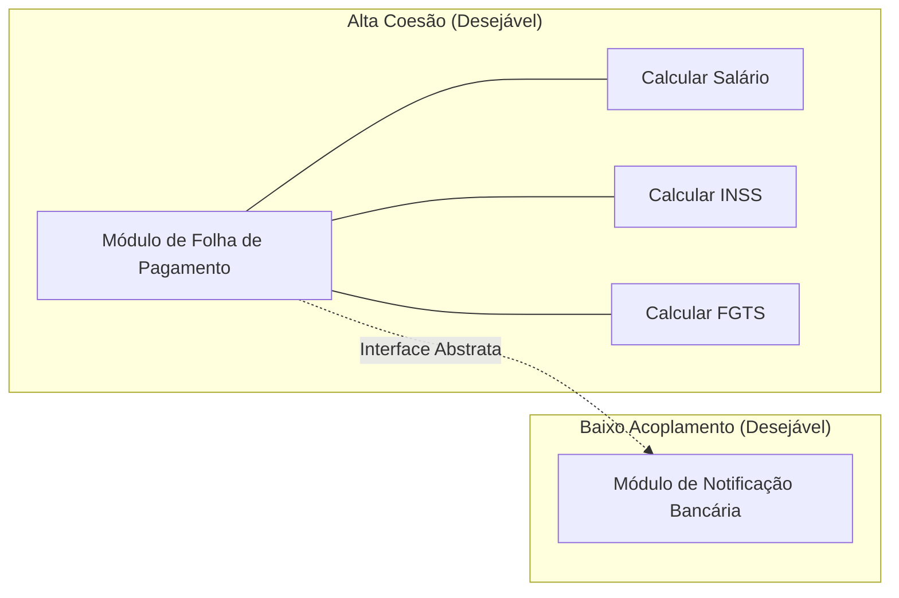
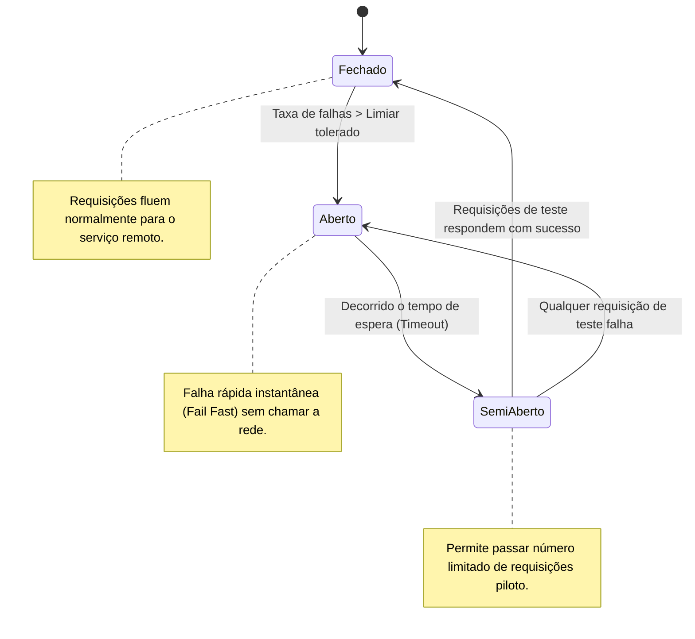

# 03 - Arquitetura de Software e Princípios de Design

> **Matéria:** Engenharia de Software  
> **Cargo:** B02 – Técnico de Controle Externo – Especialidade: Tecnologia da Informação  
> **Arquivo:** `03_arquitetura_de_software_e_principios_solid.md`  

---

## 📌 Ementa / Itens do Edital
- Arquitetura de software: padrões arquiteturais, arquitetura em camadas, orientada a serviços (SOA), microsserviços e orientada a eventos
- Princípios de design: SOLID, DRY, KISS e YAGNI
- Coesão e Acoplamento

---

## 🌳 Classificação Hierárquica

```text
3. Arquitetura de Software, Estilos Arquiteturais e Boas Práticas de Design
├── 3.1 Fundamentos de Arquitetura de Software
│   ├── 3.1.1 Definição, estrutura, componentes, conectores e visão arquitetural (Modelo 4+1 visões de Kruchten)
│   ├── 3.1.2 Trade-offs arquiteturais (Desempenho vs. Manutenibilidade vs. Segurança vs. Custo)
│   └── 3.1.3 Coesão e Acoplamento:
│       ├── Coesão (medida de foco de um módulo; objetivo: Alta Coesão funcional)
│       └── Acoplamento (grau de interdependência entre módulos; objetivo: Baixo Acoplamento)
├── 3.2 Estilos e Padrões Arquiteturais
│   ├── 3.2.1 Arquitetura Monolítica vs. Arquiteturas Distribuídas
│   ├── 3.2.2 Arquitetura em Camadas (Layered / N-Tier Architecture):
│   │   ├── Camadas clássicas: Apresentação, Lógica de Negócio (Domínio), Acesso a Dados (Persistência) e Banco de Dados
│   │   ├── Princípio do isolamento de camadas e regras de dependência unidirecional
│   │   └── Variações modernas: Clean Architecture (Robert Martin), Onion Architecture e Ports and Adapters (Hexagonal)
│   ├── 3.2.3 Arquitetura Orientada a Serviços (SOA - Service-Oriented Architecture):
│   │   ├── Princípios de SOA: Baixo acoplamento, contratos formais, reusabilidade, autonomia e composabilidade
│   │   ├── Barramento de Serviços Corporativo (ESB - Enterprise Service Bus) e orquestração vs. coreografia
│   │   └── Protocolos e padrões: SOAP, WSDL, UDDI e XML
│   ├── 3.2.4 Arquitetura de Microsserviços (Microservices):
│   │   ├── Características: Serviços autônomos, foco em domínio (DDD - Bounded Context), banco de dados por serviço
│   │   ├── Padrões de Microsserviços:
│   │   │   ├── API Gateway (roteamento, agregação, segurança, rate limiting)
│   │   │   ├── Service Discovery e Service Registry (registro dinâmico de instâncias)
│   │   │   ├── Circuit Breaker (resiliência contra falhas em cascata)
│   │   │   ├── Saga Pattern (transações distribuídas: coreografia vs. orquestração)
│   │   │   └── CQRS (Command Query Responsibility Segregation)
│   │   └── Comunicação síncrona (REST / gRPC) vs. assíncrona (Message Brokers / Filas)
│   └── 3.2.5 Arquitetura Orientada a Eventos (EDA - Event-Driven Architecture):
│       ├── Componentes: Produtores de eventos, Corretores de eventos (Event Brokers) e Consumidores
│       ├── Modelos: Publicação/Assinatura (Pub/Sub) e Event Streaming (Kafka, RabbitMQ)
│       └── Padrões: Event Sourcing (estado reconstruído a partir do histórico imutável de eventos)
└── 3.3 Princípios de Design e Boas Práticas de Código Limpo
    ├── 3.3.1 Os Princípios SOLID:
    │   ├── S - SRP (Single Responsibility Principle): Uma classe deve ter apenas um motivo para mudar
    │   ├── O - OCP (Open/Closed Principle): Entidades abertas para extensão, fechadas para modificação
    │   ├── L - LSP (Liskov Substitution Principle): Subclasses substituem superclasses sem quebrar o sistema
    │   ├── I - ISP (Interface Segregation Principle): Interfaces específicas em vez de interfaces gordas
    │   └── D - DIP (Dependency Inversion Principle): Depender de abstrações, não de implementações
    └── 3.3.2 Princípios Práticos de Engenharia Ágil:
        ├── DRY (Don't Repeat Yourself): Evitar duplicação de conhecimento e lógica
        ├── KISS (Keep It Simple, Stupid): Priorizar simplicidade estrutural
        └── YAGNI (You Aren't Gonna Need It): Implementar apenas o que é requerido agora
```

---

## 📖 Resumo Teórico Aprofundado

### 1. Coesão vs. Acoplamento

A meta primordial do bom design orientado a objetos e da arquitetura de software resume-se a:
$$\mathbf{\text{Alta Coesão} \quad \text{e} \quad \text{Baixo Acoplamento}}$$



- **Coesão:** Mede a harmonia interna e a singularidade de propósito dos elementos pertencentes a um módulo. Se uma classe cuida de faturamento, conexão com banco e impressão de relatórios, ela possui *baixa coesão*.
- **Acoplamento:** Mede o nível de interdependência entre dois ou mais módulos. Módulos que dependem de detalhes concretos internos de outros módulos apresentam *alto acoplamento*, tornando manutenções arriscadas.

---

### 2. Os Princípios SOLID de Robert C. Martin (Uncle Bob)

| Princípio | Sigla | Definição Central | Sintoma Típico de Violação na FCC |
| :--- | :--- | :--- | :--- |
| **Single Responsibility** | **SRP** | Uma classe deve possuir uma e apenas uma razão para mudar (um único ator/stakeholder). | Classe "Deus" (*God Class*) com centenas de linhas fazendo validação, banco e regras de negócio. |
| **Open/Closed** | **OCP** | Módulos devem estar abertos para extensão, mas fechados para modificação. | Uso massivo de `if/else` ou `switch/case` checando tipos de classes para executar comportamentos distintos. |
| **Liskov Substitution** | **LSP** | Se $S$ é subtipo de $T$, objetos do tipo $T$ devem poder ser substituídos por $S$ sem alterar as propriedades corretas do programa. | Subclasse que sobrescreve método herdado lançando `UnsupportedOperationException` ou alterando pré/pós-condições (ex.: Quadrado herdando de Retângulo). |
| **Interface Segregation** | **ISP** | Clientes não devem ser forçados a depender de interfaces e métodos que não utilizam. | Interface gigantesca ("gorda") que força implementadores básicos a declarar métodos vazios ou lançar erros. |
| **Dependency Inversion** | **DIP** | Módulos de alto nível não devem depender de módulos de baixo nível; ambos devem depender de abstrações. | Instanciação direta com operador `new` dentro de classes de negócio (`PedidoService` instanciando `OracleRepository`). |

---

### 3. Padrões de Resiliência em Microsserviços: O Circuit Breaker

Em arquiteturas distribuídas, o padrão **Circuit Breaker** previne travamentos generalizados em cascata (*cascading failures*):



#### 3.1 Outros Padrões Arquiteturais Fundamentais
- **API Gateway:** Único ponto de entrada para clientes externos. Centraliza roteamento, terminação SSL, autenticação, rate limiting e agregação de respostas.
- **Saga Pattern:** Gerencia transações distribuídas sem bloqueio bidirecional (*2PC - Two-Phase Commit*). Opera via uma sequência de transações locais compensatórias:
  - *Coreografia:* Cada microsserviço publica eventos que disparam a próxima etapa no serviço vizinho.
  - *Orquestração:* Um serviço coordenador central diz a cada participante qual transação executar.
- **CQRS (Command Query Responsibility Segregation):** Separa as operações de escrita/modificação de estado (*Commands*) das operações de leitura/consulta (*Queries*), frequentemente utilizando bancos de dados otimizados distintos.

---

### 4. Comparativo: Monólito vs. SOA vs. Microsserviços

| Dimensão | Arquitetura Monolítica | SOA (Service-Oriented) | Microsserviços |
| :--- | :--- | :--- | :--- |
| **Escopo dos Serviços** | Aplicação única e monolítica | Serviços corporativos amplos | Serviços hiperfocados em domínios delimitados (*Bounded Context*) |
| **Comunicação / Barramento** | Chamadas diretas em memória | Barramento Corporativo Inteligente (**ESB**) com transformações pesadas | Barramento simples / leve (*Smart endpoints, dumb pipes* via REST/gRPC/Kafka) |
| **Persistência de Dados** | Banco de dados único e centralizado | Banco frequentemente compartilhado entre serviços | Banco de dados exclusivo por serviço (*Database per Service*) |
| **Deploy e Escalabilidade** | Deploy de bloco único (tudo ou nada) | Deploys coordenados e complexos | Deploy totalmente autônomo por microsserviço |

---

## ⚠️ Pontos de Atenção (Estilo FCC)

> 🚨 **PEGADINHAS RECORRENTES DA BANCA FCC:**  
> 1. **Diferença entre Inversão de Dependência (DIP), Inversão de Controle (IoC) e Injeção de Dependência (DI):**  
>    - **DIP:** Princípio de design abstrato (o conceito arquitetural).  
>    - **IoC:** Mecanismo arquitetural geral onde o controle do fluxo é transferido para o framework.  
>    - **DI:** Padrão prático de implementação do DIP/IoC (passar a dependência pelo construtor ou setter).  
> 2. **Violação clássica de LSP:** Criar uma classe `Quadrado` que herda de `Retangulo`. Como o quadrado força largura e altura iguais, ao invocar `setLargura(5)` e `setAltura(10)` em uma referência a `Retangulo`, a área calculada não corresponderá à lógica esperada da superclasse!

---

## 🌐 Fontes Recomendadas na Internet

- [Martin Fowler - Microservices Architecture](https://martinfowler.com/articles/microservices.html)
- [Microservices.io - Collection of Microservice Architecture Patterns (Chris Richardson)](https://microservices.io/)
- [Microsoft Learn - Cloud Design Patterns (Circuit Breaker, API Gateway, Saga)](https://learn.microsoft.com/azure/architecture/patterns/)
- [Clean Coder Blog - Robert C. Martin: Principles of OOD (SOLID)](https://blog.cleancoder.com/)

---

## 📝 Questões Comentadas & Exemplos (Padrão FCC)

### Questão 1 (FCC - Analista de TI / Arquitetura e Desenvolvimento)
Em um sistema corporativo em Java, uma interface denominada `DispositivoMultifuncional` declara os seguintes métodos: `imprimirDocumento()`, `digitalizarDocumento()`, `enviarFax()` e `grampearFolhas()`. Uma classe denominada `ImpressoraBasicaDomestica` implementa essa interface, mas, por não possuir scanner, fax nem grampeador, é forçada a lançar exceções do tipo `UnsupportedOperationException` no corpo desses três últimos métodos. De acordo com os princípios de orientação a objetos SOLID preconizados por Robert C. Martin, essa estrutura viola diretamente o:  
A) Princípio da Responsabilidade Única (SRP).  
B) Princípio Aberto/Fechado (OCP).  
C) Princípio da Segregação de Interfaces (ISP).  
D) Princípio da Inversão de Dependência (DIP).  
E) Princípio da Substituição de Liskov (LSP).  

> **Gabarito: C**  
>  
> **Comentário Analítico Passo a Passo:**  
> - **A) Incorreta:** O SRP trata de responsabilidades únicas da classe com relação a motivos de modificação, não da imposição de métodos de interface desnecessários.  
> - **B) Incorreta:** O OCP diz respeito a permitir a extensão de comportamento sem modificar o código-fonte existente.  
> - **C) CORRETA:** O Princípio da Segregação de Interfaces (ISP - *Interface Segregation Principle*) afirma que os clientes não devem ser forçados a depender de interfaces que não utilizam. Quando uma interface declara métodos que uma classe concreta não pode suportar, a solução correta é segregar a interface ampla em interfaces coesas e específicas (`Imprimivel`, `Digitalizavel`).  
> - **D) Incorreta:** O DIP exige que módulos de alto e baixo nível dependam de abstrações, não de classes concretas.  
> - **E) Incorreta:** Embora lançar exceções em métodos herdados afete o comportamento polimórfico, a causa raiz e o princípio expressamente projetado para resolver interfaces com excesso de contratos é o ISP.

---

### Questão 2 (FCC - Técnico de Controle Externo / TI)
Em uma arquitetura de microsserviços distribuídos, para evitar que a indisponibilidade ou latência excessiva de um serviço secundário externo provoque falhas em cascata e o esgotamento dos recursos de computação do serviço principal chamador, adota-se um padrão de resiliência que monitora as chamadas recentes. Se a taxa de falhas exceder um limiar pré-definido, o padrão interrompe imediatamente as chamadas subsequentes, retornando erro ou resposta de contingência instantânea sem sobrecarregar a rede, testando periodicamente se o serviço remoto se recuperou. Esse padrão é denominado:  
A) API Gateway.  
B) Circuit Breaker.  
C) Service Registry.  
D) Event Sourcing.  
E) Command Query Responsibility Segregation (CQRS).  

> **Gabarito: B**  
>  
> **Comentário Analítico Passo a Passo:**  
> - **A) Incorreta:** O API Gateway é a porta de entrada única para clientes, responsável por roteamento e segurança, não pelo controle de estados de circuito de chamadas individuais downstream.  
> - **B) CORRETA:** O padrão *Circuit Breaker* (Disjuntor) transita entre três estados formais: Fechado (passa chamadas normais), Aberto (falha imediatamente para poupar recursos) e Semi-Aberto (envia chamadas de teste após um timeout para conferir o restabelecimento).  
> - **C) Incorreta:** O Service Registry atua como um catálogo/catálogo de endereços dinâmicos de instâncias de microsserviços ativas (ex.: Netflix Eureka, Consul).  
> - **D) Incorreta:** O Event Sourcing armazena todas as alterações de estado como uma sequência imutável de eventos.  
> - **E) Incorreta:** O CQRS separa as responsabilidades e os modelos de leitura (Query) e escrita (Command).

---

### Questão 3 (FCC - TRT - Analista Judiciário / Tecnologia da Informação)
Considere uma classe Java que calcula o valor do frete para pedidos de um tribunal. O método `calcularFrete` possui uma estrutura sequencial de instruções `if-else-if` verificando a modalidade de entrega: caso seja "SEDEX", aplica uma fórmula; se for "PAC", aplica outra; se for "TRANSPORTADORA", aplica uma terceira. Sempre que o órgão firma contrato com uma nova transportadora, o desenvolvedor é obrigado a abrir a classe de serviço existente e adicionar uma nova cláusula `else-if`. Essa estrutura arquitetural viola diretamente o princípio SOLID:  
A) Aberto/Fechado (OCP - Open/Closed Principle).  
B) Substituição de Liskov (LSP - Liskov Substitution Principle).  
C) Segregação de Interfaces (ISP - Interface Segregation Principle).  
D) Don't Repeat Yourself (DRY).  
E) Keep It Simple, Stupid (KISS).  

> **Gabarito: A**  
>  
> **Comentário Analítico Passo a Passo:**  
> - **A) CORRETA:** O Princípio Aberto/Fechado (OCP) estabelece que uma classe deve estar aberta para extensão (permitir novos comportamentos), mas fechada para modificação (não exigir a edição e reteste do código-fonte já em produção). A solução padrão OCP para esse cenário é o padrão de projeto *Strategy* ou polimorfismo por interface `CalculadoraFrete`.  
> - **B) Incorreta:** O LSP lida com a garantia de que subclasses não quebrem o contrato semântico das classes base.  
> - **C) Incorreta:** O ISP lida com interfaces que possuem métodos excessivos.  
> - **D) Incorreta:** DRY trata da eliminação de trechos duplicados de código, o que não é o foco do problema estrutural do encadeamento de tipos.  
> - **E) Incorreta:** KISS prega simplicidade, mas não é um dos princípios formais do acrônimo SOLID.

---

### Questão 4 (FCC - TCE - Auditor de Controle Externo / TI)
Em relação aos estilos arquiteturais para sistemas corporativos, analise as afirmativas a respeito da Arquitetura Orientada a Serviços (SOA) e da Arquitetura de Microsserviços:  
I. Em SOA tradicional, é comum a utilização de um Barramento de Serviços Corporativo (ESB) centralizado que concentra regras complexas de roteamento, orquestração e transformação de protocolos.  
II. Na arquitetura de microsserviços, recomenda-se a utilização de um banco de dados relacional único compartilhado entre todos os serviços para garantir transações atômicas ACID globais imediatas.  
III. Os microsserviços enfatizam serviços autônomos com deploys independentes e o conceito de *smart endpoints and dumb pipes*, mantendo a lógica de negócio nas pontas e a comunicação por mecanismos leves.  
Está correto o que se afirma em:  
A) I e II, apenas.  
B) II e III, apenas.  
C) I e III, apenas.  
D) I, II e III.  
E) III, apenas.  

> **Gabarito: C**  
>  
> **Comentário Analítico Passo a Passo:**  
> - **Item I: Verdadeiro.** SOA clássico adota o ESB (*Enterprise Service Bus*) como elemento centralizador de integração corporativa pesada.  
> - **Item II: Falso.** Na arquitetura de microsserviços, o princípio canônico é o *Database per Service* (banco de dados exclusivo por serviço). O compartilhamento de um banco relacional único é um antipadrão em microsserviços, pois quebra a autonomia e cria acoplamento em nível de esquema.  
> - **Item III: Verdadeiro.** Microsserviços adotam endpoints inteligentes e canais de comunicação burros e rápidos (*smart endpoints and dumb pipes*), com deploys e ciclos de vida desacoplados.  
> - Portanto, estão corretos apenas os itens I e III (Alternativa C).

---

### Questão 5 (FCC - SEFAZ - Auditor de Tecnologia da Informação)
No contexto das boas práticas de engenharia e arquitetura de software, os acrônimos DRY e YAGNI orientam a tomada de decisões no projeto de sistemas. A correta definição desses princípios estabelece que:  
A) DRY (*Don't Repeat Yourself*) determina que duas classes jamais podem conter a mesma assinatura de método; YAGNI (*You Aren't Gonna Need It*) proíbe o uso de testes unitários automatizados em ambientes de produção.  
B) DRY determina que cada porção de conhecimento ou lógica de negócio em um sistema deve possuir uma representação única, não ambígua e definitiva; YAGNI recomenda aos desenvolvedores não implementar funcionalidades antecipadas baseadas em suposições futuras até que sejam estritamente necessárias.  
C) DRY refere-se exclusivamente à padronização de nomenclatura de variáveis de banco de dados; YAGNI recomenda a criação preventiva de tabelas adicionais para suportar ampliações cadastrais.  
D) YAGNI estabelece a obrigatoriedade de reescrever todo o código legado a cada seis meses; DRY impõe que todo código-fonte deva ser distribuído em licença de código aberto.  
E) Ambos os princípios foram concebidos pelo modelo CMMI para fundamentar a documentação textual exaustiva de projetos antes de qualquer codificação.  

> **Gabarito: B**  
>  
> **Comentário Analítico Passo a Passo:**  
> - **A) Incorreta:** Assinaturas de métodos podem e devem ser compartilhadas em polimorfismo/interfaces; YAGNI incentiva testes, não os proíbe.  
> - **B) CORRETA:** DRY (*Don't Repeat Yourself*, de Andy Hunt e Dave Thomas) visa evitar duplicação de conhecimento e regras de negócio. YAGNI (*You Aren't Gonna Need It*, do XP) combate a sobre-engenharia (*overengineering*), determinando que funcionalidades especulativas não devem ser construídas antes que haja real demanda do usuário.  
> - **C) Incorreta:** Criar tabelas antecipadamente por suposição futura é exatamente o que o YAGNI condena veementemente.  
> - **D) Incorreta:** Descrições absurdas sem qualquer relação com a engenharia ágil de software.  
> - **E) Incorreta:** DRY e YAGNI são princípios ágeis de código limpo e desenvolvimento pragmático, não oriundos do CMMI tradicional.
