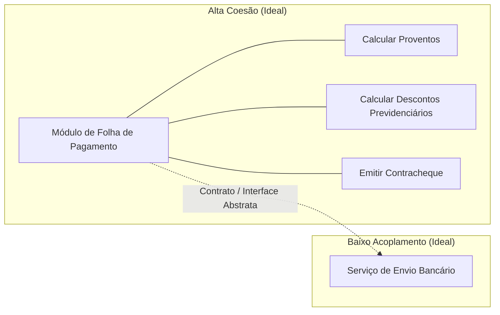
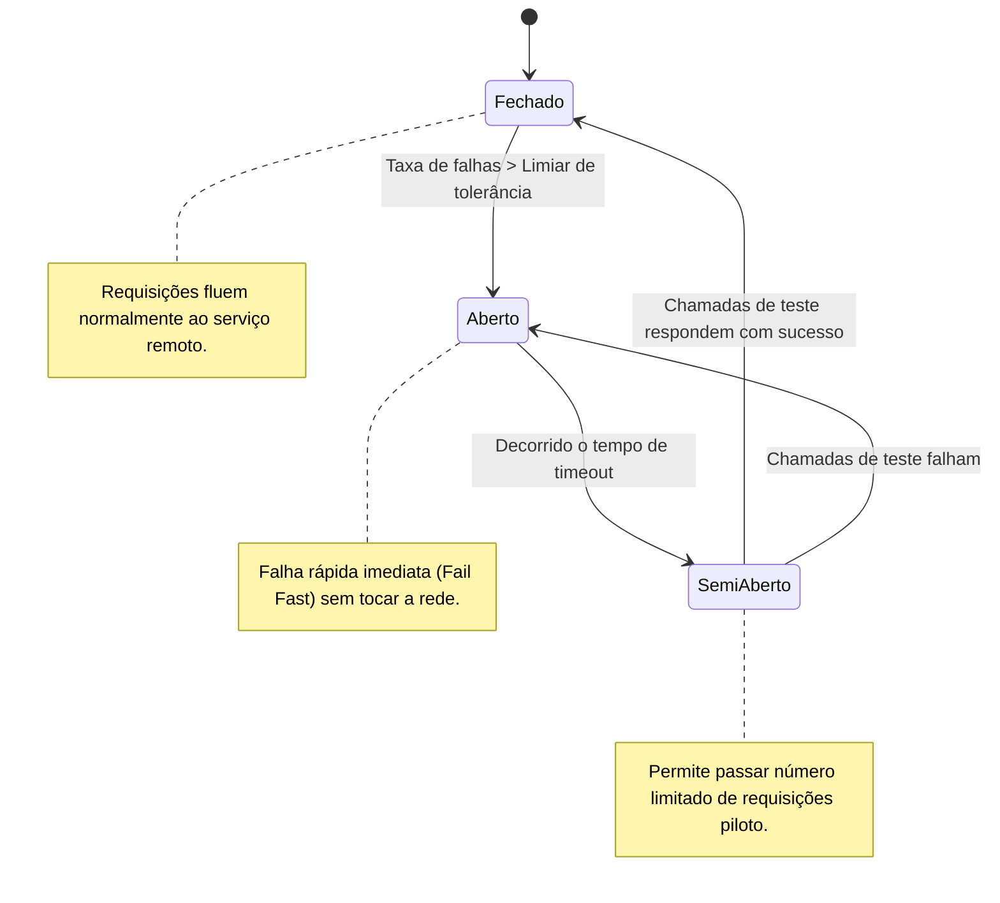
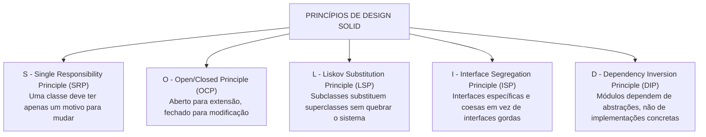

# 03 - Arquitetura de Software e Princípios de Design

> **Matéria:** Engenharia de Software  
> **Cargo:** B02 – Técnico de Controle Externo – Especialidade: Tecnologia da Informação  
> **Arquivo:** `03_arquitetura_de_software_e_principios_solid.md`  

---

## 📌 Ementa / Itens do Edital
- Arquitetura de software: padrões arquiteturais, arquitetura em camadas, orientada a serviços (SOA), microsserviços e orientada a eventos
- Princípios de design: SOLID, DRY, KISS e YAGNI
- Coesão e Acoplamento

---

## 🧭 Sumário
- [1. Fundamentos de Arquitetura de Software](#1-fundamentos-de-arquitetura-de-software)
    - [1.1 Estrutura, Componentes e Conectores Arquiteturais](#11-estrutura-componentes-e-conectores-arquiteturais)
    - [1.2 O Modelo 4+1 Visões de Philippe Kruchten](#12-o-modelo-41-visoes-de-philippe-kruchten)
    - [1.3 Coesão e Acoplamento: A Busca pela Alta Coesão e Baixo Acoplamento](#13-coesao-e-acoplamento-a-busca-pela-alta-coesao-e-baixo-acoplamento)
- [2. Estilos e Padrões Arquiteturais](#2-estilos-e-padroes-arquiteturais)
    - [2.1 Arquitetura em Camadas (Layered / N-Tier Architecture) e Variações Hexagonais](#21-arquitetura-em-camadas-layered-n-tier-architecture-e-variacoes-hexagonais)
    - [2.2 Arquitetura Orientada a Serviços (SOA) e o Papel do Barramento Corporativo (ESB)](#22-arquitetura-orientada-a-servicos-soa-e-o-papel-do-barramento-corporativo-esb)
    - [2.3 Arquitetura de Microsserviços e seus Padrões de Resiliência e Dados](#23-arquitetura-de-microsservicos-e-seus-padroes-de-resiliencia-e-dados)
    - [2.4 Arquitetura Orientada a Eventos (EDA - Event-Driven Architecture)](#24-arquitetura-orientada-a-eventos-eda-event-driven-architecture)
    - [2.5 Matriz Comparativa: Monólito vs. SOA vs. Microsserviços](#25-matriz-comparativa-monolito-vs-soa-vs-microsservicos)
- [3. Princípios de Design e Código Limpo](#3-principios-de-design-e-codigo-limpo)
    - [3.1 Os Princípios SOLID de Robert C. Martin](#31-os-principios-solid-de-robert-c-martin)
    - [3.2 Princípios Práticos de Engenharia: DRY, KISS e YAGNI](#32-principios-praticos-de-engenharia-dry-kiss-e-yagni)
- [4. Fontes Oficiais e Referências Bibliográficas](#4-fontes-oficiais-e-referencias-bibliograficas)
- [5. Questões de Concurso FCC Comentadas](#5-questoes-de-concurso-fcc-comentadas)

---

## 1. Fundamentos de Arquitetura de Software

### 1.1 Estrutura, Componentes e Conectores Arquiteturais
A Arquitetura de Software define a organização fundamental de um sistema corporativo, representada por seus componentes estruturais, pelos conectores e relacionamentos estabelecidos entre eles, pelo ambiente operacional em que executam e pelos princípios que norteiam seu design e evolução ao longo do tempo (IEEE 1471 / ISO/IEC 42010).

- **Componentes:** Unidades computacionais ou módulos de processamento e armazenamento de dados (ex.: microsserviços, controladores web, camadas de acesso a dados ou bancos relacionais);
- **Conectores:** Mecanismos que intermedeiam a comunicação, coordenação e transferência de dados entre os componentes (ex.: chamadas de procedimentos remotos RPC, requisições REST/HTTP, pipes, barramentos de mensageria ou filas Kafka/RabbitMQ);
- **Trade-offs Arquiteturais:** Nenhuma decisão arquitetural é neutra. Uma escolha que maximize desempenho ou escalabilidade horizontal quase invariavelmente introduz maior complexidade operacional e consistência eventual de dados (*Teorema CAP*).

---

### 1.2 O Modelo 4+1 Visões de Philippe Kruchten
Para descrever a arquitetura de software sob a ótica de múltiplos públicos (*stakeholders*), Philippe Kruchten introduziu o consagrado modelo **4+1 Visões**:

1. **Visão Lógica:** Foca na decomposição do sistema em classes, pacotes e subsistemas, atendendo aos requisitos funcionais do negócio (público: desenvolvedores e arquitetos);
2. **Visão de Processo:** Trata dos aspectos dinâmicos de concorrência, sincronização, desempenho, escalabilidade e threads de execução do sistema em tempo de execução;
3. **Visão de Desenvolvimento (Implementação):** Mostra a organização estática dos módulos de código-fonte, bibliotecas, frameworks, pacotes e ferramentas de compilação;
4. **Visão Física (Implantação):** Mapeia os artefatos de software sobre os nós de hardware físico, servidores de aplicação, redes, balanceadores de carga e contêineres na nuvem;
5. **Visão de Casos de Uso (+1):** Centraliza e integra as quatro visões anteriores a partir dos cenários essenciais que os usuários finais demandam do sistema.

---

### 1.3 Coesão e Acoplamento: A Busca pela Alta Coesão e Baixo Acoplamento
A métrica fundamental de qualidade de um design modular reside no equilíbrio entre coesão e acoplamento:

- **Coesão:** Mede a proximidade semântica e a harmonia das responsabilidades desempenhadas pelos elementos contidos no interior de um mesmo módulo.
    - *Alta Coesão (Desejável):* O módulo possui um propósito único, focado e bem delineado. Todos os seus métodos e atributos convergem para atender a uma finalidade coesa.
    - *Baixa Coesão (Indesejável / Antipadrão):* O módulo executa funções heterogêneas e desconexas (ex.: uma classe "Deus" ou "Manager" que conecta ao banco, valida regras fiscais e desenha janelas na tela).
- **Acoplamento:** Mede a intensidade da interdependência e a força das conexões entre módulos distintos.
    - *Baixo Acoplamento (Desejável):* Módulos comunicam-se exclusivamente através de contratos abstratos, interfaces ou mensagens padronizadas. Modificações internas em um módulo não propagam efeitos colaterais nos demais.
    - *Alto Acoplamento (Indesejável):* Módulos dependem de detalhes concretos de implementação interna uns dos outros, tornando qualquer manutenção arriscada e gerando falhas em cascata.

---

## 2. Estilos e Padrões Arquiteturais

### 2.1 Arquitetura em Camadas (Layered / N-Tier Architecture) e Variações Hexagonais
- **Arquitetura em Camadas Clássica:** Divide o sistema em camadas horizontais empilhadas logicamente, onde cada camada oferece serviços especializados à camada imediatamente superior e consome serviços da camada imediatamente inferior:
    1. *Camada de Apresentação (UI / Interface com Usuário):* Captura requisições e renderiza respostas visuais;
    2. *Camada de Aplicação / Serviços:* Orquestra os fluxos de trabalho e casos de uso;
    3. *Camada de Domínio / Negócio:* Encapsula as regras de negócio puras e entidades corporativas;
    4. *Camada de Acesso a Dados / Persistência:* Isola operações de banco de dados (DAOs, Repositories).

- **Variações Modernas (Arquitetura Hexagonal e Clean Architecture):**
    - **Ports and Adapters (Alistair Cockburn):** O núcleo de domínio de negócio fica no centro, completamente isolado de frameworks e bancos. Comunica-se com o mundo externo através de **Portas** (interfaces abstratas) e **Adaptadores** (implementações concretas de controllers REST, drivers de banco ou filas).
    - **Clean Architecture (Robert Martin):** Estruturada em círculos concêntricos governados pela **Regra da Dependência**: as dependências de código-fonte devem apontar unicamente para dentro, em direção às entidades e casos de uso de alto nível.

---

### 2.2 Arquitetura Orientada a Serviços (SOA) e o Papel do Barramento Corporativo (ESB)
A Arquitetura Orientada a Serviços (SOA) é um estilo arquitetural corporativo que integra aplicações legadas heterogêneas através de serviços fracamente acoplados e reutilizáveis:

- **Princípios Fundamentais de SOA (Thomas Erl):** Contratos de serviço formais e padronizados, baixo acoplamento, abstração de tecnologia, reusabilidade corporativa, autonomia funcional, composabilidade e descoberta de serviços;
- **Barramento de Serviços Corporativo (ESB - Enterprise Service Bus):** Infraestrutura de middleware centralizada e pesada que assume a responsabilidade de conectar, mediar, rotear, transformar protocolos (ex.: converter JSON/HTTP para XML/SOAP) e orquestrar fluxos de trabalho entre sistemas legados distintos;
- **Padrões de Comunicação:** Serviços web baseados em SOAP (*Simple Object Access Protocol*), descritos formalmente em documentos WSDL (*Web Services Description Language*) e registrados em repositórios UDDI.

---

### 2.3 Arquitetura de Microsserviços e seus Padrões de Resiliência e Dados
A arquitetura de microsserviços decompõe um sistema em um conjunto de serviços autônomos, de granularidade fina, modelados em torno de contextos de negócios delimitados (*Bounded Contexts* do Domain-Driven Design - DDD):

- **Premissa Fundamental:** *Smart endpoints and dumb pipes* (a lógica de negócio reside nas pontas, dispensando barramentos pesados e usando comunicação direta leve como REST/JSON, gRPC ou filas Kafka/RabbitMQ);
- **Banco de Dados por Serviço (*Database per Service*):** Cada microsserviço gerencia sua própria base de dados (relacional ou NoSQL). É expressamente proibido o acesso direto ao banco de dados de um serviço por outro serviço!

#### Padrões Críticos de Microsserviços:
1. **Circuit Breaker (Disjuntor de Resiliência):** Previne que a indisponibilidade ou latência extrema de um microsserviço provoque falhas em cascata que esgotem os recursos do chamador. Opera em três estados:
    - *Fechado (Closed):* As requisições fluem normalmente. Falhas são contabilizadas;
    - *Aberto (Open):* Ao atingir um limiar de erros, o circuito abre. Todas as requisições falham imediatamente (*fail-fast*), sem tentar acessar a rede;
    - *Semi-Aberto (Half-Open):* Após um tempo de espera (*timeout*), o circuito permite a passagem de algumas requisições de teste. Se forem bem-sucedidas, o circuito fecha; se falharem, o circuito volta ao estado aberto.

2. **API Gateway:** Ponto único de entrada para todas as requisições de clientes externos. Responsável por roteamento dinâmico, autenticação, controle de taxa (*rate limiting*), monitoramento e agregação de respostas de múltiplos serviços;
3. **Saga Pattern (Transações Distribuídas):** Substitui o bloqueio rígido do *Two-Phase Commit (2PC)* em ambientes distribuídos, gerenciando a consistência final por meio de uma sequência de transações locais encadeadas:
    - *Coreografia:* Cada serviço executa sua transação local e emite um evento de domínio que aciona a transação no serviço seguinte;
    - *Orquestração:* Um serviço coordenador centralizado comanda explicitamente a execução de cada etapa;
    - *Ações Compensatórias:* Caso uma etapa falhe no meio do fluxo, a Saga executa transações de compensação (estorno) para desfazer os efeitos parciais anteriores;

4. **CQRS (Command Query Responsibility Segregation):** Segrega o modelo de escrita/atualização de dados (*Commands*) do modelo de leitura/consulta (*Queries*), permitindo otimizar e escalar separadamente os bancos de escrita (foco em normalização) e de leitura (foco em desnormalização rápida).

---

### 2.4 Arquitetura Orientada a Eventos (EDA - Event-Driven Architecture)
Estilo arquitetural fundamentado na produção, captura, processamento e reação a **eventos** (mudanças significativas de estado no negócio):

- **Componentes:** *Produtores de Eventos* (emitem notificações de que algo ocorreu), *Event Brokers* (canais de mensageria assíncrona como Apache Kafka ou RabbitMQ) e *Consumidores de Eventos* (reagem e processam os eventos);
- **Modelos:** *Publicação/Assinatura (Pub/Sub)* e *Event Streaming* (fluxo contínuo e persistido de eventos ordenados);
- **Event Sourcing:** Padrão arquitetural em que o estado atual de uma entidade não é armazenado em campos estáticos de uma tabela, mas reconstruído dinamicamente mediante a reprodução sequencial de uma trilha histórica imutável de eventos registrados (*append-only log*).

---

### 2.5 Matriz Comparativa: Monólito vs. SOA vs. Microsserviços

| Característica | Arquitetura Monolítica | SOA (Service-Oriented) | Microsserviços |
| :--- | :--- | :--- | :--- |
| **Composição da Aplicação** | Bloco único de implantação | Serviços corporativos reutilizáveis | Pequenos serviços focados em domínios (*Bounded Contexts*) |
| **Infraestrutura de Integração** | Chamadas diretas em memória | Barramento Corporativo Inteligente (**ESB**) centralizado | Mecanismos leves (*Smart endpoints, dumb pipes* via REST/gRPC/Kafka) |
| **Gerenciamento de Dados** | Banco de dados único e centralizado | Banco de dados compartilhado por múltiplos serviços | Banco de dados exclusivo por serviço (**Database per Service**) |
| **Independência de Deploy** | Nula (deploy tudo-ou-nada) | Moderada a baixa (deploys coordenados) | Totalmente independente para cada microsserviço |
| **Acoplamento Tecnológico** | Alto (pilha tecnológica única) | Médio (contratos padronizados WSDL) | Nulo (poliglotismo: cada serviço usa a linguagem ideal) |

---

## 3. Princípios de Design e Código Limpo

### 3.1 Os Princípios SOLID de Robert C. Martin
Os princípios SOLID formam a espinha dorsal do design orientado a objetos robusto, modular e sustentável:

1. **S - Single Responsibility Principle (SRP - Princípio da Responsabilidade Única):**
    - *Definição:* Uma classe deve possuir uma e apenas uma razão para mudar (deve atender a um único ator de negócio);
    - *Violação Clássica:* Criar classes monstruosas (*God Classes*) que acumulam regras de negócio, persistência de banco de dados e geração de relatórios gráficos no mesmo arquivo.

2. **O - Open/Closed Principle (OCP - Princípio Aberto/Fechado):**
    - *Definição:* Entidades de software (classes, módulos, funções) devem estar **abertas para extensão, mas fechadas para modificação**;
    - *Aplicação:* Novos comportamentos devem ser adicionados mediante criação de novas classes derivadas ou polimorfismo de interfaces, sem editar e arriscar quebrar o código-fonte original já em produção;
    - *Violação Clássica:* Estruturas extensas de `if-else-if` ou `switch-case` checando tipos de objetos para aplicar regras de cálculo distintas (ex.: cálculo de frete por transportadora).

3. **L - Liskov Substitution Principle (LSP - Princípio da Substituição de Liskov):**
    - *Definição:* Se $S$ é um subtipo de $T$, objetos do tipo $T$ devem poder ser substituídos por objetos do tipo $S$ sem alterar a corretude do programa;
    - *Violação Clássica:* Uma classe `Quadrado` que herda de `Retangulo`. Como o quadrado força largura e altura rigorosamente iguais, invocar `setLargura(5)` e `setAltura(10)` em uma referência polimórfica de `Retangulo` que aponte para um `Quadrado` viola as expectativas de comportamento da classe base. Outro sintoma claro é uma subclasse sobrescrever um método herdado lançando `UnsupportedOperationException`.

4. **I - Interface Segregation Principle (ISP - Princípio da Segregação de Interfaces):**
    - *Definição:* Muitas interfaces específicas são melhores do que uma interface única de propósito geral ("interface gorda");
    - *Aplicação:* Classes clientes não devem ser forçadas a depender de métodos que não utilizam. Decompõem-se interfaces amplas em interfaces menores e coesas.

5. **D - Dependency Inversion Principle (DIP - Princípio da Inversão de Dependência):**
    - *Definição:* Módulos de alto nível não devem depender de módulos de baixo nível; ambos devem depender de **abstrações** (interfaces). Abstrações não devem depender de detalhes; detalhes devem depender de abstrações;
    - *Aplicação:* As classes de serviço de negócio dependem de interfaces (`RepositorioAuditoria`), e as implementações concretas de acesso a banco (`PostgresRepositorioAuditoria`) implementam essa interface.

> 🚨 **ALERTA DE PROVA / PEGADINHA FCC:**  
> A FCC adora cobrar a distinção conceitual entre:
>
> - **Inversão de Dependência (DIP):** É o princípio conceitual abstrato de design (depender de interfaces).
> - **Inversão de Controle (IoC):** É a estratégia arquitetural genérica onde o fluxo de execução é delegado ao framework.
> - **Injeção de Dependência (DI):** É o padrão de projeto prático que implementa a IoC/DIP, fornecendo as instâncias concretas das dependências através de construtores ou métodos setter.

---

### 3.2 Princípios Práticos de Engenharia: DRY, KISS e YAGNI
- **DRY (Don't Repeat Yourself - Não se Repita):** Formulado por Andy Hunt e Dave Thomas no livro *The Pragmatic Programmer*. Estabelece que cada porção de conhecimento ou lógica de negócio em um sistema deve possuir uma representação única, não ambígua e autoritativa. Combate a duplicação de regras em múltiplos pontos do código;
- **KISS (Keep It Simple, Stupid - Mantenha as Coisas Simples):** Princípio de design que preconiza a simplicidade estrutural. A solução mais simples que resolve adequadamente o problema deve sempre prevalecer sobre soluções sofisticadas e excessivamente complexas;
- **YAGNI (You Aren't Gonna Need It - Você Não Vai Precisar Disso):** Princípio fundamental do Extreme Programming (XP). Determina que os desenvolvedores **não devem implementar funcionalidades antecipadamente com base em suposições futuras**, construindo apenas aquilo que é estritamente exigido pelos requisitos atuais. Evita o desperdício de *Gold Plating* e a sobre-engenharia (*overengineering*).

---

## 4. Fontes Oficiais e Referências Bibliográficas

* [Microservices: A Definition of This New Architectural Term (Martin Fowler & James Lewis)](https://martinfowler.com/articles/microservices.html) - Artigo seminal definindo a arquitetura de microsserviços, governança descentralizada, *smart endpoints and dumb pipes* e persistência poliglota.
* [What do you mean by "Event-Driven"? — Arquitetura Orientada a Eventos e Event Sourcing (Martin Fowler)](https://martinfowler.com/articles/201701-event-driven.html) - Distinção formal entre notificação de eventos, transferência de estado baseada em eventos, Event Sourcing e CQRS.
* [Strangler Fig Application — Modernização Gradual de Sistemas Legados (Martin Fowler)](https://martinfowler.com/bliki/StranglerFigApplication.html) - Padrão arquitetural para migração incremental de monólitos para arquiteturas distribuídas.
* [Bounded Context — Contextos Delimitados no Domain-Driven Design (Martin Fowler)](https://martinfowler.com/bliki/BoundedContext.html) - Fundamento de alta coesão e baixo acoplamento no particionamento de domínios e microsserviços.
* [The Twelve-Factor App (Os Doze Fatores para Aplicações Cloud-Native)](https://12factor.net/pt_br/) - Metodologia arquitetural para construção de softwares-como-serviço escaláveis, portáveis e resilientes.
* MARTIN, Robert C. **Arquitetura Limpa: O Guia do Artesão para Estrutura e Design de Software**. Rio de Janeiro: Alta Books, 2019. (Parte III - Princípios de Design SOLID; Parte V - Arquitetura).
* NEWMAN, Sam. **Building Microservices: Designing Fine-Grained Systems**. 2. ed. Sebastopol: O'Reilly Media, 2021. (Cap. 4 - Microservice Communication Styles; Cap. 6 - Workflow and Sagas; Cap. 11 - Resiliency).
* EVANS, Eric. **Domain-Driven Design: Atacando as Complexidades no Coração do Software**. Rio de Janeiro: Alta Books, 2016. (Parte IV - Design Estratégico).

---

## 5. Questões de Concurso FCC Comentadas

### Questão 01
**(FCC – TCE-GO – Analista de Controle Externo / TI)**  
Em um sistema corporativo em Java, uma interface denominada `DispositivoMultifuncional` declara os seguintes métodos: `imprimirDocumento()`, `digitalizarDocumento()`, `enviarFax()` e `grampearFolhas()`. Uma classe denominada `ImpressoraBasicaDomestica` implementa essa interface, mas, por não possuir scanner, fax nem grampeador, é forçada a lançar exceções do tipo `UnsupportedOperationException` no corpo desses três últimos métodos. De acordo com os princípios de orientação a objetos SOLID preconizados por Robert C. Martin, essa estrutura viola diretamente o:

* **A)** Princípio da Responsabilidade Única (SRP).
* **B)** Princípio Aberto/Fechado (OCP).
* **C)** Princípio da Segregação de Interfaces (ISP).
* **D)** Princípio da Inversão de Dependência (DIP).
* **E)** Princípio da Substituição de Liskov (LSP).

> **Comentário Detalhado:**
>
> - **A) Incorreta.** O SRP estabelece que uma classe deve ter um único motivo para mudar perante seus stakeholders, não tratando da imposição de métodos supérfluos em interfaces.
> - **B) Incorreta.** O OCP versa sobre a extensibilidade sem modificação de código existente.
> - **C) CORRETA.** O **Princípio da Segregação de Interfaces (ISP - *Interface Segregation Principle*)** determina formalmente que clientes não devem ser forçados a depender de interfaces e métodos que não utilizam. Quando uma interface agrega métodos demais ("interface gorda"), forçando implementadores parciais a lançar exceções ou deixar métodos vazios, viola-se frontalmente o ISP. A refatoração correta consiste em segregar em interfaces coesas (`Imprimivel`, `Digitalizavel`, `Faxavel`).
> - **D) Incorreta.** O DIP determina a dependência mútua de abstrações entre módulos de alto e baixo nível.
> - **E) Incorreta.** Embora lançar exceções em métodos afete o polimorfismo, a causa raiz e o princípio expressamente criado para coibir interfaces hiperdimensionadas é o ISP.
> 
> **Gabarito: C**

---

### Questão 02
**(FCC – TCE-GO – Técnico de Controle Externo / TI)**  
Em uma arquitetura de microsserviços distribuídos, para evitar que a indisponibilidade ou latência excessiva de um serviço secundário externo provoque falhas em cascata e o esgotamento dos recursos de computação do serviço principal chamador, adota-se um padrão de resiliência que monitora as chamadas recentes. Se a taxa de falhas exceder um limiar pré-definido, o padrão interrompe imediatamente as chamadas subsequentes, retornando erro ou resposta de contingência instantânea sem sobrecarregar a rede, testando periodicamente se o serviço remoto se recuperou. Esse padrão é denominado:

* **A)** API Gateway.
* **B)** Circuit Breaker.
* **C)** Service Registry.
* **D)** Event Sourcing.
* **E)** Command Query Responsibility Segregation (CQRS).

> **Comentário Detalhado:**
>
> - **A) Incorreta.** O API Gateway atua como ponto único de entrada para requisições de clientes externos, concentrando autenticação e roteamento, mas não implementa a máquina de estados de tolerância a falhas do disjuntor em si.
> - **B) CORRETA.** O padrão de resiliência **Circuit Breaker (Disjuntor)** opera exatamente monitorando o tráfego remoto e chaveando entre três estados: *Fechado* (fluxo normal), *Aberto* (rejeição imediata *fail-fast* ao atingir taxa de erro crítica) e *Semi-Aberto* (envio de requisições piloto de teste após um período de timeout).
> - **C) Incorreta.** O Service Registry atua como catálogo de registro e localização dinâmica de endereços de rede das instâncias ativas de microsserviços.
> - **D) Incorreta.** O Event Sourcing armazena todas as mutações de dados como uma trilha histórica imutável de eventos de negócio.
> - **E) Incorreta.** O CQRS separa modelos computacionais de escrita (*Commands*) e modelos de consulta (*Queries*).
> 
> **Gabarito: B**

---

### Questão 03
**(FCC – TRT – Analista Judiciário / Tecnologia da Informação)**  
Considere uma classe Java que calcula o valor do frete para pedidos de um tribunal. O método `calcularFrete` possui uma estrutura sequencial de instruções `if-else-if` verificando a modalidade de entrega: caso seja "SEDEX", aplica uma fórmula; se for "PAC", aplica outra; se for "TRANSPORTADORA", aplica uma terceira. Sempre que o órgão firma contrato com uma nova transportadora, o desenvolvedor é obrigado a abrir a classe de serviço existente e adicionar uma nova cláusula `else-if`. Essa estrutura arquitetural viola diretamente o princípio SOLID:

* **A)** Aberto/Fechado (OCP - Open/Closed Principle).
* **B)** Substituição de Liskov (LSP - Liskov Substitution Principle).
* **C)** Segregação de Interfaces (ISP - Interface Segregation Principle).
* **D)** Don't Repeat Yourself (DRY).
* **E)** Keep It Simple, Stupid (KISS).

> **Comentário Detalhado:**
>
> - **A) CORRETA.** O **Princípio Aberto/Fechado (OCP - *Open/Closed Principle*)** postula que módulos devem estar **abertos para extensão, mas fechados para modificação**. A necessidade recorrente de editar o código-fonte de uma classe funcional consolidada para adicionar novos tipos de cálculo mediante `if-else-if` viola o OCP. O correto é extrair o cálculo para uma interface polimórfica (`EstrategiaFrete`) com implementações separadas (Padrão de Projeto *Strategy*).
> - **B) Incorreta.** O LSP cuida da integridade semântica de subtipos ao herdarem classes base, não do encadeamento de condicionais de tipo.
> - **C) Incorreta.** O ISP trata de interfaces com métodos excessivos.
> - **D) Incorreta.** DRY visa combater a duplicação de lógica repetida, o que não é o problema estrutural do acoplamento por condicionais.
> - **E) Incorreta.** KISS é um princípio geral de simplicidade, não integrando o acrônimo formal SOLID.
> 
> **Gabarito: A**

---

### Questão 04
**(FCC – TCE – Auditor de Controle Externo / TI)**  
Em relação aos estilos arquiteturais para sistemas corporativos, analise as afirmativas a respeito da Arquitetura Orientada a Serviços (SOA) e da Arquitetura de Microsserviços:

I. Em SOA tradicional, é comum a utilização de um Barramento de Serviços Corporativo (ESB) centralizado que concentra regras complexas de roteamento, orquestração e transformação de protocolos.  

II. Na arquitetura de microsserviços, recomenda-se a utilização de um banco de dados relacional único compartilhado entre todos os serviços para garantir transações atômicas ACID globais imediatas.  

III. Os microsserviços enfatizam serviços autônomos com deploys independentes e o conceito de *smart endpoints and dumb pipes*, mantendo a lógica de negócio nas pontas e a comunicação por mecanismos leves.  

Está correto o que se afirma em:

* **A)** I e II, apenas.
* **B)** II e III, apenas.
* **C)** I e III, apenas.
* **D)** I, II e III.
* **E)** III, apenas.

> **Comentário Detalhado:**
>
> - **Item I (Correto):** Na arquitetura SOA clássica, o Barramento Corporativo (**ESB**) centraliza transformações de dados pesadas, roteamento dinâmico e orquestração entre serviços.
> - **Item II (Incorreto):** O compartilhamento de um banco de dados relacional centralizado é um grave **antipadrão em microsserviços**. A regra basilar é o padrão *Database per Service* (banco de dados exclusivo por serviço) para assegurar autonomia e desacoplamento do esquema de persistência.
> - **Item III (Correto):** Microsserviços adotam canais de comunicação leves e endpoints inteligentes (*smart endpoints, dumb pipes*), com deploys e ciclos de vida independentes.
> - Portanto, estão corretos apenas os itens I e III.
> 
> **Gabarito: C**

---

### Questão 05
**(FCC – SEFAZ – Auditor de Tecnologia da Informação)**  
No contexto das boas práticas de engenharia e arquitetura de software, os acrônimos DRY e YAGNI orientam a tomada de decisões no projeto de sistemas. A correta definição desses princípios estabelece que:

* **A)** DRY (*Don't Repeat Yourself*) determina que duas classes jamais podem conter a mesma assinatura de método; YAGNI (*You Aren't Gonna Need It*) proíbe o uso de testes unitários automatizados em ambientes de produção.
* **B)** DRY determina que cada porção de conhecimento ou lógica de negócio em um sistema deve possuir uma representação única, não ambígua e definitiva; YAGNI recomenda aos desenvolvedores não implementar funcionalidades antecipadas baseadas em suposições futuras até que sejam estritamente necessárias.
* **C)** DRY refere-se exclusivamente à padronização de nomenclatura de variáveis de banco de dados; YAGNI recomenda a criação preventiva de tabelas adicionais para suportar ampliações cadastrais.
* **D)** YAGNI estabelece a obrigatoriedade de reescrever todo o código legado a cada seis meses; DRY impõe que todo código-fonte deva ser distribuído em licença de código aberto.
* **E)** Ambos os princípios foram concebidos pelo modelo CMMI para fundamentar a documentação textual exaustiva de projetos antes de qualquer codificação.

> **Comentário Detalhado:**
>
> - **A) Incorreta.** Compartilhar assinaturas é a base do polimorfismo; e o YAGNI apoia ativamente a confecção de testes unitários.
> - **B) CORRETA.** O princípio **DRY (*Don't Repeat Yourself*)**, formulado por Andy Hunt e Dave Thomas, visa garantir que cada conhecimento do domínio tenha uma representação única e sem duplicações no sistema. O princípio **YAGNI (*You Aren't Gonna Need It*)**, oriundo do Extreme Programming (XP), preceitua que os desenvolvedores não devem gastar tempo implementando funcionalidades especulativas baseadas em suposições de demandas futuras até que elas sejam realmente necessárias.
> - **C) Incorreta.** Criar tabelas preventivamente por especulação futura é exatamente a sobre-engenharia (*overengineering*) que o YAGNI combate.
> - **D) Incorreta.** Conceituações absurdas sem qualquer aderência às boas práticas de engenharia de software.
> - **E) Incorreta.** DRY e YAGNI são princípios ágeis de código limpo e desenvolvimento pragmático, não oriundos do modelo tradicional CMMI.
> 
> **Gabarito: B**
