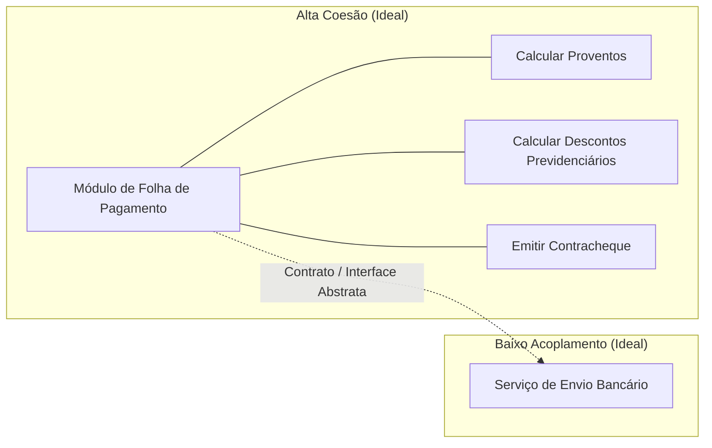
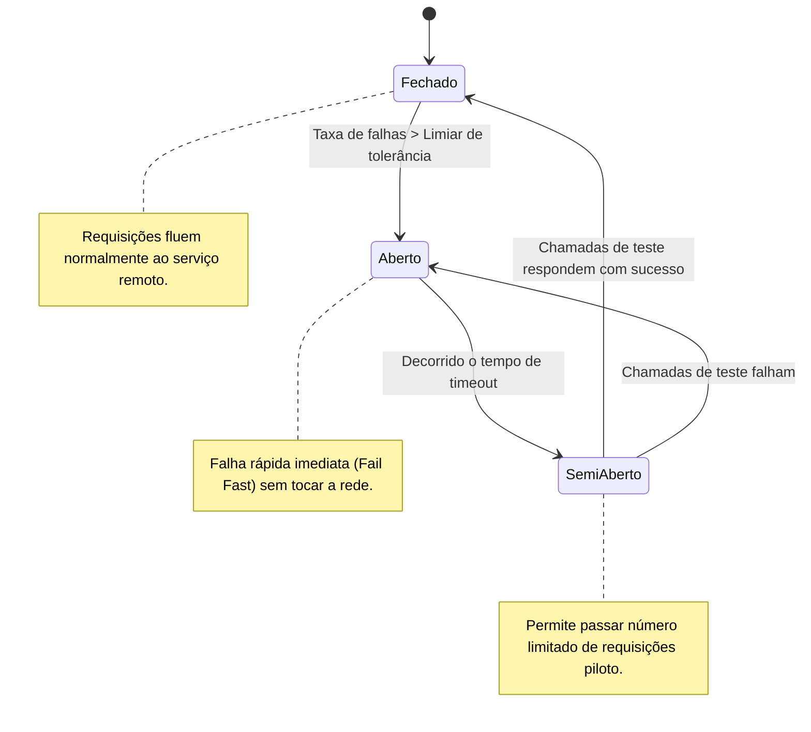
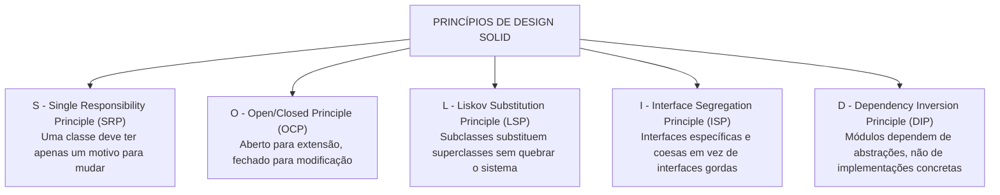

# 03 - Arquitetura de Software e Princípios de Design

> **Matéria:** Engenharia de Software  
> **Cargo:** B02 – Técnico de Controle Externo – Especialidade: Tecnologia da Informação  
> **Arquivo:** `03_arquitetura_de_software_e_principios_solid.md`  

---

## 📌 Ementa / Itens do Edital
- Arquitetura de software: padrões arquiteturais, arquitetura em camadas, orientada a serviços (SOA), microsserviços e orientada a eventos
- Princípios de design: SOLID, DRY, KISS e YAGNI
- Coesão e Acoplamento

---

## 🧭 Sumário

1. [Fundamentos de Arquitetura de Software](#1-fundamentos-de-arquitetura-de-software)
    1. [Estrutura, Componentes e Conectores Arquiteturais](#11-estrutura-componentes-e-conectores-arquiteturais)
    2. [O Modelo 4+1 Visões de Philippe Kruchten](#12-o-modelo-41-visoes-de-philippe-kruchten)
    3. [Coesão e Acoplamento: A Busca pela Alta Coesão e Baixo Acoplamento](#13-coesao-e-acoplamento-a-busca-pela-alta-coesao-e-baixo-acoplamento)
    4. [Teste 023](#Teste-023)
    5. [Teste 024](#Teste-024)
2. [Estilos e Padrões Arquiteturais](#2-estilos-e-padroes-arquiteturais)
    1. [Arquitetura em Camadas (Layered / N-Tier Architecture) e Variações Hexagonais](#21-arquitetura-em-camadas-layered-n-tier-architecture-e-variacoes-hexagonais)
    2. [Arquitetura Orientada a Serviços (SOA) e o Papel do Barramento Corporativo (ESB)](#22-arquitetura-orientada-a-servicos-soa-e-o-papel-do-barramento-corporativo-esb)
    3. [Arquitetura de Microsserviços e seus Padrões de Resiliência e Dados](#23-arquitetura-de-microsservicos-e-seus-padroes-de-resiliencia-e-dados)
    4. [Arquitetura Orientada a Eventos (EDA - Event-Driven Architecture)](#24-arquitetura-orientada-a-eventos-eda-event-driven-architecture)
    5. [Matriz Comparativa: Monólito vs. SOA vs. Microsserviços](#25-matriz-comparativa-monolito-vs-soa-vs-microsservicos)
    6. [Teste 025](#Teste-025)
    7. [Teste 026](#Teste-026)
    8. [Teste 027](#Teste-027)
    9. [Teste 028](#Teste-028)
    10. [Teste 029](#Teste-029)
3. [Princípios de Design e Código Limpo](#3-principios-de-design-e-codigo-limpo)
    1. [Os Princípios SOLID de Robert C. Martin](#31-os-principios-solid-de-robert-c-martin)
    2. [Princípios Práticos de Engenharia: DRY, KISS e YAGNI](#32-principios-praticos-de-engenharia-dry-kiss-e-yagni)
    3. [Teste 030](#Teste-030)
    4. [Teste 031](#Teste-031)
    5. [Teste 032](#Teste-032)
4. [Fontes Oficiais e Referências Bibliográficas](#4-fontes-oficiais-e-referencias-bibliograficas)

---

## 1. Fundamentos de Arquitetura de Software

### 1.1 Estrutura, Componentes e Conectores Arquiteturais
A Arquitetura de Software define a organização fundamental de um sistema corporativo, representada por seus componentes estruturais, pelos conectores e relacionamentos estabelecidos entre eles, pelo ambiente operacional em que executam e pelos princípios que norteiam seu design e evolução ao longo do tempo (IEEE 1471 / ISO/IEC 42010).

- **Componentes:** Unidades computacionais ou módulos de processamento e armazenamento de dados (ex.: microsserviços, controladores web, camadas de acesso a dados ou bancos relacionais);
- **Conectores:** Mecanismos que intermedeiam a comunicação, coordenação e transferência de dados entre os componentes (ex.: chamadas de procedimentos remotos RPC, requisições REST/HTTP, pipes, barramentos de mensageria ou filas Kafka/RabbitMQ);
- **Trade-offs Arquiteturais:** Nenhuma decisão arquitetural é neutra. Uma escolha que maximize desempenho ou escalabilidade horizontal quase invariavelmente introduz maior complexidade operacional e consistência eventual de dados (*Teorema CAP*).

### 1.2 O Modelo 4+1 Visões de Philippe Kruchten
Para descrever a arquitetura de software sob a ótica de múltiplos públicos (*stakeholders*), Philippe Kruchten introduziu o consagrado modelo **4+1 Visões**:

1. **Visão Lógica:** Foca na decomposição do sistema em classes, pacotes e subsistemas, atendendo aos requisitos funcionais do negócio (público: desenvolvedores e arquitetos);
2. **Visão de Processo:** Trata dos aspectos dinâmicos de concorrência, sincronização, desempenho, escalabilidade e threads de execução do sistema em tempo de execução;
3. **Visão de Desenvolvimento (Implementação):** Mostra a organização estática dos módulos de código-fonte, bibliotecas, frameworks, pacotes e ferramentas de compilação;
4. **Visão Física (Implantação):** Mapeia os artefatos de software sobre os nós de hardware físico, servidores de aplicação, redes, balanceadores de carga e contêineres na nuvem;
5. **Visão de Casos de Uso (+1):** Centraliza e integra as quatro visões anteriores a partir dos cenários essenciais que os usuários finais demandam do sistema.

### 1.3 Coesão e Acoplamento: A Busca pela Alta Coesão e Baixo Acoplamento
A métrica fundamental de qualidade de um design modular reside no equilíbrio entre coesão e acoplamento:

- **Coesão:** Mede a proximidade semântica e a harmonia das responsabilidades desempenhadas pelos elementos contidos no interior de um mesmo módulo.
    - *Alta Coesão (Desejável):* O módulo possui um propósito único, focado e bem delineado. Todos os seus métodos e atributos convergem para atender a uma finalidade coesa.
    - *Baixa Coesão (Indesejável / Antipadrão):* O módulo executa funções heterogêneas e desconexas (ex.: uma classe "Deus" ou "Manager" que conecta ao banco, valida regras fiscais e desenha janelas na tela).
- **Acoplamento:** Mede a intensidade da interdependência e a força das conexões entre módulos distintos.
    - *Baixo Acoplamento (Desejável):* Módulos comunicam-se exclusivamente através de contratos abstratos, interfaces ou mensagens padronizadas. Modificações internas em um módulo não propagam efeitos colaterais nos demais.
    - *Alto Acoplamento (Indesejável):* Módulos dependem de detalhes concretos de implementação interna uns dos outros, tornando qualquer manutenção arriscada e gerando falhas em cascata.

---

### Teste 023
**(Questão Inédita / Simulada Estilo FCC – Nível: Controle Externo / TI)**  
O modelo arquitetural "4+1 Visões", concebido por Philippe Kruchten, organiza a descrição de uma arquitetura de software sob diferentes perspectivas de múltiplos *stakeholders*. Em uma auditoria de sistemas de fiscalização, a equipe técnica necessita inspecionar a visão que se destina primordialmente aos desenvolvedores e gerentes de configuração, descrevendo a organização estática dos módulos de código-fonte, pacotes, camadas e gerenciamento de dependências. Essa perspectiva denomina-se Visão:

* **A)** de Desenvolvimento ou de Implementação (*Development/Implementation View*).
* **B)** Lógica (*Logical View*).
* **C)** de Processo (*Process View*).
* **D)** Física ou de Implantação (*Physical/Deployment View*).
* **E)** de Casos de Uso ou Cenários (*Scenarios / +1 View*).

---

> **Comentário Detalhado:**
>
> - **A) CORRETA.** No modelo "4+1" de Kruchten, a **Visão de Desenvolvimento (ou de Implementação)** aborda a organização estática dos módulos de software no ambiente de desenvolvimento: hierarquia de pacotes, bibliotecas, subsistemas, frameworks e código-fonte, tendo como público-alvo prioritário os programadores e engenheiros de software.
> - **B) Incorreta.** A Visão Lógica (*Logical View*) atende aos analistas de negócio e usuários finais, representando as abstrações do domínio, classes, interfaces e diagramas de classes e estados.
> - **C) Incorreta.** A Visão de Processo (*Process View*) foca em integradores e arquitetos de infraestrutura, descrevendo os aspectos dinâmicos de concorrência, threads, sincronização e desempenho em tempo de execução.
> - **D) Incorreta.** A Visão Física ou de Implantação (*Physical/Deployment View*) mapeia a distribuição dos componentes de software sobre a topologia física de hardware, servidores e nós de rede.
> - **E) Incorreta.** A Visão de Cenários (*+1 View*) reúne casos de uso essenciais que ilustram, validam e costuram harmonicamente as quatro outras visões arquiteturais.
>
> **Gabarito: A**

---

### Teste 024
**(Questão Inédita / Simulada Estilo FCC – Nível: Controle Externo / TI)**  
Na engenharia de software modular e no projeto arquitetural orientado a objetos, dois conceitos fundamentais que condicionam diretamente a manutenibilidade, testabilidade e elegância técnica do sistema são a Coesão e o Acoplamento. A respeito desses conceitos, assinale a afirmativa tecnicamente correta:

* **A)** A alta coesão indica que os elementos e responsabilidades de um mesmo módulo estão intimamente relacionados a um único propósito conceitual claro e bem delimitado, devendo ser buscada em conjunto com o baixo acoplamento entre módulos distintos.
* **B)** O projeto arquitetural ideal busca módulos com baixo acoplamento e baixa coesão, para que cada classe compartilhe o maior número possível de responsabilidades operacionais.
* **C)** O acoplamento afere a afinidade lógica interna entre os métodos privados de uma mesma classe, devendo ser maximizado para garantir integridade transacional.
* **D)** O alto acoplamento entre subsistemas é altamente desejável em arquiteturas corporativas, pois assegura que alterações em uma classe reflitam compulsoriamente em todos os demais componentes.
* **E)** Módulos com alta coesão dependem compulsoriamente de conexões rígidas com as classes concretas de banco de dados para validar suas regras de negócio.

---

> **Comentário Detalhado:**
>
> - **A) CORRETA.** O princípio mestre da boa arquitetura de software é a busca contínua por **Alta Coesão** (módulos focados em uma única responsabilidade conceitual bem delimitada) e **Baixo Acoplamento** (independência mútua entre módulos, minimizando dependências diretas e permitindo alterações isoladas sem efeitos colaterais em cascata).
> - **B) Incorreta.** Baixa coesão é indesejável (gera classes inchadas com responsabilidades desconexas, conhecidas como *God Classes*).
> - **C) Incorreta.** Inversão: o relacionamento interno entre os elementos de uma mesma classe define a **coesão**; o **acoplamento** mede o grau de interdependência entre classes ou módulos distintos.
> - **D) Incorreta.** O alto acoplamento gera fragilidade e rigidez arquitetural, fazendo com que uma modificação simples propague erros inesperados por todo o sistema.
> - **E) Incorreta.** Alta coesão independe de banco de dados; pelo contrário, conectar o domínio diretamente a tabelas físicas eleva o acoplamento tecnológico e viola o isolamento de camadas.
>
> **Gabarito: A**

---

## 2. Estilos e Padrões Arquiteturais

### 2.1 Arquitetura em Camadas (Layered / N-Tier Architecture) e Variações Hexagonais
- **Arquitetura em Camadas Clássica:** Divide o sistema em camadas horizontais empilhadas logicamente, onde cada camada oferece serviços especializados à camada imediatamente superior e consome serviços da camada imediatamente inferior:
    1. *Camada de Apresentação (UI / Interface com Usuário):* Captura requisições e renderiza respostas visuais;
    2. *Camada de Aplicação / Serviços:* Orquestra os fluxos de trabalho e casos de uso;
    3. *Camada de Domínio / Negócio:* Encapsula as regras de negócio puras e entidades corporativas;
    4. *Camada de Acesso a Dados / Persistência:* Isola operações de banco de dados (DAOs, Repositories).

- **Variações Modernas (Arquitetura Hexagonal e Clean Architecture):**
    - **Ports and Adapters (Alistair Cockburn):** O núcleo de domínio de negócio fica no centro, completamente isolado de frameworks e bancos. Comunica-se com o mundo externo através de **Portas** (interfaces abstratas) e **Adaptadores** (implementações concretas de controllers REST, drivers de banco ou filas).
    - **Clean Architecture (Robert Martin):** Estruturada em círculos concêntricos governados pela **Regra da Dependência**: as dependências de código-fonte devem apontar unicamente para dentro, em direção às entidades e casos de uso de alto nível.

### 2.2 Arquitetura Orientada a Serviços (SOA) e o Papel do Barramento Corporativo (ESB)
A Arquitetura Orientada a Serviços (SOA) é um estilo arquitetural corporativo que integra aplicações legadas heterogêneas através de serviços fracamente acoplados e reutilizáveis:

- **Princípios Fundamentais de SOA (Thomas Erl):** Contratos de serviço formais e padronizados, baixo acoplamento, abstração de tecnologia, reusabilidade corporativa, autonomia funcional, composabilidade e descoberta de serviços;
- **Barramento de Serviços Corporativo (ESB - Enterprise Service Bus):** Infraestrutura de middleware centralizada e pesada que assume a responsabilidade de conectar, mediar, rotear, transformar protocolos (ex.: converter JSON/HTTP para XML/SOAP) e orquestrar fluxos de trabalho entre sistemas legados distintos;
- **Padrões de Comunicação:** Serviços web baseados em SOAP (*Simple Object Access Protocol*), descritos formalmente em documentos WSDL (*Web Services Description Language*) e registrados em repositórios UDDI.

### 2.3 Arquitetura de Microsserviços e seus Padrões de Resiliência e Dados
A arquitetura de microsserviços decompõe um sistema em um conjunto de serviços autônomos, de granularidade fina, modelados em torno de contextos de negócios delimitados (*Bounded Contexts* do Domain-Driven Design - DDD):

- **Premissa Fundamental:** *Smart endpoints and dumb pipes* (a lógica de negócio reside nas pontas, dispensando barramentos pesados e usando comunicação direta leve como REST/JSON, gRPC ou filas Kafka/RabbitMQ);
- **Banco de Dados por Serviço (*Database per Service*):** Cada microsserviço gerencia sua própria base de dados (relacional ou NoSQL). É expressamente proibido o acesso direto ao banco de dados de um serviço por outro serviço!

#### Padrões Críticos de Microsserviços:
1. **Circuit Breaker (Disjuntor de Resiliência):** Previne que a indisponibilidade ou latência extrema de um microsserviço provoque falhas em cascata que esgotem os recursos do chamador. Opera em três estados:
    - *Fechado (Closed):* As requisições fluem normalmente. Falhas são contabilizadas;
    - *Aberto (Open):* Ao atingir um limiar de erros, o circuito abre. Todas as requisições falham imediatamente (*fail-fast*), sem tentar acessar a rede;
    - *Semi-Aberto (Half-Open):* Após um tempo de espera (*timeout*), o circuito permite a passagem de algumas requisições de teste. Se forem bem-sucedidas, o circuito fecha; se falharem, o circuito volta ao estado aberto.

2. **API Gateway:** Ponto único de entrada para todas as requisições de clientes externos. Responsável por roteamento dinâmico, autenticação, controle de taxa (*rate limiting*), monitoramento e agregação de respostas de múltiplos serviços;
3. **Saga Pattern (Transações Distribuídas):** Substitui o bloqueio rígido do *Two-Phase Commit (2PC)* em ambientes distribuídos, gerenciando a consistência final por meio de uma sequência de transações locais encadeadas:
    - *Coreografia:* Cada serviço executa sua transação local e emite um evento de domínio que aciona a transação no serviço seguinte;
    - *Orquestração:* Um serviço coordenador centralizado comanda explicitamente a execução de cada etapa;
    - *Ações Compensatórias:* Caso uma etapa falhe no meio do fluxo, a Saga executa transações de compensação (estorno) para desfazer os efeitos parciais anteriores;

4. **CQRS (Command Query Responsibility Segregation):** Segrega o modelo de escrita/atualização de dados (*Commands*) do modelo de leitura/consulta (*Queries*), permitindo otimizar e escalar separadamente os bancos de escrita (foco em normalização) e de leitura (foco em desnormalização rápida).

### 2.4 Arquitetura Orientada a Eventos (EDA - Event-Driven Architecture)
Estilo arquitetural fundamentado na produção, captura, processamento e reação a **eventos** (mudanças significativas de estado no negócio):

- **Componentes:** *Produtores de Eventos* (emitem notificações de que algo ocorreu), *Event Brokers* (canais de mensageria assíncrona como Apache Kafka ou RabbitMQ) e *Consumidores de Eventos* (reagem e processam os eventos);
- **Modelos:** *Publicação/Assinatura (Pub/Sub)* e *Event Streaming* (fluxo contínuo e persistido de eventos ordenados);
- **Event Sourcing:** Padrão arquitetural em que o estado atual de uma entidade não é armazenado em campos estáticos de uma tabela, mas reconstruído dinamicamente mediante a reprodução sequencial de uma trilha histórica imutável de eventos registrados (*append-only log*).

### 2.5 Matriz Comparativa: Monólito vs. SOA vs. Microsserviços

| Característica | Arquitetura Monolítica | SOA (Service-Oriented) | Microsserviços |
| :--- | :--- | :--- | :--- |
| **Composição da Aplicação** | Bloco único de implantação | Serviços corporativos reutilizáveis | Pequenos serviços focados em domínios (*Bounded Contexts*) |
| **Infraestrutura de Integração** | Chamadas diretas em memória | Barramento Corporativo Inteligente (**ESB**) centralizado | Mecanismos leves (*Smart endpoints, dumb pipes* via REST/gRPC/Kafka) |
| **Gerenciamento de Dados** | Banco de dados único e centralizado | Banco de dados compartilhado por múltiplos serviços | Banco de dados exclusivo por serviço (**Database per Service**) |
| **Independência de Deploy** | Nula (deploy tudo-ou-nada) | Moderada a baixa (deploys coordenados) | Totalmente independente para cada microsserviço |
| **Acoplamento Tecnológico** | Alto (pilha tecnológica única) | Médio (contratos padronizados WSDL) | Nulo (poliglotismo: cada serviço usa a linguagem ideal) |

---

### Teste 025
**(Questão Inédita / Simulada Estilo FCC – Nível: Controle Externo / TI)**  
A Arquitetura Hexagonal (*Ports and Adapters*), idealizada por Alistair Cockburn, consolidou-se como um referencial arquitetural para sistemas corporativos que buscam isolar o núcleo das regras de negócio de tecnologias de persistência, protocolos de rede e interfaces com o usuário. A respeito dos princípios formais dessa arquitetura, é correto afirmar:

* **A)** O núcleo de domínio da aplicação reside no interior do hexágono e interage com o ambiente externo estritamente por meio de Portas (*Ports* - interfaces abstratas), cujas implementações tecnológicas concretas são providas por Adaptadores (*Adapters*).
* **B)** A interface gráfica com o usuário e as bibliotecas de persistência relacional devem ser acopladas diretamente às entidades de domínio para viabilizar auditorias imediatas.
* **C)** O padrão veda a execução de testes unitários automatizados no domínio interno sem a presença ativa de um servidor de aplicação web e banco de dados físico em produção.
* **D)** A arquitetura exige a alocação de seis servidores físicos redundantes para implementar cada um dos vértices do hexágono computacional.
* **E)** As portas e adaptadores somente podem ser empregados se a camada de comunicação externa utilizar exclusivamente mensagens em padrão SOAP com assinatura digital.

---

> **Comentário Detalhado:**
>
> - **A) CORRETA.** Na **Arquitetura Hexagonal (Portas e Adaptadores)**, o domínio central de negócio é completamente agnóstico a detalhes de infraestrutura. Ele se comunica com o mundo exterior por meio de **Portas** (interfaces de entrada/saída) e **Adaptadores** (componentes periféricos que convertem sinais externos — como requisições HTTP, filas Kafka ou repositórios SQL — para as chamadas de método definidas pelas portas).
> - **B) Incorreta.** Viola o princípio basilar da arquitetura, que é exatamente desacoplar o domínio de bancos de dados ou frameworks de interface gráfica.
> - **C) Incorreta.** Uma das maiores vantagens da arquitetura hexagonal é a alta testabilidade: o domínio pode ser integralmente testado por testes unitários puros em memória com *mocks* de portas, sem dependência de servidores web ou bancos reais.
> - **D) Incorreta.** O "hexágono" é uma metáfora visual de desenho lógico, não uma exigência física de hardware ou servidores de rede.
> - **E) Incorreta.** Os adaptadores podem adotar qualquer protocolo (REST, GraphQL, gRPC, CLI, JDBC, etc.), não havendo restrição a SOAP.
>
> **Gabarito: A**

---

### Teste 026
**(Questão Inédita / Simulada Estilo FCC – Nível: Controle Externo / TI)**  
No modelo de Arquitetura Orientada a Serviços (SOA), o Barramento Corporativo de Serviços (*Enterprise Service Bus* - ESB) desempenha papel central de infraestrutura na integração de sistemas heterogêneos. Dentre as capacidades e responsabilidades técnicas atribuídas a um ESB em ambientes de alta governança pública, destaca-se:

* **A)** O roteamento inteligente de mensagens, a mediação de serviços e a transformação transparente entre diferentes protocolos e formatos de dados corporativos.
* **B)** A compilação em tempo real e injeção dinâmica de código-fonte nas estações de trabalho de todos os usuários finais do órgão.
* **C)** A eliminação definitiva de sistemas de gerenciamento de banco de dados relacionais em proveito de tabelas gravadas exclusivamente em memória volátil no barramento.
* **D)** A obrigatoriedade de reescrever todas as aplicações legadas da instituição na linguagem Java antes de conectá-las ao barramento.
* **E)** A delegação automática de deliberações decisórias de auditoria a algoritmos não supervisionados sem registro de trilha de auditoria.

---

> **Comentário Detalhado:**
>
> - **A) CORRETA.** Em uma infraestrutura SOA clássica, o **ESB (Enterprise Service Bus)** fornece conectividade desacoplada, oferecendo **roteamento baseado em conteúdo**, **transformação de protocolos e formatos de mensagens** (ex.: converter JSON REST em SOAP XML ou arquivos posicionais), enriquecimento de dados, controle de tráfego e aplicação de políticas de segurança e auditoria corporativa.
> - **B) Incorreta.** O ESB lida com transporte e integração de mensagens entre serviços de backend, não com compilação de código ou injeção em clientes de front-end.
> - **C) Incorreta.** O barramento não substitui bancos de dados; a persistência de dados permanece sob gestão dos serviços e repositórios especialistas de cada aplicação.
> - **D) Incorreta.** Um dos maiores atrativos do ESB é justamente a capacidade de integrar sistemas legados heterogêneos escritos em COBOL, C, .NET, Java, etc., sem necessidade de reescrita da base legada.
> - **E) Incorreta.** Afirmação absurda que colide com princípios de governança, conformidade e rastreabilidade pública.
>
> **Gabarito: A**

---

### Teste 027
**(Questão Inédita / Simulada Estilo FCC – Nível: Controle Externo / TI)**  
Em uma arquitetura de microsserviços distribuídos voltada a serviços de auditoria digital, um serviço principal depende de sucessivas chamadas a uma API externa de consulta cadastral. Para evitar que eventuais lentidões severas ou a indisponibilidade dessa API externa provoquem o esgotamento dos recursos de processamento (*thread starvation*) do serviço chamador e desencadeiem falhas em cascata em todo o ecossistema, adota-se um padrão de resiliência que intercepta as invocações. Caso a proporção de falhas ultrapasse um limiar crítico, esse mecanismo interrompe temporariamente as chamadas subsequentes, retornando imediatamente uma resposta alternativa (*fallback*), e passa a monitorar em intervalos programados se o serviço remoto restabeleceu sua operação estável. Esse padrão arquitetural é denominado:

* **A)** Circuit Breaker.
* **B)** API Gateway.
* **C)** Service Registry.
* **D)** Event Sourcing.
* **E)** Command Query Responsibility Segregation (CQRS).

---

> **Comentário Detalhado:**
>
> - **A) CORRETA.** O padrão **Circuit Breaker (Disjuntor)**, popularizado por Michael Nygard em sistemas distribuídos, atua exatamente como um disjuntor elétrico em três estados: **Fechado (*Closed*)** (requisições passam normalmente); **Aberto (*Open*)** (após sucessivas falhas ou latências acima do limiar, as chamadas são bloqueadas de imediato, disparando fallbacks sem onerar a rede ou travar threads); e **Meio-Aberto (*Half-Open*)** (após um tempo de espera, permite um número controlado de chamadas de teste para verificar a recuperação do serviço).
> - **B) Incorreta.** O API Gateway é um ponto único de entrada para clientes externos, responsável por roteamento reverso, agregação de chamadas, autenticação e limitação de taxa (*rate limiting*).
> - **C) Incorreta.** O Service Registry atua como um catálogo de serviços para localização dinâmica de instâncias e balanceamento de carga (*service discovery*).
> - **D) Incorreta.** O Event Sourcing armazena as mudanças de estado da aplicação como uma sequência histórica append-only de eventos de negócio imutáveis.
> - **E) Incorreta.** O CQRS segrega as operações de mutação de dados (Commands) das operações de consulta (Queries) em modelos separados.
>
> **Gabarito: A**

---

### Teste 028
**(Questão Inédita / Simulada Estilo FCC – Nível: Controle Externo / TI)**  
A Arquitetura Orientada a Eventos (*Event-Driven Architecture* - EDA) baseia-se na troca assíncrona de estímulos corporativos entre produtores e consumidores de eventos, promovendo alto desacoplamento e escalabilidade. Quando associada ao padrão arquitetural CQRS (*Command Query Responsibility Segregation*), estabelece-se que:

* **A)** as operações de mutação de estado (*Commands*) e as operações de consulta (*Queries*) utilizam modelos conceituais segregados, viabilizando a otimização independente do banco de escrita e dos bancos de leitura.
* **B)** todas as transações de escrita e leitura devem ocorrer obrigatoriamente sobre o mesmo esquema de banco de dados relacional para garantir bloqueio pessimista imediato.
* **C)** os produtores de eventos necessitam manter acoplamento síncrono com o endereço IP de todos os consumidores cadastrados antes de liberar o evento na fila.
* **D)** as operações de consulta (*Queries*) passam a ter a prerrogativa de disparar alterações definitivas no modelo de escrita a fim de atualizar estatísticas de acesso.
* **E)** o padrão veda expressamente o uso de consistência eventual (*eventual consistency*) entre os repositórios de leitura e o repositório principal de comandos.

---

> **Comentário Detalhado:**
>
> - **A) CORRETA.** O padrão **CQRS** (segregação de responsabilidade entre comandos e consultas) divide estruturalmente a aplicação em dois fluxos: o lado de **Escrita/Comandos (*Commands*)**, focado em regras de consistência transacional profunda e validação de negócio; e o lado de **Leitura/Consultas (*Queries*)**, focado em alta velocidade de resposta por meio de visões desnormalizadas, índices especializados e caches, que podem ser sincronizados assincronamente via eventos (EDA).
> - **B) Incorreta.** O objetivo primário do CQRS é justamente libertar a aplicação do modelo único compartilhado de dados para escrita e leitura.
> - **C) Incorreta.** Na arquitetura orientada a eventos, os produtores são desacoplados dos consumidores (publicam no barramento/tópico sem conhecimento da identidade ou endereço dos consumidores).
> - **D) Incorreta.** Princípio estrito de comandos e consultas: consultas nunca devem produzir efeitos colaterais de alteração de estado no domínio (*queries do not change state*).
> - **E) Incorreta.** Pelo contrário: a consistência eventual é o modelo comumente adotado na sincronização assíncrona entre o banco de escrita e as projeções de leitura no CQRS.
>
> **Gabarito: A**

---

### Teste 029
**(Questão Inédita / Simulada Estilo FCC – Nível: Controle Externo / TI)**  
Em relação aos estilos arquiteturais para sistemas corporativos, analise as afirmativas a respeito da Arquitetura Orientada a Serviços (SOA) e da Arquitetura de Microsserviços:

I. Na arquitetura SOA clássica, é comum a utilização de um Barramento de Serviços Corporativo (ESB) centralizado que concentra regras de mediação, roteamento e transformação de protocolos complexos.  
II. Na arquitetura de microsserviços, a boa prática de engenharia prescreve o compartilhamento obrigatório de uma única base de dados relacional entre todos os serviços do ecossistema, a fim de assegurar transações atômicas globais imediatas.  
III. A arquitetura de microsserviços privilegia serviços autônomos com ciclos de implantação independentes, pautando-se pelo princípio de *smart endpoints and dumb pipes*, em que a inteligência de negócio reside nos próprios serviços e o transporte de mensagens utiliza mecanismos leves e desacoplados.  

Em relação aos conceitos arquiteturais consagrados na literatura técnica, está correto o que se afirma em:

* **A)** I e III, apenas.
* **B)** I e II, apenas.
* **C)** II e III, apenas.
* **D)** I, II e III.
* **E)** III, apenas.

---

> **Comentário Detalhado:**
>
> - **I. Correta.** SOA tradicionalmente adota um barramento corporativo (ESB) central que orquestra a comunicação, converte formatos de dados pesados (XML/SOAP) e concentra a inteligência da integração corporativa.
> - **II. Incorreta.** Em microsserviços, compartilhar um banco de dados central único (*Database-per-service anti-pattern*) cria um acoplamento oculto severo que inviabiliza implantações independentes e gera gargalos de escala. A recomendação mestre é o padrão **Database-per-Service** (cada microsserviço gerencia privativamente seu próprio banco de dados).
> - **III. Correta.** Princípio cunhado por Martin Fowler: microsserviços adotam *"endpoints inteligentes e canais burros"* (*smart endpoints and dumb pipes*), mantendo a lógica de processamento e validações dentro dos microsserviços e utilizando canais de comunicação leves e padronizados (como HTTP REST ou mensageria Kafka/RabbitMQ).
>
> **Gabarito: A**

---

## 3. Princípios de Design e Código Limpo

### 3.1 Os Princípios SOLID de Robert C. Martin
Os princípios SOLID formam a espinha dorsal do design orientado a objetos robusto, modular e sustentável:

1. **S - Single Responsibility Principle (SRP - Princípio da Responsabilidade Única):**
    - *Definição:* Uma classe deve possuir uma e apenas uma razão para mudar (deve atender a um único ator de negócio);
    - *Violação Clássica:* Criar classes monstruosas (*God Classes*) que acumulam regras de negócio, persistência de banco de dados e geração de relatórios gráficos no mesmo arquivo.

2. **O - Open/Closed Principle (OCP - Princípio Aberto/Fechado):**
    - *Definição:* Entidades de software (classes, módulos, funções) devem estar **abertas para extensão, mas fechadas para modificação**;
    - *Aplicação:* Novos comportamentos devem ser adicionados mediante criação de novas classes derivadas ou polimorfismo de interfaces, sem editar e arriscar quebrar o código-fonte original já em produção;
    - *Violação Clássica:* Estruturas extensas de `if-else-if` ou `switch-case` checando tipos de objetos para aplicar regras de cálculo distintas (ex.: cálculo de frete por transportadora).

3. **L - Liskov Substitution Principle (LSP - Princípio da Substituição de Liskov):**
    - *Definição:* Se $S$ é um subtipo de $T$, objetos do tipo $T$ devem poder ser substituídos por objetos do tipo $S$ sem alterar a corretude do programa;
    - *Violação Clássica:* Uma classe `Quadrado` que herda de `Retangulo`. Como o quadrado força largura e altura rigorosamente iguais, invocar `setLargura(5)` e `setAltura(10)` em uma referência polimórfica de `Retangulo` que aponte para um `Quadrado` viola as expectativas de comportamento da classe base. Outro sintoma claro é uma subclasse sobrescrever um método herdado lançando `UnsupportedOperationException`.

4. **I - Interface Segregation Principle (ISP - Princípio da Segregação de Interfaces):**
    - *Definição:* Muitas interfaces específicas são melhores do que uma interface única de propósito geral ("interface gorda");
    - *Aplicação:* Classes clientes não devem ser forçadas a depender de métodos que não utilizam. Decompõem-se interfaces amplas em interfaces menores e coesas.

5. **D - Dependency Inversion Principle (DIP - Princípio da Inversão de Dependência):**
    - *Definição:* Módulos de alto nível não devem depender de módulos de baixo nível; ambos devem depender de **abstrações** (interfaces). Abstrações não devem depender de detalhes; detalhes devem depender de abstrações;
    - *Aplicação:* As classes de serviço de negócio dependem de interfaces (`RepositorioAuditoria`), e as implementações concretas de acesso a banco (`PostgresRepositorioAuditoria`) implementam essa interface.

> 🚨 **ALERTA DE PROVA / PEGADINHA FCC:**  
> A FCC adora cobrar a distinção conceitual entre:
>
> - **Inversão de Dependência (DIP):** É o princípio conceitual abstrato de design (depender de interfaces).
> - **Inversão de Controle (IoC):** É a estratégia arquitetural genérica onde o fluxo de execução é delegado ao framework.
> - **Injeção de Dependência (DI):** É o padrão de projeto prático que implementa a IoC/DIP, fornecendo as instâncias concretas das dependências através de construtores ou métodos setter.

### 3.2 Princípios Práticos de Engenharia: DRY, KISS e YAGNI
- **DRY (Don't Repeat Yourself - Não se Repita):** Formulado por Andy Hunt e Dave Thomas no livro *The Pragmatic Programmer*. Estabelece que cada porção de conhecimento ou lógica de negócio em um sistema deve possuir uma representação única, não ambígua e autoritativa. Combate a duplicação de regras em múltiplos pontos do código;
- **KISS (Keep It Simple, Stupid - Mantenha as Coisas Simples):** Princípio de design que preconiza a simplicidade estrutural. A solução mais simples que resolve adequadamente o problema deve sempre prevalecer sobre soluções sofisticadas e excessivamente complexas;
- **YAGNI (You Aren't Gonna Need It - Você Não Vai Precisar Disso):** Princípio fundamental do Extreme Programming (XP). Determina que os desenvolvedores **não devem implementar funcionalidades antecipadamente com base em suposições futuras**, construindo apenas aquilo que é estritamente exigido pelos requisitos atuais. Evita o desperdício de *Gold Plating* e a sobre-engenharia (*overengineering*).

---

### Teste 030
**(Questão Inédita / Simulada Estilo FCC – Nível: Controle Externo / TI)**  
Durante a revisão de código de um sistema corporativo de gestão de processos administrativos em Java, um Auditor de TI inspecionou uma interface denominada `DispositivoMultifuncional`, que declarava os seguintes métodos: `imprimirDocumento()`, `digitalizarDocumento()`, `enviarFax()` e `grampearFolhas()`. Verificou-se que a classe `ImpressoraBasicaGabinete` implementava essa interface, mas, por tratar-se de um equipamento simples que não possui scanner, módulo de fax nem grampeador mecânico, seu código era forçado a lançar exceções do tipo `UnsupportedOperationException` no corpo dos três últimos métodos. De acordo com os princípios de orientação a objetos SOLID preconizados por Robert C. Martin, essa modelagem viola frontalmente o:

* **A)** Princípio da Segregação de Interfaces (ISP).
* **B)** Princípio da Responsabilidade Única (SRP).
* **C)** Princípio Aberto/Fechado (OCP).
* **D)** Princípio da Inversão de Dependência (DIP).
* **E)** Princípio da Substituição de Liskov (LSP).

---

> **Comentário Detalhado:**
>
> - **A) CORRETA.** O **Princípio da Segregação de Interfaces (ISP - *Interface Segregation Principle*)** estabelece formalmente que *"nenhum cliente deve ser forçado a depender de métodos que não utiliza"*. Em vez de interfaces genéricas e volumosas (*fat interfaces*), o arquiteto deve decompor a interface em contratos menores e específicos (ex.: `Imprimivel`, `Digitalizavel`, `Grampeavel`), permitindo que as classes clientes implementem estritamente as capacidades que de fato possuem.
> - **B) Incorreta.** O SRP dita que uma classe ou módulo deve ter um, e apenas um, motivo para mudar (*single reason to change*).
> - **C) Incorreta.** O OCP estabelece que entidades de software devem estar abertas para extensão, mas fechadas para modificação.
> - **D) Incorreta.** O DIP prescreve que módulos de alto nível não devem depender de módulos de baixo nível, mas sim de abstrações.
> - **E) Incorreta.** O LSP preconiza que objetos de subclasses devem poder substituir objetos da superclasse sem alterar a corretude do sistema (embora o lançamento de UnsupportedOperationException configure um sintoma prático na hierarquia, a raiz direta da má modelagem de contratos inchados é a violação do ISP).
>
> **Gabarito: A**

---

### Teste 031
**(Questão Inédita / Simulada Estilo FCC – Nível: Controle Externo / TI)**  
Considere uma classe Java responsável pelo cálculo da tarifa de serviços operacionais em um Tribunal de Contas. O método `calcularTarifa` possui uma estrutura sequencial de instruções condicionais `if-else-if` encadeadas: caso o tipo de procedimento seja "INSPECAO", aplica uma fórmula; se for "AUDITORIA", aplica outra; se for "PERICIA", aplica uma terceira. Sempre que o Tribunal regulamenta uma nova modalidade de procedimento fiscalizatório, os analistas são obrigados a abrir a classe de serviço já testada em produção e adicionar manualmente uma nova cláusula `else-if`. Do ponto de vista dos princípios arquiteturais SOLID, essa estrutura viola diretamente o:

* **A)** Princípio Aberto/Fechado (OCP - *Open/Closed Principle*).
* **B)** Princípio da Substituição de Liskov (LSP - *Liskov Substitution Principle*).
* **C)** Princípio da Segregação de Interfaces (ISP - *Interface Segregation Principle*).
* **D)** Princípio *Don't Repeat Yourself* (DRY).
* **E)** Princípio *You Aren't Gonna Need It* (YAGNI).

---

> **Comentário Detalhado:**
>
> - **A) CORRETA.** O **Princípio Aberto/Fechado (OCP)** dita que *"artefatos de software devem estar abertos para extensão, porém fechados para modificação"*. Quando a introdução de um novo comportamento exige alterar o código-fonte de uma classe pré-existente e estável (adicionando condicionais `if/else` ou `switch`), o princípio é violado. A solução técnica correta é aplicar polimorfismo (por exemplo, com o padrão *Strategy*), criando novas classes especializadas que implementem uma interface comum, estendendo o sistema sem alterar o código estável original.
> - **B) Incorreta.** O LSP assegura que tipos derivados possam substituir perfeitamente seus tipos base sem quebrar o comportamento do programa.
> - **C) Incorreta.** O ISP trata do tamanho e foco de interfaces abstratas, evitando contratos inchados.
> - **D) Incorreta.** DRY combate a duplicação de conhecimento e regras de negócio no sistema.
> - **E) Incorreta.** YAGNI recomenda não implementar recursos antecipadamente até que sejam comprovadamente necessários.
>
> **Gabarito: A**

---

### Teste 032
**(Questão Inédita / Simulada Estilo FCC – Nível: Controle Externo / TI)**  
No âmbito das boas práticas de arquitetura e qualidade de código em desenvolvimento de software, os acrônimos DRY (*Don't Repeat Yourself*) e YAGNI (*You Aren't Gonna Need It*) são amplamente referenciados como balizadores de simplificação e manutenibilidade. A respeito da correta fundamentação técnica desses dois princípios, assinale a afirmativa correta:

* **A)** O princípio DRY preconiza que cada porção de conhecimento ou lógica de negócio em um sistema deve possuir uma representação única, não ambígua e definitiva; ao passo que o YAGNI orienta os desenvolvedores a não implementarem funcionalidades ou abstrações antecipadas com base em meras suposições de necessidades futuras.
* **B)** O princípio DRY impede que classes distintas possuam métodos com a mesma assinatura ou nomenclatura; ao passo que o YAGNI proíbe expressamente a utilização de testes unitários automatizados em ambientes de produção.
* **C)** O princípio DRY aplica-se unicamente à padronização de nomenclatura de colunas em bancos de dados relacionais; enquanto o YAGNI recomenda a criação preventiva de tabelas adicionais para acomodar futuras demandas.
* **D)** O princípio YAGNI impõe a obrigatoriedade de reescrever integralmente o código legado a cada ciclo anual; enquanto o DRY determina que todo software público deve ser licenciado em código aberto.
* **E)** Ambos os princípios foram originalmente formulados pela norma ISO 9001 para auditar contratos de aquisição de bens permanentes de TI.

---

> **Comentário Detalhado:**
>
> - **A) CORRETA.** Formulados pela comunidade de engenharia ágil e desenvolvimento pragmático:
>     - **DRY (*Don't Repeat Yourself* - Andy Hunt e Dave Thomas):** Estabelece que toda porção de conhecimento e regra de negócio deve ter uma representação única, autoritativa e não ambígua no sistema, combatendo duplicação de lógica e inconsistências;
>     - **YAGNI (*You Aren't Gonna Need It* - Extreme Programming):** Recomenda implementar apenas o que é estritamente necessário para atender aos requisitos atuais, evitando o desperdício de codificar arquiteturas ou funcionalidades hipotéticas para o futuro ("prematuridade especulativa").
> - **B) Incorreta.** Assinaturas idênticas de métodos em classes diferentes fazem parte do polimorfismo natural; testes automatizados são indispensáveis e incentivados pelo YAGNI/XP.
> - **C) Incorreta.** Distorção completa: criar tabelas preventivas para suposições futuras viola diretamente a essência do YAGNI.
> - **D) Incorreta.** Não há nenhuma regra de reescrita compulsória anual de legado nem obrigatoriedade de licenciamento no teor do DRY/YAGNI.
> - **E) Incorreta.** São princípios de engenharia e boas práticas de codificação artesanal de software (*software craftsmanship*), não cláusulas da norma ISO 9001.
>
> **Gabarito: A**

---

## 4. Fontes Oficiais e Referências Bibliográficas

* [Microservices: A Definition of This New Architectural Term (Martin Fowler & James Lewis)](https://martinfowler.com/articles/microservices.html) - Artigo seminal definindo a arquitetura de microsserviços, governança descentralizada, *smart endpoints and dumb pipes* e persistência poliglota.
* [What do you mean by "Event-Driven"? — Arquitetura Orientada a Eventos e Event Sourcing (Martin Fowler)](https://martinfowler.com/articles/201701-event-driven.html) - Distinção formal entre notificação de eventos, transferência de estado baseada em eventos, Event Sourcing e CQRS.
* [Strangler Fig Application — Modernização Gradual de Sistemas Legados (Martin Fowler)](https://martinfowler.com/bliki/StranglerFigApplication.html) - Padrão arquitetural para migração incremental de monólitos para arquiteturas distribuídas.
* [Bounded Context — Contextos Delimitados no Domain-Driven Design (Martin Fowler)](https://martinfowler.com/bliki/BoundedContext.html) - Fundamento de alta coesão e baixo acoplamento no particionamento de domínios e microsserviços.
* [The Twelve-Factor App (Os Doze Fatores para Aplicações Cloud-Native)](https://12factor.net/pt_br/) - Metodologia arquitetural para construção de softwares-como-serviço escaláveis, portáveis e resilientes.
* MARTIN, Robert C. **Arquitetura Limpa: O Guia do Artesão para Estrutura e Design de Software**. Rio de Janeiro: Alta Books, 2019. (Parte III - Princípios de Design SOLID; Parte V - Arquitetura).
* NEWMAN, Sam. **Building Microservices: Designing Fine-Grained Systems**. 2. ed. Sebastopol: O'Reilly Media, 2021. (Cap. 4 - Microservice Communication Styles; Cap. 6 - Workflow and Sagas; Cap. 11 - Resiliency).
* EVANS, Eric. **Domain-Driven Design: Atacando as Complexidades no Coração do Software**. Rio de Janeiro: Alta Books, 2016. (Parte IV - Design Estratégico).
