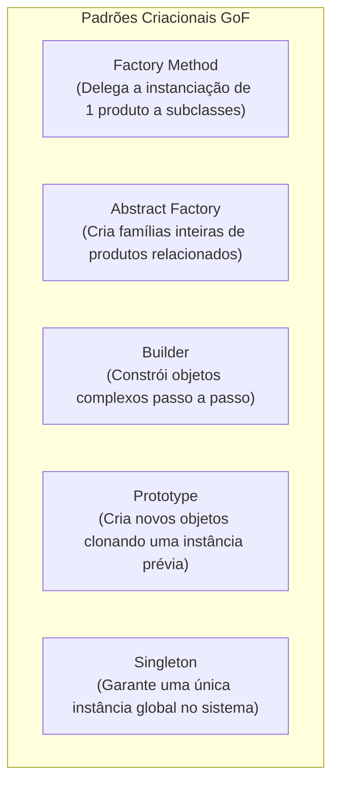

# 04 - Padrões de Projeto (Design Patterns - GoF)

> **Matéria:** Engenharia de Software  
> **Cargo:** B02 – Técnico de Controle Externo – Especialidade: Tecnologia da Informação  
> **Arquivo:** `04_padroes_de_projeto_design_patterns.md`  
> **Referência Fundamental:** Gang of Four (GoF - Erich Gamma, Richard Helm, Ralph Johnson e John Vlissides)

---

## 📌 Ementa / Itens do Edital
- Padrões de projeto de software (Design Patterns GoF)
- Padrões Criacionais (Creational Patterns)
- Padrões Estruturais (Structural Patterns)
- Padrões Comportamentais (Behavioral Patterns)

---

## 🧭 Sumário

1. [Fundamentos e Princípios dos Padrões de Projeto GoF](#1-fundamentos-e-principios-dos-padroes-de-projeto-gof)
    1. [Definição Canônica e Elementos Estruturantes](#11-definicao-canonica-e-elementos-estruturantes)
    2. [Os Dois Grandes Princípios de Design do GoF](#12-os-dois-grandes-principios-de-design-do-gof)
    3. [A Matriz Canônica dos 23 Padrões GoF (Propósito vs. Escopo)](#13-a-matriz-canonica-dos-23-padroes-gof-proposito-vs-escopo)
    4. [Teste 033](#Teste-033)
2. [Padrões de Criação (Creational Patterns)](#2-padroes-de-criacao-creational-patterns)
    1. [Factory Method vs. Abstract Factory](#21-factory-method-vs-abstract-factory)
    2. [Builder, Prototype e Singleton](#22-builder-prototype-e-singleton)
    3. [Teste 034](#Teste-034)
    4. [Teste 035](#Teste-035)
3. [Padrões Estruturais (Structural Patterns)](#3-padroes-estruturais-structural-patterns)
    1. [Adapter vs. Bridge vs. Facade](#31-adapter-vs-bridge-vs-facade)
    2. [Composite, Decorator, Flyweight e Proxy](#32-composite-decorator-flyweight-e-proxy)
    3. [Teste 036](#Teste-036)
    4. [Teste 037](#Teste-037)
    5. [Teste 038](#Teste-038)
4. [Padrões Comportamentais (Behavioral Patterns)](#4-padroes-comportamentais-behavioral-patterns)
    1. [Strategy vs. State vs. Template Method](#41-strategy-vs-state-vs-template-method)
    2. [Observer e Arquitetura de Publicação/Assinatura](#42-observer-e-arquitetura-de-publicacaoassinatura)
    3. [Command, Chain of Responsibility, Iterator, Mediator, Memento e Visitor](#43-command-chain-of-responsibility-iterator-mediator-memento-e-visitor)
    4. [Teste 039](#Teste-039)
    5. [Teste 040](#Teste-040)
    6. [Teste 041](#Teste-041)
    7. [Teste 042](#Teste-042)
5. [Fontes Oficiais e Referências Bibliográficas](#5-fontes-oficiais-e-referencias-bibliograficas)

---

## 1. Fundamentos e Princípios dos Padrões de Projeto GoF

### 1.1 Definição Canônica e Elementos Estruturantes
Publicado em 1994 por Erich Gamma, Richard Helm, Ralph Johnson e John Vlissides (*Gang of Four - GoF*), o catálogo clássico de Padrões de Projeto (*Design Patterns*) formalizou soluções reutilizáveis para problemas recorrentes no desenvolvimento de software orientado a objetos.
Um padrão de projeto não é código-fonte acabado nem uma biblioteca pronta, mas uma descrição e template arquitetural que orienta como estruturar classes e objetos para resolver determinado problema de design com flexibilidade e baixo acoplamento.

Conforme a definição GoF, cada padrão é formalmente caracterizado por quatro elementos essenciais:

1. **Nome do Padrão (*Pattern Name*):** Vocabulário de design conciso e compartilhado que eleva o nível de abstração das discussões técnicas;
2. **Problema (*Problem*):** Descreve quando aplicar o padrão, o contexto arquitetural e os requisitos ou sintomas de código que justificam sua adoção;
3. **Solução (*Solution*):** Descreve os elementos que compõem o design, seus relacionamentos, responsabilidades e colaborações (sem vincular a uma implementação específica em linguagem singular);
4. **Consequências (*Consequences*):** Os resultados, trade-offs, benefícios de flexibilidade e custos em termos de complexidade adicional ou consumo de memória advindos da aplicação do padrão.

### 1.2 Os Dois Grandes Princípios de Design do GoF
Toda a filosofia dos 23 padrões GoF alicerça-se sobre dois princípios basilares do design de software orientado a objetos:

1. **"Programe para uma interface, não para uma implementação":** Os clientes devem permanecer completamente alheios às classes concretas e aos tipos específicos dos objetos que utilizam, conhecendo unicamente a interface ou classe abstrata que define o contrato de operação. Isso viabiliza o polimorfismo puro e a substituição dinâmica de implementações em tempo de execução.
2. **"Favoreça a composição de objetos sobre a herança de classes":** Enquanto a herança de classes (*white-box reuse*) gera acoplamento estático em tempo de compilação e quebra de encapsulamento da superclasse, a composição de objetos (*black-box reuse*) estabelece associações dinâmicas em tempo de execução, preserva o encapsulamento interno dos objetos e permite alterar comportamentos dinamicamente sem afetar a hierarquia.

### 1.3 A Matriz Canônica dos 23 Padrões GoF (Propósito vs. Escopo)
Os 23 padrões são classificados de acordo com duas dimensões: o **Propósito** (o que o padrão faz: criar, estruturar ou definir comportamento) e o **Escopo** (se o padrão se aplica predominantemente a Classes via herança estática ou a Objetos via composição dinâmica):

| Propósito | Escopo de Classe (Herança Estática) | Escopo de Objeto (Composição Dinâmica) |
| :--- | :--- | :--- |
| **Criacional** (Criação de Objetos) | **Factory Method** | **Abstract Factory**, **Builder**, **Prototype**, **Singleton** |
| **Estrutural** (Composição de Classes/Objetos) | **Adapter (baseado em classe)** | **Adapter (baseado em objeto)**, **Bridge**, **Composite**, **Decorator**, **Facade**, **Flyweight**, **Proxy** |
| **Comportamental** (Comunicação e Algoritmos) | **Interpreter**, **Template Method** | **Chain of Responsibility**, **Command**, **Iterator**, **Mediator**, **Memento**, **Observer**, **State**, **Strategy**, **Visitor** |

> 🚨 **ALERTA DE PROVA / PEGADINHA FCC:**  
> A FCC adora cobrar a distinção entre padrões de **Escopo de Classe** e **Escopo de Objeto**. Memorize os quatro únicos padrões de Escopo de Classe do catálogo GoF:
>
> 1. *Factory Method* (Criacional);
> 2. *Adapter de Classe* (Estrutural com herança múltipla);
> 3. *Template Method* (Comportamental);
> 4. *Interpreter* (Comportamental).  
> **Todos os outros 19 padrões GoF operam sob Escopo de Objeto!**

---

### Teste 033
**(Questão Inédita / Simulada Estilo FCC – Nível: Controle Externo / TI)**  
O catálogo clássico de padrões de projeto de software formulado pelo *Gang of Four* (GoF) organiza os 23 padrões em duas matrizes classificatórias: o **Propósito** (Criacional, Estrutural ou Comportamental) e o **Escopo** (de Classe ou de Objeto). No que tange ao escopo de **Classe** — no qual as relações entre classes são essencialmente estáticas, fixadas em tempo de compilação prioritariamente por mecanismos de herança —, assinale o padrão criacional GoF que opera genuinamente sob esse escopo:

* **A)** *Factory Method*.
* **B)** *Abstract Factory*.
* **C)** *Singleton*.
* **D)** *Builder*.
* **E)** *Prototype*.

---

> **Comentário Detalhado:**
>
> - **A) CORRETA.** Na taxonomia formal do GoF, o **Factory Method** é o único padrão puramente **criacional de escopo de Classe**. Ele define uma interface para criar um objeto, mas delega a instanciação concreta para subclasses por meio de herança estática em tempo de compilação.
> - **B) Incorreta.** O *Abstract Factory* atua sob escopo de **Objeto**, pois compõe famílias de objetos por meio de delegação e interfaces polimórficas dinâmicas.
> - **C) Incorreta.** O *Singleton* atua sob escopo de **Objeto**, garantindo a existência de uma instância única em tempo de execução.
> - **D) Incorreta.** O *Builder* atua sob escopo de **Objeto**, orquestrando partes de um objeto complexo via delegação (*Director* e *Builder*).
> - **E) Incorreta.** O *Prototype* atua sob escopo de **Objeto**, clonando instâncias dinamicamente em tempo de execução.
>
> **Gabarito: A**

---

## 2. Padrões de Criação (Creational Patterns)

Os padrões criacionais abstraem o processo de instanciação, tornando o sistema independente de como seus objetos são criados, compostos e representados.

### 2.1 Factory Method vs. Abstract Factory
- **Factory Method (Método de Fábrica - Escopo de Classe):**
    - *Intenção:* Define uma interface para criar um objeto, mas deixa as subclasses decidirem qual classe concreta instanciar. Permite adiar a instanciação para as subclasses;
    - *Mecanismo:* Utiliza **herança**. A classe criadora base possui um método fábrica abstrato (`criarDocumento()`), e cada subclasse concreta sobrescreve esse método retornando o seu produto específico (`DocumentoPDF`, `DocumentoWord`).
- **Abstract Factory (Fábrica Abstrata - Escopo de Objeto):**
    - *Intenção:* Fornece uma interface para **criar famílias de objetos relacionados ou dependentes** sem especificar suas classes concretas;
    - *Mecanismo:* Utiliza **composição de objetos**. Uma fábrica abstrata declara múltiplos métodos de criação de produtos (`criarBotao()`, `criarJanela()`), e cada fábrica concreta produz uma família inteira harmonizada (ex.: `FabricaTemaEscuro` cria `BotaoEscuro` e `JanelaEscura`; `FabricaTemaClaro` cria `BotaoClaro` e `JanelaClara`).

### 2.2 Builder, Prototype e Singleton
- **Builder (Construtor):**
    - *Intenção:* Separa a construção de um objeto complexo da sua representação final, de modo que o mesmo processo de construção possa criar diferentes representações;
    - *Mecanismo:* Permite a construção passo a passo (*step-by-step*) do objeto com métodos encadeados (`setNome()`, `setCPF()`, `build()`). Envolve os papéis do **Director** (define a ordem dos passos) e do **Builder Concreto** (executa a montagem física);
- **Prototype (Protótipo):**
    - *Intenção:* Especifica os tipos de objetos a serem criados usando uma instância protótipo e cria novos objetos **clonando** esse protótipo existente;
    - *Mecanismo:* Evita o custo de instanciação pesada ou consultas lentas ao banco de dados chamando o método `clone()` da interface Prototype;
- **Singleton (Instância Única):**
    - *Intenção:* Garante que uma classe tenha **uma única instância** em toda a aplicação e fornece um ponto de acesso global a ela;
    - *Mecanismo:* Construtor privado (`private`), uma variável estática que armazena a instância única e um método público estático de recuperação (`getInstance()`).

> 📌 **NOTA EXPLICATIVA / SINGLETON E CONCORRÊNCIA:** Em ambientes multithread, a inicialização tardia simples (*lazy initialization*) do Singleton pode criar instâncias duplicadas se duas threads acessarem `getInstance()` simultaneamente. A solução em Java corporativo exige o padrão *Double-Checked Locking* com variável `volatile` ou a inicialização estática interna segura (*Bill Pugh Singleton*).

---

### Teste 034
**(Questão Inédita / Simulada Estilo FCC – Nível: Controle Externo / TI)**  
Em um projeto de desenvolvimento do novo portal de serviços ao cidadão de um Tribunal de Contas, a arquitetura de front-end deve suportar múltiplos temas visuais e padrões de acessibilidade (por exemplo: Tema Alto Contraste para PCDs e Tema Padrão Institucional). Cada tema é composto por uma família coordenada de componentes visuais integrados (botões, campos de formulário, caixas de diálogo e menus suspensos). Para garantir que a aplicação instancie os elementos visuais de uma família específica sem acoplar o código cliente às classes concretas de cada componente visual, deve-se adotar o padrão GoF:

* **A)** Abstract Factory.
* **B)** Factory Method.
* **C)** Memento.
* **D)** Visitor.
* **E)** State.

---

> **Comentário Detalhado:**
>
> - **A) CORRETA.** O padrão criacional **Abstract Factory (Fábrica Abstrata)** tem como propósito fornecer uma interface única para **criar famílias de objetos relacionados ou dependentes sem especificar suas classes concretas**. É a solução arquitetural ideal para temas visuais, suítes de componentes de interface gráfica ou famílias de drivers de persistência.
> - **B) Incorreta.** O *Factory Method* cria uma única categoria de produto por meio de herança em subclasses, enquanto o *Abstract Factory* orquestra a criação de múltiplos produtos relacionados pertencentes a uma família.
> - **C) Incorreta.** O *Memento* é um padrão comportamental voltado à captura e restauração de estados internos de objetos (*undo*).
> - **D) Incorreta.** O *Visitor* é um padrão comportamental que permite adicionar novas operações a uma estrutura de objetos sem alterar suas classes.
> - **E) Incorreta.** O *State* é um padrão comportamental que altera o comportamento de um objeto conforme suas transições internas de estado.
>
> **Gabarito: A**

---

### Teste 035
**(Questão Inédita / Simulada Estilo FCC – Nível: Controle Externo / TI)**  
Considere uma situação em que o sistema eletrônico de auditoria de um Tribunal de Contas necessita construir relatórios analíticos complexos contendo múltiplos blocos heterogêneos opcionais (cabeçalho regimental, matriz de achados, gráficos estatísticos de conformidade, parecer conclusivo e anexos periciais). A equipe de TI deseja separar o algoritmo que orquestra o processo de montagem sequencial do relatório da representação concreta de cada um de seus formatos finais (PDF, HTML5 interativo e planilha de dados), de modo que o mesmo fluxo de montagem possa produzir representações finais distintas. O padrão criacional do GoF que soluciona essa demanda de projeto é o:

* **A)** *Builder*.
* **B)** *Prototype*.
* **C)** *Singleton*.
* **D)** *Decorator*.
* **E)** *Proxy*.

---

> **Comentário Detalhado:**
>
> - **A) CORRETA.** O padrão **Builder (Construtor)** destina-se a **separar a construção de um objeto complexo da sua representação**, de modo que o mesmo processo de montagem (orquestrado pelo *Director*) possa gerar diferentes representações do produto final (implementadas por diferentes classes concretas de *Builder*).
> - **B) Incorreta.** O *Prototype* cria novos objetos clonando instâncias prototípicas pré-configuradas.
> - **C) Incorreta.** O *Singleton* assegura a unicidade de uma única instância em memória, provendo um ponto global de acesso.
> - **D) Incorreta.** O *Decorator* é um padrão estrutural que agrega novas responsabilidades a um objeto dinamicamente em tempo de execução.
> - **E) Incorreta.** O *Proxy* é um padrão estrutural que atua como substituto (*surrogate*) para controlar o acesso a outro objeto.
>
> **Gabarito: A**

---

## 3. Padrões Estruturais (Structural Patterns)

Os padrões estruturais tratam de como classes e objetos são compostos para formar estruturas maiores e mais flexíveis.

### 3.1 Adapter vs. Bridge vs. Facade
- **Adapter (Adaptador / Wrapper):**
    - *Intenção:* Converte a interface de uma classe existente na interface esperada pelos clientes. Permite que classes com interfaces incompatíveis trabalhem juntas;
    - *Cenário:* Integração de sistemas legados ou bibliotecas de terceiros sem modificar seu código-fonte;
- **Bridge (Ponte):**
    - *Intenção:* Desacopla uma **abstração da sua implementação**, de modo que ambas possam variar independentemente;
    - *Cenário:* Evita a explosão combinatória de subclasses quando tanto a abstração de negócio (ex.: `Janela`, `JanelaDialogo`) quanto a implementação de plataforma subjacente (ex.: `JanelaWindows`, `JanelaLinux`) precisam evoluir separadamente;
- **Facade (Fachada):**
    - *Intenção:* Fornece uma **interface unificada e simplificada** para um conjunto complexo de interfaces em um subsistema;
    - *Cenário:* Cria uma camada de alto nível que oculta chamadas intrincadas de centenas de classes de um subsistema legado, tornando o uso elementar para novos clientes sem expor os detalhes internos.

### 3.2 Composite, Decorator, Flyweight e Proxy
- **Composite (Composição Hierárquica):**
    - *Intenção:* Compõe objetos em estruturas de **árvore** para representar hierarquias do tipo Todo-Parte. Permite aos clientes **tratar objetos individuais (*folhas*) e composições de objetos (*nós compostos*) de maneira uniforme** por meio de uma interface comum;
    - *Exemplo Clássico:* Sistema de arquivos (um `Arquivo` simples e um `Diretorio` composto contendo arquivos e outros subdiretórios implementam a mesma interface `ComponenteSistema`, respondendo identicamente a `obterTamanho()`).
- **Decorator (Decorador / Wrapper Dinâmico):**
    - *Intenção:* Agrega **responsabilidades adicionais a um objeto dinamicamente** em tempo de execução. Oferece uma alternativa mais flexível do que a herança de classes para estender funcionalidades;
    - *Exemplo Clássico:* Pacote `java.io` da biblioteca padrão Java:  
    `new BufferedReader(new InputStreamReader(new FileInputStream(file)));`
- **Flyweight (Peso-Mosca):**
    - *Intenção:* Usa compartilhamento para suportar eficientemente grandes quantidades de objetos de granulação fina, minimizando o consumo de memória RAM;
    - *Mecanismo:* Separa o estado em **Intrínseco** (imutável, compartilhado por todos os objetos, como o caractere 'A') e **Extrínseco** (mutável, dependente do contexto externo, como as coordenadas X e Y onde a letra é desenhada na página);
- **Proxy (Procurador / Substituto):**
    - *Intenção:* Fornece um objeto substituto ou intermediário que **controla o acesso** ao objeto real original;
    - *Tipos Comuns:* *Virtual Proxy* (carregamento tardio / *lazy loading* de imagens pesadas sob demanda), *Protection Proxy* (checagem de permissões de segurança antes de delegar a chamada) e *Remote Proxy* (representante local de um objeto que reside em outro servidor na rede).

> 🚨 **ALERTA DE PROVA / PEGADINHA FCC:**  
> A banca FCC costuma colocar em uma mesma questão **Adapter**, **Decorator**, **Facade** e **Proxy**, pois todos envolvem outros objetos. Memorize a diferença fulcral de intenção:
>
> - **Adapter:** Altera a interface para resolver **incompatibilidade**.
> - **Decorator:** Mantém a interface e **adiciona novas responsabilidades** dinamicamente.
> - **Facade:** Cria uma **nova interface simplificada** para um subsistema inteiro.
> - **Proxy:** Mantém a mesma interface e **controla o acesso** ao objeto real.

---

### Teste 036
**(Questão Inédita / Simulada Estilo FCC – Nível: Controle Externo / TI)**  
Durante uma auditoria de sistemas legados, um Auditor de TI constatou a necessidade de integrar um novo módulo web moderno ao subsistema de processamento contábil do órgão, implantado há mais de duas décadas. O subsistema contábil legado é constituído por dezenas de classes interdependentes, com chamadas complexas e APIs de difícil utilização. A equipe de desenvolvimento deseja disponibilizar uma interface unificada, simplificada e de alto nível para os desenvolvedores do novo módulo web, blindando-os da complexidade interna do subsistema legado sem modificar o código-fonte pré-existente. O padrão de projeto estrutural GoF indicado para esse cenário é o:

* **A)** Facade.
* **B)** Decorator.
* **C)** Singleton.
* **D)** Prototype.
* **E)** Chain of Responsibility.

---

> **Comentário Detalhado:**
>
> - **A) CORRETA.** O padrão estrutural **Facade (Fachada)** tem como propósito fornecer uma **interface unificada e simplificada para um conjunto de interfaces de um subsistema**. Ele define uma camada de mais alto nível que torna o subsistema mais fácil de usar, reduzindo drasticamente o acoplamento entre os clientes externos e as múltiplas classes internas complexas.
> - **B) Incorreta.** O *Decorator* adiciona responsabilidades e comportamentos a um objeto dinamicamente, mantendo a mesma interface do componente envelopado.
> - **C) Incorreta.** O *Singleton* é um padrão criacional de instância única, não uma interface de simplificação de subsistemas.
> - **D) Incorreta.** O *Prototype* é um padrão criacional baseado em clonagem de objetos.
> - **E) Incorreta.** O *Chain of Responsibility* é um padrão comportamental para encadear objetos receptores no tratamento de requisições.
>
> **Gabarito: A**

---

### Teste 037
**(Questão Inédita / Simulada Estilo FCC – Nível: Controle Externo / TI)**  
Em um sistema de processo eletrônico e gestão documental de um Tribunal de Contas, necessita-se modelar os autos processuais, os quais podem ser constituídos tanto por peças documentais atômicas (certidões, votos, ofícios) quanto por pastas compostas que agregam outras subpastas e documentos avulsos em estruturas hierárquicas em árvore. O requisito arquitetural impõe que o cliente da aplicação possa tratar documentos individuais simples e pastas compostas de forma inteiramente transparente e uniforme, invocando métodos como `assinarDigitalmente()` e `calcularTamanhoBytes()` sem distinguir se o alvo é uma folha única ou um volume composto. O padrão de projeto estrutural GoF que materializa essa estrutura recursiva é o:

* **A)** Composite.
* **B)** Flyweight.
* **C)** Bridge.
* **D)** Mediator.
* **E)** Abstract Factory.

---

> **Comentário Detalhado:**
>
> - **A) CORRETA.** O padrão estrutural **Composite** compõe objetos em estruturas de árvore para representar hierarquias do tipo "parte-todo". Ele permite que os clientes tratem objetos individuais (*Leaf*) e composições de objetos (*Composite*) de maneira **uniforme**, compartilhando uma interface comum de operações recursivas.
> - **B) Incorreta.** O *Flyweight* tem como foco economizar memória através do compartilhamento eficiente de grandes quantidades de objetos granulares de estado intrínseco comum.
> - **C) Incorreta.** O *Bridge* desacopla uma abstração da sua implementação, permitindo que ambas variem independentemente.
> - **D) Incorreta.** O *Mediator* é um padrão comportamental que centraliza as interações complexas entre múltiplos objetos colegas (*colleagues*).
> - **E) Incorreta.** O *Abstract Factory* é um padrão criacional para famílias de produtos.
>
> **Gabarito: A**

---

### Teste 038
**(Questão Inédita / Simulada Estilo FCC – Nível: Controle Externo / TI)**  
Considere os dois cenários técnicos a seguir, identificados durante uma auditoria de código-fonte de sistemas judiciais:

Cenário 1: Deseja-se agregar dinamicamente responsabilidades adicionais (como compressão de dados e cálculo de hash de integridade) a instâncias individuais de fluxos de entrada e saída (*Streams*), de forma transparente para o cliente e sem recorrer à explosão de subclasses estáticas por herança.  
Cenário 2: Uma rotina de auditoria consome um objeto volumoso que carrega centenas de megabytes de imagens de notas fiscais digitalizadas do banco de dados; deseja-se postergar a carga pesada desse objeto na memória até o instante exato em que o usuário acione a primeira operação de exibição (*lazy loading*), mantendo um substituto leve que controle esse acesso.  

Os padrões de projeto estruturais do catálogo GoF que atendem com precisão aos Cenários 1 e 2 são, respectivamente:

* **A)** *Decorator* e *Proxy* Virtual.
* **B)** *Facade* e *Bridge*.
* **C)** *Composite* e *Adapter*.
* **D)** *Proxy* de Proteção e *Flyweight*.
* **E)** *Adapter* e *Decorator*.

---

> **Comentário Detalhado:**
>
> - **A) CORRETA.** 
>     - **Cenário 1:** O padrão **Decorator (Decorador)** anexa responsabilidades adicionais a um objeto dinamicamente. Oferece uma alternativa flexível ao uso de subclasses para extensão de funcionalidade em tempo de execução (típico da biblioteca `java.io`, ex.: `BufferedOutputStream(GZIPOutputStream(FileOutputStream))`);
>     - **Cenário 2:** O padrão **Proxy Virtual** atua como um procurador/substituto leve para um objeto real pesado, interceptando as requisições e adiando a sua criação ou instanciação em memória até o momento da real necessidade (*lazy initialization*).
> - **B) Incorreta.** O *Facade* cria uma interface simplificada para um subsistema e o *Bridge* desacopla abstração e implementação.
> - **C) Incorreta.** O *Composite* organiza hierarquias em árvore e o *Adapter* converte a interface de uma classe em outra esperada pelo cliente.
> - **D) Incorreta.** O *Proxy de Proteção* controla direitos de acesso/permissões de segurança, não lazy loading; *Flyweight* lida com economia de memória por compartilhamento massivo de objetos idênticos.
> - **E) Incorreta.** Apresenta os papéis invertidos em relação aos cenários propostos.
>
> **Gabarito: A**

---

## 4. Padrões Comportamentais (Behavioral Patterns)

Os padrões comportamentais concentram-se nos algoritmos, na distribuição de responsabilidades e na dinâmica de comunicação e colaboração entre objetos.

### 4.1 Strategy vs. State vs. Template Method
A diferenciação entre esses três padrões é uma das temáticas mais cobradas em provas de controle externo:

| Critério de Comparação | Strategy | State | Template Method |
| :--- | :--- | :--- | :--- |
| **Intenção Principal** | Encapsular uma família de algoritmos intercambiáveis para que o cliente selecione qual utilizar. | Permitir a um objeto alterar seu comportamento dinamicamente quando seu estado interno mudar. | Definir o esqueleto estrutural de um algoritmo fixo, delegando passos específicos para subclasses. |
| **Mecanismo de Reúso** | **Composição de Objetos** | **Composição de Objetos** | **Herança de Classes** (Escopo de Classe) |
| **Quem Altera o Comportamento?** | O **cliente** injeta explicitamente a estratégia desejada no contexto (ex.: cálculo de juros simples ou compostos). | O **próprio contexto transita de estado** autonomamente em resposta a eventos (ex.: processo *Protocolado* $\rightarrow$ *Em Instrução* $\rightarrow$ *Julgado*). | A **superclasse** executa o fluxo; as subclasses sobrescrevem apenas métodos gancho (*hooks*). |

### 4.2 Observer e Arquitetura de Publicação/Assinatura
- **Observer (Observador / Publicador-Assinante):**
    - *Intenção:* Define uma **dependência um-para-muitos** entre objetos, de modo que quando um objeto (o *Sujeito* / *Subject*) muda de estado, todos os seus dependentes registrados (*Observadores* / *Observers*) são **automaticamente notificados e atualizados**;
    - *Mecanismo:* O sujeito mantém uma lista de referências abstratas a instâncias da interface `Observador`. Ao alterar seu estado interno, invoca em loop o método `atualizar()` de cada observador registrado;
    - *Benefício:* Desacoplamento pleno entre o produtor do evento e os múltiplos consumidores ouvintes.

### 4.3 Command, Chain of Responsibility, Iterator, Mediator, Memento e Visitor
- **Command (Comando):** Encapsula uma requisição como um **objeto**, permitindo parametrizar clientes com diferentes operações, enfileirar ou registrar requisições em log e suportar **operações reversíveis de desfazer (*undo/redo*)**;
- **Chain of Responsibility (Cadeia de Responsabilidade):** Evita o acoplamento do remetente de uma requisição ao seu destinatário, dando a mais de um objeto a oportunidade de tratar a solicitação. Encadeia os objetos receptores e passa a requisição ao longo da cadeia até que um deles a processe (ex.: filtros de requisição HTTP em servlets);
- **Iterator (Iterador):** Fornece uma maneira de **acessar sequencialmente os elementos de um objeto agregado** (lista, árvore, grafo) sem expor sua representação estrutural subjacente;
- **Mediator (Mediador):** Define um objeto central que encapsula como um conjunto de objetos interage. Promove o baixo acoplamento ao evitar que os objetos se refiram uns aos outros explicitamente, centralizando a lógica de comunicação (ex.: controlador de diálogo de interface gráfica);
- **Memento (Lembrança):** Sem violar o encapsulamento, captura e **externaliza o estado interno de um objeto**, permitindo que o objeto seja restaurado para esse estado posteriormente (snapshot de recuperação);
- **Visitor (Visitante):** Representa uma nova operação a ser executada sobre os elementos de uma estrutura de objetos existente. Permite **definir uma nova operação sem mudar as classes** dos elementos sobre os quais ela opera (utiliza o mecanismo de despacho duplo / *double dispatch*).

---

### Teste 039
**(Questão Inédita / Simulada Estilo FCC – Nível: Controle Externo / TI)**  
Em um sistema de auditoria de compras públicas, o módulo de fiscalização financeira precisa liquidar sanções contratuais aplicando fórmulas de cálculo distintas (multa de mora diária, multa rescisória e glosa de faturamento), as quais são selecionadas dinamicamente dependendo da gravidade e da tipicidade da infração cometida pela contratada. O arquiteto de software determinou que novas fórmulas de sanção possam ser incorporadas no futuro sem que seja necessário alterar a classe de fiscalização existente e sem recorrer a blocos aninhados de instruções condicionais `if-else` ou `switch`. O padrão de projeto comportamental GoF concebido para encapsular cada algoritmo em classes autônomas e torná-los intercambiáveis pelo cliente em tempo de execução é o:

* **A)** Strategy.
* **B)** Template Method.
* **C)** Observer.
* **D)** Builder.
* **E)** Proxy.

---

> **Comentário Detalhado:**
>
> - **A) CORRETA.** O padrão comportamental **Strategy (Estratégia)** define uma família de algoritmos, encapsula cada um deles em uma classe isolada e os torna **intercambiáveis**. Permite que o algoritmo varie independentemente dos clientes que o utilizam, materializando o Princípio Aberto/Fechado (OCP) ao eliminar extensas estruturas condicionais de desvio (`switch-case`).
> - **B) Incorreta.** O *Template Method* define o esqueleto de um algoritmo em um método na superclasse, delegando etapas específicas para subclasses por meio de herança, enquanto o *Strategy* usa composição/delegação com algoritmos totalmente intercambiáveis em tempo de execução.
> - **C) Incorreta.** O *Observer* estabelece notificações de mudança de estado em dependência um-para-muitos.
> - **D) Incorreta.** O *Builder* é um padrão criacional para construção de objetos complexos em etapas.
> - **E) Incorreta.** O *Proxy* é um padrão estrutural que controla o acesso a um objeto.
>
> **Gabarito: A**

---

### Teste 040
**(Questão Inédita / Simulada Estilo FCC – Nível: Controle Externo / TI)**  
O padrão de projeto comportamental Observer é frequentemente empregado em arquiteturas orientadas a eventos e no desenvolvimento de interfaces gráficas para desacoplar as entidades que alteram seu estado interno das classes que necessitam reagir a essa mutação. A respeito da mecânica estrutural e conceitual do padrão Observer segundo o GoF, é correto afirmar:

* **A)** Estabelece uma dependência do tipo "um-para-muitos" entre objetos, de forma que quando o estado do objeto sujeito (*Subject*) se modifica, todos os seus observadores dependentes (*Observers*) são notificados e atualizados automaticamente.
* **B)** Exige que o objeto sujeito mantenha referências concretas e conheça a implementação interna detalhada de cada classe observadora cadastrada.
* **C)** Restringe o número de ouvintes a no máximo dois observadores cadastrados simultaneamente por objeto monitorado.
* **D)** Fundamenta-se em herança múltipla obrigatória para injetar os comportamentos de notificação diretamente no núcleo do sistema operacional.
* **E)** Opera exclusivamente sob o modelo síncrono bloqueante no escopo de Classe, sendo vedada sua implementação por meio de interfaces abstratas de retorno (*callbacks*).

---

> **Comentário Detalhado:**
>
> - **A) CORRETA.** É a definição oficial do padrão **Observer**: define uma dependência do tipo um-para-muitos entre objetos, de modo que quando um objeto (o *Subject*) muda de estado, todos os seus dependentes (os *Observers*) são **automaticamente notificados e atualizados**. A comunicação dá-se por meio de uma interface abstrata de observador, mantendo o sujeito desvinculado das classes concretas que o monitoram.
> - **B) Incorreta.** O sujeito conhece os observadores unicamente através de uma interface genérica abstrata (`Observer`), operando com acoplamento fraco.
> - **C) Incorreta.** Não há limitação quantitativa; o sujeito mantém uma lista dinâmica que suporta qualquer número de observadores inscritos.
> - **D) Incorreta.** O padrão utiliza composição/delegação simples de objetos (lista de inscritos), prescindindo de herança múltipla ou acoplamento a sistemas operacionais.
> - **E) Incorreta.** O Observer é um padrão de escopo de **Objeto**, amplamente utilizado tanto em modelos síncronos quanto em arquiteturas assíncronas de eventos (*pub/sub*).
>
> **Gabarito: A**

---

### Teste 041
**(Questão Inédita / Simulada Estilo FCC – Nível: Controle Externo / TI)**  
No catálogo de padrões comportamentais do GoF, o padrão cuja intenção oficial consagrada é *"evitar o acoplamento do remetente de uma requisição ao seu destinatário, dando a mais de um objeto a oportunidade de tratar a requisição, encadeando os objetos receptores e passando a requisição ao longo da cadeia até que um deles a processe"* denomina-se:

* **A)** *Chain of Responsibility*.
* **B)** *Command*.
* **C)** *Mediator*.
* **D)** *Observer*.
* **E)** *Visitor*.

---

> **Comentário Detalhado:**
>
> - **A) CORRETA.** Definição literal da especificação canônica do **Chain of Responsibility (Cadeia de Responsabilidade)**: evita o acoplamento do remetente ao destinatário ao criar uma linha sequencial de receptores em que cada elo da cadeia decide se processa a solicitação ou a propaga para o próximo elo. Muito utilizado em filtros web (ex.: `FilterChain` do Java EE), autenticação e fluxos de aprovação de despesas em cascata.
> - **B) Incorreta.** O *Command* encapsula uma requisição como um objeto, permitindo parametrização de clientes, enfileiramento de operações e suporte a operações reversíveis (*undo*).
> - **C) Incorreta.** O *Mediator* encapsula como um conjunto de objetos interage, centralizando as comunicações para evitar que classes façam referências explícitas umas às outras.
> - **D) Incorreta.** O *Observer* notifica múltiplos dependentes sobre mudanças de estado de um sujeito central.
> - **E) Incorreta.** O *Visitor* permite definir uma nova operação sem mudar as classes dos elementos sobre os quais opera.
>
> **Gabarito: A**

---

### Teste 042
**(Questão Inédita / Simulada Estilo FCC – Nível: Controle Externo / TI)**  
Em um sistema de auditoria eletrônica de dados fiscais, os auditores executam operações complexas de simulação de cruzamento de dados. Para garantir segurança operacional, a aplicação deve disponibilizar a funcionalidade de "Desfazer" (*Undo*), permitindo restaurar o estado integral do documento pericial a um ponto anterior de verificação (*checkpoint*). A exigência do projeto de software é que o estado interno do documento possa ser capturado e posteriormente recuperado sem expor sua estrutura privada ou violar o princípio do encapsulamento. O padrão comportamental GoF que soluciona essa demanda técnica é o:

* **A)** *Memento*.
* **B)** *State*.
* **C)** *Template Method*.
* **D)** *Prototype*.
* **E)** *Flyweight*.

---

> **Comentário Detalhado:**
>
> - **A) CORRETA.** O padrão **Memento (Lembrança)** atende expressamente a esse requisito: ele captura e externaliza o estado interno de um objeto (o *Originator*) em um objeto memento sem quebrar ou expor seu encapsulamento, de modo que o objeto possa ser restaurado a esse estado posteriormente, sendo gerenciado por um zelador (*Caretaker*).
> - **B) Incorreta.** O *State* altera o comportamento de um objeto quando seu estado interno se modifica, comportando-se como se a classe do objeto tivesse mudado.
> - **C) Incorreta.** O *Template Method* define o esqueleto de um algoritmo em uma superclasse abstrata, postergando etapas para subclasses.
> - **D) Incorreta.** O *Prototype* é um padrão criacional para clonagem de instâncias pré-configuradas.
> - **E) Incorreta.** O *Flyweight* é um padrão estrutural de otimização de memória por compartilhamento de estado.
>
> **Gabarito: A**

---

## 5. Fontes Oficiais e Referências Bibliográficas

* [Refactoring.Guru — Catálogo Completo dos 23 Padrões de Projeto GoF](https://refactoring.guru/pt-br/design-patterns/catalog) - Visão geral estruturada, diagramas UML e aplicabilidade dos padrões do Gang of Four.
* [Refactoring.Guru — Padrões de Projeto Criacionais](https://refactoring.guru/pt-br/design-patterns/creational-patterns) - Detalhamento técnico de Factory Method, Abstract Factory, Builder, Prototype e Singleton.
* [Refactoring.Guru — Padrões de Projeto Estruturais](https://refactoring.guru/pt-br/design-patterns/structural-patterns) - Detalhamento técnico de Adapter, Bridge, Composite, Decorator, Facade, Flyweight e Proxy.
* [Refactoring.Guru — Padrões de Projeto Comportamentais](https://refactoring.guru/pt-br/design-patterns/behavioral-patterns) - Detalhamento técnico de Strategy, State, Template Method, Observer, Command, Chain of Responsibility, Iterator, Mediator, Memento e Visitor.
* [SourceMaking — Design Patterns Reference & Architectural Guide](https://sourcemaking.com/design_patterns) - Catálogo técnico de padrões de projeto orientados a objetos, motivações e relações entre padrões.
* GAMMA, Erich; HELM, Richard; JOHNSON, Ralph; VLISSIDES, John. **Padrões de Projetos: Soluções Reutilizáveis de Software Orientado a Objetos**. Porto Alegre: Bookman, 2000. (Cap. 1 - Introdução; Cap. 3 a 5 - Catálogo de Padrões Criacionais, Estruturais e Comportamentais).
* FREEMAN, Eric; ROBSON, Elisabeth. **Use a Cabeça! Padrões de Projetos (Head First Design Patterns)**. 2. ed. Rio de Janeiro: Alta Books, 2021. (Cap. 1 a 12 - Aplicação Prática dos Padrões GoF).
