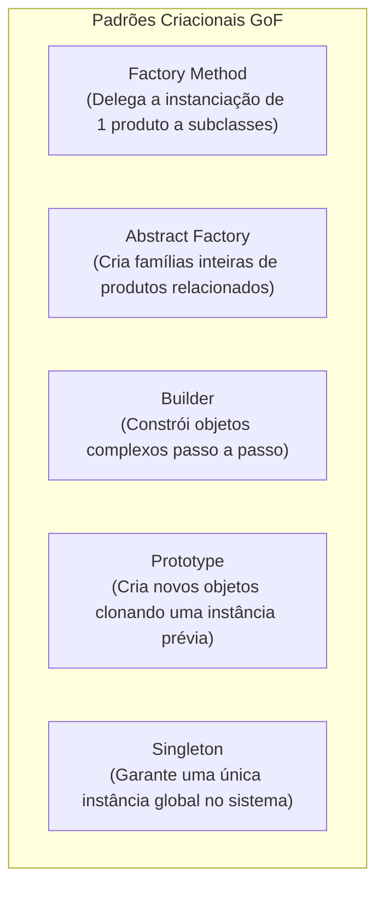

# 04 - Padrões de Projeto (Design Patterns - GoF)

> **Matéria:** Engenharia de Software  
> **Cargo:** B02 – Técnico de Controle Externo – Especialidade: Tecnologia da Informação  
> **Arquivo:** `04_padroes_de_projeto_design_patterns.md`  
> **Referência Fundamental:** Gang of Four (GoF - Erich Gamma, Richard Helm, Ralph Johnson e John Vlissides)

---

## 📌 Ementa / Itens do Edital
- Padrões de projeto de software (Design Patterns GoF)
- Padrões Criacionais (Creational Patterns)
- Padrões Estruturais (Structural Patterns)
- Padrões Comportamentais (Behavioral Patterns)

---

## 🧭 Sumário
- [1. Fundamentos e Princípios dos Padrões de Projeto GoF](#1-fundamentos-e-principios-dos-padroes-de-projeto-gof)
    - [1.1 Definição Canônica e Elementos Estruturantes](#11-definicao-canonica-e-elementos-estruturantes)
    - [1.2 Os Dois Grandes Princípios de Design do GoF](#12-os-dois-grandes-principios-de-design-do-gof)
    - [1.3 A Matriz Canônica dos 23 Padrões GoF (Propósito vs. Escopo)](#13-a-matriz-canonica-dos-23-padroes-gof-proposito-vs-escopo)
- [2. Padrões de Criação (Creational Patterns)](#2-padroes-de-criacao-creational-patterns)
    - [2.1 Factory Method vs. Abstract Factory](#21-factory-method-vs-abstract-factory)
    - [2.2 Builder, Prototype e Singleton](#22-builder-prototype-e-singleton)
- [3. Padrões Estruturais (Structural Patterns)](#3-padroes-estruturais-structural-patterns)
    - [3.1 Adapter vs. Bridge vs. Facade](#31-adapter-vs-bridge-vs-facade)
    - [3.2 Composite, Decorator, Flyweight e Proxy](#32-composite-decorator-flyweight-e-proxy)
- [4. Padrões Comportamentais (Behavioral Patterns)](#4-padroes-comportamentais-behavioral-patterns)
    - [4.1 Strategy vs. State vs. Template Method](#41-strategy-vs-state-vs-template-method)
    - [4.2 Observer e Arquitetura de Publicação/Assinatura](#42-observer-e-arquitetura-de-publicacaoassinatura)
    - [4.3 Command, Chain of Responsibility, Iterator, Mediator, Memento e Visitor](#43-command-chain-of-responsibility-iterator-mediator-memento-e-visitor)
- [5. Fontes Oficiais e Referências Bibliográficas](#5-fontes-oficiais-e-referencias-bibliograficas)

---

## 1. Fundamentos e Princípios dos Padrões de Projeto GoF

### 1.1 Definição Canônica e Elementos Estruturantes
Publicado em 1994 por Erich Gamma, Richard Helm, Ralph Johnson e John Vlissides (*Gang of Four - GoF*), o catálogo clássico de Padrões de Projeto (*Design Patterns*) formalizou soluções reutilizáveis para problemas recorrentes no desenvolvimento de software orientado a objetos.
Um padrão de projeto não é código-fonte acabado nem uma biblioteca pronta, mas uma descrição e template arquitetural que orienta como estruturar classes e objetos para resolver determinado problema de design com flexibilidade e baixo acoplamento.

Conforme a definição GoF, cada padrão é formalmente caracterizado por quatro elementos essenciais:

1. **Nome do Padrão (*Pattern Name*):** Vocabulário de design conciso e compartilhado que eleva o nível de abstração das discussões técnicas;
2. **Problema (*Problem*):** Descreve quando aplicar o padrão, o contexto arquitetural e os requisitos ou sintomas de código que justificam sua adoção;
3. **Solução (*Solution*):** Descreve os elementos que compõem o design, seus relacionamentos, responsabilidades e colaborações (sem vincular a uma implementação específica em linguagem singular);
4. **Consequências (*Consequences*):** Os resultados, trade-offs, benefícios de flexibilidade e custos em termos de complexidade adicional ou consumo de memória advindos da aplicação do padrão.

---

### 1.2 Os Dois Grandes Princípios de Design do GoF
Toda a filosofia dos 23 padrões GoF alicerça-se sobre dois princípios basilares do design de software orientado a objetos:

1. **"Programe para uma interface, não para uma implementação":** Os clientes devem permanecer completamente alheios às classes concretas e aos tipos específicos dos objetos que utilizam, conhecendo unicamente a interface ou classe abstrata que define o contrato de operação. Isso viabiliza o polimorfismo puro e a substituição dinâmica de implementações em tempo de execução.
2. **"Favoreça a composição de objetos sobre a herança de classes":** Enquanto a herança de classes (*white-box reuse*) gera acoplamento estático em tempo de compilação e quebra de encapsulamento da superclasse, a composição de objetos (*black-box reuse*) estabelece associações dinâmicas em tempo de execução, preserva o encapsulamento interno dos objetos e permite alterar comportamentos dinamicamente sem afetar a hierarquia.

---

### 1.3 A Matriz Canônica dos 23 Padrões GoF (Propósito vs. Escopo)
Os 23 padrões são classificados de acordo com duas dimensões: o **Propósito** (o que o padrão faz: criar, estruturar ou definir comportamento) e o **Escopo** (se o padrão se aplica predominantemente a Classes via herança estática ou a Objetos via composição dinâmica):

| Propósito | Escopo de Classe (Herança Estática) | Escopo de Objeto (Composição Dinâmica) |
| :--- | :--- | :--- |
| **Criacional** (Criação de Objetos) | **Factory Method** | **Abstract Factory**, **Builder**, **Prototype**, **Singleton** |
| **Estrutural** (Composição de Classes/Objetos) | **Adapter (baseado em classe)** | **Adapter (baseado em objeto)**, **Bridge**, **Composite**, **Decorator**, **Facade**, **Flyweight**, **Proxy** |
| **Comportamental** (Comunicação e Algoritmos) | **Interpreter**, **Template Method** | **Chain of Responsibility**, **Command**, **Iterator**, **Mediator**, **Memento**, **Observer**, **State**, **Strategy**, **Visitor** |

> 🚨 **ALERTA DE PROVA / PEGADINHA FCC:**  
> A FCC adora cobrar a distinção entre padrões de **Escopo de Classe** e **Escopo de Objeto**. Memorize os quatro únicos padrões de Escopo de Classe do catálogo GoF:
>
> 1. *Factory Method* (Criacional);
> 2. *Adapter de Classe* (Estrutural com herança múltipla);
> 3. *Template Method* (Comportamental);
> 4. *Interpreter* (Comportamental).  
> **Todos os outros 19 padrões GoF operam sob Escopo de Objeto!**

---

### Questão 01
**(FCC – TRT – Analista Judiciário / Tecnologia da Informação)**  
O clássico catálogo de padrões de projeto do Gang of Four (GoF) classifica os 23 padrões canônicos sob duas dimensões fundamentais: o **Propósito** (Criacional, Estrutural ou Comportamental) e o **Escopo** (de Classe ou de Objeto). Quanto ao escopo de Classe (no qual os relacionamentos são estáticos e definidos em tempo de compilação principalmente por meio de herança), assinale o padrão de projeto GoF que pertence genuinamente ao escopo de **Classe**:

* **A)** *Abstract Factory*.
* **B)** *Singleton*.
* **C)** *Factory Method*.
* **D)** *Bridge*.
* **E)** *Strategy*.

> **Comentário Detalhado:**
>
> - **A) Incorreta.** *Abstract Factory* tem escopo de Objeto (criação baseada em delegação/composição).
> - **B) Incorreta.** *Singleton* tem escopo de Objeto.
> - **C) Correta.** Na taxonomia formal do GoF, apenas 4 padrões operam sob escopo de **Classe**: *Factory Method* (Criação), *Adapter de Classe* (Estrutural), *Interpreter* (Comportamental) e *Template Method* (Comportamental). Todos os demais operam sob escopo de Objeto.
> - **D) Incorreta.** *Bridge* tem escopo de Objeto.
> - **E) Incorreta.** *Strategy* tem escopo de Objeto.
>
> **Gabarito: C**

---

## 2. Padrões de Criação (Creational Patterns)

Os padrões criacionais abstraem o processo de instanciação, tornando o sistema independente de como seus objetos são criados, compostos e representados.

### 2.1 Factory Method vs. Abstract Factory
- **Factory Method (Método de Fábrica - Escopo de Classe):**
    - *Intenção:* Define uma interface para criar um objeto, mas deixa as subclasses decidirem qual classe concreta instanciar. Permite adiar a instanciação para as subclasses;
    - *Mecanismo:* Utiliza **herança**. A classe criadora base possui um método fábrica abstrato (`criarDocumento()`), e cada subclasse concreta sobrescreve esse método retornando o seu produto específico (`DocumentoPDF`, `DocumentoWord`).
- **Abstract Factory (Fábrica Abstrata - Escopo de Objeto):**
    - *Intenção:* Fornece uma interface para **criar famílias de objetos relacionados ou dependentes** sem especificar suas classes concretas;
    - *Mecanismo:* Utiliza **composição de objetos**. Uma fábrica abstrata declara múltiplos métodos de criação de produtos (`criarBotao()`, `criarJanela()`), e cada fábrica concreta produz uma família inteira harmonizada (ex.: `FabricaTemaEscuro` cria `BotaoEscuro` e `JanelaEscura`; `FabricaTemaClaro` cria `BotaoClaro` e `JanelaClara`).

---

### Questão 02
**(FCC – SEFAZ – Auditor de Tecnologia da Informação)**  
Deseja-se criar uma interface gráfica que suporte múltiplos temas visuais (por exemplo: Tema Escuro e Tema Claro). Cada tema é composto por uma família coordenada de botões, caixas de texto e barras de rolagem visualmente harmonizados. Para garantir que a aplicação crie os componentes de um tema específico sem acoplar o código cliente às classes concretas de cada fabricante ou tema, deve-se adotar o padrão GoF:

* **A)** Abstract Factory.
* **B)** Factory Method.
* **C)** Memento.
* **D)** Visitor.
* **E)** State.

> **Comentário Detalhado:**
>
> - **A) CORRETA.** O padrão criacional **Abstract Factory (Fábrica Abstrata)** tem como propósito fornecer uma interface para **criar famílias de objetos relacionados ou dependentes** (como os conjuntos coordenados de botões, caixas de texto e barras de rolagem de temas distintos) sem especificar suas classes concretas perante o cliente.
> - **B) Incorreta.** O Factory Method cria um único produto delegando a instanciação para subclasses através de herança de método, enquanto a Abstract Factory cria famílias completas de múltiplos produtos por composição.
> - **C) Incorreta.** O Memento captura e restaura estados internos de um objeto (operações de desfazer).
> - **D) Incorreta.** O Visitor adiciona novas operações a estruturas de objetos existentes sem alterar suas classes.
> - **E) Incorreta.** O State permite que um objeto altere seu comportamento quando seu estado interno muda.
> 
> **Gabarito: A**

---

### 2.2 Builder, Prototype e Singleton
- **Builder (Construtor):**
    - *Intenção:* Separa a construção de um objeto complexo da sua representação final, de modo que o mesmo processo de construção possa criar diferentes representações;
    - *Mecanismo:* Permite a construção passo a passo (*step-by-step*) do objeto com métodos encadeados (`setNome()`, `setCPF()`, `build()`). Envolve os papéis do **Director** (define a ordem dos passos) e do **Builder Concreto** (executa a montagem física);
- **Prototype (Protótipo):**
    - *Intenção:* Especifica os tipos de objetos a serem criados usando uma instância protótipo e cria novos objetos **clonando** esse protótipo existente;
    - *Mecanismo:* Evita o custo de instanciação pesada ou consultas lentas ao banco de dados chamando o método `clone()` da interface Prototype;
- **Singleton (Instância Única):**
    - *Intenção:* Garante que uma classe tenha **uma única instância** em toda a aplicação e fornece um ponto de acesso global a ela;
    - *Mecanismo:* Construtor privado (`private`), uma variável estática que armazena a instância única e um método público estático de recuperação (`getInstance()`).

> 📌 **NOTA EXPLICATIVA / SINGLETON E CONCORRÊNCIA:** Em ambientes multithread, a inicialização tardia simples (*lazy initialization*) do Singleton pode criar instâncias duplicadas se duas threads acessarem `getInstance()` simultaneamente. A solução em Java corporativo exige o padrão *Double-Checked Locking* com variável `volatile` ou a inicialização estática interna segura (*Bill Pugh Singleton*).

---

### Questão 03
**(FCC – TRT – Analista Judiciário / Tecnologia da Informação)**  
Considere uma situação em que um sistema corporativo necessita construir objetos complexos formados por múltiplas partes e configurações opcionais. A equipe deseja separar o algoritmo de montagem do objeto final da representação interna das suas partes constituintes, de modo que o mesmo processo de montagem possa criar representações diferentes com composições variadas. O padrão de projeto criacional do GoF que atende especificamente a esse requisito é o:

* **A)** *Prototype*.
* **B)** *Singleton*.
* **C)** *Builder*.
* **D)** *Decorator*.
* **E)** *Proxy*.

> **Comentário Detalhado:**
>
> - **A) Incorreta.** O *Prototype* cria novos objetos clonando instâncias prototípicas existentes.
> - **B) Incorreta.** O *Singleton* assegura a unicidade de uma única instância global.
> - **C) Correta.** O padrão *Builder* tem como intenção explícita "separar a construção de um objeto complexo da sua representação, de modo que o mesmo processo de construção possa criar diferentes representações".
> - **D) Incorreta.** O *Decorator* é um padrão estrutural que adiciona responsabilidades a objetos dinamicamente.
> - **E) Incorreta.** O *Proxy* é um padrão estrutural que atua como substituto para controlar acesso a outro objeto.
>
> **Gabarito: C**

---

## 3. Padrões Estruturais (Structural Patterns)

Os padrões estruturais tratam de como classes e objetos são compostos para formar estruturas maiores e mais flexíveis.

### 3.1 Adapter vs. Bridge vs. Facade
- **Adapter (Adaptador / Wrapper):**
    - *Intenção:* Converte a interface de uma classe existente na interface esperada pelos clientes. Permite que classes com interfaces incompatíveis trabalhem juntas;
    - *Cenário:* Integração de sistemas legados ou bibliotecas de terceiros sem modificar seu código-fonte;
- **Bridge (Ponte):**
    - *Intenção:* Desacopla uma **abstração da sua implementação**, de modo que ambas possam variar independentemente;
    - *Cenário:* Evita a explosão combinatória de subclasses quando tanto a abstração de negócio (ex.: `Janela`, `JanelaDialogo`) quanto a implementação de plataforma subjacente (ex.: `JanelaWindows`, `JanelaLinux`) precisam evoluir separadamente;
- **Facade (Fachada):**
    - *Intenção:* Fornece uma **interface unificada e simplificada** para um conjunto complexo de interfaces em um subsistema;
    - *Cenário:* Cria uma camada de alto nível que oculta chamadas intrincadas de centenas de classes de um subsistema legado, tornando o uso elementar para novos clientes sem expor os detalhes internos.

---

### Questão 04
**(FCC – TCE-GO – Analista de Controle Externo / TI)**  
Um arquiteto de software precisa integrar uma nova aplicação corporativa a um sistema legado de contabilidade existente há mais de vinte anos. O sistema legado possui centenas de classes complexas, chamadas intrincadas e rotinas interdependentes. O objetivo é criar uma camada intermediária que forneça uma interface simples, unificada e de alto nível para os desenvolvedores da nova aplicação, ocultando toda a complexidade interna do subsistema legado sem alterar o código original dele. O padrão de projeto GoF que resolve essa necessidade de design é o:

* **A)** Decorator.
* **B)** Facade.
* **C)** Singleton.
* **D)** Prototype.
* **E)** Chain of Responsibility.

> **Comentário Detalhado:**
>
> - **A) Incorreta.** O Decorator adiciona responsabilidades extras a um objeto em tempo de execução sem alterar sua interface original, não criando uma interface simplificada unificada para um subsistema inteiro.
> - **B) CORRETA.** O padrão estrutural **Facade (Fachada)** tem como propósito formal fornecer uma **interface unificada e de alto nível para um conjunto de interfaces em um subsistema**. A fachada define uma interface simplificada que torna o subsistema mais fácil de usar por clientes externos, reduzindo o acoplamento com o código complexo legado.
> - **C) Incorreta.** O Singleton garante a existência de uma única instância global de uma classe.
> - **D) Incorreta.** O Prototype clona instâncias existentes para criar novos objetos.
> - **E) Incorreta.** O Chain of Responsibility encadeia objetos manipuladores para processar requisições em cascata.
> 
> **Gabarito: B**

---

### 3.2 Composite, Decorator, Flyweight e Proxy
- **Composite (Composição Hierárquica):**
    - *Intenção:* Compõe objetos em estruturas de **árvore** para representar hierarquias do tipo Todo-Parte. Permite aos clientes **tratar objetos individuais (*folhas*) e composições de objetos (*nós compostos*) de maneira uniforme** por meio de uma interface comum;
    - *Exemplo Clássico:* Sistema de arquivos (um `Arquivo` simples e um `Diretorio` composto contendo arquivos e outros subdiretórios implementam a mesma interface `ComponenteSistema`, respondendo identicamente a `obterTamanho()`).
- **Decorator (Decorador / Wrapper Dinâmico):**
    - *Intenção:* Agrega **responsabilidades adicionais a um objeto dinamicamente** em tempo de execução. Oferece uma alternativa mais flexível do que a herança de classes para estender funcionalidades;
    - *Exemplo Clássico:* Pacote `java.io` da biblioteca padrão Java:  
    `new BufferedReader(new InputStreamReader(new FileInputStream(file)));`
- **Flyweight (Peso-Mosca):**
    - *Intenção:* Usa compartilhamento para suportar eficientemente grandes quantidades de objetos de granulação fina, minimizando o consumo de memória RAM;
    - *Mecanismo:* Separa o estado em **Intrínseco** (imutável, compartilhado por todos os objetos, como o caractere 'A') e **Extrínseco** (mutável, dependente do contexto externo, como as coordenadas X e Y onde a letra é desenhada na página);
- **Proxy (Procurador / Substituto):**
    - *Intenção:* Fornece um objeto substituto ou intermediário que **controla o acesso** ao objeto real original;
    - *Tipos Comuns:* *Virtual Proxy* (carregamento tardio / *lazy loading* de imagens pesadas sob demanda), *Protection Proxy* (checagem de permissões de segurança antes de delegar a chamada) e *Remote Proxy* (representante local de um objeto que reside em outro servidor na rede).

> 🚨 **ALERTA DE PROVA / PEGADINHA FCC:**  
> A banca FCC costuma colocar em uma mesma questão **Adapter**, **Decorator**, **Facade** e **Proxy**, pois todos envolvem outros objetos. Memorize a diferença fulcral de intenção:
>
> - **Adapter:** Altera a interface para resolver **incompatibilidade**.
> - **Decorator:** Mantém a interface e **adiciona novas responsabilidades** dinamicamente.
> - **Facade:** Cria uma **nova interface simplificada** para um subsistema inteiro.
> - **Proxy:** Mantém a mesma interface e **controla o acesso** ao objeto real.

---

### Questão 05
**(FCC – TRT – Analista Judiciário / TI)**  
Em um sistema de processo eletrônico, deseja-se representar documentos que podem ser tanto peças processuais individuais (como certidões e pareceres em texto) quanto pastas de autos contendo diversos documentos e outras subpastas agregadas. A exigência do projeto é que o cliente da aplicação possa invocar operações como `assinarDigitalmente()` e `calcularTamanhoBytes()` tratando documentos simples e pastas compostas de maneira inteiramente uniforme e transparente. O padrão de projeto GoF que soluciona essa demanda arquitetural é o:

* **A)** Flyweight.
* **B)** Composite.
* **C)** Bridge.
* **D)** Mediator.
* **E)** Abstract Factory.

> **Comentário Detalhado:**
>
> - **A) Incorreta.** O Flyweight visa economizar memória através do compartilhamento massivo de estados intrínsecos de objetos leves.
> - **B) CORRETA.** O padrão estrutural **Composite** organiza objetos em estruturas de **árvore** para representar hierarquias Todo-Parte. Sua principal característica é permitir que os clientes **tratem objetos primitivos (*folhas*) e composições de objetos (*compostos*) de forma absolutamente uniforme e indistinta** por meio da implementação de uma interface comum (`ComponenteProcessual`).
> - **C) Incorreta.** O Bridge desacopla uma abstração de sua implementação física para que ambas variem de forma independente.
> - **D) Incorreta.** O Mediator centraliza e simplifica as interações complexas entre múltiplos objetos colegas.
> - **E) Incorreta.** A Abstract Factory cria famílias de produtos relacionados sem expor suas classes concretas.
> 
> **Gabarito: B**

---

### Questão 06
**(FGV – TJ – Analista de Sistemas)**  
Analise os seguintes cenários de engenharia de software envolvendo padrões de projeto estruturais do GoF:  

Cenário 1: Um desenvolvedor necessita estender o comportamento de um objeto específico em tempo de execução, adicionando responsabilidades de forma transparente e flexível, como alternativa preferível à criação de subclasses estáticas por herança.  
Cenário 2: Uma aplicação requer o controle estrito de acesso a um objeto volumoso que demanda alto consumo de memória, instanciando-o apenas no momento exato em que algum cliente invocar sua execução pela primeira vez (*lazy loading*).  

Os padrões de projeto adequados para os Cenários 1 e 2 são, respectivamente:

* **A)** *Facade* e *Bridge*.
* **B)** *Decorator* e *Proxy* Virtual.
* **C)** *Composite* e *Adapter*.
* **D)** *Proxy* e *Decorator*.
* **E)** *Flyweight* e *Singleton*.

> **Comentário Detalhado:**
>
> - **Cenário 1:** O padrão *Decorator* adiciona responsabilidades a um objeto de maneira dinâmica e transparente sem usar herança profunda.
> - **Cenário 2:** O padrão *Proxy* Virtual atua como intermediário/substituto de um objeto real para adiar sua criação cara até o momento de uso (*lazy initialization*).
>
> **Gabarito: B**

---

## 4. Padrões Comportamentais (Behavioral Patterns)

Os padrões comportamentais concentram-se nos algoritmos, na distribuição de responsabilidades e na dinâmica de comunicação e colaboração entre objetos.

### 4.1 Strategy vs. State vs. Template Method
A diferenciação entre esses três padrões é uma das temáticas mais cobradas em provas de controle externo:

| Critério de Comparação | Strategy | State | Template Method |
| :--- | :--- | :--- | :--- |
| **Intenção Principal** | Encapsular uma família de algoritmos intercambiáveis para que o cliente selecione qual utilizar. | Permitir a um objeto alterar seu comportamento dinamicamente quando seu estado interno mudar. | Definir o esqueleto estrutural de um algoritmo fixo, delegando passos específicos para subclasses. |
| **Mecanismo de Reúso** | **Composição de Objetos** | **Composição de Objetos** | **Herança de Classes** (Escopo de Classe) |
| **Quem Altera o Comportamento?** | O **cliente** injeta explicitamente a estratégia desejada no contexto (ex.: cálculo de juros simples ou compostos). | O **próprio contexto transita de estado** autonomamente em resposta a eventos (ex.: processo *Protocolado* $\rightarrow$ *Em Instrução* $\rightarrow$ *Julgado*). | A **superclasse** executa o fluxo; as subclasses sobrescrevem apenas métodos gancho (*hooks*). |

---

### Questão 07
**(FCC – TCE-GO – Técnico de Controle Externo / TI)**  
Um sistema de fiscalização de contratos necessita calcular o valor final de penalidades financeiras aplicando diferentes fórmulas de cálculo (ex.: multa por mora, multa compensatória e glosa por quebra de SLA), as quais podem ser selecionadas dinamicamente em tempo de execução dependendo da tipificação da infração cometida pela empresa contratada. O analista deseja que novas fórmulas de multa possam ser adicionadas no futuro sem a necessidade de alterar as classes existentes e sem utilizar extensas estruturas de condicionais aninhadas (`switch` ou múltiplos `if-else`). O padrão de projeto GoF recomendado para encapsular cada algoritmo em classes separadas e torná-los intercambiáveis é o:

* **A)** Strategy.
* **B)** Template Method.
* **C)** Observer.
* **D)** Builder.
* **E)** Proxy.

> **Comentário Detalhado:**
>
> - **A) CORRETA.** O padrão comportamental **Strategy** define uma família de algoritmos, encapsula cada um deles em uma classe separada sob uma interface comum (`CalculadoraPenalidade`) e torna os algoritmos **intercambiáveis em tempo de execução**. Esse padrão atende diretamente ao Princípio Aberto/Fechado (OCP), eliminando blocos de `if-else` ou `switch`.
> - **B) Incorreta.** O Template Method define o esqueleto fixo do algoritmo em uma superclasse abstrata por herança, delegando apenas passos isolados para as subclasses, não trocando algoritmos completos por composição dinâmica.
> - **C) Incorreta.** O Observer trata da notificação de mudanças de estado em relação um-para-muitos.
> - **D) Incorreta.** O Builder constrói objetos complexos passo a passo.
> - **E) Incorreta.** O Proxy atua como substituto para controlar o acesso a um objeto real.
> 
> **Gabarito: A**

---

### 4.2 Observer e Arquitetura de Publicação/Assinatura
- **Observer (Observador / Publicador-Assinante):**
    - *Intenção:* Define uma **dependência um-para-muitos** entre objetos, de modo que quando um objeto (o *Sujeito* / *Subject*) muda de estado, todos os seus dependentes registrados (*Observadores* / *Observers*) são **automaticamente notificados e atualizados**;
    - *Mecanismo:* O sujeito mantém uma lista de referências abstratas a instâncias da interface `Observador`. Ao alterar seu estado interno, invoca em loop o método `atualizar()` de cada observador registrado;
    - *Benefício:* Desacoplamento pleno entre o produtor do evento e os múltiplos consumidores ouvintes.

---

### Questão 08
**(FCC – TCE – Auditor de Controle Externo / TI)**  
O padrão de projeto comportamental Observer é amplamente utilizado em arquiteturas de software para desacoplar objetos que produzem mudanças de estado daqueles que precisam reagir a elas. A esse respeito, é correto afirmar que o padrão Observer:

* **A)** Exige que o objeto observado conheça detalhadamente as classes concretas de todos os seus observadores cadastrados.
* **B)** Estabelece uma dependência um-para-muitos entre objetos, de forma que quando o estado de um objeto muda, todos os seus dependentes são automaticamente notificados e atualizados.
* **C)** Restringe o número de ouvintes a no máximo dois observadores por instância monitorada.
* **D)** Utiliza herança múltipla obrigatória para injetar o comportamento de notificação diretamente no sistema operacional.
* **E)** É classificado como padrão de escopo de classe no catálogo clássico do Gang of Four.

> **Comentário Detalhado:**
>
> - **A) Incorreta.** O sujeito observado conhece apenas a interface genérica e abstrata `Observador`, desconhecendo deliberadamente os tipos concretos dos objetos para manter o baixo acoplamento.
> - **B) CORRETA.** É a definição canônica e clássica do GoF: o padrão **Observer** *"define uma dependência um-para-muitos entre objetos, de modo que quando um objeto muda de estado, todos os seus dependentes são notificados e atualizados automaticamente"*.
> - **C) Incorreta.** O padrão suporta uma quantidade ilimitada e dinâmica de observadores inscritos na lista de ouvintes.
> - **D) Incorreta.** Opera por composição e associação dinâmica em tempo de execução, sem qualquer relação com herança múltipla de sistema operacional.
> - **E) Incorreta.** O Observer é um padrão estruturado sobre **Escopo de Objeto** (opera por composição dinâmica).
> 
> **Gabarito: B**

---

### 4.3 Command, Chain of Responsibility, Iterator, Mediator, Memento e Visitor
- **Command (Comando):** Encapsula uma requisição como um **objeto**, permitindo parametrizar clientes com diferentes operações, enfileirar ou registrar requisições em log e suportar **operações reversíveis de desfazer (*undo/redo*)**;
- **Chain of Responsibility (Cadeia de Responsabilidade):** Evita o acoplamento do remetente de uma requisição ao seu destinatário, dando a mais de um objeto a oportunidade de tratar a solicitação. Encadeia os objetos receptores e passa a requisição ao longo da cadeia até que um deles a processe (ex.: filtros de requisição HTTP em servlets);
- **Iterator (Iterador):** Fornece uma maneira de **acessar sequencialmente os elementos de um objeto agregado** (lista, árvore, grafo) sem expor sua representação estrutural subjacente;
- **Mediator (Mediador):** Define um objeto central que encapsula como um conjunto de objetos interage. Promove o baixo acoplamento ao evitar que os objetos se refiram uns aos outros explicitamente, centralizando a lógica de comunicação (ex.: controlador de diálogo de interface gráfica);
- **Memento (Lembrança):** Sem violar o encapsulamento, captura e **externaliza o estado interno de um objeto**, permitindo que o objeto seja restaurado para esse estado posteriormente (snapshot de recuperação);
- **Visitor (Visitante):** Representa uma nova operação a ser executada sobre os elementos de uma estrutura de objetos existente. Permite **definir uma nova operação sem mudar as classes** dos elementos sobre os quais ela opera (utiliza o mecanismo de despacho duplo / *double dispatch*).

---

### Questão 09
**(FCC – TRT – Analista Judiciário / Tecnologia da Informação)**  
No catálogo de padrões comportamentais do GoF, o padrão cuja intenção oficial é "evitar o acoplamento do remetente de uma requisição ao seu destinatário, dando a mais de um objeto a oportunidade de tratar a requisição, encadeando os objetos receptores e passando a requisição ao longo da cadeia até que um deles a trate" denomina-se:

* **A)** *Command*.
* **B)** *Chain of Responsibility*.
* **C)** *Mediator*.
* **D)** *Observer*.
* **E)** *Visitor*.

> **Comentário Detalhado:**
>
> - **A) Incorreta.** O *Command* encapsula uma requisição como um objeto para parametrização e suporte a operações reversíveis (*undo*).
> - **B) Correta.** É a definição canônica e literal do padrão *Chain of Responsibility* do GoF (muito cobrada pela FCC).
> - **C) Incorreta.** O *Mediator* centraliza as interações complexas entre um conjunto de objetos colegas.
> - **D) Incorreta.** O *Observer* define dependência 1-para-muitos entre objetos com notificação automática de mudanças.
> - **E) Incorreta.** O *Visitor* representa uma operação a ser executada nos elementos de uma estrutura de objetos sem alterar suas classes.
>
> **Gabarito: B**

---

### Questão 10
**(FCC – TRT – Analista Judiciário / Tecnologia da Informação)**  
O padrão de projeto comportamental GoF que permite capturar e externalizar o estado interno de um objeto, de modo que este possa ser restaurado a esse estado posteriormente, sem que o princípio fundamental de encapsulamento seja violado, é o:

* **A)** *Memento*.
* **B)** *State*.
* **C)** *Template Method*.
* **D)** *Prototype*.
* **E)** *Flyweight*.

> **Comentário Detalhado:**
>
> - **A) Correta.** O padrão *Memento* (composto pelos papéis *Originator*, *Memento* e *Caretaker*) armazena um snapshot do estado interno do objeto para viabilizar restauração (*undo/checkpoint*) preservando o encapsulamento.
> - **B) Incorreta.** O *State* permite a um objeto alterar seu comportamento quando seu estado interno muda.
> - **C) Incorreta.** O *Template Method* define o esqueleto de um algoritmo na superclasse, diferindo passos concretos para subclasses.
> - **D) Incorreta.** O *Prototype* é criacional e clona instâncias inteiras.
> - **E) Incorreta.** O *Flyweight* é estrutural e foca em compartilhamento de objetos de granularidade fina para economizar memória.
>
> **Gabarito: A**

---

## 5. Fontes Oficiais e Referências Bibliográficas

* [Refactoring.Guru — Catálogo Completo dos 23 Padrões de Projeto GoF](https://refactoring.guru/pt-br/design-patterns/catalog) - Visão geral estruturada, diagramas UML e aplicabilidade dos padrões do Gang of Four.
* [Refactoring.Guru — Padrões de Projeto Criacionais](https://refactoring.guru/pt-br/design-patterns/creational-patterns) - Detalhamento técnico de Factory Method, Abstract Factory, Builder, Prototype e Singleton.
* [Refactoring.Guru — Padrões de Projeto Estruturais](https://refactoring.guru/pt-br/design-patterns/structural-patterns) - Detalhamento técnico de Adapter, Bridge, Composite, Decorator, Facade, Flyweight e Proxy.
* [Refactoring.Guru — Padrões de Projeto Comportamentais](https://refactoring.guru/pt-br/design-patterns/behavioral-patterns) - Detalhamento técnico de Strategy, State, Template Method, Observer, Command, Chain of Responsibility, Iterator, Mediator, Memento e Visitor.
* [SourceMaking — Design Patterns Reference & Architectural Guide](https://sourcemaking.com/design_patterns) - Catálogo técnico de padrões de projeto orientados a objetos, motivações e relações entre padrões.
* GAMMA, Erich; HELM, Richard; JOHNSON, Ralph; VLISSIDES, John. **Padrões de Projetos: Soluções Reutilizáveis de Software Orientado a Objetos**. Porto Alegre: Bookman, 2000. (Cap. 1 - Introdução; Cap. 3 a 5 - Catálogo de Padrões Criacionais, Estruturais e Comportamentais).
* FREEMAN, Eric; ROBSON, Elisabeth. **Use a Cabeça! Padrões de Projetos (Head First Design Patterns)**. 2. ed. Rio de Janeiro: Alta Books, 2021. (Cap. 1 a 12 - Aplicação Prática dos Padrões GoF).
