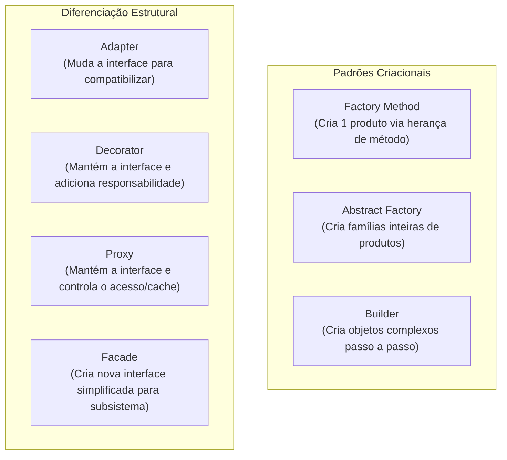
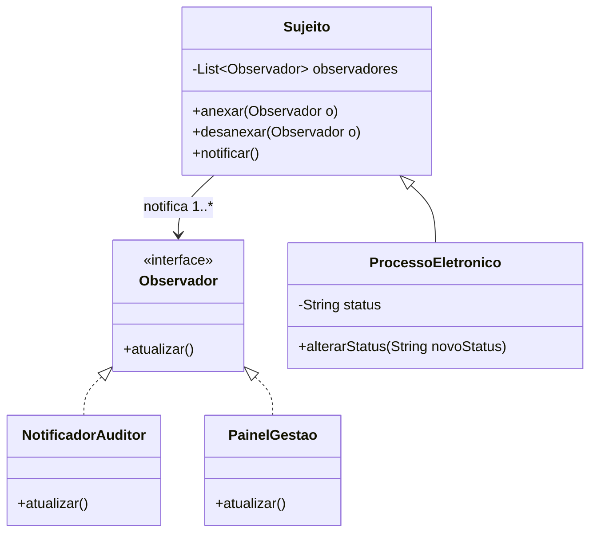

# 04 - Padrões de Projeto (Design Patterns - GoF)

> **Matéria:** Engenharia de Software  
> **Cargo:** B02 – Técnico de Controle Externo – Especialidade: Tecnologia da Informação  
> **Arquivo:** `04_padroes_de_projeto_design_patterns.md`  
> **Referência Fundamental:** Gang of Four (GoF - Erich Gamma, Richard Helm, Ralph Johnson e John Vlissides)

---

## 📌 Ementa / Itens do Edital
- Padrões de projeto de software (Design Patterns GoF)
- Padrões Criacionais (Creational Patterns)
- Padrões Estruturais (Structural Patterns)
- Padrões Comportamentais (Behavioral Patterns)

---

## 🌳 Classificação Hierárquica

```text
4. Padrões de Projeto de Software (GoF)
├── 4.1 Fundamentos dos Design Patterns
│   ├── 4.1.1 Definição canônica: Nome, Problema, Solução e Consequências
│   ├── 4.1.2 Princípios norteadores GoF:
│   │   ├── "Programe para uma interface, não para uma implementação"
│   │   └── "Favoreça a composição de objetos sobre a herança de classes"
│   └── 4.1.3 Classificação por Escopo (de Classe vs. de Objeto) e por Propósito (Criacional, Estrutural, Comportamental)
├── 4.2 Padrões Criacionais (Criação e Instanciação de Objetos)
│   ├── 4.2.1 Singleton: Garante uma única instância de uma classe e fornece ponto de acesso global
│   ├── 4.2.2 Factory Method: Define interface para criar objeto, deixando subclasses decidirem a classe concreta
│   ├── 4.2.3 Abstract Factory: Interface para criar famílias de objetos relacionados sem especificar classes concretas
│   ├── 4.2.4 Builder: Separa a construção de um objeto complexo de sua representação (passo a passo)
│   └── 4.2.5 Prototype: Cria novos objetos clonando uma instância protótipo existente
├── 4.3 Padrões Estruturais (Composição de Classes e Objetos)
│   ├── 4.3.1 Adapter: Converte a interface de uma classe na interface que o cliente espera (compatibilização)
│   ├── 4.3.2 Bridge: Desacopla uma abstração de sua implementação para que ambas variem independentemente
│   ├── 4.3.3 Composite: Compõe objetos em árvores para hierarquias todo-parte (trata folhas e nós uniformemente)
│   ├── 4.3.4 Decorator: Agrega responsabilidades dinâmicas a um objeto (alternativa flexível a subclasses)
│   ├── 4.3.5 Facade: Interface unificada e simplificada para um subsistema complexo
│   ├── 4.3.6 Flyweight: Compartilhamento eficiente de grandes quantidades de objetos de granulação fina
│   └── 4.3.7 Proxy: Fornece substituto ou procurador para controlar o acesso a outro objeto
└── 4.4 Padrões Comportamentais (Comunicação e Algoritmos)
    ├── 4.4.1 Strategy: Encapsula família de algoritmos intercambiáveis em tempo de execução
    ├── 4.4.2 Observer: Dependência um-para-muitos com notificações automáticas de mudança de estado
    ├── 4.4.3 Command: Encapsula uma requisição como objeto (permite fila, histórico e operação de undo)
    ├── 4.4.4 Template Method: Define o esqueleto do algoritmo na superclasse, delegando passos às subclasses
    ├── 4.4.5 State: Permite a um objeto alterar seu comportamento quando seu estado interno muda
    ├── 4.4.6 Chain of Responsibility: Encadeia objetos receptores para tratar uma requisição
    ├── 4.4.7 Iterator: Acesso sequencial aos elementos de uma coleção sem expor sua representação interna
    ├── 4.4.8 Mediator: Encapsula a forma como um conjunto de objetos interage para reduzir acoplamento
    ├── 4.4.9 Memento: Captura e restaura o estado interno de um objeto sem violar o encapsulamento
    └── 4.4.10 Visitor: Define nova operação sobre elementos de uma estrutura sem alterar suas classes
```

---

## 📖 Resumo Teórico Aprofundado

### 1. A Matriz Canônica dos 23 Padrões GoF

Os 23 padrões são classificados pelo seu **Propósito** e pelo seu **Escopo** (se aplicados a Classes via herança estática ou a Objetos via composição dinâmica):

| Propósito | Escopo de Classe (Herança) | Escopo de Objeto (Composição / Dinâmico) |
| :--- | :--- | :--- |
| **Criacional** | **Factory Method** | **Abstract Factory**, **Builder**, **Prototype**, **Singleton** |
| **Estrutural** | **Adapter (de Classe)** | **Adapter (de Objeto)**, **Bridge**, **Composite**, **Decorator**, **Facade**, **Flyweight**, **Proxy** |
| **Comportamental** | **Interpreter**, **Template Method** | **Chain of Responsibility**, **Command**, **Iterator**, **Mediator**, **Memento**, **Observer**, **State**, **Strategy**, **Visitor** |

---

### 2. Comparações e Diferenças Críticas



#### 2.1 Strategy vs. State vs. Template Method
- **Strategy:** O cliente escolhe explicitamente uma estratégia intercambiável (ex.: cálculo de juros simples vs. compostos). Utiliza **composição de objetos**.
- **State:** O contexto transita internamente de estado de forma autônoma (ex.: *Protocolado* $\rightarrow$ *Em Análise* $\rightarrow$ *Julgado*). Ao mudar de estado, seu comportamento se altera dinamicamente como se tivesse mudado de classe. Utiliza **composição de objetos**.
- **Template Method:** Define o esqueleto do algoritmo fixo em uma superclasse abstrata, enquanto os passos concretos específicos (*hooks*) são sobrescritos pelas subclasses. Utiliza **herança de classes**.

#### 2.2 Decorator vs. Adapter vs. Proxy
- **Adapter:** Resolve **incompatibilidade**. As classes cliente e servidora possuem interfaces diferentes; o Adapter atua como "tradutor".
- **Decorator:** Resolve **agregação de comportamento em tempo de execução**. Não altera a interface do componente original; "envolve" o objeto adicionando funcionalidades (ex.: streams no Java: `new BufferedReader(new FileReader(...))`).
- **Proxy:** Resolve **controle de acesso**. Possui a mesma interface do objeto real (*Subject*), interceptando chamadas para realizar: inicialização tardia (*Virtual Proxy*), checagem de permissões (*Protection Proxy*) ou comunicação remota (*Remote Proxy*).

---

### 3. Padrão Observer: Arquitetura de Notificação



---

## ⚠️ Pontos de Atenção (Estilo FCC)

> 🚨 **PEGADINHAS RECORRENTES DA BANCA FCC:**  
> 1. **Escopo dos Padrões:** A FCC adora cobrar quais padrões são de **Escopo de Classe**: memorize que são **Factory Method**, **Adapter (versão herança múltipla de classe)**, **Template Method** e **Interpreter**. Todos os outros são de escopo de objeto!  
> 2. **Composite:** Trata objetos primitivos (*folhas*) e coleções de objetos (*compostos*) de maneira **completamente uniforme** por meio de uma interface comum. Se a questão falar em "estrutura em árvore hierárquica tratada de modo idêntico", a resposta é **Composite**.  
> 3. **Singleton em ambientes multithread:** Cuidado com a inicialização preguiçosa simples (*lazy initialization*), que não é segura para threads (*thread-safe*). Em Java corporativo, exige sincronização ou bloco estático (*Bill Pugh Singleton*).

---

## 🌐 Fontes Recomendadas na Internet

- [Refactoring Guru - Guia Ilustrado de Padrões de Projeto (Português)](https://refactoring.guru/pt-br/design-patterns)
- [SourceMaking - Catálogo Completo de Padrões GoF](https://sourcemaking.com/design_patterns)
- [Baeldung - Design Patterns in Java](https://www.baeldung.com/design-patterns-series)
- [Gang of Four - Design Patterns: Elements of Reusable Object-Oriented Software](https://www.oreilly.com/library/view/design-patterns-elements/0201633612/)

---

## 📝 Questões Comentadas & Exemplos (Padrão FCC)

### Questão 1 (FCC - Analista de TI / Sistemas)
Um arquiteto de software precisa integrar uma nova aplicação corporativa a um sistema legado de contabilidade existente há mais de vinte anos. O sistema legado possui centenas de classes complexas, chamadas intrincadas e rotinas interdependentes. O objetivo é criar uma camada intermediária que forneça uma interface simples, unificada e de alto nível para os desenvolvedores da nova aplicação, ocultando toda a complexidade interna do subsistema legado sem alterar o código original dele. O padrão de projeto GoF que resolve essa necessidade de design é o:  
A) Decorator.  
B) Facade.  
C) Singleton.  
D) Prototype.  
E) Chain of Responsibility.  

> **Gabarito: B**  
>  
> **Comentário Analítico Passo a Passo:**  
> - **A) Incorreta:** O Decorator agrega responsabilidades adicionais a um objeto dinamicamente sem alterar sua interface original, não criando uma interface simplificada para um subsistema inteiro.  
> - **B) CORRETA:** O padrão estrutural **Facade (Fachada)** tem como propósito exato fornecer uma interface unificada e simplificada para um conjunto complexo de interfaces em um subsistema, desacoplando os clientes dos detalhes de baixo nível.  
> - **C) Incorreta:** O Singleton assegura uma única instância global de uma classe.  
> - **D) Incorreta:** O Prototype cria novos objetos clonando instâncias existentes.  
> - **E) Incorreta:** O Chain of Responsibility encadeia objetos que podem tratar uma requisição sequencialmente.

---

### Questão 2 (FCC - Técnico de Controle Externo / TI)
Um sistema de fiscalização de contratos necessita calcular o valor final de penalidades financeiras aplicando diferentes fórmulas de cálculo (ex.: multa por mora, multa compensatória e glosa por quebra de SLA), as quais podem ser selecionadas dinamicamente em tempo de execução dependendo da tipificação da infração cometida pela empresa contratada. O analista deseja que novas fórmulas de multa possam ser adicionadas no futuro sem a necessidade de alterar as classes existentes e sem utilizar extensas estruturas de condicionais aninhadas (`switch` ou múltiplos `if-else`). O padrão de projeto GoF recomendado para encapsular cada algoritmo em classes separadas e torná-los intercambiáveis é o:  
A) Strategy.  
B) Template Method.  
C) Observer.  
D) Builder.  
E) Proxy.  

> **Gabarito: A**  
>  
> **Comentário Analítico Passo a Passo:**  
> - **A) CORRETA:** O padrão comportamental **Strategy** define uma família de algoritmos, encapsula cada um deles em classes independentes sob uma interface comum e os torna intercambiáveis em tempo de execução, eliminando blocos `if/else` ou `switch/case`.  
> - **B) Incorreta:** O Template Method utiliza herança para definir o esqueleto de um algoritmo na superclasse com passos fixos, não troca famílias de algoritmos inteiros dinamicamente via composição.  
> - **C) Incorreta:** O Observer trata de notificação de eventos um-para-muitos.  
> - **D) Incorreta:** O Builder é um padrão criacional para construção de objetos complexos em etapas.  
> - **E) Incorreta:** O Proxy fornece um substituto ou intermediário para controlar o acesso a um objeto real.

---

### Questão 3 (FCC - TRT - Analista Judiciário / TI)
Em um sistema de processo eletrônico, deseja-se representar documentos que podem ser tanto peças processuais individuais (como certidões e pareceres em texto) quanto pastas de autos contendo diversos documentos e outras subpastas agregadas. A exigência do projeto é que o cliente da aplicação possa invocar operações como `assinarDigitalmente()` e `calcularTamanhoBytes()` tratando documentos simples e pastas compostas de maneira inteiramente uniforme e transparente. O padrão de projeto GoF que soluciona essa demanda arquitetural é o:  
A) Flyweight.  
B) Composite.  
C) Bridge.  
D) Mediator.  
E) Abstract Factory.  

> **Gabarito: B**  
>  
> **Comentário Analítico Passo a Passo:**  
> - **A) Incorreta:** O Flyweight utiliza compartilhamento de estado para suportar grandes quantidades de objetos idênticos economizando memória.  
> - **B) CORRETA:** O padrão estrutural **Composite** compõe objetos em estruturas em árvore para representar hierarquias todo-parte, permitindo que os clientes tratem objetos individuais (folhas) e composições de objetos (nós compostos) de maneira absolutamente uniforme por meio de uma interface comum.  
> - **C) Incorreta:** O Bridge desacopla uma abstração de sua implementação para que ambas variem de modo independente.  
> - **D) Incorreta:** O Mediator centraliza a comunicação complexa entre objetos colegas.  
> - **E) Incorreta:** A Abstract Factory cria famílias de produtos sem expor suas classes concretas.

---

### Questão 4 (FCC - TCE - Auditor de Controle Externo / TI)
O padrão de projeto comportamental Observer é amplamente utilizado em arquiteturas de software para desacoplar objetos que produzem mudanças de estado daqueles que precisam reagir a elas. A esse respeito, é correto afirmar que o padrão Observer:  
A) Exige que o objeto observado conheça detalhadamente as classes concretas de todos os seus observadores cadastrados.  
B) Estabelece uma dependência um-para-muitos entre objetos, de forma que quando o estado de um objeto muda, todos os seus dependentes são automaticamente notificados e atualizados.  
C) Restringe o número de ouvintes a no máximo dois observadores por instância monitorada.  
D) Utiliza herança múltipla obrigatória para injetar o comportamento de notificação diretamente no sistema operacional.  
E) É classificado como padrão de escopo de classe no catálogo clássico do Gang of Four.  

> **Gabarito: B**  
>  
> **Comentário Analítico Passo a Passo:**  
> - **A) Incorreta:** O sujeito observado conhece apenas a interface genérica `Observador`, garantindo o baixo acoplamento entre as partes.  
> - **B) CORRETA:** Definição canônica do GoF para o padrão **Observer**: *"Define uma dependência um-para-muitos entre objetos, de modo que quando um objeto muda de estado, todos os seus dependentes são notificados e atualizados automaticamente"*.  
> - **C) Incorreta:** Não há limite rígido para o número de observadores; qualquer objeto que implemente a interface de escuta pode se registrar dinamicamente na lista.  
> - **D) Incorreta:** Opera por composição em tempo de execução, não por herança múltipla no sistema operacional.  
> - **E) Incorreta:** O Observer é um padrão de **escopo de objeto** (opera dinamicamente por composição).

---

### Questão 5 (FCC - SEFAZ - Auditor de Tecnologia da Informação)
Deseja-se criar uma interface gráfica que suporte múltiplos temas visuais (por exemplo: Tema Escuro e Tema Claro). Cada tema é composto por uma família coordenada de botões, caixas de texto e barras de rolagem visualmente harmonizados. Para garantir que a aplicação crie os componentes de um tema específico sem acoplar o código cliente às classes concretas de cada fabricante ou tema, deve-se adotar o padrão GoF:  
A) Abstract Factory.  
B) Factory Method.  
C) Memento.  
D) Visitor.  
E) State.  

> **Gabarito: A**  
>  
> **Comentário Analítico Passo a Passo:**  
> - **A) CORRETA:** O padrão criacional **Abstract Factory** fornece uma interface para criar **famílias de objetos relacionados ou dependentes** (como botões e janelas do tema escuro ou claro) sem especificar suas classes concretas.  
> - **B) Incorreta:** O Factory Method foca na criação de um único produto por meio de um método que as subclasses especializam, enquanto a Abstract Factory cria famílias completas de múltiplos produtos.  
> - **C) Incorreta:** O Memento captura e restaura estados internos de um objeto (mecanismo de desfazer).  
> - **D) Incorreta:** O Visitor adiciona operações a estruturas de objetos existentes sem modificá-las.  
> - **E) Incorreta:** O State permite que um objeto altere seu comportamento quando seu estado interno muda.
