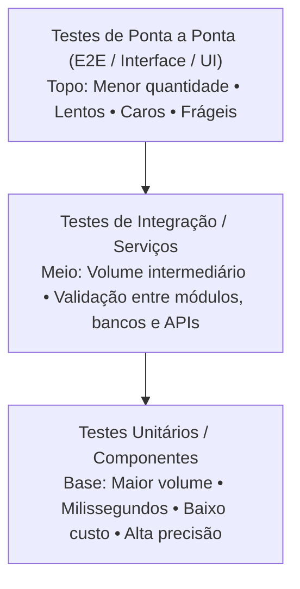
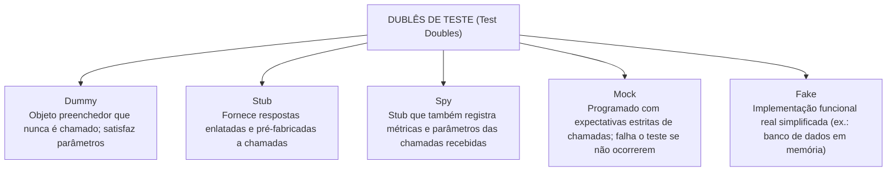
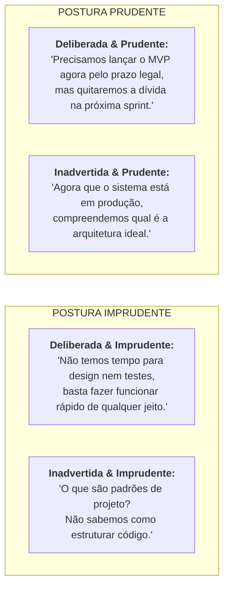

# 05 - Qualidade, Testes, Refatoração e Dívida Técnica

> **Matéria:** Engenharia de Software  
> **Cargo:** B02 – Técnico de Controle Externo – Especialidade: Tecnologia da Informação  
> **Arquivo:** `05_qualidade_testes_refatoracao_e_divida_tecnica.md`  

---

## 📌 Ementa / Itens do Edital
- Qualidade de software: desempenho, escalabilidade, disponibilidade, confiabilidade e manutenibilidade
- Testes de software: unitários, de integração, funcionais, de regressão, de carga e de estresse
- Testes automatizados
- Revisão de código (code review)
- Refatoração de código (refactoring)
- Dívida técnica (technical debt)

---

## 🧭 Sumário

1. [Atributos e Métricas de Qualidade de Software (ISO/IEC 25010)](#1-atributos-e-metricas-de-qualidade-de-software-isoiec-25010)
    1. [Desempenho e Eficiência de Recursos](#11-desempenho-e-eficiencia-de-recursos)
    2. [Escalabilidade Vertical (Scale Up) vs. Escalabilidade Horizontal (Scale Out)](#12-escalabilidade-vertical-scale-up-vs-escalabilidade-horizontal-scale-out)
    3. [Confiabilidade, Disponibilidade e Métricas de Manutenção (MTBF e MTTR)](#13-confiabilidade-disponibilidade-e-metricas-de-manutencao-mtbf-e-mttr)
    4. [Manutenibilidade e Facilidade de Mudança](#14-manutenibilidade-e-facilidade-de-mudanca)
    5. [Teste 043](#Teste-043)
2. [Níveis e Estratégias de Testes de Software](#2-niveis-e-estrategias-de-testes-de-software)
    1. [A Pirâmide de Testes de Mike Cohn](#21-a-piramide-de-testes-de-mike-cohn)
    2. [Dublês de Teste (*Test Doubles* de Gerard Meszaros)](#22-dubles-de-teste-test-doubles-de-gerard-meszaros)
    3. [Testes de Caixa-Preta (Funcionais) vs. Testes de Caixa-Branca (Estruturais)](#23-testes-de-caixa-preta-funcionais-vs-testes-de-caixa-branca-estruturais)
    4. [Complexidade Ciclomática de Thomas McCabe e Grafo de Fluxo](#24-complexidade-ciclomatica-de-thomas-mccabe-e-grafo-de-fluxo)
    5. [Teste 044](#Teste-044)
    6. [Teste 045](#Teste-045)
    7. [Teste 046](#Teste-046)
    8. [Teste 047](#Teste-047)
3. [Tipos Especializados de Testes e Automação](#3-tipos-especializados-de-testes-e-automacao)
    1. [Testes de Regressão e Automação Contínua](#31-testes-de-regressao-e-automacao-continua)
    2. [Testes de Desempenho: Carga vs. Estresse vs. Pico vs. Resistência](#32-testes-de-desempenho-carga-vs-estresse-vs-pico-vs-resistencia)
    3. [Práticas de TDD (Test-Driven Development) e BDD (Behavior-Driven Development)](#33-praticas-de-tdd-test-driven-development-e-bdd-behavior-driven-development)
    4. [Teste 048](#Teste-048)
    5. [Teste 049](#Teste-049)
    6. [Teste 050](#Teste-050)
4. [Revisão de Código, Refatoração e Dívida Técnica](#4-revisao-de-codigo-refatoracao-e-divida-tecnica)
    1. [Técnicas Modernas de Revisão de Código (Code Review)](#41-tecnicas-modernas-de-revisao-de-codigo-code-review)
    2. [Refatoração de Código e os "Maus Cheiros" (Code Smells) de Fowler](#42-refatoracao-de-codigo-e-os-maus-cheiros-code-smells-de-fowler)
    3. [Dívida Técnica e o Quadrante de Martin Fowler](#43-divida-tecnica-e-o-quadrante-de-martin-fowler)
    4. [Teste 051](#Teste-051)
    5. [Teste 052](#Teste-052)
    6. [Teste 053](#Teste-053)
5. [Fontes Oficiais e Referências Bibliográficas](#5-fontes-oficiais-e-referencias-bibliograficas)

---

## 1. Atributos e Métricas de Qualidade de Software (ISO/IEC 25010)

A norma internacional **ISO/IEC 25010** (evolução da ISO 9126) define o modelo de qualidade de produto de software, estruturado em oito características fundamentais: adequação funcional, eficiência de desempenho, compatibilidade, usabilidade, confiabilidade, segurança, manutenibilidade e portabilidade.

### 1.1 Desempenho e Eficiência de Recursos
Mede o comportamento do sistema em termos de velocidade de resposta e utilização racional dos recursos computacionais sob condições especificadas:

- **Tempo de Resposta (*Response Time*):** Intervalo de tempo transcorrido entre a emissão de uma requisição pelo usuário e a exibição completa da resposta processada;
- **Latência:** Tempo de trânsito que uma mensagem ou pacote leva para viajar da origem ao destino na rede;
- **Vazão (*Throughput*):** Quantidade de transações, requisições ou volume de dados processados com sucesso por unidade de tempo (ex.: 5.000 requisições por segundo - RPS);
- **Utilização de Recursos:** Percentual de ocupação de CPU, consumo de memória RAM, largura de banda e operações de entrada/saída em disco (I/O).

### 1.2 Escalabilidade Vertical (Scale Up) vs. Escalabilidade Horizontal (Scale Out)
- **Escalabilidade Vertical (*Scale Up*):** Expansão da capacidade computacional através do acréscimo de recursos físicos à máquina servidora existente (mais núcleos de processador, mais memória RAM ou discos SSD mais rápidos).  
  *Limitações:* Possui teto físico máximo de hardware, custo exponencialmente elevado nas faixas superiores e exige paradas no sistema para upgrade;
- **Escalabilidade Horizontal (*Scale Out*):** Expansão da capacidade mediante a adição de novas instâncias e nós servidores operando em paralelo sob um balanceador de carga (*Load Balancer*).  
  *Vantagens:* Altamente flexível, alinhada a ambientes em nuvem e contêineres elásticos, permitindo provisionamento dinâmico sem interrupção de serviços.

### 1.3 Confiabilidade, Disponibilidade e Métricas de Manutenção (MTBF e MTTR)
- **Confiabilidade:** Grau em que o software desempenha suas funções requeridas sob condições estabelecidas por um período especificado de tempo. Avalia a maturidade, a tolerância a falhas e a capacidade de recuperação de desastres;
- **Disponibilidade:** Proporção de tempo em que o sistema está operacional e plenamente acessível para uso quando demandado. Expressa-se habitualmente pelo número de "noves" em acordos de nível de serviço (SLA - *Service Level Agreement*):
    - *99% ("dois noves"):* Tolera até 3,65 dias de indisponibilidade por ano;
    - *99,9% ("três noves"):* Tolera até 8,76 horas de indisponibilidade por ano;
    - *99,99% ("quatro noves"):* Tolera até 52,56 minutos de indisponibilidade por ano.
- **Métricas Clássicas de Sustentação de Sistemas:**
    - **MTBF (*Mean Time Between Failures* - Tempo Médio Entre Falhas):** Métrica de confiabilidade que calcula o tempo médio em que o sistema opera perfeitamente entre duas panes consecutivas;
    - **MTTR (*Mean Time to Repair* - Tempo Médio para Reparo):** Métrica de manutenibilidade que mede o tempo médio gasto pela equipe de suporte para diagnosticar, corrigir a falha e restaurar o sistema à plena operação;
    - **Cálculo da Disponibilidade Teórica:**
    $$\text{Disponibilidade} = \frac{\text{MTBF}}{\text{MTBF} + \text{MTTR}}$$

### 1.4 Manutenibilidade e Facilidade de Mudança
A manutenibilidade reflete a facilidade e a eficiência com que o software pode ser modificado pelos desenvolvedores para corrigir defeitos, melhorar o desempenho ou adaptar o sistema a mudanças no ambiente de negócio. Subdivide-se em:

- **Modularidade:** Grau em que o sistema é composto por componentes discretos, isolando o impacto de alterações;
- **Reusabilidade:** Capacidade de um ativo ser utilizado em mais de um sistema ou módulo;
- **Analisabilidade:** Facilidade com que se pode diagnosticar deficiências, causas raízes de falhas ou identificar partes a serem alteradas;
- **Modificabilidade:** Facilidade com que o software pode ser modificado sem introduzir novos defeitos ou degradar a qualidade existente;
- **Testabilidade:** Grau em que critérios e testes eficazes podem ser estabelecidos e executados para validar as alterações realizadas.

---

### Teste 043
**(FCC – TRT – Analista Judiciário / Tecnologia da Informação)**  
Na avaliação de confiabilidade e disponibilidade de sistemas computacionais em conformidade com as normas de qualidade de software, duas métricas temporais essenciais são o MTBF (*Mean Time Between Failures* - Tempo Médio Entre Falhas) e o MTTR (*Mean Time To Repair* - Tempo Médio Para Reparo). A disponibilidade global do sistema ($D$) é classicamente calculada pela fórmula:

* **A)** $D = \frac{MTTR}{MTBF + MTTR}$
* **B)** $D = \frac{MTBF}{MTBF + MTTR}$
* **C)** $D = MTBF - MTTR$
* **D)** $D = \frac{MTBF \times MTTR}{100}$
* **E)** $D = \frac{MTTR}{MTBF}$

---

> **Comentário Detalhado:**
>
> - **A) Incorreta.** Essa razão representaria a taxa de indisponibilidade fracionária (*unavailability*).
> - **B) Correta.** A Disponibilidade ($A$ ou $D$) é a probabilidade do sistema estar operacional no instante considerado: $D = \frac{MTBF}{MTBF + MTTR}$.
> - **C) Incorreta.** A disponibilidade é uma razão adimensional (frequentemente expressa em percentual, como 99,99%), não uma subtração temporal.
> - **D) Incorreta.** Fórmula incorreta.
> - **E) Incorreta.** Razão que não expressa a disponibilidade.
>
> **Gabarito: B**

---

## 2. Níveis e Estratégias de Testes de Software

### 2.1 A Pirâmide de Testes de Mike Cohn
A Pirâmide de Testes é o modelo canônico de engenharia de software para construir suítes de testes automatizados equilibradas e sustentáveis:

| Nível de Teste | Velocidade de Execução | Custo de Construção/Manutenção | Foco do Diagnóstico de Falha | Escopo de Isolamento |
| :--- | :--- | :--- | :--- | :--- |
| **Unitário** | Milissegundos | Muito baixo | Linha exata do código / método | Total (isola com Stubs/Mocks) |
| **Integração** | Segundos | Moderado | Comunicação entre componentes | Parcial (integra com BD ou filas) |
| **Ponta a Ponta (E2E)** | Minutos / Horas | Extremamente alto | Fluxo completo do usuário | Nulo (sistema real completo) |

> 🚨 **ALERTA DE PROVA / PEGADINHA FCC:** A inversão da pirâmide (chamada de antipadrão "Casquinha de Sorvete" ou *Ice Cream Cone*) ocorre quando a organização possui poucos testes unitários e concentra quase todo o esforço em testes manuais ou E2E de interface. O resultado são suítes de testes lentas, que demoram horas para rodar no CI/CD e quebram frequentemente por pequenas alterações visuais (*testes frágeis / flaky tests*).

### 2.2 Dublês de Teste (*Test Doubles* de Gerard Meszaros)
Nos testes unitários, para isolar a unidade sob teste (*System Under Test - SUT*) de dependências pesadas, instáveis ou lentas (bancos de dados, serviços web externos, sistemas de arquivos), empregam-se **Dublês de Teste**:

1. **Dummy:** Objeto passado apenas para preencher parâmetros de assinatura de métodos obrigatórios, nunca sendo invocado durante a execução do teste;
2. **Stub:** Objeto que fornece respostas prontas e pré-programadas para as chamadas recebidas durante o teste (ex.: método `consultarSaldo()` retorna sempre o valor fixo de `1000.00`);
3. **Spy (Espião):** Um Stub enriquecido que intercepta e grava o histórico das chamadas (armazena quantas vezes o método foi invocado e quais parâmetros foram passados para checagem posterior);
4. **Mock:** Objeto pré-programado com **expectativas formais de comportamento**. O desenvolvedor configura explicitamente quais métodos devem ser chamados, com quais argumentos específicos e em que ordem. Se o método não for invocado conforme a expectativa estabelecida, o teste falha compulsoriamente;
5. **Fake:** Objeto que possui uma implementação funcional real simplificada, mas utiliza atalhos que a tornam imprópria para produção (ex.: um banco de dados relacional em memória H2 substituindo um servidor Oracle corporativo nos testes).

### 2.3 Testes de Caixa-Preta (Funcionais) vs. Testes de Caixa-Branca (Estruturais)
- **Testes de Caixa-Preta (Funcionais):** Avaliam o comportamento do software sem conhecimento da estrutura interna ou do código-fonte. O foco reside nas entradas e saídas esperadas:
    - *Partição de Equivalência:* Divide os dados de entrada em classes válidas e inválidas, partindo do princípio de que qualquer dado dentro da mesma partição receberá o mesmo tratamento;
    - *Análise do Valor Limite (BVA):* Testa valores situados exatamente nas fronteiras e adjacências das partições (ex.: se o intervalo aceito é de 18 a 65 anos, testa-se 17, 18, 19, 64, 65 e 66 anos).
- **Testes de Caixa-Branca (Estruturais):** Avaliam os caminhos de controle, estruturas lógicas e condições internas do código-fonte:
    - *Critérios de Cobertura:* Cobertura de comandos (*Statement Coverage*), cobertura de decisões/desvios (*Branch Coverage*) e cobertura de caminhos independentes.

### 2.4 Complexidade Ciclomática de Thomas McCabe e Grafo de Fluxo
Proposta por Thomas McCabe em 1976, a **Complexidade Ciclomática ($V(G)$)** mede quantitativamente a complexidade lógica de um programa através da contagem do número de caminhos linearmente independentes no seu grafo de fluxo de controle.

**Fórmulas de Cálculo Clássicas:**

1. Pela contagem de arestas ($E$), nós ($N$) e componentes conexos ($P=1$ para método único):
   $$V(G) = E - N + 2$$
2. Pela contagem direta de pontos de decisão/predicados ($P$):
   $$V(G) = P + 1$$
   *(onde $P$ é o total de comandos condicionais e de laço: `if`, `while`, `for`, `case`)*.

> ⭐ **IMPORTANTE / APLICAÇÃO EM TESTES:** O valor da complexidade ciclomática de McCabe define o **número mínimo exato de casos de teste** necessários para garantir que todas as instruções e caminhos lógicos do método sejam executados ao menos uma vez!

---

### Teste 044
**(FGV – TJ – Analista Judiciário / Tecnologia da Informação)**  
A Pirâmide de Testes, conceito amplamente difundido por Mike Cohn na engenharia de software moderna, define a proporção ideal entre diferentes categorias de testes automatizados em uma suíte de entrega contínua. Em conformidade com esse modelo, tem-se que:

* **A)** a base da pirâmide deve conter o maior volume de testes e ser constituída por Testes de Unidade, caracterizados por alta velocidade de execução, isolamento e baixo custo de manutenção.
* **B)** o topo da pirâmide deve concentrar mais de 80% do esforço de testes na forma de testes ponta a ponta manuais na interface com o usuário.
* **C)** os testes de integração devem ser completamente extintos, visto que os testes de unidade cobrem todas as falhas de comunicação entre microsserviços.
* **D)** o modelo preconiza que suítes de testes automatizados devem assemelhar-se a um "cone de sorvete", priorizando testes de UI em detrimento de testes de baixo nível.
* **E)** os testes de unidade são os mais lentos e custosos da pirâmide devido à obrigatoriedade de instanciar contêineres Docker e bancos de dados em nuvem.

---

> **Comentário Detalhado:**
>
> - **A) Correta.** A base larga da pirâmide é formada por Testes de Unidade (rápidos, isolados, determinísticos e baratos). Na camada intermediária situam-se os Testes de Integração/Serviço, e no topo reduzido os Testes de Ponta a Ponta / UI.
> - **B) Incorreta.** O topo da pirâmide é pequeno e restrito; testes de UI são caros, lentos e frágeis (*flaky*).
> - **C) Incorreta.** Os testes de integração são indispensáveis para validar contratos, protocolos e comunicação de componentes.
> - **D) Incorreta.** O "cone de sorvete" (*ice cream cone anti-pattern*) é exatamente a anomalia que a Pirâmide de Testes combate.
> - **E) Incorreta.** Testes de unidade operam em memória com dublês de teste, sem rede ou banco real, sendo os mais velozes.
>
> **Gabarito: A**

---

### Teste 045
**(FCC – TCE – Auditor de Controle Externo / TI)**  
No desenvolvimento guiado por testes (*Test-Driven Development* - TDD) e na criação de suítes de testes unitários isolados, utilizam-se diferentes tipos de dublês de teste (*Test Doubles*). O dublê que é configurado especificamente com expectativas prévias sobre quais métodos devem ser chamados, com quais argumentos e quantas vezes, fazendo com que o teste falhe caso essas interações não ocorram conforme esperado, é denominado:

* **A)** Dummy.
* **B)** Stub.
* **C)** Mock.
* **D)** Fake.
* **E)** Driver.

---

> **Comentário Detalhado:**
>
> - **A) Incorreta.** O Dummy é um objeto utilizado unicamente para preencher argumentos exigidos por assinaturas de construtores ou métodos, sem jamais ser executado na lógica.
> - **B) Incorreta.** O Stub fornece respostas fixas pré-programadas para chamadas feitas durante o teste, mas não verifica expectativas de quantas vezes ou com quais argumentos foi chamado.
> - **C) CORRETA.** Conforme a classificação formal de Gerard Meszaros e Martin Fowler, o **Mock** é um dublê de teste orientado à verificação de comportamento. Ele é configurado previamente com expectativas estritas de chamadas e parâmetros; ao final da execução do teste, o mock valida se os métodos esperados foram acionados na quantidade e ordem programadas, reprovando o teste caso haja desvio.
> - **D) Incorreta.** O Fake é uma implementação funcional real, porém simplificada e inadequada para produção (ex.: repositório em memória).
> - **E) Incorreta.** Driver é o componente que aciona o módulo sob teste em abordagens ascendentes de integração (*bottom-up*).
> 
> **Gabarito: C**

---

### Teste 046
**(FCC – TRT – Analista Judiciário / Tecnologia da Informação)**  
No âmbito das técnicas de teste funcional de software (Caixa-Preta), o Particionamento em Classes de Equivalência e a Análise de Valor Limite são métodos consagrados para seleção criteriosa de casos de teste. A respeito dessas técnicas, é correto afirmar:

* **A)** O particionamento em classes de equivalência exige que o desenvolvedor inspecione o código-fonte C++ para verificar o número de desvios condicionais `if-else`.
* **B)** A análise de valor limite assume que a probabilidade de ocorrência de erros no software é homogênea em todo o espaço de entrada, dispensando testes nas fronteiras.
* **C)** No particionamento de equivalência, divide-se o domínio de dados de entrada em partições válidas e inválidas, partindo do princípio de que qualquer dado representativo escolhido dentro de uma mesma partição gerará um comportamento análogo pelo sistema.
* **D)** As técnicas de caixa-preta analisam exclusivamente a complexidade ciclomática e a cobertura de comandos do código compilado.
* **E)** A análise de valor limite testa exclusivamente o ponto central aritmético de cada partição, ignorando os extremos superior e inferior.

---

> **Comentário Detalhado:**
>
> - **A) Incorreta.** Inspecionar desvios e código-fonte é teste de Caixa-Branca (estrutural), não Caixa-Preta.
> - **B) Incorreta.** A análise de valor limite fundamenta-se na premissa comprovada de que a maioria dos erros ocorre justamente nas fronteiras e transições das partições.
> - **C) Correta.** É o princípio exato das classes de equivalência: os valores de uma classe são tratados como equivalentes pelo programa, permitindo testar um único representante por classe.
> - **D) Incorreta.** Complexidade ciclomática e cobertura de comandos são técnicas de Caixa-Branca.
> - **E) Incorreta.** A análise de valor limite testa exatamente os extremos (mínimo, logo abaixo do mínimo, máximo, logo acima do máximo).
>
> **Gabarito: C**

---

### Teste 047
**(FCC – TRF – Analista Judiciário / TI)**  
Considere um método Java que contém a seguinte estrutura lógica de decisões condicionais: três comandos `if` simples, um laço `while` e uma estrutura `switch-case` com quatro cláusulas `case` e uma cláusula `default`. Aplicando a técnica de teste de caixa-branca fundamentada na Complexidade Ciclomática de Thomas McCabe ($V(G)$), o número de caminhos linearmente independentes e, consequentemente, a quantidade mínima de casos de teste necessários para cobrir todos os fluxos de execução desse método é:

* **A)** 8.
* **B)** 9.
* **C)** 10.
* **D)** 12.
* **E)** 7.

---

> **Comentário Detalhado:**
>
> - **A) Incorreta.** Corresponde ao total de predicados de decisão isolados ($P = 8$), sem adicionar a unidade básica $+1$ exigida pela métrica de McCabe.
> - **B) CORRETA.** Pela equação de complexidade ciclomática de McCabe $V(G) = P + 1$, somam-se $3$ (`if`) $+ 1$ (`while`) $+ 4$ (`case`) $= 8$ pontos de decisão (o `default` não pontua), resultando em $V(G) = 8 + 1 = 9$ caminhos linearmente independentes.
> - **C) Incorreta.** Incluiria erroneamente o desvio padrão `default` como predicado gerador de bifurcação independente.
> - **D) Incorreta.** Valor arbitrário superestimado.
> - **E) Incorreta.** Valor subdimensionado que desconsidera bifurcações reais do grafo de controle de fluxo.
> 
> **Gabarito: B**

---

## 3. Tipos Especializados de Testes e Automação

### 3.1 Testes de Regressão e Automação Contínua
- **Conceito de Teste de Regressão:** Bateria sistemática de testes executada após qualquer manutenção no software (correção de bugs, refatoração ou acréscimo de novas funcionalidades) para certificar que as alterações introduzidas **não causaram efeitos colaterais adversos nem reintroduziram defeitos antigos em módulos que funcionavam perfeitamente**;
- **Automação no Pipeline de CI/CD:** A suíte de testes de regressão deve ser integralmente automatizada e disparada a cada *commit* ou *Pull Request*, impedindo que código quebrado atinja o repositório principal.

### 3.2 Testes de Desempenho: Carga vs. Estresse vs. Pico vs. Resistência
A engenharia de testes de desempenho categoriza os testes de acordo com o padrão e a intensidade de tráfego injetado no sistema:

| Modalidade de Teste | Volume de Tráfego / Carga Injetada | Objetivo Específico da Avaliação |
| :--- | :--- | :--- |
| **Teste de Carga (*Load Testing*)** | Carga operacional esperada (normal e pico previsto em projeto). | Avaliar o comportamento do sistema, tempos de resposta e uso de hardware sob o volume regular de usuários acordado no SLA. |
| **Teste de Estresse (*Stress Testing*)** | Carga extrema que ultrapassa intencionalmente o limite de capacidade máxima do sistema. | Identificar o **ponto de quebra (*breaking point*)**, testar como o sistema falha (degradação graciosa) e como ele se recupera após o término da sobrecarga extrema. |
| **Teste de Pico (*Spike Testing*)** | Variações abruptas, repentinas e massivas de tráfego em intervalos de segundos. | Avaliar se a infraestrutura elástica e os balanceadores reagem com agilidade suficiente a picos súbitos de acesso. |
| **Teste de Resistência (*Soak / Endurance*)** | Carga moderada a alta mantida de forma ininterrupta por períodos prolongados (dias/semanas). | Detectar **vazamentos de memória (*memory leaks*)**, esgotamento de pools de conexões e saturação progressiva de disco. |

> 🚨 **ALERTA DE PROVA / PEGADINHA FCC:** Fique atento: Teste de **Carga** avalia o sistema *dentro* da capacidade contratual. Teste de **Estresse** empurra o sistema *além* do limite máximo com a finalidade expressa de quebrar o ambiente e avaliar a resiliência e recuperação.

### 3.3 Práticas de TDD (Test-Driven Development) e BDD (Behavior-Driven Development)
- **TDD (Desenvolvimento Guiado por Testes):** Técnica de engenharia de software fundamentada no ciclo rápido e iterativo de três fases: **Red $\rightarrow$ Green $\rightarrow$ Refactor**:
    1. *Red:* Escrever um teste automatizado que falha antes de escrever o código de produção;
    2. *Green:* Escrever o código mais simples possível apenas para fazer o teste passar com sucesso;
    3. *Refactor:* Limpar o código-fonte, eliminar duplicações e aperfeiçoar o design, garantindo que a suíte de testes continue verde.

- **BDD (Desenvolvimento Guiado por Comportamento):** Evolução colaborativa do TDD focada na linguagem ubíqua e no comportamento do sistema sob a ótica do negócio. Expressa cenários no formato **Given-When-Then** (*Dado que... Quando... Então...* - sintaxe Gherkin).

---

### Teste 048
**(FCC – TCE-GO – Analista de Controle Externo / TI)**  
Uma equipe de desenvolvimento de software do Tribunal de Contas concluiu a correção de uma vulnerabilidade de segurança e a implementação de uma nova funcionalidade na rotina de cadastro de credores. Antes de disponibilizar a nova versão em produção, o líder técnico determinou a execução imediata de um conjunto de testes automatizados com o objetivo específico de verificar se as alterações recentes introduzidas no código-fonte não afetaram adversamente ou causaram falhas em partes do sistema que funcionavam perfeitamente antes da alteração. O tipo de teste determinado pelo líder é o:

* **A)** Teste de estresse.
* **B)** Teste de regressão.
* **C)** Teste de carga.
* **D)** Teste de usabilidade.
* **E)** Teste de caixa-transparente destrutivo.

---

> **Comentário Detalhado:**
>
> - **A) Incorreta.** O teste de estresse avalia o sistema sob sobrecarga extrema de infraestrutura além dos limites operacionais, sem foco em efeitos colaterais de novas linhas de código em funcionalidades estáveis.
> - **B) CORRETA.** O **Teste de Regressão** tem a finalidade precípua e específica de assegurar que novas alterações no código-fonte (sejam correções de defeitos, refatorações ou implementação de novos recursos) não causaram "regressão", isto é, não introduziram novos defeitos em funcionalidades que anteriormente se encontravam íntegras e funcionando de forma estável.
> - **C) Incorreta.** O teste de carga avalia o comportamento sob volume de requisições normais ou de pico contratual.
> - **D) Incorreta.** O teste de usabilidade verifica a ergonomia e facilidade de interação do usuário com a interface gráfica.
> - **E) Incorreta.** Nomenclatura fictícia sem amparo na literatura técnica de engenharia de software.
> 
> **Gabarito: B**

---

### Teste 049
**(FCC – SEFAZ – Auditor de Tecnologia da Informação)**  
Uma equipe de testes de software planeja a execução de testes não-funcionais de desempenho em um portal tributário que receberá declarações fiscais. Para verificar o comportamento do sistema quando submetido a uma carga que ultrapassa intencionalmente a capacidade operacional máxima para a qual foi projetado, com o objetivo de observar como o sistema se comporta sob falha, se degrada graciosamente e como se recupera após a remoção da sobrecarga extrema, deve ser planejado um:

* **A)** Teste de Carga (*Load Testing*).
* **B)** Teste de Estresse (*Stress Testing*).
* **C)** Teste de Aceitação de Usuário (*UAT*).
* **D)** Teste de Sanidade (*Sanity Testing*).
* **E)** Teste de Fumaça (*Smoke Testing*).

---

> **Comentário Detalhado:**
>
> - **A) Incorreta.** O Teste de Carga avalia o sistema dentro das condições esperadas normais e nos picos previstos de projeto, sem o objetivo proposital de colapsar o ambiente.
> - **B) CORRETA.** O **Teste de Estresse (*Stress Testing*)** submete deliberadamente o software a volumes de requisições e cargas que ultrapassam a sua capacidade física projetada. O objetivo fundamental é observar o modo como o sistema se comporta sob colapso (garantindo que ele degrade graciosamente sem corromper dados) e verificar se ele é capaz de se recuperar autonomamente após o término do estresse.
> - **C) Incorreta.** O UAT é o teste final de homologação pelos usuários para validar se os requisitos de negócio foram atendidos.
> - **D) Incorreta.** O Teste de Sanidade é um subconjunto rápido de testes funcionais focado em validar se uma correção pontual de bug surtiu efeito sem efeitos colaterais imediatos.
> - **E) Incorreta.** O Teste de Fumaça (*Smoke Test*) é uma execução preliminar e superficial para verificar se a compilação do software é minimamente estável para iniciar a rodada de testes.
> 
> **Gabarito: B**

---

### Teste 050
**(FCC – TRT – Analista Judiciário / Tecnologia da Informação)**  
O Desenvolvimento Orientado por Testes (*Test-Driven Development* - TDD), preconizado por Kent Beck, estabelece um ciclo disciplinado de desenvolvimento guiado por iterações extremamente curtas, denominado ciclo *Red-Green-Refactor*. A ordem estrita e as ações correspondentes a esse ciclo são:

* **A)** 1. Escrever todo o código de produção funcional (Green); 2. Encontrar erros de compilação (Red); 3. Otimizar o banco de dados (Refactor).
* **B)** 1. Escrever um teste unitário automatizado que falha porque a funcionalidade ainda não existe (Red); 2. Escrever o código mínimo necessário para fazer o teste passar (Green); 3. Melhorar o design e a estrutura interna do código mantendo os testes passando (Refactor).
* **C)** 1. Refatorar o código legado sem testes (Refactor); 2. Executar testes de carga em produção (Green); 3. Corrigir bugs reportados pelos usuários (Red).
* **D)** 1. Gerar relatórios de cobertura SonarQube (Red); 2. Solicitar aprovação gerencial (Green); 3. Comitar na branch master (Refactor).
* **E)** 1. Escrever código e testes simultaneamente na mesma classe (Green); 2. Desabilitar testes que falharem (Refactor); 3. Marcar o build como concluído (Red).

---

> **Comentário Detalhado:**
>
> - **A) Incorreta.** No TDD o teste é escrito *antes* do código de produção.
> - **B) Correta.** É o mantra oficial do TDD: **Red** (escreva um teste para o novo comportamento e veja-o falhar), **Green** (escreva o código mais simples e rápido que faça o teste passar), e **Refactor** (limpe a duplicação e refine o design com a segurança de que a suíte continua verde).
> - **C) Incorreta.** Inversão completa da metodologia.
> - **D) Incorreta.** TDD é prática de engenharia de software em nível de código, não processo burocrático de aprovação.
> - **E) Incorreta.** Desabilitar testes que falham é um anti-padrão grave.
>
> **Gabarito: B**

---

## 4. Revisão de Código, Refatoração e Dívida Técnica

### 4.1 Técnicas Modernas de Revisão de Código (Code Review)
A revisão de código é uma prática colaborativa indispensável de garantia da qualidade:

- **Inspeções Formais (Fagan):** Processo tradicional rígido com papéis formais (moderador, autor, leitor e inspetor) e reuniões presenciais de leitura de código;
- **Revisão Baseada em Pull Requests (Moderna / Ágil):** Conduzida de forma assíncrona em plataformas como GitHub/GitLab. Antes de realizar o *merge* para a branch principal, outros desenvolvedores inspecionam o diff, verificam aderência a padrões arquiteturais, segurança e ausência de code smells;
- **Pair Programming:** Revisão contínua em tempo real executada pelo copiloto (*Navigator*) enquanto o piloto (*Driver*) digita o código.

### 4.2 Refatoração de Código e os "Maus Cheiros" (Code Smells) de Fowler
- **Definição Canônica (Martin Fowler):** Refatoração (*Refactoring*) é o processo de **modificar a estrutura interna de um software sem alterar o seu comportamento observável externo**, visando melhorar a legibilidade, reduzir a complexidade e facilitar futuras manutenções.  
  > 🚨 **PEGADINHA FCC:** Refatoração **NÃO adiciona novas funcionalidades** e **NÃO corrige bugs de negócio**! Se o comportamento funcional externo mudou, houve evolução de software ou correção, e não pura refatoração.
- **Maus Cheiros de Código (*Code Smells*) Recorrentes:**
    - *Método Longo (*Long Method*):* Métodos com centenas de linhas de código. Técnica de correção: **Extract Method** (extrair trecho para novo método nomeado);
    - *Classe Grande / Objeto Deus (*Large Class / God Class*):* Classe que acumula responsabilidades demais. Correção: **Extract Class**;
    - *Código Duplicado (*Duplicated Code*):* Mesma estrutura lógica em múltiplos locais. Viola o princípio DRY;
    - *Cirurgia com Espingarda (*Shotgun Surgery*):* Cada pequena alteração em uma regra exige dezenas de pequenas modificações espalhadas em classes diferentes. Indica alto acoplamento e baixa coesão.

### 4.3 Dívida Técnica e o Quadrante de Martin Fowler
Cunhada por Ward Cunningham, a metáfora da **Dívida Técnica (*Technical Debt*)** compara o desenvolvimento acelerado e descuidado de software a um empréstimo financeiro bancário: você consegue entregar o produto mais rápido hoje, mas contrai uma dívida de código mal estruturado. Se a dívida não for quitada (por meio de refatoração), o sistema acumula "juros compostos" que tornam qualquer nova manutenção futura proibitivamente lenta e cara.

- **Deliberada e Prudente:** A equipe sabe exatamente como fazer da melhor forma, mas opta conscientemente por um atalho temporário para atingir uma janela crítica de mercado ou prazo legal, agendando formalmente a refatoração subsequente;
- **Inadvertida e Prudente:** Decorrente do aprendizado natural do time: após colocar o sistema em produção e observar o uso real, os arquitetos percebem qual deveria ter sido o melhor design;
- **Deliberada e Imprudente:** A equipe sabe que está gerando código de péssima qualidade e sem testes, mas adota atalhos por puro desleixo e negligência;
- **Inadvertida e Imprudente:** A equipe desconhece princípios básicos de engenharia de software e padrões de design, gerando código macarrônico por pura incompetência técnica.

---

### Teste 051
**(FCC – TCE – Auditor de Controle Externo / Tecnologia da Informação)**  
No ciclo de vida de desenvolvimento de software em equipes de alta maturidade, a prática de Revisão de Código (*Code Review*) por meio de *Pull Requests* / *Merge Requests* aliada à Análise Estática Automatizada compõe a primeira linha de defesa da qualidade do software. Em relação a essas práticas, é correto afirmar:

* **A)** A análise estática de código só pode ser executada com o software em pleno funcionamento no ambiente de produção sob tráfego real.
* **B)** As ferramentas de análise estática (como *linters* e analisadores de qualidade) examinam a estrutura do código-fonte sem executá-lo, detectando violações de estilo, vulnerabilidades de segurança conhecidas, duplicações de código e métricas de complexidade ciclomática.
* **C)** A revisão por pares de código deve ser reservada exclusivamente para código desenvolvido por estagiários, devendo o código de desenvolvedores seniores ser enviado direto para produção sem inspeção.
* **D)** O Code Review tem como finalidade primordial medir o tempo gasto por linha de código para fins de aplicação de penalidades trabalhistas.
* **E)** O uso de ferramentas automatizadas de análise de código elimina integralmente a necessidade da revisão humana em Pull Requests.

---

> **Comentário Detalhado:**
>
> - **A) Incorreta.** A análise estática examina o código sem executá-lo. A análise que roda com a aplicação sob tráfego é a análise dinâmica (DAST / APM).
> - **B) Correta.** Ferramentas de análise estática (ex: SonarQube, ESLint, Checkstyle) inspecionam o código-fonte em repouso (*at rest*), apontando code smells, vulnerabilidades (SAST), duplicações e métricas de manutenibilidade.
> - **C) Incorreta.** Todos os membros da equipe submetem código a review (*peer review* universal para garantia de qualidade e disseminação de conhecimento).
> - **D) Incorreta.** Code review foca na qualidade técnica da solução e na melhoria contínua, jamais em controle punitivo.
> - **E) Incorreta.** Ferramentas automatizadas e revisões humanas são complementares; humanos avaliam arquitetura, legibilidade e intenção de negócio.
>
> **Gabarito: B**

---

### Teste 052
**(FCC – TCE-GO – Técnico de Controle Externo / TI)**  
A respeito do conceito de refatoração (*refactoring*) de código em engenharia de software e da metáfora de dívida técnica, assinale a afirmativa correta:

* **A)** A refatoração consiste em alterar a lógica de negócio do software para adicionar novos recursos solicitados pelo cliente na sprint atual.
* **B)** A refatoração tem como objetivo aperfeiçoar a estrutura interna do código, tornando-o mais limpo, legível e manutenível, sem alterar o seu comportamento observável externo.
* **C)** A dívida técnica é um conceito que se aplica exclusivamente aos débitos financeiros de contratos de licitação em atraso.
* **D)** A prática do desenvolvimento guiado por testes (TDD) proíbe a realização de refatoração após os testes unitários passarem.
* **E)** Métodos longos com dezenas de parâmetros são considerados boas práticas de modularidade no padrão Clean Code.

---

> **Comentário Detalhado:**
>
> - **A) Incorreta.** A adição de novas funcionalidades ou alterações no comportamento do software para o usuário constituem evolução ou manutenção adaptativa, contrariando a premissa de refatoração.
> - **B) CORRETA.** Conforme a definição clássica estabelecida por Martin Fowler, a **refatoração (*refactoring*)** é o processo de alterar e aprimorar a estrutura interna do código-fonte (eliminar duplicações, melhorar modularidade e legibilidade) **sem alterar o seu comportamento observável externo**.
> - **C) Incorreta.** A dívida técnica (*technical debt*) é uma célebre metáfora criada por Ward Cunningham no contexto do desenvolvimento de software para representar o custo cumulativo futuro gerado por atalhos arquiteturais e código mal projetado.
> - **D) Incorreta.** O TDD preconiza obrigatoriamente a refatoração como a sua terceira fase cíclica (*Red $\rightarrow$ Green $\rightarrow$ Refactor*).
> - **E) Incorreta.** Métodos longos (*Long Method*) constituem um dos mais graves "maus cheiros" (*code smells*), devendo ser eliminados via extração de métodos.
> 
> **Gabarito: B**

---

### Teste 053
**(FCC – Inédita – Padrão TCE-GO)**  
O conceito de Dívida Técnica (*Technical Debt*), cunhado originariamente por Ward Cunningham e categorizado no célebre "Quadrante da Dívida Técnica" por Martin Fowler, compara decisões apressadas de desenvolvimento a dívidas financeiras. No quadrante de Fowler, quando uma equipe assume deliberadamente uma solução de arquitetura simplificada e incompleta para atingir um prazo de lançamento crucial do negócio, tendo plena consciência técnica do débito e planejando pagá-lo na Sprint seguinte, essa dívida é classificada como:

* **A)** Imprudente e Inadvertida.
* **B)** Prudente e Deliberada.
* **C)** Imprudente e Deliberada.
* **D)** Prudente e Inadvertida.
* **E)** Acidental e Irreversível.

---

> **Comentário Detalhado:**
>
> - **A) Incorreta.** "Imprudente e Inadvertida" ocorre quando a equipe não conhece boas práticas de design e escreve código ruim sem saber que o está fazendo.
> - **B) Correta.** No Quadrante da Dívida Técnica de Fowler:
>   - **Prudente e Deliberada:** A equipe sabe o que está fazendo e decide assumir o débito conscientemente ("Temos que lançar agora; pagaremos o débito na próxima Sprint").
>   - **Imprudente e Deliberada:** A equipe decide ignorar boas práticas por pressa negligente ("Não temos tempo para design").
>   - **Prudente e Inadvertida:** A equipe fez o melhor trabalho possível, mas aprendeu uma abordagem melhor com o tempo ("Agora sabemos como deveríamos ter feito").
>   - **Imprudente e Inadvertida:** Falta de competência técnica básica ("O que é arquitetura em camadas?").
> - **C) Incorreta.** "Imprudente e Deliberada" é o atalho negligente.
> - **D) Incorreta.** "Prudente e Inadvertida" decorre do aprendizado natural pós-entrega.
> - **E) Incorreta.** Categorias que não fazem parte do quadrante de Fowler.
>
> **Gabarito: B**

---

## 5. Fontes Oficiais e Referências Bibliográficas

* [ISO/IEC 25010 — Modelo de Qualidade de Produto de Software (Portal SQuaRE)](https://iso25000.com/index.php/en/iso-25000-standards/iso-25010) - Especificação das oito características de qualidade de produto de software (desempenho, confiabilidade, manutenibilidade, segurança e demais).
* [The Practical Test Pyramid — Pirâmide de Testes e Automação (Ham Vocke / Martin Fowler)](https://martinfowler.com/articles/practical-test-pyramid.html) - Estratégia de distribuição de testes unitários, de integração e de ponta a ponta (E2E).
* [Mocks Aren't Stubs — Dublês de Teste: Dummy, Fake, Stubs, Spies e Mocks (Martin Fowler)](https://martinfowler.com/articles/mocksArentStubs.html) - Distinção conceitual e prática entre os cinco tipos de *Test Doubles* de Gerard Meszaros e verificação de estado vs. comportamento.
* [Technical Debt Quadrant — O Quadrante da Dívida Técnica (Martin Fowler)](https://martinfowler.com/bliki/TechnicalDebtQuadrant.html) - Classificação da dívida técnica nos eixos prudente/imprudente e deliberada/inadvertida.
* [Refactoring.Guru — Maus Cheiros no Código (Code Smells) e Dívida Técnica](https://refactoring.guru/pt-br/refactoring/smells) - Catálogo de sintomas de degradação estrutural de código (*Long Method*, *Large Class*, *Shotgun Surgery*, *Duplicated Code*).
* [Refactoring.Guru — Catálogo de Técnicas de Refatoração de Código](https://refactoring.guru/pt-br/refactoring/techniques) - Operações formais de refatoração para melhoria do design interno sem alterar o comportamento externo.
* FOWLER, Martin. **Refatoração: Aperfeiçoando o Design de Códigos Existentes**. 2. ed. São Paulo: Novatec, 2019. (Cap. 1 - Refatoração: Um Primeiro Exemplo; Cap. 3 - Maus Cheiros no Código).
* MESZAROS, Gerard. **xUnit Test Patterns: Refactoring Test Code**. Boston: Addison-Wesley Professional, 2007. (Parte III - Cap. 11 - Using Test Doubles).
* SOMMERVILLE, Ian. **Engenharia de Software**. 10. ed. São Paulo: Pearson Education do Brasil, 2019. (Cap. 8 - Testes de Software; Cap. 24 - Gerenciamento da Qualidade).
