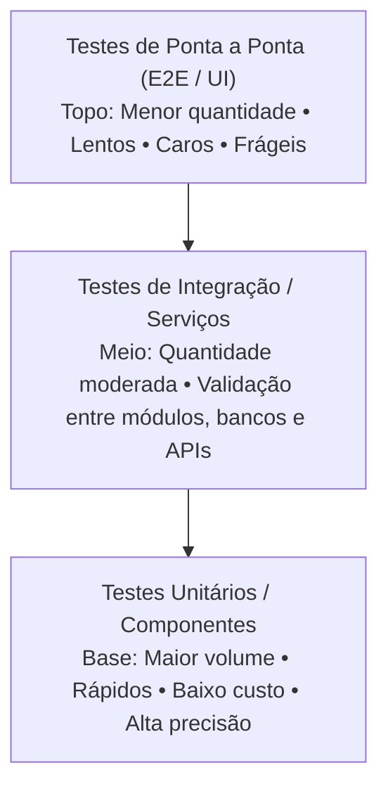
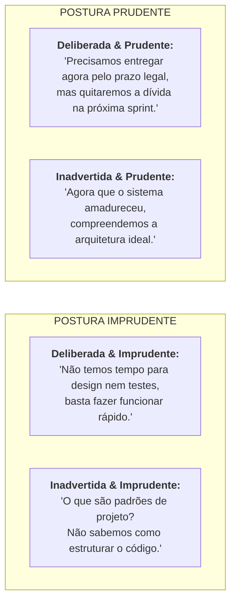

# 05 - Qualidade, Testes, Refatoração e Dívida Técnica

> **Matéria:** Engenharia de Software  
> **Cargo:** B02 – Técnico de Controle Externo – Especialidade: Tecnologia da Informação  
> **Arquivo:** `05_qualidade_testes_refatoracao_e_divida_tecnica.md`  

---

## 📌 Ementa / Itens do Edital
- Qualidade de software: desempenho, escalabilidade, disponibilidade, confiabilidade e manutenibilidade
- Testes de software: unitários, de integração, funcionais, de regressão, de carga e de estresse
- Testes automatizados
- Revisão de código (code review)
- Refatoração de código (refactoring)
- Dívida técnica (technical debt)

---

## 🌳 Classificação Hierárquica

```text
5. Garantia da Qualidade, Estratégias de Testes e Manutenção de Software
├── 5.1 Atributos e Métricas de Qualidade de Software (ISO/IEC 25010)
│   ├── 5.1.1 Desempenho e Eficiência (tempo de resposta, latência, vazão e consumo de recursos)
│   ├── 5.1.2 Escalabilidade: Escalabilidade Vertical (Scale Up) vs. Escalabilidade Horizontal (Scale Out)
│   ├── 5.1.3 Confiabilidade: Tolerância a falhas, maturidade e recuperabilidade (MTBF - Mean Time Between Failures)
│   ├── 5.1.4 Disponibilidade: SLA, cálculo de disponibilidade percentual ("99.9%") e MTTR (Mean Time to Repair)
│   └── 5.1.5 Manutenibilidade: Modularidade, reusabilidade, analisabilidade, modificabilidade e testabilidade
├── 5.2 Níveis e Estratégias de Testes de Software
│   ├── 5.2.1 A Pirâmide de Testes de Mike Cohn:
│   │   ├── Base: Testes Unitários (rápidos, baratos, isolados)
│   │   ├── Meio: Testes de Integração / Serviços (comunicação entre módulos/banco)
│   │   └── Topo: Testes de Ponta a Ponta (E2E / Interface / UI)
│   ├── 5.2.2 Dublês de Teste (Test Doubles de Gerard Meszaros):
│   │   ├── Dummy (apenas preenche parâmetros)
│   │   ├── Stub (respostas fixas programadas)
│   │   ├── Spy (registra chamadas efetuadas)
│   │   ├── Mock (objeto pré-programado com expectativas estritas de chamadas)
│   │   └── Fake (implementação funcional simplificada, ex.: banco em memória)
│   └── 5.2.3 Abordagens Estruturais:
│       ├── Teste de Caixa-Preta (Funcional): Partição de equivalência e análise de valor limite
│       └── Teste de Caixa-Branca (Estrutural): Cobertura de comandos, cobertura de desvios e complexidade ciclomática de McCabe
├── 5.3 Tipos Especializados de Teste e Automação
│   ├── 5.3.1 Testes de Regressão: Assegurar que alterações não quebraram rotinas funcionais anteriores
│   ├── 5.3.2 Testes de Desempenho e Capacidade:
│   │   ├── Teste de Carga (Load): Comportamento sob carga operacional normal e de pico previsto
│   │   ├── Teste de Estresse (Stress): Avaliação além do limite máximo para testar modo de quebra e recuperação
│   │   ├── Teste de Pico (Spike): Variações abruptas e repentinas de tráfego
│   │   └── Teste de Resistência / Sobrecarga (Soak): Longos períodos sob carga para detectar vazamentos de memória
│   └── 5.3.3 Automação e Práticas Ágeis: TDD (Red-Green-Refactor) e BDD (Given-When-Then / Gherkin)
└── 5.4 Revisão de Código, Refatoração e Dívida Técnica
    ├── 5.4.1 Revisão de Código (Code Review): Pull Requests, inspeção de Fagan e pair programming
    ├── 5.4.2 Refatoração de Código (Martin Fowler):
    │   ├── Definição: Alterar estrutura interna sem modificar comportamento externo observável
    │   ├── Maus Cheiros de Código (Code Smells): Método Longo, God Class, Código Duplicado, Shotgun Surgery
    │   └── Técnicas: Extract Method, Extract Class, Rename, Replace Conditional with Polymorphism
    └── 5.4.3 Dívida Técnica (Ward Cunningham / Martin Fowler):
        ├── Metáfora do débito técnico e juros de manutenção
        └── O Quadrante da Dívida Técnica (Deliberada x Inadvertida; Prudente x Imprudente)
```

---

## 📖 Resumo Teórico Aprofundado

### 1. A Pirâmide de Testes de Mike Cohn

A Pirâmide de Testes estabelece a proporção ideal de distribuição dos testes em projetos sustentáveis:



| Nível de Teste | Velocidade de Execução | Custo de Manutenção | Foco de Falha | Escopo de Isolamento |
| :--- | :--- | :--- | :--- | :--- |
| **Unitário** | Milissegundos | Muito baixo | Linha exata / Método | Total (usa Stubs/Mocks) |
| **Integração** | Segundos | Moderado | Interface entre componentes | Parcial (integra com BD ou filas) |
| **Ponta a Ponta (E2E)** | Minutos / Horas | Muito alto | Fluxo completo do usuário | Nulo (sistema real ponta a ponta) |

---

### 2. Dublês de Teste (*Test Doubles*)

Classificação formal de Gerard Meszaros:
1. **Dummy:** Objetos passados apenas para preencher parâmetros de assinatura obrigatórios, nunca sendo chamados de fato na lógica sob teste.
2. **Stub:** Fornece respostas enlatadas e pré-fabricadas para chamadas feitas durante o teste (ex.: sempre retorna `true` para `verificarSaldo()`).
3. **Spy:** Um Stub que também registra informações sobre como foi chamado (ex.: memoriza quantas vezes foi invocado ou quais parâmetros recebeu).
4. **Mock:** Objeto pré-programado com **expectativas formais** sobre quais métodos *devem* ser chamados. Se a chamada não ocorrer na ordem ou quantidade correta, o teste falha.
5. **Fake:** Possui uma implementação funcional real, mas utiliza atalhos que a tornam imprópria para produção (ex.: um banco de dados em memória `H2` simulando um banco de dados relacional complexo).

---

### 3. Técnicas de Teste: Caixa-Preta vs. Caixa-Branca

#### 3.1 Caixa-Preta (Funcional)
- **Partição de Equivalência:** Divide o domínio de entrada em classes de equivalência válidas e inválidas, assumindo que qualquer valor da partição produz o mesmo resultado.
- **Análise do Valor Limite (BVA):** Testa valores exatamente nas fronteiras e imediatamente adjacentes (ex.: se a regra é `idade entre 18 e 65`, testa-se `17, 18, 19` e `64, 65, 66`). É onde historicamente ocorre mais de 80% dos bugs de lógica condicional.

#### 3.2 Caixa-Branca (Estrutural) e McCabe
- **Complexidade Ciclomática de McCabe ($V(G)$):** Mede a quantidade de caminhos linearmente independentes no grafo de fluxo de controle do código:
  $V(G) = P + 1$ *(onde $P$ é a quantidade de predicados/decisões: `if`, `while`, `for`, `case`)*.
- Representa o **número mínimo de casos de teste** necessários para garantir cobertura completa de todas as decisões do algoritmo.

---

### 4. O Quadrante da Dívida Técnica de Martin Fowler

A dívida técnica é o custo acumulado de retrabalho futuro decorrente de escolhas técnicas imediatistas:



| Postura | Deliberada (Consciente) | Inadvertida (Inconsciente) |
| :--- | :--- | :--- |
| **Prudente** | Decisão de negócio planejada: entrega antecipada com refatoração agendada. | Aprendizado evolucionário: o design ideal só ficou claro após o uso real. |
| **Imprudente** | Atalho irresponsável: código rápido e mal feito por negligência deliberada. | Falta de capacitação: a equipe ignora boas práticas de engenharia de software. |

---

## ⚠️ Pontos de Atenção (Estilo FCC)

> 🚨 **PEGADINHAS RECORRENTES DA BANCA FCC:**  
> 1. **Refatoração não adiciona funcionalidade:** A FCC frequentemente afirma em enunciados que "a equipe refatorou o sistema para incluir suporte ao protocolo Pix". Isso está **ERRADO**! Adicionar funcionalidades é evolução de software. Refatoração preserva rigorosamente o comportamento observável externo.  
> 2. **Carga vs. Estresse:** Teste de **carga** verifica o sistema dentro da capacidade contratual prevista. Teste de **estresse** propositalmente quebra o sistema levando-o além do limite para testar resiliência e recuperação.  
> 3. **Teste de Regressão:** Deve ser disparado após qualquer manutenção corretiva, adaptativa ou evolutiva para certificar que o que funcionava não parou de funcionar.

---

## 🌐 Fontes Recomendadas na Internet

- [ISO/IEC 25010 Software Quality Model](https://iso25000.com/index.php/en/iso-25000-standards/iso-25010)
- [The Practical Test Pyramid (Ham Vocke / Martin Fowler)](https://martinfowler.com/articles/practical-test-pyramid.html)
- [Martin Fowler - Refactoring Catalog](https://refactoring.com/catalog/)
- [Martin Fowler - Technical Debt Quadrant Explained](https://martinfowler.com/bliki/TechnicalDebtQuadrant.html)

---

## 📝 Questões Comentadas & Exemplos (Padrão FCC)

### Questão 1 (FCC - Analista de TI / Garantia da Qualidade e Testes)
Uma equipe de desenvolvimento de software do Tribunal de Contas concluiu a correção de uma vulnerabilidade de segurança e a implementação de uma nova funcionalidade na rotina de cadastro de credores. Antes de disponibilizar a nova versão em produção, o líder técnico determinou a execução imediata de um conjunto de testes automatizados com o objetivo específico de verificar se as alterações recentes introduzidas no código-fonte não afetaram adversamente ou causaram falhas em partes do sistema que funcionavam perfeitamente antes da alteração. O tipo de teste determinado pelo líder é o:  
A) Teste de estresse.  
B) Teste de regressão.  
C) Teste de carga.  
D) Teste de usabilidade.  
E) Teste de caixa-transparente destrutivo.  

> **Gabarito: B**  
>  
> **Comentário Analítico Passo a Passo:**  
> - **A) Incorreta:** Teste de estresse visa avaliar os limites extremos de hardware/software até o esgotamento de recursos.  
> - **B) CORRETA:** O **Teste de Regressão** tem a finalidade exata de assegurar que novas modificações, correções de defeitos ou inserções de código não quebraram rotinas que anteriormente se encontravam íntegras e estáveis.  
> - **C) Incorreta:** Teste de carga avalia o comportamento sob volume normal e de pico de usuários concorrentes.  
> - **D) Incorreta:** Teste de usabilidade avalia a facilidade de interação e experiência do usuário.  
> - **E) Incorreta:** Nomenclatura inexistente nos padrões formais de teste.

---

### Questão 2 (FCC - Técnico de Controle Externo / TI)
A respeito do conceito de refatoração (*refactoring*) de código em engenharia de software e da metáfora de dívida técnica, assinale a afirmativa correta:  
A) A refatoração consiste em alterar a lógica de negócio do software para adicionar novos recursos solicitados pelo cliente na sprint atual.  
B) A refatoração tem como objetivo aperfeiçoar a estrutura interna do código, tornando-o mais limpo, legível e manutenível, sem alterar o seu comportamento observável externo.  
C) A dívida técnica é um conceito que se aplica exclusivamente aos débitos financeiros de contratos de licitação em atraso.  
D) A prática do desenvolvimento guiado por testes (TDD) proíbe a realização de refatoração após os testes unitários passarem.  
E) Métodos longos com dezenas de parâmetros são considerados boas práticas de modularidade no padrão Clean Code.  

> **Gabarito: B**  
>  
> **Comentário Analítico Passo a Passo:**  
> - **A) Incorreta:** Adicionar novos recursos altera o comportamento externo, o que contradiz a definição fundamental de refatoração.  
> - **B) CORRETA:** Conforme definição clássica de Martin Fowler, a refatoração altera a estrutura interna do código (organização de classes, legibilidade, redução de duplicidade) preservando integralmente o comportamento funcional observável externo.  
> - **C) Incorreta:** Dívida técnica é uma metáfora da engenharia de software concebida por Ward Cunningham sobre o custo futuro de escolhas arquiteturais rápidas e mal feitas.  
> - **D) Incorreta:** A terceira etapa obrigatória do TDD é justamente o *Refactor* (Red-Green-Refactor).  
> - **E) Incorreta:** Métodos longos (*Long Method*) são classificados como sérios *code smells* (más práticas) que devem ser refatorados via *Extract Method*.

---

### Questão 3 (FCC - TRF - Analista Judiciário / TI)
Considere um método Java que contém a seguinte estrutura lógica de decisões condicionais: três comandos `if` simples, um laço `while` e uma estrutura `switch-case` com quatro cláusulas `case` e uma cláusula `default`. Aplicando a técnica de teste de caixa-branca fundamentada na Complexidade Ciclomática de Thomas McCabe ($V(G)$), o número de caminhos linearmente independentes e, consequentemente, a quantidade mínima de casos de teste necessários para cobrir todos os fluxos de execução desse método é:  
A) 8.  
B) 9.  
C) 10.  
D) 12.  
E) 7.  

> **Gabarito: B**  
>  
> **Comentário Analítico Passo a Passo:**  
> - A fórmula de complexidade ciclomática de McCabe por pontos de decisão é dada por $V(G) = P + 1$, onde $P$ é o total de predicados de decisão:  
>   - Três comandos `if`: 3 predicados;  
>   - Um laço `while`: 1 predicado;  
>   - Um `switch` com 4 cláusulas `case`: 4 predicados (o `default` é a saída padrão e não conta como predicado adicional).  
>   - Total de predicados $P = 3 + 1 + 4 = 8$.  
> - Logo: $V(G) = 8 + 1 = 9$ caminhos linearmente independentes.  
> - A quantidade mínima de casos de teste exigida é **9** (Gabarito B).

---

### Questão 4 (FCC - TCE - Auditor de Controle Externo / TI)
No desenvolvimento guiado por testes (*Test-Driven Development* - TDD) e na criação de suítes de testes unitários isolados, utilizam-se diferentes tipos de dublês de teste (*Test Doubles*). O dublê que é configurado especificamente com expectativas prévias sobre quais métodos devem ser chamados, com quais argumentos e quantas vezes, fazendo com que o teste falhe caso essas interações não ocorram conforme esperado, é denominado:  
A) Dummy.  
B) Stub.  
C) Mock.  
D) Fake.  
E) Driver.  

> **Gabarito: C**  
>  
> **Comentário Analítico Passo a Passo:**  
> - **A) Incorreta:** Dummy é apenas um objeto passado para satisfazer parâmetros de tipos, nunca chamado.  
> - **B) Incorreta:** Stub fornece respostas prontas e pré-programadas para chamadas, mas não verifica ativamente o comportamento ou a quantidade de chamadas recebidas.  
> - **C) CORRETA:** Conforme a taxonomia canônica de Gerard Meszaros e Martin Fowler, o **Mock** é um dublê orientado a verificação de comportamento: ele é programado com expectativas rigorosas de quais métodos serão invocados, falhando o teste caso a interação esperada não se concretize.  
> - **D) Incorreta:** Fake é uma implementação funcional real simplificada (ex.: banco em memória).  
> - **E) Incorreta:** Driver é um módulo que invoca o componente sob teste em abordagens bottom-up, não um dublê de dependência.

---

### Questão 5 (FCC - SEFAZ - Auditor de Tecnologia da Informação)
Uma equipe de testes de software planeja a execução de testes não-funcionais de desempenho em um portal tributário que receberá declarações fiscais. Para verificar o comportamento do sistema quando submetido a uma carga que ultrapassa intencionalmente a capacidade operacional máxima para a qual foi projetado, com o objetivo de observar como o sistema se comporta sob falha, se degrada graciosamente e como se recupera após a remoção da sobrecarga extrema, deve ser planejado um:  
A) Teste de Carga (*Load Testing*).  
B) Teste de Estresse (*Stress Testing*).  
C) Teste de Aceitação de Usuário (*UAT*).  
D) Teste de Sanidade (*Sanity Testing*).  
E) Teste de Fumaça (*Smoke Testing*).  

> **Gabarito: B**  
>  
> **Comentário Analítico Passo a Passo:**  
> - **A) Incorreta:** O Teste de Carga avalia o sistema dentro das condições esperadas normais e de pico contratual, sem o objetivo intencional de provocar o colapso.  
> - **B) CORRETA:** O **Teste de Estresse** submete intencionalmente o sistema a cargas superiores ao limite projetado de hardware e largura de banda para identificar seu ponto de quebra (*breaking point*), testar a robustez dos mecanismos de recuperação de desastres e garantir que ele não corrompa dados ao falhar.  
> - **C) Incorreta:** O UAT verifica a aderência das funcionalidades às necessidades de negócio do usuário final.  
> - **D) Incorreta:** O Teste de Sanidade é um subconjunto rápido de testes para avaliar se uma correção específica de bug não gerou regressão óbvia.  
> - **E) Incorreta:** O Smoke Testing verifica se a compilação do software está minimamente estável para iniciar a bateria de testes.
