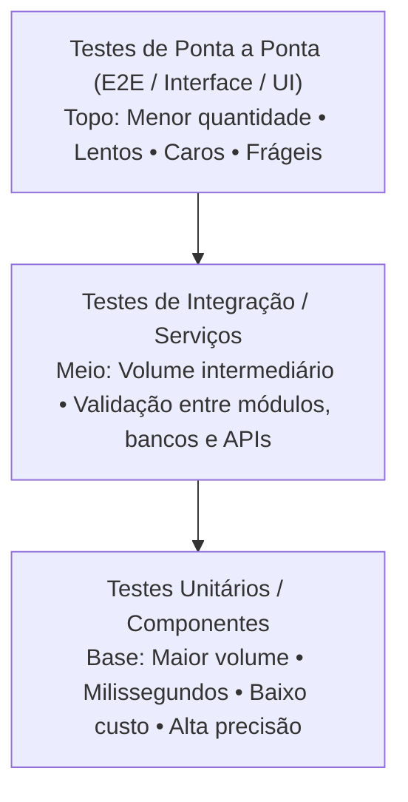
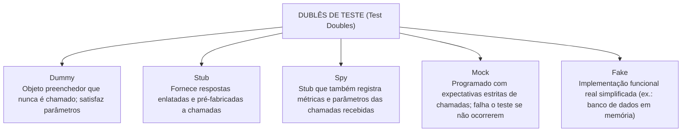
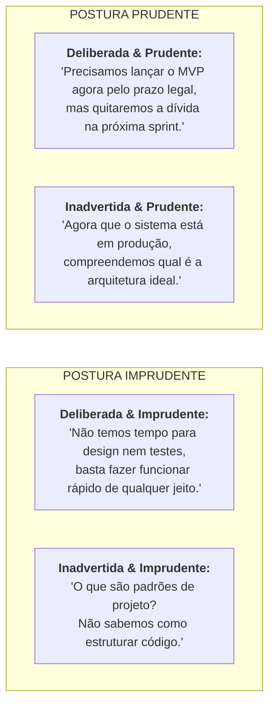

# 05 - Qualidade, Testes, Refatoração e Dívida Técnica

> **Matéria:** Engenharia de Software  
> **Cargo:** B02 – Técnico de Controle Externo – Especialidade: Tecnologia da Informação  
> **Arquivo:** `05_qualidade_testes_refatoracao_e_divida_tecnica.md`  

---

## 📌 Ementa / Itens do Edital
- Qualidade de software: desempenho, escalabilidade, disponibilidade, confiabilidade e manutenibilidade
- Testes de software: unitários, de integração, funcionais, de regressão, de carga e de estresse
- Testes automatizados
- Revisão de código (code review)
- Refatoração de código (refactoring)
- Dívida técnica (technical debt)

---

## 🧭 Sumário

1. [Atributos e Métricas de Qualidade de Software (ISO/IEC 25010)](#1-atributos-e-metricas-de-qualidade-de-software-isoiec-25010)
    1. [Desempenho e Eficiência de Recursos](#11-desempenho-e-eficiencia-de-recursos)
    2. [Escalabilidade Vertical (Scale Up) vs. Escalabilidade Horizontal (Scale Out)](#12-escalabilidade-vertical-scale-up-vs-escalabilidade-horizontal-scale-out)
    3. [Confiabilidade, Disponibilidade e Métricas de Manutenção (MTBF e MTTR)](#13-confiabilidade-disponibilidade-e-metricas-de-manutencao-mtbf-e-mttr)
    4. [Manutenibilidade e Facilidade de Mudança](#14-manutenibilidade-e-facilidade-de-mudanca)
    5. [Teste 043](#Teste-043)
2. [Níveis e Estratégias de Testes de Software](#2-niveis-e-estrategias-de-testes-de-software)
    1. [A Pirâmide de Testes de Mike Cohn](#21-a-piramide-de-testes-de-mike-cohn)
    2. [Dublês de Teste (*Test Doubles* de Gerard Meszaros)](#22-dubles-de-teste-test-doubles-de-gerard-meszaros)
    3. [Testes de Caixa-Preta (Funcionais) vs. Testes de Caixa-Branca (Estruturais)](#23-testes-de-caixa-preta-funcionais-vs-testes-de-caixa-branca-estruturais)
    4. [Complexidade Ciclomática de Thomas McCabe e Grafo de Fluxo](#24-complexidade-ciclomatica-de-thomas-mccabe-e-grafo-de-fluxo)
    5. [Teste 044](#Teste-044)
    6. [Teste 045](#Teste-045)
    7. [Teste 046](#Teste-046)
    8. [Teste 047](#Teste-047)
3. [Tipos Especializados de Testes e Automação](#3-tipos-especializados-de-testes-e-automacao)
    1. [Testes de Regressão e Automação Contínua](#31-testes-de-regressao-e-automacao-continua)
    2. [Testes de Desempenho: Carga vs. Estresse vs. Pico vs. Resistência](#32-testes-de-desempenho-carga-vs-estresse-vs-pico-vs-resistencia)
    3. [Práticas de TDD (Test-Driven Development) e BDD (Behavior-Driven Development)](#33-praticas-de-tdd-test-driven-development-e-bdd-behavior-driven-development)
    4. [Teste 048](#Teste-048)
    5. [Teste 049](#Teste-049)
    6. [Teste 050](#Teste-050)
4. [Revisão de Código, Refatoração e Dívida Técnica](#4-revisao-de-codigo-refatoracao-e-divida-tecnica)
    1. [Técnicas Modernas de Revisão de Código (Code Review)](#41-tecnicas-modernas-de-revisao-de-codigo-code-review)
    2. [Refatoração de Código e os "Maus Cheiros" (Code Smells) de Fowler](#42-refatoracao-de-codigo-e-os-maus-cheiros-code-smells-de-fowler)
    3. [Dívida Técnica e o Quadrante de Martin Fowler](#43-divida-tecnica-e-o-quadrante-de-martin-fowler)
    4. [Teste 051](#Teste-051)
    5. [Teste 052](#Teste-052)
    6. [Teste 053](#Teste-053)
5. [Fontes Oficiais e Referências Bibliográficas](#5-fontes-oficiais-e-referencias-bibliograficas)

---

## 1. Atributos e Métricas de Qualidade de Software (ISO/IEC 25010)

A norma internacional **ISO/IEC 25010** (evolução da ISO 9126) define o modelo de qualidade de produto de software, estruturado em oito características fundamentais: adequação funcional, eficiência de desempenho, compatibilidade, usabilidade, confiabilidade, segurança, manutenibilidade e portabilidade.

### 1.1 Desempenho e Eficiência de Recursos
Mede o comportamento do sistema em termos de velocidade de resposta e utilização racional dos recursos computacionais sob condições especificadas:

- **Tempo de Resposta (*Response Time*):** Intervalo de tempo transcorrido entre a emissão de uma requisição pelo usuário e a exibição completa da resposta processada;
- **Latência:** Tempo de trânsito que uma mensagem ou pacote leva para viajar da origem ao destino na rede;
- **Vazão (*Throughput*):** Quantidade de transações, requisições ou volume de dados processados com sucesso por unidade de tempo (ex.: 5.000 requisições por segundo - RPS);
- **Utilização de Recursos:** Percentual de ocupação de CPU, consumo de memória RAM, largura de banda e operações de entrada/saída em disco (I/O).

### 1.2 Escalabilidade Vertical (Scale Up) vs. Escalabilidade Horizontal (Scale Out)
- **Escalabilidade Vertical (*Scale Up*):** Expansão da capacidade computacional através do acréscimo de recursos físicos à máquina servidora existente (mais núcleos de processador, mais memória RAM ou discos SSD mais rápidos).  
  *Limitações:* Possui teto físico máximo de hardware, custo exponencialmente elevado nas faixas superiores e exige paradas no sistema para upgrade;
- **Escalabilidade Horizontal (*Scale Out*):** Expansão da capacidade mediante a adição de novas instâncias e nós servidores operando em paralelo sob um balanceador de carga (*Load Balancer*).  
  *Vantagens:* Altamente flexível, alinhada a ambientes em nuvem e contêineres elásticos, permitindo provisionamento dinâmico sem interrupção de serviços.

### 1.3 Confiabilidade, Disponibilidade e Métricas de Manutenção (MTBF e MTTR)
- **Confiabilidade:** Grau em que o software desempenha suas funções requeridas sob condições estabelecidas por um período especificado de tempo. Avalia a maturidade, a tolerância a falhas e a capacidade de recuperação de desastres;
- **Disponibilidade:** Proporção de tempo em que o sistema está operacional e plenamente acessível para uso quando demandado. Expressa-se habitualmente pelo número de "noves" em acordos de nível de serviço (SLA - *Service Level Agreement*):
    - *99% ("dois noves"):* Tolera até 3,65 dias de indisponibilidade por ano;
    - *99,9% ("três noves"):* Tolera até 8,76 horas de indisponibilidade por ano;
    - *99,99% ("quatro noves"):* Tolera até 52,56 minutos de indisponibilidade por ano.
- **Métricas Clássicas de Sustentação de Sistemas:**
    - **MTBF (*Mean Time Between Failures* - Tempo Médio Entre Falhas):** Métrica de confiabilidade que calcula o tempo médio em que o sistema opera perfeitamente entre duas panes consecutivas;
    - **MTTR (*Mean Time to Repair* - Tempo Médio para Reparo):** Métrica de manutenibilidade que mede o tempo médio gasto pela equipe de suporte para diagnosticar, corrigir a falha e restaurar o sistema à plena operação;
    - **Cálculo da Disponibilidade Teórica:**
    $$\text{Disponibilidade} = \frac{\text{MTBF}}{\text{MTBF} + \text{MTTR}}$$

### 1.4 Manutenibilidade e Facilidade de Mudança
A manutenibilidade reflete a facilidade e a eficiência com que o software pode ser modificado pelos desenvolvedores para corrigir defeitos, melhorar o desempenho ou adaptar o sistema a mudanças no ambiente de negócio. Subdivide-se em:

- **Modularidade:** Grau em que o sistema é composto por componentes discretos, isolando o impacto de alterações;
- **Reusabilidade:** Capacidade de um ativo ser utilizado em mais de um sistema ou módulo;
- **Analisabilidade:** Facilidade com que se pode diagnosticar deficiências, causas raízes de falhas ou identificar partes a serem alteradas;
- **Modificabilidade:** Facilidade com que o software pode ser modificado sem introduzir novos defeitos ou degradar a qualidade existente;
- **Testabilidade:** Grau em que critérios e testes eficazes podem ser estabelecidos e executados para validar as alterações realizadas.

---

### Teste 043
**(FCC – TRT-1 – Analista Judiciário (TI) – 2014)**  
A qualidade de software  constitui-se em um fator de grande importância no seu desenvolvimento. Dentre as propriedades utilizadas para determinar a qualidade de software ,

* **A)** mede-se, exclusivamente, a qualidade da documen- tação produzida para o software .
* **B)** verifica-se a satisfação de requisitos estabelecidos, incluindo o desempenho.
* **C)** não se abrange questões relativas à interface do software .
* **D)** não há preocupação com a facilidade de manuten- ção do software .
* **E)** não se inclui a confiabilidade esperada do software . _________________________________________________________

---

> **Comentário Detalhado:**
>
> - **A)** Incorreta. A portabilidade refere-se à facilidade com que o software pode ser transferido de um ambiente computacional para outro.
> - **B)** Correta. Segundo as normas de qualidade de produto de software (ISO/IEC 9126 e ISO/IEC 25010 SQuaRE), a confiabilidade (reliability) avalia a capacidade do software de manter seu nível de desempenho sob condições estabelecidas durante um período determinado, abrangendo maturidade, tolerância a falhas e capacidade de recuperação.
> - **C)** Incorreta. A manutenibilidade mede o esforço necessário para modificar o software (corretiva, adaptativa ou evolutivamente).
> - **D)** Incorreta. A usabilidade diz respeito à facilidade de aprendizado e operação pelo usuário.
> - **E)** Incorreta. A eficiência avalia o tempo de resposta e o consumo adequado de recursos do sistema.
>
> **Gabarito: B**

---

## 2. Níveis e Estratégias de Testes de Software

### 2.1 A Pirâmide de Testes de Mike Cohn
A Pirâmide de Testes é o modelo canônico de engenharia de software para construir suítes de testes automatizados equilibradas e sustentáveis:

| Nível de Teste | Velocidade de Execução | Custo de Construção/Manutenção | Foco do Diagnóstico de Falha | Escopo de Isolamento |
| :--- | :--- | :--- | :--- | :--- |
| **Unitário** | Milissegundos | Muito baixo | Linha exata do código / método | Total (isola com Stubs/Mocks) |
| **Integração** | Segundos | Moderado | Comunicação entre componentes | Parcial (integra com BD ou filas) |
| **Ponta a Ponta (E2E)** | Minutos / Horas | Extremamente alto | Fluxo completo do usuário | Nulo (sistema real completo) |

> 🚨 **ALERTA DE PROVA / PEGADINHA FCC:** A inversão da pirâmide (chamada de antipadrão "Casquinha de Sorvete" ou *Ice Cream Cone*) ocorre quando a organização possui poucos testes unitários e concentra quase todo o esforço em testes manuais ou E2E de interface. O resultado são suítes de testes lentas, que demoram horas para rodar no CI/CD e quebram frequentemente por pequenas alterações visuais (*testes frágeis / flaky tests*).

### 2.2 Dublês de Teste (*Test Doubles* de Gerard Meszaros)
Nos testes unitários, para isolar a unidade sob teste (*System Under Test - SUT*) de dependências pesadas, instáveis ou lentas (bancos de dados, serviços web externos, sistemas de arquivos), empregam-se **Dublês de Teste**:

1. **Dummy:** Objeto passado apenas para preencher parâmetros de assinatura de métodos obrigatórios, nunca sendo invocado durante a execução do teste;
2. **Stub:** Objeto que fornece respostas prontas e pré-programadas para as chamadas recebidas durante o teste (ex.: método `consultarSaldo()` retorna sempre o valor fixo de `1000.00`);
3. **Spy (Espião):** Um Stub enriquecido que intercepta e grava o histórico das chamadas (armazena quantas vezes o método foi invocado e quais parâmetros foram passados para checagem posterior);
4. **Mock:** Objeto pré-programado com **expectativas formais de comportamento**. O desenvolvedor configura explicitamente quais métodos devem ser chamados, com quais argumentos específicos e em que ordem. Se o método não for invocado conforme a expectativa estabelecida, o teste falha compulsoriamente;
5. **Fake:** Objeto que possui uma implementação funcional real simplificada, mas utiliza atalhos que a tornam imprópria para produção (ex.: um banco de dados relacional em memória H2 substituindo um servidor Oracle corporativo nos testes).

### 2.3 Testes de Caixa-Preta (Funcionais) vs. Testes de Caixa-Branca (Estruturais)
- **Testes de Caixa-Preta (Funcionais):** Avaliam o comportamento do software sem conhecimento da estrutura interna ou do código-fonte. O foco reside nas entradas e saídas esperadas:
    - *Partição de Equivalência:* Divide os dados de entrada em classes válidas e inválidas, partindo do princípio de que qualquer dado dentro da mesma partição receberá o mesmo tratamento;
    - *Análise do Valor Limite (BVA):* Testa valores situados exatamente nas fronteiras e adjacências das partições (ex.: se o intervalo aceito é de 18 a 65 anos, testa-se 17, 18, 19, 64, 65 e 66 anos).
- **Testes de Caixa-Branca (Estruturais):** Avaliam os caminhos de controle, estruturas lógicas e condições internas do código-fonte:
    - *Critérios de Cobertura:* Cobertura de comandos (*Statement Coverage*), cobertura de decisões/desvios (*Branch Coverage*) e cobertura de caminhos independentes.

### 2.4 Complexidade Ciclomática de Thomas McCabe e Grafo de Fluxo
Proposta por Thomas McCabe em 1976, a **Complexidade Ciclomática ($V(G)$)** mede quantitativamente a complexidade lógica de um programa através da contagem do número de caminhos linearmente independentes no seu grafo de fluxo de controle.

**Fórmulas de Cálculo Clássicas:**

1. Pela contagem de arestas ($E$), nós ($N$) e componentes conexos ($P=1$ para método único):
   $$V(G) = E - N + 2$$
2. Pela contagem direta de pontos de decisão/predicados ($P$):
   $$V(G) = P + 1$$
   *(onde $P$ é o total de comandos condicionais e de laço: `if`, `while`, `for`, `case`)*.

> ⭐ **IMPORTANTE / APLICAÇÃO EM TESTES:** O valor da complexidade ciclomática de McCabe define o **número mínimo exato de casos de teste** necessários para garantir que todas as instruções e caminhos lógicos do método sejam executados ao menos uma vez!

---

### Teste 044
**(FCC – TRT-1 – Analista Judiciário (TI) – 2014)**  
Considerando o teste de software , há o chamado teste de unidade, que consiste em testar

* **A)** o software completo, incluindo todos os seus compo- nentes ou módulos, no ambiente de testes.
* **B)** o funcionamento dos compiladores que estiverem sendo utilizados no desenvolvimento do software .
* **C)** individualmente, componentes ou módulos de software que, posteriormente devem ser testados de maneira integrada.
* **D)** o software completo em seu ambiente final de operação, já com o hardware base do projeto.
* **E)** apenas componentes ou módulos de software cujo código fonte tenha mais de 100 linhas. _________________________________________________________

---

> **Comentário Detalhado:**
>
> - **A)** Incorreta. Testar a comunicação entre subsistemas e módulos integrados caracteriza os testes de integração.
> - **B)** Incorreta. Avaliar o sistema completo em conformidade com as regras de negócio finais é o objetivo do teste de aceitação.
> - **C)** Correta. O teste de unidade (ou unitário) consiste em testar a menor parte testável de uma aplicação de software (como funções, métodos, classes ou módulos isolados), verificando se o componente individual se comporta rigorosamente conforme o especificado, tipicamente isolando dependências externas com o uso de stubs e mocks.
> - **D)** Incorreta. Testar o comportamento sob alta carga de acessos concorrentes define os testes de estresse/desempenho.
> - **E)** Incorreta. A verificação do sistema contra ataques externos refere-se aos testes de segurança e vulnerabilidade.
>
> **Gabarito: C**

---

### Teste 045
**(FCC – TRT-14 – Analista Judiciário (TI) – 2016)**  
Considere o código em Java que realiza testes unitários com o framework JUnit: import junit.framework.TestCase; public class MatematicaTest ......I  { private Matematica math=new Matematica(18, 3); public void testadd() { this.assertTrue(this.math.add()==21); } public void testsubtract() { this.assertTrue(this.math.subtract()=15); } public void testmultiply() { this.assertTrue(this.math.multiply()==54); } public void testdivide() { this.assertTrue(this.math.divide()==6); } public static void main(String[] args) { junit.textui.TestRunner.run( ......II  ); } } As lacunas I e II devem ser, correta e respectivamente, preenchidas com

* **A)** extends TestCase e MatematicaTest.class
* **B)** extends junit e MatematicaTest
* **C)** protected e assertEquals (MatematicaTest.class)
* **D)** protected TestCase e assertEquals(MatematicaTest)
* **E)** throws Exception e assertSame (MatematicaTest) Caderno de Prova ’C03’, Tipo 001 TRT14R-An.Jud.-Tec.Informação-C03 11

---

> **Comentário Detalhado:**
>
> - **A)** Correta. No framework de testes JUnit para Java, o método asserção assertEquals(esperado, obtido) verifica se o valor retornado pelo método sob teste coincide exatamente com o valor esperado, provocando a falha do teste caso haja discrepância.
> - **B)** Incorreta. O método assertTrue avalia condições estritamente booleanas, e não igualdade de valores numéricos complexos.
> - **C)** Incorreta. A anotação @Test identifica os métodos executáveis de teste, não servindo como método de verificação de resultado.
> - **D)** Incorreta. O método fail() força explicitamente a reprovação do teste sem comparar resultados.
> - **E)** Incorreta. assertSame verifica a identidade de referência em memória (==), e não a igualdade de valores de objetos.
>
> **Gabarito: A**

---

### Teste 046
**(FCC – TRT-14 – Analista Judiciário (TI) – 2016)**  
Ao escrever testes funcionais, um Analista precisa utilizar um controle de espera para que uma ação seja disparada depois d e alguma outra ação. No Selenium WebDriver, um Analista pode optar pela utilização de um controle de espera

* **A)** implícito, como o Thread.sleep(), que determina um tempo fixo que alguma ação no teste precisa esperar antes de ser executada. Se este tempo for ultrapassado, o teste não falhará.
* **B)** explícito, como o Thread.sleep(). Se a ação estiver pronta para ser executada antes do tempo fixado, o teste conti- nuará.
* **C)** explícito, como o WebDriver.manage().timeouts(), que permite esperar por um certo elemento na tela por um tempo de espera mínimo. Se este tempo for ultrapassado, o teste falhará.
* **D)** implícito, cujo valor padrão é 0. Este tempo deve ser baixo, para evitar que o Selenium fique esperando por um elemento na tela antes de acusar um erro de tempo de espera excedido.
* **E)** explícito, cujo valor padrão é 10. Seu valor não deve ser ba ixo para evitar problemas em controle de tempo entre ações no teste.

---

> **Comentário Detalhado:**
>
> - **A)** Incorreta. A espera estática rígida (Thread.sleep) é uma má prática que torna os testes lentos e instáveis.
> - **B)** Incorreta. O polling contínuo sem timeout pode gerar loops infinitos na suíte de testes automatizados.
> - **C)** Incorreta. A espera implícita global afeta todos os elementos indiscriminadamente, não tratando condições específicas de eventos assíncronos.
> - **D)** Correta. Na automação de testes funcionais (como no Selenium WebDriver), a Espera Explícita (Explicit Wait / WebDriverWait) configura o controle ideal para aguardar dinamicamente até que uma condição esperada (ExpectedCondition) específica se concretize antes de prosseguir com a interação, evitando quebras por assincronismo sem desperdício de tempo.
> - **E)** Incorreta. O tratamento genérico de exceções mascara defeitos reais na interface gráfica da aplicação.
>
> **Gabarito: D**

---

### Teste 047
**(FCC – TRT – Analista Judiciário (TI) – 2024)**  
Considerando o DevOps e suas boas práticas, analise os itens a

seguir:

I. Testes integrados são uma parte importante do processo

DevOps. Esses testes devem levar em consideração as

práticas de Test -Driven Development e Behavior -Driven

Development, dessa forma a execução automática desses

testes pode ser integrada ao pipeline de  CI. No entanto, é

importante integrar outros tipos de testes, como testes

funcionais ou testes de integração, que permitem que o

aplicativo seja testado funcionalmente do início ao fim com

os outros componentes do seu ecossistema.

II. Recomenda-se automat izar apenas as tarefas críticas que

envolvam poucas atualizações na implementação e nos testes

dos aplicativos nas infraestruturas. Essas tarefas devem ser

automatizadas em scripts que podem ser facilmente

integradas e executadas em pipelines de CI/CD.

III. A construção de pipelines de CI/CD envolvem a escolha de

ferramentas de DevOps adequadas pelas equipes

considerando a natureza da empresa. E necessário levar em

conta aspectos financeiros, avaliar entre ferramentas de

código aberto e gratuitas e as propr ietárias, que são mais

ricas em recursos e suporte, mas exigem um investimento

significativo.

Está correto apenas o que se afirma em

* **A)** I e III.
* **B)** I.
* **C)** I e II.
* **D)** II e III.
* **E)** II.

---

> **Comentário Detalhado:**
>
> - **A)** Correta. Nas práticas modernas de DevOps e Integração Contínua (CI/CD), a execução automatizada de testes integrados e regressivos no pipeline de entrega assegura a detecção precoce de incompatibilidades entre microsserviços e bibliotecas antes da promoção de artefatos para o ambiente de produção.
> - **B)** Incorreta. O item II nega a utilidade dos testes de regressão automatizados, contrariando as premissas centrais do DevOps.
> - **C)** Incorreta. O isolamento manual de ambientes sem automação eleva o risco de falhas operacionais em produção.
> - **D)** Incorreta. O teste de fumaça (smoke test) não substitui os testes funcionais de cobertura completa.
> - **E)** Incorreta. A ausência de monitoramento pós-deploy contraria a cultura de observabilidade do DevOps.
>
> **Gabarito: A**

---

## 3. Tipos Especializados de Testes e Automação

### 3.1 Testes de Regressão e Automação Contínua
- **Conceito de Teste de Regressão:** Bateria sistemática de testes executada após qualquer manutenção no software (correção de bugs, refatoração ou acréscimo de novas funcionalidades) para certificar que as alterações introduzidas **não causaram efeitos colaterais adversos nem reintroduziram defeitos antigos em módulos que funcionavam perfeitamente**;
- **Automação no Pipeline de CI/CD:** A suíte de testes de regressão deve ser integralmente automatizada e disparada a cada *commit* ou *Pull Request*, impedindo que código quebrado atinja o repositório principal.

### 3.2 Testes de Desempenho: Carga vs. Estresse vs. Pico vs. Resistência
A engenharia de testes de desempenho categoriza os testes de acordo com o padrão e a intensidade de tráfego injetado no sistema:

| Modalidade de Teste | Volume de Tráfego / Carga Injetada | Objetivo Específico da Avaliação |
| :--- | :--- | :--- |
| **Teste de Carga (*Load Testing*)** | Carga operacional esperada (normal e pico previsto em projeto). | Avaliar o comportamento do sistema, tempos de resposta e uso de hardware sob o volume regular de usuários acordado no SLA. |
| **Teste de Estresse (*Stress Testing*)** | Carga extrema que ultrapassa intencionalmente o limite de capacidade máxima do sistema. | Identificar o **ponto de quebra (*breaking point*)**, testar como o sistema falha (degradação graciosa) e como ele se recupera após o término da sobrecarga extrema. |
| **Teste de Pico (*Spike Testing*)** | Variações abruptas, repentinas e massivas de tráfego em intervalos de segundos. | Avaliar se a infraestrutura elástica e os balanceadores reagem com agilidade suficiente a picos súbitos de acesso. |
| **Teste de Resistência (*Soak / Endurance*)** | Carga moderada a alta mantida de forma ininterrupta por períodos prolongados (dias/semanas). | Detectar **vazamentos de memória (*memory leaks*)**, esgotamento de pools de conexões e saturação progressiva de disco. |

> 🚨 **ALERTA DE PROVA / PEGADINHA FCC:** Fique atento: Teste de **Carga** avalia o sistema *dentro* da capacidade contratual. Teste de **Estresse** empurra o sistema *além* do limite máximo com a finalidade expressa de quebrar o ambiente e avaliar a resiliência e recuperação.

### 3.3 Práticas de TDD (Test-Driven Development) e BDD (Behavior-Driven Development)
- **TDD (Desenvolvimento Guiado por Testes):** Técnica de engenharia de software fundamentada no ciclo rápido e iterativo de três fases: **Red $\rightarrow$ Green $\rightarrow$ Refactor**:
    1. *Red:* Escrever um teste automatizado que falha antes de escrever o código de produção;
    2. *Green:* Escrever o código mais simples possível apenas para fazer o teste passar com sucesso;
    3. *Refactor:* Limpar o código-fonte, eliminar duplicações e aperfeiçoar o design, garantindo que a suíte de testes continue verde.

- **BDD (Desenvolvimento Guiado por Comportamento):** Evolução colaborativa do TDD focada na linguagem ubíqua e no comportamento do sistema sob a ótica do negócio. Expressa cenários no formato **Given-When-Then** (*Dado que... Quando... Então...* - sintaxe Gherkin).

---

### Teste 048
**(Questão Inédita / Simulada Estilo FCC – Nível: Controle Externo / TI)**  
Uma equipe de desenvolvimento do Tribunal de Contas concluiu a refatoração e a correção de um defeito crítico no módulo de cálculo de prazos de processos administrativos. Antes de autorizar a implantação da nova versão no ambiente de homologação, o auditor líder de testes determinou a execução imediata de uma suíte de testes com a finalidade específica de assegurar que a alteração realizada ou o defeito corrigido não introduziram novos erros ou efeitos colaterais indesejados em partes do software que funcionavam perfeitamente antes da modificação. Essa categoria de teste classifica-se como:

* **A)** Teste de Regressão.
* **B)** Teste de Estresse.
* **C)** Teste de Carga.
* **D)** Teste de Usabilidade.
* **E)** Teste de Penetração (*Pentest*).

---

> **Comentário Detalhado:**
>
> - **A) CORRETA.** O **Teste de Regressão** consiste na reexecução seletiva ou total de suítes de testes previamente aprovadas após qualquer modificação de código (correção de bugs, refatoração, atualização de dependências ou acréscimo de novas features), visando certificar que as funcionalidades estáveis pré-existentes não sofreram "regressão" ou danos acidentais.
> - **B) Incorreta.** O Teste de Estresse avalia o comportamento do sistema sob sobrecargas extremas além de sua capacidade operacional máxima.
> - **C) Incorreta.** O Teste de Carga afere a performance e tempo de resposta sob volumes operacionais esperados em produção.
> - **D) Incorreta.** O Teste de Usabilidade avalia a facilidade de navegação, ergonomia e experiência do usuário na interface gráfica.
> - **E) Incorreta.** O Teste de Penetração avalia brechas de segurança cibernética e vetores de exploração de vulnerabilidades.
>
> **Gabarito: A**

---

### Teste 049
**(Questão Inédita / Simulada Estilo FCC – Nível: Controle Externo / TI)**  
Durante a auditoria de desempenho de um sistema de transmissão eletrônica de folhas de pagamento dos municípios jurisdicionados ao Tribunal de Contas, a equipe técnica planejou a execução de testes não-funcionais. O objetivo é submeter intencionalmente o cluster computacional a um volume de requisições concorrentes e tráfego que extrapole significativamente a sua capacidade operacional de pico, visando observar se o sistema degrada graciosamente suas funções, se mantém a consistência dos dados sob pane e de que maneira se restabelece após o cessamento da sobrecarga extrema. Esse teste de desempenho classifica-se como:

* **A)** Teste de Estresse (*Stress Testing*).
* **B)** Teste de Carga (*Load Testing*).
* **C)** Teste de Aceitação de Usuário (*UAT*).
* **D)** Teste de Fumaça (*Smoke Testing*).
* **E)** Teste de Sanidade (*Sanity Testing*).

---

> **Comentário Detalhado:**
>
> - **A) CORRETA.** O **Teste de Estresse (*Stress Testing*)** tem como finalidade primordial avaliar a robustez, disponibilidade e resiliência de um sistema computacional quando submetido a condições operacionais que **extrapolam intencionalmente os limites máximos de projeto** (*breaking point*), verificando se ocorrem falhas catastróficas, vazamentos de memória ou corrupção de dados e como se dá sua capacidade de autorrecuperação.
> - **B) Incorreta.** O Teste de Carga (*Load Testing*) testa o sistema operando dentro dos limites operacionais máximos previstos em regime normal ou de pico para medir latência e vazão.
> - **C) Incorreta.** O UAT é o teste formal executado pelos usuários de negócio para validar se a aplicação atende às regras funcionais contratadas.
> - **D) Incorreta.** O Smoke Test é uma bateria superficial rápida para checar se a compilação inicial da versão é estável o suficiente para iniciar os testes aprofundados.
> - **E) Incorreta.** O Sanity Test é uma verificação pontual e rápida após uma correção isolada para garantir que a funcionalidade pontual alterada está respondendo.
>
> **Gabarito: A**

---

### Teste 050
**(Questão Inédita / Simulada Estilo FCC – Nível: Controle Externo / TI)**  
A disciplina do Desenvolvimento Orientado por Testes (*Test-Driven Development* - TDD), preconizada por Kent Beck na metodologia Extreme Programming, estrutura a atividade de programação em torno de microiterações sistemáticas e disciplinadas conhecidas como o ciclo *Red-Green-Refactor*. A correta sequência de ações que define esse ciclo canônico estabelece que o desenvolvedor deve:

* **A)** 1. Escrever um teste unitário automatizado que falha porque a funcionalidade ainda não foi implementada (Red); 2. Escrever o código mínimo necessário de produção para fazer o teste passar com sucesso (Green); 3. Aperfeiçoar o design e a legibilidade do código, eliminando duplicações, assegurando que todos os testes continuem passando (Refactor).
* **B)** 1. Escrever o código completo de produção em camada de controle (Green); 2. Analisar falhas de compilação em tempo de execução (Red); 3. Otimizar as tabelas do banco de dados relacional (Refactor).
* **C)** 1. Refatorar classes legadas sem cobertura de testes automatizados (Refactor); 2. Escrever testes exploratórios manuais na interface com o usuário (Red); 3. Publicar o incremento em produção assistida (Green).
* **D)** 1. Gerar relatórios automatizados de violação de cobertura com SonarQube (Red); 2. Submeter pull request para autorização do comitê diretivo (Green); 3. Reescrever a documentação funcional do sistema (Refactor).
* **E)** 1. Codificar os métodos de produção e as classes de teste de forma simultânea e acoplada no mesmo arquivo fonte (Green); 2. Aguardar a execução noturna da esteira CI/CD (Red); 3. Limpar variáveis de ambiente (Refactor).

---

> **Comentário Detalhado:**
>
> - **A) CORRETA.** O ciclo mestre do **TDD** é estruturado estritamente em três fases consecutivas:
>     1. **Red:** Escreve-se um teste unitário automatizado que expressa o comportamento desejado. O teste falha compulsoriamente (ficando vermelho), pois a funcionalidade ainda não existe;
>     2. **Green:** Escreve-se o código de produção estritamente mínimo e indispensável para fazer o teste passar (ficando verde);
>     3. **Refactor:** Aperfeiçoa-se a qualidade interna do código (eliminando duplicações, melhorando nomenclatura e arquitetura), mantendo a garantia de segurança de que a suíte de testes permanece verde.
> - **B) Incorreta.** Inverte a ordem lógica: no TDD o teste sempre nasce antes do código funcional.
> - **C) Incorreta.** Refatorar código sem a retaguarda de testes automatizados é violação das premissas de engenharia segura.
> - **D) Incorreta.** Distorção com burocracias e ferramentas periféricas que não representam o ciclo ágil de TDD.
> - **E) Incorreta.** Testes e código de produção residem em estruturas de diretórios segregadas (`src/main` e `src/test`), e a iteração do ciclo ocorre em questão de segundos a minutos.
>
> **Gabarito: A**

---

## 4. Revisão de Código, Refatoração e Dívida Técnica

### 4.1 Técnicas Modernas de Revisão de Código (Code Review)
A revisão de código é uma prática colaborativa indispensável de garantia da qualidade:

- **Inspeções Formais (Fagan):** Processo tradicional rígido com papéis formais (moderador, autor, leitor e inspetor) e reuniões presenciais de leitura de código;
- **Revisão Baseada em Pull Requests (Moderna / Ágil):** Conduzida de forma assíncrona em plataformas como GitHub/GitLab. Antes de realizar o *merge* para a branch principal, outros desenvolvedores inspecionam o diff, verificam aderência a padrões arquiteturais, segurança e ausência de code smells;
- **Pair Programming:** Revisão contínua em tempo real executada pelo copiloto (*Navigator*) enquanto o piloto (*Driver*) digita o código.

### 4.2 Refatoração de Código e os "Maus Cheiros" (Code Smells) de Fowler
- **Definição Canônica (Martin Fowler):** Refatoração (*Refactoring*) é o processo de **modificar a estrutura interna de um software sem alterar o seu comportamento observável externo**, visando melhorar a legibilidade, reduzir a complexidade e facilitar futuras manutenções.  
  > 🚨 **PEGADINHA FCC:** Refatoração **NÃO adiciona novas funcionalidades** e **NÃO corrige bugs de negócio**! Se o comportamento funcional externo mudou, houve evolução de software ou correção, e não pura refatoração.
- **Maus Cheiros de Código (*Code Smells*) Recorrentes:**
    - *Método Longo (*Long Method*):* Métodos com centenas de linhas de código. Técnica de correção: **Extract Method** (extrair trecho para novo método nomeado);
    - *Classe Grande / Objeto Deus (*Large Class / God Class*):* Classe que acumula responsabilidades demais. Correção: **Extract Class**;
    - *Código Duplicado (*Duplicated Code*):* Mesma estrutura lógica em múltiplos locais. Viola o princípio DRY;
    - *Cirurgia com Espingarda (*Shotgun Surgery*):* Cada pequena alteração em uma regra exige dezenas de pequenas modificações espalhadas em classes diferentes. Indica alto acoplamento e baixa coesão.

### 4.3 Dívida Técnica e o Quadrante de Martin Fowler
Cunhada por Ward Cunningham, a metáfora da **Dívida Técnica (*Technical Debt*)** compara o desenvolvimento acelerado e descuidado de software a um empréstimo financeiro bancário: você consegue entregar o produto mais rápido hoje, mas contrai uma dívida de código mal estruturado. Se a dívida não for quitada (por meio de refatoração), o sistema acumula "juros compostos" que tornam qualquer nova manutenção futura proibitivamente lenta e cara.

- **Deliberada e Prudente:** A equipe sabe exatamente como fazer da melhor forma, mas opta conscientemente por um atalho temporário para atingir uma janela crítica de mercado ou prazo legal, agendando formalmente a refatoração subsequente;
- **Inadvertida e Prudente:** Decorrente do aprendizado natural do time: após colocar o sistema em produção e observar o uso real, os arquitetos percebem qual deveria ter sido o melhor design;
- **Deliberada e Imprudente:** A equipe sabe que está gerando código de péssima qualidade e sem testes, mas adota atalhos por puro desleixo e negligência;
- **Inadvertida e Imprudente:** A equipe desconhece princípios básicos de engenharia de software e padrões de design, gerando código macarrônico por pura incompetência técnica.

---

### Teste 051
**(Questão Inédita / Simulada Estilo FCC – Nível: Controle Externo / TI)**  
Em equipes de desenvolvimento de alta maturidade em Tribunais de Contas, a Revisão de Código (*Code Review*) por pares via *Pull Requests* associada à Análise Estática de Código compõe uma política essencial de controle de qualidade e governança. Em relação aos fundamentos dessas práticas de engenharia de software, é correto afirmar:

* **A)** As ferramentas de análise estática de código examinam o código-fonte ou binários compilados sem executá-los dinamicamente, identificando potenciais falhas de segurança conhecidas, violações de diretrizes de codificação, duplicações de trechos e índices excessivos de complexidade ciclomática.
* **B)** A análise estática de código exige compulsoriamente que o software esteja em execução ativa em ambiente de produção sob carga real de requisições.
* **C)** A revisão de código por pares (*Code Review*) destina-se exclusivamente a medir o tempo e a quantidade nominal de linhas escritas por cada programador para subsidiar avaliações de desempenho individual.
* **D)** A adoção de ferramentas automatizadas de análise estática de qualidade dispensa inteiramente a necessidade de testes funcionais e de integração na esteira CI/CD.
* **E)** As análises de código devem ser executadas com periodicidade exclusivamente anual no encerramento de cada exercício contábil.

---

> **Comentário Detalhado:**
>
> - **A) CORRETA.** A **Análise Estática de Código** (executada por ferramentas como SonarQube, Checkstyle e linters) analisa o código sem executá-lo, detectando antecipadamente *code smells*, riscos de segurança (vulnerabilidades OWASP), código duplicado, violações de padrões arquiteturais e métricas de complexidade e acoplamento.
> - **B) Incorreta.** Inversão conceitual: o exame com o software em execução dinâmica sob carga caracteriza a **Análise Dinâmica de Código** (DAST / profiling), não a análise estática.
> - **C) Incorreta.** Code Review é uma prática colaborativa voltada a assegurar qualidade técnica, aderência a padrões arquiteturais e disseminação de conhecimento, não uma ferramenta punitiva de medição de linhas de código.
> - **D) Incorreta.** A análise estática identifica defeitos estruturais e estilísticos, mas é incapaz de testar a lógica dinâmica de execução de regras de negócio, que depende de testes funcionais.
> - **E) Incorreta.** Práticas modernas de DevOps incorporam a análise estática e o code review continuamente a cada *commit* ou *pull request*.
>
> **Gabarito: A**

---

### Teste 052
**(Questão Inédita / Simulada Estilo FCC – Nível: Controle Externo / TI)**  
A respeito da técnica de refatoração (*refactoring*) de código em engenharia de software e de sua aplicação na prevenção e pagamento de débitos estruturais, assinale a afirmativa tecnicamente correta:

* **A)** A refatoração consiste no processo de alterar a estrutura interna de um software para torná-lo mais compreensível e manutenível, reduzindo seu custo de evolução, sem que haja modificação no seu comportamento observável externo.
* **B)** A refatoração caracteriza-se compulsoriamente pela inclusão de novos requisitos de negócio demandados pelos usuários na iteração em andamento.
* **C)** O termo dívida técnica refere-se exclusivamente aos custos financeiros contratuais e contingências tributárias de licenciamento de software proprietário.
* **D)** A metodologia do desenvolvimento guiado por testes (TDD) proíbe a realização de refatorações de código após a aprovação da suíte de testes unitários.
* **E)** A presença de classes gigantes (*God Classes*) e métodos extensos repletos de responsabilidades dispersas é considerada um padrão arquitetural desejável em sistemas corporativos.

---

> **Comentário Detalhado:**
>
> - **A) CORRETA.** Definição formal cunhada por Martin Fowler: a **Refatoração (*Refactoring*)** é uma modificação na estrutura interna do software para torná-lo mais fácil de entender e mais barato de modificar, **sem alterar o seu comportamento observável externo** (as entradas produzem rigorosamente as mesmas saídas esperadas).
> - **B) Incorreta.** Se há alteração de comportamento observável ou inclusão de novos requisitos de negócio, não se trata de refatoração pura, mas de desenvolvimento evolutivo de novas funcionalidades.
> - **C) Incorreta.** Dívida Técnica (*Technical Debt*) é uma metáfora técnica de engenharia de software para custos ocultos de manutenção e retrabalho decorrentes de atalhos e código mal estruturado.
> - **D) Incorreta.** Pelo contrário: o passo *Refactor* é a terceira etapa obrigatória do ciclo canônico do TDD (*Red-Green-Refactor*).
> - **E) Incorreta.** God classes e métodos longos constituem graves *code smells* (sintomas de má qualidade) que violam o princípio da responsabilidade única.
>
> **Gabarito: A**

---

### Teste 053
**(Questão Inédita / Simulada Estilo FCC – Nível: Controle Externo / TI)**  
O conceito de Dívida Técnica (*Technical Debt*), cunhado originariamente por Ward Cunningham e categorizado no célebre "Quadrante da Dívida Técnica" por Martin Fowler, estabelece uma analogia entre decisões arquiteturais apressadas e empréstimos financeiros. No quadrante de Fowler, quando uma equipe técnica de desenvolvimento adota conscientemente uma solução temporária simplificada para atender a um prazo legal inadiável fixado pelo Tribunal de Contas, mantendo pleno conhecimento das deficiências técnicas da solução e planejando seu pagamento nas Sprints subsequentes de estabilização, essa dívida é classificada como:

* **A)** Prudente e Deliberada.
* **B)** Imprudente e Inadvertida.
* **C)** Imprudente e Deliberada.
* **D)** Prudente e Inadvertida.
* **E)** Acidental e Irreversível.

---

> **Comentário Detalhado:**
>
> - **A) CORRETA.** No **Quadrante da Dívida Técnica de Martin Fowler** (cruzando os eixos Prudente/Imprudente com Deliberada/Inadvertida):
>     - **Prudente e Deliberada:** A equipe possui alto conhecimento técnico, calcula conscientemente o custo-benefício de antecipar a entrega (*"precisamos lançar a solução agora para atender ao prazo legal; sabemos as limitações e pagaremos esse débito na próxima Sprint"*);
>     - **Imprudente e Deliberada:** A equipe ignora as boas práticas por preguiça ou desleixo (*"não temos tempo para arquitetura ou testes, entregue de qualquer jeito"*);
>     - **Imprudente e Inadvertida:** A equipe desconhece práticas básicas de engenharia (*"o que são princípios SOLID ou testes automatizados?"*);
>     - **Prudente e Inadvertida:** A equipe aplica as melhores práticas, mas, após a entrega, aprende novos aspectos sobre o domínio que revelam como o sistema poderia ter sido desenhado de forma melhor.
> - **B) Incorreta.** "Imprudente e Inadvertida" decorre da inexperiência e desconhecimento da equipe.
> - **C) Incorreta.** "Imprudente e Deliberada" ocorre quando atalhos de má qualidade são adotados por descaso, sem planos de pagamento.
> - **D) Incorreta.** "Prudente e Inadvertida" ocorre quando a percepção da dívida surge apenas a posteriori por evolução do conhecimento do time.
> - **E) Incorreta.** Classificação inexistente no quadrante conceitual de Fowler.
>
> **Gabarito: A**

---

## 5. Fontes Oficiais e Referências Bibliográficas

* [ISO/IEC 25010 — Modelo de Qualidade de Produto de Software (Portal SQuaRE)](https://iso25000.com/index.php/en/iso-25000-standards/iso-25010) - Especificação das oito características de qualidade de produto de software (desempenho, confiabilidade, manutenibilidade, segurança e demais).
* [The Practical Test Pyramid — Pirâmide de Testes e Automação (Ham Vocke / Martin Fowler)](https://martinfowler.com/articles/practical-test-pyramid.html) - Estratégia de distribuição de testes unitários, de integração e de ponta a ponta (E2E).
* [Mocks Aren't Stubs — Dublês de Teste: Dummy, Fake, Stubs, Spies e Mocks (Martin Fowler)](https://martinfowler.com/articles/mocksArentStubs.html) - Distinção conceitual e prática entre os cinco tipos de *Test Doubles* de Gerard Meszaros e verificação de estado vs. comportamento.
* [Technical Debt Quadrant — O Quadrante da Dívida Técnica (Martin Fowler)](https://martinfowler.com/bliki/TechnicalDebtQuadrant.html) - Classificação da dívida técnica nos eixos prudente/imprudente e deliberada/inadvertida.
* [Refactoring.Guru — Maus Cheiros no Código (Code Smells) e Dívida Técnica](https://refactoring.guru/pt-br/refactoring/smells) - Catálogo de sintomas de degradação estrutural de código (*Long Method*, *Large Class*, *Shotgun Surgery*, *Duplicated Code*).
* [Refactoring.Guru — Catálogo de Técnicas de Refatoração de Código](https://refactoring.guru/pt-br/refactoring/techniques) - Operações formais de refatoração para melhoria do design interno sem alterar o comportamento externo.
* FOWLER, Martin. **Refatoração: Aperfeiçoando o Design de Códigos Existentes**. 2. ed. São Paulo: Novatec, 2019. (Cap. 1 - Refatoração: Um Primeiro Exemplo; Cap. 3 - Maus Cheiros no Código).
* MESZAROS, Gerard. **xUnit Test Patterns: Refactoring Test Code**. Boston: Addison-Wesley Professional, 2007. (Parte III - Cap. 11 - Using Test Doubles).
* SOMMERVILLE, Ian. **Engenharia de Software**. 10. ed. São Paulo: Pearson Education do Brasil, 2019. (Cap. 8 - Testes de Software; Cap. 24 - Gerenciamento da Qualidade).
