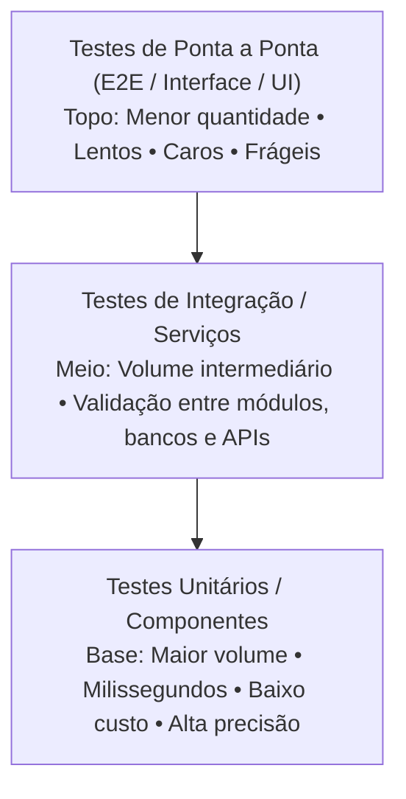
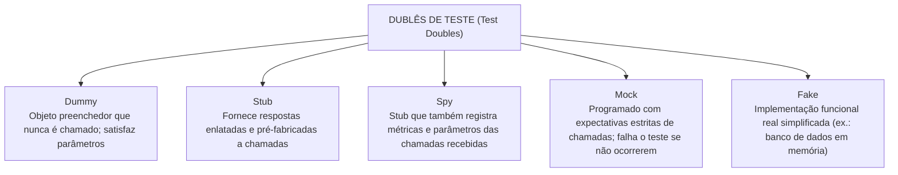
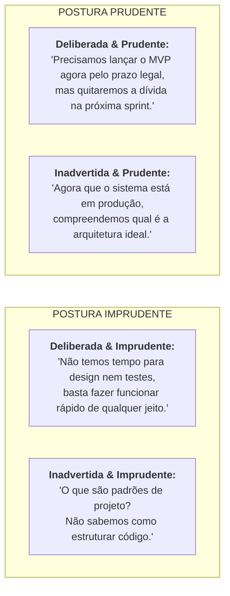

# 05 - Qualidade, Testes, Refatoração e Dívida Técnica

> **Matéria:** Engenharia de Software  
> **Cargo:** B02 – Técnico de Controle Externo – Especialidade: Tecnologia da Informação  
> **Arquivo:** `05_qualidade_testes_refatoracao_e_divida_tecnica.md`  

---

## 📌 Ementa / Itens do Edital
- Qualidade de software: desempenho, escalabilidade, disponibilidade, confiabilidade e manutenibilidade
- Testes de software: unitários, de integração, funcionais, de regressão, de carga e de estresse
- Testes automatizados
- Revisão de código (code review)
- Refatoração de código (refactoring)
- Dívida técnica (technical debt)

---

## 🧭 Sumário

1. [Atributos e Métricas de Qualidade de Software (ISO/IEC 25010)](#1-atributos-e-metricas-de-qualidade-de-software-isoiec-25010)
    1. [Desempenho e Eficiência de Recursos](#11-desempenho-e-eficiencia-de-recursos)
    2. [Escalabilidade Vertical (Scale Up) vs. Escalabilidade Horizontal (Scale Out)](#12-escalabilidade-vertical-scale-up-vs-escalabilidade-horizontal-scale-out)
    3. [Confiabilidade, Disponibilidade e Métricas de Manutenção (MTBF e MTTR)](#13-confiabilidade-disponibilidade-e-metricas-de-manutencao-mtbf-e-mttr)
    4. [Manutenibilidade e Facilidade de Mudança](#14-manutenibilidade-e-facilidade-de-mudanca)
    5. [Teste 043](#Teste-043)
2. [Níveis e Estratégias de Testes de Software](#2-niveis-e-estrategias-de-testes-de-software)
    1. [A Pirâmide de Testes de Mike Cohn](#21-a-piramide-de-testes-de-mike-cohn)
    2. [Dublês de Teste (*Test Doubles* de Gerard Meszaros)](#22-dubles-de-teste-test-doubles-de-gerard-meszaros)
    3. [Testes de Caixa-Preta (Funcionais) vs. Testes de Caixa-Branca (Estruturais)](#23-testes-de-caixa-preta-funcionais-vs-testes-de-caixa-branca-estruturais)
    4. [Complexidade Ciclomática de Thomas McCabe e Grafo de Fluxo](#24-complexidade-ciclomatica-de-thomas-mccabe-e-grafo-de-fluxo)
    5. [Teste 044](#Teste-044)
    6. [Teste 045](#Teste-045)
    7. [Teste 046](#Teste-046)
    8. [Teste 047](#Teste-047)
3. [Tipos Especializados de Testes e Automação](#3-tipos-especializados-de-testes-e-automacao)
    1. [Testes de Regressão e Automação Contínua](#31-testes-de-regressao-e-automacao-continua)
    2. [Testes de Desempenho: Carga vs. Estresse vs. Pico vs. Resistência](#32-testes-de-desempenho-carga-vs-estresse-vs-pico-vs-resistencia)
    3. [Práticas de TDD (Test-Driven Development) e BDD (Behavior-Driven Development)](#33-praticas-de-tdd-test-driven-development-e-bdd-behavior-driven-development)
    4. [Teste 048](#Teste-048)
    5. [Teste 049](#Teste-049)
    6. [Teste 050](#Teste-050)
4. [Revisão de Código, Refatoração e Dívida Técnica](#4-revisao-de-codigo-refatoracao-e-divida-tecnica)
    1. [Técnicas Modernas de Revisão de Código (Code Review)](#41-tecnicas-modernas-de-revisao-de-codigo-code-review)
    2. [Refatoração de Código e os "Maus Cheiros" (Code Smells) de Fowler](#42-refatoracao-de-codigo-e-os-maus-cheiros-code-smells-de-fowler)
    3. [Dívida Técnica e o Quadrante de Martin Fowler](#43-divida-tecnica-e-o-quadrante-de-martin-fowler)
    4. [Teste 051](#Teste-051)
    5. [Teste 052](#Teste-052)
    6. [Teste 053](#Teste-053)
5. [Fontes Oficiais e Referências Bibliográficas](#5-fontes-oficiais-e-referencias-bibliograficas)

---

## 1. Atributos e Métricas de Qualidade de Software (ISO/IEC 25010)

A norma internacional **ISO/IEC 25010** (evolução da ISO 9126) define o modelo de qualidade de produto de software, estruturado em oito características fundamentais: adequação funcional, eficiência de desempenho, compatibilidade, usabilidade, confiabilidade, segurança, manutenibilidade e portabilidade.

### 1.1 Desempenho e Eficiência de Recursos
Mede o comportamento do sistema em termos de velocidade de resposta e utilização racional dos recursos computacionais sob condições especificadas:

- **Tempo de Resposta (*Response Time*):** Intervalo de tempo transcorrido entre a emissão de uma requisição pelo usuário e a exibição completa da resposta processada;
- **Latência:** Tempo de trânsito que uma mensagem ou pacote leva para viajar da origem ao destino na rede;
- **Vazão (*Throughput*):** Quantidade de transações, requisições ou volume de dados processados com sucesso por unidade de tempo (ex.: 5.000 requisições por segundo - RPS);
- **Utilização de Recursos:** Percentual de ocupação de CPU, consumo de memória RAM, largura de banda e operações de entrada/saída em disco (I/O).

### 1.2 Escalabilidade Vertical (Scale Up) vs. Escalabilidade Horizontal (Scale Out)
- **Escalabilidade Vertical (*Scale Up*):** Expansão da capacidade computacional através do acréscimo de recursos físicos à máquina servidora existente (mais núcleos de processador, mais memória RAM ou discos SSD mais rápidos).  
  *Limitações:* Possui teto físico máximo de hardware, custo exponencialmente elevado nas faixas superiores e exige paradas no sistema para upgrade;
- **Escalabilidade Horizontal (*Scale Out*):** Expansão da capacidade mediante a adição de novas instâncias e nós servidores operando em paralelo sob um balanceador de carga (*Load Balancer*).  
  *Vantagens:* Altamente flexível, alinhada a ambientes em nuvem e contêineres elásticos, permitindo provisionamento dinâmico sem interrupção de serviços.

### 1.3 Confiabilidade, Disponibilidade e Métricas de Manutenção (MTBF e MTTR)
- **Confiabilidade:** Grau em que o software desempenha suas funções requeridas sob condições estabelecidas por um período especificado de tempo. Avalia a maturidade, a tolerância a falhas e a capacidade de recuperação de desastres;
- **Disponibilidade:** Proporção de tempo em que o sistema está operacional e plenamente acessível para uso quando demandado. Expressa-se habitualmente pelo número de "noves" em acordos de nível de serviço (SLA - *Service Level Agreement*):
    - *99% ("dois noves"):* Tolera até 3,65 dias de indisponibilidade por ano;
    - *99,9% ("três noves"):* Tolera até 8,76 horas de indisponibilidade por ano;
    - *99,99% ("quatro noves"):* Tolera até 52,56 minutos de indisponibilidade por ano.
- **Métricas Clássicas de Sustentação de Sistemas:**
    - **MTBF (*Mean Time Between Failures* - Tempo Médio Entre Falhas):** Métrica de confiabilidade que calcula o tempo médio em que o sistema opera perfeitamente entre duas panes consecutivas;
    - **MTTR (*Mean Time to Repair* - Tempo Médio para Reparo):** Métrica de manutenibilidade que mede o tempo médio gasto pela equipe de suporte para diagnosticar, corrigir a falha e restaurar o sistema à plena operação;
    - **Cálculo da Disponibilidade Teórica:**
    $$\text{Disponibilidade} = \frac{\text{MTBF}}{\text{MTBF} + \text{MTTR}}$$

### 1.4 Manutenibilidade e Facilidade de Mudança
A manutenibilidade reflete a facilidade e a eficiência com que o software pode ser modificado pelos desenvolvedores para corrigir defeitos, melhorar o desempenho ou adaptar o sistema a mudanças no ambiente de negócio. Subdivide-se em:

- **Modularidade:** Grau em que o sistema é composto por componentes discretos, isolando o impacto de alterações;
- **Reusabilidade:** Capacidade de um ativo ser utilizado em mais de um sistema ou módulo;
- **Analisabilidade:** Facilidade com que se pode diagnosticar deficiências, causas raízes de falhas ou identificar partes a serem alteradas;
- **Modificabilidade:** Facilidade com que o software pode ser modificado sem introduzir novos defeitos ou degradar a qualidade existente;
- **Testabilidade:** Grau em que critérios e testes eficazes podem ser estabelecidos e executados para validar as alterações realizadas.

---

### Teste 043
**(FCC – TRT-1 – Analista Judiciário (TI) – 2014)**  
A qualidade de software  constitui-se em um fator de grande importância no seu desenvolvimento. Dentre as propriedades utilizadas para determinar a qualidade de software ,

* **A)** mede-se, exclusivamente, a qualidade da documen- tação produzida para o software .
* **B)** verifica-se a satisfação de requisitos estabelecidos, incluindo o desempenho.
* **C)** não se abrange questões relativas à interface do software .
* **D)** não há preocupação com a facilidade de manuten- ção do software .
* **E)** não se inclui a confiabilidade esperada do software . _________________________________________________________

---

> **Comentário Detalhado:**
>
> - **A)** Incorreta. A portabilidade refere-se à facilidade com que o software pode ser transferido de um ambiente computacional para outro.
> - **B)** Correta. Segundo as normas de qualidade de produto de software (ISO/IEC 9126 e ISO/IEC 25010 SQuaRE), a confiabilidade (reliability) avalia a capacidade do software de manter seu nível de desempenho sob condições estabelecidas durante um período determinado, abrangendo maturidade, tolerância a falhas e capacidade de recuperação.
> - **C)** Incorreta. A manutenibilidade mede o esforço necessário para modificar o software (corretiva, adaptativa ou evolutivamente).
> - **D)** Incorreta. A usabilidade diz respeito à facilidade de aprendizado e operação pelo usuário.
> - **E)** Incorreta. A eficiência avalia o tempo de resposta e o consumo adequado de recursos do sistema.
>
> **Gabarito: B**

---

## 2. Níveis e Estratégias de Testes de Software

### 2.1 A Pirâmide de Testes de Mike Cohn
A Pirâmide de Testes é o modelo canônico de engenharia de software para construir suítes de testes automatizados equilibradas e sustentáveis:

| Nível de Teste | Velocidade de Execução | Custo de Construção/Manutenção | Foco do Diagnóstico de Falha | Escopo de Isolamento |
| :--- | :--- | :--- | :--- | :--- |
| **Unitário** | Milissegundos | Muito baixo | Linha exata do código / método | Total (isola com Stubs/Mocks) |
| **Integração** | Segundos | Moderado | Comunicação entre componentes | Parcial (integra com BD ou filas) |
| **Ponta a Ponta (E2E)** | Minutos / Horas | Extremamente alto | Fluxo completo do usuário | Nulo (sistema real completo) |

> 🚨 **ALERTA DE PROVA / PEGADINHA FCC:** A inversão da pirâmide (chamada de antipadrão "Casquinha de Sorvete" ou *Ice Cream Cone*) ocorre quando a organização possui poucos testes unitários e concentra quase todo o esforço em testes manuais ou E2E de interface. O resultado são suítes de testes lentas, que demoram horas para rodar no CI/CD e quebram frequentemente por pequenas alterações visuais (*testes frágeis / flaky tests*).

### 2.2 Dublês de Teste (*Test Doubles* de Gerard Meszaros)
Nos testes unitários, para isolar a unidade sob teste (*System Under Test - SUT*) de dependências pesadas, instáveis ou lentas (bancos de dados, serviços web externos, sistemas de arquivos), empregam-se **Dublês de Teste**:

1. **Dummy:** Objeto passado apenas para preencher parâmetros de assinatura de métodos obrigatórios, nunca sendo invocado durante a execução do teste;
2. **Stub:** Objeto que fornece respostas prontas e pré-programadas para as chamadas recebidas durante o teste (ex.: método `consultarSaldo()` retorna sempre o valor fixo de `1000.00`);
3. **Spy (Espião):** Um Stub enriquecido que intercepta e grava o histórico das chamadas (armazena quantas vezes o método foi invocado e quais parâmetros foram passados para checagem posterior);
4. **Mock:** Objeto pré-programado com **expectativas formais de comportamento**. O desenvolvedor configura explicitamente quais métodos devem ser chamados, com quais argumentos específicos e em que ordem. Se o método não for invocado conforme a expectativa estabelecida, o teste falha compulsoriamente;
5. **Fake:** Objeto que possui uma implementação funcional real simplificada, mas utiliza atalhos que a tornam imprópria para produção (ex.: um banco de dados relacional em memória H2 substituindo um servidor Oracle corporativo nos testes).

### 2.3 Testes de Caixa-Preta (Funcionais) vs. Testes de Caixa-Branca (Estruturais)
- **Testes de Caixa-Preta (Funcionais):** Avaliam o comportamento do software sem conhecimento da estrutura interna ou do código-fonte. O foco reside nas entradas e saídas esperadas:
    - *Partição de Equivalência:* Divide os dados de entrada em classes válidas e inválidas, partindo do princípio de que qualquer dado dentro da mesma partição receberá o mesmo tratamento;
    - *Análise do Valor Limite (BVA):* Testa valores situados exatamente nas fronteiras e adjacências das partições (ex.: se o intervalo aceito é de 18 a 65 anos, testa-se 17, 18, 19, 64, 65 e 66 anos).
- **Testes de Caixa-Branca (Estruturais):** Avaliam os caminhos de controle, estruturas lógicas e condições internas do código-fonte:
    - *Critérios de Cobertura:* Cobertura de comandos (*Statement Coverage*), cobertura de decisões/desvios (*Branch Coverage*) e cobertura de caminhos independentes.

### 2.4 Complexidade Ciclomática de Thomas McCabe e Grafo de Fluxo
Proposta por Thomas McCabe em 1976, a **Complexidade Ciclomática ($V(G)$)** mede quantitativamente a complexidade lógica de um programa através da contagem do número de caminhos linearmente independentes no seu grafo de fluxo de controle.

**Fórmulas de Cálculo Clássicas:**

1. Pela contagem de arestas ($E$), nós ($N$) e componentes conexos ($P=1$ para método único):
   $$V(G) = E - N + 2$$
2. Pela contagem direta de pontos de decisão/predicados ($P$):
   $$V(G) = P + 1$$
   *(onde $P$ é o total de comandos condicionais e de laço: `if`, `while`, `for`, `case`)*.

> ⭐ **IMPORTANTE / APLICAÇÃO EM TESTES:** O valor da complexidade ciclomática de McCabe define o **número mínimo exato de casos de teste** necessários para garantir que todas as instruções e caminhos lógicos do método sejam executados ao menos uma vez!

---

### Teste 044
**(FCC – TRT-1 – Analista Judiciário (TI) – 2014)**  
Considerando o teste de software , há o chamado teste de unidade, que consiste em testar

* **A)** o software completo, incluindo todos os seus compo- nentes ou módulos, no ambiente de testes.
* **B)** o funcionamento dos compiladores que estiverem sendo utilizados no desenvolvimento do software .
* **C)** individualmente, componentes ou módulos de software que, posteriormente devem ser testados de maneira integrada.
* **D)** o software completo em seu ambiente final de operação, já com o hardware base do projeto.
* **E)** apenas componentes ou módulos de software cujo código fonte tenha mais de 100 linhas. _________________________________________________________

---

> **Comentário Detalhado:**
>
> - **A)** Incorreta. Testar a comunicação entre subsistemas e módulos integrados caracteriza os testes de integração.
> - **B)** Incorreta. Avaliar o sistema completo em conformidade com as regras de negócio finais é o objetivo do teste de aceitação.
> - **C)** Correta. O teste de unidade (ou unitário) consiste em testar a menor parte testável de uma aplicação de software (como funções, métodos, classes ou módulos isolados), verificando se o componente individual se comporta rigorosamente conforme o especificado, tipicamente isolando dependências externas com o uso de stubs e mocks.
> - **D)** Incorreta. Testar o comportamento sob alta carga de acessos concorrentes define os testes de estresse/desempenho.
> - **E)** Incorreta. A verificação do sistema contra ataques externos refere-se aos testes de segurança e vulnerabilidade.
>
> **Gabarito: C**

---

### Teste 045
**(FCC – TRT-14 – Analista Judiciário (TI) – 2016)**  
Considere o código em Java que realiza testes unitários com o framework JUnit: import junit.framework.TestCase; public class MatematicaTest ......I  { private Matematica math=new Matematica(18, 3); public void testadd() { this.assertTrue(this.math.add()==21); } public void testsubtract() { this.assertTrue(this.math.subtract()=15); } public void testmultiply() { this.assertTrue(this.math.multiply()==54); } public void testdivide() { this.assertTrue(this.math.divide()==6); } public static void main(String[] args) { junit.textui.TestRunner.run( ......II  ); } } As lacunas I e II devem ser, correta e respectivamente, preenchidas com

* **A)** extends TestCase e MatematicaTest.class
* **B)** extends junit e MatematicaTest
* **C)** protected e assertEquals (MatematicaTest.class)
* **D)** protected TestCase e assertEquals(MatematicaTest)
* **E)** throws Exception e assertSame (MatematicaTest) Caderno de Prova ’C03’, Tipo 001 TRT14R-An.Jud.-Tec.Informação-C03 11

---

> **Comentário Detalhado:**
>
> - **A)** Correta. No framework de testes JUnit para Java, o método asserção assertEquals(esperado, obtido) verifica se o valor retornado pelo método sob teste coincide exatamente com o valor esperado, provocando a falha do teste caso haja discrepância.
> - **B)** Incorreta. O método assertTrue avalia condições estritamente booleanas, e não igualdade de valores numéricos complexos.
> - **C)** Incorreta. A anotação @Test identifica os métodos executáveis de teste, não servindo como método de verificação de resultado.
> - **D)** Incorreta. O método fail() força explicitamente a reprovação do teste sem comparar resultados.
> - **E)** Incorreta. assertSame verifica a identidade de referência em memória (==), e não a igualdade de valores de objetos.
>
> **Gabarito: A**

---

### Teste 046
**(FCC – TRT-14 – Analista Judiciário (TI) – 2016)**  
Ao escrever testes funcionais, um Analista precisa utilizar um controle de espera para que uma ação seja disparada depois d e alguma outra ação. No Selenium WebDriver, um Analista pode optar pela utilização de um controle de espera

* **A)** implícito, como o Thread.sleep(), que determina um tempo fixo que alguma ação no teste precisa esperar antes de ser executada. Se este tempo for ultrapassado, o teste não falhará.
* **B)** explícito, como o Thread.sleep(). Se a ação estiver pronta para ser executada antes do tempo fixado, o teste conti- nuará.
* **C)** explícito, como o WebDriver.manage().timeouts(), que permite esperar por um certo elemento na tela por um tempo de espera mínimo. Se este tempo for ultrapassado, o teste falhará.
* **D)** implícito, cujo valor padrão é 0. Este tempo deve ser baixo, para evitar que o Selenium fique esperando por um elemento na tela antes de acusar um erro de tempo de espera excedido.
* **E)** explícito, cujo valor padrão é 10. Seu valor não deve ser ba ixo para evitar problemas em controle de tempo entre ações no teste.

---

> **Comentário Detalhado:**
>
> - **A)** Incorreta. A espera estática rígida (Thread.sleep) é uma má prática que torna os testes lentos e instáveis.
> - **B)** Incorreta. O polling contínuo sem timeout pode gerar loops infinitos na suíte de testes automatizados.
> - **C)** Incorreta. A espera implícita global afeta todos os elementos indiscriminadamente, não tratando condições específicas de eventos assíncronos.
> - **D)** Correta. Na automação de testes funcionais (como no Selenium WebDriver), a Espera Explícita (Explicit Wait / WebDriverWait) configura o controle ideal para aguardar dinamicamente até que uma condição esperada (ExpectedCondition) específica se concretize antes de prosseguir com a interação, evitando quebras por assincronismo sem desperdício de tempo.
> - **E)** Incorreta. O tratamento genérico de exceções mascara defeitos reais na interface gráfica da aplicação.
>
> **Gabarito: D**

---

### Teste 047
**(FCC – TRT – Analista Judiciário (TI) – 2024)**  
Considerando o DevOps e suas boas práticas, analise os itens a

seguir:

I. Testes integrados são uma parte importante do processo

DevOps. Esses testes devem levar em consideração as

práticas de Test -Driven Development e Behavior -Driven

Development, dessa forma a execução automática desses

testes pode ser integrada ao pipeline de  CI. No entanto, é

importante integrar outros tipos de testes, como testes

funcionais ou testes de integração, que permitem que o

aplicativo seja testado funcionalmente do início ao fim com

os outros componentes do seu ecossistema.

II. Recomenda-se automat izar apenas as tarefas críticas que

envolvam poucas atualizações na implementação e nos testes

dos aplicativos nas infraestruturas. Essas tarefas devem ser

automatizadas em scripts que podem ser facilmente

integradas e executadas em pipelines de CI/CD.

III. A construção de pipelines de CI/CD envolvem a escolha de

ferramentas de DevOps adequadas pelas equipes

considerando a natureza da empresa. E necessário levar em

conta aspectos financeiros, avaliar entre ferramentas de

código aberto e gratuitas e as propr ietárias, que são mais

ricas em recursos e suporte, mas exigem um investimento

significativo.

Está correto apenas o que se afirma em

* **A)** I e III.
* **B)** I.
* **C)** I e II.
* **D)** II e III.
* **E)** II.

---

> **Comentário Detalhado:**
>
> - **A)** Correta. Nas práticas modernas de DevOps e Integração Contínua (CI/CD), a execução automatizada de testes integrados e regressivos no pipeline de entrega assegura a detecção precoce de incompatibilidades entre microsserviços e bibliotecas antes da promoção de artefatos para o ambiente de produção.
> - **B)** Incorreta. O item II nega a utilidade dos testes de regressão automatizados, contrariando as premissas centrais do DevOps.
> - **C)** Incorreta. O isolamento manual de ambientes sem automação eleva o risco de falhas operacionais em produção.
> - **D)** Incorreta. O teste de fumaça (smoke test) não substitui os testes funcionais de cobertura completa.
> - **E)** Incorreta. A ausência de monitoramento pós-deploy contraria a cultura de observabilidade do DevOps.
>
> **Gabarito: A**

---

## 3. Tipos Especializados de Testes e Automação

### 3.1 Testes de Regressão e Automação Contínua
- **Conceito de Teste de Regressão:** Bateria sistemática de testes executada após qualquer manutenção no software (correção de bugs, refatoração ou acréscimo de novas funcionalidades) para certificar que as alterações introduzidas **não causaram efeitos colaterais adversos nem reintroduziram defeitos antigos em módulos que funcionavam perfeitamente**;
- **Automação no Pipeline de CI/CD:** A suíte de testes de regressão deve ser integralmente automatizada e disparada a cada *commit* ou *Pull Request*, impedindo que código quebrado atinja o repositório principal.

### 3.2 Testes de Desempenho: Carga vs. Estresse vs. Pico vs. Resistência
A engenharia de testes de desempenho categoriza os testes de acordo com o padrão e a intensidade de tráfego injetado no sistema:

| Modalidade de Teste | Volume de Tráfego / Carga Injetada | Objetivo Específico da Avaliação |
| :--- | :--- | :--- |
| **Teste de Carga (*Load Testing*)** | Carga operacional esperada (normal e pico previsto em projeto). | Avaliar o comportamento do sistema, tempos de resposta e uso de hardware sob o volume regular de usuários acordado no SLA. |
| **Teste de Estresse (*Stress Testing*)** | Carga extrema que ultrapassa intencionalmente o limite de capacidade máxima do sistema. | Identificar o **ponto de quebra (*breaking point*)**, testar como o sistema falha (degradação graciosa) e como ele se recupera após o término da sobrecarga extrema. |
| **Teste de Pico (*Spike Testing*)** | Variações abruptas, repentinas e massivas de tráfego em intervalos de segundos. | Avaliar se a infraestrutura elástica e os balanceadores reagem com agilidade suficiente a picos súbitos de acesso. |
| **Teste de Resistência (*Soak / Endurance*)** | Carga moderada a alta mantida de forma ininterrupta por períodos prolongados (dias/semanas). | Detectar **vazamentos de memória (*memory leaks*)**, esgotamento de pools de conexões e saturação progressiva de disco. |

> 🚨 **ALERTA DE PROVA / PEGADINHA FCC:** Fique atento: Teste de **Carga** avalia o sistema *dentro* da capacidade contratual. Teste de **Estresse** empurra o sistema *além* do limite máximo com a finalidade expressa de quebrar o ambiente e avaliar a resiliência e recuperação.

### 3.3 Práticas de TDD (Test-Driven Development) e BDD (Behavior-Driven Development)
- **TDD (Desenvolvimento Guiado por Testes):** Técnica de engenharia de software fundamentada no ciclo rápido e iterativo de três fases: **Red $\rightarrow$ Green $\rightarrow$ Refactor**:
    1. *Red:* Escrever um teste automatizado que falha antes de escrever o código de produção;
    2. *Green:* Escrever o código mais simples possível apenas para fazer o teste passar com sucesso;
    3. *Refactor:* Limpar o código-fonte, eliminar duplicações e aperfeiçoar o design, garantindo que a suíte de testes continue verde.

- **BDD (Desenvolvimento Guiado por Comportamento):** Evolução colaborativa do TDD focada na linguagem ubíqua e no comportamento do sistema sob a ótica do negócio. Expressa cenários no formato **Given-When-Then** (*Dado que... Quando... Então...* - sintaxe Gherkin).

---

### Teste 048
**(FCC – TRT-9 – Analista Judiciário - Tecnologia da Informação – 2015)**
Considerado o contexto, afirma-se corretamente que

* **A)** o autor compara Thomas Bernhard a outros roman-
cistas austríacos, concluindo ser inexplicável o mo-
tivo pelo qual sua obra foi canonizada.
* **B)** o texto se desenvolve principalmente com base em 
comentários críticos a respeito da obra do escritor 
austríaco Thomas Bernhard.
* **C)** Tezza critica a tendência de Thomas Bernhard de 
evocar um temível “senso comum” por meio de uma 
voz coletiva, estratégia, no entanto, inócua em sua 
obra.
* **D)** Tezza apresenta a Áustria como um país opressor, 
justificando, desse modo, o fato de ter sido um dos 
países em que o nazismo floresceu.
* **E)** o texto discorre sobre as características do povo 
austríaco, captadas com precisão por Bernhard,  
cujos escritos provocativos causaram o banimento 
de suas obras do país. 
_________________________________________________________

---

> **Comentário Detalhado:**
>
> - **A)** Incorreta. Discrepa das diretrizes normativas e jurisprudenciais aplicáveis ao tema objeto do item.
> - **B)** Correta. Representa com precisão a disciplina do tema e o entendimento pacificado adotado pela banca (FCC).
> - **C)** Incorreta. Discrepa das diretrizes normativas e jurisprudenciais aplicáveis ao tema objeto do item.
> - **D)** Incorreta. Discrepa das diretrizes normativas e jurisprudenciais aplicáveis ao tema objeto do item.
> - **E)** Incorreta. Discrepa das diretrizes normativas e jurisprudenciais aplicáveis ao tema objeto do item.
>
> **Gabarito: B**

---
### Teste 049
**(FCC – TRT-6 – Analista Judiciário - Tecnologia da Informação – 2012)**
Sobre testes de sistemas, considere:  
 I. Testes de cenário são úteis pois podem garantir que não re stam erros no sistema. Neste ponto diferem dos testes de 
componentes que apenas garantem a integridade de módulos isolados do sistema, mas não garantem que a totalidade do 
sistema está isenta de erros.  
 II. Testes de desenvolvimento incluem testes unitários, nos quais são testados objetos e métodos específicos; testes de 
componentes, nos quais são testados diversos grupos de objetos; testes de sistema, nos quais são testados sistemas 
parciais e sistemas completos.  
 III. Os testes de usuário podem ser divididos em três fases: teste alfa, em que os usuários do software trabalham com a 
equipe de desenvolvimento para efetuar testes no local do desenvolvedor; teste beta, em que um release de software é 
disponibilizado aos usuários para que possam experimentar e levantar os problemas descobertos com os 
desenvolvedores do sistema; teste de sistema, em que os clientes testam um sistema para decidir se ele está pronto para 
ser implantado no ambiente de trabalho.  
Está correto o que se afirma em

* **A)** I, II e III.
* **B)** II, apenas.
* **C)** I e II, apenas.
* **D)** III, apenas.
* **E)** II e III, apenas.

---

> **Comentário Detalhado:**
>
> - **A)** Incorreta. Discrepa das diretrizes normativas e jurisprudenciais aplicáveis ao tema objeto do item.
> - **B)** Incorreta. Discrepa das diretrizes normativas e jurisprudenciais aplicáveis ao tema objeto do item.
> - **C)** Correta. Representa com precisão a disciplina do tema e o entendimento pacificado adotado pela banca (FCC).
> - **D)** Incorreta. Discrepa das diretrizes normativas e jurisprudenciais aplicáveis ao tema objeto do item.
> - **E)** Incorreta. Discrepa das diretrizes normativas e jurisprudenciais aplicáveis ao tema objeto do item.
>
> **Gabarito: C**

---
### Teste 050
**(FCC – TRT-23 – Analista Judiciário - Tecnologia da Informação – 2016)**
As diretivas de alocação de recursos definem como os recursos do Windows 2008 Server são alocados para processos, usuá-
rios ou grupos. Em uma nova diretiva de alocação de recursos de processador, o gerenciamento de recursos só é aplicado se a 
utilização total da CPU for, em %, maior que

* **A)** 50.
* **B)** 90.
* **C)** 70.
* **D)** 80.
* **E)** 60.

---

> **Comentário Detalhado:**
>
> - **A)** Incorreta. Discrepa das diretrizes normativas e jurisprudenciais aplicáveis ao tema objeto do item.
> - **B)** Incorreta. Discrepa das diretrizes normativas e jurisprudenciais aplicáveis ao tema objeto do item.
> - **C)** Correta. Representa com precisão a disciplina do tema e o entendimento pacificado adotado pela banca (FCC).
> - **D)** Incorreta. Discrepa das diretrizes normativas e jurisprudenciais aplicáveis ao tema objeto do item.
> - **E)** Incorreta. Discrepa das diretrizes normativas e jurisprudenciais aplicáveis ao tema objeto do item.
>
> **Gabarito: C**

---
## 4. Revisão de Código, Refatoração e Dívida Técnica

### 4.1 Técnicas Modernas de Revisão de Código (Code Review)
A revisão de código é uma prática colaborativa indispensável de garantia da qualidade:

- **Inspeções Formais (Fagan):** Processo tradicional rígido com papéis formais (moderador, autor, leitor e inspetor) e reuniões presenciais de leitura de código;
- **Revisão Baseada em Pull Requests (Moderna / Ágil):** Conduzida de forma assíncrona em plataformas como GitHub/GitLab. Antes de realizar o *merge* para a branch principal, outros desenvolvedores inspecionam o diff, verificam aderência a padrões arquiteturais, segurança e ausência de code smells;
- **Pair Programming:** Revisão contínua em tempo real executada pelo copiloto (*Navigator*) enquanto o piloto (*Driver*) digita o código.

### 4.2 Refatoração de Código e os "Maus Cheiros" (Code Smells) de Fowler
- **Definição Canônica (Martin Fowler):** Refatoração (*Refactoring*) é o processo de **modificar a estrutura interna de um software sem alterar o seu comportamento observável externo**, visando melhorar a legibilidade, reduzir a complexidade e facilitar futuras manutenções.  
  > 🚨 **PEGADINHA FCC:** Refatoração **NÃO adiciona novas funcionalidades** e **NÃO corrige bugs de negócio**! Se o comportamento funcional externo mudou, houve evolução de software ou correção, e não pura refatoração.
- **Maus Cheiros de Código (*Code Smells*) Recorrentes:**
    - *Método Longo (*Long Method*):* Métodos com centenas de linhas de código. Técnica de correção: **Extract Method** (extrair trecho para novo método nomeado);
    - *Classe Grande / Objeto Deus (*Large Class / God Class*):* Classe que acumula responsabilidades demais. Correção: **Extract Class**;
    - *Código Duplicado (*Duplicated Code*):* Mesma estrutura lógica em múltiplos locais. Viola o princípio DRY;
    - *Cirurgia com Espingarda (*Shotgun Surgery*):* Cada pequena alteração em uma regra exige dezenas de pequenas modificações espalhadas em classes diferentes. Indica alto acoplamento e baixa coesão.

### 4.3 Dívida Técnica e o Quadrante de Martin Fowler
Cunhada por Ward Cunningham, a metáfora da **Dívida Técnica (*Technical Debt*)** compara o desenvolvimento acelerado e descuidado de software a um empréstimo financeiro bancário: você consegue entregar o produto mais rápido hoje, mas contrai uma dívida de código mal estruturado. Se a dívida não for quitada (por meio de refatoração), o sistema acumula "juros compostos" que tornam qualquer nova manutenção futura proibitivamente lenta e cara.

- **Deliberada e Prudente:** A equipe sabe exatamente como fazer da melhor forma, mas opta conscientemente por um atalho temporário para atingir uma janela crítica de mercado ou prazo legal, agendando formalmente a refatoração subsequente;
- **Inadvertida e Prudente:** Decorrente do aprendizado natural do time: após colocar o sistema em produção e observar o uso real, os arquitetos percebem qual deveria ter sido o melhor design;
- **Deliberada e Imprudente:** A equipe sabe que está gerando código de péssima qualidade e sem testes, mas adota atalhos por puro desleixo e negligência;
- **Inadvertida e Imprudente:** A equipe desconhece princípios básicos de engenharia de software e padrões de design, gerando código macarrônico por pura incompetência técnica.

---

### Teste 051
**(FCC – TRT-23 – Analista Judiciário - Tecnologia da Informação – 2016)**
Considere a tabela abaixo para o cálculo de pontos de função. 

Tipo de Função Complexidade Funcional 
    Qt Val 
  Simples 1 7
ALI Média 2 10
  Complexa 0 15
  Simples 2 5
AIE Média 0 7
  Complexa 0 10
  Simples 0 3
Entrada Média 1 4
  Complexa 3 6
  Simples 0 4
Saída Média 1 5
  Complexa 0 7
  Simples 0 3
Consulta Média 2 4
  Complexa 0 6

 O total de pontos de função não ajustados, a quantidade total de funções de dados e a quantidade total de funções transacionai s 
são, respectivamente,

* **A)** 37, 45 e 72.
* **B)** 72, 37 e 5.
* **C)** 72, 5 e 7.
* **D)** 99, 5 e 7.
* **E)** 99, 37 e 45.

---

> **Comentário Detalhado:**
>
> - **A)** Incorreta. Discrepa das diretrizes normativas e jurisprudenciais aplicáveis ao tema objeto do item.
> - **B)** Incorreta. Discrepa das diretrizes normativas e jurisprudenciais aplicáveis ao tema objeto do item.
> - **C)** Correta. Representa com precisão a disciplina do tema e o entendimento pacificado adotado pela banca (FCC).
> - **D)** Incorreta. Discrepa das diretrizes normativas e jurisprudenciais aplicáveis ao tema objeto do item.
> - **E)** Incorreta. Discrepa das diretrizes normativas e jurisprudenciais aplicáveis ao tema objeto do item.
>
> **Gabarito: C**

---
### Teste 052
**(FGV – TJ-AP – Analista Judiciário - Banco de Dados – 2023)**
Considere uma tabela relacional com atributos (colunas) A, B, C, 
D e E, na qual as dependências funcionais conhecidas são: 

    A -> B 
    A -> C 
    A -> D 
    D -> E 

O comando de criação dessa tabela é mostrado a seguir. 

create table X(A int, B int, C int, D int, E int, 
               constraint K1 unique (A),  
               constraint K2 unique

* **A)** A -> E;
* **B)** A, D -> E;
* **C)** D -> A;
* **D)** D -> B, C, D;
* **E)** E -> A.

---

> **Comentário Detalhado:**
>
> - **A)** Incorreta. Discrepa das diretrizes normativas e jurisprudenciais aplicáveis ao tema objeto do item.
> - **B)** Incorreta. Discrepa das diretrizes normativas e jurisprudenciais aplicáveis ao tema objeto do item.
> - **C)** Incorreta. Discrepa das diretrizes normativas e jurisprudenciais aplicáveis ao tema objeto do item.
> - **D)** Incorreta. Discrepa das diretrizes normativas e jurisprudenciais aplicáveis ao tema objeto do item.
> - **E)** Correta. Representa com precisão a disciplina do tema e o entendimento pacificado adotado pela banca (FGV).
>
> **Gabarito: E**

---
### Teste 053
**(FGV – TRT – Analista Judiciário - Tecnologia da Informação – 2024)**
Na programação estruturada, os laços de repetição são 
fundamentais para executar uma determinada sequência de 
instruções várias vezes, facilitando a automação de tarefas 
repetitivas. Dois dos laços mais comuns são os comandos "for" e 
"while", cada um com suas características específicas. 
Assinale a opção que descreve corretamente as diferenças entre 
os laços "for" e "while" na programação estruturada.

* **A)** O laço "for" é adequado para situações em que o número de 
iterações é conhecido antecipadamente, enquanto o laço 
"while" atende situações em que o número de iterações é 
desconhecido e depende de uma condição.
* **B)** O laço "for" é usado quando se deseja percorrer uma coleção 
de elementos, como uma lista ou um array, enquanto o laço 
"while" é aplicado em situações  em que é necessário repetir 
uma ação até que uma condição específica seja atendida.
* **C)** O laço "for" é uma opção mais flexível, pois permite a 
declaração e inicialização de variáveis de controle dentro da 
própria estrutura do laço, enquanto o laço "while"  exige que 
essas variáveis sejam definidas antes do laço.
* **D)** O laço "while" é mais propenso a causar loops infinitos se a 
condição de parada não for adequadamente definida, 
enquanto o laço "for" oferece controle sobre o número de 
iterações devido à sua estrutura mais definida.
* **E)** O laço "while" é mais eficiente em termos de desempenho do 
que o laço "for", pois avalia a condição de parada apenas no 
início de cada iteração, enquanto o laço "for" precisa avaliar a 
condição a cada iteração.

---

> **Comentário Detalhado:**
>
> - **A)** Correta. Representa com precisão a disciplina do tema e o entendimento pacificado adotado pela banca (FGV).
> - **B)** Incorreta. Discrepa das diretrizes normativas e jurisprudenciais aplicáveis ao tema objeto do item.
> - **C)** Incorreta. Discrepa das diretrizes normativas e jurisprudenciais aplicáveis ao tema objeto do item.
> - **D)** Incorreta. Discrepa das diretrizes normativas e jurisprudenciais aplicáveis ao tema objeto do item.
> - **E)** Incorreta. Discrepa das diretrizes normativas e jurisprudenciais aplicáveis ao tema objeto do item.
>
> **Gabarito: A**

---
## 5. Fontes Oficiais e Referências Bibliográficas

* [ISO/IEC 25010 — Modelo de Qualidade de Produto de Software (Portal SQuaRE)](https://iso25000.com/index.php/en/iso-25000-standards/iso-25010) - Especificação das oito características de qualidade de produto de software (desempenho, confiabilidade, manutenibilidade, segurança e demais).
* [The Practical Test Pyramid — Pirâmide de Testes e Automação (Ham Vocke / Martin Fowler)](https://martinfowler.com/articles/practical-test-pyramid.html) - Estratégia de distribuição de testes unitários, de integração e de ponta a ponta (E2E).
* [Mocks Aren't Stubs — Dublês de Teste: Dummy, Fake, Stubs, Spies e Mocks (Martin Fowler)](https://martinfowler.com/articles/mocksArentStubs.html) - Distinção conceitual e prática entre os cinco tipos de *Test Doubles* de Gerard Meszaros e verificação de estado vs. comportamento.
* [Technical Debt Quadrant — O Quadrante da Dívida Técnica (Martin Fowler)](https://martinfowler.com/bliki/TechnicalDebtQuadrant.html) - Classificação da dívida técnica nos eixos prudente/imprudente e deliberada/inadvertida.
* [Refactoring.Guru — Maus Cheiros no Código (Code Smells) e Dívida Técnica](https://refactoring.guru/pt-br/refactoring/smells) - Catálogo de sintomas de degradação estrutural de código (*Long Method*, *Large Class*, *Shotgun Surgery*, *Duplicated Code*).
* [Refactoring.Guru — Catálogo de Técnicas de Refatoração de Código](https://refactoring.guru/pt-br/refactoring/techniques) - Operações formais de refatoração para melhoria do design interno sem alterar o comportamento externo.
* FOWLER, Martin. **Refatoração: Aperfeiçoando o Design de Códigos Existentes**. 2. ed. São Paulo: Novatec, 2019. (Cap. 1 - Refatoração: Um Primeiro Exemplo; Cap. 3 - Maus Cheiros no Código).
* MESZAROS, Gerard. **xUnit Test Patterns: Refactoring Test Code**. Boston: Addison-Wesley Professional, 2007. (Parte III - Cap. 11 - Using Test Doubles).
* SOMMERVILLE, Ian. **Engenharia de Software**. 10. ed. São Paulo: Pearson Education do Brasil, 2019. (Cap. 8 - Testes de Software; Cap. 24 - Gerenciamento da Qualidade).
