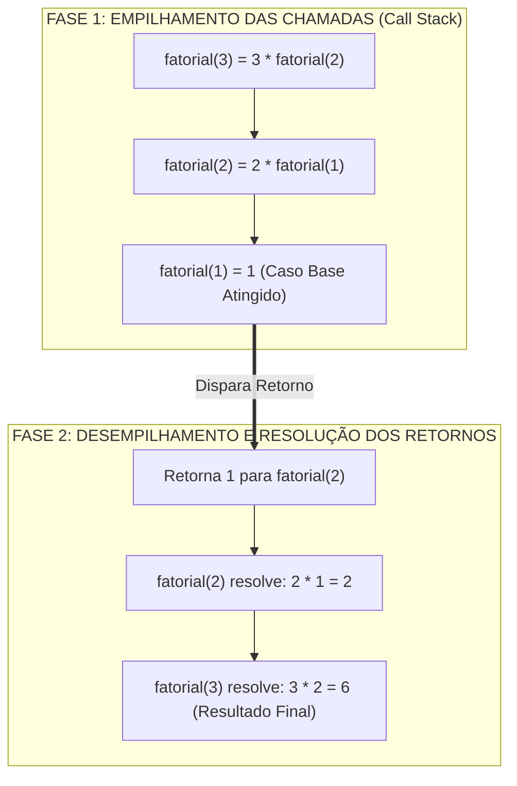
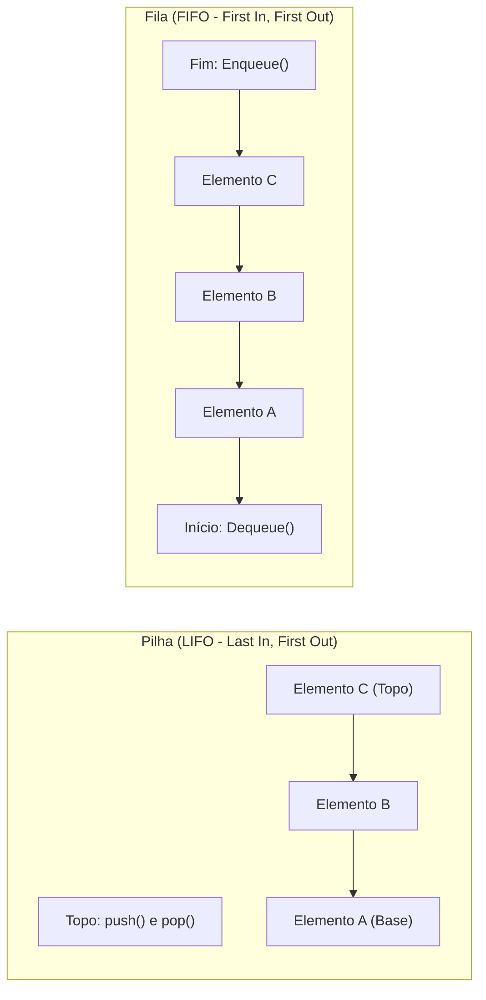
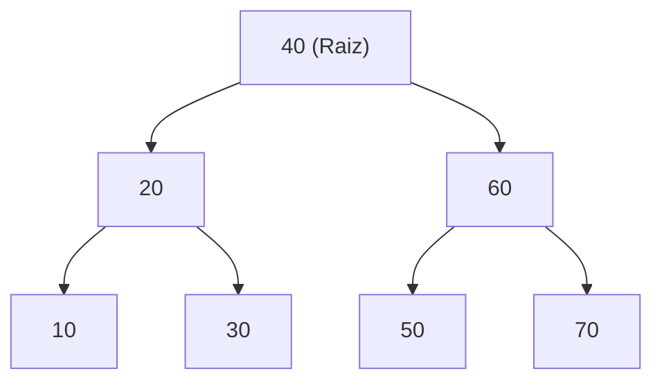
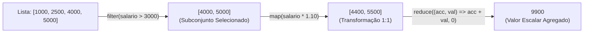

# 01 - Algoritmos, Estruturas de Dados e Paradigmas de Programação

> **Matéria:** Desenvolvimento de Sistemas  
> **Cargo:** B02 – Técnico de Controle Externo – Especialidade: Tecnologia da Informação  
> **Arquivo:** `01_algoritmos_estruturas_de_dados_e_paradigmas.md`  


---


## 📌 Ementa / Itens do Edital
- Algoritmos e lógica de programação
- Estruturas de dados (lineares e não lineares)
- Complexidade de algoritmos (noções assintóticas)
- Programação Orientada a Objetos (POO)
- Programação Funcional (PF)

---

## 🧭 Sumário

1. [Algoritmos, Lógica de Execução e Complexidade Assintótica](#1-algoritmos-logica-de-execucao-e-complexidade-assintotica)
    1. [Variáveis, Escopo e Passagem de Parâmetros (Valor vs. Referência)](#11-variaveis-escopo-e-passagem-de-parametros-valor-vs-referencia)
    2. [Recursão e Pilha de Execução (Call Stack)](#12-recursao-e-pilha-de-execucao-call-stack)
    3. [Análise Assintótica e a Notação Big-O](#13-analise-assintotica-e-a-notacao-big-o)
    4. [Teste 054](#Teste-054)
    5. [Teste 055](#Teste-055)
2. [Estruturas de Dados Fundamentais](#2-estruturas-de-dados-fundamentais)
    1. [Estruturas Lineares: Vetores, Listas Encadeadas, Pilhas e Filas](#21-estruturas-lineares-vetores-listas-encadeadas-pilhas-e-filas)
    2. [Tabelas Hash (Hash Tables) e Métodos de Tratamento de Colisão](#22-tabelas-hash-hash-tables-e-metodos-de-tratamento-de-colisao)
    3. [Estruturas Não Lineares: Árvores Binárias de Busca (BST) e Percursos](#23-estruturas-nao-lineares-arvores-binarias-de-busca-bst-e-percursos)
    4. [Árvores Auto-Balanceadas (AVL e Rubro-Negra) e Grafos](#24-arvores-auto-balanceadas-avl-e-rubro-negra-e-grafos)
    5. [Matriz Geral de Complexidade das Estruturas de Dados](#25-matriz-geral-de-complexidade-das-estruturas-de-dados)
    6. [Teste 056](#Teste-056)
    7. [Teste 057](#Teste-057)
    8. [Teste 058](#Teste-058)
    9. [Teste 059](#Teste-059)
3. [Paradigma de Programação Orientada a Objetos (POO)](#3-paradigma-de-programacao-orientada-a-objetos-poo)
    1. [Os Quatro Pilares da POO: Abstração, Encapsulamento, Herança e Polimorfismo](#31-os-quatro-pilares-da-poo-abstracao-encapsulamento-heranca-e-polimorfismo)
    2. [Polimorfismo Estático (Sobrecarga) vs. Polimorfismo Dinâmico (Sobrescrita)](#32-polimorfismo-estatico-sobrecarga-vs-polimorfismo-dinamico-sobrescrita)
    3. [Relações Estruturais: Classes Abstratas, Interfaces, Coesão e Acoplamento](#33-relacoes-estruturais-classes-abstratas-interfaces-coesao-e-acoplamento)
    4. [Teste 060](#Teste-060)
    5. [Teste 061](#Teste-061)
    6. [Teste 062](#Teste-062)
4. [Paradigma de Programação Funcional (PF)](#4-paradigma-de-programacao-funcional-pf)
    1. [Princípios Fundamentais: Funções Puras, Imutabilidade e Transparência Referencial](#41-principios-fundamentais-funcoes-puras-imutabilidade-e-transparencia-referencial)
    2. [Funções de Primeira Classe e Funções de Alta Ordem (Higher-Order Functions)](#42-funcoes-de-primeira-classe-e-funcoes-de-alta-ordem-higher-order-functions)
    3. [Operações Funcionais sobre Coleções: map, filter e reduce](#43-operacoes-funcionais-sobre-colecoes-map-filter-e-reduce)
    4. [Teste 063](#Teste-063)
    5. [Teste 064](#Teste-064)
5. [Fontes Oficiais e Referências Bibliográficas](#5-fontes-oficiais-e-referencias-bibliograficas)

---

## 1. Algoritmos, Lógica de Execução e Complexidade Assintótica

### 1.1 Variáveis, Escopo e Passagem de Parâmetros (Valor vs. Referência)
A lógica de programação orienta a elaboração de sequências finitas, ordenadas e inequívocas de passos para a resolução computacional de problemas:

- **Variáveis e Tipagem:** Uma variável é um espaço nominal alocado na memória para armazenar determinado tipo de dado. O **escopo** delimita a visibilidade dessa variável:
    - *Escopo Global:* Acessível em qualquer parte do módulo ou programa;
    - *Escopo Local de Bloco/Função:* Visível estritamente dentro do corpo da sub-rotina onde foi declarada, sendo liberada da pilha (*stack*) ao término da execução.
- **Mecanismos de Passagem de Parâmetros:**
    - **Passagem por Valor:** Uma cópia literal do valor do dado primitivo é enviada à sub-rotina. Qualquer modificação efetuada internamente não altera a variável original no escopo chamador;
    - **Passagem por Referência (ou Valor da Referência):** Em linguagens modernas como Java e Python, a passagem é estritamente **por valor**, mas para variáveis de tipos não primitivos (objetos e coleções), o "valor" copiado é o **endereço de memória (ponteiro)** do objeto. Logo:
    - Alterações no estado interno do objeto (ex.: `lista.add("item")` ou `obj.setNome("novo")`) afetam diretamente o objeto original no chamador;
    - Reatribuir a variável inteira dentro do método (ex.: `obj = new Objeto()`) altera apenas a cópia local do ponteiro, mantendo a variável original inalterada.

### 1.2 Recursão e Pilha de Execução (Call Stack)
Um algoritmo recursivo decompõe a solução de um problema invocando a si próprio com instâncias menores do mesmo problema.



Todo algoritmo recursivo exige dois componentes fundamentais:

1. **Caso Base (Condição de Parada):** Uma condição booleana explícita que encerra as chamadas subsequentes e retorna um valor constante imediato. A ausência ou falha no caso base gera recursão infinita e o esgotamento da memória de pilha do sistema operacional (*StackOverflowError*);
2. **Passo Recursivo:** Chamada da função a si mesma com argumentos que convergem progressivamente em direção à condição de parada.

### 1.3 Análise Assintótica e a Notação Big-O
A notação **Big-O ($\mathcal{O}$)** mensura o crescimento do tempo de execução ou do consumo de memória de um algoritmo à medida que o tamanho da entrada ($n$) tende ao infinito, descrevendo o limite superior assintótico (*pior caso* ou caso geral).

| Notação Big-O | Denominação | Comportamento ao Dobrar a Entrada ($2n$) | Exemplos Clássicos |
| :---: | :--- | :--- | :--- |
| $\mathcal{O}(1)$ | Constante | Tempo inalterado | Acesso a índice de array; `push`/`pop` em pilha. |
| $\mathcal{O}(\log n)$ | Logarítmica | Aumenta em uma fração constante | **Busca Binária** (*Binary Search*) em array ordenado. |
| $\mathcal{O}(n)$ | Linear | O tempo dobra proporcionalmente | Busca Linear em vetor; percurso em lista encadeada. |
| $\mathcal{O}(n \log n)$ | Linearítmica | Aumenta um pouco mais que o dobro | *Merge Sort*, *Heap Sort*, *Quick Sort* (caso médio). |
| $\mathcal{O}(n^2)$ | Quadrática | O tempo quadruplica | Laços aninhados simples, *Bubble Sort*, *Insertion Sort*. |
| $\mathcal{O}(2^n)$ | Exponencial | Crescimento explosivo impraticável | Algoritmos de força bruta (ex.: subconjuntos). |
| $\mathcal{O}(n!)$ | Fatorial | Pior classe computacional tratável | Caixeiro Viajante por enumeração exaustiva. |

> ⭐ **IMPORTANTE / BUSCA BINÁRIA:** A Busca Binária exige **obrigatoriamente** que a estrutura esteja previamente **ordenada** e suporte acesso aleatório indexado em tempo $\mathcal{O}(1)$ (como arrays e vetores contíguos). Sua complexidade temporal é $\mathcal{O}(\log n)$. Se aplicada em listas encadeadas, mesmo ordenadas, a busca binária perde eficiência porque o acesso ao nó central requer navegação sequencial $\mathcal{O}(n)$.

---

### Teste 054
**(Questão Inédita / Simulada Estilo FCC – Nível: Controle Externo / TI)**  
A recursão é uma técnica algorítmica fundamental na qual uma função invoca a si mesma para resolver subproblemas menores de mesma natureza. A respeito do funcionamento da recursão e de sua pilha de execução (*Call Stack*), é correto afirmar:

* **A)** Toda função recursiva deve possuir pelo menos uma condição de parada (caso base), sob pena de provocar um estouro de pilha (*Stack Overflow*) em virtude de chamadas infinitas.
* **B)** A execução de uma chamada recursiva não consome espaço na memória RAM, pois todas as variáveis locais utilizam o mesmo endereço físico de registradores da CPU.
* **C)** Algoritmos recursivos são sempre mais velozes e consomem menos memória do que suas versões iterativas equivalentes.
* **D)** A pilha de chamadas (*Call Stack*) opera sob o princípio FIFO (*First-In, First-Out*), finalizando primeiro a primeira função chamada.
* **E)** A recursão em cauda (*tail recursion*) impede que o compilador realize qualquer otimização de espaço na pilha de execução.


---

> **Comentário Detalhado:**
>
> - **A) Correta.** Sem o caso base (condição de parada), a função empilha novos registros de ativação indefinidamente até esgotar o limite da pilha de execução, gerando *Stack Overflow*.
> - **B) Incorreta.** Cada invocação recursiva aloca um novo quadro (*stack frame*) na pilha com suas variáveis e endereço de retorno.
> - **C) Incorreta.** Funções recursivas geralmente apresentam *overhead* de empilhamento e desempilhamento de frames, sendo frequentemente mais lentas que laços iterativos simples.
> - **D) Incorreta.** A pilha opera sob o princípio LIFO (*Last-In, First-Out*); a última função chamada é a primeira a retornar.
> - **E) Incorreta.** A recursão em cauda (*tail call optimization*) permite que compiladores reutilizem o frame atual sem alocar novos frames na pilha.
>
> **Gabarito: A**

---

### Teste 055
**(Questão Inédita / Simulada Estilo FCC – Nível: Controle Externo / TI)**  
A análise assintótica de complexidade de algoritmos permite quantificar o crescimento do consumo de tempo de execução e memória à medida que o tamanho da entrada ($n$) cresce assintoticamente. Em relação aos algoritmos clássicos de ordenação de vetores em memória interna, é correto afirmar que:

* **A)** O algoritmo *Bubble Sort* possui complexidade de tempo de pior caso igual a $O(n \log n)$.
* **B)** O algoritmo *Merge Sort* baseia-se no paradigma de divisão e conquista e possui complexidade de tempo no pior caso estritamente delimitada por $O(n \log n)$.
* **C)** O *Quicksort* garante complexidade de tempo $O(n)$ em qualquer cenário de partição de pivôs.
* **D)** O pior caso de tempo do *Quicksort* ocorre com complexidade de tempo $O(\log n)$.
* **E)** Todos os algoritmos de ordenação baseados em comparação de chaves conseguem ordenar um vetor em tempo linear $O(n)$ no pior caso.


---

> **Comentário Detalhado:**
>
> - **A) Incorreta.** O *Bubble Sort* tem complexidade de pior caso quadrática: $O(n^2)$.
> - **B) Correta.** O *Merge Sort* divide recursivamente o vetor ao meio e intercala as metades ordenadas, garantindo complexidade $O(n \log n)$ em todos os cenários (melhor, médio e pior caso).
> - **C) Incorreta.** O *Quicksort* tem complexidade média $O(n \log n)$, mas pode degradar para $O(n^2)$ no pior caso.
> - **D) Incorreta.** O pior caso do *Quicksort* é quadrático: $O(n^2)$.
> - **E) Incorreta.** O limite inferior matemático teórico para ordenação por comparação é $\Omega(n \log n)$.
>
> **Gabarito: B**

---

## 2. Estruturas de Dados Fundamentais

### 2.1 Estruturas Lineares: Vetores, Listas Encadeadas, Pilhas e Filas



- **Vetores (Arrays):** Estrutura indexada contígua na memória.
    - *Vantagem:* Acesso aleatório direto em $\mathcal{O}(1)$ via cálculo de deslocamento (`endereço = base + índice * tamanho`).
    - *Desvantagem:* Inserções ou remoções no meio do vetor exigem o deslocamento (*shift*) de todos os elementos posteriores, consumindo tempo $\mathcal{O}(n)$.
- **Listas Encadeadas (*Linked Lists*):** Elementos (nós) alocados dinamicamente na memória, contendo o dado e ponteiros:
    - *Simplesmente Encadeada:* Ponteiro único apontando para o próximo nó (`next`);
    - *Duplamente Encadeada:* Ponteiros para o anterior (`prev`) e próximo nó (`next`), permitindo percurso bidirecional e remoção em tempo $\mathcal{O}(1)$ caso a referência do nó seja conhecida;
    - *Circular:* O último nó aponta de volta para o primeiro nó da lista.
- **Pilhas (*Stacks* - Disciplina LIFO):**
    - *Last-In, First-Out* (o último elemento a entrar é o primeiro a sair);
    - Operações: `push()` (inserção no topo), `pop()` (remoção do topo) e `peek()` (inspeção do topo sem remoção). Todas operam em $\mathcal{O}(1)$;
    - Aplicações: Pilha de execução de sub-rotinas (*Call Stack*), conversão de expressões polonesas reversas (RPN), mecanismos de desfazer/refazer (*Undo/Redo*) e validação de fechamento de delimitadores (chaves e parênteses).
- **Filas (*Queues* - Disciplina FIFO):**
    - *First-In, First-Out* (o primeiro elemento a entrar é o primeiro a ser processado);
    - Operações: `enqueue()` (inserção no final da fila), `dequeue()` (remoção do início da fila) e `peek()`. Todas em $\mathcal{O}(1)$;
    - Aplicações: Spoolers de impressão, filas de mensagens assíncronas (RabbitMQ/Kafka) e algoritmo de busca em largura (BFS) em grafos e árvores.

### 2.2 Tabelas Hash (Hash Tables) e Métodos de Tratamento de Colisão
Uma Tabela Hash associa chaves de busca a índices de um array de tamanho $m$ por meio de uma **função de espalhamento** (*hash function*): $\text{índice} = h(\text{chave}) \pmod m$.

- **Fator de Carga ($\alpha$):** Razão entre o número de itens armazenados $n$ e o número total de posições da tabela $m$ ($\alpha = \frac{n}{m}$). Quando o fator de carga ultrapassa o limiar regulamentar (tipicamente $0.75$), a tabela é redimensionada (*rehashing*), duplicando a capacidade e recalculando as posições.
- **Tratamento de Colisões (Quando duas chaves resultam no mesmo índice):**
    1. **Encadeamento Separado (*Separate Chaining*):** Cada slot do vetor principal referencia uma lista encadeada (ou árvore binária balanceada quando a lista cresce demais, como no Java 8+). Os elementos colidentes são simplesmente adicionados como novos nós dessa lista secundária.
    2. **Endereçamento Aberto (*Open Addressing*):** Todos os elementos residem diretamente no vetor principal. Ocorrendo colisão, o algoritmo pesquisa sistematicamente o próximo slot vago:
        - *Sondagem Linear (*Linear Probing*):* Testa células consecutivas ($i+1, i+2, \dots$). Sofre com o fenômeno de **agrupamento primário** (*primary clustering*);
        - *Sondagem Quadrática (*Quadratic Probing*):* Testa células com incrementos quadráticos ($i+1^2, i+2^2, \dots$);
        - *Duplo Hash (*Double Hashing*):* Calcula o tamanho do salto através de uma segunda função hash: $\text{passo} = h_2(\text{chave})$.

> 🚨 **ALERTA DE PROVA / PEGADINHA FCC:**  
> A complexidade temporal média de busca, inserção e remoção em uma Tabela Hash é $\mathcal{O}(1)$. Todavia, no **pior caso** (quando todas as chaves colidem no mesmo índice devido a uma função hash deficiente ou ataque de negação de serviço), a complexidade **degrada compulsoriamente para $\mathcal{O}(n)$**. A FCC frequentemente tenta enganar o candidato afirmando que a busca em tabela hash é $\mathcal{O}(1)$ em qualquer circunstância!

### 2.3 Estruturas Não Lineares: Árvores Binárias de Busca (BST) e Percursos
Uma **Árvore Binária de Busca (BST - Binary Search Tree)** é uma estrutura hierárquica na qual, para cada nó raiz $X$:

- Todos os nós situados em sua subárvore esquerda possuem chaves estritamente **menores** que a chave de $X$;
- Todos os nós situados em sua subárvore direita possuem chaves estritamente **maiores** que a chave de $X$.



**Percursos em Profundidade (DFS - Depth-First Search):**

1. **Pré-Ordem (Pre-order / Raiz $\rightarrow$ Esquerda $\rightarrow$ Direita):** Visita a Raiz, depois percorre a subárvore Esquerda, e por fim a Direita.  
   *Sequência na árvore acima:* `40, 20, 10, 30, 60, 50, 70`. (Utilizada para clonagem ou serialização estrutural da árvore).
2. **Em-Ordem (In-order / Esquerda $\rightarrow$ Raiz $\rightarrow$ Direita):** Percorre a subárvore Esquerda, visita a Raiz, e por fim a Direita.  
   *Sequência na árvore acima:* `10, 20, 30, 40, 50, 60, 70`.  
   > ⭐ **REGRA DE OURO DA FCC:** Em qualquer Árvore Binária de Busca (BST), o percurso **Em-Ordem (In-order) produz obrigatoriamente a sequência dos elementos em ordem estritamente crescente!**
3. **Pós-Ordem (Post-order / Esquerda $\rightarrow$ Direita $\rightarrow$ Raiz):** Percorre a subárvore Esquerda, depois a Direita, e por fim visita a Raiz.  
   *Sequência na árvore acima:* `10, 30, 20, 50, 70, 60, 40`. (Utilizada para liberação e desalocação de memória de nós folha até a raiz).
4. **Percurso em Largura (BFS / Level-Order):** Visita os nós nível por nível, de cima para baixo e da esquerda para a direita, utilizando uma Fila auxiliar: `40, 20, 60, 10, 30, 50, 70`.

### 2.4 Árvores Auto-Balanceadas (AVL e Rubro-Negra) e Grafos
- **Degeneração da BST:** Se inserirmos elementos já ordenados (`10, 20, 30, 40, 50`) em uma BST simples, a árvore degenera em uma lista linear encadeada, e as operações de busca caem de $\mathcal{O}(\log n)$ para $\mathcal{O}(n)$;
- **Árvore AVL (Adelson-Velsky e Landis):** Mantém o Fator de Balanceamento $FB = \text{altura}(E) - \text{altura}(D) \in \{-1, 0, +1\}$. Caso $|FB| > 1$, aplica rotações (simples ou duplas) para restabelecer a altura estritamente logarítmica $\mathcal{O}(\log n)$;
- **Árvore Rubro-Negra (Red-Black Tree):** Árvore balanceada por coloração de nós (vermelho ou preto). Menos rígida que a AVL em altura, demandando menor quantidade de rotações em operações frequentes de inserção e exclusão (utilizada internamente no `TreeMap` e `HashMap` do Java);
- **Grafos:** Conjunto de vértices e arestas (direcionadas ou não, ponderadas ou não):
    - *Representações:* Matriz de Adjacência ($\mathcal{O}(V^2)$ de memória, ideal para grafos densos) e Lista de Adjacência ($\mathcal{O}(V + E)$, ideal para grafos esparsos);
    - *Algoritmos de Percurso:* Busca em Profundidade (DFS - usa pilha/recursão) e Busca em Largura (BFS - usa fila).

### 2.5 Matriz Geral de Complexidade das Estruturas de Dados

| Estrutura de Dados | Acesso Médio | Acesso Pior | Busca Média | Busca Pior | Inserção Média | Inserção Pior | Remoção Média | Remoção Pior |
| :--- | :---: | :---: | :---: | :---: | :---: | :---: | :---: | :---: |
| **Vetor (Array)** | $\mathcal{O}(1)$ | $\mathcal{O}(1)$ | $\mathcal{O}(n)$ | $\mathcal{O}(n)$ | $\mathcal{O}(n)$ | $\mathcal{O}(n)$ | $\mathcal{O}(n)$ | $\mathcal{O}(n)$ |
| **Lista Encadeada** | $\mathcal{O}(n)$ | $\mathcal{O}(n)$ | $\mathcal{O}(n)$ | $\mathcal{O}(n)$ | $\mathcal{O}(1)^*$ | $\mathcal{O}(1)^*$ | $\mathcal{O}(1)^*$ | $\mathcal{O}(1)^*$ |
| **Pilha (Stack)** | $\mathcal{O}(n)$ | $\mathcal{O}(n)$ | $\mathcal{O}(n)$ | $\mathcal{O}(n)$ | $\mathcal{O}(1)$ | $\mathcal{O}(1)$ | $\mathcal{O}(1)$ | $\mathcal{O}(1)$ |
| **Fila (Queue)** | $\mathcal{O}(n)$ | $\mathcal{O}(n)$ | $\mathcal{O}(n)$ | $\mathcal{O}(n)$ | $\mathcal{O}(1)$ | $\mathcal{O}(1)$ | $\mathcal{O}(1)$ | $\mathcal{O}(1)$ |
| **Tabela Hash** | N/A | N/A | $\mathcal{O}(1)$ | $\mathcal{O}(n)$ | $\mathcal{O}(1)$ | $\mathcal{O}(n)$ | $\mathcal{O}(1)$ | $\mathcal{O}(n)$ |
| **BST Degenerada** | $\mathcal{O}(n)$ | $\mathcal{O}(n)$ | $\mathcal{O}(n)$ | $\mathcal{O}(n)$ | $\mathcal{O}(n)$ | $\mathcal{O}(n)$ | $\mathcal{O}(n)$ | $\mathcal{O}(n)$ |
| **Árvore AVL / Rubro-Negra** | $\mathcal{O}(\log n)$ | $\mathcal{O}(\log n)$ | $\mathcal{O}(\log n)$ | $\mathcal{O}(\log n)$ | $\mathcal{O}(\log n)$ | $\mathcal{O}(\log n)$ | $\mathcal{O}(\log n)$ | $\mathcal{O}(\log n)$ |

*\*Inserção e remoção em lista encadeada são $\mathcal{O}(1)$ se a referência direta ao nó alvo for previamente conhecida.*

---

### Teste 056
**(Questão Inédita / Simulada Estilo FCC – Nível: Controle Externo / TI)**  
Em uma estrutura de dados do tipo Pilha (*Stack*), as operações de manipulação de dados obedecem rigorosamente à disciplina LIFO (*Last In, First Out*). Considere uma pilha inicialmente vazia que é submetida, passo a passo, à seguinte sequência consecutiva de comandos:

```text
push(15); push(25); pop(); push(35); push(45); pop(); push(55); push(65); pop();
```

Ao término da execução dessa sequência completa de operações, o elemento posicionado no topo da pilha e a quantidade total de elementos presentes na estrutura são, respectivamente:

* **A)** 45 e 2.
* **B)** 55 e 3.
* **C)** 35 e 3.
* **D)** 65 e 4.
* **E)** 55 e 2.


---

> **Comentário Detalhado:**
>
> - Rastreando passo a passo o estado da pilha (LIFO):
>     1. `push(15)`: Pilha = `[15]` (topo = 15).
>     2. `push(25)`: Pilha = `[15, 25]` (topo = 25).
>     3. `pop()`: Remove o topo (25). Pilha = `[15]` (topo = 15).
>     4. `push(35)`: Pilha = `[15, 35]` (topo = 35).
>     5. `push(45)`: Pilha = `[15, 35, 45]` (topo = 45).
>     6. `pop()`: Remove o topo (45). Pilha = `[15, 35]` (topo = 35).
>     7. `push(55)`: Pilha = `[15, 35, 55]` (topo = 55).
>     8. `push(65)`: Pilha = `[15, 35, 55, 65]` (topo = 65).
>     9. `pop()`: Remove o topo (65). Pilha = `[15, 35, 55]` (topo = 55).
>
> - Ao término das instruções, a pilha contém 3 elementos (`[15, 35, 55]`) e o elemento do topo é o **55**.
> - Análise das alternativas:
>     - **A) Incorreta.** O elemento 45 foi desempilhado no passo 6.
>     - **B) CORRETA.** Topo igual a 55 e quantidade de 3 elementos.
>     - **C) Incorreta.** 35 é o elemento intermediário, posicionado abaixo de 55.
>     - **D) Incorreta.** 65 foi desempilhado no passo 9.
>     - **E) Incorreta.** A quantidade de elementos é 3, não 2.
> 
> **Gabarito: B**

---

### Teste 057
**(Questão Inédita / Simulada Estilo FCC – Nível: Controle Externo / TI)**  
As Tabelas Hash (*Hash Tables*) são amplamente utilizadas em sistemas de informação pela sua eficiência em operações de busca, inserção e remoção de registros indexados por chaves. A respeito da teoria das tabelas hash e dos métodos de tratamento de colisões, assinale a afirmativa correta:

* **A)** A complexidade temporal assintótica de busca em uma tabela hash é estritamente $\mathcal{O}(1)$ em qualquer circunstância, independentemente da função hash ou da quantidade de colisões.
* **B)** No método de tratamento de colisões por encadeamento separado (*separate chaining*), cada posição do vetor principal referencia uma lista encadeada, de modo que elementos colidentes são armazenados como nós dessa lista.
* **C)** O fator de carga (*load factor*) de uma tabela hash corresponde ao tempo em milissegundos gasto pela CPU para calcular a função hash de uma chave string.
* **D)** No endereçamento aberto com sondagem linear (*linear probing*), elementos que sofrem colisão são sempre descartados da tabela para impedir o agrupamento primário.
* **E)** As tabelas hash armazenam seus elementos de forma intrinsicamente ordenada pelas suas chaves, facilitando operações de busca por intervalo (*range queries*).


---

> **Comentário Detalhado:**
>
> - **A) Incorreta.** $\mathcal{O}(1)$ é a complexidade média esperada; no pior caso (quando ocorrem colisões em massa), a busca degrada para $\mathcal{O}(n)$.
> - **B) CORRETA.** No encadeamento separado (*separate chaining*), cada slot da tabela hash funciona como o cabeçalho de uma lista encadeada (ou árvore rubro-negra), de forma que múltiplos elementos associados ao mesmo índice hash são armazenados como nós sequenciais nessa lista.
> - **C) Incorreta.** O fator de carga ($\alpha = n/m$) é a razão entre o número de elementos armazenados e o número de slots disponíveis na tabela, medindo a taxa de ocupação, não tempo de CPU.
> - **D) Incorreta.** No endereçamento aberto, os elementos colidentes não são descartados, mas alocados na próxima posição desocupada do próprio array.
> - **E) Incorreta.** As tabelas hash são desordenadas por natureza; para buscas ordenadas por intervalo utilizam-se árvores binárias de busca balanceadas (B-Trees ou AVL).
> 
> **Gabarito: B**

---

### Teste 058
**(Questão Inédita / Simulada Estilo FCC – Nível: Controle Externo / TI)**  
Considere uma Árvore Binária de Busca (BST) construída a partir da inserção sucessiva dos seguintes números inteiros em uma árvore inicialmente vazia, respeitando as regras estritas da estrutura (valores menores à esquerda, maiores à direita):

```text
Inserções na ordem: 40, 20, 60, 10, 30, 50, 70
```

Se essa árvore for percorrida utilizando os algoritmos de percurso em **Pré-Ordem** (*Pre-order*) e **Em-Ordem** (*In-order*), as sequências exatas geradas pelas visitas aos nós serão, respectivamente:

* **A)** Pré-Ordem: `40, 20, 10, 30, 60, 50, 70` ; Em-Ordem: `10, 20, 30, 40, 50, 60, 70`.
* **B)** Pré-Ordem: `10, 20, 30, 40, 50, 60, 70` ; Em-Ordem: `40, 20, 10, 30, 60, 50, 70`.
* **C)** Pré-Ordem: `10, 30, 20, 50, 70, 60, 40` ; Em-Ordem: `70, 60, 50, 40, 30, 20, 10`.
* **D)** Pré-Ordem: `40, 20, 60, 10, 30, 50, 70` ; Em-Ordem: `40, 20, 30, 10, 60, 50, 70`.
* **E)** Pré-Ordem: `40, 20, 10, 30, 60, 50, 70` ; Em-Ordem: `70, 60, 50, 40, 30, 20, 10`.


---

> **Comentário Detalhado:**
>
> - Desenhando a BST a partir das inserções:
>     - 40 é a raiz;
>     - 20 fica à esquerda de 40; 60 fica à direita de 40;
>     - 10 fica à esquerda de 20; 30 fica à direita de 20;
>     - 50 fica à esquerda de 60; 70 fica à direita de 60.
> - **Percurso em Pré-Ordem (Raiz $\rightarrow$ Esquerda $\rightarrow$ Direita):**
>     - Visita raiz 40;
>     - Subárvore esquerda de 40: visita 20, depois 10, depois 30;
>     - Subárvore direita de 40: visita 60, depois 50, depois 70;
>     - Sequência: `40, 20, 10, 30, 60, 50, 70`.
> - **Percurso Em-Ordem (Esquerda $\rightarrow$ Raiz $\rightarrow$ Direita):**
>     - Em qualquer BST, o percurso Em-Ordem visita os elementos em **ordem estritamente crescente**;
>     - Sequência: `10, 20, 30, 40, 50, 60, 70`.
> - Análise das alternativas:
>     - **A) CORRETA.** Exibe perfeitamente a Pré-Ordem e a Em-Ordem calculadas.
>     - **B) Incorreta.** Inverteu a nomenclatura dos dois percursos.
>     - **C) Incorreta.** Apresenta percurso em pós-ordem e ordem decrescente.
>     - **D) Incorreta.** Apresenta percurso em largura (nível por nível) na primeira sequência.
>     - **E) Incorreta.** Apresenta a ordem decrescente na segunda sequência.
> 
> **Gabarito: A**

---

### Teste 059
**(Questão Inédita / Simulada Estilo FCC – Nível: Controle Externo / TI)**  
Uma Árvore AVL é uma Árvore Binária de Busca (BST) estritamente auto-balanceada na qual a diferença de altura entre as subárvores esquerda e direita de qualquer nó (fator de balanceamento $FB = h_{esq} - h_{dir}$) deve pertencer obrigatoriamente ao conjunto:

* **A)** $\{-2, 0, +2\}$
* **B)** $\{-1, 0, +1\}$
* **C)** $\{0, 1, 2\}$
* **D)** $\{-3, 0, +3\}$
* **E)** $\{1, 2, 3\}$


---

> **Comentário Detalhado:**
>
> - **A) Incorreta.** Um fator de balanceamento em $\pm 2$ indica que a árvore perdeu o equilíbrio e exige uma rotação imediata de rebalanceamento.
> - **B) Correta.** Na definição canônica de Adelson-Velsky e Landis (AVL), o fator de balanceamento de cada nó deve ser $-1, 0$ ou $+1$. Se uma inserção ou remoção resultar em $FB = \pm 2$, executam-se rotações (simples ou duplas) para restaurar a invariante de equilíbrio em tempo $O(\log n)$.
> - **C) Incorreta.** Fatores de balanceamento negativos são válidos e necessários quando a subárvore direita é mais alta.
> - **D) Incorreta.** Valores acima de 1 violam a propriedade da árvore AVL.
> - **E) Incorreta.** Viola a definição canônica da AVL.
>
> **Gabarito: B**

---

## 3. Paradigma de Programação Orientada a Objetos (POO)

### 3.1 Os Quatro Pilares da POO: Abstração, Encapsulamento, Herança e Polimorfismo
1. **Abstração:** Foco nos atributos e operações essenciais de uma entidade do domínio de negócio, isolando aspectos acidentais ou supérfluos;
2. **Encapsulamento:** Ocultamento do estado interno e detalhes algorítmicos de um objeto. O acesso às variáveis de instância é protegido por modificadores de visibilidade (`private`, `protected`, `public`), expondo apenas operações controladas de interface pública;
3. **Herança:** Relação estática entre classes onde uma subclasse (filha) estende atributos e comportamentos de uma superclasse (pai), estabelecendo uma taxonomia do tipo "é um" (*is-a*);
4. **Polimorfismo:** Capacidade de objetos de diferentes classes derivadas responderem a uma mesma mensagem (chamada de método) de maneiras particulares e especializadas.

### 3.2 Polimorfismo Estático (Sobrecarga) vs. Polimorfismo Dinâmico (Sobrescrita)
Essa comparação é cobrada com frequência máxima pela banca FCC:

| Critério de Comparação | Sobrecarga (*Overloading*) | Sobrescrita (*Overriding*) |
| :--- | :--- | :--- |
| **Definição** | Múltiplos métodos com o **mesmo nome** declarados na **mesma classe**. | Redefinição de um método herdado da superclasse na **subclasse**. |
| **Assinatura do Método** | **Obrigatoriamente DIFERENTE** (quantidade ou tipos de parâmetros). | **Rigorosamente IDÊNTICA** (mesmo nome, parâmetros e retorno covariante). |
| **Momento de Resolução** | **Tempo de Compilação** (*Compile-time* / Ligação Estática / *Early Binding*). | **Tempo de Execução** (*Runtime* / Ligação Dinâmica / *Late Binding*). |
| **Classificação** | Polimorfismo Estático ou Ad-hoc. | Polimorfismo Dinâmico, Verdadeiro ou de Inclusão. |
| **Dependência de Herança** | Não depende de herança. | **Exige herança** ou implementação de interface. |

> 🚨 **ALERTA DE PROVA / PEGADINHA FCC:**  
> A FCC adora afirmar que dois métodos são sobrecarregados se eles tiverem o mesmo nome, os mesmos parâmetros e **apenas o tipo de retorno diferente** (ex.: `int calcular(int x)` e `double calcular(int x)`). **ISSO NÃO É SOBRECARGA!** Isso é um erro de compilação! O tipo de retorno isolado não desambigua métodos sobrecarregados.

### 3.3 Relações Estruturais: Classes Abstratas, Interfaces, Coesão e Acoplamento
- **Classes Abstratas vs. Interfaces:**
    - *Classe Abstrata:* Não pode ser instanciada diretamente (`new`). Pode conter métodos abstratos (sem corpo) e métodos concretos (com implementação), além de atributos de instância com qualquer modificador de acesso. Modela uma herança conceitual forte;
    - *Interface:* Define um contrato puro de comportamento. Classes de diferentes hierarquias podem implementar a mesma interface, viabilizando o desacoplamento de contratos e a substituição de componentes;
- **Alta Coesão e Baixo Acoplamento:** Módulos de software de excelência devem ser altamente coesos (cada classe com foco em um propósito único do negócio) e fracamente acoplados (comunicação através de interfaces abstratas, permitindo substituição dinâmica);
- **Composição sobre Herança:** A herança gera forte acoplamento de código (*acoplamento de caixa-branca*), quebrando o encapsulamento caso a subclasse dependa de detalhes de implementação da superclasse. A composição de objetos (*relação "tem um"*) é amplamente recomendada por promover delegação dinâmica e flexibilidade em tempo de execução.

---

### Teste 060
**(Questão Inédita / Simulada Estilo FCC – Nível: Controle Externo / TI)**  
No paradigma de Programação Orientada a Objetos, o pilar que estabelece a técnica de ocultar os detalhes internos de implementação e o estado de um objeto, restringindo o acesso direto aos seus atributos e expondo apenas uma interface pública controlada de métodos, denomina-se:

* **A)** Herança múltipla.
* **B)** Polimorfismo paramétrico.
* **C)** Encapsulamento.
* **D)** Sobrecarga de operadores.
* **E)** Coesão temporal.


---

> **Comentário Detalhado:**
>
> - **A) Incorreta.** Herança é o mecanismo pelo qual classes filhas herdam características de classes mães.
> - **B) Incorreta.** Polimorfismo paramétrico refere-se a tipos genéricos (*generics*).
> - **C) Correta.** O **Encapsulamento** oculta o estado interno e a representação de dados do objeto (*information hiding*), protegendo a integridade contra manipulação indevida externa.
> - **D) Incorreta.** Sobrecarga permite redefinir operadores ou métodos com assinaturas distintas.
> - **E) Incorreta.** Coesão temporal é um nível fraco de coesão procedimental.
>
> **Gabarito: C**

---

### Teste 061
**(Questão Inédita / Simulada Estilo FCC – Nível: Controle Externo / TI)**  
No contexto do paradigma de Programação Orientada a Objetos (POO), analise o mecanismo pelo qual uma subclasse fornece uma definição específica para um método que já foi declarado e implementado por sua superclasse direta ou indireta, preservando integralmente o mesmo nome, a mesma quantidade e os mesmos tipos de parâmetros, permitindo a seleção da implementação adequada durante a execução do programa (*runtime*).

Esse mecanismo e seu momento de amarração (*binding*) correspondem, respectivamente, a:

* **A)** Sobrecarga (*Overloading*) com amarração estática (*early binding*).
* **B)** Sobrescrita (*Overriding*) com amarração dinâmica (*late binding*).
* **C)** Encapsulamento reflexivo com resolução de compilação.
* **D)** Coesão ad-hoc com ligação tardia (*late binding*).
* **E)** Sobrecarga (*Overloading*) com amarração dinâmica (*late binding*).


---

> **Comentário Detalhado:**
>
> - **A) Incorreta.** A sobrecarga (*overloading*) ocorre na mesma classe, exige assinaturas diferentes e é decidida estaticamente em tempo de compilação.
> - **B) CORRETA.** O enunciado traz a definição exata de **Sobrescrita (*Overriding*)**: redefinição de método herdado da superclasse em uma subclasse com **assinatura idêntica**, viabilizando o polimorfismo dinâmico cuja invocação é resolvida em tempo de execução (*runtime*) via **amarração dinâmica (*late binding*)**.
> - **C) Incorreta.** Encapsulamento é a prática de ocultação de estado interno de objetos com modificadores de acesso, não polimorfismo de métodos.
> - **D) Incorreta.** Termo pejorativo sem relação com despacho dinâmico de métodos.
> - **E) Incorreta.** Sobrecarga não utiliza amarração dinâmica em tempo de execução.
> 
> **Gabarito: B**

---

### Teste 062
**(Questão Inédita / Simulada Estilo FCC – Nível: Controle Externo / TI)**  
A respeito das distinções conceituais entre Classes Abstratas e Interfaces na modelagem orientada a objetos clássica, é correto afirmar:

* **A)** Interfaces podem ser instanciadas diretamente por meio do operador `new`, ao passo que classes abstratas nunca podem conter código compilado.
* **B)** Uma classe concreta pode herdar de múltiplas classes abstratas em Java, mas pode implementar apenas uma única interface.
* **C)** Uma classe abstrata não pode ser instanciada diretamente e pode conter tanto métodos abstratos (sem corpo) quanto métodos concretos com implementação completa e estado (atributos de instância).
* **D)** Interfaces são obrigadas a implementar todos os métodos de persistência no banco de dados.
* **E)** Classes abstratas são usadas exclusivamente para definir variáveis de escopo global no sistema operacional.


---

> **Comentário Detalhado:**
>
> - **A) Incorreta.** Nem interfaces nem classes abstratas podem ser instanciadas diretamente com `new`.
> - **B) Incorreta.** Em linguagens como Java e C#, há herança simples de classes (apenas uma superclasse) e herança múltipla de interfaces (implementação de múltiplas interfaces).
> - **C) Correta.** Classes abstratas servem como base arquitetural de extensão: não permitem instanciação direta, mas oferecem código reutilizável (métodos concretos e atributos de instância) juntamente com contratos a serem implementados pelas subclasses.
> - **D) Incorreta.** Interfaces estabelecem contratos de comportamento, sem qualquer obrigatoriedade com persistência.
> - **E) Incorreta.** Conceito totalmente descabido.
>
> **Gabarito: C**

---

## 4. Paradigma de Programação Funcional (PF)

### 4.1 Princípios Fundamentais: Funções Puras, Imutabilidade e Transparência Referencial
A Programação Funcional é um paradigma declarativo que trata a computação como a avaliação de funções matemáticas e evita a mutação de estados e dados:

1. **Funções Puras (*Pure Functions*):**
    - *Determinismo:* Para os mesmos argumentos de entrada, a função retorna **rigorosamente o mesmo valor**;
    - *Ausência de Efeitos Colaterais (*No Side Effects*):* Não modifica variáveis externas ou globais, não altera parâmetros recebidos por referência e não realiza operações de I/O em disco ou rede durante a sua computação pura;

2. **Imutabilidade:** As estruturas de dados não são alteradas após criadas. Qualquer transformação produz uma **nova estrutura de dados**, deixando a original intacta. Isso elimina problemas de condição de corrida (*race conditions*) em ambientes concorrentes multithread;
3. **Transparência Referencial:** Uma expressão pode ser substituída diretamente pelo seu valor resultante em qualquer ponto do programa sem alterar o comportamento global do sistema.

### 4.2 Funções de Primeira Classe e Funções de Alta Ordem (Higher-Order Functions)
- **Funções como Cidadãs de Primeira Classe (*First-Class Citizens*):** Funções podem ser atribuídas a variáveis, armazenadas em estruturas de dados, passadas como parâmetros e retornadas como resultado de outras funções;
- **Funções de Alta Ordem (*Higher-Order Functions*):** Funções que recebem uma ou mais funções como argumento ou retornam uma função (como `map`, `filter`, `reduce`);
- **Expressões Lambda:** Funções anônimas concisas, declaradas sem identificador de nome formal (ex.: `x -> x * 2` ou `(a, b) -> a + b`).

### 4.3 Operações Funcionais sobre Coleções: map, filter e reduce



| Método Funcional | Propósito Central da Operação | Cardinalidade de Saída vs. Entrada | Tipo do Retorno |
| :--- | :--- | :---: | :--- |
| **`filter`** | Seleciona os elementos da coleção que satisfazem um predicado booleano. | $0 \le \text{tamanho} \le n$ | Nova coleção filtrada com elementos do mesmo tipo. |
| **`map`** | Aplica uma função de transformação individual a cada elemento da coleção. | Rigorosamente igual a $n$ | Nova coleção com elementos transformados (mesmo tamanho). |
| **`reduce`** | Acumula todos os elementos da coleção aplicando iterativamente uma função de combinação. | Exatamente $1$ valor | Valor escalar consolidado ou objeto acumulador único (número, string). |

---

### Teste 063
**(Questão Inédita / Simulada Estilo FCC – Nível: Controle Externo / TI)**  
No paradigma de Programação Funcional (PF), uma função é considerada **pura** (*pure function*) quando satisfaz a dois critérios rigorosos:

* **A)** Altera variáveis globais do sistema e consome dados de sensores de hardware aleatórios a cada execução.
* **B)** Produz o mesmo valor de saída para os mesmos argumentos de entrada e não gera efeitos colaterais (*side effects*) observáveis no ambiente externo.
* **C)** Executa exclusivamente operações de escrita síncrona em bancos de dados relacionais transacionais.
* **D)** Depende do horário do relógio da CPU e de geradores de números pseudoaleatórios para calcular seu resultado.
* **E)** Exige que todos os parâmetros sejam passados obrigatoriamente por referência com permissão de escrita.


---

> **Comentário Detalhado:**
>
> - **A) Incorreta.** Funções puras não geram nem dependem de efeitos colaterais como modificação de variáveis globais.
> - **B) Correta.** A pureza funcional exige determinismo estrito (mesmas entradas $\rightarrow$ mesma saída) e ausência de efeitos colaterais (sem alteração de estado mutável externo ou I/O não controlado), garantindo a **transparência referencial**.
> - **C) Incorreta.** Operações de escrita em banco são efeitos colaterais clássicos de I/O.
> - **D) Incorreta.** Consultar relógio ou números aleatórios torna a função impura e não determinística.
> - **E) Incorreta.** O paradigma funcional baseia-se na **imutabilidade** dos dados.
>
> **Gabarito: B**

---

### Teste 064
**(Questão Inédita / Simulada Estilo FCC – Nível: Controle Externo / TI)**  
No paradigma de Programação Funcional (PF), a manipulação de coleções é realizada prioritariamente por meio de funções de alta ordem (*higher-order functions*) que operam sobre estruturas imutáveis. Considere o processamento de uma lista contendo os salários de 5 colaboradores: `[2000, 3000, 4000, 5000, 6000]`. Deseja-se realizar, sequencialmente, as seguintes operações:

1. Filtrar apenas os colaboradores com salário estritamente superior a `3500`.
2. Aplicar um reajuste de `10%` sobre o salário de cada um dos colaboradores filtrados.
3. Obter o valor numérico total correspondente à soma de todos os salários reajustados.

Para atingir exatamente esse objetivo seguindo os princípios funcionais, as funções de alta ordem aplicadas nos passos 1, 2 e 3 devem ser, respectivamente:

* **A)** `map`, `filter` e `reduce`.
* **B)** `filter`, `reduce` e `map`.
* **C)** `filter`, `map` e `reduce`.
* **D)** `reduce`, `map` e `filter`.
* **E)** `map`, `map` e `forEach`.


---

> **Comentário Detalhado:**
>
> - Analisando a finalidade técnica de cada função funcional padrão:
>     1. **Passo 1:** Selecionar um subconjunto de elementos baseado em um predicado booleano (`salario > 3500`) é a atribuição precípua do **`filter`**.
>     2. **Passo 2:** Aplicar uma transformação matemática individual em cada item da lista mantendo o mesmo número de elementos (`salario * 1.10`) é a atribuição clássica do **`map`**.
>     3. **Passo 3:** Reduzir e agregar iterativamente todos os itens de uma coleção em um único valor escalar final (a soma total) é o objetivo do **`reduce`**.
>
> - A sequência exata é: **`filter`**, **`map`** e **`reduce`**.
> - Análise das alternativas:
>     - **A) Incorreta.** Inverteu a ordem de `map` e `filter`.
>     - **B) Incorreta.** O `reduce` condensaria a lista antes da aplicação do `map`.
>     - **C) CORRETA.** Sequência correta e canônica do pipeline funcional.
>     - **D) Incorreta.** Inicia prematuramente pelo `reduce`.
>     - **E) Incorreta.** `forEach` destina-se à execução de efeitos colaterais imperativos e retorna `void`.
> 
> **Gabarito: C**

---

## 5. Fontes Oficiais e Referências Bibliográficas

* [Python Official Documentation - Data Structures](https://docs.python.org/pt-br/3/tutorial/datastructures.html) - Listas, pilhas, filas, tuplas, dicionários, conjuntos e operações fundamentais de dados.
* [Oracle Java Documentation - Java Collections Framework](https://docs.oracle.com/javase/tutorial/collections/intro/index.html) - Interfaces List, Set, Queue, Deque, Map e implementações em Java.
* [Oracle Java Documentation - Object-Oriented Programming Concepts](https://docs.oracle.com/javase/tutorial/java/concepts/index.html) - Fundamentos formais de orientação a objetos: classes, objetos, encapsulamento e polimorfismo.
* [ArXiv - Algorithm Complexity and Analysis](https://arxiv.org/abs/2107.03374) - Análise assintótica formal de complexidade e benchmarks algorítmicos.
* CORMEN, Thomas H. et al. **Algoritmos: Teoria e Prática**. 4. ed. Rio de Janeiro: GEN LTC, 2024. (Cap. 1 a 4 - Fundamentos, Notação Assintótica e Divisão e Conquista).
* SEDGEWICK, Robert; WAYNE, Kevin. **Algorithms**. 4. ed. Boston: Addison-Wesley, 2011. (Cap. 1 e 2 - Estruturas de Dados Elementares e Ordenação).
* DROZDEK, Adam. **Estrutura de Dados e Algoritmos em C++**. 2. ed. São Paulo: Cengage Learning, 2016. (Cap. 3 a 5 - Pilhas, Filas e Árvores).
