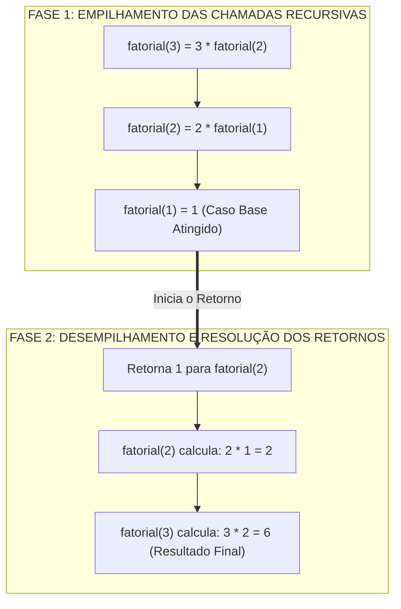
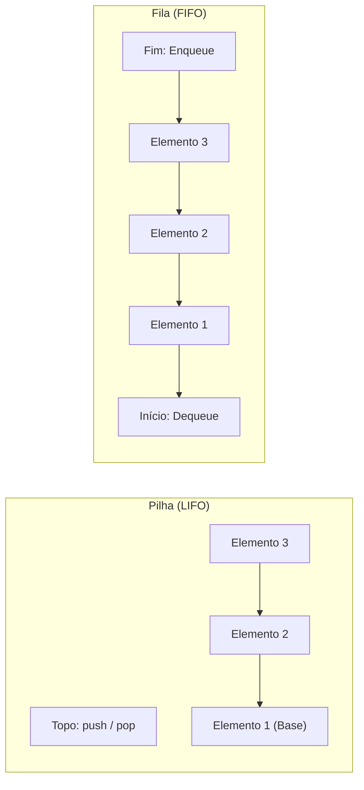
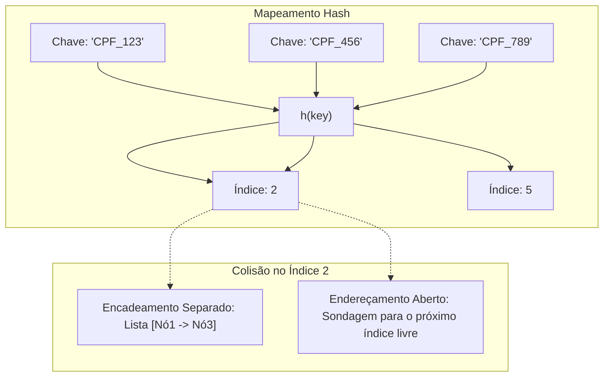
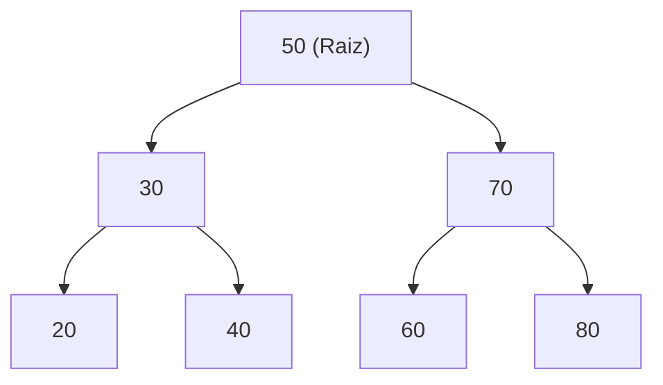
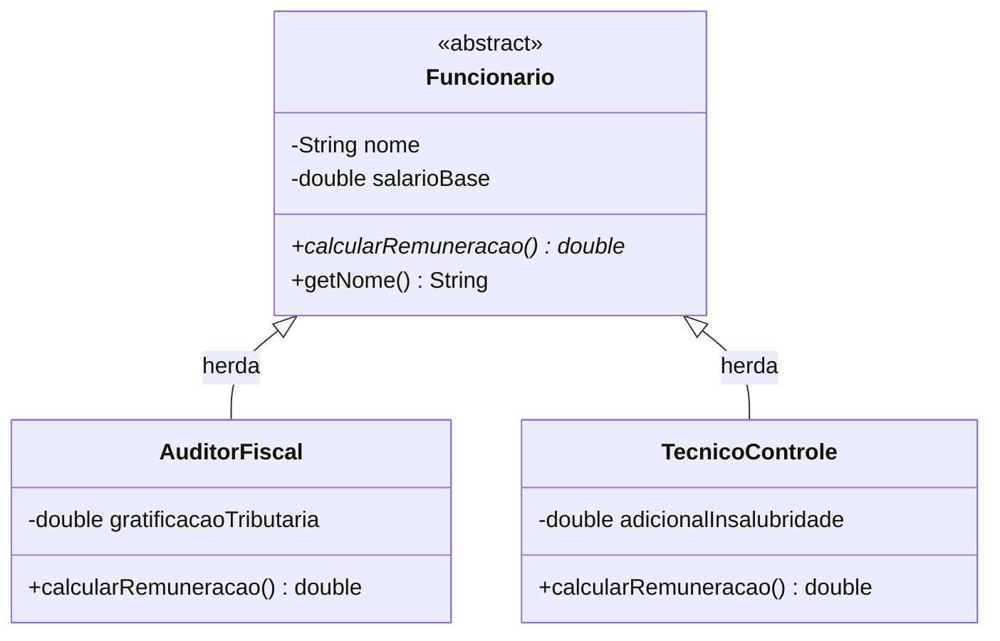

# 01 - Algoritmos, Estruturas de Dados e Paradigmas de Programação

> **Matéria:** Desenvolvimento de Sistemas  
> **Cargo:** B02 – Técnico de Controle Externo – Especialidade: Tecnologia da Informação  
> **Arquivo:** `01_algoritmos_estruturas_de_dados_e_paradigmas.md`  

---

## 📌 Ementa / Itens do Edital
- Algoritmos e lógica de programação
- Estruturas de dados (lineares e não lineares)
- Complexidade de algoritmos (noções assintóticas)
- Programação Orientada a Objetos (POO)
- Programação Funcional (PF)

---

## 🌳 Classificação Hierárquica

```text
1. Lógica Algorítmica, Estruturas de Dados e Paradigmas
├── 1.1 Algoritmos e Complexidade
│   ├── 1.1.1 Lógica de Programação: Variáveis, operadores relacionais e lógicos, estruturas de controle de fluxo (condicionais e laços de repetição)
│   ├── 1.1.2 Modularização, escopo de variáveis, passagem de parâmetros por valor vs. por referência e recursão
│   └── 1.1.3 Análise Assintótica de Algoritmos (Notação Big-O: O(1), O(log n), O(n), O(n log n), O(n^2), O(2^n), O(n!))
├── 1.2 Estruturas de Dados Fundamentais
│   ├── 1.2.1 Estruturas Lineares:
│   │   ├── Vetores (Arrays) e Matrizes: Acesso indexado direto, alocação contígua
│   │   ├── Listas Encadeadas (Simplesmente, duplamente e circulares): Inserção e remoção O(1) com ponteiros
│   │   ├── Pilhas (Stack - LIFO: Last In, First Out): Operações push, pop, peek (aplicação em chamadas de função e parsing)
│   │   └── Filas (Queue - FIFO: First In, First Out): Operações enqueue, dequeue (filas simples, circulares e de prioridade)
│   ├── 1.2.2 Tabelas Hash (Hash Tables / Dicionários):
│   │   ├── Função de espalhamento (hash function) e fator de carga (load factor)
│   │   ├── Tratamento de colisões: Encadeamento separado (chaining) vs. Endereçamento aberto (sondagem linear, quadrática e duplo hash)
│   │   └── Complexidade média O(1) vs. pior caso O(n)
│   └── 1.2.3 Estruturas Não Lineares e Grafos:
│       ├── Árvores Binárias: Nós, raiz, folhas, altura e percursos (pré-ordem, em-ordem, pós-ordem, em largura)
│       ├── Árvores Binárias de Busca (BST) e Árvores Balanceadas (AVL e Rubro-Negra)
│       └── Grafos: Representação (matriz vs. lista de adjacência) e buscas (DFS - profundidade, BFS - largura)
├── 1.3 Paradigma de Programação Orientada a Objetos (POO)
│   ├── 1.3.1 Pilares Fundamentais:
│   │   ├── Abstração: Modelagem do mundo real em entidades de software
│   │   ├── Encapsulamento: Ocultação de detalhes internos (modificadores public, private, protected, package)
│   │   ├── Herança: Reutilização e extensão de comportamento (superclasse e subclasse; problemas de herança múltipla)
│   │   └── Polimorfismo: Sobrecarga (estático/tempo de compilação) vs. Sobrescrita (dinâmico/tempo de execução com late binding)
│   └── 1.3.2 Conceitos Avançados: Classes abstratas, Interfaces, Acoplamento, Coesão e Composição vs. Herança
└── 1.4 Paradigma de Programação Funcional (PF)
    ├── 1.4.1 Princípios Fundamentais:
    │   ├── Funções Puras (Pure Functions): Determinismo e ausência de efeitos colaterais (side effects)
    │   ├── Imutabilidade: Preservação de estado e novas instâncias
    │   ├── Funções de Primeira Classe (First-Class Citizens) e Funções de Alta Ordem (Higher-Order Functions)
    │   └── Expressões Lambda / Funções Anônimas
    └── 1.4.2 Padrões Funcionais no Desenvolvimento Moderno:
        ├── Transformações de coleções: map, filter, reduce
        ├── Currying e Composição de funções
        └── Recursão de cauda (Tail Call Optimization)
```

---

## 📖 Teoria Aprofundada & Pontos-Chave

### 1.1 Algoritmos, Lógica de Execução e Complexidade Assintótica

#### 1.1.1 Lógica, Escopo e Execução de Sub-rotinas
- **Variáveis e Escopo:** O escopo define a visibilidade e o ciclo de vida de uma variável no código. Variáveis globais residem no escopo do módulo/aplicação, enquanto variáveis locais residem no escopo de bloco ou de função.
- **Passagem de Parâmetros:**
  - **Por Valor:** Uma cópia independente do dado primitivo é transferida para o parâmetro da função. Alterações feitas no corpo da função **não** afetam a variável de origem no chamador.
  - **Por Referência / Por Valor da Referência:** O endereço de memória do objeto é repassado. Em linguagens modernas como Java e Python, a passagem é estritamente **por valor**, mas para tipos de referência (objetos/coleções), o valor copiado é o **próprio ponteiro/referência**. Logo, modificar o estado interno do objeto recebido reflete fora da função, mas reatribuir a referência inteira dentro da função não afeta a variável original.
- **Recursão:** Um algoritmo recursivo decompõe um problema dividindo-o em subproblemas idênticos, exigindo:
  1. **Caso Base (Condição de Parada):** Condição explícita que interrompe as chamadas subsequentes e retorna um valor fixo. Sem caso base, ocorre o estouro da pilha de chamadas (*Stack Overflow*).
  2. **Passo Recursivo:** Chamada da função a si mesma com argumentos que convergem obrigatoriamente em direção ao caso base.



#### 1.1.2 Análise Assintótica e Notação Big-O
A notação Big-O ($\mathcal{O}$) descreve o comportamento assintótico de um algoritmo no limite superior (*worst-case scenario* ou caso geral), quantificando como o tempo de execução ou o consumo de memória crescem em função do tamanho da entrada $n$.

| Notação | Nome / Classificação | Comportamento com Dobro de Entrada ($2n$) | Algoritmos Típicos |
|---|---|---|---|
| $\mathcal{O}(1)$ | Constante | Tempo inalterado | Acesso a índice em array, `push`/`pop` em pilha |
| $\mathcal{O}(\log n)$ | Logarítmica | Aumenta em uma fração constante | Busca Binária (*Binary Search*) em array ordenado |
| $\mathcal{O}(n)$ | Linear | Tempo dobra proporcionalmente | Busca Linear, percurso em lista encadeada |
| $\mathcal{O}(n \log n)$ | Linearítmica / Quase-linear | Aumenta um pouco mais que o dobro | *Merge Sort*, *Heap Sort*, *Quick Sort* (caso médio) |
| $\mathcal{O}(n^2)$ | Quadrática | Tempo quadruplica | Laços aninhados, *Bubble Sort*, *Insertion Sort* |
| $\mathcal{O}(2^n)$ | Exponencial | Crescimento explosivo impraticável | Algoritmos de força bruta (ex.: subconjuntos) |
| $\mathcal{O}(n!)$ | Fatorial | Pior classe computacional tratável | Problema do Caixeiro Viajante por enumeração exaustiva |

> ⭐ **IMPORTANTE / REGRA DE OURO:**  
> A busca binária exige **obrigatoriamente** que o vetor esteja previamente **ordenado** e suporte acesso aleatório $\mathcal{O}(1)$ (como arrays indexados). Sua complexidade temporal de busca é $\mathcal{O}(\log n)$. Se aplicada sobre uma lista simplesmente encadeada, mesmo ordenada, a busca binária perde eficiência porque o acesso ao elemento central exige navegação sequencial $\mathcal{O}(n)$.

---

### 1.2 Estruturas de Dados Lineares e Não Lineares

#### 1.2.1 Estruturas de Dados Lineares: Comparativo e Mecânica



- **Arrays (Vetores):**
  - Armazenamento contíguo em blocos de memória contíguos.
  - Acesso direto indexado em tempo $\mathcal{O}(1)$ via cálculo de deslocamento (`endereço = base + índice * tamanho`).
  - Inserção e remoção no meio exigem deslocamento sequencial de elementos (*shift*), consumindo tempo $\mathcal{O}(n)$.
- **Listas Encadeadas (Linked Lists):**
  - Nós espalhados na memória, cada um contendo o dado e um ou dois ponteiros (`next`, `prev`).
  - **Simplesmente encadeada:** Ponteiro único apontando para o próximo nó.
  - **Duplamente encadeada:** Ponteiros para o anterior e o próximo nó, permitindo percurso bidirecional e remoção de um nó conhecido em $\mathcal{O}(1)$.
  - **Circular:** O último elemento aponta de volta para o primeiro (raiz/cabeça).
- **Pilhas (Stacks - LIFO):**
  - Política *Last-In, First-Out* (o último a entrar é o primeiro a sair).
  - Operações: `push` (insere no topo), `pop` (remove do topo), `peek`/`top` (apenas inspeciona o topo sem remover). Todas $\mathcal{O}(1)$.
  - Aplicações práticas: Pilha de execução de sub-rotinas (Call Stack), avaliação e conversão de expressões polonesas reversas (RPN), algoritmo de *Undo/Redo*, validação de fechamento de colchetes/parênteses.
- **Filas (Queues - FIFO):**
  - Política *First-In, First-Out* (o primeiro a entrar é o primeiro a sair).
  - Operações: `enqueue` (insere no final), `dequeue` (remove do início), `peek` (inspeciona o início). Todas $\mathcal{O}(1)$.
  - Aplicações práticas: Filas de impressão, processamento assíncrono de mensagens (RabbitMQ, SQS, Kafka), busca em largura (BFS) em grafos e árvores.

#### 1.2.2 Tabelas Hash (Hash Tables)
Uma Tabela Hash mapeia chaves abstratas para índices inteiros de um array de tamanho $m$ utilizando uma **função de espalhamento** (*hash function*): $\text{índice} = h(\text{chave}) \pmod m$.



- **Fator de Carga ($\alpha$):** Razão entre a quantidade de elementos armazenados $n$ e a capacidade da tabela $m$ ($\alpha = \frac{n}{m}$). Quando $\alpha$ excede um limiar (tipicamente $0.75$), a tabela é redimensionada (*rehashing*).
- **Tratamento de Colisões:**
  1. **Encadeamento Separado (Chaining):** Cada posição da tabela aponta para uma lista encadeada (ou árvore rubro-negra em implementações modernas, como Java 8+ para listas longas). Múltiplos elementos com o mesmo hash residem na mesma lista encadeada.
  2. **Endereçamento Aberto (Open Addressing):** Todos os elementos residem diretamente no array. Em caso de colisão, o algoritmo procura outra célula livre:
     - *Sondagem Linear (Linear Probing):* Testa posições consecutivas ($i+1, i+2, \dots$). Sofre de agrupamento primário (*primary clustering*).
     - *Sondagem Quadrática (Quadratic Probing):* Testa posições com passos quadráticos ($i+1^2, i+2^2, \dots$). Reduz o agrupamento primário, mas pode sofrer de agrupamento secundário.
     - *Duplo Hash (Double Hashing):* Usa uma segunda função hash para calcular o tamanho do salto: $\text{passo} = h_2(\text{chave})$. Excelente distribuição.

> 🚨 **ALERTA DE PROVA / PEGADINHA FCC:**  
> A complexidade média de busca, inserção e remoção em uma Tabela Hash é $\mathcal{O}(1)$. No entanto, no **pior caso** (quando todas as chaves colidem no mesmo slot/índice da tabela), a complexidade **degrada para $\mathcal{O}(n)$**. A FCC frequentemente tenta induzir o candidato ao erro afirmando que uma tabela hash é $\mathcal{O}(1)$ irrestritamente em todas as circunstâncias.

#### 1.2.3 Árvores e Percursos
Uma **Árvore Binária** é uma estrutura hierárquica na qual cada nó possui no máximo dois filhos (esquerdo e direito).
- **Árvore Binária de Busca (BST - Binary Search Tree):** Para cada nó $X$:
  - Todos os nós na subárvore esquerda possuem chaves **menores** que a chave de $X$.
  - Todos os nós na subárvore direita possuem chaves **maiores** que a chave de $X$.



- **Percursos em Profundidade (DFS):**
  1. **Pré-Ordem (Pre-order / R-E-D):** Visita a **Raiz**, depois percorre a subárvore **Esquerda**, depois a subárvore **Direita**.  
     *Exemplo na árvore acima:* `50, 30, 20, 40, 70, 60, 80`. (Útil para clonar/serializar a estrutura da árvore).
  2. **Em-Ordem (In-order / E-R-D):** Percorre a subárvore **Esquerda**, visita a **Raiz**, depois a subárvore **Direita**.  
     *Exemplo na árvore acima:* `20, 30, 40, 50, 60, 70, 80`.  
     ⭐ **REGRA FUNDAMENTAL:** Em uma BST, o percurso **Em-Ordem visita os elementos em ordem estritamente crescente**.
  3. **Pós-Ordem (Post-order / E-D-R):** Percorre a subárvore **Esquerda**, depois a subárvore **Direita**, e por fim visita a **Raiz**.  
     *Exemplo na árvore acima:* `20, 40, 30, 60, 80, 70, 50`. (Útil para desalocar memória ou deletar nós de baixo para cima).
- **Percurso em Largura (BFS / Level-order):** Visita os nós nível por nível, da esquerda para a direita, utilizando uma Fila auxiliar: `50, 30, 70, 20, 40, 60, 80`.
- **Árvores Auto-Balanceadas:**
  - **Árvore AVL:** Mantém o Fator de Balanceamento $FB = \text{altura}(E) - \text{altura}(D) \in \{-1, 0, +1\}$. Se $|FB| > 1$, aplica rotações (simples à esquerda/direita ou duplas). Garante altura estritamente $\mathcal{O}(\log n)$.
  - **Árvore Rubro-Negra (Red-Black Tree):** Cada nó é colorido de vermelho ou preto. A raiz é preta, nós vermelhos não possuem filhos vermelhos e todo caminho da raiz às folhas contém o mesmo número de nós pretos. Balanceamento mais tolerante que a AVL, exigindo menos rotações em inserções e remoções frequentes.

#### 1.2.4 Quadro Resumo de Complexidade de Estruturas de Dados

| Estrutura de Dados | Acesso Médio | Acesso Pior | Busca Média | Busca Pior | Inserção Média | Inserção Pior | Remoção Média | Remoção Pior |
|---|:---:|:---:|:---:|:---:|:---:|:---:|:---:|:---:|
| **Array** | $\mathcal{O}(1)$ | $\mathcal{O}(1)$ | $\mathcal{O}(n)$ | $\mathcal{O}(n)$ | $\mathcal{O}(n)$ | $\mathcal{O}(n)$ | $\mathcal{O}(n)$ | $\mathcal{O}(n)$ |
| **Lista Encadeada** | $\mathcal{O}(n)$ | $\mathcal{O}(n)$ | $\mathcal{O}(n)$ | $\mathcal{O}(n)$ | $\mathcal{O}(1)^*$ | $\mathcal{O}(1)^*$ | $\mathcal{O}(1)^*$ | $\mathcal{O}(1)^*$ |
| **Pilha (Stack)** | $\mathcal{O}(n)$ | $\mathcal{O}(n)$ | $\mathcal{O}(n)$ | $\mathcal{O}(n)$ | $\mathcal{O}(1)$ | $\mathcal{O}(1)$ | $\mathcal{O}(1)$ | $\mathcal{O}(1)$ |
| **Fila (Queue)** | $\mathcal{O}(n)$ | $\mathcal{O}(n)$ | $\mathcal{O}(n)$ | $\mathcal{O}(n)$ | $\mathcal{O}(1)$ | $\mathcal{O}(1)$ | $\mathcal{O}(1)$ | $\mathcal{O}(1)$ |
| **Tabela Hash** | N/A | N/A | $\mathcal{O}(1)$ | $\mathcal{O}(n)$ | $\mathcal{O}(1)$ | $\mathcal{O}(n)$ | $\mathcal{O}(1)$ | $\mathcal{O}(n)$ |
| **BST (Degenerada)** | $\mathcal{O}(n)$ | $\mathcal{O}(n)$ | $\mathcal{O}(n)$ | $\mathcal{O}(n)$ | $\mathcal{O}(n)$ | $\mathcal{O}(n)$ | $\mathcal{O}(n)$ | $\mathcal{O}(n)$ |
| **BST (Balanceada/AVL)** | $\mathcal{O}(\log n)$ | $\mathcal{O}(\log n)$ | $\mathcal{O}(\log n)$ | $\mathcal{O}(\log n)$ | $\mathcal{O}(\log n)$ | $\mathcal{O}(\log n)$ | $\mathcal{O}(\log n)$ | $\mathcal{O}(\log n)$ |

*\*Inserção e remoção em lista encadeada são $\mathcal{O}(1)$ se a referência do nó alvo já for conhecida.*

---

### 1.3 Paradigma de Programação Orientada a Objetos (POO)

#### 1.3.1 Os Quatro Pilares da POO
1. **Abstração:** Capacidade de focar nos atributos e comportamentos essenciais de uma entidade do mundo real, ignorando detalhes acidentais ou irrelevantes ao domínio do sistema.
2. **Encapsulamento:** Princípio de ocultar o estado interno de um objeto, restringindo o acesso direto a seus dados sensíveis e disponibilizando métodos públicos controlados (getters/setters ou métodos de negócio). Garante a integridade do estado e reduz o acoplamento.
3. **Herança:** Mecanismo pelo qual uma classe filha (*subclasse*) herda atributos e comportamentos de uma classe pai (*superclasse*), promovendo o reúso de código e viabilizando hierarquias taxonômicas (relação do tipo "é um").
4. **Polimorfismo:** Capacidade de objetos de diferentes classes derivadas responderem à mesma mensagem (chamada de método) de maneiras distintas e especializadas.



#### 1.3.2 Sobrecarga (Overloading) vs. Sobrescrita (Overriding)

| Característica | Sobrecarga (*Overloading*) | Sobrescrita (*Overriding*) |
|---|---|---|
| **Definição** | Múltiplos métodos com o mesmo nome na **mesma classe**. | Redefinição de um método herdado na **subclasse**. |
| **Assinatura do Método** | **Obrigatoriamente DIFERENTE** (número ou tipos de parâmetros). | **Rigorosamente IDÊNTICA** (mesmo nome, parâmetros e retorno compatível). |
| **Resolução Temporal** | **Tempo de Compilação** (*Compile-time* / Ligação Estática / *Early Binding*). | **Tempo de Execução** (*Runtime* / Ligação Dinâmica / *Late Binding*). |
| **Polimorfismo** | Polimorfismo Estático / Ad-hoc. | Polimorfismo Dinâmico / Verdadeiro / de Inclusão. |
| **Dependência de Herança** | Não depende de herança. | **Exige herança** ou implementação de interface. |

> 🚨 **ALERTA DE PROVA / PEGADINHA FCC:**  
> A FCC adora afirmar que métodos sobrecarregados podem se diferenciar **apenas** pelo tipo de retorno (por exemplo, `int calcular()` e `double calcular()`). Isso é um erro conceitual grave e gera erro de compilação! A sobrecarga exige que a **lista de parâmetros** seja diferente. O tipo de retorno isolado não compõe a assinatura para desambiguação de sobrecarga.

#### 1.3.3 Acoplamento, Coesão e Relações Estruturais
- **Alta Coesão:** Uma classe ou módulo deve possuir uma responsabilidade única e bem delimitada (Princípio da Responsabilidade Única - SRP). Seus atributos e métodos devem colaborar estreitamente para esse objetivo central.
- **Baixo Acoplamento:** Grau de dependência mínima entre componentes independentes. Facilita testes unitários, manutenção e refatoração.
- **Composição vs. Herança:** O princípio fundamental da arquitetura orientada a objetos dita: *"Favoreça a composição sobre a herança"*. A herança gera alto acoplamento (*acoplamento de caixa branca*), quebrando o encapsulamento se a subclasse depender de detalhes de implementação da superclasse. A composição (relação "tem um") delega responsabilidades dinamicamente com flexibilidade em tempo de execução.

---

### 1.4 Paradigma de Programação Funcional (PF)

#### 1.4.1 Pilares e Propriedades Fundamentais
- **Funções Puras (*Pure Functions*):**
  1. Para os mesmos argumentos de entrada, retornam **sempre o mesmo resultado** (Determinismo / Transparência Referencial).
  2. **Não produzem efeitos colaterais (*side effects*):** Não alteram variáveis globais, não modificam parâmetros passados por referência, não executam operações de I/O em disco/rede durante a computação interna.
- **Imutabilidade:** Uma vez criada uma estrutura de dados, seu estado jamais é alterado. Qualquer transformação gera uma **nova estrutura de dados**, preservando a original intacta. Isso elimina problemas de condição de corrida (*race conditions*) em ambientes concorrentes/multithread.
- **Funções como Cidadãs de Primeira Classe (*First-Class Citizens*):** Funções podem ser atribuídas a variáveis, passadas como argumentos para outras funções e retornadas como resultado de chamadas.
- **Funções de Alta Ordem (*Higher-Order Functions*):** Funções que recebem uma ou mais funções como argumento e/ou retornam uma função.

#### 1.4.2 Operações Fundamentais sobre Coleções: `map`, `filter` e `reduce`


| Método Funcional | Propósito Principal | Tamanho da Saída em Relação à Entrada | Tipo de Retorno |
|---|---|---|---|
| **`filter`** | Seleciona elementos que satisfazem um predicado booleano. | $0 \le \text{tamanho} \le n$ | Coleção com elementos do mesmo tipo. |
| **`map`** | Aplica uma função transformadora a cada elemento. | Rigorosamente igual a $n$ | Coleção com elementos transformados (mesmo tamanho). |
| **`reduce`** | Acumula todos os elementos iterativamente em um único valor final. | $1$ (único valor acumulado) | Valor escalar ou objeto acumulador (número, objeto, etc.). |

---

## 🌐 Fontes Recomendadas na Internet (Acesso Direto e Gratuito)

- [x] **VisuAlgo - Visualização Interativa de Estruturas de Dados e Algoritmos:**
  - Link Oficial: [VisuAlgo em Português](https://visualgo.net/pt)
  - *Conteúdo:* Simulações visuais dinâmicas passo a passo de Pilhas, Filas, Listas Encadeadas, Tabelas Hash, Árvores Binárias de Busca (BST, AVL) e algoritmos de ordenação e busca em grafos.
- [x] **Big-O Cheat Sheet - Referência Rápida de Complexidade:**
  - Link Oficial: [Big-O Algorithm Complexity Cheat Sheet](https://www.bigocheatsheet.com/)
  - *Conteúdo:* Quadro comparativo canônico da complexidade assintótica temporal e espacial (melhor, médio e pior caso) de todas as estruturas e algoritmos de ordenação.
- [x] **GeeksforGeeks - Data Structures & Algorithms Tutorials:**
  - Link Oficial: [GeeksforGeeks Data Structures](https://www.geeksforgeeks.org/data-structures/)
  - *Conteúdo:* Implementações detalhadas e análise teórica de árvores balanceadas, hashing com tratamento de colisões e percursos de grafos.
- [x] **Oracle Java Tutorials - Object-Oriented Programming Concepts:**
  - Link Oficial: [Oracle Java Concepts Guide](https://docs.oracle.com/javase/tutorial/java/concepts/)
  - *Conteúdo:* Abstração, herança, encapsulamento, polimorfismo dinâmico e polimorfismo estático.

---

## 📝 Questões Comentadas & Exemplos (Padrão FCC)

### Questão 1 (FCC - Analista de TI / Sistemas)
Em uma estrutura de dados do tipo Pilha (*Stack*), as operações de manipulação de dados obedecem rigorosamente à disciplina LIFO (*Last In, First Out*). Considere uma pilha inicialmente vazia que é submetida, passo a passo, à seguinte sequência consecutiva de comandos:

```text
push(15); push(25); pop(); push(35); push(45); pop(); push(55); push(65); pop();
```

Ao término da execução dessa sequência completa de operações, o elemento posicionado no topo da pilha e a quantidade total de elementos presentes na estrutura são, respectivamente:  
A) 45 e 2.  
B) 55 e 3.  
C) 35 e 3.  
D) 65 e 4.  
E) 55 e 2.  

> **Gabarito: B**  
>
> **Comentário Analítico Passo a Passo:**  
> Vamos rastrear com precisão cirúrgica o estado da pilha após cada instrução:
> 1. `push(15)`: Pilha = `[15]` (topo = 15).
> 2. `push(25)`: Pilha = `[15, 25]` (topo = 25).
> 3. `pop()`: Remove o elemento do topo (25). Pilha = `[15]` (topo = 15).
> 4. `push(35)`: Pilha = `[15, 35]` (topo = 35).
> 5. `push(45)`: Pilha = `[15, 35, 45]` (topo = 45).
> 6. `pop()`: Remove o elemento do topo (45). Pilha = `[15, 35]` (topo = 35).
> 7. `push(55)`: Pilha = `[15, 35, 55]` (topo = 55).
> 8. `push(65)`: Pilha = `[15, 35, 55, 65]` (topo = 65).
> 9. `pop()`: Remove o elemento do topo (65). Pilha = `[15, 35, 55]` (topo = 55).
> 
> Ao final da sequência, os elementos restantes na pilha da base ao topo são `[15, 35, 55]`. A quantidade total de elementos é **3** e o elemento que reside no topo da pilha é o **55**.
>
> **Análise detalhada das alternativas:**  
> - **A (Incorreta):** O valor 45 foi inserido no passo 5 e removido imediatamente no passo 6 pelo comando `pop()`. Não permanece na pilha.  
> - **B (CORRETA):** O topo é 55 e a pilha contém exatamente 3 elementos (`[15, 35, 55]`).  
> - **C (Incorreta):** 35 é o segundo elemento da pilha, posicionado abaixo de 55; portanto, não é o elemento de topo.  
> - **D (Incorreta):** O valor 65 foi inserido no passo 8, mas removido na última operação `pop()` do passo 9. A quantidade de elementos também não é 4.  
> - **E (Incorreta):** Embora o elemento do topo (55) esteja correto, a contagem de elementos restantes é 3, e não 2 (15, 35 e 55).

---

### Questão 2 (FCC - Técnico de Controle Externo / TI)
No contexto do paradigma de Programação Orientada a Objetos (POO), analise o mecanismo pelo qual uma subclasse fornece uma definição específica para um método que já foi declarado e implementado por sua superclasse direta ou indireta, preservando integralmente o mesmo nome, a mesma quantidade e os mesmos tipos de parâmetros, permitindo a seleção da implementação adequada durante a execução do programa (*runtime*).

Esse mecanismo e seu momento de amarração (*binding*) correspondem, respectivamente, a:  
A) Sobrecarga (*Overloading*) com amarração estática (*early binding*).  
B) Sobrescrita (*Overriding*) com amarração dinâmica (*late binding*).  
C) Encapsulamento reflexivo com resolução de compilação.  
D) Coesão ad-hoc com ligação tardia (*late binding*).  
E) Sobrecarga (*Overloading*) com amarração dinâmica (*late binding*).  

> **Gabarito: B**  
>
> **Comentário Analítico Passo a Passo:**  
> O enunciado apresenta a definição formal de **Sobrescrita de Métodos** (*Method Overriding*), pilar do polimorfismo dinâmico. Quando uma classe filha redefine um método herdado da classe pai com a **mesma assinatura** (mesmo nome, quantidade e tipos de argumentos), o ambiente de execução utiliza tabelas de métodos virtuais (*vtable*) para descobrir a classe concreta da instância em tempo de execução (*runtime*) e despachar a chamada para a versão correta. Esse processo é formalmente denominado **amarração dinâmica** (*late/dynamic binding*).
>
> **Análise detalhada das alternativas:**  
> - **A (Incorreta):** A sobrecarga (*overloading*) ocorre na mesma classe e exige **assinaturas diferentes** (diferentes tipos ou número de parâmetros), sendo resolvida pelo compilador em tempo de compilação (*early/static binding*).  
> - **B (CORRETA):** Descreve com exatidão a sobrescrita (*overriding*), que preserva a mesma assinatura em subclasses e utiliza amarração dinâmica (*late binding*) em tempo de execução.  
> - **C (Incorreta):** Encapsulamento é a prática de ocultar detalhes internos de representação de um objeto por meio de modificadores de acesso, não se confundindo com polimorfismo de métodos.  
> - **D (Incorreta):** Coesão ad-hoc é um termo pejorativo de engenharia de software para módulos fracamente agrupados sem coerência conceitual, não tendo relação com métodos virtuais.  
> - **E (Incorreta):** Mistura sobrecarga com ligação dinâmica; a sobrecarga em linguagens orientadas a objetos tradicionais (Java, C++) é decidida estaticamente pelo compilador via assinatura estática dos tipos.

---

### Questão 3 (FCC - Analista de TI / Sistemas)
Considere uma Árvore Binária de Busca (BST) construída a partir da inserção sucessiva dos seguintes números inteiros em uma árvore inicialmente vazia, respeitando as regras estritas da estrutura (valores menores à esquerda, maiores à direita):

```text
Inserções na ordem: 40, 20, 60, 10, 30, 50, 70
```

Se essa árvore for percorrida utilizando os algoritmos de percurso em **Pré-Ordem** (*Pre-order*) e **Em-Ordem** (*In-order*), as sequências exatas geradas pelas visitas aos nós serão, respectivamente:  
A) Pré-Ordem: `40, 20, 10, 30, 60, 50, 70` ; Em-Ordem: `10, 20, 30, 40, 50, 60, 70`.  
B) Pré-Ordem: `10, 20, 30, 40, 50, 60, 70` ; Em-Ordem: `40, 20, 10, 30, 60, 50, 70`.  
C) Pré-Ordem: `10, 30, 20, 50, 70, 60, 40` ; Em-Ordem: `70, 60, 50, 40, 30, 20, 10`.  
D) Pré-Ordem: `40, 20, 60, 10, 30, 50, 70` ; Em-Ordem: `40, 20, 30, 10, 60, 50, 70`.  
E) Pré-Ordem: `40, 20, 10, 30, 60, 50, 70` ; Em-Ordem: `70, 60, 50, 40, 30, 20, 10`.  

> **Gabarito: A**  
>
> **Comentário Analítico Passo a Passo:**  
> Vamos desenhar a BST resultante da inserção dos nós:
> 1. Insere 40: Raiz da árvore.
> 2. Insere 20: 20 < 40 -> Filho esquerdo de 40.
> 3. Insere 60: 60 > 40 -> Filho direito de 40.
> 4. Insere 10: 10 < 40 e 10 < 20 -> Filho esquerdo de 20.
> 5. Insere 30: 30 < 40 e 30 > 20 -> Filho direito de 20.
> 6. Insere 50: 50 > 40 e 50 < 60 -> Filho esquerdo de 60.
> 7. Insere 70: 70 > 40 e 70 > 60 -> Filho direito de 60.
>
> **Percurso em Pré-Ordem (Raiz -> Esquerda -> Direita):**
> - Visita a raiz: **40**
> - Percorre subárvore esquerda de 40: Visita raiz **20**, depois filho esquerdo **10**, depois filho direito **30**.
> - Percorre subárvore direita de 40: Visita raiz **60**, depois filho esquerdo **50**, depois filho direito **70**.
> - Sequência Pré-Ordem: `40, 20, 10, 30, 60, 50, 70`.
>
> **Percurso Em-Ordem (Esquerda -> Raiz -> Direita):**
> - Em uma BST, o percurso Em-Ordem produz **obrigatoriamente a sequência em ordem crescente**:
> - Subárvore esquerda: 10, depois 20, depois 30.
> - Raiz: 40.
> - Subárvore direita: 50, depois 60, depois 70.
> - Sequência Em-Ordem: `10, 20, 30, 40, 50, 60, 70`.
>
> **Análise detalhada das alternativas:**  
> - **A (CORRETA):** Apresenta exatamente as sequências Pré-Ordem e Em-Ordem calculadas.  
> - **B (Incorreta):** Inverteu os papéis: colocou a sequência Em-Ordem como sendo a Pré-Ordem.  
> - **C (Incorreta):** A primeira sequência apresentada é o percurso em Pós-Ordem (E-D-R) e a segunda é a ordem decrescente.  
> - **D (Incorreta):** A primeira sequência é o percurso em largura (nível por nível), e a segunda não segue nenhuma disciplina válida.  
> - **E (Incorreta):** A sequência Em-Ordem apresentada está em ordem decrescente, o que só ocorreria se fosse visitada Direita-Raiz-Esquerda.

---

### Questão 4 (FCC - Auditor Fiscal / Tecnologia da Informação)
As Tabelas Hash (*Hash Tables*) são amplamente utilizadas em sistemas de informação pela sua eficiência em operações de busca, inserção e remoção de registros indexados por chaves. A respeito da teoria das tabelas hash e dos métodos de tratamento de colisões, assinale a afirmativa correta:  
A) A complexidade temporal assintótica de busca em uma tabela hash é estritamente $\mathcal{O}(1)$ em qualquer circunstância, independentemente da função hash ou da quantidade de colisões.  
B) No método de tratamento de colisões por encadeamento separado (*separate chaining*), cada posição do vetor principal referencia uma lista encadeada, de modo que elementos colidentes são armazenados como nós dessa lista.  
C) O fator de carga (*load factor*) de uma tabela hash corresponde ao tempo em milissegundos gasto pela CPU para calcular a função hash de uma chave string.  
D) No endereçamento aberto com sondagem linear (*linear probing*), elementos que sofrem colisão são sempre descartados da tabela para impedir o agrupamento primário.  
E) As tabelas hash armazenam seus elementos de forma intrinsicamente ordenada pelas suas chaves, facilitando operações de busca por intervalo (*range queries*).  

> **Gabarito: B**  
>
> **Comentário Analítico Passo a Passo:**  
> - A mecânica de Tabelas Hash fundamenta-se na transformação de uma chave em um índice numérico. Como o universo de chaves possíveis é quase sempre imensamente maior que o tamanho da tabela, colisões são inevitáveis (pelo Princípio da Casa dos Pombos). O tratamento de colisões é feito por **encadeamento separado** (onde cada bucket contém uma lista encadeada com os itens colidentes) ou por **endereçamento aberto** (procurando outro slot livre no próprio array).
>
> **Análise detalhada das alternativas:**  
> - **A (Incorreta):** $\mathcal{O}(1)$ é a complexidade média esperada. No pior caso (quando todas as chaves colidem no mesmo slot), a estrutura degrada para uma lista linear, e a complexidade de busca torna-se **$\mathcal{O}(n)$**.  
> - **B (CORRETA):** Define com perfeição o encadeamento separado: os elementos que geram o mesmo índice na função hash são encadeados em uma estrutura secundária vinculada àquela posição.  
> - **C (Incorreta):** O fator de carga ($\alpha$) é a razão matemática entre o número de elementos armazenados e o número de slots disponíveis na tabela ($\alpha = n/m$), indicando a taxa de ocupação da estrutura, e não tempo de CPU.  
> - **D (Incorreta):** Elementos em colisão no endereçamento aberto nunca são descartados; eles são alocados no próximo slot sequencial disponível no array ($i+1, i+2, \dots$).  
> - **E (Incorreta):** Tabelas hash são estruturas essencialmente **não ordenadas**. Operações de busca por intervalo (*range queries*) são ineficientes em tabelas hash (exigindo percurso completo $\mathcal{O}(n)$); quem resolve buscas por intervalo eficientemente em $\mathcal{O}(\log n + k)$ são árvores balanceadas (B-Tree, BST).

---

### Questão 5 (FCC - Analista de Sistemas / Desenvolvimento)
No paradigma de Programação Funcional (PF), a manipulação de coleções é realizada prioritariamente por meio de funções de alta ordem (*higher-order functions*) que operam sobre estruturas imutáveis. Considere o processamento de uma lista contendo os salários de 5 colaboradores: `[2000, 3000, 4000, 5000, 6000]`. Deseja-se realizar, sequencialmente, as seguintes operações:

1. Filtrar apenas os colaboradores com salário estritamente superior a `3500`.
2. Aplicar um reajuste de `10%` sobre o salário de cada um dos colaboradores filtrados.
3. Obter o valor numérico total correspondente à soma de todos os salários reajustados.

Para atingir exatamente esse objetivo seguindo os princípios funcionais, as funções de alta ordem aplicadas nos passos 1, 2 e 3 devem ser, respectivamente:  
A) `map`, `filter` e `reduce`.  
B) `filter`, `reduce` e `map`.  
C) `filter`, `map` e `reduce`.  
D) `reduce`, `map` e `filter`.  
E) `map`, `map` e `forEach`.  

> **Gabarito: C**  
>
> **Comentário Analítico Passo a Passo:**  
> Vamos analisar o papel conceitual de cada função funcional padrão:
> 1. **Passo 1 (Filtragem):** A operação consiste em selecionar um subconjunto de elementos com base em uma condição booleana (predicado: `salario > 3500`). A função que realiza seleção condicional mantendo a estrutura de coleção é o **`filter`**. Ela recebe uma coleção de 5 elementos e retorna uma coleção contendo apenas `[4000, 5000, 6000]` (3 elementos).
> 2. **Passo 2 (Mapeamento/Transformação):** A operação consiste em aplicar uma função de transformação individual a cada elemento da coleção resultante (`salario * 1.10`), mantendo uma correspondência 1 para 1 e gerando uma nova coleção de mesmo tamanho: `[4400, 5500, 6600]`. A função que executa transformação individual elemento a elemento é o **`map`**.
> 3. **Passo 3 (Redução/Agregação):** A operação consiste em iterar sobre todos os elementos da lista reajustada e acumular seus valores progressivamente em um único valor escalar resultante (a soma: $4400 + 5500 + 6600 = 16500$). A função concebida para agregar/acumular uma coleção em um valor único é o **`reduce`** (também conhecida como *fold*).
>
> A ordem rigorosa dos métodos é: **`filter`**, **`map`** e **`reduce`**.
>
> **Análise detalhada das alternativas:**  
> - **A (Incorreta):** O `map` no passo 1 transformaria todos os elementos sem eliminar os menores ou iguais a 3500. A ordem está invertida entre `map` e `filter`.  
> - **B (Incorreta):** O `reduce` no passo 2 condensaria a lista em um único número prematuramente, impedindo a aplicação subsequente do `map` para reajuste individual.  
> - **C (CORRETA):** Identifica com precisão a sequência canônica do pipeline funcional: `filter` (restringe o conjunto), `map` (transforma cada item 1:1) e `reduce` (acumula em valor escalar).  
> - **D (Incorreta):** Inicia com `reduce`, destruindo a lista de salários antes mesmo do filtro.  
> - **E (Incorreta):** `forEach` é uma função projetada para executar efeitos colaterais imperativos (como imprimir em tela) e tipicamente retorna `void`/`undefined`, não gerando o valor escalar acumulado esperado.
