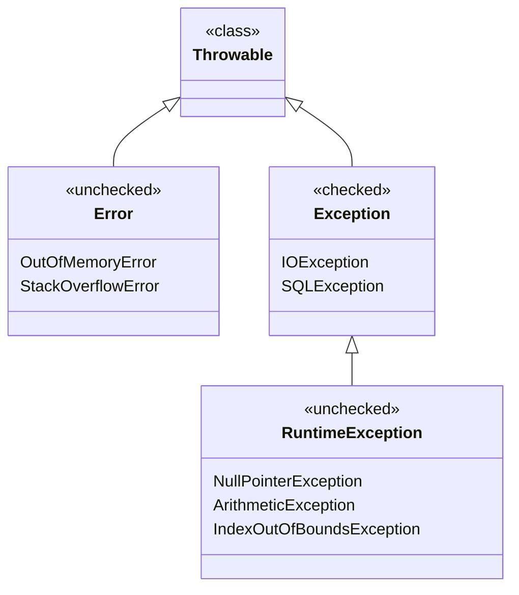
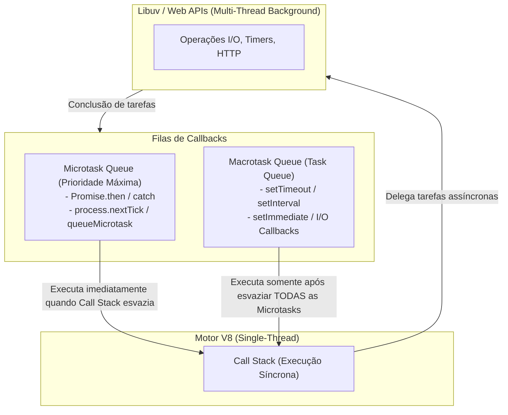

# 02 - Linguagens de Programação: Java, JavaScript, Node.js e Python

> **Matéria:** Desenvolvimento de Sistemas  
> **Cargo:** B02 – Técnico de Controle Externo – Especialidade: Tecnologia da Informação  
> **Arquivo:** `02_linguagens_java_javascript_nodejs_python.md`  

---

## 📌 Ementa / Itens do Edital
- Programação em Java (conceitos básicos)
- Programação em JavaScript e no ambiente Node.js
- Programação em Python para automação e desenvolvimento back-end

---

## 🌳 Classificação Hierárquica

```text
2. Linguagens de Programação e Ambientes de Execução
├── 2.1 Programação em Java (Conceitos Fundamentais)
│   ├── 2.1.1 Arquitetura da Plataforma: JVM (Java Virtual Machine), JRE, JDK e Bytecode ("Write once, run anywhere")
│   ├── 2.1.2 Gerenciamento de Memória e Coletor de Lixo (Garbage Collector - Heap vs. Stack)
│   ├── 2.1.3 Tipos Primitivos (byte, short, int, long, float, double, char, boolean) vs. Classes Wrapper (Integer, Double...)
│   ├── 2.1.4 Tratamento de Exceções: Checked Exceptions (Exception) vs. Unchecked Exceptions (RuntimeException, Error); blocos try-catch-finally e try-with-resources
│   ├── 2.1.5 Framework de Coleções (Java Collections Framework):
│   │   ├── List (ArrayList, LinkedList)
│   │   ├── Set (HashSet, TreeSet)
│   │   └── Map (HashMap, TreeMap)
│   └── 2.1.6 Recursos Modernos: Generics, Enums, Lambdas e Stream API (processamento funcional em Java)
├── 2.2 JavaScript Moderno (ECMAScript 6+)
│   ├── 2.2.1 Declaração de Variáveis: var (escopo de função/hoisting) vs. let e const (escopo de bloco)
│   ├── 2.2.2 Tipos de Dados, coerção de tipos (== vs. ===), Template Literals e Desestruturação (Destructuring Assignment)
│   ├── 2.2.3 Operadores Spread e Rest (...), Arrow Functions e comportamento léxico do this
│   ├── 2.2.4 Escopo, Closures e Funções de Callback
│   └── 2.2.5 Programação Assíncrona em JavaScript:
│       ├── Modelo de execução Single-Thread e o Event Loop (Call Stack, Task Queue / Macrotasks, Microtask Queue)
│       ├── Objetos Promise (estados: pending, fulfilled, rejected; métodos then, catch, finally, Promise.all)
│       └── Sintaxe async / await e tratamento de erros com try/catch
├── 2.3 Ambiente de Execução Node.js
│   ├── 2.3.1 Arquitetura: Motor V8, biblioteca libuv, I/O não bloqueante e orientado a eventos (Non-blocking I/O)
│   ├── 2.3.2 Sistema de Módulos: CommonJS (require / module.exports) vs. ES Modules (import / export)
│   ├── 2.3.3 Módulos Nativos Essenciais: fs (sistema de arquivos), path, http, events (EventEmitter), os
│   └── 2.3.4 Gerenciador de Pacotes npm (arquivo package.json, scripts, devDependencies vs. dependencies, npx)
└── 2.4 Programação em Python para Automação e Back-end
    ├── 2.4.1 Sintaxe e Tipagem: Tipagem dinâmica e forte, indentação obrigatória como delimitador de blocos
    ├── 2.4.2 Estruturas de Dados Embutidas: Listas (list), Tuplas (tuple - imutáveis), Dicionários (dict), Conjuntos (set)
    ├── 2.4.3 Idiomas Pythonicos: List Comprehensions, Dict Comprehensions, Geradores (yield), Funções lambda, Decorators
    ├── 2.4.4 Tratamento de Erros e Manipulação de Recursos: Blocos try-except-else-finally e gerenciadores de contexto (with open(...) as f:)
    ├── 2.4.5 Python para Automação de Tarefas:
    │   ├── Manipulação de arquivos e caminhos (os, sys, pathlib)
    │   ├── Automação HTTP e Web Scraping básico (requests, BeautifulSoup)
    │   └── Manipulação de dados estruturados (módulos json, csv)
    └── 2.4.6 Python no Back-end: Noções dos frameworks FastAPI e Flask (criação de rotas, injeção de dependências e validação Pydantic)
```

---

## 📖 Teoria Aprofundada & Pontos-Chave

### 2.1 Programação em Java

#### 2.1.1 Arquitetura da Plataforma e Execução
- **JDK (Java Development Kit):** Kit completo para desenvolvedores, contendo o compilador (`javac`), utilitários de diagnóstico (`jconsole`, `javap`) e a JRE.
- **JRE (Java Runtime Environment):** Ambiente mínimo para execução de aplicações Java pré-compiladas, contendo a JVM e as bibliotecas centrais de classes (`rt.jar` / módulos Java).
- **JVM (Java Virtual Machine):** Máquina virtual que interpreta o **Bytecode** (`.class`) gerado pelo `javac` e o traduz para instruções de máquina nativas do sistema operacional hospedeiro via compilador **JIT** (*Just-In-Time Compiler*).
- **Gerenciamento de Memória:**
  - **Stack (Pilha):** Armazena referências locais de variáveis, tipos primitivos e quadros de chamadas de métodos (*frames*). Possui desalocação automática e instantânea no retorno da função.
  - **Heap:** Área de memória compartilhada onde **todos os objetos** e arrays são instanciados (`new`). Seu gerenciamento é automático pelo **Garbage Collector (GC)**, que identifica e limpa objetos inalcançáveis na árvore de referências.

#### 2.1.2 Modificadores de Acesso e a Palavra-chave `final`

| Modificador | Mesma Classe | Mesmo Pacote | Subclasses (Outro Pacote) | Qualquer Classe Externa |
|---|:---:|:---:|:---:|:---:|
| `private` | Sim | Não | Não | Não |
| *(default / package-private)* | Sim | Sim | Não | Não |
| `protected` | Sim | Sim | Sim | Não |
| `public` | Sim | Sim | Sim | Sim |

- **Palavra-chave `final`:**
  - Em uma **variável/campo:** Torna-o uma constante (não pode ter seu valor ou referência reatribuído após inicializado).
  - Em um **método:** Impede que o método seja sobrescrito (*overridden*) por subclasses.
  - Em uma **classe:** Impede que a classe seja herdada/estendida (ex.: a classe `java.lang.String` é `final`).

#### 2.1.3 Hierarquia de Tratamento de Exceções



- **Checked Exceptions (Exceções Checadas):** Subclasses diretas de `java.lang.Exception` (excluindo `RuntimeException`). O compilador **obriga** o desenvolvedor a tratá-las explicitamente com bloco `try-catch` ou a declará-las na assinatura do método com a cláusula `throws` (ex.: `IOException`, `SQLException`).
- **Unchecked Exceptions (Exceções Não Checadas):** Subclasses de `java.lang.RuntimeException` ou de `java.lang.Error`. Ocorrem geralmente por erros de lógica de programação (ex.: `NullPointerException`, `ArrayIndexOutOfBoundsException`, `ArithmeticException`). O compilador **não** exige tratamento nem declaração.
- **Blocos `try-catch-finally` e `try-with-resources`:**
  - O bloco `finally` é executado **sempre**, ocorra exceção ou não (salvo se a JVM for terminada abruptamente por `System.exit(0)`).
  - O `try-with-resources` (Java 7+) gerencia o fechamento automático de conexões, fluxos e arquivos que implementem `java.lang.AutoCloseable`, dispensando chamadas manuais a `.close()` no `finally`.

#### 2.1.4 Framework de Coleções (Java Collections)
- **`List` (Interface):** Coleção indexada que **permite duplicatas** e preserva a ordem de inserção.
  - `ArrayList`: Baseado em array dinâmico redimensionável. Acesso por índice em $\mathcal{O}(1)$; inserção/remoção no meio em $\mathcal{O}(n)$.
  - `LinkedList`: Baseado em lista duplamente encadeada. Acesso em $\mathcal{O}(n)$; inserção no início/fim em $\mathcal{O}(1)$.
- **`Set` (Interface):** Coleção que **não admite elementos duplicados**.
  - `HashSet`: Baseado em tabela hash. Operações médias em $\mathcal{O}(1)$. Não garante ordenação.
  - `TreeSet`: Baseado em Árvore Rubro-Negra (*NavigableSet*). Elementos mantidos ordenados naturalmente ou por `Comparator`. Operações em $\mathcal{O}(\log n)$.
- **`Map` (Interface):** Associa chaves exclusivas a valores (pares chave-valor).
  - `HashMap`: Baseado em tabela hash. Acesso em $\mathcal{O}(1)$ médio. Permite chave `null`.
  - `TreeMap`: Mantém as chaves ordenadas. Operações em $\mathcal{O}(\log n)$.

---

### 2.2 JavaScript Moderno (ECMAScript 6+) e Node.js

#### 2.2.1 Declaração de Variáveis: `var` vs. `let` vs. `const`

| Característica | `var` | `let` | `const` |
|---|---|---|---|
| **Escopo** | De função ou global | **De bloco** (`{ ... }`) | **De bloco** (`{ ... }`) |
| **Içamento (*Hoisting*)** | Sim (inicializada com `undefined`) | Sim (fica na *Temporal Dead Zone*) | Sim (fica na *Temporal Dead Zone*) |
| **Redeclaração no mesmo escopo** | Permitida | Erro de sintaxe (*SyntaxError*) | Erro de sintaxe (*SyntaxError*) |
| **Reatribuição** | Permitida | Permitida | **Proibida** (valor imutável de referência) |

> 🚨 **ALERTA DE PROVA / PEGADINHA FCC:**  
> A declaração `const` impede a **reatribuição da variável**, mas **não torna o objeto imutável**! Se uma variável `const obj = { id: 1 }` for declarada, `obj = 2` gera erro, mas `obj.id = 2` ou `obj.novo = "teste"` são perfeitamente válidos e alteram o objeto interno sem erro.

#### 2.2.2 Coerção de Tipos e Operadores de Igualdade
- **Igualdade Ampla / Abstrata (`==`):** Executa coerção automática de tipos antes da comparação.
  - `0 == ""` $\rightarrow$ `true`
  - `0 == false` $\rightarrow$ `true`
  - `null == undefined` $\rightarrow$ `true`
  - `[] == false` $\rightarrow$ `true`
- **Igualdade Estrita (`===`):** Não realiza conversão. Retorna `true` apenas se ambos os operandos possuírem o **mesmo tipo** e o **mesmo valor**.
  - `0 === ""` $\rightarrow$ `false`
  - `null === undefined` $\rightarrow$ `false`

#### 2.2.3 Arquitetura Assíncrona e o Event Loop do Node.js



- **Fases de Prioridade no Event Loop:**
  1. A **Call Stack** executa todo o código síncrono.
  2. Ao esvaziar a Call Stack, o Event Loop processa **todas as Microtasks pendentes** (resoluções de Promises e `process.nextTick`).
  3. Somente após a Microtask Queue estar totalmente vazia é que o Event Loop retira a primeira **Macrotask** da fila (`setTimeout`, `setInterval`, etc.).

---

### 2.3 Programação em Python para Automação e Back-end

#### 2.3.1 Características Fundamentais e Tipagem
- **Dinâmica e Forte:** Dinâmica porque o tipo da variável é inferido em tempo de execução; Forte porque a linguagem **não realiza coerção arbitrária entre tipos incompatíveis** (ex.: `"Nota: " + 10` dispara `TypeError`, diferentemente do JavaScript que resultaria em `"Nota: 10"`).
- **Indentação Significativa:** A estrutura de blocos é delimitada estritamente pelo recuo de espaços em branco (padronizado em 4 espaços pela PEP 8), dispensando chaves `{}`.

#### 2.3.2 Estruturas de Dados Nativas em Python

| Tipo | Sintaxe | Mutável? | Ordenado? | Admite Duplicatas? | Indexado? |
|---|---|:---:|:---:|:---:|:---:|
| **`list`** | `[1, 2, 3]` | **Sim** | Sim (por inserção) | Sim | Sim (`[0]`, `[-1]`) |
| **`tuple`** | `(1, 2, 3)` | **Não** (imutável) | Sim | Sim | Sim |
| **`dict`** | `{"chave": 10}` | **Sim** | Sim (Python 3.7+) | Não (chaves únicas) | Por chave |
| **`set`** | `{1, 2, 3}` | **Sim** | Não | **Não** | Não |

- **Fatiamento (*Slicing*):** Sintaxe `sequencia[inicio:fim:passo]`.  
  - Índices negativos contam do final para o início: `lista[-1]` obtém o último elemento.  
  - Inversão elegante: `lista[::-1]`.

#### 2.3.3 Recursos Avançados do Python
- **List Comprehensions:** Notação concisa para criação de listas:
  ```python
  pares_quadrados = [x**2 for x in range(10) if x % 2 == 0]
  ```
- **Geradores (`yield`):** Funções geradoras preservam seu estado entre invocações com `yield`. Realizam **avaliação preguiçosa (*lazy evaluation*)**, calculando um valor por vez sob demanda, economizando memória em conjuntos de dados volumosos.
- **Gerenciadores de Contexto (`with`):** Garantem a alocação e liberação determinística de recursos (fechamento automático de arquivos e sessões de banco de dados por meio dos métodos especiais `__enter__` e `__exit__`):
  ```python
  with open("dados.txt", "r", encoding="utf-8") as f:
      linhas = f.readlines()
  # O arquivo é fechado automaticamente aqui, mesmo que ocorra exceção
  ```
- **Blocos `try-except-else-finally`:**
  - `try`: Código monitorado.
  - `except`: Captura da exceção específica.
  - `else`: Executado **apenas se nenhuma exceção** for lançada no bloco `try`.
  - `finally`: Executado **incondicionalmente**, garantindo liberação de recursos.

---

### 2.4 Quadro Comparativo entre as Linguagens

| Critério | Java | JavaScript (Node.js) | Python |
|---|---|---|---|
| **Paradigma Principal** | Orientado a Objetos (com suporte funcional) | Multiparadigma (baseado em protótipos e eventos) | Multiparadigma (orientado a objetos e procedural) |
| **Sistema de Tipos** | Estática e Forte | Dinâmica e Fraca | Dinâmica e Forte |
| **Modelo de Execução** | Compilado para Bytecode e interpretado/JIT (JVM) | Interpretado / JIT (Motor V8) | Interpretado para Bytecode (CPython) |
| **Modelo de Concorrência** | Multithread real nativo com suporte a Virtual Threads | Single-Thread com I/O assíncrono via Event Loop | Single-Thread com GIL (Global Interpreter Lock) / `asyncio` |
| **Tratamento de Exceções** | Checked e Unchecked Exceptions | Unchecked com `try-catch` | Unchecked com `try-except-else-finally` |

---

## 🌐 Fontes Recomendadas na Internet (Acesso Direto e Gratuito)

- [x] **Oracle Java Tutorials - Collections, Exceptions & OOP:**
  - Link Oficial: [The Java Tutorials (Oracle Docs)](https://docs.oracle.com/javase/tutorial/)
  - *Conteúdo:* Guia completo da arquitetura Java, Collections Framework (`List`, `Set`, `Map`), tratamento de exceções com `try-with-resources` e modificadores de visibilidade.
- [x] **MDN Web Docs - JavaScript Guide & Event Loop:**
  - Link Oficial: [MDN JavaScript Guide em Português](https://developer.mozilla.org/pt-BR/docs/Web/JavaScript/Guide)
  - *Conteúdo:* Declaração de variáveis (`let`, `const`, `var`), Promises, async/await, closures e modelo de concorrência com Event Loop.
- [x] **Node.js Official Documentation - Asynchronous Work & Event Loop:**
  - Link Oficial: [Node.js Event Loop Architecture](https://nodejs.org/en/learn/asynchronous-work/event-loop-timers-and-nexttick)
  - *Conteúdo:* Arquitetura da biblioteca libuv, Call Stack, Microtasks (`process.nextTick`, `Promise`) e Macrotasks (`setTimeout`).
- [x] **Python Documentation - Tutorial Oficial do Python 3:**
  - Link Oficial: [Tutorial Oficial de Python 3 (Python.org Docs)](https://docs.python.org/pt-br/3/tutorial/index.html)
  - *Conteúdo:* Tipagem dinâmica e forte, estruturas de dados (`list`, `tuple`, `dict`, `set`), list comprehensions, gerenciadores de contexto (`with`) e exceções.

---

## 📝 Questões Comentadas & Exemplos (Padrão FCC)

### Questão 1 (FCC - Analista de TI / Sistemas)
Em relação ao modelo de execução assíncrona do ambiente Node.js e da linguagem JavaScript, considere o seguinte fragmento de código:

```javascript
console.log("A");

setTimeout(() => {
    console.log("B");
}, 0);

Promise.resolve().then(() => {
    console.log("C");
});

console.log("D");
```

A ordem exata em que os caracteres serão impressos no console do terminal durante a execução desse script é:  
A) A, B, C, D  
B) A, D, B, C  
C) A, D, C, B  
D) C, A, D, B  
E) A, C, D, B  

> **Gabarito: C**  
>
> **Comentário Analítico Passo a Passo:**  
> Vamos analisar o ciclo de vida do Event Loop da linguagem JavaScript passo a passo:
> 1. O código síncrono é colocado e executado imediatamente na **Call Stack**:
>    - `console.log("A")` é executado $\rightarrow$ Imprime **A**.
>    - `setTimeout(...)` registra o temporizador com a API do ambiente/libuv. O callback para imprimir `"B"` é despachado para a fila de **Macrotasks** (*Task Queue*).
>    - `Promise.resolve().then(...)` resolve a promessa imediatamente e coloca seu callback para imprimir `"C"` na fila prioritária de **Microtasks** (*Microtask Queue*).
>    - `console.log("D")` é executado $\rightarrow$ Imprime **D**.
> 2. Agora, a **Call Stack está vazia**.
> 3. O Event Loop entra em ação: a regra fundamental do Event Loop dita que **todas as Microtasks devem ser drenadas antes de executar a próxima Macrotask**.
>    - O callback da Promise é retirado da Microtask Queue e executado $\rightarrow$ Imprime **C**.
> 4. Estando a fila de Microtasks vazia, o Event Loop passa para a fila de Macrotasks:
>    - O callback do `setTimeout` é executado $\rightarrow$ Imprime **B**.
>
> Ordem final impressa no console: **A, D, C, B**.
>
> **Análise detalhada das alternativas:**  
> - **A (Incorreta):** Supõe uma execução estritamente sequencial linha a linha, ignorando o comportamento assíncrono do `setTimeout` e da `Promise`.  
> - **B (Incorreta):** Supõe erroneamente que a Macrotask do `setTimeout(..., 0)` tem prioridade sobre a Microtask da Promise resolvida. Na especificação do ECMAScript e Node.js, microtasks têm precedência absoluta sobre macrotasks.  
> - **C (CORRETA):** Sequência exata: código síncrono (`A`, `D`), seguido da fila de microtarefas (`C`), finalizando com a fila de macrotarefas (`B`).  
> - **D (Incorreta):** Afirma que a Promise é executada antes mesmo do código síncrono inicial (`A`), o que viola a mecânica da Call Stack.  
> - **E (Incorreta):** Afirma que a Promise é executada antes da linha síncrona `console.log("D")`, o que é impossível, pois a Call Stack precisa esvaziar todo o código síncrono para dar a primeira rodada do Event Loop.

---

### Questão 2 (FCC - Técnico de Controle Externo / TI)
Na linguagem de programação Java, a respeito das palavras-chave de controle de acesso, modificadores de comportamento e tratamento da orientação a objetos, assinale a afirmativa correta:  
A) Um atributo declarado com o modificador `private` pode ser acessado diretamente por quaisquer subclasses pertencentes ao mesmo pacote da superclasse.  
B) Uma classe declarada com o modificador `final` não pode ser estendida (não permite criação de subclasses), e um método marcado como `final` não pode ser sobrescrito (*overridden*).  
C) Interfaces em Java não podem conter assinaturas de métodos abstratos, permitindo apenas constantes estáticas.  
D) O operador relacional `==` compara o conteúdo semântico e alfanumérico de dois objetos da classe `String`, enquanto o método `.equals()` compara estritamente os endereços de memória.  
E) O bloco `finally` em uma estrutura de tratamento `try-catch-finally` é opcional e nunca é executado quando uma exceção é capturada com sucesso pelo bloco `catch`.  

> **Gabarito: B**  
>
> **Comentário Analítico Passo a Passo:**  
> A linguagem Java emprega modificadores com papéis bem estruturados para garantir integridade estrutural e encapsulamento.
>
> **Análise detalhada das alternativas:**  
> - **A (Incorreta):** Atributos `private` são visíveis **única e exclusivamente** dentro do escopo da própria classe onde foram declarados. Subclasses (mesmo dentro do mesmo pacote) não possuem acesso direto a membros privados. O modificador que permitiria acesso no mesmo pacote e em subclasses de outros pacotes seria `protected`.  
> - **B (CORRETA):** A palavra-chave `final` possui três semânticas em Java: (1) em variáveis: impede reatribuição de valor (constante); (2) em métodos: impede que subclasses o sobrescrevam; (3) em classes: impede a extensão via herança (ex.: a classe `java.lang.String` é `final`).  
> - **C (Incorreta):** Interfaces em Java foram originalmente concebidas justamente para declarar assinaturas de métodos abstratos que devem ser implementados por classes concretas.  
> - **D (Incorreta):** Pegadinha clássica da FCC: os papéis estão invertidos. O operador `==` compara a **identidade das referências de memória** (se apontam para o mesmo endereço), enquanto o método `.equals()` compara a **igualdade de conteúdo** semântico dos objetos.  
> - **E (Incorreta):** O bloco `finally` é executado **sempre** após o `try` e o `catch`, independentemente de uma exceção ter sido capturada ou não, sendo projetado exatamente para limpeza e liberação de recursos.

---

### Questão 3 (FCC - Analista de TI / Sistemas)
Considere o seguinte trecho de código escrito na linguagem Python 3:

```python
numeros = [1, 2, 3, 4, 5, 6, 7, 8, 9, 10]
resultado = [x * 2 for x in numeros if x % 2 != 0 and x > 3]
print(resultado)
```

A execução correta desse código gerará no terminal a saída:  
A) `[8, 12, 16, 20]`  
B) `[10, 14, 18]`  
C) `[5, 7, 9]`  
D) `[10, 14, 18, 22]`  
E) `[2, 6, 10, 14]`  

> **Gabarito: B**  
>
> **Comentário Analítico Passo a Passo:**  
> O código utiliza o recurso idiomático de **List Comprehension** em Python: `[expressão for elemento in iterável if condição]`.
> 1. A lista original `numeros` contém inteiros de 1 a 10.
> 2. Avaliando a cláusula condicional de filtro `if x % 2 != 0 and x > 3`:
>    - `x % 2 != 0` seleciona números **ímpares**: `1, 3, 5, 7, 9`.
>    - `x > 3` restringe aos números estritamente **maiores que 3**.
>    - A interseção dessas duas condições seleciona apenas: `5, 7, 9`.
> 3. Avaliando a expressão de projeção/transformação `x * 2`:
>    - Para $x = 5 \rightarrow 5 \times 2 = 10$.
>    - Para $x = 7 \rightarrow 7 \times 2 = 14$.
>    - Para $x = 9 \rightarrow 9 \times 2 = 18$.
> 4. A lista resultante gerada e impressa é: `[10, 14, 18]`.
>
> **Análise detalhada das alternativas:**  
> - **A (Incorreta):** Esta lista resultaria se a condição filtrasse os números pares maiores que 3 (`4, 6, 8, 10`), multiplicando-os por 2.  
> - **B (CORRETA):** Corresponde exatamente ao dobro dos números ímpares estritamente superiores a 3 presentes na lista (`5 * 2 = 10`, `7 * 2 = 14`, `9 * 2 = 18`).  
> - **C (Incorreta):** Apresenta os números filtrados (`[5, 7, 9]`), mas esqueceu de aplicar a multiplicação por 2 (`x * 2`).  
> - **D (Incorreta):** Inclui o elemento 22, mas o maior número ímpar na lista original é 9 ($9 \times 2 = 18$), portanto 22 não pode existir.  
> - **E (Incorreta):** Multiplica por 2 todos os números ímpares da lista (`1, 3, 5, 7`), violando a restrição de que `x` deve ser estritamente maior que 3.

---

### Questão 4 (FCC - Auditor Fiscal / Tecnologia da Informação)
No ecossistema da linguagem Java, o tratamento robusto de erros baseia-se na hierarquia da classe `java.lang.Throwable`. A respeito da distinção entre *Checked Exceptions* (exceções checadas) e *Unchecked Exceptions* (exceções não checadas), assinale a afirmativa correta:  
A) Exceções filhas de `java.lang.RuntimeException`, como `NullPointerException` e `IllegalArgumentException`, são do tipo *Checked Exceptions* e exigem tratamento obrigatório com bloco `try-catch` em tempo de compilação.  
B) A classe `java.lang.Error` e suas subclasses representam condições anormais graves de ambiente (como `OutOfMemoryError`), que são consideradas *Unchecked* e não devem ser capturadas na rotina de negócio da aplicação.  
C) O compilador Java não impõe nenhuma exigência sobre classes derivadas de `java.lang.Exception`, tornando o uso de blocos `try-catch` facultativo para operações de E/S de arquivos (`IOException`).  
D) As palavras-chave `throw` e `throws` são perfeitamente intercambiáveis, podendo ambas ser empregadas para lançar explicitamente uma nova instância de exceção dentro de um bloco de código.  
E) A cláusula `finally` anula a necessidade de declaração de exceções na assinatura do método com `throws`.  

> **Gabarito: B**  
>
> **Comentário Analítico Passo a Passo:**  
> A hierarquia de erros em Java divide-se a partir de `Throwable`:
> - `Error`: Indica falhas catastróficas da JVM ou esgotamento de recursos (ex.: estouro de memória, falha interna). São *unchecked*, pois o código de negócio normalmente não tem como se recuperar delas.
> - `Exception`: Divide-se em:
>   - *Checked Exceptions*: Subclasses diretas de `Exception`. Devem obrigatoriamente ser tratadas com `try-catch` ou declaradas com `throws`.
>   - *Unchecked Exceptions*: Subclasses de `RuntimeException`. Decorrem de falhas de programação que podem ser evitadas com checagens prévias, logo o compilador não obriga o tratamento sintático formal.
>
> **Análise detalhada das alternativas:**  
> - **A (Incorreta):** Subclasses de `RuntimeException` são o exemplo canônico de **Unchecked Exceptions**, não exigindo captura obrigatória pelo compilador.  
> - **B (CORRETA):** A classe `Error` representa problemas fatais no nível da infraestrutura da JVM (como `OutOfMemoryError` ou `StackOverflowError`), não sendo recomendada sua captura ou tratamento pela lógica de aplicação.  
> - **C (Incorreta):** Subclasses de `Exception` que não herdam de `RuntimeException` (como `IOException`, `SQLException`) são *Checked Exceptions* e seu tratamento com `try-catch` ou propagação com `throws` é **rigorosamente obrigatório** pelo compilador.  
> - **D (Incorreta):** `throw` é uma instrução para lançar uma instância de exceção (`throw new MinhaException()`), enquanto `throws` é um modificador de assinatura de método que declara quais exceções checadas o método pode disparar para quem o invoca.  
> - **E (Incorreta):** O bloco `finally` garante a execução de código de limpeza, mas não desobriga a assinatura do método de conter a declaração `throws` caso uma exceção checada não seja capturada por um bloco `catch`.

---

### Questão 5 (FCC - Analista de Sistemas / Desenvolvimento)
Em JavaScript moderno, a utilização de variáveis e a criação de funções de fechamento (*closures*) dentro de laços de repetição assíncronos comportam-se de maneira distinta dependendo de como as variáveis são declaradas. Analise os dois fragmentos de código abaixo:

**Fragmento 1:**
```javascript
for (var i = 0; i < 3; i++) {
    setTimeout(() => console.log("F1:", i), 100);
}
```

**Fragmento 2:**
```javascript
for (let j = 0; j < 3; j++) {
    setTimeout(() => console.log("F2:", j), 100);
}
```

Após o término dos temporizadores de 100 milissegundos, as saídas produzidas pelos Fragmentos 1 e 2 serão, respectivamente:  
A) Fragmento 1: `F1: 0`, `F1: 1`, `F1: 2` ; Fragmento 2: `F2: 0`, `F2: 1`, `F2: 2`.  
B) Fragmento 1: `F1: 3`, `F1: 3`, `F1: 3` ; Fragmento 2: `F2: 0`, `F2: 1`, `F2: 2`.  
C) Fragmento 1: `F1: 3`, `F1: 3`, `F1: 3` ; Fragmento 2: `F2: 3`, `F2: 3`, `F2: 3`.  
D) Fragmento 1: `F1: 0`, `F1: 1`, `F1: 2` ; Fragmento 2: `F2: 3`, `F2: 3`, `F2: 3`.  
E) Fragmento 1: `F1: undefined`, `F1: undefined`, `F1: undefined` ; Fragmento 2: `F2: 0`, `F2: 1`, `F2: 2`.  

> **Gabarito: B**  
>
> **Comentário Analítico Passo a Passo:**  
> Esse problema ilustra a diferença seminal de escopo entre `var` e `let` combinada com *closures* e o *Event Loop*:
> 1. **No Fragmento 1 (`var i = 0`):**
>    - A palavra-chave `var` possui **escopo de função** (ou global), e não escopo de bloco.
>    - Existe apenas **uma única variável `i`** compartilhada por todas as iterações do laço.
>    - O laço executa sincronicamente até o final: `i` assume 0, 1, 2 e finalmente atinge `3` (condição que encerra o laço `i < 3`).
>    - Os 3 callbacks do `setTimeout` foram agendados para a fila de Macrotasks. Quando são executados 100ms depois, todos eles referenciam a mesma variável `i`, cujo valor atual é `3`. Logo, imprime: `F1: 3`, `F1: 3`, `F1: 3`.
> 2. **No Fragmento 2 (`let j = 0`):**
>    - A palavra-chave `let` possui **escopo de bloco**.
>    - A especificação do ECMAScript estabelece que, para variáveis `let` em laços `for`, **uma nova instância da variável `j` com seu respectivo valor é criada para cada iteração do laço**.
>    - Cada closure formada pela função de callback do `setTimeout` captura o seu próprio `j` individual daquela iteração (0, 1 e 2).
>    - Quando os callbacks executam, eles imprimem os valores preservados: `F2: 0`, `F2: 1`, `F2: 2`.
>
> **Análise detalhada das alternativas:**  
> - **A (Incorreta):** Supõe que `var` preservaria o escopo de cada iteração, o que não ocorre sem a criação de uma IIFE (Immediately Invoked Function Expression) em JavaScript legado.  
> - **B (CORRETA):** Identifica com perfeição que `var` compartilha a referência final (`3, 3, 3`) e `let` cria um novo escopo de ligação léxica a cada ciclo (`0, 1, 2`).  
> - **C (Incorreta):** Supõe erroneamente que `let` teria o mesmo comportamento defeituoso de escopo que `var`.  
> - **D (Incorreta):** Inverte os comportamentos das duas declarações.  
> - **E (Incorreta):** Afirma que `var` seria resolvida para `undefined`, o que contraria o fato de `i` ter sido devidamente incrementada até o valor 3 no escopo circundante.
