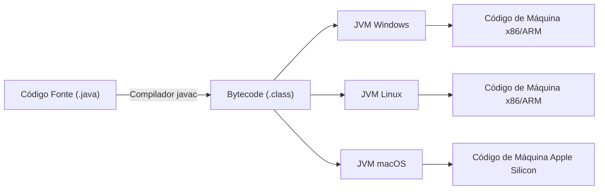
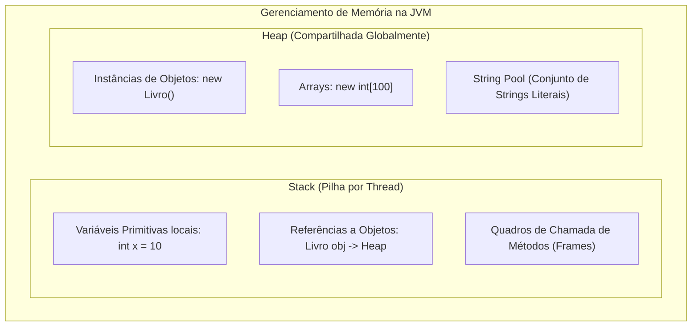
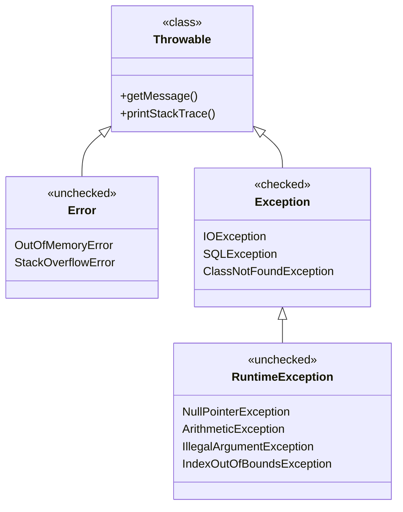
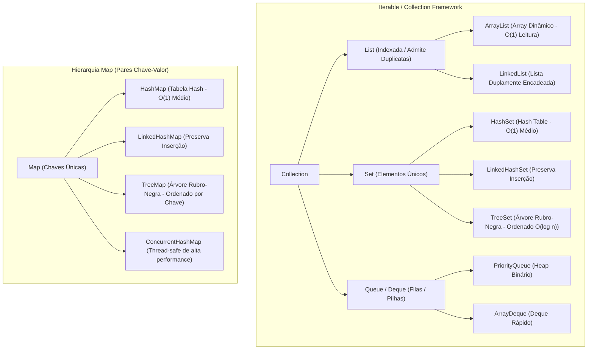
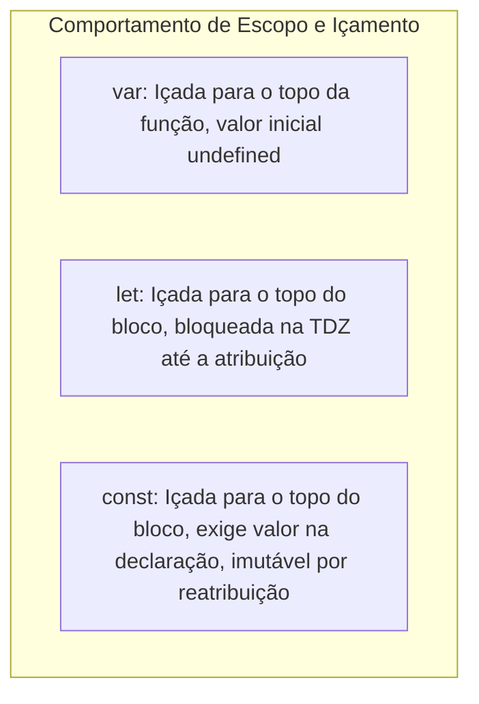
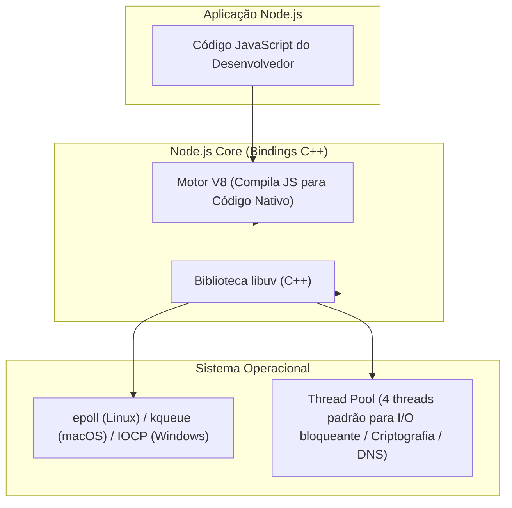
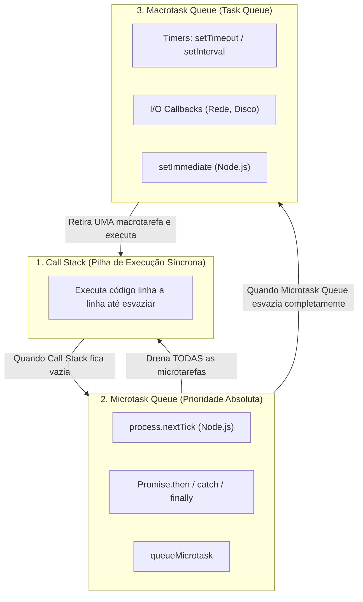
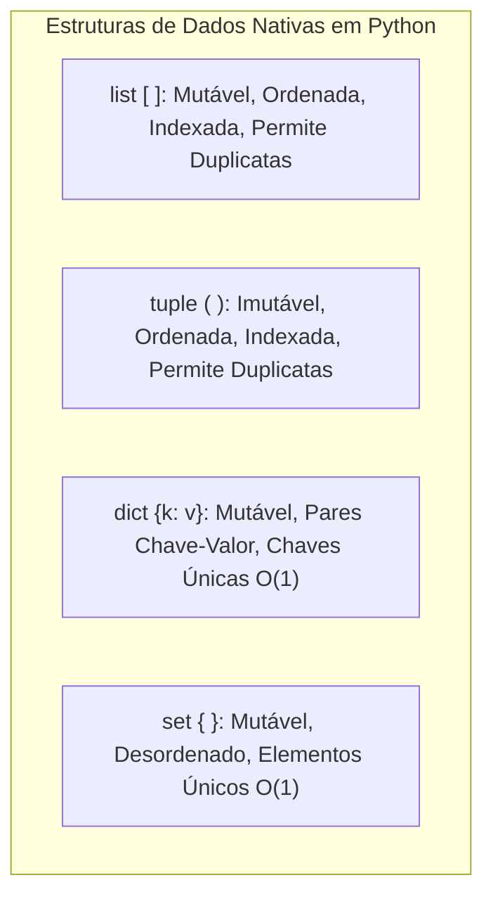

# 02 - Linguagens de Programação: Java, JavaScript, Node.js e Python

> **Matéria:** Desenvolvimento de Sistemas  
> **Cargo:** B02 – Técnico de Controle Externo – Especialidade: Tecnologia da Informação  
> **Arquivo:** `02_linguagens_java_javascript_nodejs_python.md`  


---


## 📌 Ementa / Itens do Edital
- Programação em Java (conceitos básicos)
- Programação em JavaScript e no ambiente Node.js
- Programação em Python para automação e desenvolvimento back-end

---

## 🧭 Sumário

1. [Programação em Java (Conceitos Fundamentais)](#1-programacao-em-java-conceitos-fundamentais)
    1. [Arquitetura da Plataforma: JVM, JRE, JDK e Bytecode](#11-arquitetura-da-plataforma-jvm-jre-jdk-e-bytecode)
    2. [Gerenciamento de Memória: Stack vs. Heap e Garbage Collection](#12-gerenciamento-de-memoria-stack-vs-heap-e-garbage-collection)
    3. [Tipos Primitivos vs. Classes Wrapper e Comparação de Objetos](#13-tipos-primitivos-vs-classes-wrapper-e-comparacao-de-objetos)
    4. [Modificadores de Acesso e a Palavra-Chave `final`](#14-modificadores-de-acesso-e-a-palavra-chave-final)
    5. [Tratamento de Exceções: Hierarquia de `Throwable`, Checked vs. Unchecked](#15-tratamento-de-excecoes-hierarquia-de-throwable-checked-vs-unchecked)
    6. [Java Collections Framework: List, Set, Queue e Map](#16-java-collections-framework-list-set-queue-e-map)
    7. [Recursos Modernos: Generics, Enums, Lambdas e Stream API](#17-recursos-modernos-generics-enums-lambdas-e-stream-api)
    8. [Teste 065](#Teste-065)
    9. [Teste 066](#Teste-066)
    10. [Teste 067](#Teste-067)
    11. [Teste 068](#Teste-068)
2. [JavaScript Moderno (ECMAScript 6+)](#2-javascript-moderno-ecmascript-6)
    1. [Declaração de Variáveis: `var`, `let` e `const`, Escopo e Hoisting](#21-declaracao-de-variaveis-var-let-e-const-escopo-e-hoisting)
    2. [Tipos de Dados, Coerção e Operadores de Igualdade (`==` vs. `===`)](#22-tipos-de-dados-coercao-e-operadores-de-igualdade-vs)
    3. [Recursos Idiomáticos ES6+: Desestruturação, Spread/Rest e Arrow Functions](#23-recursos-idiomaticos-es6-desestruturacao-spreadrest-e-arrow-functions)
    4. [Escopo Léxico, Closures e Funções de Alta Ordem](#24-escopo-lexico-closures-e-funcoes-de-alta-ordem)
    5. [Teste 069](#Teste-069)
    6. [Teste 070](#Teste-070)
    7. [Teste 071](#Teste-071)
3. [Programação Assíncrona e Ambiente Node.js](#3-programacao-assincrona-e-ambiente-nodejs)
    1. [Arquitetura do Node.js: Motor V8, Libuv e Non-blocking I/O](#31-arquitetura-do-nodejs-motor-v8-libuv-e-non-blocking-io)
    2. [O Event Loop: Call Stack, Microtasks e Macrotasks](#32-o-event-loop-call-stack-microtasks-e-macrotasks)
    3. [Promises e a Sintaxe `async` / `await`](#33-promises-e-a-sintaxe-async-await)
    4. [Sistema de Módulos (CommonJS vs. ES Modules) e Módulos Nativos Essenciais](#34-sistema-de-modulos-commonjs-vs-es-modules-e-modulos-nativos-essenciais)
    5. [Gerenciamento de Dependências com npm](#35-gerenciamento-de-dependencias-com-npm)
    6. [Teste 072](#Teste-072)
    7. [Teste 073](#Teste-073)
4. [Programação em Python para Automação e Back-end](#4-programacao-em-python-para-automacao-e-back-end)
    1. [Sintaxe, Tipagem Dinâmica e Forte e Filosofia PEP 8](#41-sintaxe-tipagem-dinamica-e-forte-e-filosofia-pep-8)
    2. [Estruturas de Dados Nativas: Listas, Tuplas, Dicionários e Conjuntos](#42-estruturas-de-dados-nativas-listas-tuplas-dicionarios-e-conjuntos)
    3. [Fatiamento (*Slicing*), Comprehensions e Funções Geradoras (`yield`)](#43-fatiamento-slicing-comprehensions-e-funcoes-geradoras-yield)
    4. [Tratamento de Exceções (`try-except-else-finally`) e Gerenciadores de Contexto (`with`)](#44-tratamento-de-excecoes-try-except-else-finally-e-gerenciadores-de-contexto-with)
    5. [Automação de Tarefas com Python: Arquivos, HTTP, Scraping e Formatos Estruturados](#45-automacao-de-tarefas-com-python-arquivos-http-scraping-e-formatos-estruturados)
    6. [Python no Back-end: Conceitos Fundamentais de Flask e FastAPI](#46-python-no-back-end-conceitos-fundamentais-de-flask-e-fastapi)
    7. [Teste 074](#Teste-074)
    8. [Teste 075](#Teste-075)
5. [Tabela Comparativa Sintética entre as Linguagens](#5-tabela-comparativa-sintetica-entre-as-linguagens)
6. [Fontes Recomendadas na Internet](#6-fontes-recomendadas-na-internet)

---

## 1. Programação em Java (Conceitos Fundamentais)

### 1.1 Arquitetura da Plataforma: JVM, JRE, JDK e Bytecode
A linguagem Java, criada pela Sun Microsystems e atualmente mantida pela Oracle, foi concebida sob o paradigma da independência de plataforma, expresso pelo lema *"Write Once, Run Anywhere"* (WORA). Essa portabilidade é viabilizada por uma arquitetura em camadas composta por:

1. **Código-Fonte (`.java`):** Arquivo de texto contendo as instruções escritas pelo programador em conformidade com as especificações da linguagem.
2. **Compilador (`javac`):** Não traduz o código-fonte diretamente para o código binário da máquina hospedeira. Em vez disso, compila o código-fonte para um formato intermediário, compacto e abstrato denominado **Bytecode** (arquivos com extensão `.class`).
3. **Bytecode:** Conjunto de instruções executáveis padronizadas que independem do hardware e do sistema operacional.
4. **JVM (Java Virtual Machine):** A máquina virtual abstrata instalada em cada sistema operacional específico (Windows, Linux, macOS). A JVM interpreta o bytecode e traduz suas instruções para o conjunto de instruções nativas do processador subjacente.
    - **JIT Compiler (*Just-In-Time*):** Para otimizar o desempenho e evitar a lentidão da interpretação instrução por instrução, o motor JIT compila trechos de bytecode frequentemente executados (*hot spots*) diretamente em código de máquina nativo durante o tempo de execução, armazenando-os em memória cache.

5. **JRE (Java Runtime Environment):** O ambiente mínimo de execução necessário para o usuário final rodar sistemas Java pré-compilados. Contém a JVM, as bibliotecas padrão da API Java (`rt.jar` ou módulos JPMS) e arquivos de configuração de suporte. A JRE **não** inclui ferramentas de desenvolvimento como compilador ou depurador.
6. **JDK (Java Development Kit):** O kit completo para engenheiros de software. Engloba toda a JRE mais ferramentas de desenvolvimento fundamentais: o compilador `javac`, empacotador `jar`, gerador de documentação `javadoc`, desassemblador `javap` e utilitários de diagnóstico e depuração (`jconsole`, `jstack`, `jps`).



> 🚨 **ALERTA DE PROVA / FCC:**  
> A FCC frequentemente tenta confundir o candidato afirmando que "o compilador Java gera código de máquina nativo dependente do sistema operacional" ou que "a JRE inclui o compilador javac". Lembre-se: o `javac` gera **Bytecode** (independente de plataforma); quem gera código nativo é a **JVM** (específica para cada SO), e o compilador só está presente no **JDK**, nunca na JRE isolada.

### 1.2 Gerenciamento de Memória: Stack vs. Heap e Garbage Collection
A JVM gerencia automaticamente o ciclo de vida da memória alocada, dividindo-a primariamente em duas áreas fundamentais de armazenamento:



#### A Memória Stack (Pilha)
- Cada thread em execução possui sua própria pilha de execução privativa (*thread-safe*).
- Armazena os quadros de chamada de métodos (*stack frames*).
- Guarda **valores de tipos primitivos locais** e **referências (ponteiros de memória)** para objetos instanciados no Heap.
- Possui alocação e liberação ultrarrápida, estritamente alinhada à entrada e saída do escopo do método (LIFO - *Last In, First Out*).
- Quando a profundidade de chamadas recursivas ultrapassa o limite da pilha, a JVM lança a exceção crítica `java.lang.StackOverflowError`.

#### A Memória Heap
- Área global compartilhada por todas as threads ativas do processo JVM.
- É o local exclusivo onde **todos os objetos** e arrays são criados fisicamente via operador `new`.
- O tamanho do Heap pode ser configurado na inicialização da aplicação pelos parâmetros `-Xms` (tamanho inicial) e `-Xmx` (tamanho máximo).
- Quando o Heap se esgota e o Garbage Collector não consegue liberar memória suficiente para novas instanciações, é lançada a exceção fatal `java.lang.OutOfMemoryError`.

#### O Coletor de Lixo (*Garbage Collector* - GC)
- O GC é uma thread de segundo plano gerenciada pela JVM que monitora o Heap e remove objetos que se tornaram **inalcançáveis** (*unreachable*), ou seja, objetos para os quais não existe mais nenhuma cadeia ativa de referências partindo das chamadas raízes do sistema (*GC Roots*, que incluem referências ativas na pilha, classes carregadas estáticas e variáveis JNI).
- A memória Heap tradicional é organizada em gerações baseadas na hipótese de que a maioria dos objetos morre jovem (*Weak Generational Hypothesis*):
    1. **Young Generation (Geração Jovem):** Onde novos objetos são inicialmente alocados (subdividida em espaço *Eden* e dois espaços *Survivor* - S0 e S1). A coleta aqui é chamada de *Minor GC*.
    2. **Old / Tenured Generation (Geração Antiga):** Armazena objetos que sobreviveram a vários ciclos de *Minor GC*. A coleta nesta área é a *Major GC* ou *Full GC*.
    3. **Metaspace (antigo PermGen):** Armazena metadados de classes carregadas e constantes de reflexão (alocado fora da memória do heap principal desde o Java 8, na memória nativa do SO).

- A chamada a `System.gc()` apenas **sugere** à JVM que execute uma coleta de lixo, mas **não garante** a execução imediata nem determinística do processo.

### 1.3 Tipos Primitivos vs. Classes Wrapper e Comparação de Objetos
Java é uma linguagem de tipagem estática e fortemente tipada que distingue claramente valores primitivos e referências a objetos.

#### Tipos Primitivos
Armazenam diretamente os seus próprios valores numéricos, lógicos ou textuais, operando sem a sobrecarga de objetos:

| Tipo Primitivo | Tamanho | Valor Padrão | Intervalo / Representação |
|---|:---:|:---:|---|
| `boolean` | 1 bit (dependente da JVM) | `false` | `true` ou `false` |
| `byte` | 8 bits (1 byte) | `0` | $-128$ a $127$ |
| `short` | 16 bits (2 bytes) | `0` | $-32.768$ a $32.767$ |
| `char` | 16 bits (2 bytes) | `'\u0000'` | $0$ a $65.535$ (caracteres Unicode UTF-16) |
| `int` | 32 bits (4 bytes) | `0` | $-2^{31}$ a $2^{31}-1$ (padrão para inteiros) |
| `long` | 64 bits (8 bytes) | `0L` | $-2^{63}$ a $2^{63}-1$ (sufixo `L`) |
| `float` | 32 bits (4 bytes) | `0.0f` | IEEE 754 ponto flutuante de precisão simples |
| `double` | 64 bits (8 bytes) | `0.0d` | IEEE 754 ponto flutuante de precisão dupla (padrão) |

#### Classes Wrapper (*Invólucros*)
Para cada tipo primitivo, Java fornece uma classe correspondente no pacote `java.lang` (`Boolean`, `Byte`, `Short`, `Character`, `Integer`, `Long`, `Float`, `Double`).

- **Autoboxing:** Conversão automática de um valor primitivo para seu respectivo objeto wrapper pelo compilador (ex.: `Integer obj = 10;`).
- **Unboxing:** Conversão automática do objeto wrapper para o tipo primitivo nativo (ex.: `int valor = obj;`).
- Objetos wrapper são **imutáveis**.
- Permitem que tipos básicos sejam armazenados em coleções genéricas (`List<Integer>`, `Map<String, Double>`), pois as coleções Java aceitam estritamente objetos.

#### Comparação de Igualdade: `==` vs. `.equals()` e o *String Pool*
- **Operador `==`:**
    - Quando aplicado a tipos primitivos, compara diretamente o **conteúdo numérico/lógico** dos valores (`10 == 10` é `true`).
    - Quando aplicado a objetos, compara a **identidade da referência de memória**, avaliando se ambas as variáveis apontam fisicamente para o mesmo endereço no Heap.
- **Método `.equals()`:**
    - Método herdado de `java.lang.Object`.
    - Quando sobrescrito (como nas classes `String`, `Integer`, `LocalDate`), compara a **igualdade semântica de estado e conteúdo**.
- **String Pool:** Literais de String criados com aspas duplas (ex.: `String s1 = "tce"; String s2 = "tce";`) são armazenados em um pool compartilhado no Heap. Nesses casos, `s1 == s2` resulta em `true` porque ambos apontam para o mesmo objeto no pool. Contudo, se for instanciado com o operador `new` (`String s3 = new String("tce");`), um novo objeto separado é alocado no Heap, fazendo com que `s1 == s3` seja `false`, embora `s1.equals(s3)` retorne `true`.

### 1.4 Modificadores de Acesso e a Palavra-Chave `final`
O encapsulamento e o design estrutural em Java apoiam-se em quatro níveis de visibilidade:

| Modificador | Mesma Classe | Classes do Mesmo Pacote | Subclasses em Outro Pacote | Outras Classes Externas |
|---|:---:|:---:|:---:|:---:|
| `private` | **Sim** | Não | Não | Não |
| *(default / package-private)* | **Sim** | **Sim** | Não | Não |
| `protected` | **Sim** | **Sim** | **Sim** (via herança) | Não |
| `public` | **Sim** | **Sim** | **Sim** | **Sim** |

#### Usos da Palavra-Chave `final`
A palavra-chave `final` é um modificador de não-acesso que restringe alterações:

1. **Em Variáveis e Parâmetros:** A variável torna-se uma constante. Uma vez inicializada com um valor ou referência, seu valor não pode mais ser reatribuído.
    - *Atenção:* Se a variável for uma referência para um objeto (`final List<String> itens = new ArrayList<>();`), a referência `itens` não pode ser apontada para outra lista, mas o estado interno do objeto **continua mutável** (`itens.add("dado")` é válido).

2. **Em Métodos:** Impede que subclasses sobrescrevam (*override*) o método, garantindo que o algoritmo implementado na superclasse seja mantido intacto.
3. **Em Classes:** Impede que a classe seja herdada/estendida por subclasses (ex.: a classe `java.lang.String` e todas as classes wrapper são `final` por razões de segurança e imutabilidade).

### 1.5 Tratamento de Exceções: Hierarquia de `Throwable`, Checked vs. Unchecked
Em Java, qualquer condição anômala que interrompa o fluxo normal de execução é representada por um objeto derivado de `java.lang.Throwable`.



#### 1. `java.lang.Error` (Unchecked)
Representa falhas catastróficas graves de infraestrutura e do ambiente de execução da JVM (como exaustão de memória ou estouro de pilha). Não são tratáveis pelo código de negócio da aplicação e não devem ser capturadas por blocos `try-catch`.

#### 2. `java.lang.Exception` e as *Checked Exceptions* (Exceções Checadas)
São subclasses diretas de `Exception` que **não** derivam de `RuntimeException` (ex.: `IOException`, `SQLException`, `FileNotFoundException`).

- **Regra do Compilador:** O compilador Java **obriga** o desenvolvedor a tratá-las explicitamente através de um bloco `try-catch` ou a propagá-las na assinatura do método por meio da cláusula `throws`. Se não o fizer, o código não compilará.
- Representam condições externas previsíveis e recuperáveis (ex.: rede indisponível, arquivo inexistente).

### 1.6 Java Collections Framework: List, Set, Queue e Map
O ecossistema de coleções de Java reside no pacote `java.util` e organiza-se em torno de quatro interfaces mestras:



#### 1. Interface `List` (Listas)
Coleção indexada com controle absoluto de posição. **Permite elementos duplicados** e preserva a ordem de inserção.

- **`ArrayList`:** Implementada sobre um array dinâmico redimensionável. Excelente para leitura e acesso aleatório por índice ($\mathcal{O}(1)$), porém custosa para inserções ou remoções de elementos no meio ou início da lista ($\mathcal{O}(n)$ devido ao deslocamento dos elementos).
- **`LinkedList`:** Implementada sobre uma lista duplamente encadeada. Também implementa a interface `Deque`. Inserções e remoções nos extremos (início/fim) operam em tempo constante $\mathcal{O}(1)$, mas a busca e acesso por índice operam em $\mathcal{O}(n)$.

#### 2. Interface `Set` (Conjuntos)
Coleção matemática que **não permite elementos duplicados** (baseia-se nos métodos `hashCode()` e `equals()`).

- **`HashSet`:** Utiliza internamente uma tabela hash (`HashMap`). Oferece operações básicas (`add`, `remove`, `contains`) em tempo constante médio $\mathcal{O}(1)$. **Não garante nenhuma ordem** dos elementos. Admite um único elemento `null`.
- **`LinkedHashSet`:** Especialização do `HashSet` que mantém uma lista duplamente encadeada entre os elementos, preservando a **ordem de inserção**.
- **`TreeSet`:** Implementa `NavigableSet` sobre uma Árvore Rubro-Negra (*Red-Black Tree*). Mantém os elementos **estritamente ordenados** (pela ordem natural `Comparable` ou por um `Comparator` customizado). Operações básicas operam em tempo logarítmico $\mathcal{O}(\log n)$. Não aceita elementos `null`.

#### 3. Interface `Map` (Mapas / Dicionários)
Associa chaves exclusivas a valores correspondentes (pares chave-valor). Não estende `java.util.Collection`.

- **`HashMap`:** Baseado em tabela hash. Operações de `get` e `put` em $\mathcal{O}(1)$ médio. Permite uma chave `null` e múltiplos valores `null`. Desordenado.
- **`LinkedHashMap`:** Mantém os pares chave-valor na ordem em que foram inseridos.
- **`TreeMap`:** Mantém as chaves ordenadas com base em árvores balanceadas ($\mathcal{O}(\log n)$).
- **`ConcurrentHashMap`:** Estrutura otimizada e thread-safe para concorrência multi-thread que utiliza travas por segmentos de baldes (*bucket-level locking*), superando amplamente a antiga e lenta classe sincronizada `Hashtable`.

### 1.7 Recursos Modernos: Generics, Enums, Lambdas e Stream API

#### Generics (Parametrização de Tipos)
Introduzidos no Java 5, conferem segurança de tipos em tempo de compilação (*type safety*), eliminando a necessidade de *casts* manuais e prevenindo erros do tipo `ClassCastException` em tempo de execução:

```java
List<String> nomes = new ArrayList<>();
nomes.add("TCE");
String primeiro = nomes.get(0); // Sem necessidade de cast (String)
```

Em tempo de compilação, o Java realiza o **Type Erasure** (apagamento de tipo), removendo os metadados genéricos para manter compatibilidade binária com versões legadas da JVM.

#### Expressões Lambda e Interfaces Funcionais (Java 8+)
Uma **Interface Funcional** é qualquer interface que possua exatamente um único método abstrato (marcada com `@FunctionalInterface`), como `Runnable`, `Callable`, `Comparator` e as interfaces padronizadas do pacote `java.util.function`:

- `Predicate<T>`: Recebe `T` e retorna `boolean` (`test(T t)`).
- `Function<T, R>`: Recebe `T` e retorna `R` (`apply(T t)`).
- `Consumer<T>`: Recebe `T`, realiza uma ação e não retorna nada (`accept(T t)`).
- `Supplier<T>`: Não recebe parâmetros e fornece um valor do tipo `T` (`get()`).

Expressões lambda fornecem uma notação concisa para instanciar interfaces funcionais sem classes anônimas: `(a, b) -> a + b`.

#### Stream API
Permite o processamento declarativo e funcional de coleções de dados:

- **Operações Intermediárias (Lazy - avaliação preguiçosa):** Retornam um novo Stream e não são executadas até que uma operação terminal seja disparada. Exemplos: `.filter()`, `.map()`, `.sorted()`, `.distinct()`, `.flatMap()`.
- **Operações Terminais (Eager):** Consomem o Stream e geram um resultado ou efeito colateral final. Exemplos: `.collect(Collectors.toList())`, `.forEach()`, `.reduce()`, `.count()`, `.anyMatch()`.

---

### Teste 065
**(FCC – TRT – Analista Judiciário / Tecnologia da Informação)**  
Na Máquina Virtual Java (JVM), o gerenciamento de memória divide-se principalmente entre a memória *Stack* (Pilha) e a memória *Heap*. A respeito da organização e do ciclo de vida dos dados nessas áreas, é correto afirmar:

* **A)** Todas as instâncias de objetos criadas via operador `new` são alocadas na memória *Heap*, enquanto as variáveis locais de tipos primitivos e as referências aos objetos residem na memória *Stack*.
* **B)** A memória *Stack* é compartilhada por todas as threads da JVM, sendo limpa exclusivamente pelo *Garbage Collector*.
* **C)** Os objetos instanciados na *Heap* são desalocados imediatamente no instante exato em que a chave de fechamento do método atual é executada em estrita conformidade com as normas legais e regulamentares aplicáveis.
* **D)** O *Garbage Collector* da JVM varre e gerencia a memória *Stack*, mas nunca atua sobre os objetos da *Heap*.
* **E)** A memória *Heap* opera sob a política de primeiro a entrar, primeiro a sair (FIFO), impedindo o reaproveitamento de blocos liberados.


---

> **Comentário Detalhado:**
>
> - **A) Correta.** Na arquitetura da JVM, a *Stack* armazena frames de métodos, tipos primitivos locais e ponteiros de referência; todos os objetos instanciados residem dinamicamente na *Heap*.
> - **B) Incorreta.** Cada thread possui sua própria *Stack* privada; a *Heap* é que é compartilhada globalmente por todas as threads.
> - **C) Incorreta.** Objetos na *Heap* permanecem vivos até que não haja mais referências ativas a eles a partir do grafo de raízes (*GC Roots*), sendo coletados de forma assíncrona pelo *Garbage Collector*.
> - **D) Incorreta.** O *Garbage Collector* gerencia primordialmente a memória *Heap*; a *Stack* é liberada automaticamente no retorno de cada função.
> - **E) Incorreta.** A *Heap* é organizada em gerações (*Young*, *Old/Tenured*) e não segue disciplina FIFO de fila.
>
> **Gabarito: A**

---

### Teste 066
**(FCC - Técnico de Controle Externo / TI)**
Na linguagem de programação Java, a respeito das palavras-chave de controle de acesso, modificadores de comportamento e tratamento da orientação a objetos, assinale a afirmativa correta:  

* **A)** Um atributo declarado com o modificador `private` pode ser acessado diretamente por quaisquer subclasses pertencentes ao mesmo pacote da superclasse.
* **B)** Uma classe declarada com o modificador `final` não pode ser estendida (não permite criação de subclasses), e um método marcado como `final` não pode ser sobrescrito (*overridden*).
* **C)** Interfaces em Java não podem conter assinaturas de métodos abstratos, permitindo apenas constantes estáticas.
* **D)** O operador relacional `==` compara o conteúdo semântico e alfanumérico de dois objetos da classe `String`, enquanto o método `.equals()` compara estritamente os endereços de memória.
* **E)** O bloco `finally` em uma estrutura de tratamento `try-catch-finally` é opcional e nunca é executado quando uma exceção é capturada com sucesso pelo bloco `catch`.


---

> **Comentário Detalhado:**
>
> - **A)** Incorreta. Atributos declarados com `private` são estritamente restritos ao corpo da própria classe declarante. Nem mesmo subclasses dentro do mesmo pacote possuem acesso direto a eles. O modificador que autorizaria o acesso no mesmo pacote e em subclasses de pacotes externos seria o `protected`.
> - **B)** **CORRETA.** A palavra-chave `final` possui tríplice funcionalidade em Java: em variáveis cria constantes cujo valor/referência não pode ser reatribuído; em métodos impede a sobrescrita por subclasses; em classes proíbe a herança e extensão (como ocorre com a classe `java.lang.String`).
> - **C)** Incorreta. A finalidade primária das interfaces em Java sempre foi justamente declarar assinaturas de métodos abstratos a serem implementados por classes concretas.
> - **D)** Incorreta. Pegadinha recorrente da FCC que inverte os papéis: o operador `==` compara a identidade de referências no Heap (se apontam para o mesmo endereço físico), enquanto o método `.equals()` avalia a igualdade semântica de conteúdo.
> - **E)** Incorreta. O bloco `finally` é executado **sempre**, tenha ou não ocorrido exceção no `try`, tenha ela sido capturada ou não no `catch`.
> 
> **Gabarito: B**

---

### Teste 067
**(FCC - Auditor Fiscal / Tecnologia da Informação)**
No ecossistema da linguagem Java, o tratamento robusto de erros baseia-se na hierarquia da classe `java.lang.Throwable`. A respeito da distinção entre *Checked Exceptions* (exceções checadas) e *Unchecked Exceptions* (exceções não checadas), assinale a afirmativa correta:  

* **A)** Exceções filhas de `java.lang.RuntimeException`, como `NullPointerException` e `IllegalArgumentException`, são do tipo *Checked Exceptions* e exigem tratamento obrigatório com bloco `try-catch` em tempo de compilação.
* **B)** A classe `java.lang.Error` e suas subclasses representam condições anormais graves de ambiente (como `OutOfMemoryError`), que são consideradas *Unchecked* e não devem ser capturadas na rotina de negócio da aplicação.
* **C)** O compilador Java não impõe nenhuma exigência sobre classes derivadas de `java.lang.Exception`, tornando o uso de blocos `try-catch` facultativo para operações de E/S de arquivos (`IOException`).
* **D)** As palavras-chave `throw` e `throws` são perfeitamente intercambiáveis, podendo ambas ser empregadas para lançar explicitamente uma nova instância de exceção dentro de um bloco de código.
* **E)** A cláusula `finally` anula a necessidade de declaração de exceções na assinatura do método com `throws`.


---

> **Comentário Detalhado:**
>
> - **A)** Incorreta. Subclasses de `java.lang.RuntimeException` são precisamente o modelo clássico de **Unchecked Exceptions**; o compilador não exige bloco `try-catch` nem declaração formal com `throws`.
> - **B)** **CORRETA.** Subclasses de `java.lang.Error` sinalizam falhas catastróficas da infraestrutura da JVM das quais a aplicação normalmente não consegue se recuperar (ex.: falta de memória, estouro de pilha). São consideradas não checadas (*Unchecked*) e não devem ser tratadas pelo código de negócio.
> - **C)** Incorreta. Classes derivadas de `java.lang.Exception` que não herdam de `RuntimeException` (como `IOException` e `SQLException`) são *Checked Exceptions* e o compilador impõe rigorosamente a obrigatoriedade de captura (`try-catch`) ou declaração de repasse na assinatura (`throws`).
> - **D)** Incorreta. `throw` é uma instrução imperativa para disparar uma instância de exceção (`throw new Exception()`), enquanto `throws` é um modificador de assinatura de método que lista as exceções checadas passíveis de propagação.
> - **E)** Incorreta. O bloco `finally` garante a execução de rotinas de limpeza, mas não exime o método de declarar com `throws` eventuais exceções checadas não tratadas nos blocos `catch`.
> 
> **Gabarito: B**

---


#### 3. `java.lang.RuntimeException` e as *Unchecked Exceptions* (Não Checadas)
Subclasses de `RuntimeException` (ex.: `NullPointerException`, `ArithmeticException`, `ArrayIndexOutOfBoundsException`, `IllegalArgumentException`).

- Decorrem normalmente de falhas de lógica do programador, bugs ou violações de pré-condições.
- O compilador **não obriga** captura nem declaração com `throws`.

#### Mecanismos de Tratamento: `try-catch-finally` e `try-with-resources`
- **`try`:** Demarca o bloco de código protegido sujeito a falhas.
- **`catch`:** Captura e trata exceções do tipo compatível especificado no parâmetro. É possível capturar múltiplos tipos em um único catch (*multi-catch*): `catch (IOException | SQLException e)`.
- **`finally`:** Bloco que é executado **sempre e incondicionalmente**, tenha ocorrido exceção ou não, tenha havido `return` no `try` ou no `catch`. A única exceção ocorre se a JVM for terminada abruptamente por `System.exit(0)`. Utilizado historicamente para fechamento de conexões, fluxos e arquivos.
- **`try-with-resources` (Java 7+):** Declara recursos que implementam a interface `java.lang.AutoCloseable` diretamente nos parênteses da instrução `try`. Garante o fechamento automático e determinístico do recurso ao término do bloco, dispensando chamadas manuais a `.close()` no `finally`:

```java
try (BufferedReader br = new BufferedReader(new FileReader("auditoria.log"))) {
    String linha = br.readLine();
} catch (IOException e) {
    e.printStackTrace();
}
```

- **`throw` vs. `throws`:**
    - `throw`: Palavra-chave utilizada para lançar ativamente uma instância de exceção no fluxo de execução (`throw new IllegalArgumentException("Valor inválido");`).
    - `throws`: Modificador presente na declaração da assinatura do método que avisa aos chamadores que aquele método pode disparar certas exceções checadas (`public void gravar() throws IOException`).

---

### Teste 068
**(FCC – TRT – Analista Judiciário / Tecnologia da Informação)**  
No *Java Collections Framework*, as três interfaces fundamentais de coleção (`List`, `Set` e `Map`) apresentam características estruturais distintas. A respeito dessas estruturas, é correto afirmar:

* **A)** A interface `Set` permite armazenar elementos duplicados e garante a recuperação estrita na ordem exata de inserção em todas as suas implementações no âmbito da administração pública direta e indireta.
* **B)** A interface `List` representa uma coleção ordenada que admite elementos duplicados e permite o acesso posicional aos elementos por meio de índices inteiros.
* **C)** A classe `HashMap` proíbe o armazenamento de valores nulos e garante que as chaves fiquem automaticamente ordenadas alfabeticamente.
* **D)** A classe `TreeSet` não exige que seus elementos implementem a interface `Comparable` ou utilizem um `Comparator`.
* **E)** As chaves de um `Map` podem conter elementos repetidos, desde que seus valores associados sejam estritamente nulos.


---

> **Comentário Detalhado:**
>
> - **A) Incorreta.** `Set` não permite elementos duplicados; implementações como `HashSet` não garantem ordem alguma.
> - **B) Correta.** `List` é uma sequência ordenada (*index-based*) que aceita elementos duplicados e permite consultas diretas via índice (como `get(i)`).
> - **C) Incorreta.** `HashMap` permite uma chave nula e múltiplos valores nulos, e não garante ordenação (a classe que ordena é `TreeMap`).
> - **D) Incorreta.** `TreeSet` ordena seus elementos com base na ordem natural (`Comparable`) ou em um `Comparator` explícito.
> - **E) Incorreta.** As chaves de um `Map` são únicas (comportam-se como um `Set`).
>
> **Gabarito: B**

---

## 2. JavaScript Moderno (ECMAScript 6+)

### 2.1 Declaração de Variáveis: `var`, `let` e `const`, Escopo e Hoisting
A evolução da especificação ECMAScript padronizou mecanismos determinísticos de vinculação de identificadores:

| Característica | `var` | `let` | `const` |
|---|---|---|---|
| **Escopo** | **De Função** ou Global | **De Bloco** (`{ ... }`) | **De Bloco** (`{ ... }`) |
| **Içamento (*Hoisting*)** | Sim (inicializada com `undefined`) | Sim (fica inacessível na TDZ) | Sim (fica inacessível na TDZ) |
| **Zona Morta Temporal (TDZ)** | Não se aplica | Sim | Sim |
| **Redeclaração no mesmo escopo** | Permitida | Erro de Sintaxe (*SyntaxError*) | Erro de Sintaxe (*SyntaxError*) |
| **Reatribuição** | Permitida | Permitida | **Proibida** (*TypeError*) |



#### Temporal Dead Zone (TDZ - Zona Morta Temporal)
É o intervalo temporal que ocorre entre a entrada no bloco de execução e a linha física onde a variável `let` ou `const` é declarada. Tentar acessar a variável antes dessa linha resulta em `ReferenceError`, diferentemente do `var`, que retorna `undefined` devido ao içamento complacente.

> 🚨 **ALERTA DE PROVA / FCC:**  
> A palavra-chave `const` impede estritamente a **reatribuição da variável** (isto é, você não pode fazer `minhaConst = outroValor`), mas **NÃO congela nem torna imutável o estado interno de objetos ou arrays**!
> ```javascript
> const config = { timeout: 5000 };
> config.timeout = 10000; // TOTALMENTE VÁLIDO!
> config.retries = 3;     // TOTALMENTE VÁLIDO!
> config = {};            // ERRO CRÍTICO: TypeError: Assignment to constant variable.
> ```
> Para tornar as propriedades de um objeto imutáveis em tempo de execução, deve-se utilizar `Object.freeze(config)`.

### 2.2 Tipos de Dados, Coerção e Operadores de Igualdade (`==` vs. `===`)
JavaScript possui tipagem dinâmica e fraca. Seus tipos de dados dividem-se em:

- **Tipos Primitivos (armazenados por valor):** `string`, `number` (ponto flutuante IEEE 754 de 64 bits), `bigint`, `boolean`, `undefined`, `null` e `symbol`.
- **Tipos de Referência (armazenados por endereço no Heap):** `Object`, `Array`, `Function`, `Date`, `RegExp`.

#### Comparação Ampla (`==`) vs. Comparação Estrita (`===`)
- **Operador de Igualdade Ampla (`==`):** Realiza **coerção implícita de tipos** quando os operandos são de tipos diferentes, segundo o algoritmo abstrato de comparação do ECMAScript:
    - `0 == ""` $\rightarrow$ `true` (ambos são convertidos para o número 0)
    - `0 == false` $\rightarrow$ `true`
    - `"" == false` $\rightarrow$ `true`
    - `null == undefined` $\rightarrow$ `true` (são mutuamente iguais apenas entre si)
    - `[] == false` $\rightarrow$ `true` (array vazio convertido para string vazia e depois para 0)
    - `[10] == 10` $\rightarrow$ `true`
- **Operador de Igualdade Estrita (`===`):** Não realiza coerção automática. Retorna `true` apenas se os operandos possuírem **o mesmo tipo** e **o mesmo valor**:
    - `0 === ""` $\rightarrow$ `false` (number vs string)
    - `null === undefined` $\rightarrow$ `false`
    - `10 === "10"` $\rightarrow$ `false`

### 2.3 Recursos Idiomáticos ES6+: Desestruturação, Spread/Rest e Arrow Functions

#### Atribuição por Desestruturação (*Destructuring Assignment*)
Permite extrair dados de arrays ou propriedades de objetos diretamente em variáveis nomeadas de forma sucinta:

```javascript
// Desestruturação de Objeto
const usuario = { nome: "Carlos", cargo: "Auditor", matricula: 9481 };
const { nome, cargo } = usuario;

// Desestruturação de Array com valores padrão
const [primeiro, segundo = 0, ...demais] = [10, 20, 30, 40];
```

#### Operadores Spread e Rest (`...`)
- **Rest Operator (no parâmetro):** Agrupa múltiplos argumentos restantes em um array real:

```javascript
function somar(...numeros) {
    return numeros.reduce((acc, curr) => acc + curr, 0);
}
```

- **Spread Operator (na expressão):** Espalha e desmembra os elementos de um iterável (array, objeto, string) dentro de uma nova estrutura, facilitando clones superficiais (*shallow copies*) e mesclagens:

```javascript
const listaOriginal = [1, 2, 3];
const copiaEstendida = [0, ...listaOriginal, 4]; // [0, 1, 2, 3, 4]
const configFinal = { ...configPadrao, timeout: 8000 };
```

### 2.4 Escopo Léxico, Closures e Funções de Alta Ordem
- **Escopo Léxico:** A resolução de nomes de identificadores é determinada pela posição estática do código-fonte onde as funções foram escritas.
- **Closures (Fechamentos):** Uma closure é a combinação de uma função empacotada com as referências ao seu estado léxico circundante (*lexical environment*). Isso permite que uma função interna acerte e memorize variáveis de sua função externa mesmo após a função externa já ter terminado de executar e retornado.

```javascript
function criarContador(inicial) {
    let valor = inicial; // Variável mantida viva pela closure
    return {
        incrementar: () => ++valor,
        obterValor: () => valor
    };
}
const contador = criarContador(10);
console.log(contador.incrementar()); // 11
```

---

### Teste 069
**(FCC - Analista de Sistemas / Desenvolvimento)**
Em JavaScript moderno, a utilização de variáveis e a criação de funções de fechamento (*closures*) dentro de laços de repetição assíncronos comportam-se de maneira distinta dependendo de como as variáveis são declaradas. Analise os dois fragmentos de código abaixo:

**Fragmento 1:**

```javascript
for (var i = 0; i < 3; i++) {
    setTimeout(() => console.log("F1:", i), 100);
}
```

**Fragmento 2:**

```javascript
for (let j = 0; j < 3; j++) {
    setTimeout(() => console.log("F2:", j), 100);
}
```

Após o término dos temporizadores de 100 milissegundos, as saídas produzidas pelos Fragmentos 1 e 2 serão, respectivamente:  

* **A)** Fragmento 1: `F1: 0`, `F1: 1`, `F1: 2` ; Fragmento 2: `F2: 0`, `F2: 1`, `F2: 2`.
* **B)** Fragmento 1: `F1: 3`, `F1: 3`, `F1: 3` ; Fragmento 2: `F2: 0`, `F2: 1`, `F2: 2`.
* **C)** Fragmento 1: `F1: 3`, `F1: 3`, `F1: 3` ; Fragmento 2: `F2: 3`, `F2: 3`, `F2: 3`.
* **D)** Fragmento 1: `F1: 0`, `F1: 1`, `F1: 2` ; Fragmento 2: `F2: 3`, `F2: 3`, `F2: 3`.
* **E)** Fragmento 1: `F1: undefined`, `F1: undefined`, `F1: undefined` ; Fragmento 2: `F2: 0`, `F2: 1`, `F2: 2`.


---

> **Comentário Detalhado:**
>
> - **A)** Incorreta. Supõe que `var` preservaria o escopo individual de cada iteração, o que não ocorre sem técnicas como IIFE em JavaScript legado.
> - **B)** **CORRETA.** Explicação do escopo e closures:
>     1. **No Fragmento 1 (`var i = 0`):** `var` possui escopo de função/global. Existe uma única variável `i` compartilhada por todas as 3 iterações do laço. O laço executa sincronicamente e eleva `i` até 3 (condição de parada). Quando os 3 callbacks do `setTimeout` disparam 100ms depois, todos consultam a mesma variável compartilhada `i`, exibindo: `F1: 3`, `F1: 3`, `F1: 3`.
>     2. **No Fragmento 2 (`let j = 0`):** `let` possui escopo de bloco. O padrão ECMAScript vincula uma nova variável `j` independente a cada iteração do laço `for`. A closure de cada callback preserva o valor capturado de sua respectiva iteração (0, 1 e 2). Ao executarem, exibem: `F2: 0`, `F2: 1`, `F2: 2`.
>
> - **C)** Incorreta. Assume erroneamente que o `let` se comportaria com o mesmo defeito de escopo compartilhado de `var`.
> - **D)** Incorreta. Inverte o comportamento entre as declarações `var` e `let`.
> - **E)** Incorreta. A variável `i` foi devidamente incrementada até o valor 3 no escopo circundante, portanto não é avaliada como `undefined`.
> 
> **Gabarito: B**

---

### Teste 070
**(FCC – TRT – Analista Judiciário / Tecnologia da Informação)**  
Em JavaScript moderno, a comparação de valores pode ser realizada por meio do operador de igualdade abstrata (`==`) ou do operador de igualdade estrita (`===`). Considere as seguintes expressões avaliadas pelo interpretador JavaScript:  

I. `5 == "5"`  
II. `5 === "5"`  
III. `null === undefined`  

Os valores booleanos resultantes da avaliação das expressões I, II e III são, respectivamente:

* **A)** `true`, `true` e `true`
* **B)** `true`, `false` e `false`
* **C)** `false`, `true` e `false`
* **D)** `false`, `false` e `true`
* **E)** `true`, `false` e `true`


---

> **Comentário Detalhado:**
>
> - **I. `5 == "5"`:** Retorna `true` porque o operador de igualdade abstrata (`==`) realiza coerção de tipos (*type coercion*), convertendo a string `"5"` para o número `5`.
> - **II. `5 === "5"`:** Retorna `false` porque o operador de igualdade estrita (`===`) verifica tipo e valor sem coerção (`number !== string`).
> - **III. `null === undefined`:** Retorna `false` porque são tipos primitivos distintos (`Null` vs `Undefined`). Nota: sob igualdade abstrata (`null == undefined`), o retorno seria `true`.
>
> **Gabarito: B**

---

### Teste 071
**(FCC - Analista de TI / Sistemas)**
Considere o seguinte trecho de código escrito na linguagem Python 3:

```python
numeros = [1, 2, 3, 4, 5, 6, 7, 8, 9, 10]
resultado = [x * 2 for x in numeros if x % 2 != 0 and x > 3]
print(resultado)
```

A execução correta desse código gerará no terminal a saída:  

* **A)** `[8, 12, 16, 20]`
* **B)** `[10, 14, 18]`
* **C)** `[5, 7, 9]`
* **D)** `[10, 14, 18, 22]`
* **E)** `[2, 6, 10, 14]`


---

> **Comentário Detalhado:**
>
> - **A)** Incorreta. Essa lista decorreria da filtragem de números pares maiores que 3 (`4, 6, 8, 10`) multiplicados por 2.
> - **B)** **CORRETA.** Analisando a List Comprehension:
>     1. O laço percorre os inteiros de 1 a 10.
>     2. O filtro condicional `if x % 2 != 0 and x > 3` seleciona números que sejam simultaneamente ímpares (`1, 3, 5, 7, 9`) e estritamente maiores que 3 (`x > 3`). Os únicos elementos que atendem a ambos os predicados são `5, 7, 9`.
>     3. A expressão de transformação `x * 2` dobra cada número aprovado: $5 \times 2 = 10$, $7 \times 2 = 14$ e $9 \times 2 = 18$. A lista final impressa é `[10, 14, 18]`.
>
> - **C)** Incorreta. Apresenta apenas os valores originais filtrados antes da aplicação da projeção `x * 2`.
> - **D)** Incorreta. Inclui o elemento 22, mas o valor máximo da lista original é 10 e o maior ímpar é 9 ($9 \times 2 = 18$).
> - **E)** Incorreta. Dobra os números ímpares menores ou iguais a 3, desrespeitando o predicado `x > 3`.
> 
> **Gabarito: B**

---


#### Arrow Functions
Funções anônimas concisas com sintaxe de seta `() => {}`. Possuem duas diferenças semânticas cruciais em relação às funções tradicionais declaradas com `function`:

1. **Vinculação Léxica do `this`:** As arrow functions **não possuem seu próprio contexto `this`**. Elas capturam o valor de `this` do escopo léxico envolvente no momento de sua definição. Não podem ser alteradas por `.bind()`, `.call()` ou `.apply()`.
2. **Não são construtoras:** Não possuem método interno `[[Construct]]`, não podem ser chamadas com o operador `new` e não possuem a propriedade `prototype`.
3. **Ausência do objeto `arguments`:** Para capturar parâmetros variáveis, deve-se usar a sintaxe rest `(...args)`.

---

## 3. Programação Assíncrona e Ambiente Node.js

### 3.1 Arquitetura do Node.js: Motor V8, Libuv e Non-blocking I/O
Node.js é um ambiente de execução JavaScript construído sobre o motor V8 do Google Chrome, projetado para construir aplicações de rede escaláveis orientadas a eventos.



- **Motor V8:** Compila o código JavaScript em código de máquina de alto desempenho e gerencia a Call Stack e a memória (Heap).
- **Biblioteca `libuv`:** Biblioteca multiplataforma escrita em C que gerencia o loop de eventos (*Event Loop*), abstrai os mecanismos de notificação assíncrona do sistema operacional (`epoll`, `kqueue`, `IOCP`) e gerencia uma **Thread Pool** interna (por padrão com 4 threads) para tarefas que não possuem suporte nativo assíncrono no SO (como operações de sistema de arquivos `fs`, resolução DNS síncrona e rotinas pesadas de criptografia).
- **Non-blocking I/O (E/S Não Bloqueante):** Chamadas de entrada e saída (rede, banco de dados) não bloqueiam a thread principal de execução. A operação é delegada à camada inferior e, ao ser concluída, o callback ou promessa correspondente é enfileirado para processamento.

### 3.2 O Event Loop: Call Stack, Microtasks e Macrotasks
O modelo de concorrência do JavaScript e do Node.js é baseado em um laço infinito que orquestra a execução de tarefas:



#### A Ordem Rígida de Execução
1. **Call Stack:** Executa todo o código síncrono até o final.
2. **Microtask Queue:** Imediatamente após a Call Stack esvaziar, o motor drena **todas as microtarefas pendentes** antes de qualquer macrotarefa. Se uma microtarefa enfileirar outra microtarefa, ela também será executada nesta mesma rodada. No Node.js, `process.nextTick` tem precedência até mesmo sobre as promessas.
3. **Macrotask Queue:** Apenas quando a fila de microtarefas estiver completamente vazia, o Event Loop extrai a primeira macrotarefa (`setTimeout`, `setInterval`, `setImmediate`, eventos de I/O) e a carrega na Call Stack.

### 3.3 Promises e a Sintaxe `async` / `await`

#### Promises (Promessas)
Um objeto `Promise` representa o resultado eventual (sucesso ou falha) de uma operação assíncrona, transitando entre três estados mutuamente exclusivos:

1. `pending` (pendente): Estado inicial.
2. `fulfilled` (resolvida/cumprida): A operação foi concluída com sucesso (invoca handlers registrados com `.then()`).
3. `rejected` (rejeitada): A operação falhou com um erro (invoca handlers registrados com `.catch()`).

**Métodos Estáticos de Combinação:**

- `Promise.all([p1, p2, p3])`: Retorna quando todas as promessas forem cumpridas. Se **qualquer uma** for rejeitada, rejeita imediatamente (*fast-fail*).
- `Promise.allSettled([p1, p2, p3])`: Aguarda a finalização de todas as promessas, independentemente de terem sido cumpridas ou rejeitadas, retornando um array de objetos descrevendo o status e resultado de cada uma.
- `Promise.race([p1, p2, p3])`: Retorna assim que a primeira promessa for resolvida ou rejeitada.
- `Promise.any([p1, p2, p3])`: Retorna a primeira promessa que for **cumprida com sucesso**. Rejeita apenas se todas falharem.

#### Sintaxe `async` / `await`
Introduzida no ES2017, funciona como açúcar sintático sobre Promises:

- Declarar uma função com a palavra-chave `async` garante que ela **sempre retornará uma Promise**, empacotando valores primitivos automaticamente com `Promise.resolve()`.
- O operador `await` pausa a execução da função assíncrona até que a Promise seja resolvida, retomando a execução de forma não bloqueante. O tratamento de erros é feito de forma tradicional e idiomática por meio de blocos `try-catch`.

### 3.4 Sistema de Módulos (CommonJS vs. ES Modules) e Módulos Nativos Essenciais

#### CommonJS (CJS) vs. ECMAScript Modules (ESM)

| Critério | CommonJS (CJS) | ECMAScript Modules (ESM) |
|---|---|---|
| **Sintaxe de Importação** | `const fs = require('fs');` | `import fs from 'fs';` |
| **Sintaxe de Exportação** | `module.exports = { ... };` | `export default ...;` ou `export { ... };` |
| **Carregamento** | Síncrono e dinâmico em tempo de execução | Assíncrono e estático em tempo de compilação/parse |
| **Padrão no Node.js** | Padrão histórico (`.js` sem `"type": "module"`) | Ativado com `"type": "module"` no `package.json` ou `.mjs` |
| **Variáveis Globais Mágicas** | Suporta `__dirname` e `__filename` | Não possui `__dirname` nativo (utiliza-se `import.meta.url`) |

#### Módulos Nativos Essenciais do Node.js
- **`fs` (File System):** Permite ler, gravar e manipular arquivos de forma síncrona (`fs.readFileSync`), baseada em callbacks (`fs.readFile`) ou orientada a promessas (`fs.promises.readFile`).
- **`path`:** Fornece utilitários multiplataforma para resolução e concatenação segura de caminhos de arquivos (`path.join(__dirname, 'dados', 'arquivo.txt')`, `path.resolve()`).
- **`http` / `https`:** Permite instanciar servidores HTTP de alta performance sem depender de bibliotecas externas (`http.createServer((req, res) => { ... })`).
- **`events` (`EventEmitter`):** Núcleo do padrão Observer no Node.js, viabilizando emissão e escuta customizada de eventos (`emitter.on('evento', callback)` e `emitter.emit('evento', dados)`).
- **`os`:** Fornece informações do sistema operacional hospedeiro (CPUs, memória livre/total, arquitetura).

### 3.5 Gerenciamento de Dependências com npm
- **`package.json`:** Manifesto do projeto contendo metadados, scripts executáveis (`npm run build`) e declaração de dependências:
    - `dependencies`: Bibliotecas essenciais para a execução do sistema em ambiente de produção (ex.: `express`, `pg`).
    - `devDependencies`: Ferramentas utilizadas estritamente durante o desenvolvimento e compilação (ex.: `jest`, `eslint`, `typescript`).
- **`package-lock.json`:** Registra a árvore de dependências exata instalada, com hashes criptográficos e versões fixas, garantindo compilações determinísticas e reproduzíveis entre diferentes ambientes.
- **`npx` (Node Package Execute):** Utilitário empacotado com o npm que permite baixar e executar binários de pacotes Node.js sob demanda sem precisar instalá-los globalmente no sistema (`npx create-react-app meu-app`).

---

### Teste 072
**(FCC - Analista de TI / Sistemas)**
Em relação ao modelo de execução assíncrona do ambiente Node.js e da linguagem JavaScript, considere o seguinte fragmento de código:

```javascript
console.log("A");

setTimeout(() => {
    console.log("B");
}, 0);

Promise.resolve().then(() => {
    console.log("C");
});

console.log("D");
```

A ordem exata em que os caracteres serão impressos no console do terminal durante a execução desse script é:  

* **A)** A, B, C, D
* **B)** A, D, B, C
* **C)** A, D, C, B
* **D)** C, A, D, B
* **E)** A, C, D, B


---

> **Comentário Detalhado:**
>
> - **A)** Incorreta. Supõe uma execução linear tradicional síncrona, desconsiderando que o `setTimeout` e a resolução do método `.then()` de uma `Promise` são despachados para filas assíncronas do Event Loop.
> - **B)** Incorreta. Supõe erroneamente que a macrotarefa agendada pelo `setTimeout(..., 0)` possui prioridade sobre a microtarefa da Promise. Na especificação do ECMAScript e no motor V8/libuv, a fila de microtarefas (*Microtask Queue*) é sempre completamente drenada antes de qualquer macrotarefa ser processada.
> - **C)** **CORRETA.** Passo a passo da execução:
>     1. O código síncrono é carregado e executado na Call Stack: `console.log("A")` imprime **A**.
>     2. O `setTimeout` registra seu temporizador e despacha seu callback para a fila de macrotarefas (*Macrotask Queue*).
>     3. `Promise.resolve().then(...)` agenda seu callback na fila de microtarefas prioritárias (*Microtask Queue*).
>     4. O código síncrono prossegue na Call Stack: `console.log("D")` imprime **D**.
>     5. A Call Stack fica vazia. O Event Loop drena primeiro todas as microtarefas pendentes: o callback da Promise executa e imprime **C**.
>     6. Estando a fila de microtarefas limpa, o Event Loop busca a primeira macrotarefa da fila: o callback do `setTimeout` executa e imprime **B**. Ordem final: **A, D, C, B**.
>
> - **D)** Incorreta. Afirma que a Promise executaria antes mesmo do código síncrono inicial `console.log("A")`, o que é impossível, pois a Call Stack ainda não havia sido esvaziada.
> - **E)** Incorreta. Afirma que a microtarefa executaria antes do encerramento do código síncrono `console.log("D")`. O Event Loop apenas inspeciona e drena filas assíncronas após o esvaziamento completo da Call Stack.
> 
> **Gabarito: C**

---

### Teste 073
**(FCC – TRT – Analista Judiciário / Tecnologia da Informação)**  
Em relação ao tratamento de operações assíncronas em JavaScript e Node.js utilizando *Promises* e a sintaxe `async/await`, assinale a afirmativa correta:

* **A)** Uma função declarada com o modificador `async` sempre retorna implicitamente uma *Promise*, que resolve com o valor retornado pela função.
* **B)** A palavra-chave `await` pode ser utilizada no corpo de qualquer função tradicional síncrona sem necessidade de declaração assíncrona no âmbito da administração pública direta e indireta.
* **C)** Uma *Promise* rejeitada só pode ser tratada por meio de blocos de repetição `while(true)`.
* **D)** O método `Promise.all()` aguarda a resolução de todas as promises do array, mesmo se uma delas for rejeitada imediatamente.
* **E)** A execução de `await` bloqueia a thread principal do sistema operacional, impedindo a CPU de executar qualquer outro processo.


---

> **Comentário Detalhado:**
>
> - **A) Correta.** Toda função `async` empacota seu retorno automaticamente em uma `Promise.resolve(valor)`. Caso a função lance um erro, ela retorna uma `Promise.reject(erro)`.
> - **B) Incorreta.** O operador `await` só pode ser usado dentro de funções declaradas como `async` (ou em módulos ES em nível superior - *top-level await*).
> - **C) Incorreta.** Promises rejeitadas são tratadas com `.catch()` ou blocos `try/catch` ao redor de `await`.
> - **D) Incorreta.** `Promise.all()` adota comportamento *fail-fast*: se qualquer promise falhar, ele rejeita imediatamente.
> - **E) Incorreta.** `await` suspende apenas a execução da função assíncrona corrente sem bloquear a thread do Event Loop do Node.js (*non-blocking*).
>
> **Gabarito: A**

---

## 4. Programação em Python para Automação e Back-end

### 4.1 Sintaxe, Tipagem Dinâmica e Forte e Filosofia PEP 8
Python é uma linguagem multiparadigma de alto nível focada na legibilidade do código:

- **Tipagem Dinâmica:** O tipo de dados é associado dinamicamente ao valor do objeto na memória em tempo de execução, e não ao nome da variável.
- **Tipagem Forte:** O interpretador **não realiza conversão arbitrária entre tipos incompatíveis**. Se você tentar somar uma string com um número (`"Valor: " + 10`), Python lançará explicitamente um `TypeError` (diferentemente do JavaScript, que realizaria coerção para `"Valor: 10"`).
- **Indentação Significativa:** A hierarquia e a delimitação de blocos lógicos (funções, classes, laços, condicionais) são feitas exclusivamente por recuo de espaços em branco (padronizado em **4 espaços** pela PEP 8), dispensando chaves `{}` ou delimitadores `begin...end`.
- **PEP 8:** Guia oficial de estilo da linguagem (nomes de variáveis e funções em `snake_case`, nomes de classes em `PascalCase`, constantes em `UPPER_CASE`).

### 4.2 Estruturas de Dados Nativas: Listas, Tuplas, Dicionários e Conjuntos



| Tipo | Sintaxe Literal | Mutável? | Ordenado? | Admite Duplicatas? | Indexável por Posição? | Complexidade Média de Busca |
|---|---|:---:|:---:|:---:|:---:|:---:|
| **`list`** | `[1, 2, "a"]` | **Sim** | Sim (ordem de inserção) | Sim | **Sim** (`l[0]`) | $\mathcal{O}(n)$ |
| **`tuple`** | `(1, 2, "a")` | **Não** (imutável) | Sim | Sim | **Sim** (`t[0]`) | $\mathcal{O}(n)$ |
| **`dict`** | `{"chave": 10}` | **Sim** | Sim (desde Python 3.7) | Não (chaves únicas) | Não (acesso por chave) | $\mathcal{O}(1)$ |
| **`set`** | `{1, 2, 3}` | **Sim** | Não | **Não** | Não | $\mathcal{O}(1)$ |

- **Listas (`list`):** Sequências flexíveis. Métodos principais: `.append(x)`, `.insert(i, x)`, `.pop()`, `.extend(iter)`.
- **Tuplas (`tuple`):** Estruturas imutáveis mais leves em consumo de memória que listas. Podem ser utilizadas como chaves de dicionários se contiverem apenas elementos imutáveis. Suportam empacotamento e desempacotamento (*tuple unpacking*): `x, y = (10, 20)`.
- **Dicionários (`dict`):** Tabelas hash de alta performance. Métodos principais: `.get(chave, padrao)`, `.keys()`, `.values()`, `.items()`.
- **Conjuntos (`set`):** Otimizados para operações da teoria dos conjuntos: união (`|`), interseção (`&`), diferença (`-`) e diferença simétrica (`^`).

### 4.3 Fatiamento (*Slicing*), Comprehensions e Funções Geradoras (`yield`)

#### Operador de Fatiamento (*Slicing*)
Aplicável a listas, strings e tuplas com a sintaxe `sequencia[inicio:fim:passo]`:

- O índice `inicio` é inclusivo; o índice `fim` é exclusivo.
- Índices negativos contam a partir do final: `lista[-1]` obtém o último elemento.
- Inversão de sequências: `sequencia[::-1]`.

#### Comprehensions (List, Dict e Set Comprehensions)
Notação concisa, elegante e performática para filtrar e transformar iteráveis:

```python
# List Comprehension
quadrados_pares = [x**2 for x in range(10) if x % 2 == 0]

# Dict Comprehension
quadrados_mapa = {x: x**2 for x in range(5)}

# Set Comprehension
tamanhos = {len(palavra) for palavra in ["tce", "concurso", "auditor", "tce"]}
```

#### Funções Geradoras (`yield`) e Avaliação Preguiçosa (*Lazy Evaluation*)
Uma função que contém a palavra-chave `yield` não retorna um valor comum; ela retorna um **objeto gerador (*generator*)**.

- Ao ser invocada, a função pausa sua execução no ponto do `yield`, salva todo o seu estado local e entrega o valor sob demanda para a iteração (via função nativa `next()`).
- **Vantagem Vital:** Economia radical de memória ao iterar sobre massas de dados gigantescas (arquivos de gigabytes, bilhões de linhas), pois não instancia a lista inteira na memória RAM simultaneamente.

```python
def gerar_lotes(tamanho_maximo):
    n = 0
    while n < tamanho_maximo:
        yield n
        n += 1
```

### 4.4 Tratamento de Exceções (`try-except-else-finally`) e Gerenciadores de Contexto (`with`)

#### Estrutura Completa de Tratamento de Exceções

```python
try:
    conexao = abrir_banco()
    resultado = processar_dados(conexao)
except (ConexaoError, TimeoutError) as err:
    # Executado apenas se ocorrer uma das exceções capturadas
    log_erro(err)
else:
    # Executado APENAS se o bloco try terminar SEM NENHUMA EXCEÇÃO
    notificar_sucesso(resultado)
finally:
    # Executado SEMPRE e incondicionalmente para liberar recursos
    fechar_banco(conexao)
```

> 🚨 **ALERTA DE PROVA / FCC:**  
> A cláusula `else` em uma estrutura de tratamento de exceções em Python é uma das pegadinhas favoritas da banca FCC!
>
> - O bloco `else` **NÃO** é executado quando uma exceção é tratada no `except`.
> - O bloco `else` roda estritamente quando o bloco `try` é executado com **100% de sucesso (sem disparar nenhuma exceção)**.

#### Gerenciadores de Contexto com a Instrução `with`
Garante a alocação e desalocação determinística de recursos (fechamento de conexões e arquivos), mesmo diante de exceções não tratadas:

```python
with open("relatorio_auditoria.txt", "r", encoding="utf-8") as f:
    conteudo = f.read()
# O arquivo f é garantidamente fechado aqui automaticamente
```

Por debaixo dos panos, o gerenciador de contexto implementa o protocolo de contexto por meio dos métodos especiais `__enter__()` (executado na entrada) e `__exit__()` (executado na saída).

### 4.5 Automação de Tarefas com Python: Arquivos, HTTP, Scraping e Formatos Estruturados

#### 1. Manipulação de Arquivos e Sistema Operacional
- **`pathlib.Path`:** Abordagem moderna e orientada a objetos para caminhos de arquivo no sistema de arquivos:

```python
from pathlib import Path
caminho = Path("documentos") / "tce" / "edital.pdf"
if caminho.exists():
    print(caminho.read_bytes())
```

- **`os` e `sys`:** Execução de comandos do sistema, inspeção de variáveis de ambiente (`os.environ`) e argumentos de linha de comando (`sys.argv`).

#### 2. Requisições HTTP e Web Scraping
- **Biblioteca `requests`:** Padrão de fato para consumo de serviços HTTP:

```python
import requests
resposta = requests.get("https://api.tce.go.gov.br/dados", timeout=10)
if resposta.status_code == 200:
    dados = resposta.json() # Desserialização automática de JSON
```

- **`BeautifulSoup` (`bs4`):** Biblioteca para análise sintática (*parsing*) de documentos HTML e XML em raspagens de dados:

```python
from bs4 import BeautifulSoup
soup = BeautifulSoup(resposta.text, "html.parser")
titulos = [h2.text.strip() for h2 in soup.find_all("h2")]
```

#### 3. Formatos Estruturados: JSON e CSV
- **Módulo `json`:**
    - `json.dumps(obj)`: Converte objeto Python em string formatada JSON.
    - `json.loads(str)`: Analisa string JSON e a converte para dicionário/lista Python.
    - `json.dump(obj, f)` / `json.load(f)`: Opera diretamente sobre fluxos de arquivos abertos.
- **Módulo `csv`:**
    - `csv.reader()` e `csv.writer()`: Leitura e escrita baseada em listas de campos.
    - `csv.DictReader()` e `csv.DictWriter()`: Mapeia cada linha diretamente para dicionários com base nos cabeçalhos da primeira linha.

### 4.6 Python no Back-end: Conceitos Fundamentais de Flask e FastAPI

#### Flask (Microframework WSGI)
- Baseado no padrão WSGI (*Web Server Gateway Interface*) síncrono.
- Minimalista e extensível, utiliza o mecanismo de templates Jinja2 e a biblioteca de roteamento Werkzeug.
- Mapeamento de rotas por meio de decoradores:

```python
from flask import Flask, jsonify
app = Flask(__name__)

@app.route("/api/processos/<int:id>", methods=["GET"])
def obter_processo(id):
    return jsonify({"id": id, "status": "Em Julgamento"})
```

#### FastAPI (Framework Moderno ASGI de Alta Performance)
- Baseado em ASGI (*Asynchronous Server Gateway Interface*), oferecendo suporte nativo e concorrente a rotas assíncronas declaradas com `async def`.
- **Validação com Pydantic:** Utiliza *type hints* do Python padrão para realizar validação estrita de dados de entrada, conversão automática e serialização em tempo de execução.
- **Documentação Automática:** Gera documentação interativa completa em conformidade com as especificações OpenAPI e Swagger UI acessível em `/docs` sem necessidade de código adicional.

---

### Teste 074
**(FCC – TRT – Analista Judiciário / Tecnologia da Informação)**  
Na linguagem Python 3, duas das estruturas de dados sequenciais mais empregadas são as Listas (`list`) e as Tuplas (`tuple`). A diferença fundamental entre essas duas estruturas reside no fato de que:

* **A)** As listas são imutáveis e delimitadas por parênteses `()`, enquanto as tuplas são mutáveis e delimitadas por colchetes `[]` no âmbito da administração pública direta e indireta.
* **B)** As listas são mutáveis (podem ter elementos adicionados, alterados ou removidos após a criação), enquanto as tuplas são estritamente imutáveis.
* **C)** As tuplas aceitam apenas dados numéricos inteiros, enquanto as listas aceitam apenas cadeias de texto (*strings*).
* **D)** As listas não admitem elementos duplicados, enquanto as tuplas permitem duplicações infinitas.
* **E)** As tuplas são armazenadas em disco rígido, enquanto as listas residem na memória cache do processador.


---

> **Comentário Detalhado:**
>
> - **A) Incorreta.** A relação de delimitadores e mutabilidade está invertida.
> - **B) Correta.** Listas (`[1, 2, 3]`) são coleções mutáveis; Tuplas (`(1, 2, 3)`) são imutáveis após a instanciação (o que confere segurança, performance e permite que tuplas de elementos imutáveis sejam usadas como chaves em dicionários).
> - **C) Incorreta.** Ambas são heterogêneas e aceitam qualquer tipo de objeto Python.
> - **D) Incorreta.** Ambas aceitam elementos duplicados.
> - **E) Incorreta.** Ambas residem na memória RAM gerenciada pelo interpretador Python.
>
> **Gabarito: B**

---

### Teste 075
**(FGV – TJ – Analista Judiciário / Tecnologia da Informação)**  
Considere o seguinte trecho de código em Python 3:  

```python
dados = [1, 2, 3, 4, 5, 6]
resultado = [x * 2 for x in dados if x % 2 == 0]
```

Após a execução do código acima, o valor da variável `resultado` será:

* **A)** `[2, 4, 6, 8, 10, 12]`
* **B)** `[4, 8, 12]`
* **C)** `[2, 6, 10]`
* **D)** `[1, 2, 3]`
* **E)** `[8, 12]`


---

> **Comentário Detalhado:**
>
> - A expressão `[x * 2 for x in dados if x % 2 == 0]` utiliza *List Comprehension*:
>   1. O filtro `if x % 2 == 0` seleciona os números pares de `dados`: $2, 4, 6$.
>   2. A expressão `x * 2` multiplica cada número selecionado por 2:
>      - $2 \times 2 = 4$
>      - $4 \times 2 = 8$
>      - $6 \times 2 = 12$
>   3. A lista final resultante é `[4, 8, 12]`.
>
> **Gabarito: B**

---

## 5. Tabela Comparativa Sintética entre as Linguagens

| Critério | Java | JavaScript (Node.js) | Python |
|---|---|---|---|
| **Paradigma Central** | Orientado a Objetos (suporte funcional via Lambdas) | Multiparadigma (baseado em protótipos e eventos) | Multiparadigma (orientado a objetos, funcional e procedural) |
| **Sistema de Tipos** | Estático e Forte | Dinâmico e Fraco | Dinâmico e Forte |
| **Compilação / Execução** | Compilação para Bytecode (`javac`), interpretação/JIT na JVM | Interpretação e compilação JIT no motor V8 | Compilação para Bytecode (`.pyc`), interpretado na CPython |
| **Modelo de Concorrência** | Multithread real nativo com suporte moderno a *Virtual Threads* | Single-Thread com I/O assíncrono via Event Loop (libuv) | Single-Thread no interpretador CPython devido ao GIL (*asyncio* para I/O) |
| **Tratamento de Exceções** | *Checked Exceptions* obrigatórias e *Unchecked Exceptions* | *Unchecked* via `try-catch` | *Unchecked* via `try-except-else-finally` |
| **Gerenciamento de Recursos** | Bloco `finally` e `try-with-resources` (`AutoCloseable`) | Bloco `finally` | Bloco `finally` e `with` (`__enter__` / `__exit__`) |
| **Estrutura de Blocos** | Delimitada por chaves `{ ... }` | Delimitada por chaves `{ ... }` | Delimitada por recuo de espaços (**indentação obrigatória**) |


---

---

## 6. Fontes Recomendadas na Internet

* [Oracle Java Documentation - Streams and Functional Programming](https://docs.oracle.com/javase/tutorial/collections/streams/index.html) - Operações intermediárias e terminais da API Stream, expressões lambda e paralelismo.
* [MDN Web Docs - JavaScript Guide: The Event Loop](https://developer.mozilla.org/en-US/docs/Web/JavaScript/Event_loop) - Modelo de concorrência, Call Stack, Task Queue, Microtask Queue e execução assíncrona.
* [Python Official Documentation - Classes, Metaclasses e POO](https://docs.python.org/pt-br/3/tutorial/classes.html) - Escopos, namespaces, herança simples e múltipla e métodos mágicos em Python.
* [Python Official Documentation - Typing and Static Type Hints](https://docs.python.org/pt-br/3/library/typing.html) - Sistema de anotação e checagem estática de tipos em Python.
* BLOCH, Joshua. **Effective Java**. 3. ed. Boston: Addison-Wesley, 2018. (Cap. 4 - Classes and Interfaces; Cap. 7 - Lambdas and Streams).
* FLANAGAN, David. **JavaScript: O Guia Definitivo**. 7. ed. Porto Alegre: Bookman, 2021. (Cap. 13 - JavaScript Assíncrono; Cap. 14 - Metaprogramação).
* RAMALHO, Luciano. **Python Fluente: Programação Clara, Concisa e Eficaz**. 2. ed. São Paulo: Novatec, 2023. (Cap. 8 - Dicas de Tipos em Funções; Cap. 14 - Herança e Métodos Especiais).
