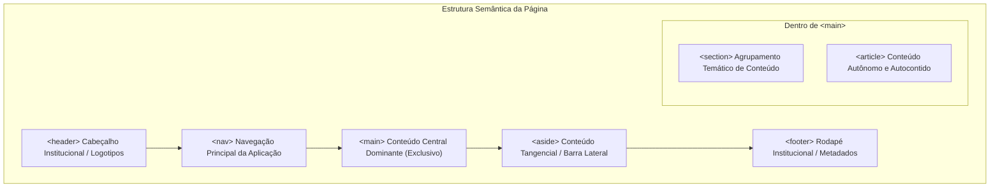
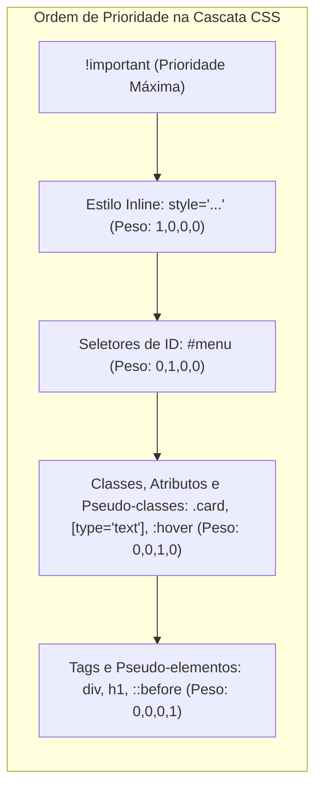
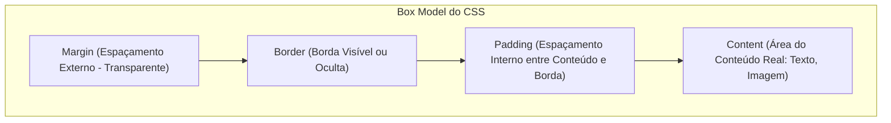
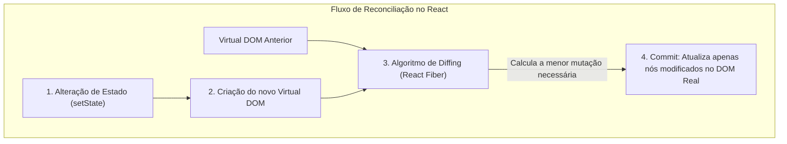
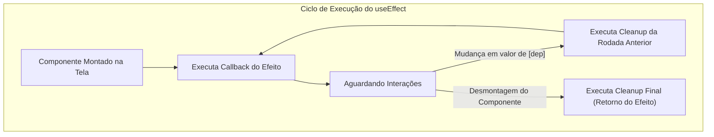

# 03 - Desenvolvimento Web Frontend: HTML5, CSS3, React e TypeScript

> **Matéria:** Desenvolvimento de Sistemas  
> **Cargo:** B02 – Técnico de Controle Externo – Especialidade: Tecnologia da Informação  
> **Arquivo:** `03_desenvolvimento_frontend_html_css_react_typescript.md`  

---

## 📌 Ementa / Itens do Edital
- Desenvolvimento web: HTML5, CSS3 e TypeScript
- Desenvolvimento front-end com biblioteca React

---

## 🧭 Sumário
- [1. Fundamentos de HTML5 Semântico e Acessibilidade](#1-fundamentos-de-html5-semantico-e-acessibilidade)
    - [1.1 Estrutura Básica do Documento e Metatags Essenciais](#11-estrutura-basica-do-documento-e-metatags-essenciais)
    - [1.2 Elementos Semânticos e Seccionamento de Conteúdo](#12-elementos-semanticos-e-seccionamento-de-conteudo)
    - [1.3 Formulários Modernos e Validação Nativa](#13-formularios-modernos-e-validacao-nativa)
    - [1.4 Mídia, Gráficos e Acessibilidade Digital (WCAG e WAI-ARIA)](#14-midia-graficos-e-acessibilidade-digital-wcag-e-wai-aria)
- [2. Estilização com CSS3](#2-estilizacao-com-css3)
    - [2.1 Cascata, Seletores e Cálculo de Especificidade CSS](#21-cascata-seletores-e-calculo-de-especificidade-css)
    - [2.2 Modelo de Caixa (Box Model) e a Propriedade `box-sizing`](#22-modelo-de-caixa-box-model-e-a-propriedade-box-sizing)
    - [2.3 Layouts Flexíveis com Flexbox (Unidimensional)](#23-layouts-flexiveis-com-flexbox-unidimensional)
    - [2.4 Grid Bidimensional (CSS Grid Layout)](#24-grid-bidimensional-css-grid-layout)
    - [2.5 Design Responsivo, Mobile-First e Unidades de Medida](#25-design-responsivo-mobile-first-e-unidades-de-medida)
    - [2.6 Transições, Transformações e Animações CSS](#26-transicoes-transformacoes-e-animacoes-css)
- [3. TypeScript: Tipagem Estática no Front-end](#3-typescript-tipagem-estatica-no-front-end)
    - [3.1 Arquitetura, Transpilação e o Arquivo `tsconfig.json`](#31-arquitetura-transpilacao-e-o-arquivo-tsconfigjson)
    - [3.2 Sistema de Tipos: Primitivos e Tipos Especiais (`any`, `unknown`, `never`, `void`)](#32-sistema-de-tipos-primitivos-e-tipos-especiais-any-unknown-never-void)
    - [3.3 Union, Intersection Types e Type Narrowing](#33-union-intersection-types-e-type-narrowing)
    - [3.4 Interfaces vs. Type Aliases e Declaration Merging](#34-interfaces-vs-type-aliases-e-declaration-merging)
    - [3.5 Generics e Utility Types Fundamentais](#35-generics-e-utility-types-fundamentais)
- [4. Desenvolvimento Front-end com a Biblioteca React](#4-desenvolvimento-front-end-com-a-biblioteca-react)
    - [4.1 Paradigma Declarativo, Componentização e Sintaxe JSX](#41-paradigma-declarativo-componentizacao-e-sintaxe-jsx)
    - [4.2 Virtual DOM e o Algoritmo de Reconciliação (Fiber)](#42-virtual-dom-e-o-algoritmo-de-reconciliacao-fiber)
    - [4.3 Propriedades (Props), Fluxo Unidirecional e Renderização de Listas com `key`](#43-propriedades-props-fluxo-unidirecional-e-renderizacao-de-listas-com-key)
    - [4.4 Gerenciamento de Estado e Ciclo de Vida com Hooks (`useState`, `useEffect`)](#44-gerenciamento-de-estado-e-ciclo-de-vida-com-hooks-usestate-useeffect)
    - [4.5 Gerenciamento Global com `useContext` e Hooks de Performance (`useMemo`, `useCallback`, `useRef`)](#45-gerenciamento-global-com-usecontext-e-hooks-de-performance-usememo-usecallback-useref)
    - [4.6 Formulários: Componentes Controlados vs. Não Controlados](#46-formularios-componentes-controlados-vs-nao-controlados)
- [5. Fontes Recomendadas na Internet](#5-fontes-recomendadas-na-internet)
- [6. Questões Comentadas & Exemplos (Padrão FCC)](#6-questoes-comentadas-exemplos-padrao-fcc)

---

## 1. Fundamentos de HTML5 Semântico e Acessibilidade

### 1.1 Estrutura Básica do Documento e Metatags Essenciais
O HTML5 padronizou a especificação dos documentos web com o objetivo de simplificar a sintaxe e enriquecer o vocabulário semântico. A estrutura básica canônica de qualquer documento HTML5 é composta por:

```html
<!DOCTYPE html>
<html lang="pt-BR">
<head>
  <meta charset="UTF-8">
  <meta name="viewport" content="width=device-width, initial-scale=1.0">
  <title>Portal do TCE-GO</title>
</head>
<body>
  <!-- Conteúdo renderizado na tela -->
</body>
</html>
```

- **`<!DOCTYPE html>`:** Declaração de tipo de documento simplificada. Informa aos navegadores que a página deve ser interpretada no modo padrão estrito (*standards mode*), prevenindo a ativação do modo de compatibilidade retrógrada (*quirks mode*).
- **`<meta charset="UTF-8">`:** Define o conjunto de caracteres universal Unicode UTF-8, garantindo a exibição precisa de caracteres acentuados, cedilhas e símbolos especiais sem problemas de corrupção (*mojibake*).
- **`<meta name="viewport" content="width=device-width, initial-scale=1.0">`:** Diretiva obrigatória para layouts responsivos em dispositivos móveis. Instruciona o navegador do smartphone a ajustar a largura da janela de exibição (*viewport*) à largura real da tela física do dispositivo (`width=device-width`), estabelecendo a escala inicial de zoom em 100% (`initial-scale=1.0`).

---

### 1.2 Elementos Semânticos e Seccionamento de Conteúdo
Antes do HTML5, páginas web eram estruturadas genericamente com divisões neutras (`<div class="header">`, `<div class="footer">`), o que dificultava a indexação por motores de busca e impedia tecnologias assistivas de entender a hierarquia do conteúdo. O HTML5 introduziu tags estruturais com significado inerente:



1. **`<header>`:** Representa um contêiner para conteúdo introdutório ou conjunto de links de navegação. Pode existir no topo da página ou no início de um `<article>` ou `<section>`.
2. **`<nav>`:** Destinado exclusivamente a blocos contendo os links principais de navegação do site ou da aplicação. Não deve ser usado para qualquer agrupamento de links soltos no rodapé.
3. **`<main>`:** Encapsula o conteúdo central, específico e exclusivo do documento `<body>`. **Regra da W3C:** Deve existir **apenas um único elemento `<main>` visível por página**. Conteúdos que se repetem de forma idêntica em múltiplas páginas do sistema (barras de navegação globais, logos de topo, termos de uso no rodapé) **não podem** ser inseridos dentro do `<main>`.
4. **`<article>`:** Representa uma composição autônoma, completa e autocontida que faça sentido pleno mesmo se for extraída do site e distribuída em outro veículo (ex.: um acórdão judicial, uma notícia, uma publicação de blog, um comentário individual).
5. **`<section>`:** Agrupamento temático genérico de conteúdo conexo, tipicamente introduzido por um título de cabeçalho (`<h2>` a `<h6>`). Se o conteúdo não possui relação temática própria e serve apenas para estilização visual, deve-se usar uma tag neutra `<div>`.
6. **`<aside>`:** Representa uma seção cujo conteúdo é tangencial ou secundário em relação ao conteúdo em torno dele (barras laterais, citações em destaque, caixas de glossário, publicidade).
7. **`<footer>`:** Rodapé de uma seção ou do documento inteiro. Costuma conter informações sobre o autor, termos de uso, licenças e links institucionais.
8. **`<figure>` e `<figcaption>`:** Encapsulam conteúdos ilustrativos (gráficos, fotos, listagens de código) acompanhados de uma legenda textual associada (`<figcaption>`).

---

### 1.3 Formulários Modernos e Validação Nativa
O HTML5 modernizou a coleta de dados com novos tipos semânticos de `<input>` e atributos de validação integrados no próprio navegador, dispensando scripts JavaScript complexos para validações básicas:

- **Novos Tipos de Input:**
    - `type="email"`: Valida o formato sintático de endereço de correio eletrônico (`usuario@dominio.com`).
    - `type="number"`: Força entrada numérica, permitindo definir limites com `min="1"`, `max="100"` e granularidade com `step="1"`.
    - `type="date"`, `time`, `datetime-local`: Renderiza seletores nativos de calendário e horário adaptados ao sistema operacional.
    - `type="url"`: Valida URLs absolutas com protocolo (`https://...`).
    - `type="tel"`: Otimizado para teclado numérico de discagem em celulares.
- **Atributos de Validação:**
    - `required`: Torna o preenchimento do campo estritamente obrigatório para submissão do formulário.
    - `pattern="[0-9]{3}\.[0-9]{3}\.[0-9]{3}-[0-9]{2}"`: Valida o campo contra uma expressão regular (Regex) em tempo de cliente (ex.: máscara de CPF).
    - `placeholder`: Fornece uma dica curta do formato esperado (não substitui o elemento `<label>`).
    - `disabled` vs. `readonly`: Um campo `disabled` é desativado visualmente e **não é enviado** na submissão do formulário (`POST/GET`). Já um campo `readonly` impede a edição pelo usuário, mas **é devidamente transmitido** na submissão.

---

### 1.4 Mídia, Gráficos e Acessibilidade Digital (WCAG e WAI-ARIA)

#### Áudio, Vídeo e Gráficos
- **`<audio>` e `<video>`:** Execução nativa de mídia sem dependência de plugins externos:

```html
<video controls width="600" poster="capa.jpg">
  <source src="sessao_plenaria.mp4" type="video/mp4">
  <source src="sessao_plenaria.webm" type="video/webm">
  Seu navegador não suporta a reprodução de vídeo.
</video>
```

- **`<canvas>`:** Fornece uma área de bitmap desenhável via código procedural JavaScript (ideal para gráficos estatísticos rápidos ou jogos).
- **SVG (Scalable Vector Graphics):** Gráficos vetoriais baseados em XML integrados no DOM, permitindo estilização direta com CSS, escalabilidade infinita sem perda de resolução e excelente suporte para acessibilidade.

#### Diretrizes WCAG e Atributos WAI-ARIA
As diretrizes WCAG (*Web Content Accessibility Guidelines*) da W3C são organizadas em torno dos 4 princípios fundamentais (**POUR**):

1. **Perceptível (*Perceivable*):** Informações e componentes visuais devem ser apresentados de modo que todos os usuários possam percebê-los (ex.: fornecer textos alternativos `alt` em imagens e legendas em vídeos).
2. **Operável (*Operable*):** Todos os componentes da interface devem poder ser operados via teclado, sem armadilhas de foco (*keyboard traps*).
3. **Compreensível (*Understandable*):** A operação e a leitura devem ser previsíveis e sem jargões confusos.
4. **Robusto (*Robust*):** O código deve ser interoperável com uma ampla variedade de navegadores e tecnologias assistivas.

**Atributos WAI-ARIA (*Accessible Rich Internet Applications*):**

- `role`: Define o papel semântico do elemento caso não haja tag HTML5 equivalente (ex.: `role="alert"`, `role="dialog"`, `role="status"`).
- `aria-label`: Fornece um rótulo textual audível para elementos visuais que não possuem texto visível (ex.: `<button aria-label="Fechar janela">X</button>`).
- `aria-labelledby` e `aria-describedby`: Apontam para IDs de elementos existentes que dão título ou descrição adicional ao componente.
- `aria-live`: Define regiões de atualização dinâmica assíncrona para que leitores de tela avisem imediatamente o usuário:
    - `aria-live="polite"`: O leitor de tela aguarda o usuário terminar sua ação atual antes de ler o aviso.
    - `aria-live="assertive"`: Interrompe a fala do leitor de tela imediatamente para alertar sobre erros críticos.
- `aria-hidden="true"`: **Oculta o elemento de leitores de tela**, mantendo-o visível visualmente (útil para ícones puramente decorativos).
- **Atributo `tabindex`:**
    - `tabindex="0"`: Insere o elemento na sequência natural de tabulação do teclado.
    - `tabindex="-1"`: Remove o elemento da ordem do teclado, permitindo foco programático via JavaScript (`elemento.focus()`).
    - `tabindex="1+"` (positivo): **Antipadrão severo**. Quebra a ordem de leitura do documento e confunde usuários dependentes de navegação por teclado.

---

## 2. Estilização com CSS3

### 2.1 Cascata, Seletores e Cálculo de Especificidade CSS
O CSS (*Cascading Style Sheets*) baseia-se no princípio da **Cascata** para resolver conflitos entre múltiplas declarações de estilo apontando para o mesmo elemento HTML. A resolução segue a hierarquia:

1. **Importância:** Regras marcadas com `!important` sobrepõem qualquer regra ordinária.
2. **Especificidade:** Se não houver `!important`, vence a regra que tiver a pontuação de especificidade mais alta.
3. **Ordem de Aparição no Código:** Se houver empate exato de especificidade, vence a última regra declarada no arquivo CSS.



#### A Pontuação Quádrupla da W3C `(a, b, c, d)`
- **$a$ (Inline):** Estilos aplicados diretamente no atributo `style=""` da tag HTML ($1, 0, 0, 0$).
- **$b$ (IDs):** Número de seletores de identificador (`#meu-id`) na regra ($0, 1, 0, 0$).
- **$c$ (Classes, Atributos e Pseudo-classes):** Número de seletores de classe (`.minha-classe`), seletores de atributos (`[type="text"]`) e pseudo-classes (`:hover`, `:first-child`, `:nth-child(n)`) ($0, 0, 1, 0$).
- **$d$ (Tags e Pseudo-elementos):** Número de tags de elementos (`div`, `p`, `span`) e pseudo-elementos (`::before`, `::after`) ($0, 0, 0, 1$).
- **Seletor Universal (`*`) e Combinadores (`>`, `+`, `~`):** Possuem peso nulo $(0, 0, 0, 0)$.

> 🚨 **ALERTA DE PROVA / FCC:**  
> A comparação de especificidade é posicional da esquerda para a direita, **nunca somatória linear simples**:
>
> - Uma regra com 1 único ID `(0, 1, 0, 0)` tem maior prioridade que uma regra contendo 15 classes combinadas `(0, 0, 15, 0)`.
> - A declaração `!important` não acrescenta "pontos" à tupla; ela altera a fase da cascata. Havendo duas declarações com `!important`, o desempate volta a ser feito pela pontuação normal de especificidade entre elas.

---

### 2.2 Modelo de Caixa (Box Model) e a Propriedade `box-sizing`
No CSS, todo elemento renderizado é estruturado visualmente como uma caixa composta por 4 áreas concêntricas:



- **`box-sizing: content-box` (Padrão nativo do navegador):**
    - A largura definida na propriedade `width` é aplicada **estritamente à área de conteúdo (*Content*)**.
    - O `padding` e a `border` são adicionados **por fora** dessa largura.
    - Se definirmos `width: 300px; padding: 20px; border: 5px solid black;`, a largura total ocupada na tela pelo elemento será:
    $$\text{Largura Total} = 300 + (20 \times 2) + (5 \times 2) = 350\text{ px}$$
- **`box-sizing: border-box` (Padrão moderno da indústria de software):**
    - A propriedade `width` define a **largura total da caixa visível**, incluindo a borda e o padding.
    - A área útil de conteúdo encolhe automaticamente para acomodar o espaçamento interno.
    - No mesmo exemplo (`width: 300px; padding: 20px; border: 5px solid black;`), a largura final na tela será **exatamente $300\text{ px}$**.

---

### 2.3 Layouts Flexíveis com Flexbox (Unidimensional)
O Flexbox (`display: flex`) é um modelo de layout voltado para a distribuição de espaço e alinhamento de itens ao longo de um **único eixo por vez** (linha ou coluna).

- **Eixo Principal (*Main Axis*) vs. Eixo Transversal (*Cross Axis*):**
    - `flex-direction: row` (padrão): O eixo principal é horizontal (esquerda para a direita); o eixo transversal é vertical.
    - `flex-direction: column`: O eixo principal é vertical; o transversal torna-se horizontal.
- **Propriedades do Contêiner Flex (*Flex Container*):**
    - `justify-content`: Alinha os itens ao longo do **eixo principal** (`flex-start`, `flex-end`, `center`, `space-between`, `space-around`, `space-evenly`).
    - `align-items`: Alinha os itens ao longo do **eixo transversal** (`stretch`, `flex-start`, `flex-end`, `center`, `baseline`).
    - `flex-wrap`: Define se os itens que ultrapassam a largura do contêiner devem quebrar para a próxima linha (`nowrap` ou `wrap`).
    - `gap`: Define o espaçamento entre os itens filhos sem recorrer a margens manuais.
- **Propriedades dos Filhos (*Flex Items*):**
    - `flex-grow`: Fator de crescimento relativo do item para preencher o espaço restante disponível.
    - `flex-shrink`: Fator de encolhimento relativo quando o espaço total for insuficiente.
    - `flex-basis`: Tamanho inicial padrão do item antes da distribuição de sobras.

---

### 2.4 Grid Bidimensional (CSS Grid Layout)
Diferentemente do Flexbox, o CSS Grid (`display: grid`) é um sistema **bidimensional nativo**, permitindo controlar simultaneamente linhas (*rows*) e colunas (*columns*).

- **Criação de Trilhas e Unidade Fracional (`fr`):**
    - `grid-template-columns: 200px 1fr 2fr`: Define três colunas: a primeira fixa com 200px, e o restante dividido em 3 partes fracionais (1 parte para a segunda coluna e 2 partes para a terceira).
    - `repeat(3, 1fr)`: Cria 3 colunas de larguras rigorosamente iguais.
- **Responsividade Automática sem Media Queries:**
    - `grid-template-columns: repeat(auto-fit, minmax(250px, 1fr));`: Os cards se ajustam dinamicamente na tela; se houver menos espaço que 250px, quebram sozinhos para a próxima linha.
- **Áreas Nomeadas (`grid-template-areas`):**

```css
.container {
  display: grid;
  grid-template-areas:
    "cabecalho cabecalho"
    "lateral principal"
    "rodape rodape";
}
```

---

### 2.5 Design Responsivo, Mobile-First e Unidades de Medida
- **Abordagem Mobile-First:** Metodologia onde a folha de estilos base é desenvolvida primeiramente para telas pequenas (smartphones). As adaptações para telas maiores são adicionadas incrementalmente através de **Media Queries com `min-width`**:

```css
/* Estilo padrão: Mobile */
.grid-noticias { display: flex; flex-direction: column; }

/* Telas a partir de tablets */
@media (min-width: 768px) {
  .grid-noticias { display: grid; grid-template-columns: repeat(2, 1fr); }
}
```

- **Unidades de Medida Relativas:**
    - `rem` (*Root EM*): Relativa ao tamanho da fonte do elemento raiz (`<html>`), tipicamente `1rem = 16px`. Garante acessibilidade quando o usuário altera o tamanho padrão de fonte no navegador.
    - `em`: Relativa ao tamanho da fonte do próprio elemento pai imediato.
    - `%`: Relativa à dimensão do elemento contêiner pai direto.
    - `vw` e `vh`: Porcentagens relativas à largura (*viewport width*) e altura (*viewport height*) da janela de visualização do navegador ($100\text{vw} = 100\%$ da tela).

---

### 2.6 Transições, Transformações e Animações CSS
- **Transições (`transition`):** Permite suavizar a mudança de propriedades CSS ao longo do tempo (ex.: `:hover` alterando cores ou opacidade). Sintaxe: `transition: property duration timing-function delay;`.
- **Transformações 2D/3D (`transform`):** Modifica a geometria visual do elemento sem disparar recálculo de fluxo de página (*reflow*). Funções comuns: `translate(x, y)`, `scale(1.1)`, `rotate(45deg)`.
- **Animações Complexas (`@keyframes`):** Permitem criar sequências visuais com múltiplos pontos intermediários (*keyframes* de 0% a 100%):

```css
@keyframes pulsar {
  0% { transform: scale(1); }
  50% { transform: scale(1.05); }
  100% { transform: scale(1); }
}
.alerta { animation: pulsar 2s infinite ease-in-out; }
```

---

## 3. TypeScript: Tipagem Estática no Front-end

### 3.1 Arquitetura, Transpilação e o Arquivo `tsconfig.json`
O TypeScript é um **superconjunto tipado de JavaScript** (*typed superset*) desenvolvido pela Microsoft. Navegadores não executam TypeScript diretamente; os arquivos `.ts` ou `.tsx` devem ser compilados/transpilados para JavaScript puro (`.js`) por meio do compilador oficial `tsc` ou ferramentas de empacotamento modernas (Vite, esbuild, Babel).

- **Verificação em Tempo de Compilação:** O TypeScript detecta erros de tipagem, acessos a propriedades nulas e incompatibilidades antes da execução. Em tempo de execução, todos os tipos são eliminados (*Type Erasure*).
- **`tsconfig.json`:** Arquivo de configuração raiz do projeto TypeScript. Opções cruciais:
    - `"target"`: Versão do ECMAScript de destino para a qual o código será transpilado (ex.: `"ES2022"`).
    - `"module"`: Sistema de módulos de saída (ex.: `"CommonJS"` ou `"ESNext"`).
    - `"strict": true`: Habilita todas as checagens rígidas de tipo (incluindo `strictNullChecks` e `noImplicitAny`).
    - `"jsx"`: Modo de transpilação do JSX no React (ex.: `"react-jsx"`).

---

### 3.2 Sistema de Tipos: Primitivos e Tipos Especiais (`any`, `unknown`, `never`, `void`)
Além dos tipos primitivos comuns (`string`, `number`, `boolean`, `null`, `undefined`, `symbol`), o TypeScript introduz tipos especiais cruciais para provas:

| Tipo | Descrição | Segurança de Tipo (*Type-Safe*) | Permitido Acessar Membros? |
|---|---|:---:|:---:|
| **`any`** | Desativa completamente o sistema de tipos estático do compilador. | **Nenhuma** | Sim, sem qualquer validação |
| **`unknown`** | Representa um tipo desconhecido em tempo de compilação. | **Total** | **Não**, sem afunilamento prévio (*narrowing*) |
| **`void`** | Indica que uma função não retorna nenhum valor utilizável. | Sim | Não |
| **`never`** | Representa valores que **nunca podem existir ou ocorrer**. | Sim | Não |

- **`never` em detalhe:** É o tipo retornado por funções que sempre lançam exceção (`throw new Error()`) ou entram em loops sem fim (`while(true)`). Também é empregado para assegurar checagens exaustivas (*exhaustive checks*) em cláusulas `switch/case`.

---

### 3.3 Union, Intersection Types e Type Narrowing
- **Union Types (`|`):** Uma variável pode assumir um entre múltiplos tipos permitidos:

```typescript
type Identificador = string | number;
```

- **Intersection Types (`&`):** Combina múltiplos tipos em um único tipo que satisfaz todas as restrições simultaneamente:

```typescript
type Pessoa = { nome: string };
type Funcionario = Pessoa & { matricula: number };
```

- **Type Narrowing (Afunilamento de Tipo):** O TypeScript refina dinamicamente o tipo de uma variável dentro de blocos condicionais utilizando guardas de tipo (*type guards*):
    - `typeof x === "string"`
    - `x instanceof Date`
    - `"propriedade" in objeto`
    - Funções de predicado de tipo customizadas (`pet is Cachorro`).

---

### 3.4 Interfaces vs. Type Aliases e Declaration Merging
Tanto `interface` quanto `type` podem ser usados para modelar a forma de objetos, mas possuem diferenças estruturais:

```typescript
// Interface: Suporta extensão (extends) e junção de declarações (Declaration Merging)
interface Auditor {
  nome: string;
}
interface Auditor {
  registroOAB?: string; // Mesclado automaticamente à interface Auditor original!
}

// Type Alias: Suporta primitivos, uniões literais e tuplas, mas NÃO permite declaração duplicada
type NivelAcesso = "ADMIN" | "CONSULTOR" | "OPERADOR";
type Ponto2D = [number, number];
```

> 🚨 **ALERTA DE PROVA / FCC:**  
> Duas interfaces com o mesmo nome no mesmo escopo realizam **Declaration Merging** (fusão de declarações), somando seus membros em uma única interface conjunta. Já dois `type` com o mesmo nome geram imediatamente um erro de compilação de identificador duplicado (`Duplicate identifier`).

---

### 3.5 Generics e Utility Types Fundamentais

#### Generics (`<T>`)
Permitem que funções, interfaces e classes operem com diferentes tipos preservando a segurança estática:

```typescript
function obterPrimeiroElemento<T>(lista: T[]): T | undefined {
  return lista[0];
}
```

#### Utility Types Nativos
O TypeScript inclui um conjunto poderoso de utilitários de transformação de tipos:

| Utility Type | Transformação Efetuada | Exemplo Prático |
|---|---|---|
| **`Partial<T>`** | Torna **todas as propriedades de `T` opcionais** (`?`). | `Partial<Processo>` (usado em requisições PATCH) |
| **`Required<T>`** | Torna **todas as propriedades de `T` estritamente obrigatórias**. | `Required<Processo>` (remove todas as interrogações `?`) |
| **`Readonly<T>`** | Torna **todas as propriedades de `T` imutáveis** (somente leitura). | Impede reatribuição: `p.status = "NOVO"` dá erro de compilação |
| **`Pick<T, K>`** | Constrói um tipo contendo apenas o **subconjunto `K` de propriedades** de `T`. | `Pick<Processo, "id" \| "numero">` |
| **`Omit<T, K>`** | Constrói um tipo contendo todas as propriedades de `T` **exceto `K`**. | `Omit<Usuario, "senhaHash">` |
| **`Record<K, T>`** | Constrói um tipo de objeto mapeando chaves do tipo `K` para valores `T`. | `Record<string, Auditor>` (dicionários chave-valor) |
| **`Exclude<T, U>`** | Exclui de uma união `T` todos os tipos que são atribuíveis a `U`. | `Exclude<"a" \| "b" \| "c", "a">` $\rightarrow$ `"b" \| "c"` |

---

## 4. Desenvolvimento Front-end com a Biblioteca React

### 4.1 Paradigma Declarativo, Componentização e Sintaxe JSX
React é uma biblioteca JavaScript declarativa para a construção de interfaces de usuário, criada pela Meta (Facebook).

- **Declarativo:** O desenvolvedor descreve **como a UI deve parecer** dado um determinado estado da aplicação, e o React encarrega-se de atualizar o DOM real de forma eficiente.
- **Componentização:** A interface é decomposta em blocos independentes, isolados e reutilizáveis (hoje prioritariamente em formato de funções JavaScript puras).
- **Sintaxe JSX (JavaScript XML):** Extensão sintática que permite escrever marcação semelhante a HTML diretamente dentro do código JavaScript. O JSX é transpilado para chamadas de função `React.createElement()` ou para o transformador moderno `_jsx()`.
    - Diferenças fundamentais em relação ao HTML:
    - `class` torna-se `className` (pois `class` é palavra reservada em JS).
    - `for` em `<label>` torna-se `htmlFor`.
    - Atributos de evento utilizam convenção camelCase (`onClick`, `onChange`, `onSubmit`).
    - Todos os elementos devem ser fechados explicitamente (`<input />`, ``).
    - Múltiplos elementos na raiz devem ser envelopados por um elemento pai ou por um Fragment (`<> ... </>`).

---

### 4.2 Virtual DOM e o Algoritmo de Reconciliação (Fiber)
Manipular o DOM real do navegador diretamente é uma operação custosa computacionalmente devido aos ciclos de *Reflow* e *Repaint*. O React resolve isso por meio do **Virtual DOM (VDOM)**:



- **Algoritmo de *Diffing* Heurístico ($\mathcal{O}(n)$):** O React compara a árvore antiga do VDOM com a nova árvore e calcula o conjunto mínimo de mutações necessárias.
    - Se dois elementos forem de tipos diferentes (ex.: `<div>` mudou para `<span>`), o React destrói a subárvore antiga por completo e monta uma nova do zero.
    - Para listas de elementos irmãos, o React utiliza a propriedade `key` para saber quais nós foram apenas movidos ou reorganizados.

---

### 4.3 Propriedades (Props), Fluxo Unidirecional e Renderização de Listas com `key`

#### Fluxo Unidirecional de Dados (*One-Way Data Binding*)
As propriedades (*props*) fluem exclusivamente de cima para baixo na hierarquia da árvore de componentes (do componente Pai para os componentes Filhos).

- As `props` são **estritamente imutáveis** para o componente que as recebe (tratam-se como valores somente leitura). Se o componente filho precisar alterar um valor do pai, o pai deve repassar uma função de callback via prop para que o filho a invoque.

#### Renderização de Listas e a Propriedade `key`
Ao utilizar `.map()` para transformar um array de objetos em elementos visuais, cada item retornado deve receber compulsoriamente a prop especial `key`.

> 🚨 **ALERTA DE PROVA / FCC:**  
>
> - A propriedade `key` deve ser um **identificador único, estável e previsível** (como o ID primário da entidade vindo do banco de dados).
> - **Nunca use o índice do array (`key={index}`)** para itens que possam ser reordenados, filtrados, excluídos ou adicionados no início da fila! O uso do índice faz o React reaproveitar instâncias de componentes erradas, provocando bugs visuais e perda de dados em inputs.
> - **Nunca gere chaves randômicas (`key={Math.random()}`)**, pois isso força a destruição e recriação do nó a cada frame de renderização.
> - A prop `key` é reservada para o algoritmo interno do React e **NÃO é repassada** para o componente filho (não pode ser lida via `props.key`).

---

### 4.4 Gerenciamento de Estado e Ciclo de Vida com Hooks (`useState`, `useEffect`)

#### 1. Hook `useState`
Permite associar estado reativo local a um componente funcional:

```jsx
const [contador, setContador] = useState(0);

// Atualização funcional (garante o valor mais recente)
setContador(anterior => anterior + 1);
```

Chamar a função atualizadora do estado agenda uma nova execução (re-renderização) do componente pelo React.

#### 2. Hook `useEffect`
Executa **efeitos colaterais** (*side effects*) no ciclo de vida do componente (como chamadas HTTP via `fetch`/`axios`, escuta de eventos do navegador ou inicialização de temporizadores).



- **As Três Formas do Vetor de Dependências:**
    1. `useEffect(fn)` (sem segundo parâmetro): Executa na montagem e **após absolutamente toda e qualquer re-renderização**.
    2. `useEffect(fn, [])` (vetor vazio): Executa **apenas uma única vez**, logo após a primeira renderização do componente (equivalente ao antigo `componentDidMount`).
    3. `useEffect(fn, [id, filtro])` (com dependências): Executa na montagem e sempre que houver alteração de valor em `id` ou `filtro`.

- **Função de Limpeza (*Cleanup*):** Se o callback do `useEffect` retornar uma função (`return () => { clearInterval(id); };`), essa função será executada pelo React **antes de reexecutar o efeito na próxima renderização** e na **desmontagem final (*unmount*) do componente**, prevenindo vazamento de memória (*memory leaks*).

---

### 4.5 Gerenciamento Global com `useContext` e Hooks de Performance (`useMemo`, `useCallback`, `useRef`)

#### `useContext` e a Context API
Evita o problema de **Prop Drilling** (ter que repassar props manualmente por dezenas de componentes intermediários que não usam aquele dado):

```jsx
// Criação do Contexto
const TemaContext = React.createContext("light");

// Provedor
<TemaContext.Provider value="dark">
  <BarraSuperior />
</TemaContext.Provider>

// Consumo em qualquer componente descendente
function Botao() {
  const tema = useContext(TemaContext);
  return <button className={tema}>Salvar</button>;
}
```

#### Hooks de Otimização e Referências
- **`useMemo`:** Memoriza o **resultado computado** de um cálculo complexo para evitar reprocessamentos desnecessários em re-renderizações:

```jsx
const relatorioComplexo = useMemo(() => calcularEstatisticas(dados), [dados]);
```

- **`useCallback`:** Memoriza a **referência de uma função de callback** entre renderizações, evitando que componentes filhos que a recebem via props sejam re-renderizados desnecessariamente:

```jsx
const handleClick = useCallback(() => { enviarAuditoria(id); }, [id]);
```

- **`useRef`:** Cria um objeto de referência mutável `{ current: valor }` que persiste durante todo o ciclo de vida do componente:
    - Permite acesso direto ao nó do DOM real (`<input ref={inputRef} />` $\rightarrow$ `inputRef.current.focus()`).
    - Armazena valores mutáveis que, quando alterados, **não disparam re-renderização** do componente.

---

### 4.6 Formulários: Componentes Controlados vs. Não Controlados
- **Componentes Controlados (*Controlled Components*):** O valor do campo de formulário é controlado integralmente pelo estado do React via `value` e evento `onChange`. O estado do React atua como a única fonte da verdade (*single source of truth*).

```jsx
<input type="text" value={nome} onChange={e => setNome(e.target.value)} />
```

- **Componentes Não Controlados (*Uncontrolled Components*):** O valor do campo é gerenciado internamente pelo próprio DOM do navegador. O React recupera o valor sob demanda no momento do submit utilizando uma referência (`useRef`).

---

## 5. Fontes Recomendadas na Internet

* [React Official Documentation - Learn React](https://react.dev/learn) - Fundamentos de componentes declarativos, props, JSX, Virtual DOM e reconciliação.
* [React Official Documentation - Built-in React Hooks](https://react.dev/reference/react/hooks) - Especificação detalhada de useState, useEffect, useContext, useReducer, useMemo e useCallback.
* [TypeScript Official Handbook - TypeScript for JavaScript Programmers](https://www.typescriptlang.org/docs/handbook/intro.html) - Sistema de tipos estático, interfaces, type aliases, union types e type narrowing.
* [TypeScript Official Handbook - Utility Types](https://www.typescriptlang.org/docs/handbook/utility-types.html) - Catálogo de Partial, Required, Readonly, Pick, Omit e Record.
* [MDN Web Docs - HTML Semântico e Estruturação Web](https://developer.mozilla.org/pt-BR/docs/Web/HTML) - Elementos estruturais e semântica de marcação moderna.
* [MDN Web Docs - CSS Layout: Flexbox e Grid](https://developer.mozilla.org/pt-BR/docs/Learn_web_development/Core/CSS_layout) - Posicionamento bidimensional com CSS Grid e unidimensional com Flexbox.
* BANKS, Alex; PORCELLO, Eve. **React Aprenda Praticando: Construindo Aplicações Web com React e Redux**. São Paulo: Novatec, 2021. (Cap. 4 a 6 - Estado, Hooks e Renderização).
* CHERNY, Boris. **TypeScript Essencial: Acelerando o Desenvolvimento JavaScript**. São Paulo: Novatec, 2020. (Cap. 3 e 4 - Tipagem Estática e Funções).
* KEITH, Jeremy; ANDREW, Rachel. **HTML5 para Designers Web**. São Paulo: Bookman, 2011. (Cap. 3 - Marcação Semântica Estruturada).

---

## 6. Questões Comentadas & Exemplos (Padrão FCC)

### Questão 1 (FCC - Analista de TI / Front-end)
Em uma aplicação desenvolvida com a biblioteca React utilizando componentes funcionais e Hooks, um programador implementou a seguinte rotina para sincronizar uma listagem de auditorias fiscais com o servidor backend:

```jsx
function PainelFiscal() {
  const [processos, setProcessos] = useState([]);

  useEffect(() => {
    fetch("/api/processos")
      .then(res => res.json())
      .then(dados => setProcessos(dados));
  });

  return <div>{processos.length} processos carregados</div>;
}
```

Ao executar essa aplicação no navegador, o comportamento verificado pelo desenvolvedor é:  

* **A)** A requisição à API é disparada apenas uma única vez na montagem da tela, funcionando de forma perfeitamente otimizada.
* **B)** Ocorre um laço infinito de renderizações (*infinite loop*), provocando sucessivas requisições HTTP e congelamento da interface do usuário.
* **C)** O React emite um erro de compilação em tempo de execução porque funções assíncronas não são permitidas dentro de componentes funcionais.
* **D)** A lista de processos jamais será atualizada porque o Hook `useState` não dispara re-renderização quando recebe arrays de dados.
* **E)** A requisição HTTP falha compulsoriamente devido à falta do cabeçalho de acessibilidade `aria-live` no elemento `<div>`.

> **Comentário Detalhado:**
>
> - **A)** Incorreta. Para que o `useEffect` fosse executado estritamente na montagem inicial do componente, seria mandatório declarar um vetor de dependências vazio `[]` como segundo argumento.
> - **B)** **CORRETA.** Passo a passo do laço infinito gerado:
>     1. O desenvolvedor omitiu o array de dependências do `useEffect`.
>     2. No React, um `useEffect` sem o segundo parâmetro executa na montagem e **após cada re-renderização** do componente.
>     3. Na montagem, o callback do efeito executa e dispara o `fetch`.
>     4. Ao receber os dados, executa `setProcessos(dados)`.
>     5. Atualizar o estado do componente agenda imediatamente uma nova renderização.
>     6. Ao renderizar novamente, o `useEffect` roda outra vez, disparando outro `fetch`, que chama `setProcessos`, gerando um ciclo sem fim que sobrecarrega a rede e trava o navegador.
>
> - **C)** Incorreta. O React suporta plenamente o consumo de chamadas assíncronas dentro do `useEffect`. O defeito é puramente de lógica do ciclo de dependências.
> - **D)** Incorreta. O `useState` agenda re-renderização para qualquer alteração de estado disparada pela função modificadora.
> - **E)** Incorreta. O atributo `aria-live` é voltado à tecnologia assistiva de acessibilidade e não exerce influência sobre o tráfego HTTP.
> 
> **Gabarito: B**

---

### Questão 2 (FCC - Técnico de Controle Externo / TI)
Na linguagem TypeScript, suponha que exista a definição do seguinte tipo base:

```typescript
type ProcessoAuditoria = {
  id: number;
  codigoFiscal: string;
  relator: string;
  valorGlosa: number;
};
```

Para declarar um novo tipo derivado denominado `ProcessoEdicao`, que contenha rigorosamente todas as propriedades de `ProcessoAuditoria`, porém com todas elas definidas como **opcionais** (isto é, marcadas com `?`), deve-se utilizar o Utility Type:  

* **A)** `Required<ProcessoAuditoria>`
* **B)** `Readonly<ProcessoAuditoria>`
* **C)** `Partial<ProcessoAuditoria>`
* **D)** `Omit<ProcessoAuditoria, "id">`
* **E)** `Record<string, ProcessoAuditoria>`

> **Comentário Detalhado:**
>
> - **A)** Incorreta. O tipo utilitário `Required<T>` executa a transformação inversa: remove todas as interrogações `?`, tornando todas as propriedades estritamente obrigatórias.
> - **B)** Incorreta. `Readonly<T>` torna as propriedades imutáveis (somente leitura), mas não as transforma em opcionais.
> - **C)** **CORRETA.** `Partial<T>` itera sobre todas as chaves do tipo `T` e aplica o modificador `?`, resultando em `{ id?: number; codigoFiscal?: string; relator?: string; valorGlosa?: number; }`, exatamente conforme solicitado no enunciado.
> - **D)** Incorreta. `Omit<T, K>` constrói um novo tipo removendo uma ou mais chaves específicas indicadas em `K`, preservando o estado obrigatório das restantes.
> - **E)** Incorreta. `Record<K, T>` é empregado para criar dicionários onde as chaves são do tipo `K` e os valores associados pertencem ao tipo `T`.
> 
> **Gabarito: C**

---

### Questão 3 (FCC - Analista de TI / Sistemas)
Considere as seguintes regras de estilização declaradas em um arquivo CSS3 externo para formatar um mesmo elemento de título em uma página web:

```css
/* Regra 1 */
h1 { color: red; }

/* Regra 2 */
#titulo-destaque { color: blue; }

/* Regra 3 */
.cabecalho .titulo { color: green; }

/* Regra 4 */
div#secao-principal h1.titulo { color: purple; }
```

Assumindo o fragmento HTML abaixo:

```html
<div id="secao-principal" class="cabecalho">
  <h1 id="titulo-destaque" class="titulo">Relatório de Conformidade</h1>
</div>
```

A cor final com que o texto do título `Relatório de Conformidade` será renderizado na tela do navegador e o motivo técnico dessa escolha são:  

* **A)** Azul, porque o seletor com o identificador direto `#titulo-destaque` possui a maior especificidade absoluta entre todas as regras.
* **B)** Vermelho, porque a Regra 1 é mais genérica e o navegador sempre prioriza seletores de tag simples para garantir padronização tipográfica.
* **C)** Roxo (*purple*), porque a Regra 4 combina um ID (`#secao-principal`), uma classe (`.titulo`) e duas tags (`div` e `h1`), somando uma especificidade superior à da Regra 2.
* **D)** Verde, porque a Regra 3 é a penúltima declarada e as classes sobrepõem identificadores únicos no CSS3 moderno.
* **E)** Roxo (*purple*), porque a regra foi escrita na última linha do arquivo CSS e o desempate na cascata dá vitória estrita à regra de menor número de seletores.

> **Comentário Detalhado:**
>
> - **A)** Incorreta. A Regra 2 possui peso de especificidade $(0, 1, 0, 0)$ (1 ID), mas é superada pela Regra 4 que soma o mesmo ID mais uma classe e duas tags.
> - **B)** Incorreta. Seletores de tag simples possuem o menor nível de prioridade na cascata $(0, 0, 0, 1)$.
> - **C)** **CORRETA.** Cálculo da pontuação quádrupla de especificidade da W3C `(Inline, IDs, Classes/Atributos/Pseudo-classes, Elementos)`:
>     - Regra 1 (`h1`): $(0, 0, 0, 1)$ = Peso 1.
>     - Regra 2 (`#titulo-destaque`): $(0, 1, 0, 0)$ = Peso 100.
>     - Regra 3 (`.cabecalho .titulo`): $(0, 0, 2, 0)$ = Peso 20.
>     - Regra 4 (`div#secao-principal h1.titulo`): $(0, 1, 1, 2)$ = Peso 112 (1 ID, 1 classe, 2 elementos).
>   Comparando a Regra 2 contra a Regra 4: ambas empatam na coluna de IDs com valor 1; na coluna seguinte (classes), a Regra 4 possui 1 e a Regra 2 possui 0. Logo, a Regra 4 vence e o elemento será exibido em **roxo (*purple*)**.
> - **D)** Incorreta. Classes jamais superam seletores com ID na ausência de `!important`.
> - **E)** Incorreta. A ordem física de linhas no arquivo só atua como critério de desempate se as duas regras conflitantes apresentarem rigorosamente a mesma pontuação de especificidade.
> 
> **Gabarito: C**

---

### Questão 4 (FCC - Auditor Fiscal / Tecnologia da Informação)
No desenvolvimento de páginas governamentais com HTML5 aderentes às diretrizes de acessibilidade na Web (W3C / WCAG), assinale a afirmativa tecnicamente correta:  

* **A)** O elemento `<article>` deve ser utilizado exclusivamente para criar tabelas de dados financeiros de auditoria, sendo vedado para artigos de texto.
* **B)** O uso do atributo `tabindex="5"` é a prática recomendada para botões de submissão, pois garante que eles sempre recebam o foco antes de qualquer campo do formulário.
* **C)** O elemento `<main>` deve encapsular o conteúdo central e específico do documento, não devendo ser duplicado em um mesmo documento exibido, e conteúdos que se repetem entre páginas (como cabeçalhos de topo e rodapés gerais) devem ficar fora dele.
* **D)** As tags de agrupamento genérico `<div>` e `<span>` possuem semântica rica superior às tags `<section>` e `<nav>`, sendo preferíveis pelos leitores de tela.
* **E)** O atributo `aria-hidden="true"` instrui os navegadores a ocultar o elemento visualmente na tela para usuários videntes, mas mantém sua leitura intacta para deficientes visuais em leitores de tela.

> **Comentário Detalhado:**
>
> - **A)** Incorreta. O elemento `<article>` representa conteúdo editorial autônomo, autocontido e reutilizável (artigos, postagens, acórdãos, notícias), não se limitando a tabelas financeiras.
> - **B)** Incorreta. O uso de valores positivos no atributo `tabindex` é considerado um antipadrão pelo W3C, pois desorganiza a navegação sequencial lógica pelo teclado.
> - **C)** **CORRETA.** Pela especificação oficial W3C/WHATWG, `<main>` encapsula o conteúdo predominante e exclusivo da página. Deve haver no máximo um elemento `<main>` visível no documento e blocos estruturais repetitivos entre várias páginas (cabeçalhos globais, rodapés institucionais) devem permanecer fora dele.
> - **D)** Incorreta. `<div>` e `<span>` são tags neutras destituídas de semântica; tags semânticas como `<section>` e `<nav>` estabelecem marcos acessíveis essenciais para leitores de tela.
> - **E)** Incorreta. `aria-hidden="true"` produz o efeito exatamente inverso: esconde o elemento de tecnologias assistivas e leitores de tela, mantendo sua visibilidade na tela para usuários videntes.
> 
> **Gabarito: C**

---

### Questão 5 (FCC - Analista de Sistemas / Desenvolvimento)
Na biblioteca React, ao iterar sobre uma lista de dados para renderizar múltiplos componentes utilizando a função `.map()`, os desenvolvedores devem obrigatoriamente fornecer a propriedade especial `key` para cada item retornado.

A respeito do propósito e do funcionamento da propriedade `key` no algoritmo de reconciliação do React, assinale a afirmativa correta:  

* **A)** A `key` serve unicamente para estilização visual via CSS, sendo convertida em uma classe HTML automática no DOM real.
* **B)** O React utiliza a `key` para identificar de forma estável quais elementos da lista foram alterados, adicionados ou removidos entre renderizações, permitindo atualizar apenas os nós do DOM que sofreram modificação efetiva.
* **C)** O uso do índice do array (`key={index}`) é a estratégia oficial recomendada pela Meta para listas dinâmicas com operações frequentes de ordenação e inserção no início da fila.
* **D)** As chaves `key` devem ser obrigatoriamente números inteiros sequenciais gerados aleatoriamente com `Math.random()` a cada ciclo de renderização.
* **E)** A propriedade `key` é repassada automaticamente pelo React para o componente filho como uma prop ordinária, podendo ser acessada livremente no código filho via `props.key`.

> **Comentário Detalhado:**
>
> - **A)** Incorreta. A `key` é consumida pelo motor de reconciliação do React em memória; ela não é renderizada como atributo CSS nem classe no DOM real.
> - **B)** **CORRETA.** A propriedade `key` atribui uma identidade estável e unívoca a cada elemento da coleção entre diferentes ciclos de renderização. Isso viabiliza que o algoritmo de reconciliação (*diffing*) identifique com precisão inserções, exclusões e reordenações, reaproveitando nós do DOM real e atualizando apenas o conteúdo estritamente necessário.
> - **C)** Incorreta. Usar o índice do array como chave em listas sujeitas a filtros, reordenação ou inserções intermediárias constitui uma grave má prática, pois induz o React a reaproveitar estados de instâncias incorretas.
> - **D)** Incorreta. Chaves randômicas com `Math.random()` alteram-se a cada renderização, provocando a destruição e recriação forçada de toda a árvore DOM da lista a cada instante.
> - **E)** Incorreta. Trata-se de uma pegadinha clássica: `key` e `ref` são propriedades reservadas do React e não são acessíveis dentro do componente filho através de `props.key`.
> 
> **Gabarito: B**
