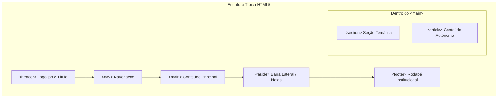
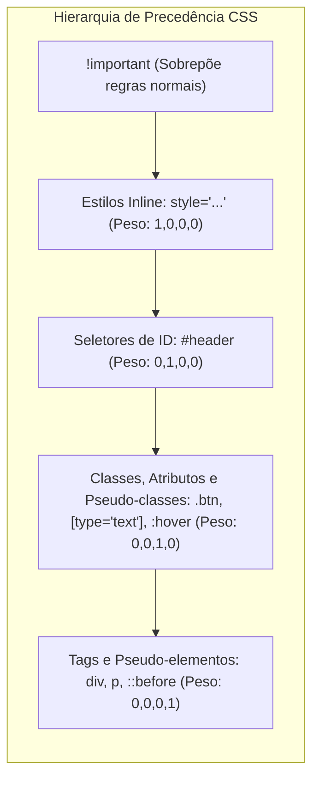
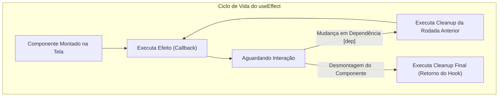

# 03 - Desenvolvimento Web Frontend: HTML5, CSS3, React e TypeScript

> **Matéria:** Desenvolvimento de Sistemas  
> **Cargo:** B02 – Técnico de Controle Externo – Especialidade: Tecnologia da Informação  
> **Arquivo:** `03_desenvolvimento_frontend_html_css_react_typescript.md`  

---

## 📌 Ementa / Itens do Edital
- Desenvolvimento web: HTML5, CSS3 e TypeScript
- Desenvolvimento front-end com biblioteca React

---

## 🌳 Classificação Hierárquica

```text
3. Desenvolvimento Front-end Moderno
├── 3.1 Fundamentos de HTML5 Semântico
│   ├── 3.1.1 Estrutura do Documento: <!DOCTYPE html>, <html>, <head>, <body>, metatags viewport e charset
│   ├── 3.1.2 Elementos Semânticos: <header>, <nav>, <main>, <section>, <article>, <aside>, <footer>
│   ├── 3.1.3 Formulários e Validação Nativa: Novos tipos de input (email, number, date, url...), atributos required, pattern, placeholder
│   ├── 3.1.4 Mídia e Gráficos: Tags de áudio/vídeo nativas (<audio>, <video>), <canvas> e suporte a SVG
│   └── 3.1.5 Acessibilidade na Web (W3C / WCAG e atributos ARIA: aria-label, role, tabIndex)
├── 3.2 Estilização com CSS3
│   ├── 3.2.1 Seletores e Especificidade CSS: Seletores de tag, classe, id, atributo, pseudo-classes (:hover, :focus, :nth-child) e pseudo-elementos (::before, ::after)
│   ├── 3.2.2 Modelo de Caixa (Box Model): Margin, Border, Padding e Content; propriedade box-sizing: border-box
│   ├── 3.2.3 Layouts Modernos:
│   │   ├── Flexbox (unidimensional): flex-direction, justify-content, align-items, flex-wrap, flex-grow, flex-shrink
│   │   └── CSS Grid Layout (bidimensional): grid-template-columns, grid-template-rows, gap, grid-area
│   ├── 3.2.4 Responsividade: Media Queries (@media (min-width: ...)), unidades relativas (rem, em, %, vh, vw) e Mobile-First
│   └── 3.2.5 Transições, Transformações 2D/3D e Animações CSS (@keyframes)
├── 3.3 TypeScript
│   ├── 3.3.1 Conceito: Superset tipado de JavaScript, compilação/transpilação para JS (tsc), arquivo tsconfig.json
│   ├── 3.3.2 Sistema de Tipos:
│   │   ├── Tipos básicos: string, number, boolean, array, tuple, any, unknown, void, never
│   │   ├── Union Types (type A = string | number) e Intersection Types (type AB = A & B)
│   │   ├── Type Aliases vs. Interfaces (diferenças, extensão via extends x declaração múltipla)
│   │   └── Modificadores readonly e propriedades opcionais (?)
│   ├── 3.3.3 Generics: Funções, interfaces e classes genéricas reutilizáveis (<T>)
│   └── 3.3.4 Utility Types comuns: Partial<T>, Required<T>, Readonly<T>, Pick<T, K>, Omit<T, K>, Record<K, T>
└── 3.4 Desenvolvimento Front-end com React
    ├── 3.4.1 Paradigma do React: Componentização baseada em funções, Declaratividade, Sintaxe JSX (JavaScript XML)
    ├── 3.4.2 Virtual DOM (VDOM) e Algoritmo de Reconciliação (Fiber): Renderização eficiente por diffing
    ├── 3.4.3 Propriedades (Props): Passagem unidirecional de dados (top-down), imutabilidade de props e children
    ├── 3.4.4 Estado (State) e Ciclo de Vida:
    │   ├── Hook useState: Gerenciamento de estado local reativo
    │   ├── Hook useEffect: Execução de efeitos colaterais (montagem, atualização, desmontagem/cleanup)
    │   ├── Hook useContext: Compartilhamento de dados sem prop drilling (Context API)
    │   └── Hooks de otimização: useMemo (memoização de cálculos pesados) e useCallback (memoização de funções)
    ├── 3.4.5 Manipulação de Eventos e Formulários: Componentes Controlados (Controlled Components) vs. Não Controlados
    └── 3.4.6 Renderização Condicional e Listas: Uso de chaves (key) únicas e estáveis na renderização de coleções
```

---

## 📖 Teoria Aprofundada & Pontos-Chave

### 3.1 HTML5 Semântico e Acessibilidade (WCAG / ARIA)

#### 3.1.1 Estrutura e Semântica de Documentos
O HTML5 introduziu elementos que expressam claramente o significado do conteúdo tanto para navegadores quanto para leitores de tela e motores de busca (SEO):
- `<header>`: Cabeçalho introdutório de uma página ou de uma seção (geralmente contém logotipos e títulos).
- `<nav>`: Bloco destinado exclusivamente a links de navegação principal da aplicação.
- `<main>`: Conteúdo principal e dominante do documento `<body>`. **Deve existir apenas um `<main>` visível por página**.
- `<article>`: Conteúdo autônomo, autocontido e independente, que faça sentido completo fora do contexto da página (ex.: uma postagem de blog, notícia, processo auditado independente).
- `<section>`: Agrupamento temático genérico de conteúdo conexo, usualmente acompanhado de um cabeçalho (`<h2>` a `<h6>`).
- `<aside>`: Conteúdo complementar ou tangencial ao conteúdo principal (ex.: barras laterais, glossários, links relacionados).
- `<footer>`: Rodapé de fechamento com informações de autoria, direitos autorais ou links institucionais.



#### 3.1.2 Acessibilidade Digital e Atributos ARIA
- **Padrões W3C / WCAG (Web Content Accessibility Guidelines):** Fundamentam-se nos 4 princípios: Perceptível, Operável, Compreensível e Robusto (POUR).
- **Atributos WAI-ARIA (Accessible Rich Internet Applications):**
  - `role`: Define o papel semântico de um elemento quando não há tag HTML correspondente (ex.: `role="dialog"`, `role="alert"`).
  - `aria-label`: Fornece um rótulo textual legível por voz para elementos sem texto visível (ex.: um botão que contém apenas um ícone de lupa: `<button aria-label="Pesquisar processo">`).
  - `aria-hidden="true"`: Oculta elementos puramente decorativos de tecnologias assistivas.
  - `tabindex`:
    - `tabindex="0"`: Insere o elemento na ordem sequencial natural de navegação via teclado (`Tab`).
    - `tabindex="-1"`: Torna o elemento focável via JavaScript (`.focus()`), mas o remove da navegação sequencial pelo teclado.
    - `tabindex="1+"` (positivo): **Antipadrão severo**, pois desrespeita a ordem natural do DOM.

---

### 3.2 CSS3 Moderno: Especificidade, Box Model e Layouts

#### 3.2.1 Cascata e Cálculo de Especificidade CSS
Quando duas ou mais regras CSS entram em conflito sobre o mesmo elemento, o navegador calcula a pontuação de **especificidade** para determinar qual regra prevalecerá:



| Tipo de Seletor | Exemplo | Peso (Base 10 fictícia para ordenação) |
|---|---|:---:|
| **Estilo Inline** | `<h1 style="color: red;">` | $(1, 0, 0, 0)$ |
| **Identificadores (ID)** | `#menu-principal` | $(0, 1, 0, 0)$ |
| **Classes, Atributos e Pseudo-classes** | `.card`, `[required]`, `:hover`, `:nth-child(2)` | $(0, 0, 1, 0)$ |
| **Tags de Elementos e Pseudo-elementos** | `div`, `p`, `span`, `::before`, `::after` | $(0, 0, 0, 1)$ |
| **Seletor Universal e Combinadores** | `*`, `>`, `+`, `~` | $(0, 0, 0, 0)$ |

> ⭐ **IMPORTANTE / REGRA DE OURO:**  
> A declaração `!important` não adiciona pontos de especificidade ordinários; ela cria uma categoria especial de alta prioridade. Se duas declarações conflitantes utilizarem `!important`, o desempate será feito pela especificidade normal entre elas.

#### 3.2.2 O Modelo de Caixa (Box Model) e `box-sizing`
Cada elemento renderizado no navegador é representado por uma caixa retangular composta por 4 camadas concêntricas: **Content** (conteúdo), **Padding** (espaçamento interno), **Border** (borda) e **Margin** (espaçamento externo).

- **`box-sizing: content-box` (Padrão do navegador):** A largura definida (`width`) aplica-se **apenas ao conteúdo**. O padding e a borda são somados por fora. Se um elemento tem `width: 200px; padding: 20px; border: 5px solid black;`, sua largura total ocupada na tela será $200 + 20 \times 2 + 5 \times 2 = 250\text{ px}$.
- **`box-sizing: border-box` (Padrão moderno da indústria):** A largura definida (`width`) absorve o padding e a borda. O conteúdo interno encolhe para acomodá-los. No exemplo acima, a largura total será exatamente **$200\text{ px}$**.

#### 3.2.3 Layouts Modernos: Flexbox vs. CSS Grid

| Recurso | Flexbox (Flexible Box Layout) | CSS Grid Layout |
|---|---|---|
| **Dimensionalidade** | **Unidimensional** (Linha OU Coluna por vez) | **Bidimensional** (Linhas E Colunas simultâneas) |
| **Foco Estrutural** | Alinhamento de componentes internos (botões, barras de navegação, cards sequenciais) | Macroestrutura e esqueletos da página inteira (layouts complexos em grade) |
| **Eixos** | Eixo Principal (*Main Axis*) e Eixo Transversal (*Cross Axis*) | Linhas de Grade (*Grid Lines*) e Trilhas (*Tracks*) |
| **Propriedades-Chave** | `justify-content` (eixo principal), `align-items` (transversal), `flex-grow`, `flex-shrink` | `grid-template-columns`, `grid-template-rows`, `gap`, `grid-area` |

---

### 3.3 TypeScript: Tipagem Estática no Front-end

#### 3.3.1 Tipos Especiais: `any` vs. `unknown` vs. `never` vs. `void`
- **`any`:** Desativa completamente a checagem estática de tipos do compilador. Permite qualquer operação, método ou propriedade, transferindo o risco de erro de tempo de execução para o JavaScript puro.
- **`unknown`:** Alternativa com segurança de tipos (*type-safe*) para valores cujo tipo ainda é desconhecido. Não permite invocar propriedades nem métodos sem antes realizar uma checagem de tipo explícita (*type narrowing* com `typeof`, `instanceof`).
- **`void`:** Indica a ausência de retorno em funções (a função executa, mas não retorna valor significativo).
- **`never`:** Representa valores que **nunca podem ocorrer**. É o tipo de retorno de funções que lançam exceções incondicionalmente (`throw new Error()`) ou que entram em loops infinitos, e também o resultado de uniões vazias após checagem exaustiva.

#### 3.3.2 Interfaces vs. Type Aliases

```typescript
// Interface (Permite declaração incremental / Declaration Merging)
interface Usuario {
  id: number;
  nome: string;
}
interface Usuario {
  ativo: boolean; // Automaticamente incorporado à interface anterior!
}

// Type Alias (Suporta Uniões Primitivas e Tuplas)
type StatusProcesso = "ABERTO" | "EM_ANALISE" | "CONCLUIDO";
type Coordenada = [number, number];
```

#### 3.3.3 Utility Types Fundamentais do TypeScript

| Utility Type | Descrição e Comportamento | Exemplo de Aplicação |
|---|---|---|
| **`Partial<T>`** | Torna **todas as propriedades de `T` opcionais** (`?`). | Atualizações parciais de formulários (PATCH). |
| **`Required<T>`** | Torna **todas as propriedades de `T` obrigatórias**. | Validações antes de submeter requisições à API. |
| **`Readonly<T>`** | Torna **todas as propriedades de `T` imutáveis** (somente leitura). | Congelamento de estados e configurações globais. |
| **`Pick<T, K>`** | Seleciona um **subconjunto de propriedades `K`** do tipo `T`. | `Pick<Processo, "id" \| "numero">` |
| **`Omit<T, K>`** | Remove **propriedades específicas `K`** do tipo `T`. | `Omit<Usuario, "senhaHash">` |
| **`Record<K, T>`** | Constrói um objeto onde as chaves são do tipo `K` e os valores são de `T`. | `Record<string, number>` (dicionários). |

---

### 3.4 Desenvolvimento Front-end com a Biblioteca React

#### 3.4.1 Paradigma, JSX e o Algoritmo de Reconciliação
- **Virtual DOM (VDOM):** Representação levíssima da árvore DOM mantida em memória JavaScript.
- **Algoritmo de Reconciliação (React Fiber):** Quando o estado de um componente é atualizado, o React constrói uma nova árvore VDOM e executa um algoritmo de diferenciação (*diffing* com complexidade heurística $\mathcal{O}(n)$). Apenas os nós do DOM real que sofreram alterações reais são modificados (*commit phase*), evitando renderizações lentas no navegador.
- **Fluxo Unidirecional de Dados:** Propriedades (*props*) fluem exclusivamente de cima para baixo (do componente pai para os componentes filhos). As props são **estritamente imutáveis** para quem as recebe.

#### 3.4.2 Hooks Fundamentais do React



1. **`useState`:** Gerencia estado reativo local. Ao chamar a função atualizadora, o React agenda uma nova renderização do componente.
2. **`useEffect`:** Executa efeitos colaterais (requisições HTTP, subscrições de eventos, manipulação de temporizadores).
   - `useEffect(fn)`: Sem segundo argumento $\rightarrow$ Executa na montagem e **após cada nova renderização** (perigo de loop infinito se alterar estado internamente!).
   - `useEffect(fn, [])`: Com vetor vazio $\rightarrow$ Executa **exatamente uma vez**, apenas na montagem inicial do componente.
   - `useEffect(fn, [id, status])`: Executa na montagem e sempre que `id` ou `status` mudarem de valor.
   - Função de limpeza (*cleanup*): O retorno do callback `return () => { clearInterval(timer); }` é invocado antes de rodar o próximo efeito e na desmontagem (*unmount*) do componente.
3. **`useContext`:** Consome contextos criados por `React.createContext()`, permitindo acessar dados globais (como usuário autenticado ou tema escuro) sem a necessidade de passar props manualmente por múltiplos níveis da árvore (*prop drilling*).
4. **`useMemo` e `useCallback`:**
   - `useMemo(() => calcularTotal(dados), [dados])`: Memoriza o **resultado** de um processamento oneroso.
   - `useCallback(() => { handleClique(); }, [deps])`: Memoriza a **referência da função**, evitando que novas instâncias da função sejam recriadas a cada renderização do componente pai.

> 🚨 **ALERTA DE PROVA / PEGADINHA FCC:**  
> Ao renderizar listas de elementos no React utilizando `.map()`, a propriedade `key` é **obrigatória**. A `key` deve ser um **identificador único e estável** entre renderizações (como o ID primário do banco de dados). Usar o índice do array (`key={index}`) é um erro grave caso a lista possa ser filtrada, reordenada ou receber inserções no início, pois quebra o algoritmo de reconciliação e preserva estados locais em elementos errados.

---

## 🌐 Fontes Recomendadas na Internet (Acesso Direto e Gratuito)

- [x] **React.dev - Documentação Oficial do React (Meta):**
  - Link Oficial: [React Learn & Documentation](https://react.dev/)
  - *Conteúdo:* Componentes funcionais, Hooks (`useState`, `useEffect`, `useContext`, `useMemo`), fluxo de renderização e boas práticas.
- [x] **TypeScript Official Handbook (Microsoft):**
  - Link Oficial: [TypeScript Handbook](https://www.typescriptlang.org/docs/handbook/intro.html)
  - *Conteúdo:* Sistema de tipagem estática, interfaces, type aliases, generics e catálogo completo de Utility Types.
- [x] **MDN Web Docs - HTML5 Semântico, Acessibilidade e CSS3:**
  - Link Oficial: [MDN HTML Semântico](https://developer.mozilla.org/pt-BR/docs/Web/HTML) e [MDN CSS Layout](https://developer.mozilla.org/pt-BR/docs/Web/CSS/CSS_layout)
  - *Conteúdo:* Tags semânticas, atributos WAI-ARIA, cálculo de especificidade CSS, Flexbox e CSS Grid.
- [x] **W3C WAI - Web Accessibility Initiative (WCAG):**
  - Link Oficial: [W3C WCAG Overview](https://www.w3.org/WAI/standards-guidelines/wcag/)
  - *Conteúdo:* Diretrizes e critérios de acessibilidade para conformidade governamental e tribunais de contas.

---

## 📝 Questões Comentadas & Exemplos (Padrão FCC)

### Questão 1 (FCC - Analista de TI / Front-end)
Em uma aplicação desenvolvida com a biblioteca React utilizando componentes funcionais e Hooks, um programador implementou a seguinte rotina para sincronizar uma listagem de auditorias fiscais com o servidor backend:

```jsx
function PainelFiscal() {
  const [processos, setProcessos] = useState([]);

  useEffect(() => {
    fetch("/api/processos")
      .then(res => res.json())
      .then(dados => setProcessos(dados));
  });

  return <div>{processos.length} processos carregados</div>;
}
```

Ao executar essa aplicação no navegador, o comportamento verificado pelo desenvolvedor é:  
A) A requisição à API é disparada apenas uma única vez na montagem da tela, funcionando de forma perfeitamente otimizada.  
B) Ocorre um laço infinito de renderizações (*infinite loop*), provocando sucessivas requisições HTTP e congelamento da interface do usuário.  
C) O React emite um erro de compilação em tempo de execução porque funções assíncronas não são permitidas dentro de componentes funcionais.  
D) A lista de processos jamais será atualizada porque o Hook `useState` não dispara re-renderização quando recebe arrays de dados.  
E) A requisição HTTP falha compulsoriamente devido à falta do cabeçalho de acessibilidade `aria-live` no elemento `<div>`.  

> **Gabarito: B**  
>
> **Comentário Analítico Passo a Passo:**  
> Vamos analisar o funcionamento interno do `useEffect`:
> 1. O desenvolvedor omitiu o segundo parâmetro do `useEffect` (a lista de dependências `[]`).
> 2. Pela regra canônica do React: um `useEffect` **sem vetor de dependências** é executado após a montagem inicial e **após cada uma das renderizações subsequentes**.
> 3. Quando o componente monta, o efeito roda e dispara `fetch(...)`.
> 4. Ao receber a resposta, ele invoca `setProcessos(dados)`.
> 5. A invocação de `setProcessos` atualiza o estado e **agenda uma nova renderização** do componente.
> 6. Ao renderizar novamente, o `useEffect` roda mais uma vez (já que não possui lista de dependências).
> 7. Isso dispara um novo `fetch`, que atualiza o estado novamente, disparando outra renderização, criando um **ciclo infinito de requisições e re-renderizações**.
> 8. A correção consiste em fornecer um vetor de dependências vazio: `useEffect(..., [])`.
>
> **Análise detalhada das alternativas:**  
> - **A (Incorreta):** Para rodar apenas na montagem, o `useEffect` exigiria obrigatoriamente um vetor de dependências vazio (`[]`) como segundo parâmetro.  
> - **B (CORRETA):** A ausência do array de dependências associada à mutação de estado dentro do efeito deflagra um loop infinito de renderização e sobrecarga de requisições.  
> - **C (Incorreta):** O React suporta perfeitamente promessas e operações assíncronas dentro de callbacks do `useEffect`; o problema reside estritamente no ciclo descontrolado de dependências.  
> - **D (Incorreta):** O `useState` agenda re-renderização sempre que a sua função despachante é chamada com um novo valor.  
> - **E (Incorreta):** Atributos ARIA dizem respeito à acessibilidade para leitores de tela e não possuem qualquer relação funcional com o disparo ou sucesso de requisições HTTP da API Fetch.

---

### Questão 2 (FCC - Técnico de Controle Externo / TI)
Na linguagem TypeScript, suponha que exista a definição do seguinte tipo base:

```typescript
type ProcessoAuditoria = {
  id: number;
  codigoFiscal: string;
  relator: string;
  valorGlosa: number;
};
```

Para declarar um novo tipo derivado denominado `ProcessoEdicao`, que contenha rigorosamente todas as propriedades de `ProcessoAuditoria`, porém com todas elas definidas como **opcionais** (isto é, marcadas com `?`), deve-se utilizar o Utility Type:  
A) `Required<ProcessoAuditoria>`  
B) `Readonly<ProcessoAuditoria>`  
C) `Partial<ProcessoAuditoria>`  
D) `Omit<ProcessoAuditoria, "id">`  
E) `Record<string, ProcessoAuditoria>`  

> **Gabarito: C**  
>
> **Comentário Analítico Passo a Passo:**  
> O TypeScript oferece ferramentas nativas no sistema de tipos conhecidas como *Utility Types* para transformar tipos existentes:
> - `Partial<T>`: Itera sobre todas as propriedades de `T` e aplica o modificador `?`, tornando todas opcionais.
>
> **Análise detalhada das alternativas:**  
> - **A (Incorreta):** `Required<T>` realiza o exato inverso: remove a interrogação `?` e força todas as propriedades a serem estritamente obrigatórias.  
> - **B (Incorreta):** `Readonly<T>` mantém a obrigatoriedade das propriedades inalterada, tornando-as apenas imutáveis (somente leitura, proibindo reatribuição).  
> - **C (CORRETA):** `Partial<ProcessoAuditoria>` produz `{ id?: number; codigoFiscal?: string; relator?: string; valorGlosa?: number; }`, exatamente como solicitado.  
> - **D (Incorreta):** `Omit<T, K>` remove as propriedades indicadas (no caso, eliminaria o campo `"id"` mantendo as outras obrigatórias).  
> - **E (Incorreta):** `Record<K, T>` constrói um tipo de dicionário mapeando chaves do tipo `K` para valores do tipo `T`.

---

### Questão 3 (FCC - Analista de TI / Sistemas)
Considere as seguintes regras de estilização declaradas em um arquivo CSS3 externo para formatar um mesmo elemento de título em uma página web:

```css
/* Regra 1 */
h1 { color: red; }

/* Regra 2 */
#titulo-destaque { color: blue; }

/* Regra 3 */
.cabecalho .titulo { color: green; }

/* Regra 4 */
div#secao-principal h1.titulo { color: purple; }
```

Assumindo o fragmento HTML abaixo:

```html
<div id="secao-principal" class="cabecalho">
  <h1 id="titulo-destaque" class="titulo">Relatório de Conformidade</h1>
</div>
```

A cor final com que o texto do título `Relatório de Conformidade` será renderizado na tela do navegador e o motivo técnico dessa escolha são:  
A) Azul, porque o seletor com o identificador direto `#titulo-destaque` possui a maior especificidade absoluta entre todas as regras.  
B) Vermelho, porque a Regra 1 é mais genérica e o navegador sempre prioriza seletores de tag simples para garantir padronização tipográfica.  
C) Roxo (*purple*), porque a Regra 4 combina um ID (`#secao-principal`), uma classe (`.titulo`) e duas tags (`div` e `h1`), somando uma especificidade superior à da Regra 2.  
D) Verde, porque a Regra 3 é a penúltima declarada e as classes sobrepõem identificadores únicos no CSS3 moderno.  
E) Roxo (*purple*), porque a regra foi escrita na última linha do arquivo CSS e o desempate na cascata dá vitória estrita à regra de menor número de seletores.  

> **Gabarito: C**  
>
> **Comentário Analítico Passo a Passo:**  
> Vamos calcular com exatidão a especificidade de cada uma das 4 regras utilizando a tupla canônica da W3C `(Inline, IDs, Classes/Pseudo-classes/Atributos, Elementos/Pseudo-elementos)`:
> 1. **Regra 1 (`h1`):** 1 elemento $\rightarrow$ $(0, 0, 0, 1)$ = Especificidade **1**.
> 2. **Regra 2 (`#titulo-destaque`):** 1 ID $\rightarrow$ $(0, 1, 0, 0)$ = Especificidade **100**.
> 3. **Regra 3 (`.cabecalho .titulo`):** 2 classes $\rightarrow$ $(0, 0, 2, 0)$ = Especificidade **20**.
> 4. **Regra 4 (`div#secao-principal h1.titulo`):** 1 ID (`#secao-principal`), 1 classe (`.titulo`) e 2 elementos (`div`, `h1`) $\rightarrow$ $(0, 1, 1, 2)$ = Especificidade **112**.
>
> Comparando a Regra 2 com a Regra 4:
> - Ambas possuem 1 ID (empatam na coluna de peso 100).
> - Na coluna de classes/atributos, a Regra 4 possui **1 classe**, enquanto a Regra 2 possui **0**.
> - Portanto, $(0, 1, 1, 2) > (0, 1, 0, 0)$. A Regra 4 vence a cascata com cor **roxa (*purple*)**.
>
> **Análise detalhada das alternativas:**  
> - **A (Incorreta):** A Regra 2 possui apenas o ID $(0, 1, 0, 0)$, sendo superada pela Regra 4 que soma o ID, uma classe e duas tags $(0, 1, 1, 2)$.  
> - **B (Incorreta):** Seletores de tag simples possuem o menor nível de especificidade $(0, 0, 0, 1)$.  
> - **C (CORRETA):** A pontuação de $(0, 1, 1, 2)$ da Regra 4 supera os $(0, 1, 0, 0)$ da Regra 2, aplicando a cor roxa.  
> - **D (Incorreta):** Classes $(0, 0, 1, 0)$ jamais sobrepõem IDs $(0, 1, 0, 0)$ na ausência de `!important`.  
> - **E (Incorreta):** A ordem de aparição no arquivo só serve como critério de desempate se as regras possuírem rigorosamente a mesma especificidade, o que não é o caso aqui.

---

### Questão 4 (FCC - Auditor Fiscal / Tecnologia da Informação)
No desenvolvimento de páginas governamentais com HTML5 aderentes às diretrizes de acessibilidade na Web (W3C / WCAG), assinale a afirmativa tecnicamente correta:  
A) O elemento `<article>` deve ser utilizado exclusivamente para criar tabelas de dados financeiros de auditoria, sendo vedado para artigos de texto.  
B) O uso do atributo `tabindex="5"` é a prática recomendada para botões de submissão, pois garante que eles sempre recebam o foco antes de qualquer campo do formulário.  
C) O elemento `<main>` deve encapsular o conteúdo central e específico do documento, não devendo ser duplicado em um mesmo documento exibido, e conteúdos que se repetem entre páginas (como cabeçalhos de topo e rodapés gerais) devem ficar fora dele.  
D) As tags de agrupamento genérico `<div>` e `<span>` possuem semântica rica superior às tags `<section>` e `<nav>`, sendo preferíveis pelos leitores de tela.  
E) O atributo `aria-hidden="true"` instrui os navegadores a ocultar o elemento visualmente na tela para usuários videntes, mas mantém sua leitura intacta para deficientes visuais em leitores de tela.  

> **Gabarito: C**  
>
> **Comentário Analítico Passo a Passo:**  
> As recomendações da especificação HTML5 e WCAG estabelecem papéis bem definidos para estruturação da página.
>
> **Análise detalhada das alternativas:**  
> - **A (Incorreta):** `<article>` representa conteúdo editorial autônomo, independente e reutilizável (notícias, posts, documentos autocontidos), não se restringindo a tabelas nem servindo exclusivamente a dados numéricos.  
> - **B (Incorreta):** Valores positivos de `tabindex` (`> 0`) são expressamente desaconselhados pelo W3C, pois desorganizam a ordem natural e lógica de navegação do usuário que navega com teclado.  
> - **C (CORRETA):** A especificação oficial da WHATWG/W3C afirma que o elemento `<main>` representa o conteúdo principal do `<body>`. Uma página não deve conter mais de um elemento `<main>` visível simultaneamente, e blocos repetitivos (menus de navegação do site, barras de login, rodapés globais) devem residir fora do `<main>`.  
> - **D (Incorreta):** `<div>` e `<span>` não possuem absolutamente nenhuma carga semântica inerente; tags semânticas como `<section>`, `<nav>` e `<header>` fornecem marcos de acessibilidade (*landmarks*) cruciais para tecnologias assistivas.  
> - **E (Incorreta):** O atributo `aria-hidden="true"` faz o oposto: ele oculta o elemento especificamente das ferramentas assistivas e leitores de tela, mantendo sua visibilidade para usuários videntes na tela (comumente usado em ícones decorativos).

---

### Questão 5 (FCC - Analista de Sistemas / Desenvolvimento)
Na biblioteca React, ao iterar sobre uma lista de dados para renderizar múltiplos componentes utilizando a função `.map()`, os desenvolvedores devem obrigatoriamente fornecer a propriedade especial `key` para cada item retornado.

A respeito do propósito e do funcionamento da propriedade `key` no algoritmo de reconciliação do React, assinale a afirmativa correta:  
A) A `key` serve unicamente para estilização visual via CSS, sendo convertida em uma classe HTML automática no DOM real.  
B) O React utiliza a `key` para identificar de forma estável quais elementos da lista foram alterados, adicionados ou removidos entre renderizações, permitindo atualizar apenas os nós do DOM que sofreram modificação efetiva.  
C) O uso do índice do array (`key={index}`) é a estratégia oficial recomendada pela Meta para listas dinâmicas com operações frequentes de ordenação e inserção no início da fila.  
D) As chaves `key` devem ser obrigatoriamente números inteiros sequenciais gerados aleatoriamente com `Math.random()` a cada ciclo de renderização.  
E) A propriedade `key` é repassada automaticamente pelo React para o componente filho como uma prop ordinária, podendo ser acessada livremente no código filho via `props.key`.  

> **Gabarito: B**  
>
> **Comentário Analítico Passo a Passo:**  
> A reconciliação do React precisa associar instâncias do Virtual DOM aos nós do DOM real com eficiência linear $\mathcal{O}(n)$.
>
> **Análise detalhada das alternativas:**  
> - **A (Incorreta):** A propriedade `key` é consumida internamente pelo motor do React; ela não se torna um atributo CSS nem classe visual no DOM renderizado.  
> - **B (CORRETA):** A chave `key` confere identidade estável e persistente a cada item da coleção entre renderizações. Com isso, ao adicionar, reordenar ou remover itens, o React reaproveita os nós existentes do DOM real sem reconstruir a lista inteira do zero.  
> - **C (Incorreta):** Utilizar o índice do array (`index`) como chave em listas que sofrem reordenação, filtragem ou inserções intermediárias é uma péssima prática: como o índice de cada elemento muda de acordo com sua posição física na lista, o React confunde os estados internos dos componentes (como campos de texto de formulários não controlados).  
> - **D (Incorreta):** Usar `Math.random()` gera chaves instáveis que mudam a cada renderização, forçando o React a destruir e recriar o DOM inteiro a cada frame, destruindo o desempenho e o foco dos elementos.  
> - **E (Incorreta):** Pegadinha clássica do React: `key` (assim como `ref`) é uma propriedade reservada do React e **não é repassada** para dentro do componente filho via `props`. Se você tentar ler `props.key`, receberá `undefined` e um aviso de console do React. Se o componente filho precisar do ID, ele deve ser repassado em uma prop separada (como `id={item.id}`).
