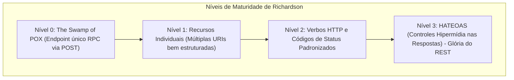
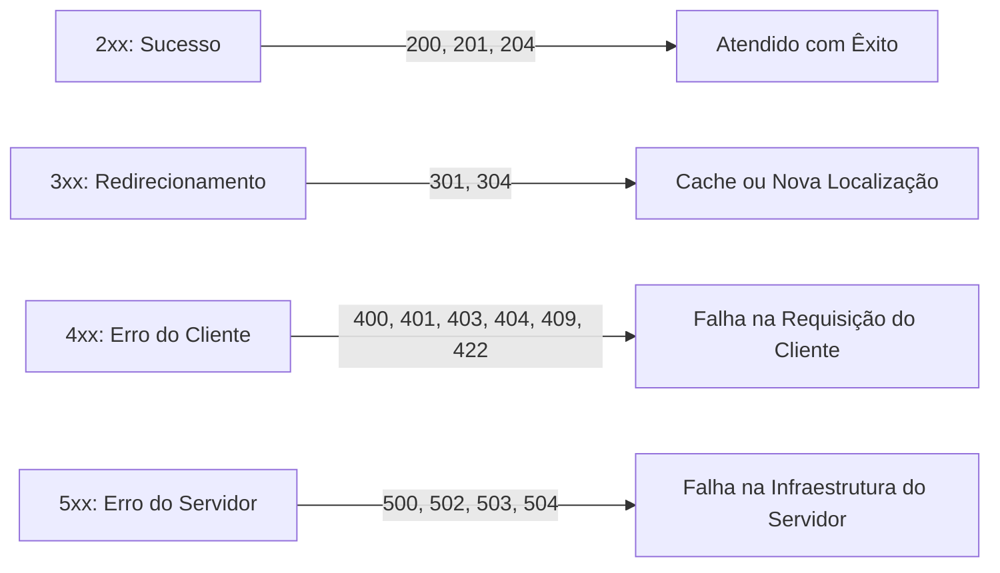
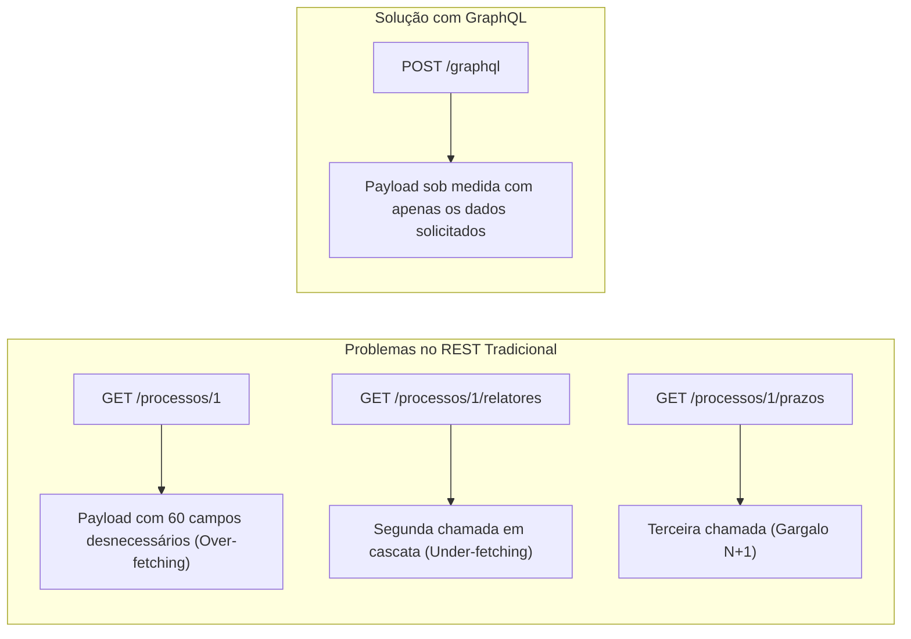
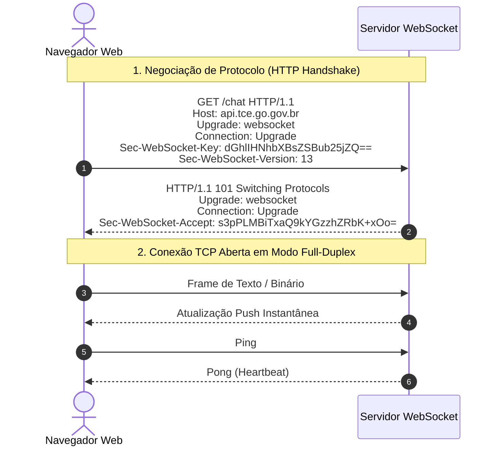

# 04 - APIs RESTful, GraphQL, WebSockets e Documentação

> **Matéria:** Desenvolvimento de Sistemas  
> **Cargo:** B02 – Técnico de Controle Externo – Especialidade: Tecnologia da Informação  
> **Arquivo:** `04_apis_restful_graphql_websockets_documentacao.md`  

---

## 📌 Ementa / Itens do Edital
- Desenvolvimento de APIs RESTful
- Conceitos de GraphQL e WebSockets
- Formatos de representação de dados: JSON e XML
- Documentação de APIs com OpenAPI e Swagger

---

## 🧭 Sumário
- [1. APIs RESTful e Protocolo HTTP](#1-apis-restful-e-protocolo-http)
    - [1.1 Princípios Arquiteturais do REST (Roy Fielding)](#11-principios-arquiteturais-do-rest-roy-fielding)
    - [1.2 O Modelo de Maturidade de Richardson](#12-o-modelo-de-maturidade-de-richardson)
    - [1.3 Métodos HTTP: Semântica, Segurança e Idempotência](#13-metodos-http-semantica-seguranca-e-idempotencia)
    - [1.4 Códigos de Status HTTP Essenciais em Provas](#14-codigos-de-status-http-essenciais-em-provas)
    - [1.5 Boas Práticas no Design de URIs e Recursos RESTful](#15-boas-praticas-no-design-de-uris-e-recursos-restful)
- [2. GraphQL: Arquitetura e Consultas Declarativas](#2-graphql-arquitetura-e-consultas-declarativas)
    - [2.1 Motivação: Resolução de Over-fetching e Under-fetching](#21-motivacao-resolucao-de-over-fetching-e-under-fetching)
    - [2.2 Modelo Operacional e a Schema Definition Language (SDL)](#22-modelo-operacional-e-a-schema-definition-language-sdl)
    - [2.3 Operações Centrais: Queries, Mutations, Subscriptions e Resolvers](#23-operacoes-centrais-queries-mutations-subscriptions-e-resolvers)
- [3. Protocolo WebSocket e Comunicação em Tempo Real](#3-protocolo-websocket-e-comunicacao-em-tempo-real)
    - [3.1 Arquitetura Full-Duplex e a RFC 6455](#31-arquitetura-full-duplex-e-a-rfc-6455)
    - [3.2 O Handshake HTTP Upgrade e os Esquemas `ws://` e `wss://`](#32-o-handshake-http-upgrade-e-os-esquemas-ws-e-wss)
    - [3.3 Comparativo: Polling, Long-Polling, Server-Sent Events (SSE) e WebSocket](#33-comparativo-polling-long-polling-server-sent-events-sse-e-websocket)
- [4. Formatos de Representação de Dados: JSON vs. XML](#4-formatos-de-representacao-de-dados-json-vs-xml)
    - [4.1 JSON: Tipagem, Sintaxe Estrita e Validação com JSON Schema](#41-json-tipagem-sintaxe-estrita-e-validacao-com-json-schema)
    - [4.2 XML: Estrutura, Validação (DTD/XSD) e Consultas com XPath](#42-xml-estrutura-validacao-dtdxsd-e-consultas-com-xpath)
    - [4.3 Comparativo Prático entre JSON e XML](#43-comparativo-pratico-entre-json-e-xml)
- [5. Documentação de APIs com OpenAPI e o Ecossistema Swagger](#5-documentacao-de-apis-com-openapi-e-o-ecossistema-swagger)
    - [5.1 A Especificação OpenAPI (OAS 3.0 / 3.1)](#51-a-especificacao-openapi-oas-30-31)
    - [5.2 Estrutura Canônica do Documento OpenAPI (YAML / JSON)](#52-estrutura-canonica-do-documento-openapi-yaml-json)
    - [5.3 Ferramental Swagger: Swagger UI, Editor e Codegen](#53-ferramental-swagger-swagger-ui-editor-e-codegen)
- [6. Fontes Recomendadas na Internet](#6-fontes-recomendadas-na-internet)
- [7. Questões Comentadas & Exemplos (Padrão FCC)](#7-questoes-comentadas-exemplos-padrao-fcc)

---

## 1. APIs RESTful e Protocolo HTTP

### 1.1 Princípios Arquiteturais do REST (Roy Fielding)
O estilo arquitetural **REST** (*Representational State Transfer*) foi formalizado por Roy Fielding em sua tese de doutorado no ano 2000. Trata-se de um conjunto de **restrições arquiteturais** coordenadas que, quando seguidas, conferem à web propriedades desejáveis de desempenho, escalabilidade, simplicidade, modificabilidade e visibilidade:

1. **Cliente-Servidor (*Client-Server*):** Separação estrita de responsabilidades. O cliente cuida da apresentação visual e experiência do usuário; o servidor encarrega-se do armazenamento de dados e das regras de negócio. Essa dissociação permite que ambas as camadas evoluam de forma independente.
2. **Sem Estado (*Statelessness*):** Cada requisição do cliente para o servidor deve conter **todas as informações contextuais necessárias** para que o servidor a interprete e execute. O servidor não armazena nenhuma sessão em memória entre requisições. O estado da sessão reside exclusivamente no lado cliente (ex.: tokens JWT).
3. **Cacheabilidade (*Cacheable*):** As respostas devem explicitar claramente se podem ou não ser retidas em cache pelo cliente ou por nós intermediários (via cabeçalhos `Cache-Control`, `ETag`, `Last-Modified`), reduzindo a latência e o consumo de banda.
4. **Interface Uniforme (*Uniform Interface*):** É o princípio distintivo do REST, subdividido em 4 pilares:
    - *Identificação de Recursos:* Recursos são identificados unicamente por URIs estáveis (ex.: `/processos/10`).
    - *Manipulação por Representações:* O cliente manipula o recurso através de sua representação textual (JSON, XML), e não do objeto bruto no banco de dados.
    - *Mensagens Autodescritivas:* Cada mensagem inclui metadados suficientes para indicar como deve ser processada (cabeçalho `Content-Type: application/json`).
    - *HATEOAS (Hypermedia As The Engine Of Application State):* A resposta traz links navegáveis que orientam o cliente sobre quais são os próximos passos e estados possíveis na aplicação.

5. **Sistema em Camadas (*Layered System*):** A arquitetura pode incluir intermediários transparentes para o cliente (balanceadores de carga, firewalls de aplicação - WAF, proxies reversos e gateways de API), sem que o cliente precise saber se está falando com o servidor final.
6. **Código sob Demanda (*Code on Demand* - Única Opcional):** Permite ao servidor estender a funcionalidade do cliente transmitindo código executável (ex.: scripts JavaScript).

---

### 1.2 O Modelo de Maturidade de Richardson
Leonard Richardson concebeu um modelo para classificar a aderência de serviços web aos preceitos REST:



- **Nível 0 (The Swamp of POX):** Utiliza HTTP apenas como protocolo de transporte para chamadas RPC remotas sobre um único endpoint (ex.: SOAP ou XML-RPC, onde todas as operações são enviadas via `POST /servico`).
- **Nível 1 (Recursos):** A API introduz URIs específicas para identificar recursos distintos (ex.: `/processos`, `/processos/12`), mas ainda utiliza métodos HTTP de forma genérica (frequentemente apenas POST ou GET).
- **Nível 2 (Verbos HTTP & Status Codes):** Emprega os verbos HTTP de acordo com sua semântica oficial (`GET` para leitura, `POST` para criação, `PUT` para substituição, `DELETE` para exclusão) e responde com códigos de status padronizados (`200`, `201`, `404`). A grande maioria das APIs comerciais atuais opera neste nível.
- **Nível 3 (Controles Hipermídia - HATEOAS):** O patamar máximo da maturidade REST. As respostas trazem links hipermídia (`_links` ou `rel`) que informam dinamicamente ao cliente quais ações subsequentes ele pode executar (ex.: aprovar processo, anexar documento).

---

### 1.3 Métodos HTTP: Semântica, Segurança e Idempotência
A RFC 7231 da IETF define com rigor a semântica e as propriedades dos métodos HTTP:

| Método | Seguro (*Safe*)? | Idempotente? | Semântica Principal | Códigos de Sucesso Comuns |
|---|:---:|:---:|---|---|
| **`GET`** | **Sim** | **Sim** | Recuperar a representação de um recurso (somente leitura). | `200 OK` |
| **`HEAD`** | **Sim** | **Sim** | Idêntico ao GET, mas retorna **apenas cabeçalhos** (sem corpo). | `200 OK` |
| **`OPTIONS`**| **Sim** | **Sim** | Consulta quais métodos e parâmetros o servidor aceita naquela URI. | `200 OK`, `204 No Content` |
| **`POST`** | **Não** | **Não** | Criação de recurso subordinado ou processamento arbitrário. | `201 Created`, `200 OK` |
| **`PUT`** | **Não** | **Sim** | **Substituição completa** do recurso especificado na URI. | `200 OK`, `204 No Content` |
| **`PATCH`**| **Não** | **Não**\* | **Modificação parcial** de campos de um recurso existente. | `200 OK`, `204 No Content` |
| **`DELETE`**| **Não** | **Sim** | Exclusão do recurso indicado na URI. | `200 OK`, `204 No Content` |

*\*Nota: Pela RFC 5789, PATCH não é intrinsecamente idempotente, embora possa ser implementado de forma idempotente em certos casos.*

> 🚨 **ALERTA DE PROVA / FCC:**  
>
> - **Método Seguro (*Safe*):** A execução da requisição **NÃO altera o estado dos recursos no servidor** (leitura pura). `GET`, `HEAD` e `OPTIONS` são seguros.
> - **Método Idempotente (*Idempotent*):** Executar a mesma requisição uma vez ou $N$ vezes consecutivas com os mesmos dados produz **exatamente o mesmo efeito final no estado do servidor**.
>     - O `PUT` é idempotente: substituir integralmente um registro 10 vezes resulta no mesmo estado final no banco de dados.
>     - O `DELETE` é idempotente: após o primeiro comando, o recurso foi apagado; chamá-lo novamente mantém o recurso inexistente. O fato de responder `404` na segunda chamada não altera a idempotência!
>     - O `POST` **NÃO é idempotente**: disparar 5 vezes cria 5 novos registros no banco.

---

### 1.4 Códigos de Status HTTP Essenciais em Provas



#### Faixa 2xx (Sucesso)
- **`200 OK`:** A requisição foi atendida com sucesso e o corpo contém a resposta solicitada.
- **`201 Created`:** Um novo recurso foi criado com sucesso. O cabeçalho `Location` deve conter a URI do recurso recém-criado.
- **`204 No Content`:** A requisição foi processada com êxito, mas o servidor **não envia nenhum corpo de resposta** (comum após operações `DELETE` ou `PUT`).

#### Faixa 3xx (Redirecionamento)
- **`301 Moved Permanently`:** O recurso mudou de endereço definitivamente.
- **`304 Not Modified`:** Validação condicional de cache bem-sucedida (via `ETag` ou `If-Modified-Since`). O cliente deve reutilizar os dados já armazenados em seu cache local sem trafegar o corpo do arquivo.

#### Faixa 4xx (Erro do Cliente)
- **`400 Bad Request`:** Requisição sintaticamente malformada (ex.: JSON inválido, sintaxe corrompida).
- **`401 Unauthorized`:** Na realidade técnica, significa **Não Autenticado** (*Unauthenticated*). Faltam credenciais no cabeçalho `Authorization` ou o token expirou/está inválido (*"Eu não sei quem você é"*).
- **`403 Forbidden`:** O cliente foi **validado e autenticado com sucesso**, mas **não possui permissão/autorização** suficiente para acessar o recurso pretendido (*"Eu sei quem você é, mas você não tem autorização"*).
- **`404 Not Found`:** O servidor não encontrou nenhum recurso na URI solicitada.
- **`409 Conflict`:** Conflito de estado do recurso (ex.: tentativa de cadastrar um processo com número de protocolo que já existe).
- **`422 Unprocessable Entity`:** A sintaxe do payload é válida, mas há violação de regras semânticas de negócio (ex.: enviar campo "idade" com valor negativo).

#### Faixa 5xx (Erro do Servidor)
- **`500 Internal Server Error`:** Erro genérico e inesperado de execução no servidor (exceção não tratada no código).
- **`502 Bad Gateway`:** Um servidor intermediário (proxy reverso, gateway de API) recebeu uma resposta inválida ou falha do servidor *upstream* (backend).
- **`503 Service Unavailable`:** O servidor está temporariamente incapaz de atender requisições por sobrecarga pontual ou manutenção programada.
- **`504 Gateway Timeout`:** O servidor intermediário esgotou o tempo limite de espera (*timeout*) aguardando uma resposta do servidor backend.

---

### 1.5 Boas Práticas no Design de URIs e Recursos RESTful
- **Utilizar substantivos no plural:** `/processos`, `/auditores`, `/orgaos` (em vez de verbos como `/buscarProcessos` ou `/criarAuditor`).
- **Hierarquias para recursos aninhados:** `/processos/105/anexos/2` indica o anexo de código 2 subordinado ao processo 105.
- **Versionamento explícito na URI:** `/api/v1/processos` ou por cabeçalhos customizados (`Accept: application/vnd.tce.v1+json`).
- **Parâmetros de consulta (*Query Strings*):** Utilizados estritamente para filtragem, paginação e ordenação:
  `/processos?status=julgado&page=2&limit=20&sort=-dataCriacao`.

---

## 2. GraphQL: Arquitetura e Consultas Declarativas

### 2.1 Motivação: Resolução de Over-fetching e Under-fetching
Desenvolvido pelo Facebook (Meta) em 2012 e tornado código aberto em 2015, o **GraphQL** é uma linguagem de consulta para APIs e um ambiente de execução para cumprir essas consultas com dados existentes.



- **Over-fetching (Excesso de Dados):** Ocorre no REST quando um endpoint fixo retorna dezenas de campos complexos, embora a interface do cliente só precise de dois (ex.: renderizar apenas o nome do relator em uma lista móvel consumindo centenas de kilobytes de dados irrelevantes).
- **Under-fetching (Carência de Dados):** Ocorre no REST quando um endpoint não traz dados relacionados suficientes, forçando o cliente a disparar sucessivas requisições em cascata para montar uma única tela (ex.: `GET /processos`, depois $N$ requisições para `GET /processos/{id}/partes` — o clássico problema $N+1$).
- **Solução do GraphQL:** O cliente envia uma consulta declarativa especificando **exatamente quais campos e relacionamentos deseja**. O backend responde com um JSON espelhado na estrutura exata do pedido, através de um **endpoint único** (geralmente `/graphql`), operando via requisições HTTP `POST`.

---

### 2.2 Modelo Operacional e a Schema Definition Language (SDL)
O contrato entre cliente e servidor no GraphQL é expresso na linguagem **SDL** (*Schema Definition Language*):

```graphql
type Processo {
  id: ID!
  numeroProtocolo: String!
  valorGlosa: Float
  julgado: Boolean!
  relator: Auditor!
}

type Auditor {
  id: ID!
  nome: String!
  matricula: String!
}
```

- **Tipos Escalares Nativos:** `Int` (inteiro 32 bits), `Float` (ponto flutuante com sinal), `String` (UTF-8), `Boolean` (`true`/`false`) e `ID` (identificador único serializado como string).
- **Modificador de Não-Nulo (`!`):** Garante que o campo jamais retornará nulo (ex.: `String!`). Se ausente, o campo é considerado anulável (*nullable*).
- **Tipos de Lista (`[]`):** `[String]` indica uma lista de strings. `[String!]!` indica uma lista não nula contendo itens obrigatoriamente não nulos.

---

### 2.3 Operações Centrais: Queries, Mutations, Subscriptions e Resolvers

1. **`Query`:** Operações de consulta e leitura de dados. Não devem provocar efeitos colaterais no backend (análogas ao método `GET` do REST).

```graphql
query BuscarProcesso {
  processo(id: "100") {
    numeroProtocolo
    relator {
      nome
    }
  }
}
```

2. **`Mutation`:** Operações que provocam modificações no servidor (criação, edição, exclusão de dados — análogas ao `POST`, `PUT`, `DELETE`).

```graphql
mutation CriarProcesso($dados: NovoProcessoInput!) {
  cadastrarProcesso(input: $dados) {
    id
    numeroProtocolo
  }
}
```

3. **`Subscription`:** Mecanismo de subscrição para receber eventos e atualizações em tempo real disparadas pelo servidor (mantidas tipicamente sobre conexões WebSocket).
4. **`Resolvers`:** Funções no backend associadas a cada campo do Schema. Quando uma query é executada, o motor do GraphQL invoca os *resolvers* correspondentes para extrair os dados de bancos SQL, bancos NoSQL ou de outras APIs REST.

---

## 3. Protocolo WebSocket e Comunicação em Tempo Real

### 3.1 Arquitetura Full-Duplex e a RFC 6455
O protocolo HTTP tradicional baseia-se no modelo *Request-Response* *half-duplex*, no qual toda comunicação precisa ser iniciada pelo cliente. O protocolo **WebSocket** (padronizado pela IETF na **RFC 6455**) viabiliza comunicação **Full-Duplex** (bidirecional simultânea) e persistente sobre uma única conexão TCP de longa duração.

- **Baixa Latência e Mínimo Overhead:** Após a conexão ser aberta, os cabeçalhos HTTP volumosos não são mais transmitidos. As mensagens trafegam divididas em frames levíssimos contendo cabeçalhos de apenas 2 a 10 bytes.
- **Mensageria Push Nativa:** O servidor pode enviar dados ativamente ao cliente a qualquer momento sem que o cliente precise solicitar (*server push* instantâneo).

---

### 3.2 O Handshake HTTP Upgrade e os Esquemas `ws://` e `wss://`
A conexão WebSocket não inicia diretamente no protocolo WebSocket; ela nasce sobre o protocolo HTTP através de um procedimento de negociação denominado **HTTP Upgrade Handshake**:



- **Cabeçalhos do Handshake:**
    - O cliente envia `Upgrade: websocket` e `Connection: Upgrade`.
    - O servidor concorda respondendo com o código especial **`101 Switching Protocols`**.
- **Esquemas de Conexão:**
    - `ws://`: Conexão em texto claro sem criptografia (opera na porta 80 por padrão).
    - `wss://` (*WebSocket Secure*): Conexão protegida por criptografia TLS/HTTPS (opera na porta 443 por padrão), recomendada em ambientes de produção.

---

### 3.3 Comparativo: Polling, Long-Polling, Server-Sent Events (SSE) e WebSocket

| Tecnologia | Direção da Comunicação | Protocolo Subjacente | Overhead por Mensagem | Caso de Uso Ideal |
|---|:---:|:---:|:---:|---|
| **Short Polling** | Unidirecional (Cliente $\rightarrow$ Servidor) | HTTP repetitivo em intervalos fixos | **Altíssimo** (novo handshake e cabeçalhos a cada requisição) | Verificações esporádicas e simples. |
| **Long Polling** | Unidirecional (Servidor segura requisição) | HTTP com conexão mantida aberta até haver dado | Alto (reabre conexão HTTP a cada resposta) | Cenários legados sem suporte a WebSockets. |
| **Server-Sent Events (SSE)** | **Unidirecional** (Servidor $\rightarrow$ Cliente) | HTTP padrão (`text/event-stream`) | Baixo (conexão persistente HTTP única) | Painéis de monitoramento, cotações, feeds onde o cliente só recebe dados. |
| **WebSocket** | **Bidirecional Completo (*Full-Duplex*)** | Protocolo TCP customizado após handshake | **Mínimo** (frames de 2 a 10 bytes) | Chats, jogos interativos, colaboração simultânea em tempo real. |

---

## 4. Formatos de Representação de Dados: JSON vs. XML

### 4.1 JSON: Tipagem, Sintaxe Estrita e Validação com JSON Schema
O JSON (*JavaScript Object Notation*, padronizado pela RFC 8259) é o formato dominante no intercâmbio de dados em APIs REST modernas.

- **Tipos de Dados Suportados:**
    - Primitivos: `string` (entre aspas duplas), `number` (inteiro ou flutuante), `boolean` (`true` ou `false`), `null`.
    - Estruturas de Dados: `object` (pares chave-valor `{}`) e `array` (listas ordenadas `[]`).
- **Regras Estritas de Sintaxe:**
    - **Chaves obrigatoriamente entre aspas duplas (`"chave": valor`)**. Usar aspas simples gera erro de parsing.
    - Proibida vírgula residual no último elemento (*trailing comma*): `{"id": 1,}` é inválido.
    - O padrão JSON puro **não suporta comentários** (`//` ou `/* */`).
- **JSON Schema:** Padrão para validar a estrutura, os tipos e os campos obrigatórios em payloads JSON de forma automatizada.

---

### 4.2 XML: Estrutura, Validação (DTD/XSD) e Consultas com XPath
O XML (*Extensible Markup Language*) é uma linguagem de marcação baseada em tags hierárquicas personalizáveis.

- **Estrutura:** Exige prólogo `<?xml version="1.0" encoding="UTF-8"?>`, raiz única (*root element*) e fechamento obrigatório de todas as tags (sensível a maiúsculas/minúsculas).
- **Validação de Documentos XML:**
    - **Well-formed (Bem-formado):** Cumpre as regras sintáticas fundamentais da linguagem XML.
    - **Valid (Válido):** Além de bem-formado, respeita rigorosamente um esquema formal de regras estruturais:
    - **DTD (*Document Type Definition*):** Mecanismo mais antigo com sintaxe própria.
    - **XSD (*XML Schema Definition*):** Esquema moderno escrito na própria sintaxe XML, com suporte a tipos de dados ricos e namespaces.
- **Consultas com XPath:** Linguagem de expressões de caminhos que permite navegar e selecionar nós específicos dentro da árvore XML (ex.: `/processos/processo[@status='julgado']/valor`).

---

### 4.3 Comparativo Prático entre JSON e XML

| Critério | JSON | XML |
|---|---|---|
| **Formato de Estrutura** | Pares chave-valor e listas (`{}`, `[]`) | Árvore de elementos com tags e atributos |
| **Complexidade de Parsing** | Leve e nativo para interpretadores JavaScript | Custoso computacionalmente (requer parsers DOM/SAX) |
| **Tamanho da Mensagem** | Compacto, sem redundância de tags | Verboso devido à duplicação de tags de fechamento |
| **Validação de Esquema** | JSON Schema | DTD e XML Schema (XSD) |
| **Linguagem de Consulta** | JSONPath | XPath e XQuery |

---

## 5. Documentação de APIs com OpenAPI e o Ecossistema Swagger

### 5.1 A Especificação OpenAPI (OAS 3.0 / 3.1)
A especificação **OpenAPI** (gerenciada pela *OpenAPI Initiative* sob tutela da Linux Foundation) é uma descrição padronizada, legível por humanos e máquinas, para interfaces de APIs RESTful. Escrita em sintaxe **YAML** ou **JSON**, ela independe da linguagem de programação utilizada no backend.

---

### 5.2 Estrutura Canônica do Documento OpenAPI (YAML / JSON)
Um documento OpenAPI divide-se nas seguintes seções principais:

```yaml
openapi: 3.0.3
info:
  title: API de Processos do TCE-GO
  version: 1.0.0
  description: API REST para consulta e instrução de auditorias fiscais.
servers:
  - url: https://api.tce.go.gov.br/v1
    description: Servidor de Produção
paths:
  /processos/{id}:
    get:
      summary: Obter detalhes do processo
      parameters:
        - name: id
          in: path
          required: true
          schema:
            type: integer
      responses:
        '200':
          description: Processo recuperado com sucesso
          content:
            application/json:
              schema:
                $ref: '#/components/schemas/Processo'
        '404':
          description: Processo não encontrado
components:
  schemas:
    Processo:
      type: object
      required:
        - id
        - numeroProtocolo
      properties:
        id:
          type: integer
        numeroProtocolo:
          type: string
  securitySchemes:
    bearerAuth:
      type: http
      scheme: bearer
      bearerFormat: JWT
```

- `openapi`: Versão da especificação OpenAPI empregada.
- `info`: Título, descrição, versão e termos da API.
- `servers`: URLs base dos ambientes (produção, homologação).
- `paths`: Mapeia os endpoints (URIs), métodos HTTP suportados, parâmetros (path, query, header), corpo de requisição (`requestBody`) e respostas (`responses`).
- `components`: Seção de **reutilização modular**. Evita redundância de código através do mecanismo de referências (`$ref`):
    - `schemas`: Modelos de entidades de dados.
    - `securitySchemes`: Definições de autenticação e autorização (Bearer JWT, OAuth2, API Key).

---

### 5.3 Ferramental Swagger: Swagger UI, Editor e Codegen
- **Swagger UI:** Converte o contrato OpenAPI em uma interface visual web interativa, onde desenvolvedores e analistas podem inspecionar a documentação e realizar disparos de testes reais diretamente pelo navegador (*Try it out*).
- **Swagger Editor:** Editor visual com validação sintática em tempo real para projetar contratos OpenAPI em YAML/JSON.
- **OpenAPI Generator / Swagger Codegen:** Utilitários que leem o arquivo OpenAPI e geram automaticamente o código boilerplate de clientes SDK (em Java, Python, TypeScript) ou esqueletos de servidores backend.

---

## 6. Fontes Recomendadas na Internet

- [OpenAPI Specification Oficial (OAS 3.1)](https://spec.openapis.org/oas/latest.html): Especificação formal da OpenAPI Initiative detalhando a sintaxe de schemas, caminhos e segurança.
- [GraphQL Official Learn & Tutorials](https://graphql.org/learn/): Documentação oficial do GraphQL cobrindo Schema Definition Language (SDL), Queries, Mutations, Subscriptions e Resolvers.
- [MDN Web Docs - The WebSocket API](https://developer.mozilla.org/pt-BR/docs/Web/API/WebSockets_API): Guia completo sobre conexões bidirecionais WebSocket, eventos `onopen`, `onmessage`, `onerror`, `onclose` e handshake HTTP.
- [Dissertação de Roy Fielding (Capítulo 5 - REST)](https://ics.uci.edu/~fielding/pubs/dissertation/rest_arch_style.htm): Documento acadêmico seminal que definiu as restrições arquiteturais originais do REST.

---

## 7. Questões Comentadas & Exemplos (Padrão FCC)

### Questão 1 (FCC - Analista de TI / Arquitetura de Software)
No projeto de uma API web RESTful aderente aos padrões da RFC 7231 (HTTP/1.1), considere os métodos `GET`, `POST`, `PUT` e `DELETE`. A respeito dos conceitos fundamentais de segurança (*safety*) e idempotência (*idempotency*) desses métodos, assinale a afirmativa correta:  

* **A)** O método `POST` é seguro e idempotente, razão pela qual deve ser invocado em operações de auditoria que demandem garantia de não repetição.
* **B)** O método `PUT` não é seguro, mas é idempotente, pois disparar sucessivas requisições idênticas deve produzir exatamente a mesma alteração no estado do servidor que uma única requisição.
* **C)** O método `GET` é idempotente, mas não é seguro, pois sua execução altera os metadados de acesso gravados no servidor.
* **D)** A propriedade de idempotência assegura que os cabeçalhos de resposta HTTP retornados pelo servidor conterrão sempre o mesmo carimbo de data e hora (*timestamp*).
* **E)** O método `DELETE` não é seguro nem idempotente, já que a segunda tentativa de exclusão do mesmo recurso costuma retornar um código de erro `404 Not Found`.

> **Comentário Detalhado:**
>
> - **A)** Incorreta. O método `POST` não é seguro (ele modifica o estado do sistema, criando registros ou processando comandos) e **não é idempotente** (se você chamar `POST /processos` 10 vezes com os mesmos dados, criará 10 processos distintos no banco de dados).
> - **B)** **CORRETA.** A especificação da IETF (RFC 7231) conceitua:
>     - **Segurança (*Safety*):** Método que não altera o estado dos recursos no servidor (apenas leitura). O `PUT` altera dados, logo não é seguro.
>     - **Idempotência (*Idempotency*):** A execução de múltiplas requisições idênticas consecutivas produz o mesmo efeito final no estado do servidor que uma única execução. O `PUT` substitui a totalidade do recurso na URI informada; portanto, executá-lo uma ou dez vezes com os mesmos dados deixará o recurso com exatamente o mesmo estado no banco.
> - **C)** Incorreta. O método `GET` é tanto seguro quanto idempotente por definição canônica.
> - **D)** Incorreta. Idempotência refere-se ao estado dos recursos no servidor, e não à igualdade física de cabeçalhos transitórios como timestamps de relógio.
> - **E)** Incorreta. O método `DELETE` **é formalmente idempotente**. O critério de idempotência avalia o estado final do recurso no servidor: após o primeiro `DELETE`, o recurso não existe mais; chamá-lo novamente mantém o recurso inexistente. O fato de o status HTTP poder ser `200/204` na primeira chamada e `404` na segunda não afeta a idempotência.
> 
> **Gabarito: B**

---

### Questão 2 (FCC - Técnico de Controle Externo / TI)
Em uma aplicação corporativa de controle de gastos públicos, a equipe de desenvolvimento optou por substituir diversos endpoints de uma API REST tradicional por uma interface em GraphQL. A principal justificativa técnica para essa decisão foi sanar dois problemas típicos do REST conhecidos como:  

* **A)** Deadlock concorrente e estouro de memória física na máquina cliente.
* **B)** Falha de segmentação no banco de dados e violação de chaves estrangeiras.
* **C)** *Over-fetching* (recebimento de dados excessivos desnecessários à visualização) e *Under-fetching* (necessidade de emitir múltiplas requisições em cascata para compor uma única tela).
* **D)** Ausência de criptografia nativa no tráfego HTTPS e quebra de sessões HTTP.
* **E)** Incompatibilidade com formatos estruturados de serialização como JSON e XML.

> **Comentário Detalhado:**
>
> - **A)** Incorreta. Deadlocks e esgotamento de memória são problemas de infraestrutura interna de banco de dados e gerenciamento de recursos no SO, não guardando relação com a modelagem do protocolo da API.
> - **B)** Incorreta. Integridade referencial é responsabilidade do SGBD relacional e independe de a camada de transporte ser REST ou GraphQL.
> - **C)** **CORRETA.** As duas deficiências clássicas de endpoints REST rígidos que motivaram a concepção do GraphQL são:
>     1. **Over-fetching:** O endpoint REST devolve representações completas contendo dezenas de campos, quando a aplicação cliente só precisa de dois ou três.
>     2. **Under-fetching:** Um único endpoint REST não fornece todos os dados correlacionados necessários, obrigando o cliente a realizar múltiplas requisições encadeadas ($N+1$). No GraphQL, o cliente declara exatamente os dados necessários em uma única consulta.
>
> - **D)** Incorreta. Tanto REST quanto GraphQL utilizam TLS/HTTPS para garantir integridade e confidencialidade criptográfica.
> - **E)** Incorreta. O GraphQL trafega nativamente sobre payloads estruturados em formato JSON.
> 
> **Gabarito: C**

---

### Questão 3 (FCC - Analista de TI / Sistemas)
Um cliente web tenta acessar um endpoint restrito de um sistema administrativo enviando um token de autorização devidamente válido e assinado, que identifica o usuário como pertencente ao perfil "Estagiário". O recurso solicitado, entretanto, exige prerrogativas exclusivas do perfil "Auditor Titular".

Nessa situação, de acordo com as especificações do protocolo HTTP/1.1 e as boas práticas de design RESTful, o código de status HTTP que o servidor deve retornar é:  

* **A)** `401 Unauthorized`
* **B)** `403 Forbidden`
* **C)** `400 Bad Request`
* **D)** `404 Not Found`
* **E)** `502 Bad Gateway`

> **Comentário Detalhado:**
>
> - **A)** Incorreta. O status `401 Unauthorized` indica falta de **autenticação** válida (o usuário não se identificou, enviou token corrompido ou expirado). No caso da questão, o usuário foi validamente identificado como "Estagiário".
> - **B)** **CORRETA.** O status `403 Forbidden` deve ser retornado quando o servidor compreendeu a requisição e a identidade do usuário foi confirmada com sucesso (autenticado), porém o usuário **não possui os privilégios/permissões de acesso requeridos** para executar a operação solicitada (autorização negada).
> - **C)** Incorreta. `400 Bad Request` destina-se a erros de formatação sintática na requisição enviada.
> - **D)** Incorreta. `404 Not Found` sinaliza a inexistência do recurso na URI apontada.
> - **E)** Incorreta. `502 Bad Gateway` é um erro de infraestrutura indicando que um servidor proxy intermediário recebeu resposta inválida do servidor backend.
> 
> **Gabarito: B**

---

### Questão 4 (FCC - Auditor Fiscal / Tecnologia da Informação)
No desenvolvimento de aplicações web modernas que requerem comunicação bidirecional em tempo real e de baixa latência, o protocolo WebSocket (RFC 6455) destaca-se frente ao modelo tradicional de requisições HTTP repetitivas (*polling*).

Sobre o protocolo WebSocket e seu procedimento inicial de conexão (*handshake*), assinale a afirmativa correta:  

* **A)** O WebSocket utiliza uma conexão UDP não orientada a fluxo, razão pela qual não requer procedimento prévio de handshake.
* **B)** A fase de handshake inicia-se por meio de uma requisição HTTP convencional do cliente contendo os cabeçalhos `Upgrade: websocket` e `Connection: Upgrade`, à qual o servidor responde com o código `101 Switching Protocols` caso aceite a transição de protocolo.
* **C)** O protocolo opera estritamente no modo half-duplex, obrigando o servidor a esperar a finalização de uma transmissão do cliente antes de enviar qualquer mensagem.
* **D)** O protocolo WebSocket proíbe qualquer tráfego seguro criptografado, funcionando exclusivamente através do identificador de esquema `ws://`.
* **E)** Cada mensagem trocada entre cliente e servidor em uma conexão WebSocket aberta precisa reenviar todos os cabeçalhos HTTP de autorização e cookies para validação.

> **Comentário Detalhado:**
>
> - **A)** Incorreta. WebSockets operam sobre conexões seguras e ordenadas orientadas a fluxo baseadas em **TCP**, e não UDP.
> - **B)** **CORRETA.** A conexão WebSocket é iniciada por meio de um handshake HTTP Upgrade: o cliente envia uma requisição `GET` com os cabeçalhos `Upgrade: websocket` e `Connection: Upgrade`. O servidor aceita e comuta o protocolo retornando o código de status HTTP **`101 Switching Protocols`**. A partir desse momento, a conexão TCP estabelecida passa a trafegar mensagens WebSocket no formato Full-Duplex.
> - **C)** Incorreta. WebSockets são por excelência **Full-Duplex**, viabilizando transmissões bidirecionais simultâneas sem bloqueios.
> - **D)** Incorreta. O protocolo provê suporte completo a conexões seguras sob TLS por meio do esquema **`wss://`** (porta 443).
> - **E)** Incorreta. Uma das maiores vantagens dos WebSockets é justamente a ausência de retransmissão de cabeçalhos HTTP em cada frame, já que a autenticação e validação ocorrem apenas no handshake inicial.
> 
> **Gabarito: B**

---

### Questão 5 (FCC - Analista de Sistemas / Arquitetura e Integração)
A respeito da especificação OpenAPI (antigo Swagger) e do Modelo de Maturidade de Richardson para arquiteturas de serviços RESTful, assinale a afirmativa correta:  

* **A)** O Nível 3 do Modelo de Richardson preconiza a implementação de HATEOAS (*Hypermedia As The Engine Of Application State*), fornecendo nas respostas representações que incluem links navegáveis para as próximas transições de estado possíveis.
* **B)** Em um documento OpenAPI 3.0, a seção `components/schemas` é obrigatória em todas as rotas e impede a reutilização de definições de modelos de dados entre endpoints diferentes.
* **C)** O Nível 1 do Modelo de Richardson caracteriza-se pelo uso de um único endpoint monolítico e uso exclusivo do método HTTP POST para todas as operações do sistema (*The Swamp of POX*).
* **D)** O Swagger UI é uma biblioteca restrita ao backend de compiladores Java, não possuindo capacidade de gerar interfaces gráficas web para testes interativos de requisições.
* **E)** Um documento OpenAPI só pode ser estruturado exclusivamente na linguagem XML, sendo proibida a utilização de YAML ou JSON.

> **Comentário Detalhado:**
>
> - **A)** **CORRETA.** O Nível 3 representa o ápice da maturidade REST no Modelo de Richardson através do emprego de **HATEOAS**: as respostas JSON retornadas pelo servidor contêm metadados e hiperlinks (como `rel="next"` ou `href="/processos/10/julgar"`) que instruem dinamicamente o cliente sobre quais ações ele pode disparar em seguida.
> - **B)** Incorreta. A seção `components/schemas` no OpenAPI serve exatamente para permitir a reutilização de tipos e modelos de dados entre múltiplos endpoints através do operador de referência `$ref`.
> - **C)** Incorreta. O uso de um único endpoint com requisições POST arbitrárias caracteriza o **Nível 0** (*The Swamp of POX*). O Nível 1 introduz a individualização de recursos em múltiplas URIs.
> - **D)** Incorreta. O Swagger UI é uma ferramenta visual web amplamente adotada em diversas linguagens que renderiza páginas interativas para testes de endpoints no navegador.
> - **E)** Incorreta. A especificação OpenAPI adota padronizadamente as linguagens **YAML** e **JSON** para estruturar seus contratos de API.
> 
> **Gabarito: A**
