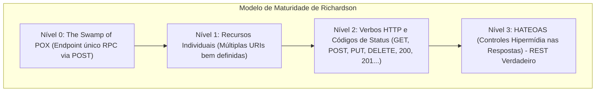
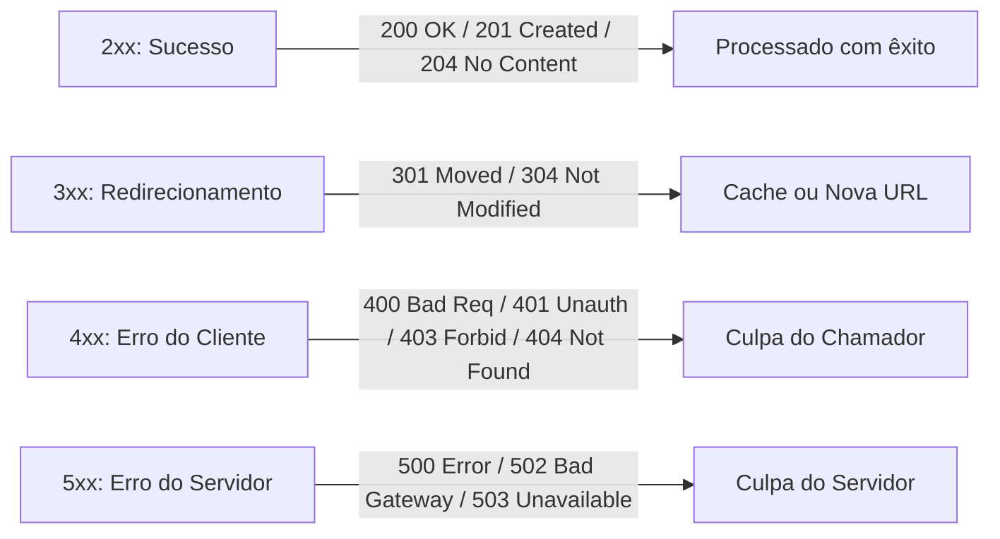
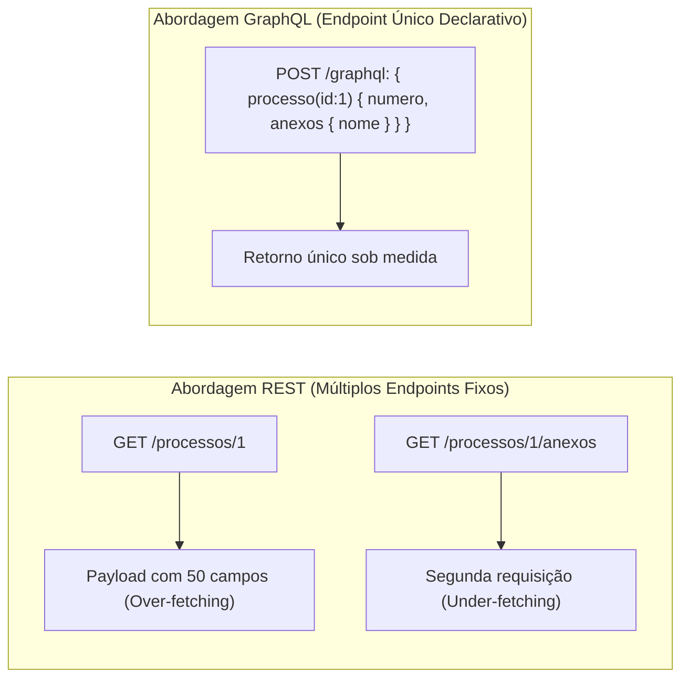
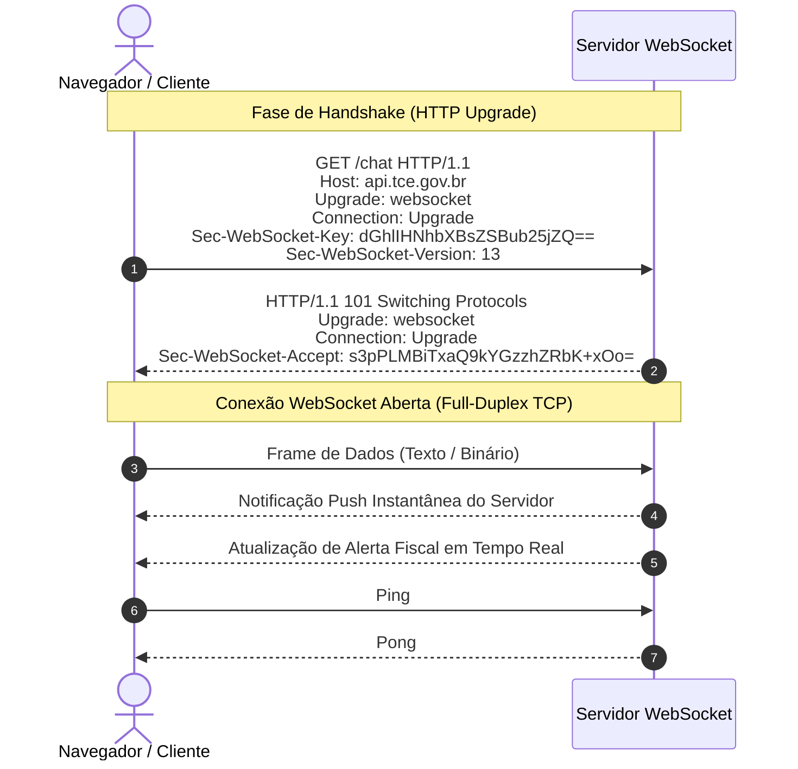

# 04 - APIs RESTful, GraphQL, WebSockets e Documentação

> **Matéria:** Desenvolvimento de Sistemas  
> **Cargo:** B02 – Técnico de Controle Externo – Especialidade: Tecnologia da Informação  
> **Arquivo:** `04_apis_restful_graphql_websockets_documentacao.md`  

---

## 📌 Ementa / Itens do Edital
- Desenvolvimento de APIs RESTful
- Conceitos de GraphQL e WebSockets
- Formatos de representação de dados: JSON e XML
- Documentação de APIs com OpenAPI e Swagger

---

## 🌳 Classificação Hierárquica

```text
4. Arquitetura de Comunicação em APIs e Intercâmbio de Dados
├── 4.1 APIs RESTful e Protocolo HTTP
│   ├── 4.1.1 Princípios Arquiteturais do REST (Roy Fielding):
│   │   ├── Cliente-Servidor (separação de responsabilidades)
│   │   ├── Sem Estado (Statelessness: cada requisição contém todo o contexto necessário)
│   │   ├── Cacheabilidade (respostas explicitamente marcadas como cacheáveis ou não)
│   │   ├── Interface Uniforme (identificação de recursos, manipulação via representações, mensagens auto-descritivas e HATEOAS)
│   │   ├── Sistema em Camadas (Layered System)
│   │   └── Código sob Demanda (Code on Demand - opcional)
│   ├── 4.1.2 Métodos HTTP e Semântica:
│   │   ├── GET (leitura segura e idempotente)
│   │   ├── POST (criação de recurso, não idempotente)
│   │   ├── PUT (substituição integral de recurso, idempotente)
│   │   ├── PATCH (atualização parcial de recurso)
│   │   ├── DELETE (remoção de recurso, idempotente)
│   │   └── OPTIONS e HEAD
│   ├── 4.1.3 Códigos de Status HTTP (Status Codes):
│   │   ├── 2xx (Sucesso): 200 OK, 201 Created, 204 No Content
│   │   ├── 3xx (Redirecionamento): 301 Moved Permanently, 304 Not Modified
│   │   ├── 4xx (Erro do Cliente): 400 Bad Request, 401 Unauthorized, 403 Forbidden, 404 Not Found, 409 Conflict, 422 Unprocessable Entity
│   │   └── 5xx (Erro do Servidor): 500 Internal Server Error, 502 Bad Gateway, 503 Service Unavailable, 504 Gateway Timeout
│   └── 4.1.4 Boas Práticas de Design REST: URIs com substantivos no plural, versionamento (/v1/...), paginação, filtros e ordenação
├── 4.2 GraphQL
│   ├── 4.2.1 Conceito e Comparação com REST:
│   │   ├── Resolução de problemas de Over-fetching (buscar mais dados do que o necessário)
│   │   ├── Resolução de Under-fetching (necessidade de múltiplas requisições em cascata)
│   │   └── Endpoint único (/graphql) via POST
│   ├── 4.2.2 Sistema de Tipos e Esquema (Schema Definition Language - SDL):
│   │   ├── Tipos escalares (Int, Float, String, Boolean, ID) e tipos de objeto
│   │   └── Diretivas e modificadores de nulidade (!)
│   └── 4.2.3 Operações Fundamentais:
│       ├── Query (consultas somente leitura)
│       ├── Mutation (operações de escrita/modificação com efeitos colaterais)
│       ├── Subscription (atualizações em tempo real baseadas em eventos)
│       └── Resolvers (funções responsáveis por resolver os dados dos campos)
├── 4.3 WebSockets
│   ├── 4.3.1 Conceito: Protocolo de comunicação bidirecional, persistente e full-duplex sobre uma única conexão TCP (ws:// e wss://)
│   ├── 4.3.2 Handshake WebSocket: Negociação inicial via HTTP com cabeçalhos Upgrade: websocket e Connection: Upgrade
│   └── 4.3.3 Casos de Uso: Chats em tempo real, painéis de monitoramento ao vivo, cotações financeiras, notificações push e jogos
├── 4.4 Formatos de Dados: JSON e XML
│   ├── 4.4.1 JSON (JavaScript Object Notation):
│   │   ├── Tipos suportados: String, Number, Boolean, Null, Array, Object
│   │   ├── Regras de sintaxe (chaves obrigatoriamente entre aspas duplas, sem vírgula residual)
│   │   └── Serialização (JSON.stringify) e Desserialização (JSON.parse)
│   └── 4.4.2 XML (Extensible Markup Language):
│       ├── Estrutura: Elementos, tags de abertura/fechamento, atributos, prólogo XML (<?xml version="1.0"?>)
│       ├── Validação de estrutura: DTD (Document Type Definition) e XML Schema (XSD)
│       └── Navegação e busca em XML: XPath
└── 4.5 Documentação de APIs com OpenAPI e Swagger
    ├── 4.5.1 OpenAPI Specification (OAS 3.0/3.1): Padrão aberto e agnóstico a linguagens para descrição de APIs REST
    ├── 4.5.2 Estrutura do Documento OpenAPI (YAML ou JSON):
    │   ├── openapi (versão da especificação)
    │   ├── info (título, versão, descrição, licença)
    │   ├── servers (URLs base de execução)
    │   ├── paths (rotas, métodos HTTP, parâmetros, requestBody e responses)
    │   └── components (schemas reutilizáveis, securitySchemes como Bearer/JWT)
    └── 4.5.3 Ecossistema Swagger:
        ├── Swagger UI (geração de interface interativa para testes e consumo de endpoints)
        └── Swagger Editor e geradores de código cliente/servidor (Swagger Codegen / OpenAPI Generator)
```

---

## 📖 Teoria Aprofundada & Pontos-Chave

### 4.1 APIs RESTful e o Protocolo HTTP

#### 4.1.1 Princípios Arquiteturais do REST (Roy Fielding)
O estilo arquitetural REST (*Representational State Transfer*) baseia-se em 6 restrições fundamentais:
1. **Cliente-Servidor:** Separação estrita entre a interface de usuário (*frontend*) e o armazenamento de dados/regras de negócio (*backend*), garantindo independência de evolução.
2. **Sem Estado (*Statelessness*):** Cada requisição do cliente para o servidor deve conter **todas as informações contextuais necessárias** para que o servidor a compreenda e processe. O servidor não mantém sessões de usuário na memória entre requisições.
3. **Cacheabilidade (*Cacheable*):** As respostas devem explicitar claramente se podem ou não ser armazenadas em cache por clientes e intermediários (via cabeçalhos `Cache-Control`, `ETag`, `Last-Modified`), otimizando a largura de banda e a latência.
4. **Interface Uniforme (*Uniform Interface*):**
   - *Identificação de Recursos:* Recursos individuais são mapeados por URIs estáveis (ex.: `/api/v1/processos/100`).
   - *Manipulação por Representações:* O cliente manipula o recurso através de sua representação (geralmente JSON ou XML).
   - *Mensagens Autodescritivas:* O cabeçalho `Content-Type` informa o tipo de mídia exato para processamento.
   - *HATEOAS (Hypermedia As The Engine Of Application State):* As respostas contêm links de hipermídia dinâmicos indicando as próximas ações válidas que o cliente pode executar.
5. **Sistema em Camadas (*Layered System*):** A arquitetura pode incluir intermediários invisíveis para o cliente (proxies reversos, load balancers, gateways de API e firewalls WAF).
6. **Código sob Demanda (*Code on Demand* - Única Opcional):** Permite ao servidor transferir temporariamente código executável para o cliente (ex.: scripts JavaScript).



#### 4.1.2 Métodos HTTP: Segurança (*Safety*) e Idempotência (*Idempotency*)

| Método | Seguro (*Safe*)? | Idempotente? | Finalidade Semântica | Status de Sucesso Típicos |
|---|:---:|:---:|---|---|
| **`GET`** | **Sim** | **Sim** | Recuperar representação de um recurso (somente leitura). | `200 OK` |
| **`HEAD`** | **Sim** | **Sim** | Idêntico ao GET, mas retorna **apenas cabeçalhos** (sem corpo). | `200 OK` |
| **`OPTIONS`**| **Sim** | **Sim** | Consulta quais métodos e cabeçalhos o servidor aceita (CORS). | `200 OK`, `204 No Content` |
| **`POST`** | **Não** | **Não** | Criação de um novo recurso subordinado ou processamento arbitrário. | `201 Created`, `200 OK` |
| **`PUT`** | **Não** | **Sim** | **Substituição completa** do recurso existente na URI indicada. | `200 OK`, `204 No Content` |
| **`PATCH`**| **Não** | **Não**\* | **Modificação parcial** de campos de um recurso existente. | `200 OK`, `204 No Content` |
| **`DELETE`**| **Não** | **Sim** | Exclusão do recurso indicado na URI. | `200 OK`, `204 No Content` |

*\*Nota Técnica RFC 5789: PATCH não é intrinsecamente idempotente por especificação, embora possa sê-lo dependendo da operação de patch aplicada.*

> ⭐ **IMPORTANTE / REGRA DE OURO:**  
> - **Método Seguro (*Safe*):** A chamada **não altera o estado dos recursos no servidor** (somente leitura).
> - **Método Idempotente:** Executar a mesma requisição uma vez ou $100$ vezes consecutivas com os mesmos parâmetros produz **exatamente o mesmo efeito no estado do servidor**. O `PUT` é idempotente porque reenviar o mesmo corpo completo substitui o recurso exatamente pelo mesmo estado. O `POST` não é idempotente porque chamá-lo 10 vezes cria 10 novos registros distintos no banco de dados.

#### 4.1.3 Principais Códigos de Status HTTP Cobrados pela FCC



- **`201 Created`:** Recurso criado com sucesso. Deve incluir o cabeçalho `Location` com a URI do novo recurso.
- **`204 No Content`:** A requisição foi atendida com sucesso, mas o servidor deliberadamente **não envia nenhum corpo** na resposta (comum em `DELETE` e `PUT`).
- **`304 Not Modified`:** Validação de cache bem-sucedida (ETag ou If-Modified-Since). O cliente deve reutilizar a cópia local; economiza tráfego de dados.
- **`400 Bad Request`:** Requisição mal formatada (JSON inválido, erro de sintaxe).
- **`401 Unauthorized`:** Na verdade significa **Não Autenticado** (*Unauthenticated*). Faltam credenciais no cabeçalho `Authorization` ou o token expirou.
- **`403 Forbidden`:** O usuário está **devidamente autenticado**, mas **não possui permissão/autorização** para o recurso solicitado.
- **`409 Conflict`:** Conflito de estado do recurso (ex.: tentativa de cadastrar um usuário com CPF que já existe no banco de dados).
- **`422 Unprocessable Entity`:** O JSON é sintaticamente válido, mas falha em regras de validação semântica de negócio (ex.: idade negativa).
- **`502 Bad Gateway`:** O servidor intermediário (proxy reverso/gateway) recebeu uma resposta inválida do servidor backend upstream.
- **`503 Service Unavailable`:** O servidor está temporariamente indisponível por sobrecarga ou manutenção agendada.
- **`504 Gateway Timeout`:** O servidor intermediário expirou o tempo de espera aguardando resposta do backend upstream.

---

### 4.2 GraphQL

#### 4.2.1 Solução de Gargalos do REST: Over-fetching vs. Under-fetching
- **Over-fetching:** Ocorre no REST quando um endpoint fixo retorna muito mais atributos do que o cliente precisa, gerando desperdício de dados na rede móvel.
- **Under-fetching:** Ocorre no REST quando um endpoint não traz informações suficientes, forçando o cliente a emitir múltiplas requisições em cascata para montar uma tela (ex.: `GET /processos/1` seguido de `GET /processos/1/interessados` e `GET /processos/1/anexos` - clássico problema $N+1$).
- **Solução do GraphQL:** O cliente envia uma consulta declarativa especificando **exatamente os campos desejados**, recebendo uma resposta JSON espelhada na estrutura da requisição, tudo via **endpoint único** (geralmente `/graphql`) sobre requisições HTTP POST.



#### 4.2.2 Elementos da Schema Definition Language (SDL) e Operações
- **Tipos Escalares Nativos:** `Int`, `Float`, `String`, `Boolean` e `ID` (identificador único serializado como string).
- **Modificador de Não-Nulo (`!`):** Indica campo estritamente obrigatório (ex.: `String!`).
- **Operações Principais:**
  1. **`Query`:** Operações exclusivas de consulta e leitura (equivalente aos métodos `GET` do REST).
  2. **`Mutation`:** Operações que modificam dados no backend (equivalente a `POST`, `PUT`, `DELETE`).
  3. **`Subscription`:** Conexão assíncrona persistente (geralmente mantida sobre WebSockets) para recebimento de atualizações em tempo real disparadas por eventos no servidor.
  4. **`Resolvers`:** Funções no backend associadas a cada campo do Schema responsáveis por consultar bancos de dados ou microserviços e retornar os dados requeridos.

---

### 4.3 WebSockets (RFC 6455)

#### 4.3.1 Conceito e Comunicação Full-Duplex
Enquanto o protocolo HTTP/1.1 tradicional opera no modelo cliente-servidor *half-duplex* (onde o cliente deve iniciar cada transação com uma requisição e aguardar uma resposta), o protocolo **WebSocket (`ws://` e `wss://`)** estabelece uma conexão TCP persistente e **Full-Duplex** (bidirecional simultânea), permitindo que servidor e cliente enviem mensagens a qualquer instante com sobrecarga mínima de cabeçalhos.



---

### 4.4 Formatos de Dados: JSON vs. XML

| Característica | JSON (JavaScript Object Notation) | XML (Extensible Markup Language) |
|---|---|---|
| **Estrutura** | Pares chave-valor e coleções indexadas (`{}`, `[]`) | Árvore hierárquica baseada em tags personalizadas e atributos |
| **Tipos Suportados** | String, Number, Boolean, Null, Array, Object | Todos os dados são texto puro estruturado por marcação |
| **Sintaxe Estrita** | Chaves **obrigatoriamente entre aspas duplas**; proibida vírgula sobrando (*trailing comma*); sem comentários nativos | Exige prólogo `<?xml ...?>`, fechamento estrito de todas as tags e case-sensitive |
| **Validação de Esquema**| JSON Schema | **DTD** (*Document Type Definition*) e **XSD** (*XML Schema Definition*) |
| **Navegação / Consulta**| JSONPath | **XPath** e **XQuery** |
| **Verbosidade e Parsing**| Levíssimo e nativo para motores JS | Verboso e maior consumo de CPU/memória para parsing |

---

### 4.5 Documentação de APIs com OpenAPI e Swagger

- **OpenAPI Specification (OAS 3.0/3.1):** Padrão aberto formal e agnóstico a linguagens para descrever a interface de APIs RESTful utilizando sintaxe YAML ou JSON.
- **Seções Principais de um Documento OpenAPI:**
  - `openapi`: Versão da especificação (ex.: `3.0.3` ou `3.1.0`).
  - `info`: Metadados da API (título, descrição, versão da API e contato).
  - `servers`: Lista de URLs base para os ambientes (produção, homologação).
  - `paths`: Mapeamento das rotas e operações HTTP (`get`, `post`, etc.), definindo parâmetros de rota (`path`), query strings, cabeçalhos, corpo da requisição (`requestBody`) e respostas esperadas (`responses`).
  - `components`: Bloco de reutilização modular contendo `schemas` (modelos de dados), `securitySchemes` (configurações de autenticação como JWT Bearer Token, OAuth2 ou API Key) e respostas genéricas.
- **Ecossistema Swagger:**
  - **Swagger UI:** Converte o arquivo OpenAPI em uma página web interativa que documenta os endpoints e permite a execução de testes manuais diretamente pelo navegador (*Try it out*).
  - **Swagger Editor:** Editor online para projetar e validar arquivos OpenAPI em tempo real.

---

## 🌐 Fontes Recomendadas na Internet (Acesso Direto e Gratuito)

- [x] **OpenAPI Initiative - Especificação Oficial OpenAPI 3.0 / 3.1:**
  - Link Oficial: [OpenAPI Official Specification](https://spec.openapis.org/oas/latest.html)
  - *Conteúdo:* Sintaxe canônica de `paths`, `requestBody`, `responses`, `components` e esquemas de segurança.
- [x] **GraphQL.org - Documentação e Tutoriais Oficiais:**
  - Link Oficial: [GraphQL Official Learn](https://graphql.org/learn/)
  - *Conteúdo:* Guia completo da Schema Definition Language (SDL), Queries, Mutations, Subscriptions e Resolvers.
- [x] **MDN Web Docs - The WebSocket API & Métodos HTTP:**
  - Link Oficial: [MDN WebSockets API](https://developer.mozilla.org/pt-BR/docs/Web/API/WebSockets_API) e [MDN HTTP Status Codes](https://developer.mozilla.org/pt-BR/docs/Web/HTTP/Status)
  - *Conteúdo:* Protocolo WebSocket, handshake HTTP `101 Switching Protocols` e semântica de métodos e códigos de status HTTP.
- [x] **Roy Fielding - Architectural Styles and the Design of Network-based Software Architectures:**
  - Link Oficial: [Dissertação Original de Roy Fielding (Capítulo 5 - REST)](https://ics.uci.edu/~fielding/pubs/dissertation/rest_arch_style.htm)
  - *Conteúdo:* Definição acadêmica original dos princípios do REST e restrições arquiteturais.

---

## 📝 Questões Comentadas & Exemplos (Padrão FCC)

### Questão 1 (FCC - Analista de TI / Arquitetura de Software)
No projeto de uma API web RESTful aderente aos padrões da RFC 7231 (HTTP/1.1), considere os métodos `GET`, `POST`, `PUT` e `DELETE`. A respeito dos conceitos fundamentais de segurança (*safety*) e idempotência (*idempotency*) desses métodos, assinale a afirmativa correta:  
A) O método `POST` é seguro e idempotente, razão pela qual deve ser invocado em operações de auditoria que demandem garantia de não repetição.  
B) O método `PUT` não é seguro, mas é idempotente, pois disparar sucessivas requisições idênticas deve produzir exatamente a mesma alteração no estado do servidor que uma única requisição.  
C) O método `GET` é idempotente, mas não é seguro, pois sua execução altera os metadados de acesso gravados no servidor.  
D) A propriedade de idempotência assegura que os cabeçalhos de resposta HTTP retornados pelo servidor conterrão sempre o mesmo carimbo de data e hora (*timestamp*).  
E) O método `DELETE` não é seguro nem idempotente, já que a segunda tentativa de exclusão do mesmo recurso costuma retornar um código de erro `404 Not Found`.  

> **Gabarito: B**  
>
> **Comentário Analítico Passo a Passo:**  
> A especificação HTTP define com precisão:
> - **Método Seguro (*Safe*):** Operação estritamente de leitura que não modifica o estado de recursos no servidor (`GET`, `HEAD`, `OPTIONS`).
> - **Método Idempotente:** Uma operação onde múltiplas requisições idênticas provocam **o mesmo efeito no estado do recurso no servidor** que uma requisição única. `GET`, `PUT`, `DELETE` e `HEAD` são formalmente **idempotentes**.
>
> **Análise detalhada das alternativas:**  
> - **A (Incorreta):** O `POST` não é seguro (ele cria recursos ou executa processamentos) e **NÃO é idempotente** (se você chamar `POST` 5 vezes seguidas para criar um processo, o servidor criará 5 processos com IDs distintos).  
> - **B (CORRETA):** O método `PUT` substitui integralmente a representação do recurso no servidor. Ele não é seguro (já que modifica dados), mas **é estritamente idempotente**: se enviamos a mesma requisição `PUT` para `/processos/123` uma ou dez vezes com os mesmos dados, ao término de todas elas o recurso terá rigorosamente o mesmo conteúdo final no banco de dados.  
> - **C (Incorreta):** O `GET` é tanto seguro quanto idempotente por definição canônica da RFC.  
> - **D (Incorreta):** Idempotência diz respeito ao **estado do recurso no servidor**, e não aos carimbos de data/hora ou cabeçalhos temporais das mensagens de resposta.  
> - **E (Incorreta):** O `DELETE` **é idempotente**! A idempotência mede o efeito final no estado do servidor: após o primeiro `DELETE`, o recurso deixa de existir; executar o comando novamente mantém o recurso no mesmo estado (inexistente). O fato de o status HTTP poder variar de `200/204` na primeira chamada para `404` na segunda chamada não revoga a idempotência do método.

---

### Questão 2 (FCC - Técnico de Controle Externo / TI)
Em uma aplicação corporativa de controle de gastos públicos, a equipe de desenvolvimento optou por substituir diversos endpoints de uma API REST tradicional por uma interface em GraphQL. A principal justificativa técnica para essa decisão foi sanar dois problemas típicos do REST conhecidos como:  
A) Deadlock concorrente e estouro de memória física na máquina cliente.  
B) Falha de segmentação no banco de dados e violação de chaves estrangeiras.  
C) *Over-fetching* (recebimento de dados excessivos desnecessários à visualização) e *Under-fetching* (necessidade de emitir múltiplas requisições em cascata para compor uma única tela).  
D) Ausência de criptografia nativa no tráfego HTTPS e quebra de sessões HTTP.  
E) Incompatibilidade com formatos estruturados de serialização como JSON e XML.  

> **Gabarito: C**  
>
> **Comentário Analítico Passo a Passo:**  
> As duas principais motivações arquiteturais que impulsionaram a criação do GraphQL pelo Facebook (Meta) foram precisamente:
> 1. **Over-fetching:** Endpoints REST fixos devolvem objetos completos com dezenas de campos, quando uma tela mobile simples só precisava de dois ou três, sobrecarregando a banda.
> 2. **Under-fetching:** Um único endpoint REST frequentemente não fornece todos os dados correlacionados necessários, exigindo que o cliente faça requisições sequenciais para `/usuarios`, `/pedidos`, `/itens` (problema $N+1$).
>
> **Análise detalhada das alternativas:**  
> - **A (Incorreta):** Deadlock e consumo de memória física são problemas de gerência de sistemas operacionais e concorrência interna de banco, não tendo qualquer relação com a escolha entre REST e GraphQL.  
> - **B (Incorreta):** Integridade relacional de chaves estrangeiras é atribuição de SGBDs relacionais (SQL), independente da camada de API de transporte.  
> - **C (CORRETA):** Aponta perfeitamente os dois conceitos canônicos que definem a vantagem técnica do GraphQL sobre endpoints REST rígidos.  
> - **D (Incorreta):** Tanto REST quanto GraphQL utilizam TLS/HTTPS de forma idêntica para prover criptografia e confidencialidade no transporte.  
> - **E (Incorreta):** O GraphQL trafega nativamente sobre o formato JSON, desmentindo qualquer incompatibilidade.

---

### Questão 3 (FCC - Analista de TI / Sistemas)
Um cliente web tenta acessar um endpoint restrito de um sistema administrativo enviando um token de autorização devidamente válido e assinado, que identifica o usuário como pertencente ao perfil "Estagiário". O recurso solicitado, entretanto, exige prerrogativas exclusivas do perfil "Auditor Titular".

Nessa situação, de acordo com as especificações do protocolo HTTP/1.1 e as boas práticas de design RESTful, o código de status HTTP que o servidor deve retornar é:  
A) `401 Unauthorized`  
B) `403 Forbidden`  
C) `400 Bad Request`  
D) `404 Not Found`  
E) `502 Bad Gateway`  

> **Gabarito: B**  
>
> **Comentário Analítico Passo a Passo:**  
> Esta questão testa uma das pegadinhas conceituais mais frequentes da Fundação Carlos Chagas: a fronteira entre autenticação e autorização nos status HTTP 4xx.
> - **401 Unauthorized:** Deve ser emitido quando a requisição carece de credenciais de **autenticação** válidas (usuário não informou token, token corrompido, assinatura inválida ou token expirado). Significa: *"Eu não sei quem você é"*.
> - **403 Forbidden:** O servidor **sabe exatamente quem é o usuário** (ele está validamente autenticado no sistema como "Estagiário"), mas o usuário **não possui os privilégios/permissões necessários** para acessar a operação ou dado pretendido. Significa: *"Eu sei quem você é, mas você não tem permissão para entrar aqui"*.
>
> **Análise detalhada das alternativas:**  
> - **A (Incorreta):** O usuário já está autenticado com token válido, portanto o código 401 seria semanticamente incorreto.  
> - **B (CORRETA):** Como o usuário foi autenticado com sucesso, mas não tem autorização para o perfil de auditor titular, o status padronizado é rigorosamente o `403 Forbidden`.  
> - **C (Incorreta):** 400 indica requisição com sintaxe malformada (como um erro de parsing de JSON), o que não é o caso.  
> - **D (Incorreta):** 404 indica que o recurso buscado não existe na URI indicada.  
> - **E (Incorreta):** 502 é um erro de infraestrutura do servidor proxy intermediário (*Bad Gateway*), não um erro de controle de acesso do cliente.

---

### Questão 4 (FCC - Auditor Fiscal / Tecnologia da Informação)
No desenvolvimento de aplicações web modernas que requerem comunicação bidirecional em tempo real e de baixa latência, o protocolo WebSocket (RFC 6455) destaca-se frente ao modelo tradicional de requisições HTTP repetitivas (*polling*).

Sobre o protocolo WebSocket e seu procedimento inicial de conexão (*handshake*), assinale a afirmativa correta:  
A) O WebSocket utiliza uma conexão UDP não orientada a fluxo, razão pela qual não requer procedimento prévio de handshake.  
B) A fase de handshake inicia-se por meio de uma requisição HTTP convencional do cliente contendo os cabeçalhos `Upgrade: websocket` e `Connection: Upgrade`, à qual o servidor responde com o código `101 Switching Protocols` caso aceite a transição de protocolo.  
C) O protocolo opera estritamente no modo half-duplex, obrigando o servidor a esperar a finalização de uma transmissão do cliente antes de enviar qualquer mensagem.  
D) O protocolo WebSocket proíbe qualquer tráfego seguro criptografado, funcionando exclusivamente através do identificador de esquema `ws://`.  
E) Cada mensagem trocada entre cliente e servidor em uma conexão WebSocket aberta precisa reenviar todos os cabeçalhos HTTP de autorização e cookies para validação.  

> **Gabarito: B**  
>
> **Comentário Analítico Passo a Passo:**  
> O protocolo WebSocket (RFC 6455) foi concebido para superar a ineficiência de conexões half-duplex e *polling* contínuo no HTTP.
>
> **Análise detalhada das alternativas:**  
> - **A (Incorreta):** WebSockets operam sobre uma conexão orientada a conexão e confiável baseada em **TCP**, e não UDP.  
> - **B (CORRETA):** A inicialização da conexão WebSocket é realizada por um mecanismo chamado *HTTP Upgrade Handshake*. O cliente emite um `GET` HTTP padrão com `Upgrade: websocket` e `Connection: Upgrade`. O servidor confirma aceitando a transição por meio do código de resposta especial **`101 Switching Protocols`**. A partir daí, a conexão TCP estabelecida passa a trafegar mensagens WebSocket com overhead mínimo.  
> - **C (Incorreta):** WebSockets são **Full-Duplex** (bidirecionais simultâneos): ambos os lados podem emitir mensagens concomitantemente sem bloqueios.  
> - **D (Incorreta):** Existe suporte nativo a tráfego seguro criptografado com TLS através do esquema **`wss://`** (WebSocket Secure), que roda sobre a porta 443 padrão da web.  
> - **E (Incorreta):** Esta é a principal vantagem de desempenho do WebSocket: os cabeçalhos HTTP só são enviados uma única vez no handshake inicial. As mensagens subsequentes trafegam encapsuladas em frames levíssimos (com cabeçalhos de apenas 2 a 10 bytes), dispensando reenvio de cookies e credenciais a cada pacote.

---

### Questão 5 (FCC - Analista de Sistemas / Arquitetura e Integração)
A respeito da especificação OpenAPI (antigo Swagger) e do Modelo de Maturidade de Richardson para arquiteturas de serviços RESTful, assinale a afirmativa correta:  
A) O Nível 3 do Modelo de Richardson preconiza a implementação de HATEOAS (*Hypermedia As The Engine Of Application State*), fornecendo nas respostas representações que incluem links navegáveis para as próximas transições de estado possíveis.  
B) Em um documento OpenAPI 3.0, a seção `components/schemas` é obrigatória em todas as rotas e impede a reutilização de definições de modelos de dados entre endpoints diferentes.  
C) O Nível 1 do Modelo de Richardson caracteriza-se pelo uso de um único endpoint monolítico e uso exclusivo do método HTTP POST para todas as operações do sistema (*The Swamp of POX*).  
D) O Swagger UI é uma biblioteca restrita ao backend de compiladores Java, não possuindo capacidade de gerar interfaces gráficas web para testes interativos de requisições.  
E) Um documento OpenAPI só pode ser estruturado exclusivamente na linguagem XML, sendo proibida a utilização de YAML ou JSON.  

> **Gabarito: A**  
>
> **Comentário Analítico Passo a Passo:**  
> Vamos analisar os conceitos de OpenAPI e do Modelo de Richardson:
> - O Modelo de Maturidade de Richardson define quatro níveis (0 a 3) para avaliar a conformidade de uma arquitetura com os princípios puros do REST de Roy Fielding.
>
> **Análise detalhada das alternativas:**  
> - **A (CORRETA):** O Nível 3 (glória do REST) é atingido quando a API incorpora **HATEOAS**, fornecendo links de hipermídia (como links `rel="next"`, `rel="cancel"`, `href="..."`) no corpo da resposta para que o cliente navegue e execute transições de estado sem precisar codificar URIs fixas no frontend.  
> - **B (Incorreta):** A seção `components` no OpenAPI é expressamente destinada à **reutilização modular** de definições de dados (`schemas`), evitando duplicação de modelos através do uso de referências (`$ref: '#/components/schemas/Processo'`).  
> - **C (Incorreta):** O uso de um único endpoint com POST (RPC estilo SOAP ou XML-RPC) é a definição do **Nível 0** (*The Swamp of POX*). O Nível 1 introduz múltiplos recursos com URIs distintas.  
> - **D (Incorreta):** O Swagger UI é amplamente conhecido justamente por gerar uma interface visual dinâmica no navegador (em HTML/JS) que permite inspecionar parâmetros e testar requisições em tempo real (*Try it out*).  
> - **E (Incorreta):** Documentos OpenAPI são escritos padronizadamente em **YAML** ou **JSON**, não existindo dependência ou exigência de formato XML.
