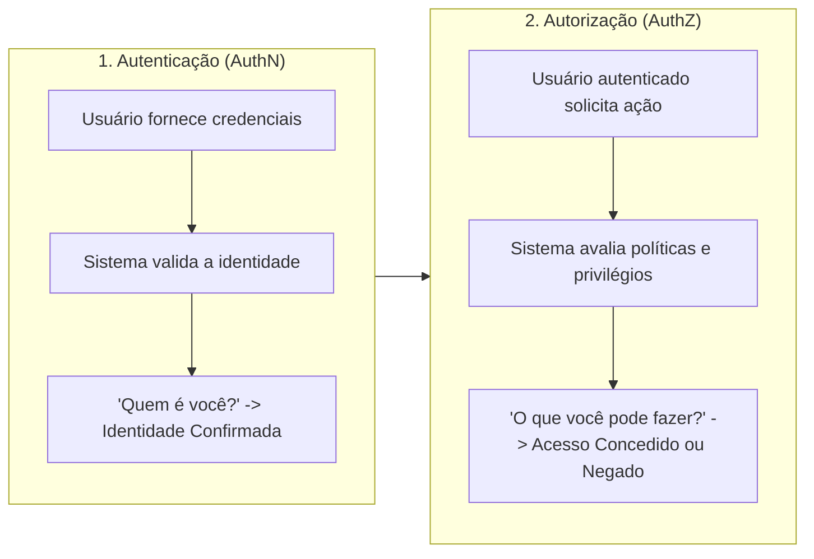
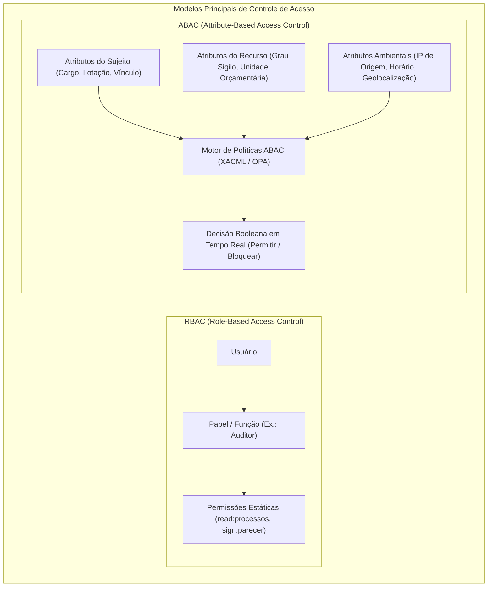
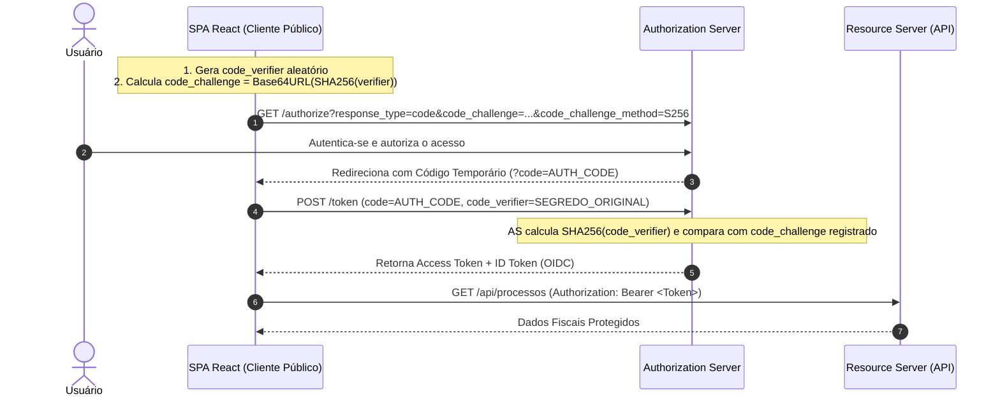
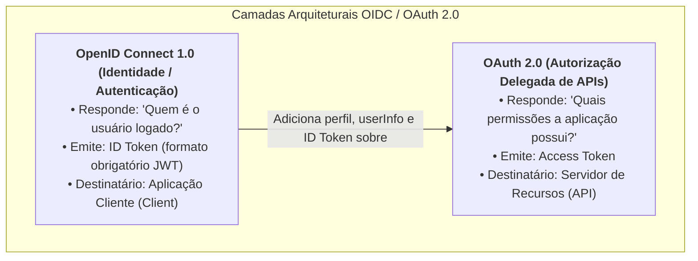
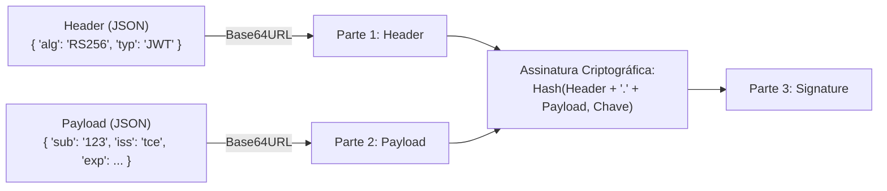
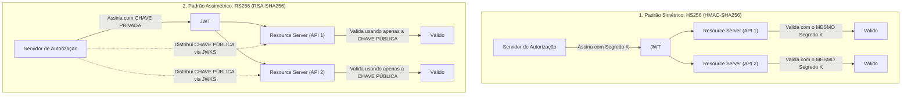

# 05 - Autenticação, Identidade e Autorização: OAuth 2.0, OIDC e JWT

> **Matéria:** Desenvolvimento de Sistemas  
> **Cargo:** B02 – Técnico de Controle Externo – Especialidade: Tecnologia da Informação  
> **Arquivo:** `05_autenticacao_identidade_oauth2_oidc_jwt.md`  

---

## 📌 Ementa / Itens do Edital
- Autenticação, identidade e autorização
- Framework OAuth 2.0 (RFC 6749)
- Camada de Identidade OpenID Connect (OIDC 1.0)
- Tokens, claims e escopos
- JSON Web Token (JWT - RFC 7519)

---

## 🧭 Sumário
- [1. Conceitos Fundamentais de Segurança de Acesso](#1-conceitos-fundamentais-de-seguranca-de-acesso)
    - [1.1 Autenticação (AuthN) vs. Autorização (AuthZ)](#11-autenticacao-authn-vs-autorizacao-authz)
    - [1.2 Fatores de Autenticação e MFA](#12-fatores-de-autenticacao-e-mfa)
    - [1.3 Modelos de Controle de Acesso: RBAC e ABAC](#13-modelos-de-controle-de-acesso-rbac-e-abac)
- [2. Framework de Autorização OAuth 2.0 (RFC 6749)](#2-framework-de-autorizacao-oauth-20-rfc-6749)
    - [2.1 Os Quatro Papéis Fundamentais](#21-os-quatro-papeis-fundamentais)
    - [2.2 Fluxos de Concessão (Grant Types) e Cenários de Aplicação](#22-fluxos-de-concessao-grant-types-e-cenarios-de-aplicacao)
    - [2.3 A Extensão PKCE (RFC 7636) para Clientes Públicos](#23-a-extensao-pkce-rfc-7636-para-clientes-publicos)
    - [2.4 Escopos (Scopes) e Autorização Granular](#24-escopos-scopes-e-autorizacao-granular)
- [3. Camada de Identidade OpenID Connect (OIDC 1.0)](#3-camada-de-identidade-openid-connect-oidc-10)
    - [3.1 Distinção Essencial: OAuth 2.0 vs. OpenID Connect](#31-distincao-essencial-oauth-20-vs-openid-connect)
    - [3.2 Tríade de Tokens no OIDC: ID Token, Access Token e Refresh Token](#32-triade-de-tokens-no-oidc-id-token-access-token-e-refresh-token)
    - [3.3 Endpoints Padronizados OIDC e Single Sign-On (SSO) Corporativo](#33-endpoints-padronizados-oidc-e-single-sign-on-sso-corporativo)
- [4. JSON Web Token - JWT (RFC 7519)](#4-json-web-token-jwt-rfc-7519)
    - [4.1 Anatomia Estrutural: Header, Payload e Signature](#41-anatomia-estrutural-header-payload-e-signature)
    - [4.2 Claims Registradas, Públicas e Privadas](#42-claims-registradas-publicas-e-privadas)
    - [4.3 Assinatura Digital: Algoritmos Simétricos (HS256) vs. Assimétricos (RS256)](#43-assinatura-digital-algoritmos-simetricos-hs256-vs-assimetricos-rs256)
    - [4.4 Armazenamento Seguro de Tokens no Cliente e Mitigação de Ataques](#44-armazenamento-seguro-de-tokens-no-cliente-e-mitigacao-de-ataques)
- [5. Quadro Comparativo Consolidado de Segurança de Acesso](#5-quadro-comparativo-consolidado-de-seguranca-de-acesso)
- [6. Fontes Recomendadas na Internet](#6-fontes-recomendadas-na-internet)

---

## 1. Conceitos Fundamentais de Segurança de Acesso

### 1.1 Autenticação (AuthN) vs. Autorização (AuthZ)
A segurança em sistemas de informação modernos apoia-se na distinção categórica entre dois processos interdependentes:



- **Autenticação (AuthN - *Authentication*):** Processo de validação e verificação inequívoca da identidade alegada por uma entidade (seja ela um usuário humano, um dispositivo ou um serviço autônomo). Responde à indagação fundamental: **"Quem é você?"**.
- **Autorização (AuthZ - *Authorization*):** Processo de determinar quais direitos, permissões e operações uma entidade **previamente autenticada** tem legitimidade para exercer sobre um recurso específico no sistema. Responde à pergunta: **"O que você tem permissão para fazer?"**.

---

### 1.2 Fatores de Autenticação e MFA
A robustez do processo de autenticação é medida pelo emprego de múltiplos fatores independentes (**MFA - *Multi-Factor Authentication***):

1. **Fator de Conhecimento (*Something you know*):** Informações secretas memorizadas pelo usuário (senhas alfanuméricas, códigos PIN, respostas a perguntas de segurança).
2. **Fator de Posse (*Something you have*):** Objetos físicos ou digitais sob custódia do usuário (smartcards com chip, tokens criptográficos USB/FIDO2, certificados digitais ICP-Brasil, aplicativos autenticadores geradores de senhas descartáveis baseadas em tempo — TOTP/Google Authenticator).
3. **Fator de Inerência (*Something you are*):** Características biológicas ou biométricas intrínsecas e exclusivas do indivíduo (impressão digital, reconhecimento facial 3D, geometria de íris/retina, padrão vascular).

> 🚨 **ALERTA DE PROVA / FCC:**  
> A banca costuma colocar pegadinhas afirmando que "utilizar senha e código PIN simultaneamente configura autenticação multifator". Isso é falso! Senha e PIN pertencem à **mesma categoria (conhecimento)**. O MFA exige o uso concorrente de pelo menos **duas categorias distintas de fatores** (ex.: senha + token TOTP ou biometria + certificado digital).

---

### 1.3 Modelos de Controle de Acesso: RBAC e ABAC
Uma vez autenticada a entidade, o subsistema de autorização aplica políticas para liberar ou vetar o acesso aos endpoints e bancos de dados:



| Critério de Comparação | RBAC (*Role-Based Access Control*) | ABAC (*Attribute-Based Access Control*) |
|---|---|---|
| **Fundamento Central** | Acesso concedido com base no **papel ou função estrutural** que o indivíduo exerce na organização (`Auditor`, `Gestor`, `Técnico`). | Acesso avaliado dinamicamente combinando múltiplos **atributos** do sujeito, do recurso, da ação pretendida e do ambiente contextual. |
| **Flexibilidade Contextual** | **Baixa**. O papel é estático e ignora variáveis temporais, geográficas ou de rede no momento da solicitação. | **Altíssima**. Permite regras condicionais refinadas (ex.: "Permitir acesso apenas se o auditor pertencer à 2ª Câmara, o processo for da sua relatoria e o acesso ocorrer em dia útil via VPN do TCE"). |
| **Complexidade de Gestão** | Sofre do problema de **explosão de papéis (*role explosion*)** quando a organização necessita de regras com granularidade muito fina. | Complexidade na escrita e no processamento computacional de políticas dinâmicas (frequentemente expressas em padrões como XACML ou OPA/Rego). |
| **Aplicação Típica** | Sistemas departamentais convencionais e portais corporativos simples. | Ambientes governamentais críticos, controle fiscal e sistemas orientados a microsserviços. |

---

## 2. Framework de Autorização OAuth 2.0 (RFC 6749)

### 2.1 Os Quatro Papéis Fundamentais
O framework OAuth 2.0 (padronizado pela IETF na **RFC 6749**) foi concebido para resolver o problema da concessão delegada de acesso, permitindo que uma aplicação terceira acesse recursos protegidos em nome do usuário **sem jamais exigir o compartilhamento de suas credenciais (login e senha)**.

1. **Resource Owner (Proprietário do Recurso):** A entidade (normalmente o usuário humano final) capaz de outorgar o acesso aos seus recursos protegidos.
2. **Client (Aplicação Cliente):** A aplicação que realiza requisições a recursos protegidos em nome do *Resource Owner*. Classifica-se em:
    - *Confidential Client (Cliente Confidencial):* Capaz de manter a confidencialidade de suas credenciais (`client_secret`), pois roda em servidores backend seguros controlados pela organização.
    - *Public Client (Cliente Público):* Incapaz de proteger um segredo criptográfico estático, pois roda no dispositivo do usuário final (SPAs em JavaScript no navegador, aplicativos móveis para Android/iOS).

3. **Authorization Server (Servidor de Autorização):** Servidor responsável por autenticar o *Resource Owner*, colher o seu consentimento expresso e emitir os tokens criptográficos de acesso (*Access Tokens*) após validação das credenciais e escopos.
4. **Resource Server (Servidor de Recursos):** O servidor que hospeda os recursos e APIs protegidos, capaz de receber, validar os tokens de acesso e responder às requisições do cliente.

---

### 2.2 Fluxos de Concessão (Grant Types) e Cenários de Aplicação
O OAuth 2.0 define fluxos distintos de acordo com a natureza da aplicação cliente e os requisitos de segurança:

```mermaid
flowchart TD
    subgraph EscolhaGrant["Árvore de Decisão de Fluxos OAuth 2.0 Modernos"]
        Q1{"Há usuário humano envolvido?"}
        Q1 -->|Não (Comunicação M2M / Batch)| CC["Client Credentials Grant"]
        Q1 -->|Sim| Q2{"O cliente consegue proteger um secret no backend?"}
        Q2 -->|Sim (Web App Tradicional)| AC["Authorization Code Grant"]
        Q2 -->|Não (SPA React ou App Mobile)| PKCE["Authorization Code Grant com PKCE"]
    end
```

| Fluxo (*Grant Type*) | Cenário Operacional | Nível de Segurança | Situação Normativa Atual |
|---|---|:---:|---|
| **Authorization Code** | Aplicações Web clássicas baseadas em servidor com backend seguro (*confidential clients*). | **Máximo** | Padrão recomendado pela IETF. |
| **Authorization Code com PKCE** | Clientes públicos: Single Page Applications (SPAs em React, Angular) e Apps Mobile nativos. | **Máximo** | **Obrigatório** pelas diretrizes contemporâneas (RFC 7636 e OAuth 2.1). |
| **Client Credentials** | Comunicação direta máquina-a-máquina (M2M), microsserviços internos, scripts batch e daemons sem usuário. | **Alto** | Padrão oficial para comunicação automatizada entre sistemas. |
| **Refresh Token Grant** | Renovação transparente de *Access Tokens* expirados sem requerer novo login do usuário. | **Alto** | Empregado como mecanismo complementar aos fluxos de código. |
| **Implicit Grant** | SPAs legadas nos primórdios da web, onde o token vinha diretamente exposto no fragmento da URL (`#access_token=...`). | **Vulnerável** | **DEPRECADO E PROIBIDO** no OAuth 2.1 devido a riscos de interceptação no histórico do navegador. |
| **Resource Owner Password Credentials (ROPC)** | O usuário digita suas credenciais corporativas diretamente na tela da aplicação cliente. | **Crítico** | **DEPRECADO E PROIBIDO** no OAuth 2.1 (viola a premissa central de não compartilhar senhas com clientes terceiros). |

---

### Questão 01 (FCC - Analista de TI / Segurança e Arquitetura)
Uma equipe de desenvolvimento do Tribunal de Contas está projetando a integração de uma nova aplicação Web Single Page Application (SPA), construída com React, com a API de auditoria de processos governamentais. A aplicação cliente executa integralmente no navegador do usuário (*public client*) e necessita autenticar a identidade dos auditores para obter acesso aos endpoints protegidos.

Considerando as boas práticas contemporâneas de segurança preconizadas pela IETF e pela OpenID Foundation:  

* **A)** Deve-se adotar o fluxo *Implicit Grant* do OAuth 2.0, visto que ele elimina a necessidade de redirecionamentos adicionais e expõe o access token diretamente na URL para agilizar o carregamento.
* **B)** O protocolo OpenID Connect (OIDC) deve ser empregado na camada de autenticação, utilizando o fluxo *Authorization Code Grant* com a extensão PKCE (RFC 7636), emitindo um `id_token` para identificar o usuário perante a aplicação React e um `access_token` para consumir a API.
* **C)** O protocolo OAuth 2.0 isolado é suficiente para autenticar o auditor perante o frontend React, bastando conferir a presença do escopo `read:processos` na requisição.
* **D)** O fluxo mais recomendado para esse cenário é o *Resource Owner Password Credentials* (ROPC), pelo qual o frontend coleta login e senha diretamente em um formulário comum e os repassa ao servidor de autorização.
* **E)** A integridade e autenticidade do token JWT devem ser verificadas no frontend através de um algoritmo simétrico HS256, armazenando o segredo compartilhado nas variáveis de ambiente estáticas do código JavaScript.

> **Comentário Detalhado:**
>
> - **A)** Incorreta. O fluxo *Implicit Grant* foi formalmente deprecado e proibido nas diretrizes modernas do OAuth 2.0 e OAuth 2.1 devido à exposição indevida do token no fragmento de URL do histórico de navegação e cabeçalhos `Referer`.
> - **B)** **CORRETA.** A autenticação da identidade do usuário é de competência do **OpenID Connect (OIDC)**, que fornece o `id_token`. Em clientes públicos no navegador (SPAs), a especificação IETF determina estritamente o uso do **Authorization Code Grant complementado com a extensão PKCE** (RFC 7636), evitando que interceptações de código de autorização permitam a geração de tokens ilegítimos.
> - **C)** Incorreta. O OAuth 2.0 provê apenas autorização delegada, não autenticação. Supor a identidade de um usuário unicamente pela posse de um access token configura uma vulnerabilidade clássica de pseudo-autenticação.
> - **D)** Incorreta. O fluxo ROPC (coleta direta de login e senha pela aplicação cliente) é considerado obsoleto e proibido em novas implementações, por quebrar o isolamento de credenciais e impedir autenticação multifator nativa.
> - **E)** Incorreta. A validação com algoritmo simétrico (HS256) exige o compartilhamento de um segredo criptográfico. Inserir esse segredo no código de uma SPA expõe a chave a qualquer usuário por meio do DevTools do navegador. Deve-se empregar RS256 e validação com chave pública via JWKS.
> 
> **Gabarito: B**

---

### Questão 02 (FCC - Analista de TI / Sistemas)
Em uma arquitetura de microsserviços do Tribunal de Contas, uma rotina de integração em lote (*batch*) executada durante a madrugada no backend precisa consumir dados da API da Secretaria da Fazenda para conciliação contábil. Esse processo é totalmente automatizado e executado sem nenhuma intervenção de usuário humano final.

De acordo com o framework OAuth 2.0 (RFC 6749), o fluxo de concessão (*Grant Type*) mais adequado e recomendado para essa comunicação máquina-a-máquina (M2M) é o:  

* **A)** *Authorization Code Grant* com tela de consentimento de usuário.
* **B)** *Client Credentials Grant*.
* **C)** *Implicit Grant*.
* **D)** *Resource Owner Password Credentials Grant*.
* **E)** *Device Authorization Grant*.

> **Comentário Detalhado:**
>
> - **A)** Incorreta. O fluxo Authorization Code exige que um usuário humano interaja em um navegador para fornecer consentimento e autenticação, sendo incompatível com rotinas batch sem interação humana.
> - **B)** **CORRETA.** O fluxo **Client Credentials Grant** é o mecanismo padronizado pelo OAuth 2.0 para cenários de comunicação direta máquina-a-máquina (M2M) ou serviços autônomos. A aplicação cliente autentica-se diretamente perante o Servidor de Autorização utilizando suas próprias credenciais (`client_id` e `client_secret`) e obtém um *Access Token* para consumir as APIs necessárias sem requerer contexto de usuário individual.
> - **C)** Incorreta. O Implicit Grant é voltado a clientes no navegador e está deprecado.
> - **D)** Incorreta. O ROPC exige credenciais individuais de um usuário físico e está obsoleto.
> - **E)** Incorreta. O Device Grant (RFC 8628) destina-se a dispositivos com capacidade limitada de entrada de dados (smart TVs, consoles de videogame), onde o usuário utiliza um segundo aparelho para autenticação.
> 
> **Gabarito: B**

---


### 2.3 A Extensão PKCE (RFC 7636) para Clientes Públicos
Em clientes públicos (como aplicações React ou apps móveis), um atacante pode registrar um esquema customizado de URI ou inspecionar o tráfego do sistema operacional para interceptar o código de autorização (`code`) retornado pelo servidor. Como o cliente público não possui um `client_secret` sigiloso, o atacante poderia trocar esse código interceptado por um *Access Token*.

A extensão **PKCE** (*Proof Key for Code Exchange*, RFC 7636) neutraliza essa ameaça através de segredos criptográficos efêmeros criados dinamicamente para cada autenticação:



1. O cliente cria uma string secreta criptograficamente aleatória denominada **`code_verifier`**.
2. O cliente calcula o hash dessa string utilizando SHA-256 e o codifica em Base64URL, obtendo o **`code_challenge`**.
3. Na solicitação de autorização (`GET /authorize`), o cliente envia apenas o `code_challenge` e o método utilizado (`code_challenge_method=S256`).
4. Ao receber o código de autorização e solicitar o token (`POST /token`), o cliente envia o `code_verifier` original em texto claro.
5. O Servidor de Autorização calcula internamente o hash do `code_verifier` recebido e compara com o `code_challenge` guardado previamente. Se coincidirem, emite o token. Se um invasor tiver interceptado o `code`, não conseguirá trocá-lo por tokens porque não conhece o `code_verifier`.

---

### 2.4 Escopos (Scopes) e Autorização Granular
Os **escopos (*scopes*)** no OAuth 2.0 são identificadores textuais que expressam o conjunto delimitado de privilégios solicitados pela aplicação cliente ao concedente:

- Exemplos: `scope=read:processos write:processos openid email`.
- O *Resource Owner* pode consentir apenas com um subconjunto dos escopos solicitados.
- O Servidor de Recursos (API) analisa as claims de escopo presentes dentro do token de acesso para autorizar ou barrar endpoints específicos.

---

## 3. Camada de Identidade OpenID Connect (OIDC 1.0)

### 3.1 Distinção Essencial: OAuth 2.0 vs. OpenID Connect

> 🚨 **ALERTA DE PROVA / FCC:**  
> A afirmação *"OAuth 2.0 é um protocolo de autenticação"* é um dos maiores distratores em concursos públicos!
>
> - **OAuth 2.0 é exclusivamente um framework de autorização delegada.** Ele informa que uma aplicação tem autorização para consumir determinadas APIs, mas não padroniza quem é o usuário, qual o formato do token nem como consultar o perfil do usuário.
> - O **OpenID Connect (OIDC 1.0)** é uma camada de **identidade e autenticação** federada construída **sobre** o OAuth 2.0. Ele introduz o escopo obrigatório `openid` e define o padrão para emissão de um token de identidade padronizado: o **ID Token**.



---

### 3.2 Tríade de Tokens no OIDC: ID Token, Access Token e Refresh Token

| Atributo / Dimensão | ID Token | Access Token | Refresh Token |
|---|---|---|---|
| **Norma de Origem** | OpenID Connect Core 1.0 | OAuth 2.0 (RFC 6749) | OAuth 2.0 (RFC 6749) |
| **Destinatário (*Audience*)** | A **Aplicação Cliente (*Client*)** | O **Servidor de Recursos (*Resource Server* / API)** | O **Servidor de Autorização (*Authorization Server*)** |
| **Formato Obrigatório** | **JWT (JSON Web Token)** assinado digitalmente | Não normatizado pelo OAuth 2.0 (na prática, JWT ou string opaca) | String opaca criptograficamente aleatória |
| **Finalidade Primária** | Provar que o usuário se autenticou com sucesso e fornecer seus atributos básicos de perfil (`sub`, `name`, `email`). | Credencial utilizada para autorizar chamadas às APIs e microsserviços nos cabeçalhos `Authorization: Bearer <token>`. | Credencial de longa duração utilizada para obter um novo *Access Token* quando o atual expirar, sem exigir novas credenciais do usuário. |
| **Tempo de Vida Médio** | Curto (minutos) | Curto (geralmente entre 5 e 60 minutos) | Longo (dias, semanas ou meses, com rotação de tokens) |

---

### 3.3 Endpoints Padronizados OIDC e Single Sign-On (SSO) Corporativo
O OpenID Connect padroniza os endpoints do Provedor de Identidade (*Identity Provider* - IdP):

- **`/.well-known/openid-configuration` (Discovery):** Endpoint público de autodescoberta que lista as capacidades do servidor, algoritmos suportados e as URLs de todos os endpoints.
- **`/authorize`:** Onde o usuário é redirecionado para realizar o login e conceder consentimento.
- **`/token`:** Onde o cliente troca o código de autorização pelos tokens de acesso e identidade.
- **`/userinfo`:** Endpoint protegido onde a aplicação cliente apresenta o *Access Token* para obter dados adicionais e detalhados do perfil do usuário autenticado.
- **Single Sign-On (SSO):** Arquitetura corporativa federada que permite ao usuário realizar login uma única vez no Provedor de Identidade (ex.: Keycloak, Microsoft Entra ID / Azure AD, Auth0) e acessar de forma transparente todos os sistemas governamentais integrados sem reinserir senhas.

---

## 4. JSON Web Token - JWT (RFC 7519)

### 4.1 Anatomia Estrutural: Header, Payload e Signature
O JWT (RFC 7519) é um padrão aberto compacto e autocontido (*stateless*) para transmitir com segurança informações entre partes na forma de um objeto JSON. No formato compacto serializado JWS (*JSON Web Signature*), é composto por **três seções separadas por pontos (`.`)**:

```text
[Header Base64URL] . [Payload Base64URL] . [Signature]
```



1. **Cabeçalho (*Header*):** Especifica o tipo do token (`typ: "JWT"`) e o algoritmo de assinatura criptográfica empregado (`alg: "RS256"` ou `"HS256"`).
2. **Carga Útil (*Payload*):** Contém as **declarações (*claims*)**, que são afirmações sobre o sujeito e metadados adicionais.
3. **Assinatura (*Signature*):** Gerada pela aplicação da função criptográfica especificada no header sobre a concatenação do header codificado com o payload codificado, utilizando uma chave secreta ou privada.

> 🚨 **ALERTA DE PROVA / FCC:**  
> **Base64URL NÃO É CRIPTOGRAFIA!**  
> Um token JWS padrão garante **integridade** (o conteúdo não foi adulterado) e **autenticidade** (foi emitido por quem possui a chave), mas **NÃO fornece confidencialidade**. O Payload é meramente codificado em Base64URL; qualquer entidade que capture o token pode decodificá-lo instantaneamente e ler todos os seus campos em texto claro. Para manter o conteúdo em sigilo contra interceptadores, deve-se adotar o padrão **JWE (*JSON Web Encryption*)**.

---

### Questão 03 (FCC - Técnico de Controle Externo / TI)
Em relação à arquitetura e estrutura do padrão JSON Web Token (JWT - RFC 7519), analise as seguintes afirmativas:

I. Um JWT serializado no formato compacto JWS é composto por três blocos concatenados por pontos (`.`): Cabeçalho (*Header*), Carga Útil (*Payload*) e Assinatura (*Signature*), codificados em Base64URL.  

II. Por constituir um padrão criptográfico assinado, as declarações contidas no *Payload* de um JWT assinado (JWS) são estritamente confidenciais e criptografadas por padrão, impedindo que interceptadores leiam seu conteúdo em texto claro.  

III. Dentre as *Registered Claims* padronizadas, a claim `sub` identifica o sujeito (*subject*) da declaração, `iss` indica a entidade emissora (*issuer*) e `exp` define o limite temporal a partir do qual o token deve ser rejeitado.  

Está correto o que se afirma em:  

* **A)** I e II, apenas.
* **B)** II e III, apenas.
* **C)** I e III, apenas.
* **D)** I, apenas.
* **E)** I, II e III.

> **Comentário Detalhado:**
>
> - **A)** Incorreta. O item II está incorreto porque o JWS não é criptografado.
> - **B)** Incorreta. O item II é falso e o item I é verdadeiro.
> - **C)** **CORRETA.** Análise detalhada dos itens:
>     - **Item I (Verdadeiro):** A estrutura serializada compacta de um JWS é formada precisamente pela concatenação `Base64URL(Header) . Base64URL(Payload) . Signature`.
>     - **Item II (Falso):** A assinatura do JWS assegura estritamente **integridade e autenticidade**, mas **não provê confidencialidade**. O Base64URL é um esquema de codificação reversível sem uso de chaves; qualquer pessoa pode decodificar o payload e ler o JSON em texto claro. Criptografia no padrão JWT é atribuição exclusiva do padrão JWE (*JSON Web Encryption*).
>     - **Item III (Verdadeiro):** As claims registradas da RFC 7519 definem `sub` como a identidade do sujeito, `iss` como a autoridade emissora e `exp` como o timestamp de expiração após o qual o token é inválido.
> - **D)** Incorreta. O item III também está perfeitamente correto.
> - **E)** Incorreta. O item II é falso.
> 
> **Gabarito: C**

---


### 4.2 Claims Registradas, Públicas e Privadas
As declarações contidas no payload classificam-se em três grupos segundo a RFC 7519:

#### Claims Registradas (*Registered Claims*)
Conjunto padronizado de chaves reservadas recomendadas para garantir interoperabilidade entre sistemas:

- **`sub` (*Subject*):** Identificador unívoco do sujeito/usuário a quem o token pertence (ex.: `"sub": "usr_9841"`).
- **`iss` (*Issuer*):** Entidade ou autoridade que emitiu o token (ex.: `"iss": "https://auth.tce.go.gov.br"`).
- **`aud` (*Audience*):** Destinatário ou aplicação para a qual o token foi emitido. Se o microsserviço receptor não constar no `aud`, deve rejeitar o token.
- **`exp` (*Expiration Time*):** Carimbo de data/hora no formato Unix Timestamp (segundos decorridos desde 01/01/1970 UTC) indicando o limite de validade do token. **Se `tempoAtual > exp`, o token é sumariamente inválido**.
- **`nbf` (*Not Before*):** Timestamp antes do qual o token não pode ser aceito para processamento.
- **`iat` (*Issued At*):** Timestamp indicando o instante exato em que o token foi criado e emitido.
- **`jti` (*JWT ID*):** Identificador exclusivo do token, frequentemente utilizado para prevenir ataques de repetição (*replay attacks*) e gerenciar revogações em listas negras (*blacklists*).

#### Claims Públicas e Privadas
- **Claims Públicas:** Nomes definidos e acordados em registros públicos da IANA ou nomes formatados como URIs para prevenir colisões de nomenclatura.
- **Claims Privadas:** Propriedades customizadas acordadas livremente entre os sistemas para tráfego de dados de negócio (ex.: `"roles": ["Auditor", "Administrador"]`, `"orgao": "TCE-GO"`).

---

### 4.3 Assinatura Digital: Algoritmos Simétricos (HS256) vs. Assimétricos (RS256)



- **HS256 (HMAC com SHA-256):** Algoritmo **simétrico**. Utiliza a mesmíssima chave secreta (*shared secret*) para assinar e para verificar a assinatura.
    - *Vulnerabilidade Arquitetural:* Todos os microsserviços que precisam validar tokens devem conhecer a chave secreta. Caso uma API periférica seja violada e a chave vaze, o invasor adquire o poder de **forjar tokens legítimos** para todo o ecossistema corporativo.
- **RS256 (RSA com SHA-256) / ES256 (ECDSA):** Algoritmo **assimétrico**.
    - O Servidor de Autorização assina o token com a sua **chave privada** (que nunca deixa seu cofre seguro de chaves).
    - Todos os servidores de recursos, APIs e clientes validam a assinatura utilizando unicamente a **chave pública**, obtida no endpoint padronizado **JWKS (*JSON Web Key Set* - `/.well-known/jwks.json`)**.
    - Mesmo que uma API receptora seja comprometida, o atacante jamais conseguirá forjar novos tokens, pois a chave pública apenas valida, não assina.

---

### Questão 04 (FCC - Auditor Fiscal / Tecnologia da Informação)
No ecossistema corporativo de segurança digital, ao validar um token JWT assinado digitalmente que circula entre múltiplos microsserviços, a escolha entre algoritmos simétricos e assimétricos traz impactos profundos na gestão das chaves.

A respeito dessa validação, assinale a afirmativa correta:  

* **A)** No algoritmo simétrico HS256, o Servidor de Recursos (API) precisa possuir apenas uma chave pública para validar a assinatura, impedindo o comprometimento do segredo de emissão.
* **B)** No algoritmo assimétrico RS256, o Servidor de Autorização assina o token com sua chave privada, e qualquer Servidor de Recursos pode validar a assinatura de forma independente utilizando a respectiva chave pública disponibilizada em um endpoint JWKS (*JSON Web Key Set*).
* **C)** A alteração de qualquer caractere no Payload de um token JWT não invalida a assinatura calculada com RS256, desde que a claim `exp` permaneça no futuro.
* **D)** Caso o cabeçalho do token informe `"alg": "none"`, a aplicação receptora deve aceitar o token automaticamente como infalível, pois esse identificador sinaliza aprovação prévia por autoridade certificadora de raiz.
* **E)** O algoritmo RS256 utiliza a mesma chave secreta tanto para assinar o JWT quanto para verificar sua assinatura em todos os nós da rede.

> **Comentário Detalhado:**
>
> - **A)** Incorreta. No algoritmo simétrico HS256, o Servidor de Recursos deve deter a mesma chave secreta compartilhada usada para assinar o token. Chaves públicas são exclusivas de criptografia assimétrica.
> - **B)** **CORRETA.** No algoritmo assimétrico **RS256** (RSA com SHA-256), a assinatura é calculada pelo Servidor de Autorização utilizando sua **chave privada** secreta. Qualquer microsserviço ou cliente receptor pode validar a integridade e a autenticidade do token utilizando exclusivamente a **chave pública** correspondente, obtida no endpoint padronizado JWKS (`/.well-known/jwks.json`), sem riscos de comprometimento do segredo de emissão.
> - **C)** Incorreta. Qualquer alteração, mesmo que de um único caractere, no Payload ou Header altera o valor do hash criptográfico e resulta em falha catastrófica de validação da assinatura digital.
> - **D)** Incorreta. O identificador `"alg": "none"` denota um token não assinado, constituindo uma grave vulnerabilidade se aceito em produção. Aplicações seguras devem rejeitar terminantemente tokens com `alg: none`.
> - **E)** Incorreta. O algoritmo RS256 é assimétrico (par de chaves pública e privada). Quem emprega uma única chave compartilhada é o HS256.
> 
> **Gabarito: B**

---


### 4.4 Armazenamento Seguro de Tokens no Cliente e Mitigação de Ataques

| Mecanismo no Navegador | Vulnerabilidade a XSS (*Cross-Site Scripting*) | Vulnerabilidade a CSRF (*Cross-Site Request Forgery*) | Recomendação de Segurança |
|---|:---:|:---:|---|
| **`localStorage` / `sessionStorage`** | **Totalmente Vulnerável**. Qualquer script malicioso injetado via XSS pode ler `localStorage.getItem("token")` e exfiltrá-lo. | Imune a CSRF (o navegador não anexa dados do localStorage automaticamente às requisições). | **Desaconselhado** para armazenamento de tokens com privilégios elevados. |
| **Cookies HTTP com Flags `HttpOnly` e `Secure`** | **Imune a roubo por XSS**. A flag `HttpOnly` bloqueia expressamente o acesso ao cookie via API JavaScript (`document.cookie`). | Suscetível a ataques de CSRF se não for configurado adequadamente. | **Altamente Recomendado**, desde que acompanhado do atributo **`SameSite=Strict`** (ou `Lax`) e tokens anti-CSRF para mitigar requisições forjadas entre sites. |

---

### Questão 05 (FCC - Analista de Sistemas / Segurança da Informação)
A respeito do armazenamento seguro de tokens de acesso no navegador web e dos modelos de controle de acesso aos recursos, assinale a afirmativa correta:  

* **A)** Gravar o token de acesso no `localStorage` do navegador é a prática mais segura do mercado para mitigar ataques de Cross-Site Scripting (XSS), pois scripts maliciosos não conseguem ler dados do armazenamento local.
* **B)** O armazenamento de tokens de sessão em cookies HTTP configurados com os sinalizadores `HttpOnly` e `Secure` protege os dados contra leitura indevida por scripts executados no cliente via ataques de Cross-Site Scripting (XSS).
* **C)** O modelo ABAC (*Attribute-Based Access Control*) restringe permissões estritamente com base nos papéis organizacionais estáticos cadastrados no banco de dados, ignorando variáveis como data, hora e endereço de rede.
* **D)** Tokens JWT emitidos com tempo de vida de 30 dias para o `access_token` representam a melhor prática recomendada pela arquitetura de microsserviços, pois eliminam a necessidade de qualquer mecanismo de renovação ou refresh token.
* **E)** O modelo RBAC (*Role-Based Access Control*) fundamenta-se na avaliação contínua de políticas dinâmicas com lógica booleana contextual, substituindo completamente a definição de funções ou perfis de usuário.

> **Comentário Detalhado:**
>
> - **A)** Incorreta. O `localStorage` é plenamente acessível por scripts JavaScript no navegador (`localStorage.getItem`). Se a aplicação sofrer ataque de Cross-Site Scripting (XSS), os scripts invasores roubam os tokens imediatamente.
> - **B)** **CORRETA.** A flag **`HttpOnly`** impede expressamente que scripts JavaScript executados no navegador leiam ou manipulem o conteúdo do cookie via `document.cookie`, blindando o token contra exfiltração em eventuais vulnerabilidades de XSS. A flag **`Secure`** assegura que o cookie só seja transmitido sob conexões HTTPS criptografadas.
> - **C)** Incorreta. O modelo que opera com base em papéis organizacionais estáticos é o **RBAC**. O ABAC baseia-se na avaliação de atributos contextuais como data, hora, endereço IP e nível de confidencialidade.
> - **D)** Incorreta. Access tokens devem possuir tempo de vida **curto** (tipicamente de 5 a 15 minutos) para minimizar o impacto de interceptações acidentais. Sessões longas são sustentadas através de *Refresh Tokens*.
> - **E)** Incorreta. O modelo que realiza avaliação contínua de políticas contextuais dinâmicas é o **ABAC**. O RBAC estrutura-se formalmente sobre funções e papéis corporativos pré-definidos.
> 
> **Gabarito: B**

---


## 5. Quadro Comparativo Consolidado de Segurança de Acesso

| Dimensão | OAuth 2.0 | OpenID Connect (OIDC) | JWT (JWS) |
|---|---|---|---|
| **Propósito Central** | **Autorização Delegada** para APIs e microsserviços | **Identidade e Autenticação** federada de usuários | **Formato Estruturado de Token** assinado e compacto |
| **Token Principal** | *Access Token* (concede acesso aos endpoints) | *ID Token* (contém as informações do perfil do usuário) | É o formato adotado para o ID Token e geralmente para o Access Token |
| **Problema Solucionado** | Elimina a necessidade de repassar senhas para aplicações terceiras | Padroniza o Single Sign-On (SSO) e o intercâmbio de perfis | Elimina a necessidade de o backend consultar o banco de dados a cada requisição (*Stateless*) |
| **Norma Técnica** | RFC 6749 / RFC 7636 | OpenID Connect Core 1.0 | RFC 7519 / RFC 7515 |

---

## 6. Fontes Recomendadas na Internet

* [IETF - RFC 6749: The OAuth 2.0 Authorization Framework](https://datatracker.ietf.org/doc/html/rfc6749) - Papéis, fluxos de autorização (Authorization Code, Client Credentials, Refresh Token).
* [IETF - RFC 7636: Proof Key for Code Exchange (PKCE)](https://datatracker.ietf.org/doc/html/rfc7636) - Proteção contra interceptação de código de autorização em clientes públicos.
* [IETF - RFC 7519: JSON Web Token (JWT)](https://datatracker.ietf.org/doc/html/rfc7519) - Estrutura compacta base64url (Header, Payload, Signature) e claims registradas.
* [OpenID Connect Core 1.0 Specification](https://openid.net/specs/openid-connect-core-1_0.html) - Camada de identidade sobre OAuth 2.0 e ID Token assinado.
* [NIST SP 800-63B - Digital Identity Guidelines: Authentication](https://pages.nist.gov/800-63-3/sp800-63b.html) - Diretrizes oficiais do NIST para autenticação e gestão do ciclo de vida de tokens.
* HARDT, Dick (Ed.). **The OAuth 2.0 Authorization Protocol**. RFC 6749, Internet Engineering Task Force (IETF), 2012.
* STALLINGS, William. **Criptografia e Segurança de Redes: Princípios e Práticas**. 7. ed. São Paulo: Pearson, 2018. (Cap. 13 - Autenticação de Usuário e Protocolos de Identidade).
* CHESWICK, William R.; BELLOVIN, Steven M.; RUBIN, Aviel D. **Firewalls e Segurança na Internet**. 2. ed. Porto Alegre: Bookman, 2005. (Cap. 7 - Autenticação Distribuída e Tokens).
