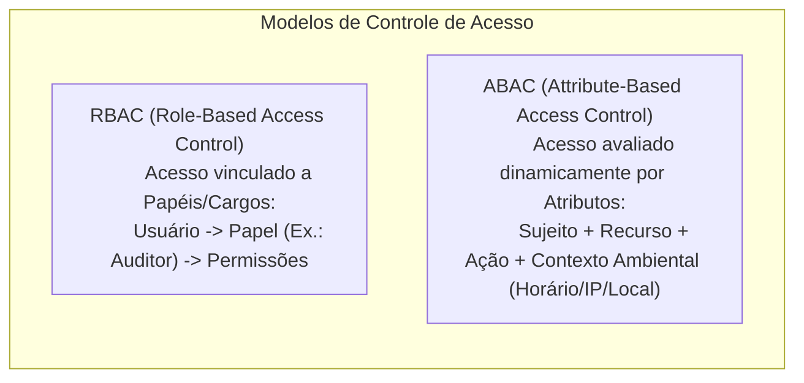
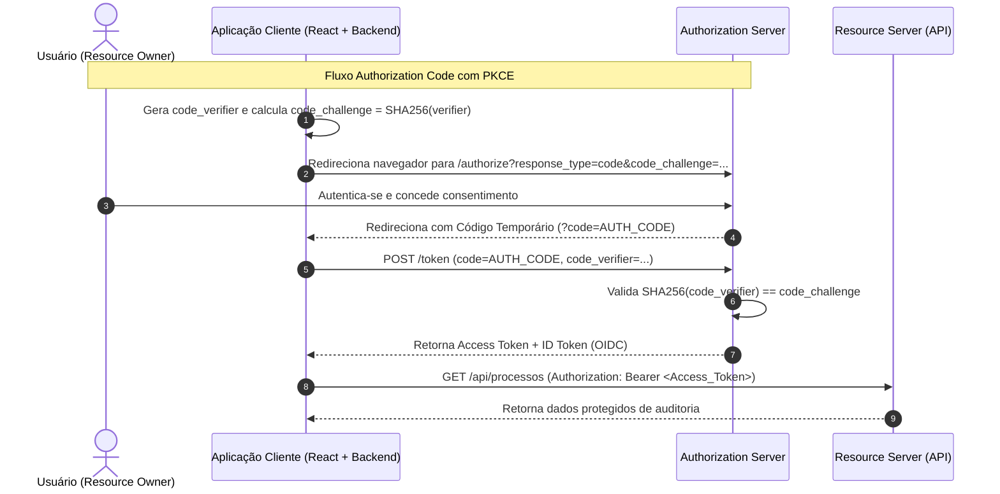
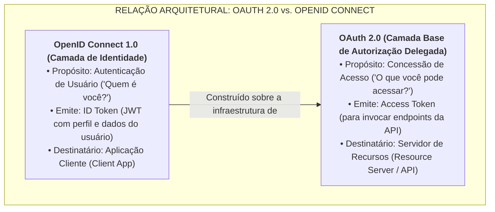
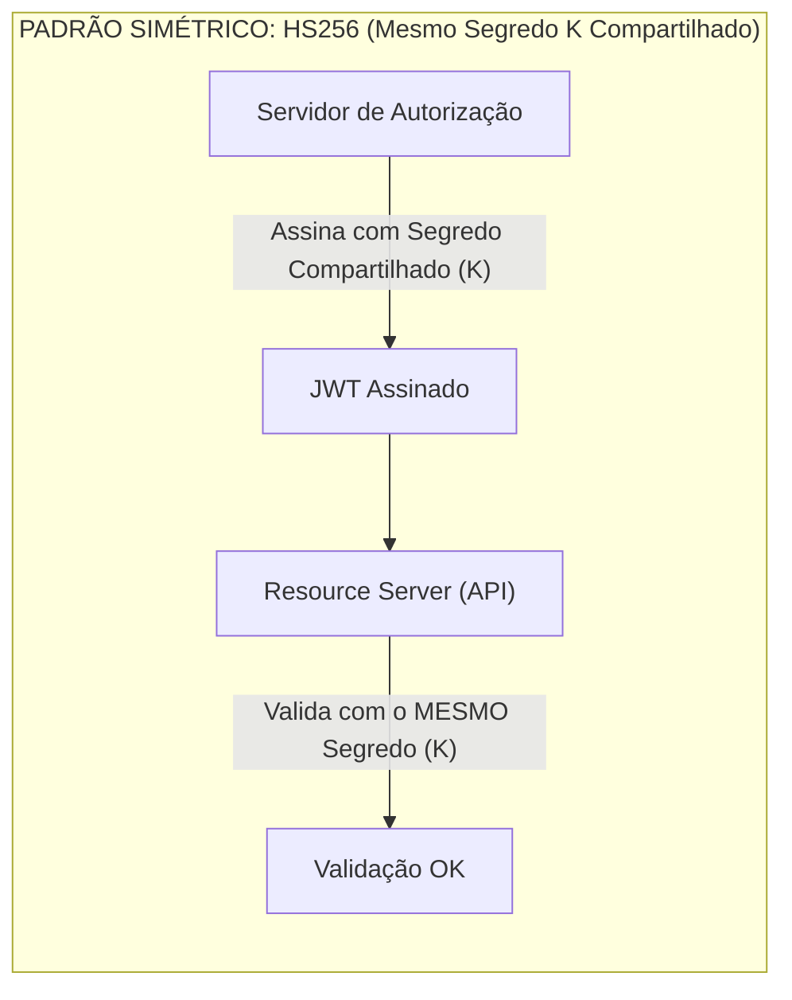
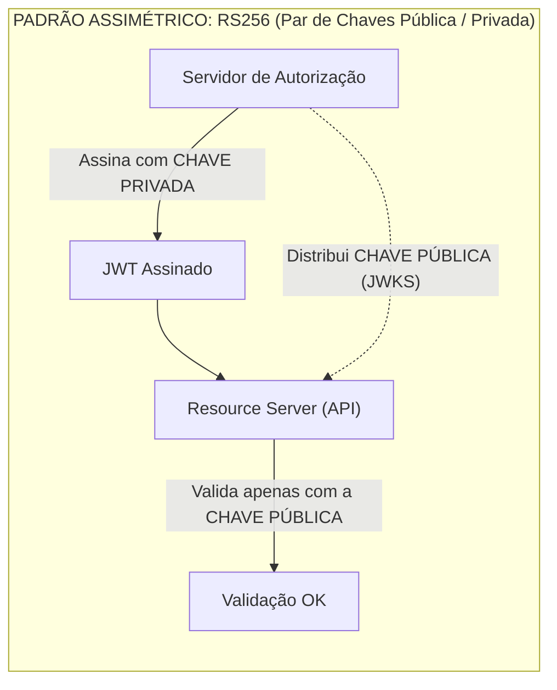

# 05 - Autenticação, Identidade e Autorização: OAuth 2.0, OIDC e JWT

> **Matéria:** Desenvolvimento de Sistemas  
> **Cargo:** B02 – Técnico de Controle Externo – Especialidade: Tecnologia da Informação  
> **Arquivo:** `05_autenticacao_identidade_oauth2_oidc_jwt.md`  

---

## 📌 Ementa / Itens do Edital
- Autenticação, identidade e autorização
- Framework OAuth 2.0 (RFC 6749)
- Camada de Identidade OpenID Connect (OIDC 1.0)
- Tokens, claims e escopos
- JSON Web Token (JWT - RFC 7519)

---

## 🌳 Classificação Hierárquica

```text
5. Segurança em Aplicações: Identidade, Acesso e Tokens
├── 5.1 Conceitos Fundamentais de Segurança de Acesso
│   ├── 5.1.1 Autenticação (Quem é você? - Verificação da identidade)
│   ├── 5.1.2 Autorização (O que você pode fazer? - Controle de permissões e privilégios)
│   └── 5.1.3 Modelos de Controle de Acesso: RBAC (Role-Based Access Control) e ABAC (Attribute-Based Access Control)
├── 5.2 Framework de Autorização OAuth 2.0 (RFC 6749)
│   ├── 5.2.1 Papéis no OAuth 2.0:
│   │   ├── Resource Owner (Proprietário do Recurso / Usuário final)
│   │   ├── Client (Aplicação terceira solicitando acesso: Web, SPA, Mobile, Backend)
│   │   ├── Authorization Server (Servidor de Autorização / Emissor de tokens)
│   │   └── Resource Server (Servidor que hospeda as APIs e recursos protegidos)
│   ├── 5.2.2 Fluxos de Concessão (Grant Types):
│   │   ├── Authorization Code Grant (fluxo mais seguro para aplicações cliente-servidor)
│   │   ├── Authorization Code com PKCE (Proof Key for Code Exchange - padrão para SPAs e Mobile)
│   │   ├── Client Credentials Grant (comunicação direta máquina-a-máquina / M2M sem usuário)
│   │   ├── Refresh Token Grant (renovação de tokens expirados sem solicitar novas credenciais)
│   │   └── Fluxos obsoletos/desaconselhados: Implicit Grant e Resource Owner Password Credentials (ROPC)
│   └── 5.2.3 Escopos (Scopes): Definição de permissões granulares (read:users, write:orders)
├── 5.3 Camada de Identidade OpenID Connect (OIDC 1.0)
│   ├── 5.3.1 Propósito: Construído sobre o OAuth 2.0 para adicionar autenticação e federação de identidades
│   ├── 5.3.2 Tipos de Tokens no OIDC:
│   │   ├── ID Token (prova criptográfica da identidade do usuário para o Client)
│   │   ├── Access Token (token de autorização para o Resource Server)
│   │   └── Refresh Token (token para renovação de acesso)
│   ├── 5.3.3 Endpoints Padrão OIDC: /authorize, /token, /userinfo e discovery /.well-known/openid-configuration
│   └── 5.3.4 Single Sign-On (SSO) corporativo e Provedores de Identidade (IdP: Keycloak, Auth0, Microsoft Entra ID)
└── 5.4 JSON Web Token - JWT (RFC 7519)
    ├── 5.4.1 Estrutura do JWT (Três partes separadas por ponto: header.payload.signature codificadas em Base64URL)
    ├── 5.4.2 Cabeçalho (Header): Algoritmo de assinatura (alg: HS256, RS256) e tipo (typ: "JWT")
    ├── 5.4.3 Carga Útil (Payload) e Claims:
    │   ├── Claims Registradas (Registered Claims):
    │   │   ├── iss (Issuer - emissor do token)
    │   │   ├── sub (Subject - identificador do usuário / sujeito)
    │   │   ├── aud (Audience - destinatário esperado do token)
    │   │   ├── exp (Expiration Time - timestamp Unix de expiração)
    │   │   ├── nbf (Not Before - timestamp antes do qual o token é inválido)
    │   │   ├── iat (Issued At - timestamp de emissão)
    │   │   └── jti (JWT ID - identificador único para evitar replay attacks)
    │   ├── Claims Públicas e Claims Privadas (dados personalizados da aplicação: roles, permissions)
    │   └── Atenção: Base64URL não é criptografia! JWS (integridade) vs. JWE (confidencialidade)
    ├── 5.4.4 Assinatura Criptográfica (Signature):
    │   ├── Simétrica: HMAC com segredo compartilhado (HS256)
    │   └── Assimétrica: Par de chaves pública e privada (RS256, ES256) com distribuição JWKS
    └── 5.4.5 Boas Práticas e Segurança com JWT: Nunca armazenar dados sensíveis não criptografados no payload; tempo de vida curto do Access Token; proteção contra vazamento em LocalStorage vs. Cookies HttpOnly SameSite
```

---

## 📖 Teoria Aprofundada & Pontos-Chave

### 5.1 Autenticação, Autorização e Modelos de Controle de Acesso

- **Autenticação (AuthN - *Authentication*):** Processo de validação da identidade de uma entidade (usuário, dispositivo ou serviço). Responde à pergunta fundamental: **"Quem é você?"**. Envolve verificação de fatores de autenticação:
  1. *O que você sabe* (senhas, PINs).
  2. *O que você tem* (smartcards, certificados digitais, tokens OTP via smartphone).
  3. *O que você é* (biometria, reconhecimento facial, impressão digital).
- **Autorização (AuthZ - *Authorization*):** Processo de verificar se uma entidade já autenticada possui os privilégios e direitos necessários para executar uma ação específica sobre determinado recurso. Responde à pergunta: **"O que você tem permissão para fazer?"**.



| Modelo | Mecanismo Central | Vantagens | Desvantagens |
|---|---|---|---|
| **RBAC** (*Role-Based*) | Atribuição de permissões a papéis (*roles*) fixos (`Auditor`, `Gestor`). Usuários herdam os direitos de suas funções. | Simples de auditar e gerenciar em organizações tradicionais. | Explosão de papéis (*role explosion*) quando se exige granularidade fina. |
| **ABAC** (*Attribute-Based*) | Avaliação booleana em tempo real de atributos do sujeito, recurso, ação e ambiente (*contexto*). | Altíssima flexibilidade (ex.: permitir acesso apenas no horário de expediente e na rede interna). | Maior complexidade de implementação e custo computacional de avaliação. |

---

### 5.2 Framework de Autorização OAuth 2.0 (RFC 6749)

#### 5.2.1 Os Quatro Papéis Fundamentais do OAuth 2.0
1. **Resource Owner (Proprietário do Recurso):** O usuário final que detém os dados e tem autoridade para conceder acesso às suas informações protegidas.
2. **Client (Aplicação Cliente):** A aplicação que solicita autorização para acessar recursos em nome do *Resource Owner*. Pode ser confidencial (backend seguro com chave privada) ou público (SPA em React, aplicativo mobile).
3. **Authorization Server (Servidor de Autorização):** Servidor responsável por autenticar o *Resource Owner*, colher o seu consentimento e emitir tokens de acesso (*Access Tokens*) após validação.
4. **Resource Server (Servidor de Recursos):** O servidor que hospeda os dados e as APIs protegidas, capaz de aceitar e responder a requisições contendo *Access Tokens* válidos.

#### 5.2.2 Fluxos de Concessão (*Grant Types*) no OAuth 2.0



| Tipo de Fluxo (*Grant Type*) | Cenário de Uso Principal | Nível de Segurança | Estado Atual / Recomendações |
|---|---|:---:|---|
| **Authorization Code** | Aplicações web com backend (*confidential clients* com segredo seguro). | **Máximo** | Padrão recomendado clássico. |
| **Authorization Code com PKCE** | Clientes Públicos: Single Page Applications (SPAs em React, Vue) e Apps Mobile. | **Máximo** | **Obrigatório** pelas especificações modernas (RFC 7636 e OAuth 2.1). |
| **Client Credentials** | Comunicação máquina-a-máquina (M2M), microsserviços internos, rotinas batch (sem usuário humano). | **Alto** | Padrão oficial para comunicação direta entre sistemas. |
| **Refresh Token** | Renovação de *Access Tokens* expirados sem intervenção do usuário final. | **Alto** | Utilizado em conjunto com outros fluxos para manter sessões ativas. |
| **Implicit Grant** | SPAs legadas no navegador onde o token vinha diretamente no fragmento da URL (`#access_token=...`). | **Inseguro** | **DEPRECADO / OBSOLETO** (risco de interceptação de token). |
| **Resource Owner Password Credentials (ROPC)** | O usuário digita usuário e senha diretamente dentro da aplicação terceira. | **Crítico** | **DEPRECADO / OBSOLETO** (viola o princípio central do OAuth 2.0). |

> ⭐ **IMPORTANTE / REGRA DE OURO:**  
> **O que é PKCE (*Proof Key for Code Exchange*)?**  
> Clientes públicos (como aplicações React rodando no navegador ou apps de smartphone) não conseguem manter um `client_secret` em sigilo, pois qualquer usuário pode inspecionar o código-fonte ou descompilar o APK. O PKCE resolve essa vulnerabilidade gerando um segredo dinâmico descartável para cada requisição: o cliente gera um `code_verifier` aleatório e envia seu hash SHA-256 (`code_challenge`) no `/authorize`. Ao trocar o código por token no `/token`, ele envia o `code_verifier` em texto claro. O servidor calcula o hash e verifica a coincidência, garantindo que quem recebeu o código de autorização foi quem de fato o solicitou!

---

### 5.3 Camada de Identidade OpenID Connect (OIDC 1.0)

#### 5.3.1 A Distinção Vital: OAuth 2.0 vs. OpenID Connect
- **OAuth 2.0 NÃO É um protocolo de autenticação!** Ele é estritamente um framework de **autorização delegada**. Ele permite conceder a uma aplicação terceira acesso a arquivos ou APIs sem fornecer a senha, emitindo um `access_token` opaco ou estruturado.
- **OpenID Connect (OIDC 1.0):** É uma camada de **identidade e autenticação** construída sobre o OAuth 2.0. Ele introduz o conceito padronizado de perfil de usuário e emite um token exclusivo para a aplicação cliente saber quem é o usuário logado: o **`id_token`**.



#### 5.3.2 Comparativo dos Tokens no Ecossistema OIDC

| Atributo | ID Token | Access Token | Refresh Token |
|---|---|---|---|
| **Padrão Normativo** | OpenID Connect Core 1.0 | OAuth 2.0 (RFC 6749) | OAuth 2.0 (RFC 6749) |
| **Destinatário (*Audience*)**| A **Aplicação Cliente (*Client*)** | O **Servidor de Recursos (*Resource Server* / API)** | O **Servidor de Autorização (*Authorization Server*)** |
| **Formato Obrigatório**| **JSON Web Token (JWT)** assinado | Formato flexível (geralmente JWT ou token opaco) | String opaca / chave criptográfica segura |
| **Finalidade Central** | Provar que o usuário se autenticou e informar seus dados (`sub`, `name`, `email`). | Provar que a aplicação tem permissão para acessar endpoints e executar escopos. | Obter novos tokens quando o Access Token expirar sem incomodar o usuário. |
| **Tempo de Vida** | Curto (minutos) | Curto (geralmente de 5 a 60 minutos) | Longo (dias, semanas ou meses) |

---

### 5.4 JSON Web Token - JWT (RFC 7519)

#### 5.4.1 Anatomia Estrutural do JWT
Um token JWT no formato compacto serializado (JWS) é uma cadeia alfanumérica contínua formada por **três partes distintas separadas por pontos (`.`)**:

```text
[Header Base64URL] . [Payload Base64URL] . [Signature]
```

1. **Cabeçalho (*Header*):** Objeto JSON codificado em Base64URL indicando o tipo de token e o algoritmo criptográfico de assinatura empregado:
   ```json
   {
     "alg": "RS256",
     "typ": "JWT"
   }
   ```
2. **Carga Útil (*Payload*):** Objeto JSON codificado em Base64URL contendo as **declarações (*claims*)** sobre uma entidade (sujeito) e metadados contextuais adicionais.
3. **Assinatura (*Signature*):** Hash criptográfico gerado a partir do cabeçalho codificado, do payload codificado e de uma chave secreta/privada. Assegura a **integridade** (que a mensagem não foi modificada) e a **autenticidade** (que partiu do emissor legítimo).

#### 5.4.2 Claims Registradas Padronizadas pela RFC 7519

| Claim | Nome Completo | Significado Técnico e Relevância |
|---|---|---|
| **`sub`** | *Subject* | Sujeito do token. Identificador exclusivo e imutável do usuário no sistema (ex.: `"user_12345"`). |
| **`iss`** | *Issuer* | Emissor do token. URI ou identificador do Servidor de Autorização (ex.: `"https://login.sefaz.go.gov.br"`). |
| **`aud`** | *Audience* | Audiência esperada. Identificador dos destinatários/recursos autorizados a aceitar este token. |
| **`exp`** | *Expiration Time* | Timestamp Unix (segundos desde a epoch) após o qual o token **deve ser sumariamente rejeitado**. |
| **`nbf`** | *Not Before* | Timestamp Unix antes do qual o token não pode ser considerado válido. |
| **`iat`** | *Issued At* | Timestamp Unix indicando o momento exato em que o token foi gerado e emitido. |
| **`jti`** | *JWT ID* | Identificador exclusivo do token, útil para revogação em listas negras (*blacklists*) e prevenção de replay attacks. |

> 🚨 **ALERTA DE PROVA / PEGADINHA FCC:**  
> O JWT padrão (JWS - *JSON Web Signature*) garante **integridade e autenticidade**, mas **NÃO garante confidencialidade**! A codificação Base64URL não é cifra nem criptografia; é apenas uma representação em texto seguro para URLs. Qualquer pessoa que intercepte o token pode decodificar o payload instantaneamente e ler tudo em texto claro. Portanto, **nunca armazene senhas, hashes de senhas ou dados fiscais/médicos protegidos dentro do payload de um JWT** sem utilizar JWE (*JSON Web Encryption*).

#### 5.4.3 Algoritmos de Assinatura: Simétricos (HS256) vs. Assimétricos (RS256)





- **HS256 (HMAC com SHA-256):** Usa a **mesma chave secreta** para assinar e validar o token. Requer que todos os microsserviços que validam o token conheçam o segredo. Se um microsserviço for comprometido, o atacante poderá forjar tokens válidos para todo o sistema corporativo.
- **RS256 (RSA com SHA-256):** Utiliza um par de chaves assimétricas. O Servidor de Autorização assina o token com sua **chave privada** (que nunca sai do servidor seguro). Todos os servidores de recursos e clientes validam a integridade utilizando exclusivamente a **chave pública**, disponibilizada no endpoint padronizado JWKS (*JSON Web Key Set*).

---

## 🌐 Fontes Recomendadas na Internet (Acesso Direto e Gratuito)

- [x] **IETF Datatracker - Especificações Oficiais RFC:**
  - Link Oficial: [RFC 7519 - JSON Web Token (JWT)](https://datatracker.ietf.org/doc/html/rfc7519)
  - Link Oficial: [RFC 6749 - OAuth 2.0 Authorization Framework](https://datatracker.ietf.org/doc/html/rfc6749)
  - Link Oficial: [RFC 7636 - PKCE for OAuth 2.0](https://datatracker.ietf.org/doc/html/rfc7636)
  - *Conteúdo:* Normas técnicas primárias que definem claims registradas, fluxos de concessão e segurança de clientes públicos.
- [x] **OpenID Foundation - Especificação Oficial OIDC Core 1.0:**
  - Link Oficial: [OpenID Connect Core 1.0](https://openid.net/specs/openid-connect-core-1_0.html)
  - *Conteúdo:* Definição formal do ID Token, escopo `openid`, fluxo de autenticação e endpoint `/userinfo`.
- [x] **OAuth.net - Portal Canônico da Comunidade OAuth:**
  - Link Oficial: [OAuth 2.0 Simplified](https://oauth.net/2/)
  - *Conteúdo:* Guias didáticos ilustrados sobre grant types, migração de fluxos obsoletos e boas práticas de segurança (OAuth 2.1).
- [x] **JWT.io - Debugger e Artigos Técnicos (Auth0):**
  - Link Oficial: [JWT.io Introduction](https://jwt.io/introduction)
  - *Conteúdo:* Estrutura do JWS compacto, decodificação em tempo real de Base64URL e cálculo de assinaturas HS256 e RS256.

---

## 📝 Questões Comentadas & Exemplos (Padrão FCC)

### Questão 1 (FCC - Analista de TI / Segurança e Arquitetura)
Uma equipe de desenvolvimento do Tribunal de Contas está projetando a integração de uma nova aplicação Web Single Page Application (SPA), construída com React, com a API de auditoria de processos governamentais. A aplicação cliente executa integralmente no navegador do usuário (*public client*) e necessita autenticar a identidade dos auditores para obter acesso aos endpoints protegidos.

Considerando as boas práticas contemporâneas de segurança preconizadas pela IETF e pela OpenID Foundation:  
A) Deve-se adotar o fluxo *Implicit Grant* do OAuth 2.0, visto que ele elimina a necessidade de redirecionamentos adicionais e expõe o access token diretamente na URL para agilizar o carregamento.  
B) O protocolo OpenID Connect (OIDC) deve ser empregado na camada de autenticação, utilizando o fluxo *Authorization Code Grant* com a extensão PKCE (RFC 7636), emitindo um `id_token` para identificar o usuário perante a aplicação React e um `access_token` para consumir a API.  
C) O protocolo OAuth 2.0 isolado é suficiente para autenticar o auditor perante o frontend React, bastando conferir a presença do escopo `read:processos` na requisição.  
D) O fluxo mais recomendado para esse cenário é o *Resource Owner Password Credentials* (ROPC), pelo qual o frontend coleta login e senha diretamente em um formulário comum e os repassa ao servidor de autorização.  
E) A integridade e autenticidade do token JWT devem ser verificadas no frontend através de um algoritmo simétrico HS256, armazenando o segredo compartilhado nas variáveis de ambiente estáticas do código JavaScript.  

> **Gabarito: B**  
>
> **Comentário Analítico Passo a Passo:**  
> Analisando as regras arquiteturais modernas de autenticação e autorização:
> - Aplicações SPA rodam no browser do cliente e são classificadas como *public clients* (incapazes de proteger um segredo fixo `client_secret`).
> - OAuth 2.0 cuida de autorização; quem provê a identidade e autenticação federada é o **OpenID Connect (OIDC)**, gerando o `id_token`.
> - O padrão moderno obrigatório para clientes públicos é o **Authorization Code com PKCE**.
>
> **Análise detalhada das alternativas:**  
> - **A (Incorreta):** O fluxo *Implicit Grant* foi formalmente descontinuado e considerado vulnerável nas recomendações atuais do OAuth 2.0 e OAuth 2.1, pois o token viajava exposto no fragmento da URL do histórico do navegador e nos cabeçalhos `Referer`.  
> - **B (CORRETA):** O OIDC provê a autenticação com entrega do `id_token` ao cliente React, enquanto o fluxo Authorization Code com extensão PKCE protege clientes públicos contra ataques de interceptação do código de autorização.  
> - **C (Incorreta):** O OAuth 2.0 é um protocolo de **autorização**, não de identidade. Utilizar apenas OAuth 2.0 para "provar identidade" é um antipadrão clássico conhecido como pseudo-autenticação (*OAuth is not authentication*).  
> - **D (Incorreta):** O fluxo ROPC (coleta direta de usuário e senha pela aplicação) é obsoleto e viola o princípio de privilégio mínimo e isolamento de credenciais, além de não suportar MFA (Multi-Factor Authentication).  
> - **E (Incorreta):** Gravar uma chave secreta simétrica (HS256) no código JavaScript de uma SPA expõe o segredo para qualquer pessoa que inspecione o código no DevTools do navegador. O correto é validação assimétrica com RS256 e chave pública distribuída via JWKS.

---

### Questão 2 (FCC - Técnico de Controle Externo / TI)
Em relação à arquitetura e estrutura do padrão JSON Web Token (JWT - RFC 7519), analise as seguintes afirmativas:

I. Um JWT serializado no formato compacto JWS é composto por três blocos concatenados por pontos (`.`): Cabeçalho (*Header*), Carga Útil (*Payload*) e Assinatura (*Signature*), codificados em Base64URL.  
II. Por constituir um padrão criptográfico assinado, as declarações contidas no *Payload* de um JWT assinado (JWS) são estritamente confidenciais e criptografadas por padrão, impedindo que interceptadores leiam seu conteúdo em texto claro.  
III. Dentre as *Registered Claims* padronizadas, a claim `sub` identifica o sujeito (*subject*) da declaração, `iss` indica a entidade emissora (*issuer*) e `exp` define o limite temporal a partir do qual o token deve ser rejeitado.  

Está correto o que se afirma em:  
A) I e II, apenas.  
B) II e III, apenas.  
C) I e III, apenas.  
D) I, apenas.  
E) I, II e III.  

> **Gabarito: C**  
>
> **Comentário Analítico Passo a Passo:**  
> Vamos analisar cada item à luz da RFC 7519:
> - **Item I (Correto):** O JWT compacto possui a sintaxe exata: `Base64URL(Header) . Base64URL(Payload) . Signature`.
> - **Item II (Incorreto):** Pegadinha clássica e recorrente da Fundação Carlos Chagas! A assinatura no JWS (*JSON Web Signature*) assegura **integridade e autenticidade**, mas **NÃO garante confidencialidade**. O Base64URL é meramente um esquema de codificação reversível sem chave. Qualquer pessoa pode decodificar o Base64URL e ler o JSON do payload em texto claro. Criptografia e sigilo só existem no formato JWE (*JSON Web Encryption*).
> - **Item III (Correto):** A RFC 7519 padroniza as *Registered Claims*: `sub` (*Subject* - usuário), `iss` (*Issuer* - emissor), `exp` (*Expiration Time* - expiração), `aud` (*Audience*), `iat` (*Issued At*), `nbf` (*Not Before*) e `jti` (*JWT ID*).
>
> Conclui-se que apenas os itens I e III estão corretos.
>
> **Análise detalhada das alternativas:**  
> - **A (Incorreta):** O item II está incorreto devido à ausência de sigilo/criptografia nativa no payload do JWS.  
> - **B (Incorreta):** Inclui o item II incorreto e omite o item I verdadeiro.  
> - **C (CORRETA):** Identifica com precisão que os itens I e III são verdadeiros e o item II é falso.  
> - **D (Incorreta):** O item III também está perfeitamente correto, não podendo ser descartado.  
> - **E (Incorreta):** Julga o item II como verdadeiro, caindo na pegadinha da confidencialidade.

---

### Questão 3 (FCC - Analista de TI / Sistemas)
Em uma arquitetura de microsserviços do Tribunal de Contas, uma rotina de integração em lote (*batch*) executada durante a madrugada no backend precisa consumir dados da API da Secretaria da Fazenda para conciliação contábil. Esse processo é totalmente automatizado e executado sem nenhuma intervenção de usuário humano final.

De acordo com o framework OAuth 2.0 (RFC 6749), o fluxo de concessão (*Grant Type*) mais adequado e recomendado para essa comunicação máquina-a-máquina (M2M) é o:  
A) *Authorization Code Grant* com tela de consentimento de usuário.  
B) *Client Credentials Grant*.  
C) *Implicit Grant*.  
D) *Resource Owner Password Credentials Grant*.  
E) *Device Authorization Grant*.  

> **Gabarito: B**  
>
> **Comentário Analítico Passo a Passo:**  
> O OAuth 2.0 define fluxos específicos dependendo de haver ou não um usuário humano envolvido:
> - Quando uma aplicação cliente precisa acessar recursos mantidos por ela mesma ou dados de sistema onde a autorização foi concedida previamente à própria aplicação (sem a figura do *Resource Owner* humano interagindo durante a execução), utiliza-se o fluxo de credenciais do cliente.
>
> **Análise detalhada das alternativas:**  
> - **A (Incorreta):** O fluxo Authorization Code exige a presença de um usuário final (*Resource Owner*) interagindo em um navegador web para digitar login/senha e dar consentimento expresso.  
> - **B (CORRETA):** O *Client Credentials Grant* foi concebido especificamente para cenários de comunicação direta máquina-a-máquina (M2M). O serviço envia suas próprias credenciais (`client_id` e `client_secret`) diretamente ao endpoint `/token` e recebe um *Access Token* para operar de forma autônoma.  
> - **C (Incorreta):** O Implicit Grant destina-se a navegadores web e está obsoleto, não fazendo sentido para processos batch de backend.  
> - **D (Incorreta):** ROPC exige usuário e senha de uma pessoa física, sendo inadequado e desaconselhado para automações M2M.  
> - **E (Incorreta):** O Device Flow (RFC 8628) é destinado a dispositivos com restrição de entrada de dados (como Smart TVs ou consoles), nos quais o usuário usa outro aparelho com navegador para autorizar o acesso.

---

### Questão 4 (FCC - Auditor Fiscal / Tecnologia da Informação)
No ecossistema corporativo de segurança digital, ao validar um token JWT assinado digitalmente que circula entre múltiplos microsserviços, a escolha entre algoritmos simétricos e assimétricos traz impactos profundos na gestão das chaves.

A respeito dessa validação, assinale a afirmativa correta:  
A) No algoritmo simétrico HS256, o Servidor de Recursos (API) precisa possuir apenas uma chave pública para validar a assinatura, impedindo o comprometimento do segredo de emissão.  
B) No algoritmo assimétrico RS256, o Servidor de Autorização assina o token com sua chave privada, e qualquer Servidor de Recursos pode validar a assinatura de forma independente utilizando a respectiva chave pública disponibilizada em um endpoint JWKS (*JSON Web Key Set*).  
C) A alteração de qualquer caractere no Payload de um token JWT não invalida a assinatura calculada com RS256, desde que a claim `exp` permaneça no futuro.  
D) Caso o cabeçalho do token informe `"alg": "none"`, a aplicação receptora deve aceitar o token automaticamente como infalível, pois esse identificador sinaliza aprovação prévia por autoridade certificadora de raiz.  
E) O algoritmo RS256 utiliza a mesma chave secreta tanto para assinar o JWT quanto para verificar sua assinatura em todos os nós da rede.  

> **Gabarito: B**  
>
> **Comentário Analítico Passo a Passo:**  
> Analisando as modalidades de assinatura digital em tokens JWT:
> - **Simétrica (HS256):** Uma única chave secreta é compartilhada entre emissor e receptores. Se um receptor for invadido, a chave secreta vaza e o atacante pode assinar tokens em nome do emissor.
> - **Assimétrica (RS256):** O emissor mantém a **chave privada** sob sigilo estrito e assina os tokens. Os receptores só recebem a **chave pública** (via JWKS), permitindo validar a assinatura com segurança sem possuir a capacidade de forjar novos tokens.
>
> **Análise detalhada das alternativas:**  
> - **A (Incorreta):** No algoritmo HS256 (simétrico), o Servidor de Recursos deve possuir o **mesmo segredo simétrico compartilhado** usado para gerar a assinatura. Chaves públicas são exclusivas de criptografia assimétrica.  
> - **B (CORRETA):** Descreve com perfeição a mecânica do RS256: o Servidor de Autorização assina com sua chave privada e os microsserviços validam de maneira desacoplada utilizando a chave pública exposta no JWKS (`/.well-known/jwks.json`).  
> - **C (Incorreta):** Qualquer alteração mínima em um único bit do Header ou do Payload quebra a integridade da assinatura criptográfica calculada pela função de hash SHA-256, provocando rejeição imediata do token pelo servidor.  
> - **D (Incorreta):** O algoritmo `"alg": "none"` indica ausência proposital de assinatura e representa uma das vulnerabilidades históricas mais críticas em bibliotecas desatualizadas de JWT. Aplicações seguras devem rejeitar terminantemente tokens sem assinatura ou com `alg: none`.  
> - **E (Incorreta):** RS256 é assimétrico (par de chaves pública e privada); quem utiliza a mesma chave para assinar e validar é o HS256.

---

### Questão 5 (FCC - Analista de Sistemas / Segurança da Informação)
A respeito do armazenamento seguro de tokens de acesso no navegador web e dos modelos de controle de acesso aos recursos, assinale a afirmativa correta:  
A) Gravar o token de acesso no `localStorage` do navegador é a prática mais segura do mercado para mitigar ataques de Cross-Site Scripting (XSS), pois scripts maliciosos não conseguem ler dados do armazenamento local.  
B) O armazenamento de tokens de sessão em cookies HTTP configurados com os sinalizadores `HttpOnly` e `Secure` protege os dados contra leitura indevida por scripts executados no cliente via ataques de Cross-Site Scripting (XSS).  
C) O modelo ABAC (*Attribute-Based Access Control*) restringe permissões estritamente com base nos papéis organizacionais estáticos cadastrados no banco de dados, ignorando variáveis como data, hora e endereço de rede.  
D) Tokens JWT emitidos com tempo de vida de 30 dias para o `access_token` representam a melhor prática recomendada pela arquitetura de microsserviços, pois eliminam a necessidade de qualquer mecanismo de renovação ou refresh token.  
E) O modelo RBAC (*Role-Based Access Control*) fundamenta-se na avaliação contínua de políticas dinâmicas com lógica booleana contextual, substituindo completamente a definição de funções ou perfis de usuário.  

> **Gabarito: B**  
>
> **Comentário Analítico Passo a Passo:**  
> A segurança de aplicações web na retenção de credenciais depende das características do navegador:
> - O `localStorage` é plenamente acessível por qualquer código JavaScript executado na página (`window.localStorage.getItem(...)`). Se a aplicação sofrer um ataque de XSS (Cross-Site Scripting), o invasor exfiltra o token armazenado em milissegundos.
> - Ao gravar o token em um cookie com a flag **`HttpOnly`**, o navegador proíbe expressamente que scripts JavaScript (incluindo scripts maliciosos injetados por XSS) tenham acesso de leitura ao cookie. A flag **`Secure`** garante que ele só trafegue em conexões HTTPS criptografadas.
>
> **Análise detalhada das alternativas:**  
> - **A (Incorreta):** O `localStorage` é altamente suscetível a XSS; scripts injetados lêem diretamente o armazenamento local.  
> - **B (CORRETA):** A flag `HttpOnly` impede o acesso ao cookie via API `document.cookie` no JavaScript, fornecendo proteção robusta contra roubo de tokens em cenários de XSS.  
> - **C (Incorreta):** O modelo que se apoia em papéis estáticos é o **RBAC**. O ABAC avalia justamente atributos dinâmicos do contexto ambiental (hora, local, IP, dispositivo).  
> - **D (Incorreta):** Access tokens devem possuir tempo de vida **curto** (tipicamente de 5 a 15 minutos) para minimizar a janela de exposição em caso de vazamento. Sessões longas são sustentadas com o uso de *Refresh Tokens* controlados no servidor de autorização.  
> - **E (Incorreta):** O modelo que utiliza políticas dinâmicas com lógica booleana e atributos de contexto é o **ABAC**, e não o RBAC. O RBAC baseia-se exatamente em funções e papéis hierárquicos predefinidos.
