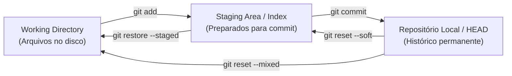
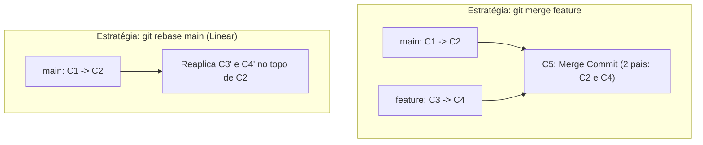
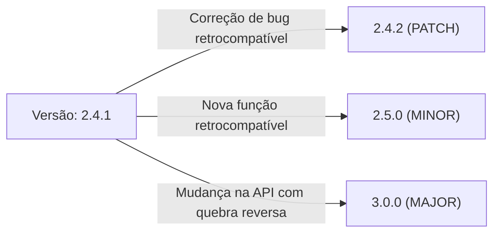

# 06 - Git, Gerenciamento de Dependências e Empacotamento

> **Matéria:** Desenvolvimento de Sistemas  
> **Cargo:** B02 – Técnico de Controle Externo – Especialidade: Tecnologia da Informação  
> **Arquivo:** `06_git_gerenciamento_de_dependencias_e_empacotamento.md`  

---

## 📌 Ementa / Itens do Edital
- Controle de versão distribuído com Git (conceitos e comandos essenciais)
- Gerenciamento de dependências
- Empacotamento de aplicações (bundlers e artefatos)
- Publicação e distribuição de aplicações

---

## 🌳 Classificação Hierárquica

```text
6. Gestão de Código-Fonte, Dependências e Empacotamento de Software
├── 6.1 Controle de Versão com Git
│   ├── 6.1.1 Arquitetura Distribuída do Git vs. Centralizada (SVN): Snapshots vs. Deltas, integridade por hash SHA-1/SHA-256
│   ├── 6.1.2 As Três Áreas de Trabalho Locais:
│   │   ├── Working Directory (Diretório de trabalho com arquivos modificados)
│   │   ├── Staging Area / Index (Área de preparação com arquivos rastreados para o próximo commit)
│   │   └── Repository / HEAD (Histórico permanente de commits locais)
│   ├── 6.1.3 Comandos Fundamentais do Ciclo de Vida:
│   │   ├── Criação e status: git init, git clone, git status, git diff
│   │   ├── Rastreamento e commit: git add, git commit -m "...", git rm, git mv
│   │   └── Histórico e logs: git log, git show, git blame
│   ├── 6.1.4 Ramificação e Integração (Branching & Merging):
│   │   ├── Gestão de ramos: git branch, git checkout (ou git switch), git branch -d
│   │   ├── Integração: git merge (Fast-forward vs. 3-way merge commit) e resolução de conflitos
│   │   ├── Reescrita de histórico linear: git rebase (diferenças operacionais em relação ao merge)
│   │   └── Comandos avançados: git cherry-pick, git stash (pop, apply, drop), git reset (--soft, --mixed, --hard) e git revert
│   └── 6.1.5 Interação Remota: git remote (add, -v), git fetch, git pull (fetch + merge), git push
├── 6.2 Gerenciamento de Dependências
│   ├── 6.2.1 Conceitos: Resolução de grafos de dependência, dependências transitivas, arquivos de manifesto vs. lockfiles
│   ├── 6.2.2 Versionamento Semântico (SemVer: MAJOR.MINOR.PATCH):
│   │   ├── MAJOR: Mudanças incompatíveis na API (breaking changes)
│   │   ├── MINOR: Novas funcionalidades com compatibilidade reversa
│   │   ├── PATCH: Correção de bugs com compatibilidade reversa
│   │   └── Prefixos no npm: ^ (atualiza minor e patch) e ~ (atualiza apenas patch)
│   ├── 6.2.3 Ecossistema JavaScript/Node.js: npm, yarn, pnpm (package.json e package-lock.json, npm install vs. npm ci)
│   ├── 6.2.4 Ecossistema Python: pip, requirements.txt, ambientes virtuais (venv, virtualenv), Poetry e pipenv
│   └── 6.2.5 Ecossistema Java: Apache Maven (pom.xml, repositório local/central, ciclo de vida: compile, test, package) e Gradle (build.gradle)
└── 6.3 Empacotamento e Publicação de Aplicações
    ├── 6.3.1 Empacotamento Web (Module Bundlers):
    │   ├── Webpack, Vite, Rollup, esbuild: Transpilação, tree shaking (eliminação de código morto), code splitting e minificação
    │   └── Geração de artefatos estáticos para produção (dist/ ou build/)
    ├── 6.3.2 Empacotamento no Backend:
    │   ├── Java: Criação de arquivos JAR (executáveis / fat JARs) e WAR
    │   ├── Python: Pacotes Wheel (.whl), criação de imagens e setups
    │   └── Node.js: Transpilação TypeScript para JavaScript vanilla (tsc)
    └── 6.3.3 Publicação e Repositórios de Artefatos:
        ├── Repositórios públicos: npmjs, PyPI, Maven Central
        └── Repositórios privados corporativos: Nexus, JFrog Artifactory, GitHub Packages
```

---

## 📖 Teoria Aprofundada & Pontos-Chave

### 6.1 Controle de Versão Distribuído com Git

#### 6.1.1 Arquitetura Interna e Modelo de Dados
- **Distribuído vs. Centralizado:** Em sistemas centralizados legados (como Subversion / SVN), os desenvolvedores dependem de conexão contínua com um servidor central para inspecionar histórico e realizar commits. No **Git**, cada cópia clonada no computador de um desenvolvedor é um **repositório completo e independente**, com histórico integral de commits, ramificações e capacidade de trabalho offline.
- **Snapshots vs. Deltas:** Sistemas tradicionais armazenam a evolução do software como uma lista de diferenças linha a linha (*deltas baseados em arquivos*). O Git armazena os dados como um conjunto de **instantâneos completos (*snapshots*)** da árvore de arquivos no momento do commit. Se um arquivo não sofreu modificação, o Git não o duplica: ele apenas cria um ponteiro direto para o snapshot idêntico pré-existente.
- **Estrutura de Objetos do Git (`.git/objects`):** Todos os dados recebem um identificador hash criptográfico (SHA-1 de 40 caracteres hexadecimais ou SHA-256) garantindo a integridade imutável:
  1. **Blob:** Armazena apenas o conteúdo binário de um arquivo (sem nome ou permissões).
  2. **Tree:** Representa um diretório. Aponta para blobs e para outras subtrees, armazenando os nomes de arquivos e permissões POSIX.
  3. **Commit:** Aponta para a Tree raiz do snapshot, armazena os ponteiros para os commits pais (*parents*), o autor, o autor do commit (*committer*), carimbo de data/hora e a mensagem de commit.
  4. **Annotated Tag:** Aponta para um commit específico com uma mensagem e assinatura criptográfica.

#### 6.1.2 As Três Áreas Locais e o Ciclo de Vida do Arquivo



1. **Working Directory (Diretório de Trabalho):** Diretório físico onde os arquivos do projeto residem no sistema operacional e onde os desenvolvedores escrevem e editam o código.
2. **Staging Area / Index (Área de Preparação):** Um arquivo binário interno do Git (`.git/index`) que atua como uma bancada de preparação. Guarda o snapshot exato dos arquivos que serão incluídos no próximo commit.
3. **Repositório Local (.git directory / HEAD):** O banco de dados de objetos do Git onde os commits confirmados são salvos permanentemente. O ponteiro especial **HEAD** aponta para o ramo e commit em que o desenvolvedor está posicionado no momento.

#### 6.1.3 Ramificações e Estratégias de Integração: Merge vs. Rebase



| Critério | `git merge` | `git rebase` |
|---|---|---|
| **Comportamento** | Cria um **Merge Commit** explícito (se não for fast-forward) unindo as duas branches. | Pega os commits da branch atual e os **reaplica individualmente** no topo da branch de destino. |
| **Histórico** | Preserva a história cronológica exata de como as tarefas foram desenvolvidas, com bifurcações e ramificações visíveis. | Reescreve o histórico, gerando uma linha do tempo **estritamente linear e contínua** sem commits de merge. |
| **Hashes dos Commits** | **Preserva** os hashes SHA originais dos commits. | **Reescreve novos hashes SHA** para todos os commits movidos. |
| **Regra de Segurança** | Seguro para qualquer branch (pública ou privada). | ⭐ **NUNCA execute rebase em branches públicas/compartilhadas**, pois corrompe a linha histórica dos demais membros da equipe. |

#### 6.1.4 Comandos Críticos: Desfazendo Alterações e Recuperação

| Comando | Efeito no HEAD | Efeito na Staging Area | Efeito no Working Directory | Indicado para |
|---|---|---|---|---|
| **`git reset --soft <hash>`** | Volta para `<hash>` | **Preserva as alterações** (arquivos permanecem *staged*) | Inalterado | Refazer a mensagem ou agrupar os últimos commits antes de enviar. |
| **`git reset --mixed <hash>`** *(padrão)* | Volta para `<hash>` | **Limpa a Staging Area** (remove do stage) | **Preserva as alterações** (arquivos continuam no disco como *modified*) | Desfazer o commit e revisar o código antes de adicionar novamente. |
| **`git reset --hard <hash>`** | Volta para `<hash>` | **Descarta tudo** | **Descarta tudo** (deleta alterações permanentemente) | Descartar completamente o trabalho recente com perda total de dados locais. |
| **`git revert <hash>`** | **Avança o HEAD** | Adiciona mudanças do revert | Aplica o revert no disco | **Desfazer alterações em branches públicas/compartilhadas** criando um novo commit de inversão. |
| **`git stash`** | Mantém HEAD limpo | Guarda em pilha interna | Retorna ao estado do último commit (limpo) | Trocar de branch urgentemente sem precisar commitar trabalho inacabado. |

---

### 6.2 Gerenciamento de Dependências de Software

#### 6.2.1 Versionamento Semântico (SemVer 2.0.0)
A especificação SemVer define o formato universal `MAJOR.MINOR.PATCH`:
- **MAJOR (X.0.0):** Incrementado quando são realizadas alterações na API que **quebram a compatibilidade reversa (*breaking changes*)**. Clientes precisam atualizar seu código para não quebrar.
- **MINOR (x.Y.0):** Incrementado quando são adicionadas novas funcionalidades ou recursos que **preservam total compatibilidade reversa** (*backwards-compatible*).
- **PATCH (x.y.Z):** Incrementado quando são implementadas correções internas de bugs (*bug fixes*) que mantêm total compatibilidade reversa.



#### 6.2.2 Prefixos no Gerenciador `npm` (Node.js)
- **Til (`~1.2.3`):** Aceita apenas correções de **PATCH**. Permite atualizações dentro da mesma versão menor: $\ge 1.2.3 \text{ e } < 1.3.0$.
- **Circunflexo (`^1.2.3`):** Aceita atualizações de **MINOR e PATCH**. Permite qualquer versão que não altere o MAJOR: $\ge 1.2.3 \text{ e } < 2.0.0$.
- **Sem prefixo (`1.2.3`):** Trava a dependência exatamente na versão indicada.

#### 6.2.3 Arquivos de Manifesto vs. Arquivos de Trava (*Lockfiles*)
- **Arquivo de Manifesto (`package.json`, `pom.xml`, `requirements.txt`):** Descreve as dependências diretas de alto nível e declara faixas de tolerância de versões (ex.: `"express": "^4.18.0"`).
- **Lockfile (`package-lock.json`, `poetry.lock`, `yarn.lock`):** Congela a **árvore completa de resolução de dependências**, incluindo todas as dependências transitivas (dependências das dependências), fixando a versão exata de cada pacote e armazenando o **hash criptográfico de integridade** de cada download (`integrity: sha512-...`).
- **Comando `npm install` vs. `npm ci`:**
  - `npm install`: Pode recalcular a árvore e atualizar o `package-lock.json` se houver versões mais recentes permitidas no manifesto.
  - `npm ci` (*Clean Install*): Projetado para esteiras de Integração Contínua (CI/CD). Ele deleta a pasta `node_modules` existente e instala estritamente o que está travado no `package-lock.json`. Se houver divergência entre o manifesto e o lockfile, ele aborta com erro.

#### 6.2.4 Ciclo de Vida do Apache Maven (Java)
O Maven organiza o build em três ciclos de vida padrão: `default`, `clean` e `site`. As fases sequenciais do ciclo `default` mais cobradas em concursos são:
1. `validate`: Valida se o projeto está correto e todas as informações necessárias estão disponíveis.
2. `compile`: Compila o código-fonte do projeto para bytecode `.class`.
3. `test`: Executa os testes unitários utilizando um framework adequado (JUnit).
4. `package`: Pega o código compilado e o empacota no formato distribuível configurado (JAR ou WAR).
5. `verify`: Executa verificações de integração para garantir critérios de qualidade.
6. `install`: Instala o pacote gerado no **repositório local** (`~/.m2/repository`), disponibilizando-o como dependência para outros projetos locais.
7. `deploy`: Copia o pacote final para o **repositório remoto compartilhado** corporativo (Nexus, Artifactory).

---

### 6.3 Empacotamento Web e Publicação de Artefatos

#### 6.3.1 Otimizações em Module Bundlers (Webpack, Vite, Rollup, esbuild)
- **Module Bundling:** Processo de analisar o grafo de dependências a partir de um ponto de entrada (*entry point*), consolidando centenas de módulos JavaScript, imagens e folhas de estilo CSS em um ou poucos arquivos empacotados (*bundles* estáticos para produção na pasta `dist/`).
- **Tree Shaking:** Técnica de eliminação estática de código morto (*dead-code elimination*). Analisa a sintaxe estática dos ES Modules (`import` e `export`) e remove do bundle final quaisquer funções, classes ou variáveis importadas que nunca são efetivamente invocadas no código da aplicação.
- **Code Splitting:** Divisão deliberada do bundle final em pedaços menores (*chunks*) que são carregados sob demanda (*lazy loading* / importações dinâmicas `import()`), reduzindo o tempo de carregamento da página inicial (*Time to Interactive* - TTI).
- **Minificação:** Processo que remove todos os espaços em branco, quebras de linha e comentários, além de encurtar os identificadores de variáveis e funções para uma única letra, reduzindo drasticamente o tamanho do payload transferido pela rede.

#### 6.3.2 Formatos de Artefatos no Backend

| Ecossistema | Formato de Artefato | Descrição e Finalidade |
|---|---|---|
| **Java** | **JAR Executável / Fat JAR** | Arquivo zip contendo todas as classes compiladas, recursos e **todas as bibliotecas de dependência embutidas** junto com um servidor web embutido (ex.: Spring Boot com Tomcat embutido), executável via `java -jar app.jar`. |
| **Java** | **WAR** (*Web Application Archive*) | Pacote padrão para implantação em servidores de aplicação tradicionais (WildFly, WebLogic, Tomcat standalone) contendo a pasta `WEB-INF`. |
| **Python** | **Wheel (`.whl`)** | Formato de distribuição binária pré-construída padronizado pela PEP 427. Não exige execução de etapas de build (`setup.py`) durante a instalação pelo `pip`, acelerando instalações e eliminando dependências de compiladores C na máquina de destino. |
| **Node.js** | **Distribuição Transpilada** | Código TypeScript convertido em JavaScript vanilla compatível com a versão de produção do Node.js, empacotado com exclusão de `devDependencies`. |

---

## 🌐 Fontes Recomendadas na Internet (Acesso Direto e Gratuito)

- [x] **Pro Git Book Oficial (Scott Chacon & Ben Straub):**
  - Link Oficial: [Pro Git Book em Português](https://git-scm.com/book/pt-br/v2)
  - *Conteúdo:* Guia definitivo sobre modelo de objetos do Git (blobs, trees, commits), operações de ramificação, rebase, cherry-pick e recuperação com reset e revert.
- [x] **SemVer.org - Semantic Versioning 2.0.0:**
  - Link Oficial: [Especificação Oficial SemVer](https://semver.org/lang/pt-BR/)
  - *Conteúdo:* Regras formais para incremento de MAJOR, MINOR e PATCH, e compatibilidade com APIs públicas.
- [x] **npm Documentation - Package-lock.json & npm ci:**
  - Link Oficial: [npm CLI Docs](https://docs.npmjs.com/cli/v10/configuring-npm/package-lock-json)
  - *Conteúdo:* Funcionamento dos lockfiles, hashes de integridade SHA-512 e diferenças entre `npm install` e `npm ci`.
- [x] **Apache Maven Official Documentation - Introduction to the Build Lifecycle:**
  - Link Oficial: [Maven Build Lifecycle Guide](https://maven.apache.org/guides/introduction/introduction-to-the-lifecycle.html)
  - *Conteúdo:* Fases do ciclo de vida padrão do Maven (`compile`, `test`, `package`, `install`, `deploy`).

---

## 📝 Questões Comentadas & Exemplos (Padrão FCC)

### Questão 1 (FCC - Analista de TI / Sistemas)
Um analista de sistemas do Tribunal de Contas estava desenvolvendo uma nova rotina de auditoria financeira no ramo de trabalho `feature-auditoria`. Durante o desenvolvimento, com dezenas de arquivos editados na sua área de trabalho (*working directory*) e na área de preparação (*staging area*), ele recebeu uma ordem prioritária para corrigir imediatamente uma falha crítica de segurança no ramo principal `main`. O analista não deseja realizar um commit parcial de código incompleto, mas necessita que sua árvore de trabalho fique totalmente limpa para permitir alternar de ramo sem erros.

Posteriormente, após solucionar a falha e submeter a correção ao repositório remoto público compartilhado com toda a equipe de engenharia, ele constatou que um commit anterior presente na branch pública compartilhada causou um efeito colateral indesejado. Ele precisa anular e desfazer as alterações introduzidas por aquele commit específico sem reescrever ou apagar a linha histórica já sincronizada pelos demais desenvolvedores.

Para atender a esses dois requisitos com segurança e conformidade com as boas práticas do Git, o analista deve executar, respectivamente, os comandos:  
A) `git stash` para armazenar temporariamente as modificações não consolidadas em uma pilha interna; e `git revert <hash>` para gerar um novo commit que anula exatamente as modificações do commit defeituoso na branch pública.  
B) `git reset --hard` para limpar o diretório de trabalho; e `git reset --soft <hash>` para remover o commit do histórico compartilhado.  
C) `git checkout -b hotfix` para ignorar o trabalho não salvo; e `git rebase -i` para expurgar a linha do commit na branch compartilhada.  
D) `git stash` para guardar as alterações; e `git reset --hard <hash>` acompanhado de `git push --force` para sobrescrever a branch pública.  
E) `git clean -df` para ocultar o código local; e `git commit --amend` para renomear o commit defeituoso no repositório remoto.  

> **Gabarito: A**  
>
> **Comentário Analítico Passo a Passo:**  
> Vamos analisar os dois problemas apresentados:
> 1. **Problema 1 (Salvar estado temporário sem commit):** O comando ideal é o **`git stash`**, que pega todas as modificações pendentes no *working directory* e na *staging area*, guarda-as em uma pilha interna de estados inacabados e restaura o diretório para o estado limpo do último commit (HEAD). Posteriormente, o desenvolvedor pode retornar à branch e recuperar tudo intacto com `git stash pop`.
> 2. **Problema 2 (Desfazer commit em branch pública compartilhada):** Em branches compartilhadas com múltiplos membros de equipe, **nunca se deve reescrever o histórico** utilizando `git reset` seguido de `push --force`, pois isso quebra os ponteiros históricos locais de todos os colegas. O comando padrão e seguro da IETF/Git para branches públicas é o **`git revert <hash>`**, que cria um **novo commit que inverte cirurgicamente** as mudanças trazidas pelo commit alvo, preservando a integridade histórica de forma auditável e transparente.
>
> **Análise detalhada das alternativas:**  
> - **A (CORRETA):** Combina perfeitamente o `git stash` (armazenamento temporário seguro) com o `git revert` (anulação de commit público sem alteração destrutiva do histórico).  
> - **B (Incorreta):** O `git reset --hard` destruiria definitivamente todo o trabalho em andamento do analista no diretório de trabalho, provocando perda de dados.  
> - **C (Incorreta):** O `git checkout -b` falharia ou carregaria as alterações sujas para o novo ramo caso houvesse conflito de nomes de arquivos, e o `rebase -i` reescreve histórico em branch pública (anti-padrão grave).  
> - **D (Incorreta):** Executar `push --force` em branches públicas compartilhadas sobrescreve o histórico dos outros colaboradores, quebrando os clones remotos da equipe.  
> - **E (Incorreta):** `git clean -df` apaga permanentemente todos os arquivos não rastreados (*untracked*) do disco rígido, e `git commit --amend` altera apenas o último commit localmente, não desfazendo um commit já publicado.

---

### Questão 2 (FCC - Técnico de Controle Externo / TI)
Considere uma biblioteca de auditoria governamental que adota rigorosamente a especificação de Versionamento Semântico (*Semantic Versioning* - SemVer 2.0.0), encontrando-se atualmente na versão de distribuição `2.4.1`. A equipe de desenvolvimento realizou intervenções de melhoria e disponibilizou novas versões do pacote.

A respeito das regras formais do SemVer e da gestão de dependências com gerenciadores de pacotes modernos, assinale a afirmativa correta:  
A) Se a equipe corrigir uma falha de segurança interna sem alterar ou descontinuar nenhum método da API pública, a nova versão oficial deve ser rotulada como `3.0.0`.  
B) Se a equipe adicionar uma nova função de cálculo tributário que preserva total compatibilidade reversa com o código existente dos consumidores, a versão deve ser incrementada para `2.5.0`.  
C) Em um arquivo de manifesto `package.json`, a declaração `"modulo": "^2.4.1"` instrui o gerenciador `npm` a autorizar estritamente atualizações de correção (*patch*), congelando a versão menor (*minor*).  
D) O arquivo de manifesto substitui integralmente a necessidade de um arquivo de trava (*lockfile*), pois ambos contêm exatamente as mesmas informações e os mesmos hashes criptográficos de integridade.  
E) A alteração do número de versão `MAJOR` sinaliza aos consumidores que foram adicionadas apenas correções superficiais de documentação, com garantia total de retrocompatibilidade.  

> **Gabarito: B**  
>
> **Comentário Analítico Passo a Passo:**  
> A especificação SemVer define o incremento de versões no formato `MAJOR.MINOR.PATCH`:
> - MAJOR: Alterações com quebra de compatibilidade reversa (*breaking changes*).
> - MINOR: Novas funcionalidades mantendo compatibilidade reversa (*backwards-compatible*).
> - PATCH: Correção de defeitos preservando compatibilidade reversa.
>
> **Análise detalhada das alternativas:**  
> - **A (Incorreta):** Correções de falhas e bugs que não quebram a API pública devem incrementar exclusivamente o dígito de **PATCH**, passando para `2.4.2`, e não MAJOR (`3.0.0`).  
> - **B (CORRETA):** A adição de novas funcionalidades com preservação integral de retrocompatibilidade exige o incremento da versão **MINOR**, alterando a versão de `2.4.1` para `2.5.0`.  
> - **C (Incorreta):** O circunflexo `^2.4.1` permite atualizações de **MINOR e PATCH** (ou seja, qualquer versão menor que `3.0.0`). Quem restringe apenas a correções de PATCH é o til (`~2.4.1`).  
> - **D (Incorreta):** O arquivo de manifesto declara faixas flexíveis de dependências desejadas, enquanto o *lockfile* congela a árvore exata de todas as dependências transitivas com seus respectivos hashes criptográficos de integridade, sendo indispensável para builds reprodutíveis e determinísticos.  
> - **E (Incorreta):** O incremento de MAJOR comunica formalmente aos desenvolvedores que a API sofreu quebra de retrocompatibilidade (*breaking changes*).

---

### Questão 3 (FCC - Analista de TI / Sistemas)
No modelo operacional do Git, o comando `git reset` permite retroceder a posição do ponteiro `HEAD` para um determinado commit anterior da árvore histórica. Esse comando aceita diferentes parâmetros que determinam o destino das alterações existentes nos arquivos.

Sobre os efeitos dos parâmetros do comando `git reset`, assinale a afirmativa correta:  
A) O comando `git reset --soft HEAD~1` move o ponteiro HEAD para o commit anterior e descarta permanentemente todas as alterações tanto da Staging Area quanto do Working Directory.  
B) O comando `git reset --mixed HEAD~1` (modo padrão) move o ponteiro HEAD para o commit anterior, desfaz a preparação dos arquivos na Staging Area, mas preserva todas as modificações no Working Directory como arquivos modificados não rastreados para o próximo commit.  
C) O comando `git reset --hard HEAD~1` mantém intactas as modificações no Working Directory e apenas remove os arquivos da Staging Area.  
D) O comando `git reset --hard` é o mecanismo recomendado para branches públicas compartilhadas, pois não afeta o histórico de commits dos demais desenvolvedores.  
E) A opção `--soft` é a única que apaga os arquivos do sistema de arquivos no disco rígido.  

> **Gabarito: B**  
>
> **Comentário Analítico Passo a Passo:**  
> A distinção entre as três modalidades principais de `git reset`:
> - `--soft`: Move apenas o HEAD. Mantém as modificações na **Staging Area** (prontas para commit imediato).
> - `--mixed` (comportamento padrão quando nenhum parâmetro é passado): Move o HEAD e limpa a **Staging Area**. Mantém todas as alterações físicas preservadas no **Working Directory** (como modificações pendentes de `git add`).
> - `--hard`: Move o HEAD e **descarta sumariamente todas as alterações**, tanto da Staging Area quanto do Working Directory, limpando o diretório de trabalho de volta ao snapshot do commit selecionado.
>
> **Análise detalhada das alternativas:**  
> - **A (Incorreta):** O `--soft` não descarta nada; ele preserva todas as modificações na Staging Area. Quem descarta tudo é o `--hard`.  
> - **B (CORRETA):** Define com precisão o comportamento padrão (`--mixed`): o HEAD volta para o commit antecedente, a Staging Area é esvaziada, mas as modificações de código são preservadas com segurança no diretório de trabalho do disco.  
> - **C (Incorreta):** O `--hard` não mantém modificações no Working Directory; ele apaga e sobrescreve tudo no disco.  
> - **D (Incorreta):** O `git reset` (em qualquer modalidade) nunca deve ser usado para alterar histórico público compartilhado, pois quebra os repositórios dos outros membros da equipe.  
> - **E (Incorreta):** A opção `--soft` não apaga nenhum arquivo do disco; quem apaga arquivos do disco é a opção `--hard`.

---

### Questão 4 (FCC - Auditor Fiscal / Tecnologia da Informação)
No contexto do desenvolvimento de aplicações web modernas com ferramentas de empacotamento (*module bundlers* como Webpack, Rollup e Vite), o processo que visa reduzir o volume de dados transferido para os navegadores dos usuários finais recorre a técnicas sofisticadas de otimização de código.

A técnica que consiste na análise estática das instruções `import` e `export` dos módulos ECMAScript (ESM) para identificar e eliminar blocos de código, funções e variáveis exportadas que nunca são efetivamente utilizados no restante da aplicação denomina-se:  
A) *Code Splitting*  
B) *Hot Module Replacement (HMR)*  
C) *Tree Shaking*  
D) *Continuous Integration (CI)*  
E) *Source Mapping*  

> **Gabarito: C**  
>
> **Comentário Analítico Passo a Passo:**  
> Vamos analisar o significado das principais técnicas de empacotamento web:
> - **Tree Shaking:** É o termo formal da indústria para a **eliminação de código morto (*dead-code elimination*)**. Como os ES Modules (ESM) possuem estrutura estática (os imports e exports não podem ser gerados dinamicamente em tempo de execução), o empacotador pode analisar a árvore de dependências durante a fase de build e "sacudir a árvore", descartando galhos mortos (funções e classes que foram importadas ou declaradas, mas que jamais são invocadas na lógica de negócio).
>
> **Análise detalhada das alternativas:**  
> - **A (Incorreta):** *Code Splitting* é a técnica de dividir o bundle em múltiplos arquivos menores carregados sob demanda (*lazy loading*), para não carregar a aplicação inteira de uma só vez na primeira página.  
> - **B (Incorreta):** *Hot Module Replacement (HMR)* é um recurso de ambiente de desenvolvimento local que atualiza módulos no navegador em tempo real sem exigir o recarregamento total da página web.  
> - **C (CORRETA):** *Tree Shaking* descreve precisamente a remoção de código não utilizado com base na análise estática de módulos ES.  
> - **D (Incorreta):** *Continuous Integration (CI)* é uma prática DevOps de integração contínua e testes automatizados de software.  
> - **E (Incorreta):** *Source Mapping* é a geração de arquivos `.map` que mapeiam o código minificado e ofuscado de produção de volta para o código-fonte original para facilitar a depuração (*debug*) no DevTools.

---

### Questão 5 (FCC - Analista de Sistemas / Integração Contínua e Build)
No ecossistema de desenvolvimento de sistemas em Java gerenciado pela ferramenta Apache Maven, o ciclo de vida de construção (*build lifecycle*) organiza a execução de objetivos (*goals*) em fases pré-definidas. Simultaneamente, em ambientes de esteiras de Integração Contínua (CI/CD), a garantia de builds reprodutíveis e determinísticos tornou-se um requisito mandatório de conformidade e segurança da cadeia de suprimentos.

A respeito do ciclo de vida do Maven e dos mecanismos que garantem builds reproduzíveis em gerenciadores de dependências modernos, assinale a afirmativa correta:  
A) A fase `package` do Maven precede a fase `compile`, permitindo empacotar o artefato antes da compilação do código Java para acelerar o processo de testes.  
B) O comando `mvn install` compila o código, roda os testes, gera o pacote e copia o artefato resultante para o repositório local do desenvolvedor (`~/.m2/repository`), disponibilizando-o como dependência para outros projetos na mesma máquina.  
C) Em projetos Node.js em esteiras de CI/CD, o comando `npm install` deve sempre substituir o comando `npm ci`, pois o `npm install` impede qualquer modificação no arquivo `package-lock.json`.  
D) As coordenadas de um artefato Maven declaradas no `pom.xml` são definidas unicamente pelo parâmetro `releaseDate`, dispensando a indicação de `groupId` e `artifactId`.  
E) O arquivo de lockfile (`package-lock.json` ou `poetry.lock`) impede a compilação de código caso o repositório remoto contenha novas versões maiores (*MAJOR*) de bibliotecas de terceiros.  

> **Gabarito: B**  
>
> **Comentário Analítico Passo a Passo:**  
> Analisando as fases fundamentais do ciclo de vida do Maven e as boas práticas de automação de compilação:
> - O ciclo padrão (*default lifecycle*) do Maven é estritamente sequencial: `validate` $\rightarrow$ `compile` $\rightarrow$ `test` $\rightarrow$ `package` $\rightarrow$ `verify` $\rightarrow$ `install` $\rightarrow$ `deploy`. Invocar uma fase posterior executa automaticamente todas as fases anteriores.
> - O comando `mvn install` executa todas as etapas até a geração do pacote (`.jar` ou `.war`) e instala o artefato no **repositório local** (`~/.m2/repository`).
> - Em esteiras de CI/CD, o comando padronizado para Node.js é o `npm ci` (*Clean Install*), pois ele requer estritamente o `package-lock.json` e falha se houver qualquer divergência em relação ao `package.json`, garantindo builds 100% determinísticos e reproduzíveis.
>
> **Análise detalhada das alternativas:**  
> - **A (Incorreta):** A fase `compile` ocorre antes da fase `package`. Não há como empacotar bytecode que ainda não foi compilado.  
> - **B (CORRETA):** Descreve com exatidão a função da fase `install`: compilação, testes, empacotamento e publicação do artefato no repositório local `.m2` para consumo por outros projetos na máquina local.  
> - **C (Incorreta):** Em esteiras de CI/CD, o comando correto é o **`npm ci`**. O `npm install` pode atualizar dependências e reescrever o `package-lock.json`, o que quebra o determinismo da esteira.  
> - **D (Incorreta):** As coordenadas canônicas que identificam unicamente qualquer artefato no Maven são o trio GAV: `groupId`, `artifactId` e `version`.  
> - **E (Incorreta):** O lockfile tem como objetivo travar a árvore exata de versões que foram testadas e validadas, garantindo que o build use sempre as versões travadas, independentemente de haver versões mais recentes no repositório remoto. Ele não bloqueia compilações por haver versões maiores disponíveis; ele simplesmente as ignora, garantindo a estabilidade.
