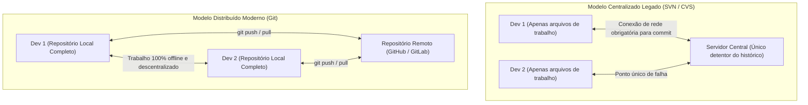
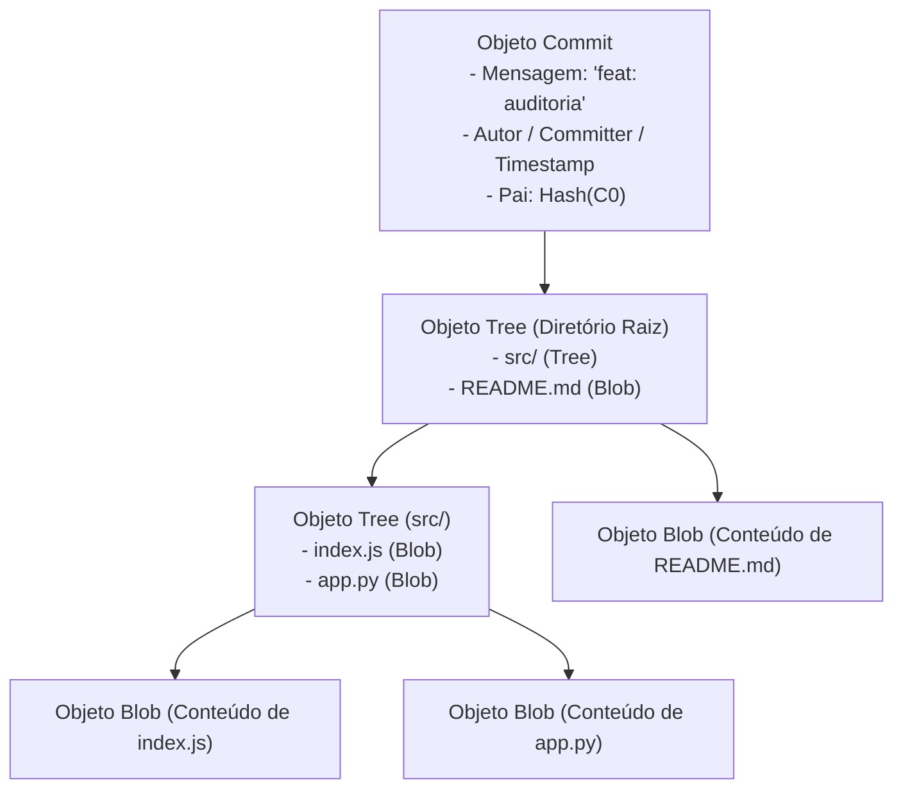
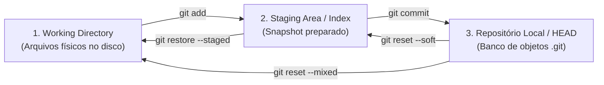
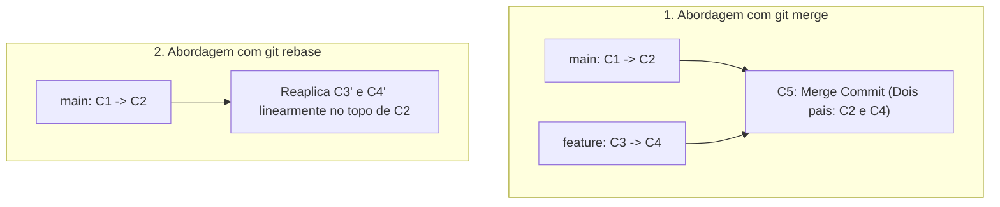
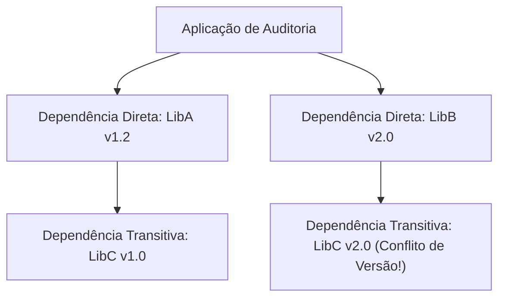
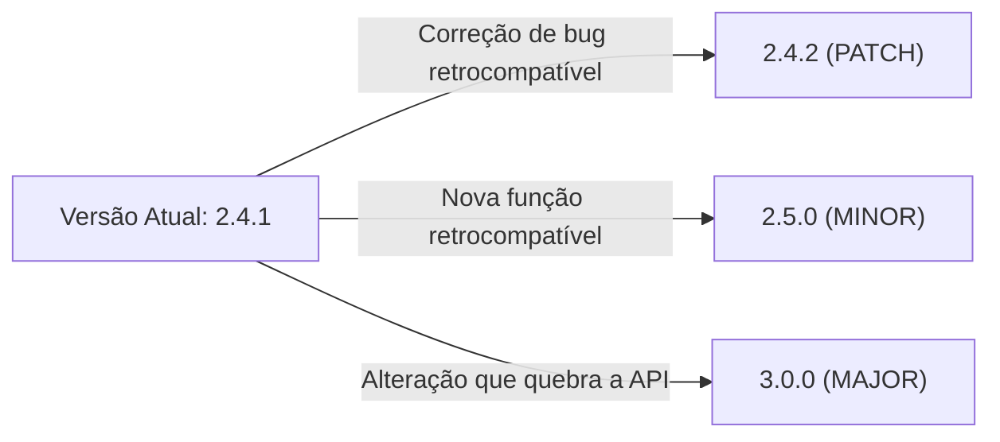
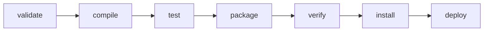
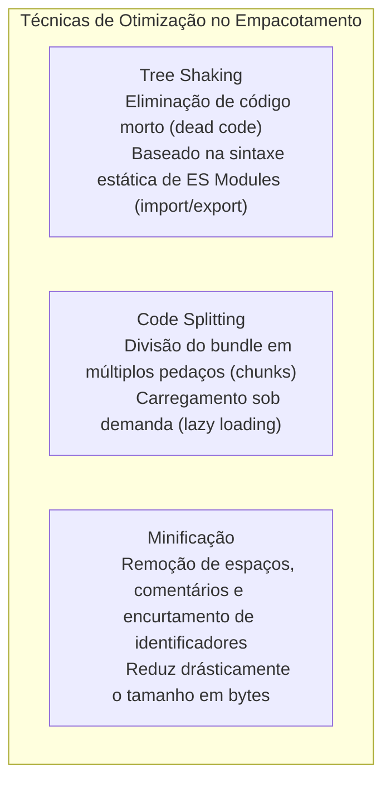

# 06 - Git, Gerenciamento de Dependências e Empacotamento

> **Matéria:** Desenvolvimento de Sistemas  
> **Cargo:** B02 – Técnico de Controle Externo – Especialidade: Tecnologia da Informação  
> **Arquivo:** `06_git_gerenciamento_de_dependencias_e_empacotamento.md`  

---

## 📌 Ementa / Itens do Edital
- Controle de versão distribuído com Git (conceitos e comandos essenciais)
- Gerenciamento de dependências
- Empacotamento de aplicações (bundlers e artefatos)
- Publicação e distribuição de aplicações

---

## 🧭 Sumário
- [1. Controle de Versão Distribuído com Git](#1-controle-de-versao-distribuido-com-git)
    - [1.1 Arquitetura Interna: Distribuído vs. Centralizado e Snapshots vs. Deltas](#11-arquitetura-interna-distribuido-vs-centralizado-e-snapshots-vs-deltas)
    - [1.2 O Modelo de Objetos do Git: Blobs, Trees, Commits e Tags](#12-o-modelo-de-objetos-do-git-blobs-trees-commits-e-tags)
    - [1.3 As Três Áreas Locais e o Ciclo de Vida dos Arquivos](#13-as-tres-areas-locais-e-o-ciclo-de-vida-dos-arquivos)
    - [1.4 Comandos Fundamentais de Inspeção, Rastreamento e Histórico](#14-comandos-fundamentais-de-inspecao-rastreamento-e-historico)
    - [1.5 Ramificação e Integração: `git merge` vs. `git rebase`](#15-ramificacao-e-integracao-git-merge-vs-git-rebase)
    - [1.6 Operações de Recuperação e Desfazer: `reset`, `revert`, `stash` e `cherry-pick`](#16-operacoes-de-recuperacao-e-desfazer-reset-revert-stash-e-cherry-pick)
    - [1.7 Sincronização e Fluxo Remoto: `fetch`, `pull` e `push`](#17-sincronizacao-e-fluxo-remoto-fetch-pull-e-push)
- [2. Gerenciamento de Dependências de Software](#2-gerenciamento-de-dependencias-de-software)
    - [2.1 Grafos de Dependência, Dependências Transitivas e Conflitos](#21-grafos-de-dependencia-dependencias-transitivas-e-conflitos)
    - [2.2 Versionamento Semântico (SemVer 2.0.0)](#22-versionamento-semantico-semver-200)
    - [2.3 Manifestos vs. Arquivos de Trava (Lockfiles) e o Comando `npm ci`](#23-manifestos-vs-arquivos-de-trava-lockfiles-e-o-comando-npm-ci)
    - [2.4 Ecossistemas de Dependências: Node.js (npm), Python (pip/Poetry) e Java (Maven)](#24-ecossistemas-de-dependencias-nodejs-npm-python-pippoetry-e-java-maven)
    - [2.5 O Ciclo de Vida Padrão do Apache Maven](#25-o-ciclo-de-vida-padrao-do-apache-maven)
- [3. Empacotamento Web e Publicação de Aplicações](#3-empacotamento-web-e-publicacao-de-aplicacoes)
    - [3.1 Empacotadores Web Modernos (Webpack, Vite, Rollup e esbuild)](#31-empacotadores-web-modernos-webpack-vite-rollup-e-esbuild)
    - [3.2 Otimizações de Produção: Tree Shaking, Code Splitting e Minificação](#32-otimizacoes-de-producao-tree-shaking-code-splitting-e-minificacao)
    - [3.3 Empacotamento de Backend: JAR/WAR, Wheels Python e Repositórios Corporativos](#33-empacotamento-de-backend-jarwar-wheels-python-e-repositorios-corporativos)
- [4. Fontes Recomendadas na Internet](#4-fontes-recomendadas-na-internet)
- [5. Questões Comentadas & Exemplos (Padrão FCC)](#5-questoes-comentadas-exemplos-padrao-fcc)

---

## 1. Controle de Versão Distribuído com Git

### 1.1 Arquitetura Interna: Distribuído vs. Centralizado e Snapshots vs. Deltas
O Git, projetado originalmente por Linus Torvalds em 2005 para o desenvolvimento do kernel Linux, representa uma ruptura paradigmática em relação aos sistemas de controle de versão legados:

- **Sistemas Centralizados (SVN / CVS):** Há um único repositório centralizado. Para inspecionar logs de commits antigos, ramificar código ou confirmar alterações, o desenvolvedor precisa de conectividade direta com o servidor. Se o servidor queimar sem backup, todo o histórico é irremediavelmente perdido.
- **Sistemas Distribuídos (Git):** Cada desenvolvedor que executa um `git clone` recebe uma **cópia integral e idêntica do repositório**, contendo cada branch, cada commit e todos os metadados históricos desde a criação do projeto. Cada máquina opera como um servidor autônomo, viabilizando operações offline instantâneas e tolerância a falhas catastróficas.
- **Snapshots vs. Deltas:**
    - Sistemas legados salvam dados como conjuntos de alterações linha a linha baseados em arquivos (**deltas baseados em diferenças**).
    - O Git não pensa em termos de deltas de arquivos: ele enxerga seus dados como um conjunto de **instantâneos completos (*snapshots*)** da árvore de arquivos no momento exato do commit. Para não desperdiçar espaço em disco, se um arquivo não sofreu nenhuma modificação entre versões, o Git não grava o arquivo novamente: ele apenas insere um ponteiro direto apontando para o snapshot anterior já armazenado.

---

### 1.2 O Modelo de Objetos do Git: Blobs, Trees, Commits e Tags
Toda informação persistida pelo Git reside dentro do diretório oculto `.git/objects` e é identificada unicamente pelo seu hash criptográfico (originalmente SHA-1 de 40 dígitos hexadecimais, evoluindo para SHA-256). O Git organiza seus dados em quatro tipos fundamentais de objetos:

1. **Blob (*Binary Large Object*):** Armazena estritamente o conteúdo binário dos dados de um arquivo. O blob **não armazena o nome do arquivo nem suas permissões de acesso** (POSIX); guarda unicamente os bytes puros. Se dois arquivos em pastas diferentes tiverem conteúdos idênticos, o Git cria um único blob para ambos.
2. **Tree (Árvore):** Representa o equivalente a uma pasta/diretório no sistema de arquivos. Uma Tree mapeia os nomes de arquivos, permissões de execução e aponta para os respectivos hashes dos Blobs ou de outras Trees filhas (subpastas).
3. **Commit:** Representa a fotografia definitiva do projeto. Aponta para a Tree raiz daquele snapshot, armazena referências para o(s) commit(s) ancestral(is) (*parents*), nome e e-mail do autor e do committer, data/hora e a mensagem descritiva do commit.
4. **Annotated Tag (Tag Anotada):** Aponta para um commit específico, contendo um nome de versão (ex.: `v1.0.0`), mensagem explicativa e assinatura criptográfica opcional (GPG).

---

### 1.3 As Três Áreas Locais e o Ciclo de Vida dos Arquivos
No computador local do desenvolvedor, o Git segmenta os arquivos em três áreas distintas:

1. **Working Directory (Diretório de Trabalho):** Diretório físico no disco rígido do sistema operacional onde os arquivos do projeto residem descompactados e onde o programador efetivamente escreve e modifica o código-fonte.
2. **Staging Area / Index (Área de Preparação):** Arquivo binário localizado em `.git/index`. Funciona como uma mesa de preparação onde o desenvolvedor seleciona e pré-agrupa exatamente quais arquivos e quais trechos modificados farão parte do próximo commit.
3. **Repositório Local (.git directory / HEAD):** O banco de dados imutável onde os commits consolidados são gravados permanentemente. O ponteiro especial **HEAD** aponta para o ramo e commit em que o desenvolvedor está atualmente trabalhando.

---

### 1.4 Comandos Fundamentais de Inspeção, Rastreamento e Histórico
- **`git init`:** Inicializa um repositório Git vazio criando a pasta oculta `.git`.
- **`git clone <url>`:** Clona um repositório remoto completo com todo o histórico de branches para a máquina local.
- **`git status`:** Exibe o estado comparativo das três áreas, listando arquivos não rastreados (*untracked*), modificados e preparados (*staged*).
- **`git diff`:** Exibe diferenças linha a linha:
    - `git diff`: Diferenças entre o *Working Directory* e a *Staging Area*.
    - `git diff --staged` (ou `--cached`): Diferenças entre a *Staging Area* e o último commit no *HEAD*.
- **`git add <arquivo>`:** Adiciona o snapshot do arquivo à Staging Area.
- **`git commit -m "mensagem"`:** Grava o snapshot da Staging Area permanentemente no repositório local.
- **`git log`:** Exibe a linha do tempo de commits (`--oneline`, `--graph` para visualizar ramificações).
- **`git blame <arquivo>`:** Exibe o arquivo linha por linha, informando qual autor e qual hash de commit foi responsável pela última edição de cada linha (ferramenta essencial para auditoria forense de código).

---

### 1.5 Ramificação e Integração: `git merge` vs. `git rebase`
Branches no Git são apenas ponteiros móveis levíssimos de 41 bytes que apontam para um hash de commit. Ao integrar alterações de ramos diferentes, existem duas abordagens fundamentais:

#### Comparativo entre Merge e Rebase

| Critério | `git merge` | `git rebase` |
|---|---|---|
| **Mecânica Operacional** | Combina os ramos criando um **novo commit de junção (*Merge Commit*)** com múltiplos pais (salvo em *Fast-Forward*). | Pega os commits do ramo atual e os **reaplica individualmente um a um** no topo do ramo de destino. |
| **Linha Histórica** | Preserva o histórico não-linear fiel à cronologia dos fatos, documentando bifurcações e fusões de branches. | **Reescreve o histórico**, produzindo uma linha do tempo **estritamente linear e contínua**, sem commits de merge adicionais. |
| **Hashes Criptográficos** | **Preserva intactos** os hashes SHA-1/256 de todos os commits originais. | **Gera novos hashes criptográficos** para todos os commits que foram deslocados. |
| **Regra de Ouro da Equipe** | Seguro para qualquer branch, seja ela privada ou pública compartilhada. | ⭐ **NUNCA aplique rebase em branches públicas/compartilhadas!** Reescrever o histórico de commits já sincronizados por outros desenvolvedores quebra os repositórios locais de toda a equipe. |

---

### 1.6 Operações de Recuperação e Desfazer: `reset`, `revert`, `stash` e `cherry-pick`

#### 1. As Três Modalidades de `git reset`
O comando `git reset <hash>` move o ponteiro HEAD para trás:

| Modo do Reset | Efeito no HEAD | Efeito na Staging Area (Index) | Efeito no Working Directory | Caso de Uso Típico |
|---|---|---|---|---|
| **`--soft`** | Recua para o `<hash>` indicado | **Preserva todas as mudanças** (arquivos continuam *staged*) | Inalterado | Agrupar os últimos 3 commits em um único commit antes de enviar. |
| **`--mixed`** *(padrão)* | Recua para o `<hash>` indicado | **Limpa a Staging Area** (remove do *stage*) | **Preserva todas as mudanças** (arquivos ficam no disco como modificados) | Desfazer um commit para revisar alterações antes de commitar de novo. |
| **`--hard`** | Recua para o `<hash>` indicado | **Descarta e limpa tudo** | **Destrói e apaga tudo no disco** | Descartar sumariamente código recente com perda total de alterações locais. |

#### 2. `git revert <hash>` (Desfazendo em Ramos Públicos)
Em branches públicas compartilhadas, o `git reset` é proibido. Para desfazer alterações com segurança sem quebrar o histórico compartilhado, utiliza-se o **`git revert <hash>`**.

- Ele **não apaga o commit defeituoso**.
- Em vez disso, o Git analisa as modificações daquele commit e gera automaticamente um **novo commit inverso**, anulando as alterações introduzidas com total transparência e auditabilidade.

#### 3. `git stash` (Armazenamento Temporário de Trabalho Inacabado)
Permite salvar o estado intermediário do *Working Directory* e da *Staging Area* em uma pilha interna temporária de memória do Git, limpando os arquivos do disco para o estado do último commit:

- `git stash` (ou `git stash push -m "descrição"`): Guarda as alterações pendentes e limpa a pasta de trabalho.
- `git stash pop`: Restaura as alterações salvas de volta para o diretório de trabalho e remove o registro do topo da pilha.
- `git stash apply`: Restaura as alterações, mas mantém uma cópia guardada na pilha.
- `git stash list`: Lista todos os stashes acumulados.

#### 4. `git cherry-pick <hash>`
Permite selecionar um **único commit específico** de outra branch e reaplicá-lo cirurgicamente no topo da branch atual, sem precisar fundir a branch inteira via merge.

---

### 1.7 Sincronização e Fluxo Remoto: `fetch`, `pull` e `push`
- **`git remote add origin <url>`:** Vincula o repositório local a um repositório remoto.
- **`git fetch`:** Baixa todos os novos objetos e branches do servidor remoto para o repositório local, mas **não altera nem mescla nada no diretório de trabalho** do desenvolvedor (operação 100% segura para inspeção).
- **`git pull`:** Executa sequencialmente um `git fetch` seguido imediatamente por um `git merge` (ou `git rebase` se configurado) no ramo local atual.
- **`git push origin <branch>`:** Envia os novos commits locais para o servidor remoto centralizado.

---

## 2. Gerenciamento de Dependências de Software

### 2.1 Grafos de Dependência, Dependências Transitivas e Conflitos
Em engenharia de software contemporânea, quase nenhuma aplicação é construída do zero; projetos utilizam bibliotecas de terceiros que, por sua vez, dependem de outras bibliotecas:

- **Dependências Diretas:** Bibliotecas declaradas explicitamente pelo desenvolvedor no arquivo de manifesto do projeto.
- **Dependências Transitivas:** Bibliotecas exigidas pelas suas dependências diretas.
- **Conflito de Dependências:** Ocorre quando duas bibliotecas exigem versões mutuamente incompatíveis de uma mesma biblioteca transitiva (ex.: a famosa problemática do *"Dependency Hell"*).

---

### 2.2 Versionamento Semântico (SemVer 2.0.0)
A especificação universal SemVer define como os softwares devem rotular suas versões públicas através do formato de três inteiros separados por ponto:

$$\textbf{MAJOR} \,.\, \textbf{MINOR} \,.\, \textbf{PATCH}$$

1. **MAJOR (Quebra de Compatibilidade Reversa / *Breaking Changes*):** Incrementado quando são realizadas modificações substanciais na API pública que tornam o código incompatível com versões anteriores. Consumidores precisam alterar seus códigos para não quebrar.
2. **MINOR (Novas Funcionalidades Retrocompatíveis):** Incrementado quando novos métodos, classes ou funcionalidades são adicionados à biblioteca, mas preservando 100% da compatibilidade com o código pré-existente (*backwards-compatible*).
3. **PATCH (Correções de Bugs Retrocompatíveis):** Incrementado estritamente para correção de defeitos internos, bugs ou vulnerabilidades de segurança que não alteram a assinatura nem o comportamento da API pública.

#### Sintaxe de Prefixos de Versão no `npm` (Node.js)
- **Til (`~1.2.3`):** Autoriza atualizações apenas no nível de **PATCH** ($\ge 1.2.3 \text{ e } < 1.3.0$).
- **Circunflexo (`^1.2.3`):** Autoriza atualizações no nível de **MINOR e PATCH** ($\ge 1.2.3 \text{ e } < 2.0.0$).
- **Versão Exata (`1.2.3`):** Sem prefixos; trava estritamente naquela versão.

---

### 2.3 Manifestos vs. Arquivos de Trava (Lockfiles) e o Comando `npm ci`
- **Arquivo de Manifesto (`package.json`, `pom.xml`, `requirements.txt`):** Descreve os metadados do projeto e declara faixas de tolerância flexíveis para as dependências (ex.: `"express": "^4.18.0"`).
- **Arquivo de Trava (*Lockfile* - `package-lock.json`, `poetry.lock`, `yarn.lock`):** É gerado automaticamente pelo gerenciador de pacotes para congelar a **árvore completa e exata de dependências transitivas**, gravando a versão exata de cada subdependência instalada e o seu **hash criptográfico de integridade** (`integrity: sha512-...`). Garante compilações 100% determinísticas e reproduzíveis em qualquer máquina.

> 🚨 **ALERTA DE PROVA / FCC:**  
> **`npm install` vs. `npm ci` em Esteiras de CI/CD:**  
>
> - Em esteiras de Integração Contínua (CI/CD) de produção, **NUNCA se deve rodar `npm install`**. O `npm install` pode atualizar dependências permitidas pelas faixas do manifesto e regerar o `package-lock.json`, introduzindo código não testado em produção.
> - O comando correto e padronizado para esteiras automatizadas é o **`npm ci`** (*Clean Install*). Ele apaga a pasta `node_modules` inteira e instala rigorosamente o que está congelado no `package-lock.json`. Se houver qualquer discrepância entre o manifesto e o lockfile, ele aborta a esteira com erro.

---

### 2.4 Ecossistemas de Dependências: Node.js (npm), Python (pip/Poetry) e Java (Maven)

| Ecossistema | Gerenciador de Pacotes | Arquivo de Manifesto | Arquivo de Trava (*Lockfile*) | Repositório Central Público |
|---|---|---|---|---|
| **JavaScript / Node.js** | npm / Yarn / pnpm | `package.json` | `package-lock.json` / `yarn.lock` | npmjs.com |
| **Python** | pip / Poetry / Pipenv | `pyproject.toml` / `requirements.txt` | `poetry.lock` / `Pipfile.lock` | PyPI (*Python Package Index*) |
| **Java** | Apache Maven / Gradle | `pom.xml` / `build.gradle` | `gradle.lockfile` (ou hashes locais) | Maven Central |

---

### 2.5 O Ciclo de Vida Padrão do Apache Maven
No ecossistema Java corporativo, o Apache Maven organiza o processo de construção em fases sequenciais imutáveis dentro do seu ciclo de vida padrão (*default lifecycle*):

1. **`validate`:** Valida se a estrutura do projeto está correta e se todas as informações do `pom.xml` estão preenchidas.
2. **`compile`:** Compila o código-fonte Java (`.java`) localizado em `src/main/java` gerando os arquivos de bytecode (`.class`).
3. **`test`:** Executa os testes automatizados unitários (JUnit) localizados em `src/test/java`.
4. **`package`:** Empacota o código compilado no formato de distribuição configurado (`.jar` ou `.war`).
5. **`verify`:** Executa testes de integração para verificar critérios de qualidade e conformidade do pacote.
6. **`install`:** Copia o pacote gerado para o **repositório local do desenvolvedor** (localizado em `~/.m2/repository`), disponibilizando o artefato como dependência para outros projetos locais na mesma máquina.
7. **`deploy`:** Copia o pacote final para o **repositório corporativo remoto compartilhado** (ex.: Nexus ou JFrog Artifactory) para distribuição oficial.

---

## 3. Empacotamento Web e Publicação de Aplicações

### 3.1 Empacotadores Web Modernos (Webpack, Vite, Rollup e esbuild)
No desenvolvimento front-end moderno, o código-fonte é decomposto em centenas de componentes JSX/TSX, folhas de estilo SASS/CSS e imagens. Navegadores não executam esses formatos diretamente de forma eficiente sem empacotamento.

- **Module Bundling:** Processo que analisa o grafo de dependências a partir de um arquivo de entrada (*entry point* como `index.tsx`) e consolida todos os recursos em arquivos estáticos otimizados (HTML, JS, CSS) dentro da pasta de produção (geralmente `dist/` ou `build/`).
- **Ferramentas:**
    - **Webpack:** O empacotador tradicional mais maduro e configurável do mercado.
    - **Vite:** Ferramenta moderna de alta velocidade que utiliza o motor **esbuild** (escrito em Go) para pré-empacotamento instantâneo em desenvolvimento e o **Rollup** para gerar o bundle final de produção.

---

### 3.2 Otimizações de Produção: Tree Shaking, Code Splitting e Minificação

- **Tree Shaking (Eliminação de Código Morto):** Técnica onde o empacotador inspeciona a árvore de dependências e **descarta funções, classes ou variáveis importadas que nunca são invocadas na lógica do sistema**. Baseia-se exclusivamente na análise estática dos módulos ECMAScript (ESM `import` e `export`). Não funciona adequadamente com CommonJS (`require()`), pois o CommonJS é dinâmico.
- **Code Splitting (Divisão de Código):** Estratégia de dividir o pacote JavaScript final em arquivos menores (*chunks*). Em vez de o usuário baixar 5 MB de código para abrir a tela de login, o navegador baixa apenas o essencial, carregando outras telas sob demanda via importações dinâmicas (`React.lazy()` / `import()`).
- **Minificação e Ofuscação:** Processo automatizado que remove todos os espaços em branco, quebras de linha e comentários, além de renomear variáveis longas para letras únicas (`function processarAuditoriaFiscal()` $\rightarrow$ `function a()`), reduzindo o payload e dificultando a engenharia reversa.

---

### 3.3 Empacotamento de Backend: JAR/WAR, Wheels Python e Repositórios Corporativos

#### Formatos de Distribuição
- **Java Executável (*Fat JAR* / *Uber JAR*):** Padrão dominante em microsserviços modernos (como Spring Boot). Empacota em um único arquivo `.jar` todo o código compilado da aplicação, todas as bibliotecas de dependência de terceiros e um **servidor web embutido** (Tomcat ou Jetty), permitindo execução direta pelo comando `java -jar aplicacao.jar` sem depender de servidores pré-instalados.
- **Java WAR (*Web Application Archive*):** Padrão corporativo legado contendo a estrutura de pastas `WEB-INF`, concebido para ser implantado dentro de servidores de aplicação compartilhados (*standalone application servers* como WildFly ou WebLogic).
- **Python Wheel (`.whl` - PEP 427):** Formato padrão de distribuição de pacotes binários pré-compilados em Python. Evita a execução de scripts de compilação C (`setup.py`) durante a instalação pelo `pip`, garantindo instalações até 10 vezes mais rápidas.

#### Repositórios Corporativos de Artefatos
Em ambientes corporativos como tribunais de contas, o acesso a repositórios públicos (npm, PyPI, Maven Central) é intermediado por gerenciadores de repositório privados como **Sonatype Nexus**, **JFrog Artifactory** ou **GitHub Packages**.

- Funcionam como proxy de cache local de dependências externas.
- Permitem aplicar varreduras automatizadas de segurança e vulnerabilidades conhecidas (CVEs) antes de permitir a instalação no ambiente governamental.

---

## 4. Fontes Recomendadas na Internet

- [Pro Git Book Oficial (Scott Chacon & Ben Straub)](https://git-scm.com/book/pt-br/v2): Livro oficial de referência completa sobre controle de versão distribuído, modelo de objetos e fluxos avançados de Git.
- [Semantic Versioning 2.0.0 (SemVer)](https://semver.org/lang/pt-BR/): Documento normativo que estabelece os critérios técnicos de incremento de MAJOR, MINOR e PATCH.
- [npm CLI Documentation - Lockfiles and CI](https://docs.npmjs.com/cli/v10/configuring-npm/package-lock-json): Manual oficial da npm sobre determinismo de builds, hashes SHA-512 e diretrizes de execução do `npm ci`.
- [Apache Maven Official Guide - Build Lifecycle](https://maven.apache.org/guides/introduction/introduction-to-the-lifecycle.html): Documentação da Apache Software Foundation sobre as fases `compile`, `test`, `package`, `install` e `deploy`.

---

## 5. Questões Comentadas & Exemplos (Padrão FCC)

### Questão 1 (FCC - Analista de TI / Sistemas)
Um analista de sistemas do Tribunal de Contas estava desenvolvendo uma nova rotina de auditoria financeira no ramo de trabalho `feature-auditoria`. Durante o desenvolvimento, com dezenas de arquivos editados na sua área de trabalho (*working directory*) e na área de preparação (*staging area*), ele recebeu uma ordem prioritária para corrigir imediatamente uma falha crítica de segurança no ramo principal `main`. O analista não deseja realizar um commit parcial de código incompleto, mas necessita que sua árvore de trabalho fique totalmente limpa para permitir alternar de ramo sem erros.

Posteriormente, após solucionar a falha e submeter a correção ao repositório remoto público compartilhado com toda a equipe de engenharia, ele constatou que um commit anterior presente na branch pública compartilhada causou um efeito colateral indesejado. Ele precisa anular e desfazer as alterações introduzidas por aquele commit específico sem reescrever ou apagar a linha histórica já sincronizada pelos demais desenvolvedores.

Para atender a esses dois requisitos com segurança e conformidade com as boas práticas do Git, o analista deve executar, respectivamente, os comandos:  

* **A)** `git stash` para armazenar temporariamente as modificações não consolidadas em uma pilha interna; e `git revert <hash>` para gerar um novo commit que anula exatamente as modificações do commit defeituoso na branch pública.
* **B)** `git reset --hard` para limpar o diretório de trabalho; e `git reset --soft <hash>` para remover o commit do histórico compartilhado.
* **C)** `git checkout -b hotfix` para ignorar o trabalho não salvo; e `git rebase -i` para expurgar a linha do commit na branch compartilhada.
* **D)** `git stash` para guardar as alterações; e `git reset --hard <hash>` acompanhado de `git push --force` para sobrescrever a branch pública.
* **E)** `git clean -df` para ocultar o código local; e `git commit --amend` para renomear o commit defeituoso no repositório remoto.

> **Comentário Detalhado:**
>
> - **A)** **CORRETA.** Análise minuciosa dos dois cenários operacionais:
>     1. Para armazenar temporariamente o progresso de trabalho inacabado sem criar commits incompletos e limpar a área de trabalho para permitir troca de branch, o comando padronizado é o **`git stash`**.
>     2. Em branches públicas compartilhadas por múltiplos desenvolvedores, reescrever ou apagar commits com `reset` quebra os repositórios locais dos demais membros. O comando seguro é o **`git revert <hash>`**, que cria um novo commit que aplica exatamente o efeito inverso das alterações trazidas pelo commit alvo, preservando a transparência e integridade da história.
>
> - **B)** Incorreta. O `git reset --hard` destrói e descarta permanentemente todas as alterações em andamento no disco, provocando perda irreparável de código.
> - **C)** Incorreta. Trocar de ramo com alterações conflitantes no disco gera erro, e executar `rebase` em branch pública viola a regra de ouro do Git.
> - **D)** Incorreta. O uso de `push --force` em branches compartilhadas corrompe os ponteiros de trabalho dos outros colaboradores da equipe.
> - **E)** Incorreta. `git clean -df` apaga definitivamente arquivos não rastreados do sistema de arquivos, e `git commit --amend` altera apenas o último commit localmente.
> 
> **Gabarito: A**

---

### Questão 2 (FCC - Técnico de Controle Externo / TI)
Considere uma biblioteca de auditoria governamental que adota rigorosamente a especificação de Versionamento Semântico (*Semantic Versioning* - SemVer 2.0.0), encontrando-se atualmente na versão de distribuição `2.4.1`. A equipe de desenvolvimento realizou intervenções de melhoria e disponibilizou novas versões do pacote.

A respeito das regras formais do SemVer e da gestão de dependências com gerenciadores de pacotes modernos, assinale a afirmativa correta:  

* **A)** Se a equipe corrigir uma falha de segurança interna sem alterar ou descontinuar nenhum método da API pública, a nova versão oficial deve ser rotulada como `3.0.0`.
* **B)** Se a equipe adicionar uma nova função de cálculo tributário que preserva total compatibilidade reversa com o código existente dos consumidores, a versão deve ser incrementada para `2.5.0`.
* **C)** Em um arquivo de manifesto `package.json`, a declaração `"modulo": "^2.4.1"` instrui o gerenciador `npm` a autorizar estritamente atualizações de correção (*patch*), congelando a versão menor (*minor*).
* **D)** O arquivo de manifesto substitui integralmente a necessidade de um arquivo de trava (*lockfile*), pois ambos contêm exatamente as mesmas informações e os mesmos hashes criptográficos de integridade.
* **E)** A alteração do número de versão `MAJOR` sinaliza aos consumidores que foram adicionadas apenas correções superficiais de documentação, com garantia total de retrocompatibilidade.

> **Comentário Detalhado:**
>
> - **A)** Incorreta. Correções de falhas ou correções de segurança que mantêm total compatibilidade da API devem incrementar unicamente o dígito de **PATCH** (passando para `2.4.2`).
> - **B)** **CORRETA.** A adição de novas funcionalidades preservando integralmente a compatibilidade com versões anteriores (*backwards-compatible*) exige formalmente o incremento do dígito **MINOR** (passando de `2.4.1` para `2.5.0` e zerando o patch).
> - **C)** Incorreta. O prefixo circunflexo `^2.4.1` autoriza atualizações de **MINOR e PATCH** (qualquer versão menor que `3.0.0`). O prefixo que congela a versão menor e restringe apenas a correções de patch é o til (`~2.4.1`).
> - **D)** Incorreta. O arquivo de manifesto define faixas de versão flexíveis, enquanto o lockfile registra a árvore completa de dependências com hashes SHA-512 de integridade, sendo indispensável para a reprodutibilidade.
> - **E)** Incorreta. O incremento de `MAJOR` indica quebras de compatibilidade reversa (*breaking changes*).
> 
> **Gabarito: B**

---

### Questão 3 (FCC - Analista de TI / Sistemas)
No modelo operacional do Git, o comando `git reset` permite retroceder a posição do ponteiro `HEAD` para um determinado commit anterior da árvore histórica. Esse comando aceita diferentes parâmetros que determinam o destino das alterações existentes nos arquivos.

Sobre os efeitos dos parâmetros do comando `git reset`, assinale a afirmativa correta:  

* **A)** O comando `git reset --soft HEAD~1` move o ponteiro HEAD para o commit anterior e descarta permanentemente todas as alterações tanto da Staging Area quanto do Working Directory.
* **B)** O comando `git reset --mixed HEAD~1` (modo padrão) move o ponteiro HEAD para o commit anterior, desfaz a preparação dos arquivos na Staging Area, mas preserva todas as modificações no Working Directory como arquivos modificados não rastreados para o próximo commit.
* **C)** O comando `git reset --hard HEAD~1` mantém intactas as modificações no Working Directory e apenas remove os arquivos da Staging Area.
* **D)** O comando `git reset --hard` é o mecanismo recomendado para branches públicas compartilhadas, pois não afeta o histórico de commits dos demais desenvolvedores.
* **E)** A opção `--soft` é a única que apaga os arquivos do sistema de arquivos no disco rígido.

> **Comentário Detalhado:**
>
> - **A)** Incorreta. A opção `--soft` não descarta nenhuma alteração; ela preserva todas as mudanças na Staging Area.
> - **B)** **CORRETA.** O modo padrão `--mixed` recua o HEAD para o commit indicado, limpa a Staging Area (desfazendo o preparo), porém **preserva intactas todas as alterações no Working Directory**, mantendo os arquivos no disco como modificações pendentes de novo `git add`.
> - **C)** Incorreta. A opção `--hard` descarta sumariamente e sobrescreve todas as modificações no Working Directory e na Staging Area.
> - **D)** Incorreta. O `git reset` não deve ser executado para reescrever branches públicas compartilhadas.
> - **E)** Incorreta. A opção `--soft` não apaga nenhum arquivo do disco.
> 
> **Gabarito: B**

---

### Questão 4 (FCC - Auditor Fiscal / Tecnologia da Informação)
No contexto do desenvolvimento de aplicações web modernas com ferramentas de empacotamento (*module bundlers* como Webpack, Rollup e Vite), o processo que visa reduzir o volume de dados transferido para os navegadores dos usuários finais recorre a técnicas sofisticadas de otimização de código.

A técnica que consiste na análise estática das instruções `import` e `export` dos módulos ECMAScript (ESM) para identificar e eliminar blocos de código, funções e variáveis exportadas que nunca são efetivamente utilizados no restante da aplicação denomina-se:  

* **A)** *Code Splitting*
* **B)** *Hot Module Replacement (HMR)*
* **C)** *Tree Shaking*
* **D)** *Continuous Integration (CI)*
* **E)** *Source Mapping*

> **Comentário Detalhado:**
>
> - **A)** Incorreta. *Code Splitting* é a técnica de segmentar o bundle em múltiplos arquivos (*chunks*) para carregamento sob demanda (*lazy loading*).
> - **B)** Incorreta. *Hot Module Replacement (HMR)* atualiza módulos no navegador durante o desenvolvimento sem recarregar a página por completo.
> - **C)** **CORRETA.** A técnica de **Tree Shaking** (*dead-code elimination*) analisa a estrutura estática dos módulos ESM (`import`/`export`) durante a compilação e remove do pacote final qualquer função ou classe importada que não seja invocada no código da aplicação.
> - **D)** Incorreta. Integração Contínua (CI) é uma prática DevOps de compilação e testes automatizados.
> - **E)** Incorreta. *Source Maps* são arquivos de mapeamento que correlacionam o código minificado de produção com o código-fonte original para depuração.
> 
> **Gabarito: C**

---

### Questão 5 (FCC - Analista de Sistemas / Integração Contínua e Build)
No ecossistema de desenvolvimento de sistemas em Java gerenciado pela ferramenta Apache Maven, o ciclo de vida de construção (*build lifecycle*) organiza a execução de objetivos (*goals*) em fases pré-definidas. Simultaneamente, em ambientes de esteiras de Integração Contínua (CI/CD), a garantia de builds reprodutíveis e determinísticos tornou-se um requisito mandatório de conformidade e segurança da cadeia de suprimentos.

A respeito do ciclo de vida do Maven e dos mecanismos que garantem builds reproduzíveis em gerenciadores de dependências modernos, assinale a afirmativa correta:  

* **A)** A fase `package` do Maven precede a fase `compile`, permitindo empacotar o artefato antes da compilação do código Java para acelerar o processo de testes.
* **B)** O comando `mvn install` compila o código, roda os testes, gera o pacote e copia o artefato resultante para o repositório local do desenvolvedor (`~/.m2/repository`), disponibilizando-o como dependência para outros projetos na mesma máquina.
* **C)** Em projetos Node.js em esteiras de CI/CD, o comando `npm install` deve sempre substituir o comando `npm ci`, pois o `npm install` impede qualquer modificação no arquivo `package-lock.json`.
* **D)** As coordenadas de um artefato Maven declaradas no `pom.xml` são definidas unicamente pelo parâmetro `releaseDate`, dispensando a indicação de `groupId` e `artifactId`.
* **E)** O arquivo de lockfile (`package-lock.json` ou `poetry.lock`) impede a compilação de código caso o repositório remoto contenha novas versões maiores (*MAJOR*) de bibliotecas de terceiros.

> **Comentário Detalhado:**
>
> - **A)** Incorreta. A fase `compile` precede obrigatoriamente a fase `package`, pois não é possível empacotar classes antes de sua compilação.
> - **B)** **CORRETA.** A fase **`install`** do ciclo padrão do Maven compila os arquivos, executa os testes unitários, gera o pacote (`.jar` ou `.war`) e o instala no repositório local (`~/.m2/repository`), permitindo que outros projetos desenvolvidos localmente o consumam como dependência.
> - **C)** Incorreta. Em esteiras de CI/CD, o comando correto é o **`npm ci`**, pois ele instala estritamente as versões travadas no `package-lock.json` e aborta se houver divergências.
> - **D)** Incorreta. As coordenadas canônicas que identificam qualquer artefato no Maven são o trio GAV: `groupId`, `artifactId` e `version`.
> - **E)** Incorreta. O lockfile congela as versões que foram aprovadas e testadas, ignorando silenciosamente versões mais novas disponíveis no repositório remoto para assegurar estabilidade.
> 
> **Gabarito: B**
