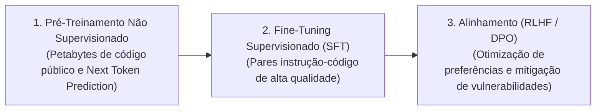
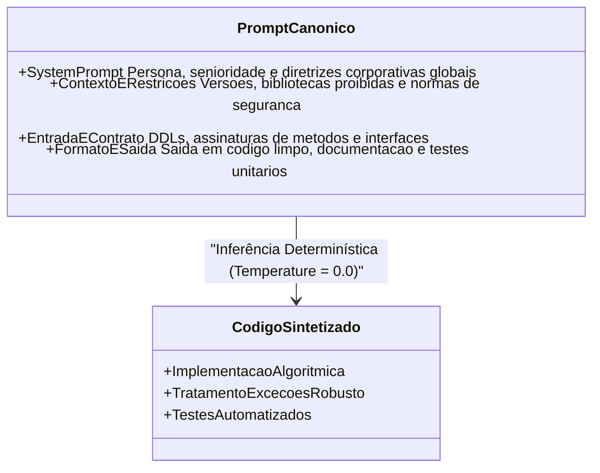
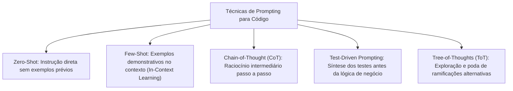
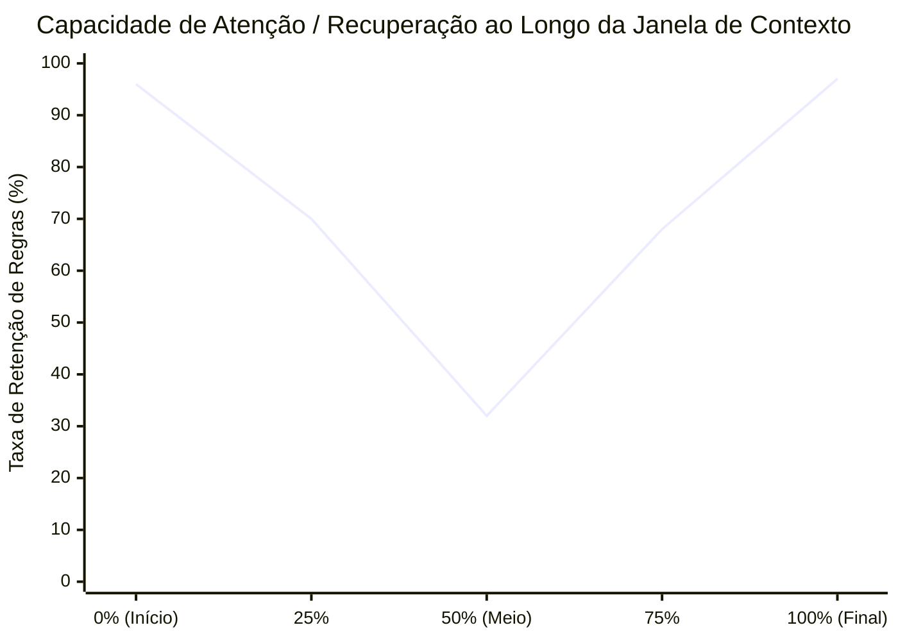

# 01 - LLMs, Programação Baseada em Intenção e Engenharia de Prompts

> **Matéria:** Engenharia de Software Assistida por IA e Sistemas Agentivos  
> **Cargo:** B02 – Técnico de Controle Externo – Especialidade: Tecnologia da Informação  
> **Arquivo:** `01_fundamentos_llms_intent_based_e_engenharia_de_prompts.md`  


---


## 📌 Ementa / Itens do Edital
- Fundamentos da IA aplicada ao desenvolvimento de software
- Modelos de Linguagem de Grande Porte (Large Language Models – LLMs)
- Programação baseada em intenção (Intent-Based Programming)
- Desenvolvimento orientado a linguagem natural (Natural Language Programming)
- Engenharia de contexto e engenharia de prompts aplicadas à geração de código

---

## 🧭 Sumário

1. [Modelos de Linguagem de Grande Porte (LLMs) no Desenvolvimento de Software](#1-modelos-de-linguagem-de-grande-porte-llms-no-desenvolvimento-de-software)
    1. [A Arquitetura Transformer e o Mecanismo de Autoatenção (Self-Attention)](#11-a-arquitetura-transformer-e-o-mecanismo-de-autoatencao-self-attention)
    2. [Variantes Arquiteturais: Encoder-Only, Decoder-Only e Encoder-Decoder](#12-variantes-arquiteturais-encoder-only-decoder-only-e-encoder-decoder)
    3. [Ciclo de Vida do Treinamento: Pré-Treinamento, SFT e Alinhamento (RLHF/DPO)](#13-ciclo-de-vida-do-treinamento-pre-treinamento-sft-e-alinhamento-rlhfdpo)
    4. [Tokenização, Vocabulário e Gestão de Custos Computacionais](#14-tokenizacao-vocabulario-e-gestao-de-custos-computacionais)
    5. [Hiperparâmetros de Inferência e Amostragem: Temperature, Top-P e Penalidades](#15-hiperparametros-de-inferencia-e-amostragem-temperature-top-p-e-penalidades)
    6. [Teste 119](#Teste-119)
    7. [Teste 120](#Teste-120)
    8. [Teste 121](#Teste-121)
    9. [Teste 122](#Teste-122)
2. [Programação Baseada em Intenção e Linguagem Natural](#2-programacao-baseada-em-intencao-e-linguagem-natural)
    1. [Intent-Based Programming: A Transição do "COMO" para o "O QUÊ"](#21-intent-based-programming-a-transicao-do-como-para-o-o-que)
    2. [Sintaxe Estrita vs. Semântica Declarativa e Contratos de Interface](#22-sintaxe-estrita-vs-semantica-declarativa-e-contratos-de-interface)
    3. [Especificações Dirigidas por Comportamento (BDD) como Prompts Executáveis](#23-especificacoes-dirigidas-por-comportamento-bdd-como-prompts-executaveis)
    4. [Teste 123](#Teste-123)
    5. [Teste 124](#Teste-124)
3. [Engenharia de Prompts e Engenharia de Contexto para Software](#3-engenharia-de-prompts-e-engenharia-de-contexto-para-software)
    1. [Estrutura Canônica de um Prompt de Código Corporativo](#31-estrutura-canonica-de-um-prompt-de-codigo-corporativo)
    2. [Técnicas Centrais de Prompting: Zero-Shot, Few-Shot, CoT e Test-Driven](#32-tecnicas-centrais-de-prompting-zero-shot-few-shot-cot-e-test-driven)
    3. [Janela de Contexto e a Mitigação do Efeito "Lost in the Middle"](#33-janela-de-contexto-e-a-mitigacao-do-efeito-lost-in-the-middle)
    4. [Curadoria de Contexto e Minimização de Ruído no Repositório](#34-curadoria-de-contexto-e-minimizacao-de-ruido-no-repositorio)
    5. [Teste 125](#Teste-125)
    6. [Teste 126](#Teste-126)
    7. [Teste 127](#Teste-127)
    8. [Teste 128](#Teste-128)
4. [Fontes Recomendadas na Internet](#4-fontes-recomendadas-na-internet)

---

## 1. Modelos de Linguagem de Grande Porte (LLMs) no Desenvolvimento de Software

### 1.1 A Arquitetura Transformer e o Mecanismo de Autoatenção (Self-Attention)
A integração da Inteligência Artificial Generativa à Engenharia de Software estabelece uma transição paradigmática fundamental: passa-se da programação procedural e imperativa estrita para a computação probabilística baseada em reconhecimento de padrões e atenção contextual em espaços vetoriais de alta dimensão.

A espinha dorsal de todos os LLMs modernos aplicados a código é a arquitetura **Transformer**, apresentada no artigo clássico *"Attention Is All You Need"* (Vaswani et al., 2017). Ao contrário das arquiteturas recorrentes anteriores (RNNs, LSTMs), que processavam palavras de forma estritamente sequencial e sofriam com o esquecimento de dependências de longo alcance, o Transformer opera com paralelismo massivo por meio do mecanismo de **Autoatenção Escalar por Produto Escalar** (*Scaled Dot-Product Attention*).

```mermaid
flowchart TD
    subgraph Attention["Mecanismo de Autoatenção (Self-Attention)"]
        T["Tokens de Código / Entrada"] --> Emb["Camada de Embeddings + Codificação Posicional"]
        Emb --> Proj["Projeções Lineares: Matrizes Q, K, V"]
        Proj --> Dot["Produto Escalar: Q x K^T"]
        Dot --> Scale["Escalonamento: Divisão por sqrt(d_k)"]
        Scale --> Mask["Máscara Causal (Apenas no Decoder)"]
        Mask --> Soft["Normalização Softmax (Pesos de Atenção)"]
        Soft --> Mult["Multiplicação pelos Valores: Pesos x V"]
        Mult --> Out["Projeção Multi-Head e Camadas Feed-Forward"]
    end
```



#### A Formulação Matemática da Atenção
A relevância de um token em relação a todos os demais tokens da janela de contexto é calculada a partir de três projeções lineares: **Consulta ($Q$ - *Query*)**, **Chave ($K$ - *Key*)** e **Valor ($V$ - *Value*)**:

$$\text{Attention}(Q, K, V) = \text{softmax}\left(\frac{Q K^T}{\sqrt{d_k}}\right) V$$

- $Q, K, V$: Matrizes geradas pela multiplicação das representações vetoriais dos tokens por matrizes de pesos aprendidas ($W_Q, W_K, W_V$).
- $d_k$: Dimensionalidade dos vetores de chave. O fator de divisão $\sqrt{d_k}$ impede que produtos escalares em dimensões elevadas atinjam magnitudes muito altas, o que empurraria a função $\text{softmax}$ para regiões com gradientes infinitesimais (*vanishing gradients*).
- $\text{softmax}$: Transforma a matriz de afinidade em uma distribuição de probabilidades normalizada entre 0 e 1, atribuindo pesos dinâmicos que ponderam a soma dos vetores de valor $V$.
- **Multi-Head Attention (Atenção Multi-Cabeça):** O modelo projeta $Q, K, V$ em múltiplos subespaços de representação simultaneamente (ex.: 32 ou 64 cabeças). Em código-fonte, uma cabeça de atenção pode especializar-se em rastrear o escopo de variáveis, outra na correspondência entre chaves `{}` e outra no rastreamento de tipos de retorno.

### 1.2 Variantes Arquiteturais: Encoder-Only, Decoder-Only e Encoder-Decoder

| Família Arquitetural | Mecânica de Processamento | Casos de Uso Predominantes em Software | Modelos Representativos |
|---|---|---|---|
| **Encoder-Only** *(Apenas Codificador)* | **Bidirecional:** O modelo enxerga os tokens à esquerda e à direita simultaneamente em todas as camadas. | Análise estática de código, classificação de vulnerabilidades de segurança, detecção de bugs e busca semântica em repositórios de código. | BERT, CodeBERT, RoBERTa. |
| **Decoder-Only** *(Apenas Decodificador)* | **Autoregressivo Unidirecional:** Utiliza uma máscara causal (*Causal Masking*) que oculta tokens futuros. Gera a resposta token por token, da esquerda para a direita. | **Geração de código**, autocompletar avançado, refatoração de sistemas, explicação de código e chat interativo de programação. | Famílias GPT (OpenAI), Claude (Anthropic), Llama (Meta), DeepSeek-Coder, StarCoder. |
| **Encoder-Decoder** *(Codificador-Decodificador)* | O codificador processa a entrada bidirecionalmente e o decodificador sintetiza a saída de forma autoregressiva. | Tradução entre diferentes linguagens de programação (ex.: COBOL para Java), sumarização de pull requests e geração automática de documentação. | T5, CodeT5. |

### 1.3 Ciclo de Vida do Treinamento: Pré-Treinamento, SFT e Alinhamento (RLHF/DPO)
O desenvolvimento de um modelo fundacional voltado para engenharia de software ocorre em três estágios sucessivos:



1. **Pré-Treinamento Não Supervisionado (*Pre-training*):** O modelo é exposto a trilhões de tokens de texto puro e código aberto em dezenas de linguagens de programação (GitHub, GitLab, documentações oficiais). Ele aprende a estrutura léxica e sintática prevendo o próximo token (*Next Token Prediction*) e através do preenchimento de lacunas intermediárias (**Fill-in-the-Middle - FIM**), fundamental para autocompletar código dentro de arquivos existentes.
2. **Ajuste Fino Supervisionado (*Supervised Fine-Tuning - SFT*):** O modelo pré-treinado recebe conjuntos de dados selecionados contendo tarefas explícitas e suas respectivas respostas ideais (`instrução -> código correto em Markdown`). O modelo aprende a dialogar no papel de assistente técnico e seguir convenções de software.
3. **Alinhamento com Feedback Humano / de IA (*RLHF / RLAIF*):** Utiliza técnicas como *Reinforcement Learning from Human Feedback* (PPO - *Proximal Policy Optimization*) ou *Direct Preference Optimization* (DPO). O alinhamento penaliza código contendo vulnerabilidades comuns (CWE/OWASP Top 10), impede a recomendação de bibliotecas obsoletas e mitiga a geração de scripts maliciosos.

### 1.4 Tokenização, Vocabulário e Gestão de Custos Computacionais
Modelos de linguagem não leem palavras inteiras ou caracteres isolados; eles operam sobre **tokens** (números inteiros que mapeiam fragmentos de palavras e símbolos em um vocabulário pré-definido). O algoritmo padrão adotado na indústria é o **Byte-Pair Encoding (BPE)**.

#### Impactos Cruciais da Tokenização em Código-Fonte:
- **Indentação e Espaços:** Em linguagens onde a indentação é sintática (como Python), tokenizadores antigos emitiam um token para cada espaço em branco individual (4 espaços = 4 tokens). Modelos modernos voltados para código possuem tokens agrupados dedicados para 2, 4 e 8 espaços consecutivos, reduzindo drasticamente o consumo de tokens.
- **Convenções de Identificadores:** Identificadores em *camelCase* (`processarLiquidacaoDespesa`) ou *snake_case* (`processar_liquidacao_despesa`) são decompostos em múltiplos subtokens (`processar`, `liquidacao`, `despesa`). Nomes de variáveis excessivamente prolixos consomem a janela de contexto com maior rapidez.
- **Economia e Métricas de Custo:** As APIs de modelos de IA tarifam o processamento com base no volume de tokens de entrada (*input tokens*) e saída (*output tokens*). A otimização e a curadoria de arquivos enviados para o contexto impactam diretamente o custo operacional das soluções corporativas.

### 1.5 Hiperparâmetros de Inferência e Amostragem: Temperature, Top-P e Penalidades
Durante a fase de inferência (geração da resposta), o modelo projeta logits (pontuações não normalizadas) sobre todo o seu vocabulário. A forma como esses logits são convertidos em probabilidades é modulada por hiperparâmetros de amostragem:

| Hiperparâmetro | Mecânica Matemática | Efeito em Baixos Valores | Efeito em Altos Valores | Recomendação em Engenharia de Software |
|---|---|---|---|---|
| **Temperature ($T$)** | Fator de divisão no expoente dos logits: $P(w_i) = \frac{\exp(z_i / T)}{\sum \exp(z_j / T)}$. | **Determinismo e Estabilidade:** Acentua a probabilidade dos tokens de maior consenso sintático. | **Aleatoriedade e Dispersão:** Achata a curva de probabilidade, aumentando o risco de alucinações. | **$0.0$ a $0.2$** para código executável, testes unitários e refatoração. $0.7$ a $0.8$ apenas para ideação arquitetural. |
| **Top-P (*Nucleus Sampling*)** | Seleciona o menor subconjunto cumulativo de tokens cuja soma das probabilidades atinge o valor $P$. | Descarta sumariamente a cauda longa de tokens improváveis. | Permite que tokens improváveis concorram caso o acumulado demore a fechar. | **$0.1$ a $0.5$** para código determinístico. Se $T = 0.0$, a amostragem torna-se puramente gulosa (*Greedy*), tornando o Top-P inócuo. |
| **Frequency Penalty** | Aplica uma penalização proporcional ao número de vezes que um token já apareceu no texto gerado. | Permite repetições lexicais legítimas. | Inibe repetições, forçando o uso de sinônimos estranhos. | **$0.0$ estrito**. Em programação, palavras reservadas (`if`, `return`, `class`) **precisam se repetir** compulsoriamente. |
| **Presence Penalty** | Aplica penalização fixa se um token já tiver aparecido ao menos uma vez no texto. | Sem interferência na estrutura sintática. | Força a introdução contínua de novos tópicos, induzindo variáveis inventadas. | **$0.0$ estrito** para código-fonte. |

---

### Teste 119
**(FGV – TRT-DA 24-REGIÃO – Analista Judiciário - Tecnologia da Informação – 2025)**
Leia o trecho a seguir. 
Essa ave presta também um grande serviço à medicina. Sem a sua 
ajuda as lobeliáceas não se poderiam reproduzir. Dessa planta de 
belíssimas flores azuis se extrai a lobelina, usada como 
ressuscitador na insuficiência respiratória e no colapso periférico. 
Assinale a opção em que o adjetivo grande mostra o mesmo 
significado do trecho acima.

* **A)** “Minuete da corte – dança originária da França, caracterizada 
pela nobreza e leveza dos gestos. Gozou de grande populari-
dade na corte portuguesa.”
* **B)** “— Grandessíssima!... E a injúria que ia soltar era tão grande 
que o engasgou... e pôs-se a tremer com todo o corpo.”
* **C)** “E começou a procurar por toda a casa. Não era esta mui 
grande; em pouco a percorreu toda, e ficou tomado do mais 
cruel desapontamento por não encontrar a Maria.”
* **D)** “Uns enfureciam-se, outros riam sem querer; do que resultava 
que saíam muitas vezes com a cara cortada, com grande prazer 
do menino e descrédito do padrinho.”
* **E)** “...a comadre trouxe um par de bentinhos da Senhora do 
Monte do Carmo que tinham grande valor na história dos 
milagres, e o lançou ao pescoço da Chiquinha.”

---

> **Comentário Detalhado:**
>
> - **A)** Incorreta. Discrepa das diretrizes normativas e jurisprudenciais aplicáveis ao tema objeto do item.
> - **B)** Incorreta. Discrepa das diretrizes normativas e jurisprudenciais aplicáveis ao tema objeto do item.
> - **C)** Incorreta. Discrepa das diretrizes normativas e jurisprudenciais aplicáveis ao tema objeto do item.
> - **D)** Incorreta. Discrepa das diretrizes normativas e jurisprudenciais aplicáveis ao tema objeto do item.
> - **E)** Correta. Representa com precisão a disciplina do tema e o entendimento pacificado adotado pela banca (FGV).
>
> **Gabarito: E**

---
### Teste 120
**(FGV – TRT-DA 24-REGIÃO – Analista Judiciário - Tecnologia da Informação – 2025)**
Leia o trecho a seguir. 
Essa ave presta também um grande serviço à medicina. Sem a sua 
ajuda as lobeliáceas não se poderiam reproduzir. Dessa planta de 
belíssimas flores azuis se extrai a lobelina, usada como 
ressuscitador na insuficiência respiratória e no colapso periférico. 
Assinale a opção em que o adjetivo grande mostra o mesmo 
significado do trecho acima.

* **A)** “Minuete da corte – dança originária da França, caracterizada 
pela nobreza e leveza dos gestos. Gozou de grande populari-
dade na corte portuguesa.”
* **B)** “— Grandessíssima!... E a injúria que ia soltar era tão grande 
que o engasgou... e pôs-se a tremer com todo o corpo.”
* **C)** “E começou a procurar por toda a casa. Não era esta mui 
grande; em pouco a percorreu toda, e ficou tomado do mais 
cruel desapontamento por não encontrar a Maria.”
* **D)** “Uns enfureciam-se, outros riam sem querer; do que resultava 
que saíam muitas vezes com a cara cortada, com grande prazer 
do menino e descrédito do padrinho.”
* **E)** “...a comadre trouxe um par de bentinhos da Senhora do 
Monte do Carmo que tinham grande valor na história dos 
milagres, e o lançou ao pescoço da Chiquinha.”

---

> **Comentário Detalhado:**
>
> - **A)** Incorreta. Discrepa das diretrizes normativas e jurisprudenciais aplicáveis ao tema objeto do item.
> - **B)** Incorreta. Discrepa das diretrizes normativas e jurisprudenciais aplicáveis ao tema objeto do item.
> - **C)** Incorreta. Discrepa das diretrizes normativas e jurisprudenciais aplicáveis ao tema objeto do item.
> - **D)** Incorreta. Discrepa das diretrizes normativas e jurisprudenciais aplicáveis ao tema objeto do item.
> - **E)** Correta. Representa com precisão a disciplina do tema e o entendimento pacificado adotado pela banca (FGV).
>
> **Gabarito: E**

---
### Teste 121
**(FGV – TRT – Analista Judiciário - Tecnologia da Informação – 2024)**
A figura a seguir ilustra a execução de uma estaca que é indicada, 
em especial, em locais com restrição de pé direito ou dificuldade 
de acesso para equipamentos de grande porte. 


Esse tipo de estaca é denominada

* **A)** raiz.
* **B)** Franki.
* **C)** Strauss.
* **D)** tubulão.
* **E)** escavada.

---

> **Comentário Detalhado:**
>
> - **A)** Incorreta. Discrepa das diretrizes normativas e jurisprudenciais aplicáveis ao tema objeto do item.
> - **B)** Incorreta. Discrepa das diretrizes normativas e jurisprudenciais aplicáveis ao tema objeto do item.
> - **C)** Incorreta. Discrepa das diretrizes normativas e jurisprudenciais aplicáveis ao tema objeto do item.
> - **D)** Correta. Representa com precisão a disciplina do tema e o entendimento pacificado adotado pela banca (FGV).
> - **E)** Incorreta. Discrepa das diretrizes normativas e jurisprudenciais aplicáveis ao tema objeto do item.
>
> **Gabarito: D**

---
### Teste 122
**(FGV – TRT – Analista Judiciário - Tecnologia da Informação – 2024)**
Um engenheiro projeta lajes maciças de concreto armado para o 
pavimento-tipo de uma edificação. Parte da estrutura projetada é 
apresentada na figura a seguir. 

Nessa estrutura, as espessuras mínimas admitidas pela NBR 
6118:2023 para as lajes L1 e L2 valem, respectivamente,

* **A)** 7cm e 8cm.
* **B)** 7cm e 10cm.
* **C)** 8cm e 8cm.
* **D)** 8cm e 10cm.
* **E)** 8cm e 12cm.

---

> **Comentário Detalhado:**
>
> - **A)** Incorreta. Discrepa das diretrizes normativas e jurisprudenciais aplicáveis ao tema objeto do item.
> - **B)** Incorreta. Discrepa das diretrizes normativas e jurisprudenciais aplicáveis ao tema objeto do item.
> - **C)** Incorreta. Discrepa das diretrizes normativas e jurisprudenciais aplicáveis ao tema objeto do item.
> - **D)** Incorreta. Discrepa das diretrizes normativas e jurisprudenciais aplicáveis ao tema objeto do item.
> - **E)** Correta. Representa com precisão a disciplina do tema e o entendimento pacificado adotado pela banca (FGV).
>
> **Gabarito: E**

---
## 2. Programação Baseada em Intenção e Linguagem Natural

### 2.1 Intent-Based Programming: A Transição do "COMO" para o "O QUÊ"
A **Programação Baseada em Intenção** (*Intent-Based Programming - IBP*) representa uma evolução na escala de abstração da engenharia de software:


- **Programação Imperativa:** O programador é responsável por detalhar exaustivamente o algoritmo imperativo: laços, ponteiros, gerência de memória e ramificações condicionais.
- **Programação Baseada em Intenção:** O engenheiro de software concentra-se na formulação rigorosa da **intenção de negócio e restrições formais** (invariantes lógicas, pré-condições, pós-condições e critérios de tolerância a falhas). A IA generativa sintetiza o código executável, que é imediatamente validado por suítes de testes determinísticos.

### 2.2 Sintaxe Estrita vs. Semântica Declarativa e Contratos de Interface
Na programação clássica, o compilador atua como um juiz sintático inflexível: a omissão de uma vírgula ou chave aborta o processo de compilação. Na programação orientada a linguagem natural assistida por IA:

- A flexibilidade da linguagem natural é associada à disciplina dos **Contratos de Interface** (como esquemas OpenAPI, JSON Schema, interfaces TypeScript ou Protocol Buffers).
- A intenção é descrita textualmente, mas ancorada por especificações formais de entrada e saída, eliminando ambiguidade semântica.

### 2.3 Especificações Dirigidas por Comportamento (BDD) como Prompts Executáveis
A disciplina do BDD (*Behavior-Driven Development*) serve como ponte natural entre intenção em linguagem humana e testes automatizados. Cenários descritos em sintaxe Gherkin (`Dado que.. Quando.. Então..`) são utilizados como especificações inequívocas:

```gherkin
Cenário: Aplicação de glosa por sobrepreço em auditoria de obras
  Dado que o valor orçado para o item "Concreto Armado" é de R$ 500.000,00
  E o preço de referência da tabela SINAPI é de R$ 420.000,00
  Quando o auditor executar o cálculo de sobrepreço unitário
  Então o sistema deve registrar uma glosa de R$ 80.000,00
  E classificar a irregularidade com gravidade "GRAVE_COM_DANO_AO_ERARIO"
```

O LLM recebe esse contrato comportamental e gera simultaneamente a suíte de testes correspondente e o código de domínio que satisfaz o cenário.

---

### Teste 123
**(FCC – TRT – Analista Judiciário - Tecnologia da Informação – 2024)**
Analise o código a seguir em linguagem de programação Java: 

Ao executar esse programa em um terminal, será escrito na saída 
padrão:

* **A)** x = 2
* **B)** x = 3
* **C)** x = 4
* **D)** x = 5
* **E)** x = 6

---

> **Comentário Detalhado:**
>
> - **A)** Incorreta. Discrepa das diretrizes normativas e jurisprudenciais aplicáveis ao tema objeto do item.
> - **B)** Incorreta. Discrepa das diretrizes normativas e jurisprudenciais aplicáveis ao tema objeto do item.
> - **C)** Incorreta. Discrepa das diretrizes normativas e jurisprudenciais aplicáveis ao tema objeto do item.
> - **D)** Incorreta. Discrepa das diretrizes normativas e jurisprudenciais aplicáveis ao tema objeto do item.
> - **E)** Correta. Representa com precisão a disciplina do tema e o entendimento pacificado adotado pela banca (FCC).
>
> **Gabarito: E**

---
### Teste 124
**(FCC – TRT – Analista Judiciário - Tecnologia da Informação – 2024)**
JUnit é um framework que facilita o desenvolvimento e execução 
de testes unitários em códigos Java. Ao contrário das versões 
anteriores, o JUnit 5 é composto por muitos módulos oriundos de 
três subprojetos diferentes conhecidos como

* **A)** IntelliJ IDEA, Spring Boot e Ant.
* **B)** Plataforma JUnit, Maven e Eclipse.
* **C)** Gradle, Jupyter Notebook e Mockito.
* **D)** Plataforma JUnit, JUnit Jupiter e JUnit Vintage.
* **E)** Visual Studio Code, Gradle e Plataforma Vintage.

---

> **Comentário Detalhado:**
>
> - **A)** Incorreta. Discrepa das diretrizes normativas e jurisprudenciais aplicáveis ao tema objeto do item.
> - **B)** Incorreta. Discrepa das diretrizes normativas e jurisprudenciais aplicáveis ao tema objeto do item.
> - **C)** Incorreta. Discrepa das diretrizes normativas e jurisprudenciais aplicáveis ao tema objeto do item.
> - **D)** Correta. Representa com precisão a disciplina do tema e o entendimento pacificado adotado pela banca (FCC).
> - **E)** Incorreta. Discrepa das diretrizes normativas e jurisprudenciais aplicáveis ao tema objeto do item.
>
> **Gabarito: D**

---
## 3. Engenharia de Prompts e Engenharia de Contexto para Software

### 3.1 Estrutura Canônica de um Prompt de Código Corporativo
Um prompt corporativo de alto nível para desenvolvimento de software não deve ser uma simples frase coloquial. Ele organiza-se em quatro seções formais estruturadas (frequentemente delimitadas por tags XML ou seções Markdown):



1. **Papel e Persona (*System Prompt*):** Define a identidade, senioridade e princípios arquiteturais (ex.: *"Você é um arquiteto de software sênior especialista em Java 21 e Spring Boot 3. Priorize código idiomático, imutabilidade, princípios SOLID e práticas de segurança OWASP"*).
2. **Contexto e Restrições Não Negociáveis:** Define versões estritas, limites de bibliotecas (ex.: *"Não utilize bibliotecas externas fora do JDK padrão e Spring Web; aplique o padrão Repository"*).
3. **Entrada de Dados e Contratos:** Código pré-existente, esquemas de tabelas SQL, modelos DTO e payloads esperados.
4. **Formato e Critérios de Saída:** Exige código em bloco Markdown limpo, sem elipses (`// .. restante do código`), tipagem estrita e inclusão de testes unitários com JUnit 5 e Mockito.

### 3.2 Técnicas Centrais de Prompting: Zero-Shot, Few-Shot, CoT e Test-Driven



| Técnica | Mecânica de Funcionamento | Indicação Principal em TI | Cuidados e Limitações |
|---|---|---|---|
| **Zero-Shot Prompting** | Instrução direta sem o fornecimento de exemplos de entrada e saída. | Tarefas padronizadas e código trivial (ex.: CRUD padrão, DTOs simples, Regex básica). | Maior incidência de violação de padrões proprietários da organização. |
| **Few-Shot Prompting** | Fornece 2 a 5 pares de `(Entrada, Saída Esperada)` no contexto antes de pedir a nova tarefa. | Replicação de guias de estilo corporativos, adaptação a frameworks legados internos. | Consome janela de contexto; exemplos ruins enviesam a inferência do modelo. |
| **Chain-of-Thought (CoT)** | Instrui o modelo a decompor a lógica passo a passo antes de escrever o código. | Cálculos fiscais complexos, concorrência, algoritmos de grafos e validação orçamentária. | Aumenta a latência e o consumo de tokens de saída (*output tokens*). |
| **Test-Driven Prompting** | Exige a geração de testes unitários antes de produzir o código de produção. | Módulos críticos de auditoria e regras de negócio de alta sensibilidade fiscal. | Requer inspeção humana para garantir que os testes não estejam triviais ou tautológicos. |
| **Tree-of-Thoughts (ToT)** | O modelo explora múltiplos caminhos de solução, avalia prós/contras e escolhe o melhor. | Tomadas de decisão arquitetural, seleção de design patterns e planos de refatoração massiva. | Alto consumo de tokens e necessidade de orquestração especializada. |

> 🚨 **ALERTA DE PROVA / PEGADINHA FCC:**  
> A banca frequentemente tenta confundir **Few-Shot Prompting (In-Context Learning)** com **Fine-Tuning**:  
>
> - **Few-Shot Prompting:** NÃO altera os pesos neurais do modelo! Trata-se de um condicionamento efêmero em tempo de inferência (*runtime*), restrito àquela chamada de API.  
> - **Fine-Tuning:** Altera permanentemente os pesos das conexões sinápticas da rede neural via retropropagação de gradientes (*backpropagation*).  
> Fornecer exemplos demonstrativos no texto do prompt é **Few-Shot**, jamais Fine-Tuning!

### 3.3 Janela de Contexto e a Mitigação do Efeito "Lost in the Middle"
A **Janela de Contexto (*Context Window*)** é a quantidade máxima de tokens que um modelo de IA consegue manter na memória de trabalho durante uma sessão de inferência.

Contudo, possuir uma janela de contexto extensa (como 128k ou 1 milhão de tokens) não significa que o modelo preste atenção uniforme em todas as posições do texto.

- **A Pesquisa Seminal (Liu et al., 2023 - *"Lost in the Middle"*):** Demonstrou empiricamente a presença de vieses posicionais acentuados na arquitetura Transformer:
    - **Viés de Primazia (*Primacy Bias*):** Altíssima retenção das informações posicionadas no **início** do contexto (System Prompt, primeiras instruções).
    - **Viés de Recência (*Recency Bias*):** Altíssima retenção das informações posicionadas no **final** do contexto (logo antes do comando de geração).
    - **Degradação Central (*The Middle Dip*):** Trechos de código ou requisitos críticos situados no meio geométrico de um contexto longo sofrem perda drástica de atenção, gerando omissões e alucinações.



### 3.4 Curadoria de Contexto e Minimização de Ruído no Repositório
Para contornar o efeito *Lost in the Middle* e evitar estouros de cotas financeiras e de tokens:

1. **Posicionamento Estratégico:** As diretrizes inegociáveis e regras de segurança devem residir no início (*System Prompt*); o comando operacional imediato e os dados de entrada prioritários devem ficar no final do prompt.
2. **Expurgo de Ruído (*Context Pruning*):** NUNCA inclua arquivos de build, diretórios de dependências (`node_modules`, `target`, `.git`), arquivos minificados ou lockfiles inteiros no prompt enviado ao LLM.
3. **Uso de Delimitadores Estruturados:** Separe claramente o código-fonte das instruções utilizando tags XML (`<context>`, `<instructions>`, `<code>`) para evitar ataques de injeção de prompt e prevenir confusão no analisador sintático do modelo.

---

### Teste 125
**(FGV – TRT-DA 24-REGIÃO – Analista Judiciário - Tecnologia da Informação – 2025)**
JUnit 5 é um framework de testes unitários para códigos Java.  
Ele possui uma arquitetura modular e três subprojetos principais. 
O subprojeto que fornece uma engine para executar testes 
baseados em JUnit 3 e JUnit 4 se chama

* **A)** builder.
* **B)** fashion.
* **C)** jupiter.
* **D)** vintage
* **E)** tester. 
TRIBUNAL REGIONAL DO TRABALHO DA 24ª REGIÃO (TRT-24) – REAPLICAÇÃO FGV CONHECIMENTO

---

> **Comentário Detalhado:**
>
> - **A)** Incorreta. Discrepa das diretrizes normativas e jurisprudenciais aplicáveis ao tema objeto do item.
> - **B)** Incorreta. Discrepa das diretrizes normativas e jurisprudenciais aplicáveis ao tema objeto do item.
> - **C)** Incorreta. Discrepa das diretrizes normativas e jurisprudenciais aplicáveis ao tema objeto do item.
> - **D)** Incorreta. Discrepa das diretrizes normativas e jurisprudenciais aplicáveis ao tema objeto do item.
> - **E)** Correta. Representa com precisão a disciplina do tema e o entendimento pacificado adotado pela banca (FGV).
>
> **Gabarito: E**

---
### Teste 126
**(FGV – TRT-16 – Analista Judiciário - Tecnologia da Informação – 2022)**
Analise o código a seguir em linguagem de programação Java: 

Ao executar esse programa em um terminal, será escrito na saída 
padrão:

* **A)** x = 2
* **B)** x = 3
* **C)** x = 4
* **D)** x = 5
* **E)** x = 6

---

> **Comentário Detalhado:**
>
> - **A)** Incorreta. Discrepa das diretrizes normativas e jurisprudenciais aplicáveis ao tema objeto do item.
> - **B)** Incorreta. Discrepa das diretrizes normativas e jurisprudenciais aplicáveis ao tema objeto do item.
> - **C)** Incorreta. Discrepa das diretrizes normativas e jurisprudenciais aplicáveis ao tema objeto do item.
> - **D)** Incorreta. Discrepa das diretrizes normativas e jurisprudenciais aplicáveis ao tema objeto do item.
> - **E)** Correta. Representa com precisão a disciplina do tema e o entendimento pacificado adotado pela banca (FGV).
>
> **Gabarito: E**

---
### Teste 127
**(FGV – TRT-16 – Analista Judiciário - Tecnologia da Informação – 2022)**
JUnit é um framework que facilita o desenvolvimento e execução 
de testes unitários em códigos Java. Ao contrário das versões 
anteriores, o JUnit 5 é composto por muitos módulos oriundos de 
três subprojetos diferentes conhecidos como

* **A)** IntelliJ IDEA, Spring Boot e Ant.
* **B)** Plataforma JUnit, Maven e Eclipse.
* **C)** Gradle, Jupyter Notebook e Mockito.
* **D)** Plataforma JUnit, JUnit Jupiter e JUnit Vintage.
* **E)** Visual Studio Code, Gradle e Plataforma Vintage.

---

> **Comentário Detalhado:**
>
> - **A)** Incorreta. Discrepa das diretrizes normativas e jurisprudenciais aplicáveis ao tema objeto do item.
> - **B)** Incorreta. Discrepa das diretrizes normativas e jurisprudenciais aplicáveis ao tema objeto do item.
> - **C)** Incorreta. Discrepa das diretrizes normativas e jurisprudenciais aplicáveis ao tema objeto do item.
> - **D)** Correta. Representa com precisão a disciplina do tema e o entendimento pacificado adotado pela banca (FGV).
> - **E)** Incorreta. Discrepa das diretrizes normativas e jurisprudenciais aplicáveis ao tema objeto do item.
>
> **Gabarito: D**

---
### Teste 128
**(FCC – TRT-14 – Analista Judiciário - Tecnologia da Informação – 2016)**
A compilação é o processo de tradução de um programa escrito em uma linguagem fonte em um programa equivalente em 
linguagem de máquina. Nesse processo, o programa fonte normalmente passa pelas fases:   
 I. Identificação de sequências de caracteres de entrada e produção de uma sequência de elementos de saída, os tokens. 
Nesta fase, verifica-se se cada caractere do programa fonte pertence ao alfabeto da linguagem, identificando os tokens e 
desprezando comentários e espaços em branco. Os tokens constituem classes de símbolos, tais como palavras 
reservadas, delimitadores, identificadores etc.  
 II. Identificação de sequências de símbolos que constituem estruturas como expressões e comandos, através de uma 
varredura, ou parsing, da representação interna do programa fonte, produzindo uma estrutura em árvore, chamada árvore 
de derivação.  
 III. Verificação das estruturas quanto ao sentido, ou seja, se o programa não possui erros de significado. Por exemplo, 
verifica se um identificador declarado como variável é utilizado como tal, se existe compatibilidade entre operandos e 
operadores em expressões etc. 

 Os itens I, II e III referem-se, correta e respectivamente, às fases

* **A)** Análise Léxica − Análise Sintática − Análise Semântica.
* **B)** Interpretação − Análise Sintática − Montagem.
* **C)** Busca Binária − Montagem Léxica − Análise Semântica.
* **D)** Classificação − Análise Léxica − Montagem.
* **E)** Identificação Inicial − Análise Estrutural − Geração de Código.

---

> **Comentário Detalhado:**
>
> - **A)** Incorreta. Discrepa das diretrizes normativas e jurisprudenciais aplicáveis ao tema objeto do item.
> - **B)** Incorreta. Discrepa das diretrizes normativas e jurisprudenciais aplicáveis ao tema objeto do item.
> - **C)** Incorreta. Discrepa das diretrizes normativas e jurisprudenciais aplicáveis ao tema objeto do item.
> - **D)** Incorreta. Discrepa das diretrizes normativas e jurisprudenciais aplicáveis ao tema objeto do item.
> - **E)** Correta. Representa com precisão a disciplina do tema e o entendimento pacificado adotado pela banca (FCC).
>
> **Gabarito: E**

---
## 4. Fontes Recomendadas na Internet

* [Anthropic Claude Official Guide - Prompt Engineering Overview](https://docs.anthropic.com/en/docs/build-with-claude/prompt-engineering/overview) - Estratégias estruturadas, delimitadores XML, Few-Shot Prompting e Chain-of-Thought.
* [OpenAI Platform - Prompt Engineering Best Practices](https://platform.openai.com/docs/guides/prompt-engineering) - Técnicas de contextualização, tarefas complexas e mitigação de alucinações.
* [ArXiv - Chain-of-Thought Prompting Elicits Reasoning in Large Language Models (Wei et al.)](https://arxiv.org/abs/2201.11903) - Artigo seminal sobre raciocínio encadeado passo a passo em modelos de linguagem.
* [NIST AI Risk Management Framework (AI RMF 1.0)](https://www.nist.gov/itl/ai-risk-management-framework) - Framework oficial do NIST para governança, validação e mensuração de riscos em IA.
* RUSSELL, Stuart; NORVIG, Peter. **Inteligência Artificial: Uma Abordagem Moderna**. 4. ed. Rio de Janeiro: GEN LTC, 2022. (Cap. 23 e 24 - Processamento de Linguagem Natural e Modelos Profundos).
* JURAFSKY, Daniel; MARTIN, James H. **Speech and Language Processing**. 3. ed. Stanford University, 2024. (Cap. 10 e 11 - Large Language Models and Prompting).
* HUYEN, Chip. **AI Engineering: Building Applications with Foundation Models**. Sebastopol: O'Reilly Media, 2025. (Cap. 2 - Prompt Engineering and Foundation Models).
