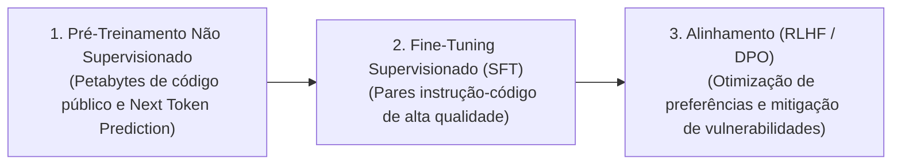
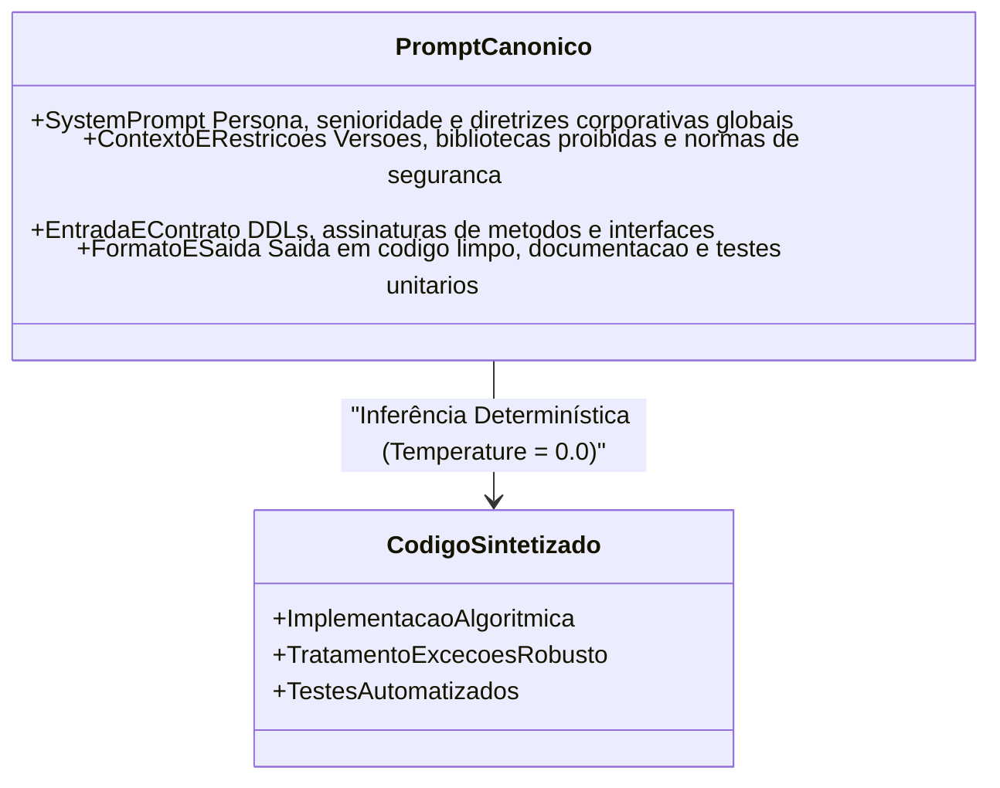
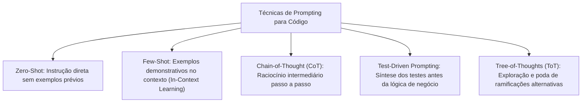

# 01 - LLMs, Programação Baseada em Intenção e Engenharia de Prompts

> **Matéria:** Engenharia de Software Assistida por IA e Sistemas Agentivos  
> **Cargo:** B02 – Técnico de Controle Externo – Especialidade: Tecnologia da Informação  
> **Arquivo:** `01_fundamentos_llms_intent_based_e_engenharia_de_prompts.md`  

---

## 📌 Ementa / Itens do Edital
- Fundamentos da IA aplicada ao desenvolvimento de software
- Modelos de Linguagem de Grande Porte (Large Language Models – LLMs)
- Programação baseada em intenção (Intent-Based Programming)
- Desenvolvimento orientado a linguagem natural (Natural Language Programming)
- Engenharia de contexto e engenharia de prompts aplicadas à geração de código

---

## 🧭 Sumário
- [1. Modelos de Linguagem de Grande Porte (LLMs) no Desenvolvimento de Software](#1-modelos-de-linguagem-de-grande-porte-llms-no-desenvolvimento-de-software)
    - [1.1 A Arquitetura Transformer e o Mecanismo de Autoatenção (Self-Attention)](#11-a-arquitetura-transformer-e-o-mecanismo-de-autoatencao-self-attention)
    - [1.2 Variantes Arquiteturais: Encoder-Only, Decoder-Only e Encoder-Decoder](#12-variantes-arquiteturais-encoder-only-decoder-only-e-encoder-decoder)
    - [1.3 Ciclo de Vida do Treinamento: Pré-Treinamento, SFT e Alinhamento (RLHF/DPO)](#13-ciclo-de-vida-do-treinamento-pre-treinamento-sft-e-alinhamento-rlhfdpo)
    - [1.4 Tokenização, Vocabulário e Gestão de Custos Computacionais](#14-tokenizacao-vocabulario-e-gestao-de-custos-computacionais)
    - [1.5 Hiperparâmetros de Inferência e Amostragem: Temperature, Top-P e Penalidades](#15-hiperparametros-de-inferencia-e-amostragem-temperature-top-p-e-penalidades)
- [2. Programação Baseada em Intenção e Linguagem Natural](#2-programacao-baseada-em-intencao-e-linguagem-natural)
    - [2.1 Intent-Based Programming: A Transição do "COMO" para o "O QUÊ"](#21-intent-based-programming-a-transicao-do-como-para-o-o-que)
    - [2.2 Sintaxe Estrita vs. Semântica Declarativa e Contratos de Interface](#22-sintaxe-estrita-vs-semantica-declarativa-e-contratos-de-interface)
    - [2.3 Especificações Dirigidas por Comportamento (BDD) como Prompts Executáveis](#23-especificacoes-dirigidas-por-comportamento-bdd-como-prompts-executaveis)
- [3. Engenharia de Prompts e Engenharia de Contexto para Software](#3-engenharia-de-prompts-e-engenharia-de-contexto-para-software)
    - [3.1 Estrutura Canônica de um Prompt de Código Corporativo](#31-estrutura-canonica-de-um-prompt-de-codigo-corporativo)
    - [3.2 Técnicas Centrais de Prompting: Zero-Shot, Few-Shot, CoT e Test-Driven](#32-tecnicas-centrais-de-prompting-zero-shot-few-shot-cot-e-test-driven)
    - [3.3 Janela de Contexto e a Mitigação do Efeito "Lost in the Middle"](#33-janela-de-contexto-e-a-mitigacao-do-efeito-lost-in-the-middle)
    - [3.4 Curadoria de Contexto e Minimização de Ruído no Repositório](#34-curadoria-de-contexto-e-minimizacao-de-ruido-no-repositorio)
- [4. Fontes Recomendadas na Internet](#4-fontes-recomendadas-na-internet)

---

## 1. Modelos de Linguagem de Grande Porte (LLMs) no Desenvolvimento de Software

### 1.1 A Arquitetura Transformer e o Mecanismo de Autoatenção (Self-Attention)
A integração da Inteligência Artificial Generativa à Engenharia de Software estabelece uma transição paradigmática fundamental: passa-se da programação procedural e imperativa estrita para a computação probabilística baseada em reconhecimento de padrões e atenção contextual em espaços vetoriais de alta dimensão.

A espinha dorsal de todos os LLMs modernos aplicados a código é a arquitetura **Transformer**, apresentada no artigo clássico *"Attention Is All You Need"* (Vaswani et al., 2017). Ao contrário das arquiteturas recorrentes anteriores (RNNs, LSTMs), que processavam palavras de forma estritamente sequencial e sofriam com o esquecimento de dependências de longo alcance, o Transformer opera com paralelismo massivo por meio do mecanismo de **Autoatenção Escalar por Produto Escalar** (*Scaled Dot-Product Attention*).


#### A Formulação Matemática da Atenção
A relevância de um token em relação a todos os demais tokens da janela de contexto é calculada a partir de três projeções lineares: **Consulta ($Q$ - *Query*)**, **Chave ($K$ - *Key*)** e **Valor ($V$ - *Value*)**:

$$\text{Attention}(Q, K, V) = \text{softmax}\left(\frac{Q K^T}{\sqrt{d_k}}\right) V$$

- $Q, K, V$: Matrizes geradas pela multiplicação das representações vetoriais dos tokens por matrizes de pesos aprendidas ($W_Q, W_K, W_V$).
- $d_k$: Dimensionalidade dos vetores de chave. O fator de divisão $\sqrt{d_k}$ impede que produtos escalares em dimensões elevadas atinjam magnitudes muito altas, o que empurraria a função $\text{softmax}$ para regiões com gradientes infinitesimais (*vanishing gradients*).
- $\text{softmax}$: Transforma a matriz de afinidade em uma distribuição de probabilidades normalizada entre 0 e 1, atribuindo pesos dinâmicos que ponderam a soma dos vetores de valor $V$.
- **Multi-Head Attention (Atenção Multi-Cabeça):** O modelo projeta $Q, K, V$ em múltiplos subespaços de representação simultaneamente (ex.: 32 ou 64 cabeças). Em código-fonte, uma cabeça de atenção pode especializar-se em rastrear o escopo de variáveis, outra na correspondência entre chaves `{}` e outra no rastreamento de tipos de retorno.

---

### Questão 01 (FCC - Padrão Concursos TI / Fundamentos de Tokenização e Transformers)
Durante a integração de um modelo de linguagem baseado na arquitetura Transformer com uma esteira de desenvolvimento de software em uma Secretaria da Fazenda, a equipe de arquitetura analisou os aspectos de tokenização de código-fonte e o mecanismo de atenção do modelo.

A respeito desse funcionamento interno, assinale a afirmativa correta:  

* **A)** O mecanismo de *Self-Attention* analisa apenas a palavra imediatamente anterior na sequência, comportando-se exatamente como uma Cadeia de Markov de primeira ordem.
* **B)** O processo de tokenização baseado em algoritmos como Byte-Pair Encoding (BPE) converte palavras em tokens indivisíveis de no mínimo dez caracteres, impedindo a fragmentação de identificadores em código.
* **C)** Na arquitetura Transformer do tipo *Decoder-Only*, a máscara causal (*Causal Masking*) impede que a previsão do próximo token tenha acesso aos tokens subsequentes da sequência, viabilizando a geração de código autoregressiva.
* **D)** A indentação em Python (quatro espaços) consome obrigatoriamente 40 tokens por linha em qualquer tokenizador moderno, inviabilizando o uso de LLMs para desenvolvimento nessa linguagem.
* **E)** Os vetores de Consulta ($Q$), Chave ($K$) e Valor ($V$) no mecanismo de atenção são constantes numéricas fixas imutáveis, definidas pelos desenvolvedores e independentes do texto de entrada.

> **Comentário Detalhado:**
>
> - **A)** Incorreta. O mecanismo de *Self-Attention* calcula correlações dinâmicas de longo alcance entre todos os tokens da sequência simultaneamente, superando as limitações locais das Cadeias de Markov.
> - **B)** Incorreta. O algoritmo BPE decompõe palavras e identificadores desconhecidos em subpalavras e caracteres individuais quando necessário.
> - **C)** **CORRETA.** Em modelos decodificadores autoregressivos (como GPT e Claude), a aplicação da máscara causal (*Causal Masking*) no mecanismo de autoatenção impede que a previsão do token na posição $t$ consulte informações de posições futuras ($t+1, t+2, \dots$), assegurando a geração estritamente sequencial da esquerda para a direita.
> - **D)** Incorreta. Tokenizadores otimizados para código agrupam blocos de 2, 4 e 8 espaços consecutivos em tokens únicos, tornando a geração em Python eficiente.
> - **E)** Incorreta. As matrizes $Q, K, V$ são geradas dinamicamente multiplicando-se os embeddings da entrada por matrizes de pesos aprendidas pela rede.
> 
> **Gabarito: C**

---


### 1.2 Variantes Arquiteturais: Encoder-Only, Decoder-Only e Encoder-Decoder

| Família Arquitetural | Mecânica de Processamento | Casos de Uso Predominantes em Software | Modelos Representativos |
|---|---|---|---|
| **Encoder-Only** *(Apenas Codificador)* | **Bidirecional:** O modelo enxerga os tokens à esquerda e à direita simultaneamente em todas as camadas. | Análise estática de código, classificação de vulnerabilidades de segurança, detecção de bugs e busca semântica em repositórios de código. | BERT, CodeBERT, RoBERTa. |
| **Decoder-Only** *(Apenas Decodificador)* | **Autoregressivo Unidirecional:** Utiliza uma máscara causal (*Causal Masking*) que oculta tokens futuros. Gera a resposta token por token, da esquerda para a direita. | **Geração de código**, autocompletar avançado, refatoração de sistemas, explicação de código e chat interativo de programação. | Famílias GPT (OpenAI), Claude (Anthropic), Llama (Meta), DeepSeek-Coder, StarCoder. |
| **Encoder-Decoder** *(Codificador-Decodificador)* | O codificador processa a entrada bidirecionalmente e o decodificador sintetiza a saída de forma autoregressiva. | Tradução entre diferentes linguagens de programação (ex.: COBOL para Java), sumarização de pull requests e geração automática de documentação. | T5, CodeT5. |

---

### Questão 02
**(Cebraspe – TRF/STJ – 2024/2025 – Adaptada para o padrão FCC)**  
No desenvolvimento de sistemas assistidos por inteligência artificial, a arquitetura *Transformer* deu origem a três famílias arquiteturais predominantes: *Encoder-Only*, *Decoder-Only* e *Encoder-Decoder*. A respeito das características e dos casos de uso de cada família em tarefas de engenharia de software, é correto afirmar:

* **A)** Modelos *Encoder-Only* (como o BERT) são amplamente empregados para geração autorregressiva contínua de grandes blocos de código-fonte em tempo real.
* **B)** Modelos *Decoder-Only* (como a família GPT, Claude e LLaMA) operam por geração autorregressiva token a token guiada por máscaras causais de atenção, sendo a arquitetura padrão predominante para síntese, geração e completamento de código.
* **C)** Modelos *Encoder-Decoder* são incapazes de realizar tradução de código entre linguagens distintas (como COBOL para Java).
* **D)** A atenção bidirecional irrestrita é uma característica exclusiva dos modelos *Decoder-Only*.
* **E)** Modelos *Decoder-Only* não utilizam embeddings nem camadas de normalização (*LayerNorm*).

> **Comentário Detalhado:**
>
> - **A) Incorreta.** Modelos *Encoder-Only* usam autoatenção bidirecional, ideais para classificação, busca semântica e análise estática (não para geração autorregressiva de texto/código).
> - **B) Correta.** Os modelos *Decoder-Only* utilizam máscara causal de atenção (*causal masking*), que impede que a posição atual veja tokens futuros, gerando tokens sequencialmente de forma autorregressiva. Essa arquitetura consolidou-se como o padrão hegemônico para assistentes de programação e LLMs generativos.
> - **C) Incorreta.** Modelos *Encoder-Decoder* (como T5 e CodeT5) são historicamente muito eficientes em tarefas seq2seq como tradução de código e sumarização.
> - **D) Incorreta.** A atenção bidirecional é típica do *Encoder*, e não do *Decoder* (que é causal/unidirecional).
> - **E) Incorreta.** Camadas de embedding e normalização são componentes universais de Transformers.
>
> **Gabarito: B**

---


### 1.3 Ciclo de Vida do Treinamento: Pré-Treinamento, SFT e Alinhamento (RLHF/DPO)
O desenvolvimento de um modelo fundacional voltado para engenharia de software ocorre em três estágios sucessivos:



1. **Pré-Treinamento Não Supervisionado (*Pre-training*):** O modelo é exposto a trilhões de tokens de texto puro e código aberto em dezenas de linguagens de programação (GitHub, GitLab, documentações oficiais). Ele aprende a estrutura léxica e sintática prevendo o próximo token (*Next Token Prediction*) e através do preenchimento de lacunas intermediárias (**Fill-in-the-Middle - FIM**), fundamental para autocompletar código dentro de arquivos existentes.
2. **Ajuste Fino Supervisionado (*Supervised Fine-Tuning - SFT*):** O modelo pré-treinado recebe conjuntos de dados selecionados contendo tarefas explícitas e suas respectivas respostas ideais (`instrução -> código correto em Markdown`). O modelo aprende a dialogar no papel de assistente técnico e seguir convenções de software.
3. **Alinhamento com Feedback Humano / de IA (*RLHF / RLAIF*):** Utiliza técnicas como *Reinforcement Learning from Human Feedback* (PPO - *Proximal Policy Optimization*) ou *Direct Preference Optimization* (DPO). O alinhamento penaliza código contendo vulnerabilidades comuns (CWE/OWASP Top 10), impede a recomendação de bibliotecas obsoletas e mitiga a geração de scripts maliciosos.

---

### Questão 03
**(FCC – Inédita – Padrão TCE-GO)**  
O pipeline moderno de treinamento de modelos de linguagem para engenharia de software é estruturado em três fases fundamentais: Pré-treinamento (*Pre-training*), Ajuste Fino Supervisionado (*Supervised Fine-Tuning* - SFT) e Alinhamento (*Alignment* via RLHF ou DPO). A esse respeito, assinale a afirmativa tecnicamente correta:

* **A)** O pré-treinamento exige anotação manual linha a linha por engenheiros humanos de cada arquivo de código consumido pelo modelo.
* **B)** O Ajuste Fino Supervisionado (SFT) utiliza conjuntos de dados de instruções com pares curados de solicitações e respostas ideais (prompts e códigos corretos) para ensinar o modelo a seguir instruções e dialogar com o desenvolvedor.
* **C)** O alinhamento por Aprendizado por Reforço com Feedback Humano (RLHF) serve exclusivamente para acelerar a velocidade de clock da placa de vídeo GPU durante o treinamento.
* **D)** O DPO (*Direct Preference Optimization*) exige obrigatoriamente o treinamento de um modelo de recompensa (*reward model*) separado e instável, ao contrário do RLHF clássico.
* **E)** Após o pré-treinamento, o modelo base já possui capacidade nativa e alinhada para recusar instruções maliciosas de exploração de vulnerabilidades.

> **Comentário Detalhado:**
>
> - **A) Incorreta.** O pré-treinamento é auto-supervisionado (*self-supervised*), treinando o modelo para prever o próximo token em terabytes de código público sem anotação manual.
> - **B) Correta.** No SFT, o modelo base (que aprendeu a completar texto) é treinado com pares de instrução e resposta ideal (*instruction tuning*), tornando-se um assistente conversacional capaz de interpretar tarefas de engenharia de software.
> - **C) Incorreta.** O RLHF alinha o modelo com valores de utilidade, veracidade e segurança (*helpful, honest, harmless*).
> - **D) Incorreta.** É o inverso: o DPO simplifica o alinhamento ao otimizar a política diretamente sobre pares de preferências (resposta aceita vs. rejeitada), dispensando o modelo de recompensa explícito do PPO/RLHF.
> - **E) Incorreta.** Modelos base brutos apenas completam padrões textuais; os mecanismos de recusa e segurança são introduzidos no alinhamento.
>
> **Gabarito: B**

---


### 1.4 Tokenização, Vocabulário e Gestão de Custos Computacionais
Modelos de linguagem não leem palavras inteiras ou caracteres isolados; eles operam sobre **tokens** (números inteiros que mapeiam fragmentos de palavras e símbolos em um vocabulário pré-definido). O algoritmo padrão adotado na indústria é o **Byte-Pair Encoding (BPE)**.

#### Impactos Cruciais da Tokenização em Código-Fonte:
- **Indentação e Espaços:** Em linguagens onde a indentação é sintática (como Python), tokenizadores antigos emitiam um token para cada espaço em branco individual (4 espaços = 4 tokens). Modelos modernos voltados para código possuem tokens agrupados dedicados para 2, 4 e 8 espaços consecutivos, reduzindo drasticamente o consumo de tokens.
- **Convenções de Identificadores:** Identificadores em *camelCase* (`processarLiquidacaoDespesa`) ou *snake_case* (`processar_liquidacao_despesa`) são decompostos em múltiplos subtokens (`processar`, `liquidacao`, `despesa`). Nomes de variáveis excessivamente prolixos consomem a janela de contexto com maior rapidez.
- **Economia e Métricas de Custo:** As APIs de modelos de IA tarifam o processamento com base no volume de tokens de entrada (*input tokens*) e saída (*output tokens*). A otimização e a curadoria de arquivos enviados para o contexto impactam diretamente o custo operacional das soluções corporativas.

---

### 1.5 Hiperparâmetros de Inferência e Amostragem: Temperature, Top-P e Penalidades
Durante a fase de inferência (geração da resposta), o modelo projeta logits (pontuações não normalizadas) sobre todo o seu vocabulário. A forma como esses logits são convertidos em probabilidades é modulada por hiperparâmetros de amostragem:

| Hiperparâmetro | Mecânica Matemática | Efeito em Baixos Valores | Efeito em Altos Valores | Recomendação em Engenharia de Software |
|---|---|---|---|---|
| **Temperature ($T$)** | Fator de divisão no expoente dos logits: $P(w_i) = \frac{\exp(z_i / T)}{\sum \exp(z_j / T)}$. | **Determinismo e Estabilidade:** Acentua a probabilidade dos tokens de maior consenso sintático. | **Aleatoriedade e Dispersão:** Achata a curva de probabilidade, aumentando o risco de alucinações. | **$0.0$ a $0.2$** para código executável, testes unitários e refatoração. $0.7$ a $0.8$ apenas para ideação arquitetural. |
| **Top-P (*Nucleus Sampling*)** | Seleciona o menor subconjunto cumulativo de tokens cuja soma das probabilidades atinge o valor $P$. | Descarta sumariamente a cauda longa de tokens improváveis. | Permite que tokens improváveis concorram caso o acumulado demore a fechar. | **$0.1$ a $0.5$** para código determinístico. Se $T = 0.0$, a amostragem torna-se puramente gulosa (*Greedy*), tornando o Top-P inócuo. |
| **Frequency Penalty** | Aplica uma penalização proporcional ao número de vezes que um token já apareceu no texto gerado. | Permite repetições lexicais legítimas. | Inibe repetições, forçando o uso de sinônimos estranhos. | **$0.0$ estrito**. Em programação, palavras reservadas (`if`, `return`, `class`) **precisam se repetir** compulsoriamente. |
| **Presence Penalty** | Aplica penalização fixa se um token já tiver aparecido ao menos uma vez no texto. | Sem interferência na estrutura sintática. | Força a introdução contínua de novos tópicos, induzindo variáveis inventadas. | **$0.0$ estrito** para código-fonte. |

---


### Questão 04
**(Cebraspe – TRF/STJ – 2024/2025 – Adaptada para o padrão FCC)**  
Na inferência de modelos de linguagem utilizados para geração de código-fonte de missão crítica, a calibração de hiperparâmetros de amostragem exerce impacto decisivo na corretude e determinismo dos programas gerados. A respeito dos hiperparâmetros *Temperature* e *Top-P* (*Nucleus Sampling*), é correto afirmar:

* **A)** Valores elevados de *Temperature* (próximos a 1.5 ou 2.0) tornam a distribuição de probabilidades mais íngreme, garantindo código determinístico, rigoroso e sem bugs de sintaxe.
* **B)** Para tarefas de geração de código-fonte, migração de dados e depuração de erros lógicos, recomenda-se configurar a *Temperature* com valores baixos (próximos a 0.0 ou 0.2), pois isso concentra a amostragem nos tokens de maior probabilidade, reduzindo alucinações e variabilidade indesejada.
* **C)** O *Top-P* seleciona aleatoriamente os tokens mais raros do vocabulário para enriquecer a diversidade léxica dos comandos SQL.
* **D)** Configurar a *Temperature* em 0.0 impede que o modelo execute inferência em computadores com sistema operacional Windows.
* **E)** O hiperparâmetro *Top-K* define a quantidade de GPUs necessárias para rodar o modelo no data center.

> **Comentário Detalhado:**
>
> - **A) Incorreta.** Temperaturas altas achatam a distribuição de probabilidades (*softmax* mais suave), aumentando a criatividade e o risco de alucinações sintáticas em código.
> - **B) Correta.** Na engenharia de software, onde a precisão sintática e lógica é indispensável, adota-se *Temperature* baixa ($0.0 \le T \le 0.2$) para promover saídas reprodutíveis, determinísticas e focadas nos caminhos mais prováveis e testados.
> - **C) Incorreta.** O *Top-P* (amostragem por núcleo) seleciona o menor conjunto de tokens cuja soma cumulativa de probabilidades atinge $P$ (descartando a cauda improvável).
> - **D) Incorreta.** *Temperature* é uma constante matemática no cálculo da distribuição de probabilidade da inferência.
> - **E) Incorreta.** *Top-K* limita a amostragem aos $K$ tokens mais prováveis no vocabulário.
>
> **Gabarito: B**

---

## 2. Programação Baseada em Intenção e Linguagem Natural

### 2.1 Intent-Based Programming: A Transição do "COMO" para o "O QUÊ"
A **Programação Baseada em Intenção** (*Intent-Based Programming - IBP*) representa uma evolução na escala de abstração da engenharia de software:


- **Programação Imperativa:** O programador é responsável por detalhar exaustivamente o algoritmo imperativo: laços, ponteiros, gerência de memória e ramificações condicionais.
- **Programação Baseada em Intenção:** O engenheiro de software concentra-se na formulação rigorosa da **intenção de negócio e restrições formais** (invariantes lógicas, pré-condições, pós-condições e critérios de tolerância a falhas). A IA generativa sintetiza o código executável, que é imediatamente validado por suítes de testes determinísticos.

---

### Questão 05 (FCC - Adaptada / TI - Intent-Based Programming e Gestão de Contexto)
No contexto da evolução da engenharia de software assistida por inteligência artificial, destacam-se os conceitos de Programação Baseada em Intenção (*Intent-Based Programming*) e a gestão criteriosa da janela de contexto (*Context Window*).

Sobre esses conceitos, assinale a afirmativa correta:  

* **A)** A programação baseada em intenção substitui completamente a necessidade de validação humana, testes automatizados e critérios de aceite, transferindo a responsabilidade civil pelo software integralmente ao provedor do modelo de IA.
* **B)** O efeito conhecido na literatura como *"Lost in the Middle"* demonstra que os modelos LLMs recuperam informações com igual precisão em qualquer ponto de uma janela de contexto extensa, tornando indiferente a ordem em que os arquivos de código são dispostos no prompt.
* **C)** Na programação baseada em intenção, o desenvolvedor expressa o objetivo de negócio, pré-condições e invariantes em linguagem declarativa/natural, enquanto o sistema de IA infere a estratégia algorítmica e gera as instruções imperativas correspondentes.
* **D)** A janela de contexto de um LLM armazena exclusivamente os parâmetros pré-treinados estáticos dos pesos neurais, não guardando relação com a quantidade de tokens de código fornecidos como entrada na requisição.
* **E)** *Few-Shot Prompting* e *Fine-Tuning* são termos sinônimos que descrevem o processo de re-treinamento dos pesos do modelo com retropropagação de gradientes (*backpropagation*) a cada nova instrução de código.

> **Comentário Detalhado:**
>
> - **A)** Incorreta. A programação baseada em intenção não suprime a supervisão humana (*Human-in-the-Loop*) nem a exigência de testes formais, sendo a responsabilidade técnica e jurídica intransferível do desenvolvedor e da organização.
> - **B)** Incorreta. A pesquisa seminal de Liu et al. (2023) comprovou exatamente o oposto: modelos de linguagem apresentam forte degradação de recuperação para informações situadas no meio geométrico da janela de contexto (*Lost in the Middle*).
> - **C)** **CORRETA.** Na *Intent-Based Programming*, o engenheiro de software foca na declaração da intenção (o "O QUÊ" - requisitos, invariantes, contratos e pós-condições), cabendo ao sistema de IA sintetizar o algoritmo correspondente (o "COMO" imperativo).
> - **D)** Incorreta. Os pesos do modelo são parâmetros estáticos. A janela de contexto é a memória de trabalho dinâmica que limita a quantidade de tokens de entrada e saída em uma requisição.
> - **E)** Incorreta. *Few-Shot Prompting* é aprendizado em contexto em tempo de inferência, sem alteração de pesos. *Fine-Tuning* implica o recálculo e modificação permanente dos pesos sinápticos via retropropagação de gradientes.
> 
> **Gabarito: C**

---


### 2.2 Sintaxe Estrita vs. Semântica Declarativa e Contratos de Interface
Na programação clássica, o compilador atua como um juiz sintático inflexível: a omissão de uma vírgula ou chave aborta o processo de compilação. Na programação orientada a linguagem natural assistida por IA:

- A flexibilidade da linguagem natural é associada à disciplina dos **Contratos de Interface** (como esquemas OpenAPI, JSON Schema, interfaces TypeScript ou Protocol Buffers).
- A intenção é descrita textualmente, mas ancorada por especificações formais de entrada e saída, eliminando ambiguidade semântica.

---

### Questão 06
**(FCC – Inédita – Padrão TCE-GO)**  
No paradigma de Programação Baseada em Intenção (*Intent-Based Programming*), o desenvolvedor expressa a intenção de negócio em linguagem natural estruturada, cabendo a agentes de IA sintetizar a lógica técnica e a implementação. No entanto, na integração desse código aos pipelines de entrega, a relação entre semântica declarativa e sintaxe estrita exige que:

* **A)** O código gerado pela IA seja enviado para produção imediatamente sem compilação, pois a intenção declarada sobrepõe-se às regras de sintaxe do compilador.
* **B)** O compilador, o analisador de tipos (como TypeScript) e os linters estáticos atuem como filtros determinísticos inegociáveis, validando rigorosamente contratos de interface e consistência tipológica da solução antes de qualquer execução.
* **C)** As interfaces de contratos sejam eliminadas do código para permitir que a IA altere tipos de dados livremente em tempo de execução.
* **D)** A semântica probabilística dos LLMs substitua a necessidade de contratos formais de API (como OpenAPI e Protocol Buffers).
* **E)** Erros de compilação em código gerado por IA sejam ignorados pelo pipeline de integração contínua.

> **Comentário Detalhado:**
>
> - **A) Incorreta.** A intenção precisa obrigatoriamente se materializar em código sintaticamente e semanticamente perfeito perante os validadores formais da linguagem.
> - **B) Correta.** A chave da engenharia de software assistida por IA é a complementariedade: a IA gera propostas de código no espaço semântico probabilístico, mas essas propostas são imediatamente submetidas a verificadores determinísticos estritos (compiladores, checadores de tipo estático, linters e suítes de testes automatizados).
> - **C) Incorreta.** Contratos estritos de interface são ainda mais essenciais quando se utiliza código assistido por IA.
> - **D) Incorreta.** Contratos padronizados (OpenAPI, protobuf) são a âncora que impede a IA de quebrar integrações existentes.
> - **E) Incorreta.** Viola os princípios mais elementares de CI/CD e confiabilidade.
>
> **Gabarito: B**

---


### 2.3 Especificações Dirigidas por Comportamento (BDD) como Prompts Executáveis
A disciplina do BDD (*Behavior-Driven Development*) serve como ponte natural entre intenção em linguagem humana e testes automatizados. Cenários descritos em sintaxe Gherkin (`Dado que... Quando... Então...`) são utilizados como especificações inequívocas:

```gherkin
Cenário: Aplicação de glosa por sobrepreço em auditoria de obras
  Dado que o valor orçado para o item "Concreto Armado" é de R$ 500.000,00
  E o preço de referência da tabela SINAPI é de R$ 420.000,00
  Quando o auditor executar o cálculo de sobrepreço unitário
  Então o sistema deve registrar uma glosa de R$ 80.000,00
  E classificar a irregularidade com gravidade "GRAVE_COM_DANO_AO_ERARIO"
```

O LLM recebe esse contrato comportamental e gera simultaneamente a suíte de testes correspondente e o código de domínio que satisfaz o cenário.

---

## 3. Engenharia de Prompts e Engenharia de Contexto para Software

### 3.1 Estrutura Canônica de um Prompt de Código Corporativo
Um prompt corporativo de alto nível para desenvolvimento de software não deve ser uma simples frase coloquial. Ele organiza-se em quatro seções formais estruturadas (frequentemente delimitadas por tags XML ou seções Markdown):



1. **Papel e Persona (*System Prompt*):** Define a identidade, senioridade e princípios arquiteturais (ex.: *"Você é um arquiteto de software sênior especialista em Java 21 e Spring Boot 3. Priorize código idiomático, imutabilidade, princípios SOLID e práticas de segurança OWASP"*).
2. **Contexto e Restrições Não Negociáveis:** Define versões estritas, limites de bibliotecas (ex.: *"Não utilize bibliotecas externas fora do JDK padrão e Spring Web; aplique o padrão Repository"*).
3. **Entrada de Dados e Contratos:** Código pré-existente, esquemas de tabelas SQL, modelos DTO e payloads esperados.
4. **Formato e Critérios de Saída:** Exige código em bloco Markdown limpo, sem elipses (`// ... restante do código`), tipagem estrita e inclusão de testes unitários com JUnit 5 e Mockito.

---

### 3.2 Técnicas Centrais de Prompting: Zero-Shot, Few-Shot, CoT e Test-Driven



| Técnica | Mecânica de Funcionamento | Indicação Principal em TI | Cuidados e Limitações |
|---|---|---|---|
| **Zero-Shot Prompting** | Instrução direta sem o fornecimento de exemplos de entrada e saída. | Tarefas padronizadas e código trivial (ex.: CRUD padrão, DTOs simples, Regex básica). | Maior incidência de violação de padrões proprietários da organização. |
| **Few-Shot Prompting** | Fornece 2 a 5 pares de `(Entrada, Saída Esperada)` no contexto antes de pedir a nova tarefa. | Replicação de guias de estilo corporativos, adaptação a frameworks legados internos. | Consome janela de contexto; exemplos ruins enviesam a inferência do modelo. |
| **Chain-of-Thought (CoT)** | Instrui o modelo a decompor a lógica passo a passo antes de escrever o código. | Cálculos fiscais complexos, concorrência, algoritmos de grafos e validação orçamentária. | Aumenta a latência e o consumo de tokens de saída (*output tokens*). |
| **Test-Driven Prompting** | Exige a geração de testes unitários antes de produzir o código de produção. | Módulos críticos de auditoria e regras de negócio de alta sensibilidade fiscal. | Requer inspeção humana para garantir que os testes não estejam triviais ou tautológicos. |
| **Tree-of-Thoughts (ToT)** | O modelo explora múltiplos caminhos de solução, avalia prós/contras e escolhe o melhor. | Tomadas de decisão arquitetural, seleção de design patterns e planos de refatoração massiva. | Alto consumo de tokens e necessidade de orquestração especializada. |

> 🚨 **ALERTA DE PROVA / PEGADINHA FCC:**  
> A banca frequentemente tenta confundir **Few-Shot Prompting (In-Context Learning)** com **Fine-Tuning**:  
>
> - **Few-Shot Prompting:** NÃO altera os pesos neurais do modelo! Trata-se de um condicionamento efêmero em tempo de inferência (*runtime*), restrito àquela chamada de API.  
> - **Fine-Tuning:** Altera permanentemente os pesos das conexões sinápticas da rede neural via retropropagação de gradientes (*backpropagation*).  
> Fornecer exemplos demonstrativos no texto do prompt é **Few-Shot**, jamais Fine-Tuning!

---

### Questão 07 (FCC - Adaptada / TI - Engenharia de Prompts e Hiperparâmetros de Inferência)
Um desenvolvedor de software de um Tribunal de Contas Estadual está configurando a integração de uma ferramenta de IA generativa para auxiliar na geração automatizada de funções de validação de regras fiscais e cálculos contábeis em Python. Ele precisa garantir que as implementações geradas sejam estritamente determinísticas, fiéis à sintaxe da linguagem e sigam um padrão corporativo pré-estabelecido de tratamento de exceções.

Considerando as técnicas de engenharia de prompts e a calibração de modelos de linguagem (LLMs):  

* **A)** O desenvolvedor deve configurar o hiperparâmetro `temperature` com valor próximo a `1.0` (ou superior), pois valores altos eliminam o risco de alucinações sintáticas e forçam o modelo a seguir rigidamente a documentação oficial.
* **B)** A técnica de *Zero-Shot Prompting* consiste em fornecer ao modelo múltiplos exemplos comentados de funções de validação no prompt antes de solicitar o código final, garantindo a replicação do padrão corporativo.
* **C)** O desenvolvedor deve ajustar o hiperparâmetro `temperature` para valores baixos (próximos de `0.0`), conferindo determinismo e reprodutibilidade à resposta, e utilizar a técnica de *Few-Shot Prompting*, fornecendo no contexto alguns exemplos prévios do padrão esperado de entrada, lógica e tratamento de erro.
* **D)** A técnica de *Chain-of-Thought* (CoT) é desaconselhada para problemas de programação e lógica algorítmica, visto que forçar o modelo a verbalizar o raciocínio intermediário degrada sua precisão na geração da sintaxe final do código.
* **E)** O *System Prompt* não tem impacto no comportamento global do modelo, servindo apenas para armazenar o histórico efêmero de mensagens trocadas na sessão atual.

> **Comentário Detalhado:**
>
> - **A)** Incorreta. Uma temperatura alta ($T \approx 1.0$) achata a distribuição probabilística dos logits, aumentando a entropia e aleatoriedade das previsões. Isso induz alucinações sintáticas, gerando nomes de métodos inexistentes e quebrando o código.
> - **B)** Incorreta. O fornecimento de múltiplos exemplos de demonstração no prompt é a definição canônica de **Few-Shot Prompting** (In-Context Learning). O *Zero-Shot Prompting* fornece apenas a instrução da tarefa sem nenhum exemplo prévio.
> - **C)** **CORRETA.** Para geração de código, testes e validações contábeis determinísticas, deve-se adotar temperatura baixa ($0.0 \le T \le 0.2$), assegurando repetibilidade e fidelidade sintática. O uso combinado com *Few-Shot Prompting* (fornecendo 2 a 3 exemplos do padrão institucional) garante a conformidade com a arquitetura desejada.
> - **D)** Incorreta. A técnica de *Chain-of-Thought* (CoT) é altamente benéfica para código, pois induz o modelo a decompor a lógica algorítmica passo a passo antes de emitir a sintaxe final, reduzindo erros de raciocínio.
> - **E)** Incorreta. O *System Prompt* define as diretrizes mestras, persona, restrições corporativas e regras comportamentais imutáveis que guiam todo o processamento da sessão.
> 
> **Gabarito: C**

---

### Questão 08 (FCC - Padrão Concursos TI / Engenharia de Prompts e Chain-of-Thought)
Um analista de sistemas da área fiscal precisa refatorar uma rotina crítica de cálculo do ITCMD (Imposto sobre Transmissão Causa Mortis e Doação) que envolve alíquotas progressivas, meação, herança legítima e múltiplas condições de isenção. Para obter da IA generativa uma solução robusta e livre de falhas de lógica contábil, ele decide aplicar técnicas avançadas de engenharia de prompts.

Nesse cenário, a abordagem metodologicamente mais adequada é:  

* **A)** Utilizar a técnica *Zero-Shot* com temperatura ajustada em $1.0$, instruindo o modelo a fornecer apenas o código final em uma única linha compactada sem comentários.
* **B)** Aplicar a técnica de *Chain-of-Thought* (Cadeia de Pensamento), instruindo explicitamente o modelo a decompor as regras tributárias, detalhar o raciocínio matemático passo a passo e, somente após validar as etapas lógicas, emitir o código Python correspondente com testes unitários cobrindo as faixas de tributação.
* **C)** Evitar o uso de *System Prompts*, pois estes anulam as diretrizes de segurança da plataforma de IA.
* **D)** Utilizar a técnica de *Tree-of-Thoughts* apenas para alterar o nome das variáveis para formatos em caixa-alta, pois a lógica fiscal dispensa decomposição passo a passo.
* **E)** Aumentar a `Frequency Penalty` para seu valor máximo possível, garantindo que palavras reservadas da linguagem como `if` e `return` nunca se repitam no código gerado.

> **Comentário Detalhado:**
>
> - **A)** Incorreta. A abordagem Zero-Shot com temperatura máxima ($1.0$) produz alta variabilidade estatística e erros grosseiros de cálculo contábil.
> - **B)** **CORRETA.** A técnica de *Chain-of-Thought* (CoT) compele o modelo a decompor o problema em etapas explícitas de raciocínio lógico. Ao calcular passo a passo a meação, as faixas progressivas e as isenções antes da codificação final, a precisão matemática atinge seu nível máximo.
> - **C)** Incorreta. O *System Prompt* é mandatório para estabelecer governança, restrições e requisitos de segurança.
> - **D)** Incorreta. Alteração de nomes de variáveis é tarefa trivial; a complexidade da questão reside na lógica tributária.
> - **E)** Incorreta. Elevar a `Frequency Penalty` para o valor máximo penaliza palavras repetidas essenciais para o código, destruindo a sintaxe funcional da linguagem de programação.
> 
> **Gabarito: B**

---


### 3.3 Janela de Contexto e a Mitigação do Efeito "Lost in the Middle"
A **Janela de Contexto (*Context Window*)** é a quantidade máxima de tokens que um modelo de IA consegue manter na memória de trabalho durante uma sessão de inferência.

Contudo, possuir uma janela de contexto extensa (como 128k ou 1 milhão de tokens) não significa que o modelo preste atenção uniforme em todas as posições do texto.

- **A Pesquisa Seminal (Liu et al., 2023 - *"Lost in the Middle"*):** Demonstrou empiricamente a presença de vieses posicionais acentuados na arquitetura Transformer:
    - **Viés de Primazia (*Primacy Bias*):** Altíssima retenção das informações posicionadas no **início** do contexto (System Prompt, primeiras instruções).
    - **Viés de Recência (*Recency Bias*):** Altíssima retenção das informações posicionadas no **final** do contexto (logo antes do comando de geração).
    - **Degradação Central (*The Middle Dip*):** Trechos de código ou requisitos críticos situados no meio geométrico de um contexto longo sofrem perda drástica de atenção, gerando omissões e alucinações.


---

### Questão 09
**(Cebraspe – TRF/STJ – 2024/2025 – Adaptada para o padrão FCC)**  
Em arquiteturas de LLMs com janelas de contexto estendidas (acima de 128k tokens), pesquisadores identificaram o fenômeno empírico denominado *"Lost in the Middle"*. Esse efeito consiste na tendência de o modelo:

* **A)** Esquecer completamente todas as palavras iniciadas pela letra "M" ao longo do texto.
* **B)** Apresentar atenção e capacidade de recuperação substancialmente superiores para informações situadas no início e no final do prompt de contexto, degradando a precisão na recuperação de fatos e restrições posicionados no meio do contexto volumoso.
* **C)** Exigir o reinício manual do computador sempre que o prompt ultrapassar 500 caracteres.
* **D)** Alucinar apenas em tarefas que envolvem operações de banco de dados relacional.
* **E)** Travar o mecanismo de autocompletar da IDE exclusivamente durante a madrugada.

> **Comentário Detalhado:**
>
> - **A) Incorreta.** Não há relação léxica com a letra "M".
> - **B) Correta.** O estudo canônico sobre o fenômeno *"Lost in the Middle"* (Liu et al., 2023) demonstrou que a atenção dos Transformers degrada em formato de "U": a retenção é máxima no início (efeito primazia) e no fim (efeito recência) do prompt, diminuindo sensivelmente no miolo. Portanto, instruções arquiteturais críticas e regras restritivas devem ser posicionadas nas extremidades do prompt.
> - **C) Incorreta.** O efeito é puramente matemático da distribuição de autoatenção (*self-attention weights*).
> - **D) Incorreta.** O efeito ocorre em qualquer domínio de conhecimento textual.
> - **E) Incorreta.** Afirmação sem fundamento.
>
> **Gabarito: B**

---


### 3.4 Curadoria de Contexto e Minimização de Ruído no Repositório
Para contornar o efeito *Lost in the Middle* e evitar estouros de cotas financeiras e de tokens:

1. **Posicionamento Estratégico:** As diretrizes inegociáveis e regras de segurança devem residir no início (*System Prompt*); o comando operacional imediato e os dados de entrada prioritários devem ficar no final do prompt.
2. **Expurgo de Ruído (*Context Pruning*):** NUNCA inclua arquivos de build, diretórios de dependências (`node_modules`, `target`, `.git`), arquivos minificados ou lockfiles inteiros no prompt enviado ao LLM.
3. **Uso de Delimitadores Estruturados:** Separe claramente o código-fonte das instruções utilizando tags XML (`<context>`, `<instructions>`, `<code>`) para evitar ataques de injeção de prompt e prevenir confusão no analisador sintático do modelo.

---

### Questão 10 (FCC - Padrão Concursos TI / Curadoria de Contexto e Estruturação de Prompts)
Na formulação de prompts para agentes de geração de código em larga escala, a equipe técnica deparou-se com a necessidade de submeter múltiplos artefatos: a especificação de uma API REST, esquemas de banco de dados e requisitos de negócio complexos.

Considerando as boas práticas de curadoria de contexto e a mitigação de vieses posicionais em LLMs:  

* **A)** Todas as diretrizes obrigatórias e regras de negócio críticas devem ser colocadas exatamente no centro geométrico do prompt, pois é a região onde o mecanismo de atenção possui seu pico de sensibilidade.
* **B)** O desenvolvedor deve concatenar todos os arquivos do repositório, incluindo pastas de dependências compiladas (`node_modules` e arquivos `.lock`), sem filtragem prévia, para maximizar a entropia do modelo.
* **C)** As instruções fundamentais, restrições invioláveis de arquitetura e o comando principal de execução devem ser posicionados nas extremidades do prompt (no início e no final), aplicando-se técnicas de delimitação clara de contexto (como tags estruturadas) e expurgando arquivos irrelevantes para contornar o efeito *"Lost in the Middle"*.
* **D)** O uso de tags delimitadoras (como marcadores XML ou blocos Markdown) é proibido por provedores de LLMs, pois causa falhas irreparáveis no decodificador causal.
* **E)** A janela de contexto não impõe nenhum custo financeiro adicional em provedores de nuvem, visto que a tarifação incide unicamente sobre o tempo de conexão TCP/IP mantido aberto.

> **Comentário Detalhado:**
>
> - **A)** Incorreta. O centro do contexto é o local onde a atenção decai (*Lost in the Middle*); posicionar regras essenciais no centro leva à omissão de diretrizes.
> - **B)** Incorreta. Enviar pastas de dependências (`node_modules`, `.lock`) polui o contexto com ruído desnecessário, esgota tokens e prejudica a qualidade da inferência.
> - **C)** **CORRETA.** Para contornar os vieses de primazia e recência (*Lost in the Middle*), as regras centrais devem ficar nas extremidades (no System Prompt/início e no comando final imediato), utilizando tags estruturadas (`<context>`, `<rules>`) para delimitar blocos e mantendo apenas arquivos pertinentes.
> - **D)** Incorreta. O uso de tags XML ou Markdown é explicitamente encorajado pelas diretrizes de engenharia de prompts da Anthropic e da OpenAI para isolar dados e comandos.
> - **E)** Incorreta. A tarifação de modelos comerciais incide diretamente sobre a quantidade de tokens consumidos na entrada e na saída.
> 
> **Gabarito: C**

---


## 4. Fontes Recomendadas na Internet

* [Anthropic Claude Official Guide - Prompt Engineering Overview](https://docs.anthropic.com/en/docs/build-with-claude/prompt-engineering/overview) - Estratégias estruturadas, delimitadores XML, Few-Shot Prompting e Chain-of-Thought.
* [OpenAI Platform - Prompt Engineering Best Practices](https://platform.openai.com/docs/guides/prompt-engineering) - Técnicas de contextualização, tarefas complexas e mitigação de alucinações.
* [ArXiv - Chain-of-Thought Prompting Elicits Reasoning in Large Language Models (Wei et al.)](https://arxiv.org/abs/2201.11903) - Artigo seminal sobre raciocínio encadeado passo a passo em modelos de linguagem.
* [NIST AI Risk Management Framework (AI RMF 1.0)](https://www.nist.gov/itl/ai-risk-management-framework) - Framework oficial do NIST para governança, validação e mensuração de riscos em IA.
* RUSSELL, Stuart; NORVIG, Peter. **Inteligência Artificial: Uma Abordagem Moderna**. 4. ed. Rio de Janeiro: GEN LTC, 2022. (Cap. 23 e 24 - Processamento de Linguagem Natural e Modelos Profundos).
* JURAFSKY, Daniel; MARTIN, James H. **Speech and Language Processing**. 3. ed. Stanford University, 2024. (Cap. 10 e 11 - Large Language Models and Prompting).
* HUYEN, Chip. **AI Engineering: Building Applications with Foundation Models**. Sebastopol: O'Reilly Media, 2025. (Cap. 2 - Prompt Engineering and Foundation Models).
