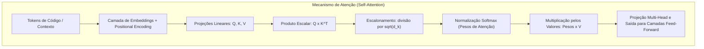
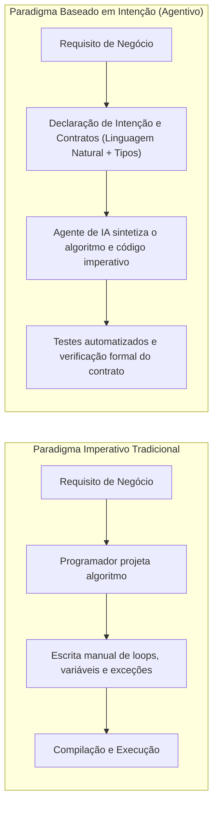
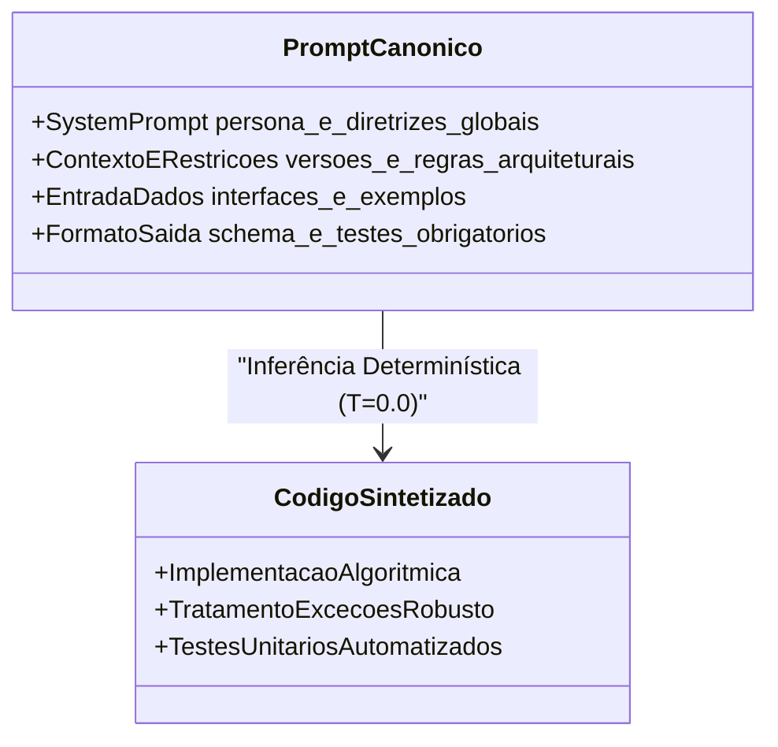
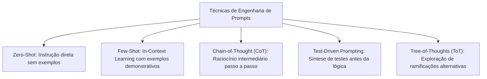
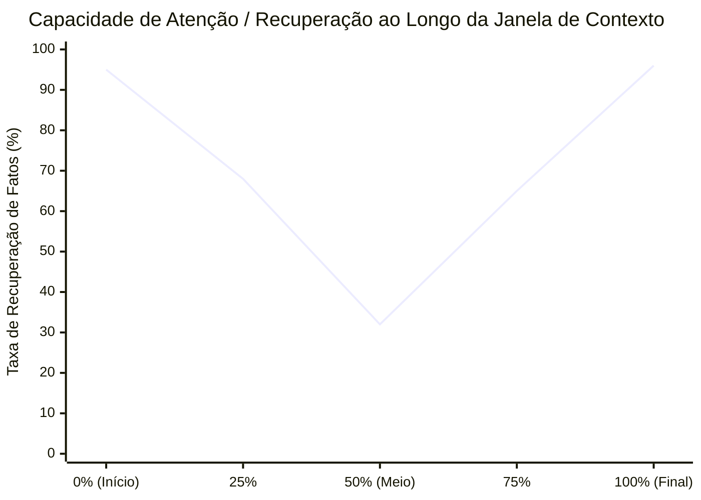

# 01 - LLMs, Programação Baseada em Intenção e Engenharia de Prompts

> **Matéria:** Engenharia de Software Assistida por IA e Sistemas Agentivos  
> **Cargo:** B02 – Técnico de Controle Externo – Especialidade: Tecnologia da Informação  
> **Arquivo:** `01_fundamentos_llms_intent_based_e_engenharia_de_prompts.md`  

---

## 📌 Ementa / Itens do Edital
- Fundamentos da IA aplicada ao desenvolvimento de software
- Modelos de Linguagem de Grande Porte (Large Language Models – LLMs)
- Programação baseada em intenção (Intent-Based Programming)
- Desenvolvimento orientado a linguagem natural (Natural Language Programming)
- Engenharia de contexto e engenharia de prompts aplicadas à geração de código

---

## 🌳 Classificação Hierárquica

```text
1. Fundamentos de LLMs, Intenção e Engenharia de Prompts para Software
├── 1.1 Modelos de Linguagem de Grande Porte (LLMs) no Desenvolvimento
│   ├── 1.1.1 Arquitetura Transformer: Mecanismo de Atenção (Self-Attention), codificadores e decodificadores
│   ├── 1.1.2 Modelos Fundacionais para Código: Pré-treinamento com repositórios abertos, Fine-Tuning e RLHF (Reinforcement Learning from Human Feedback)
│   ├── 1.1.3 Tokenização: Conceito de token, vocabulário do modelo, contagem de tokens de código e custos
│   └── 1.1.4 Hiperparâmetros de Inferência: Temperature (criatividade vs. determinismo para código), Top-P, Repetition Penalty
├── 1.2 Programação Baseada em Intenção e Linguagem Natural
│   ├── 1.2.1 Intent-Based Programming: O desenvolvedor declara o "O QUÊ" (intenção de negócio/resultado esperado) e a IA infere o "COMO" (implementação algorítmica)
│   ├── 1.2.2 Da Sintaxe Estrita à Semântica Declarativa: Transição de linguagens formais para prompts executáveis
│   └── 1.2.3 Especificação Dirigida por Comportamento em Linguagem Natural: Redação de especificações executáveis e contratos de interface
└── 1.3 Engenharia de Prompts e Engenharia de Contexto para Engenharia de Software
    ├── 1.3.1 Estrutura Canônica de um Prompt de Código:
    │   ├── Papel/Persona (System Prompt: ex.: "Você é um arquiteto sênior de software...")
    │   ├── Contexto e Restrições (versões de biblioteca, diretrizes de segurança, padrões de projeto)
    │   ├── Entrada de Dados (assinatura da função, requisitos, trechos de código existentes)
    │   └── Formato de Saída (código puro, Markdown, documentação, testes associados)
    ├── 1.3.2 Técnicas de Prompting:
    │   ├── Zero-Shot Prompting (instrução direta sem exemplos)
    │   ├── Few-Shot Prompting (fornecimento de exemplos de entrada e saída esperados no estilo desejado)
    │   ├── Chain-of-Thought (CoT - Cadeia de Pensamento): Raciocínio passo a passo antes da emissão do código
    │   └── Prompting Direcionado a Testes (solicitar casos de teste antes da implementação)
    └── 1.3.3 Janela de Contexto (Context Window):
        ├── Tamanho de contexto e capacidade de retenção de repositórios
        ├── Efeito "Lost in the Middle" (degradação da atenção em trechos no meio de contextos longos)
        └── Estratégias de Curadoria de Contexto: Priorização de arquivos relevantes e exclusão de ruído
```

---

## 📖 Teoria Aprofundada & Fundamentos Técnicos

### 1.1 Modelos de Linguagem de Grande Porte (LLMs) no Desenvolvimento de Software

A aplicação da Inteligência Artificial Generativa à Engenharia de Software representa uma mudança de paradigma: da computação baseada em instruções algorítmicas estritas para a computação estatística baseada em reconhecimento de padrões e inferência contextual em espaços vetoriais de alta dimensão.

#### 1.1.1 Arquitetura Transformer e Mecanismo de Atenção (Self-Attention)
A base tecnológica que sustenta os LLMs modernos é a arquitetura **Transformer**, introduzida por Vaswani et al. (2017) no artigo seminal *"Attention Is All You Need"*. O componente central do Transformer é o mecanismo de **Autoatenção Escalar por Produto Escalar** (*Scaled Dot-Product Attention*), complementado por Atenção Multi-Cabeça (*Multi-Head Attention*).

Em tarefas de codificação, o mecanismo de atenção permite que o modelo capture dependências léxicas, semânticas e sintáticas de longuíssimo alcance (como a declaração de uma interface no topo de um arquivo e sua implementação dezenas de linhas abaixo, ou a abertura e o fechamento de blocos de escopo).

A formulação matemática da atenção ponderada calcula a relevância entre vetores de Consulta ($Q$ - *Query*), Chave ($K$ - *Key*) e Valor ($V$ - *Value*):

$$\text{Attention}(Q, K, V) = \text{softmax}\left(\frac{Q K^T}{\sqrt{d_k}}\right) V$$

Onde:
- $Q, K, V$ são matrizes obtidas por projeções lineares dos embeddings dos tokens de entrada;
- $d_k$ é a dimensionalidade dos vetores de chave, cujo fator $\sqrt{d_k}$ impede que o produto escalar cresça excessivamente e empurre a função $\text{softmax}$ para regiões com gradientes quase nulos;
- $\text{softmax}$ normaliza os pesos, convertendo-os em distribuições probabilísticas entre 0 e 1.



Diferença entre variantes da arquitetura Transformer na engenharia de software:
- **Codificadores puros (Encoder-Only, ex.: BERT, CodeBERT):** Processam o texto bidirecionalmente. São excelentes para compreensão, classificação de código, busca semântica e análise de vulnerabilidades, mas ineficientes para geração de código longo.
- **Decodificadores autoregressivos (Decoder-Only, ex.: famílias GPT, Claude, Llama, DeepSeek-Coder, StarCoder):** Processam sequências da esquerda para a direita com máscara causal (*Causal Masking*). Prevêem o próximo token sequencialmente com base nos tokens anteriores. Essa é a arquitetura dominante para geração, completamento e refatoração de código.
- **Codificador-Decodificador (Encoder-Decoder, ex.: T5, CodeT5):** Ideais para tradução entre linguagens de programação (ex.: COBOL para Java) e sumarização/documentação de código.

#### 1.1.2 Modelos Fundacionais para Código e Ciclo de Treinamento
Os modelos de linguagem para código passam por três fases essenciais de treinamento:
1. **Pré-treinamento Não Supervisionado (*Pre-training*):** O modelo é exposto a petabytes de texto natural e bilhões de linhas de código de repositórios públicos (GitHub, GitLab) em dezenas de linguagens. O objetivo primário é o *Next Token Prediction* e técnicas especializadas como **Fill-in-the-Middle (FIM)**, onde o modelo aprende a preencher trechos ausentes no meio de um arquivo a partir do prefixo e do sufixo.
2. **Ajuste Fino Supervisionado (*Supervised Fine-Tuning - SFT*):** O modelo pré-treinado recebe conjuntos curados de pares `(instrução, código_solução)` de altíssima qualidade, aprendendo a atuar como assistente de programação (formatar em markdown, explicar a lógica, gerar testes).
3. **Alinhamento com Feedback Humano / de IA (*RLHF / RLAIF*):** Utiliza algoritmos como PPO (*Proximal Policy Optimization*) ou DPO (*Direct Preference Optimization*) com modelos de recompensa para mitigar código inseguro, evitar sugerir funções depreciadas e recusar instruções maliciosas (como criação de malware).

#### 1.1.3 Tokenização e Gestão de Vocabulário para Código
Modelos de linguagem não operam sobre palavras inteiras ou caracteres isolados, mas sobre **tokens** (fragmentos de texto mapeados para identificadores inteiros). As técnicas predominantes utilizam **BPE (Byte-Pair Encoding)** ou variantes do **WordPiece / SentencePiece**.

Impactos da tokenização no desenvolvimento de software:
- **Espaços e Indentação:** Espaços em branco repetidos (como 4 ou 8 espaços em blocos Python) podem ser agrupados em tokens únicos em tokenizadores modernos otimizados para código, reduzindo custos de inferência.
- **Identificadores Compostos:** Nomes de variáveis em *camelCase* (`calculaImpostoRendaDevido`) ou *snake_case* (`calcula_imposto_renda_devido`) são fragmentados em múltiplos subtokens, aumentando a contagem total de tokens consumidos.
- **Custo e Janela de Contexto:** Como as chamadas de API são tarifadas pelo número total de tokens processados (entrada + saída), arquivos extensos com nomes de identificadores excessivamente prolixos consomem a janela de contexto com maior velocidade.

#### 1.1.4 Hiperparâmetros de Inferência e Amostragem
Na fase de inferência (quando o desenvolvedor envia uma instrução), o modelo gera logits (vetores de pontuação não normalizados) para cada token do vocabulário. A transformação desses logits em probabilidades e a subsequente seleção do token dependem de hiperparâmetros críticos:

| Hiperparâmetro | Definição e Mecânica Matemática | Efeito em Baixos Valores | Efeito em Altos Valores | Recomendação para Engenharia de Software |
| :--- | :--- | :--- | :--- | :--- |
| **Temperature ($T$)** | Fator de escalonamento dos logits: $P(w_i) = \frac{\exp(z_i / T)}{\sum \exp(z_j / T)}$. | **Determinismo estrito:** Acentua o token mais provável. Respostas reprodutíveis e lógicas. | **Criatividade / Dispersão:** Distribuição mais plana. Gera alucinações e sintaxe inválida. | **$0.0$ a $0.2$** para código, refatoração, testes e correção de bugs; **$0.7$ a $0.8$** apenas para brainstorming de arquiteturas. |
| **Top-P (Nucleus Sampling)** | Seleciona o menor conjunto cumulativo de tokens cuja soma de probabilidades atinge o limiar $p$. | Restringe a amostragem exclusivamente aos tokens de probabilidade esmagadora. | Permite que tokens improváveis participem do sorteio se o acumulado demorar a fechar. | **$0.1$ a $0.5$** para código determinístico. Se $T=0.0$, o Top-P torna-se irrelevante. |
| **Top-K** | Trunca a distribuição, mantendo apenas os $K$ tokens de maior probabilidade absoluta. | Altamente conservador (ex.: $K=1$ equivale à amostragem gulosa / *Greedy Search*). | Permite vocabulário mais diversificado. | **$K=1$ a $10$** em ambientes onde precisão sintática e de compilação é mandatória. |
| **Frequency Penalty** | Penaliza tokens proporcionalmente à quantidade de vezes que já apareceram na resposta. | Permite repetições legítimas (palavras-chave da linguagem como `return`, `if`, tipos). | Força o modelo a buscar sinônimos ou nomes alternativos, quebrando código. | Deve ser mantido em **$0.0$** para código, pois palavras reservadas precisam se repetir. |
| **Presence Penalty** | Penaliza tokens de forma fixa caso já tenham aparecido ao menos uma vez no texto. | Sem impacto na reutilização de símbolos já declarados. | Força a introdução de novos termos, podendo alucinar variáveis. | Deve ser mantido em **$0.0$** em geração de código. |

> ⭐ **IMPORTANTE / REGRA DE OURO:**  
> Para geração de código, testes unitários, análise de vulnerabilidades e migração de sistemas, a regra absoluta é **manter a Temperature baixa ($0.0 \le T \le 0.2$)**. Valores elevados geram o fenômeno de **alucinação sintática**, inventando bibliotecas, métodos que não existem na linguagem ou parâmetros invertidos.

---

### 1.2 Programação Baseada em Intenção (Intent-Based Programming) e Linguagem Natural

A **Programação Baseada em Intenção** (*Intent-Based Programming - IBP*) transcende a dicotomia clássica entre programação imperativa e funcional/declarativa. 

#### 1.2.1 Da Abstração Imperativa à Intenção de Alto Nível
- **Programação Imperativa Clássica:** O desenvolvedor descreve explicitamente a máquina de estados e os passos computacionais de baixo nível: manipulação de ponteiros, alocação de estruturas de dados, laços `for`/`while`, tratamento manual de exceções e controle de concorrência.
- **Programação Baseada em Intenção:** O engenheiro de software formaliza o **"O QUÊ"** (a intenção de negócio, invariantes lógicas, pré-condições, pós-condições e requisitos não funcionais), cabendo ao sistema de IA sintetizar o **"COMO"** (a implementação algorítmica imperativa, padrões de projeto adequados e otimizações de compilação).



#### 1.2.2 Transição: Sintaxe Estrita vs. Semântica Declarativa
Na programação tradicional, um erro de pontuação (como a ausência de um ponto-e-vírgula ou chave de fechamento) resulta em falha catastrófica de compilação (*syntax error*). Na programação orientada a linguagem natural assistida por IA:
- A flexibilidade da linguagem natural é combinada com a precisão dos **contratos de interface** (JSON Schema, OpenAPI, TypeScript Interfaces, Protocol Buffers).
- A intenção é descrita textualmente, mas ancorada por especificações executáveis: *"Dada a entrada X com o formato Y, garanta a propriedade de idempotência Z e emita o status HTTP 201 com o payload W"*.

#### 1.2.3 Especificação Dirigida por Comportamento em Linguagem Natural
A integração entre BDD (*Behavior-Driven Development*) e LLMs permite que critérios de aceite descritos em sintaxe Gherkin (`Dado que... Quando... Então...`) sirvam diretamente como especificação de intenção executável. O agente utiliza esses cenários como diretrizes funcionais e, simultaneamente, como suite de testes para validar o código gerado.

---

### 1.3 Engenharia de Prompts e Engenharia de Contexto para Engenharia de Software

A Engenharia de Prompts para software não é mera composição de frases informais; trata-se de uma disciplina de especificação técnica rigorosa que estrutura restrições operacionais para um compilador probabilístico.

#### 1.3.1 Estrutura Canônica de um Prompt de Código
Um prompt de engenharia de software de padrão corporativo deve conter quatro seções bem delimitadas (frequentemente estruturadas com marcadores Markdown ou tags XML como `<context>`, `<rules>`, `<spec>`):

1. **Papel e Persona (*System Prompt*):** Define a identidade operacional, o nível de senioridade, a postura metodológica e as diretrizes globais de segurança (ex.: *"Você é um engenheiro de software sênior especializado em microsserviços Java 21 e Spring Boot 3. Priorize código limpo, imutabilidade, princípios SOLID e tolerância a falhas"*).
2. **Contexto e Restrições Não Negociáveis:** Versões exatas de dependências, limitações de bibliotecas (ex.: *"Não utilize bibliotecas externas fora do JDK padrão e do Spring Web"*), regras de concorrência e exigências de conformidade regulatória.
3. **Entrada de Dados e Contrato de Assinatura:** Trechos de código existentes, esquemas de banco de dados, interfaces e especificações de payloads.
4. **Formato e Critérios de Saída:** Exigência de saída em bloco de código puro, tipagem estrita, documentação de métodos e testes unitários associados.



#### 1.3.2 Técnicas de Prompting Aplicadas ao Desenvolvimento



Tabela comparativa detalhada das técnicas:

| Técnica | Descrição e Funcionamento | Quando Utilizar em TI | Limitações / Cuidados |
| :--- | :--- | :--- | :--- |
| **Zero-Shot Prompting** | Envia apenas a especificação funcional direta, sem fornecer exemplos de entrada e saída. | Tarefas padronizadas e simples (ex.: geração de getters/setters, CRUD padrão, regex elementar). | Maior vulnerabilidade a alucinações de nomes e violação de convenções corporativas. |
| **Few-Shot Prompting** | Apresenta 2 a 5 pares exemplares de `(Entrada, Saída Correta)` dentro do contexto antes do caso real. | Adaptação a padrões proprietários da organização, migração de código e replicação de style guides internos. | Consome tokens substanciais da janela de contexto; exemplos enviesados podem induzir over-fitting em tempo de inferência. |
| **Chain-of-Thought (CoT)** | Instrução explícita para o modelo "pensar passo a passo" (*"Pense passo a passo antes de escrever o código"*), decompondo o problema. | Lógica de negócios complexa, concorrência, cálculos contábeis/fiscais e algoritmos de grafos/otimização. | Aumenta a latência e o consumo de tokens de saída (*output tokens*). |
| **Test-Driven Prompting** | Exige que o modelo gere primeiramente os casos de teste (JUnit/Pytest/Jest) e, em seguida, a implementação que os satisfaça. | Módulos críticos, funções puras e regras fiscais/previdenciárias onde a corretude é prioritária. | Requer validação humana para certificar que os testes gerados cobrem de fato as regras pretendidas. |
| **Tree-of-Thoughts (ToT)** | O modelo gera múltiplos caminhos de resolução, avalia vantagens e desvantagens de cada um e seleciona a melhor árvore. | Decisões de arquitetura de software, escolha de padrões de projeto e planos de refatoração massiva. | Alto custo computacional e complexidade de orquestração no pipeline. |

#### 1.3.3 Janela de Contexto (*Context Window*) e o Efeito *"Lost in the Middle"*
A janela de contexto representa a quantidade máxima de tokens que um modelo consegue reter e correlacionar em uma única sessão de inferência. Modelos modernos suportam janelas que variam de 32k até mais de 1 milhão de tokens.

No entanto, possuir uma janela de contexto extensa não garante que o modelo recupere informações com acurácia homogênea em todas as posições do texto.
- **Pesquisa Seminal:** Liu et al. (2023), no artigo *"Lost in the Middle: How Language Models Use Long Contexts"*, demonstraram experimentalmente a existência de vieses cognitivos nos Transformers:
  - **Viés de Primazia (*Primacy Bias*):** Alta retenção das informações posicionadas no **início** do contexto (como o *System Prompt* e instruções inaugurais).
  - **Viés de Recência (*Recency Bias*):** Alta retenção das informações localizadas no **final** do contexto (próximas ao comando de execução).
  - **Degradação Central (*The Middle Dip*):** Trechos críticos de regras de negócio ou assinaturas posicionados no meio de um arquivo volumoso (ou no meio de dezenas de arquivos concatenados) sofrem atenuação severa de atenção, levando a alucinações ou omissões.



> 🚨 **ALERTA DE PROVA / PEGADINHA FCC:**  
> A FCC adora confrontar os conceitos de **In-Context Learning (Few-Shot)** e **Fine-Tuning**:  
> 1. **Few-Shot Prompting** NÃO altera os pesos neurais do modelo! Trata-se de condicionamento em tempo de inferência (*runtime*), passageiro e limitado àquela requisição.  
> 2. **Fine-Tuning** altera permanentemente os parâmetros e pesos das sinapses neurais por meio de re-treinamento com retropropagação (*backpropagation*) de gradientes.  
> Não confunda: fornecer exemplos no prompt é Few-Shot (aprendizado em contexto), nunca Fine-Tuning!

---

## 🌐 Fontes Recomendadas na Internet

### 1. Documentação Oficial dos Laboratórios de IA
- [Anthropic Prompt Engineering Guide](https://docs.anthropic.com/en/docs/build-with-claude/prompt-engineering/overview): Documentação oficial detalhando técnicas canônicas: uso de System Prompts, delimitação de contexto via tags XML, Few-Shot prompting e Chain-of-Thought (CoT).
- [OpenAI Prompt Engineering Guide](https://platform.openai.com/docs/guides/prompt-engineering): Guia oficial cobrindo estratégias para maximizar a precisão de modelos de linguagem, decomposição de tarefas complexas e calibração de hiperparâmetros (`temperature` e `top_p`).
- [Prompt Engineering Guide (DAIR.AI em Português)](https://www.promptingguide.ai/pt): Portal educacional aberto de referência global sobre raciocínio estruturado, Zero-Shot, Few-Shot, Self-Consistency e direcionamento de código.

### 2. Artigos Fundacionais e Pesquisas Científicas
- [Attention Is All You Need (Vaswani et al., 2017 - arXiv:1706.03762)](https://arxiv.org/abs/1706.03762): Artigo seminal que introduziu a arquitetura Transformer baseada no mecanismo de *Self-Attention*, alicerce de todos os LLMs modernos de código.
- [Lost in the Middle: How Language Models Use Long Contexts (Liu et al., 2023 - arXiv:2307.03172)](https://arxiv.org/abs/2307.03172): Estudo empírico que demonstra a degradação de recuperação de informações posicionadas no meio de janelas de contexto extensas, fundamentando a necessidade de curadoria e posicionamento estratégico do código-fonte nos prompts.

---

## 📝 Questões Comentadas & Prática Padrão FCC

### Questão 1 (FCC - Adaptada / TI - Engenharia de Prompts e Hiperparâmetros de Inferência)
Um desenvolvedor de software de um Tribunal de Contas Estadual está configurando a integração de uma ferramenta de IA generativa para auxiliar na geração automatizada de funções de validação de regras fiscais e cálculos contábeis em Python. Ele precisa garantir que as implementações geradas sejam estritamente determinísticas, fiéis à sintaxe da linguagem e sigam um padrão corporativo pré-estabelecido de tratamento de exceções.

Considerando as técnicas de engenharia de prompts e a calibração de modelos de linguagem (LLMs):
A) O desenvolvedor deve configurar o hiperparâmetro `temperature` com valor próximo a `1.0` (ou superior), pois valores altos eliminam o risco de alucinações sintáticas e forçam o modelo a seguir rigidamente a documentação oficial.  
B) A técnica de *Zero-Shot Prompting* consiste em fornecer ao modelo múltiplos exemplos comentados de funções de validação no prompt antes de solicitar o código final, garantindo a replicação do padrão corporativo.  
C) O desenvolvedor deve ajustar o hiperparâmetro `temperature` para valores baixos (próximos de `0.0`), conferindo determinismo e reprodutibilidade à resposta, e utilizar a técnica de *Few-Shot Prompting*, fornecendo no contexto alguns exemplos prévios do padrão esperado de entrada, lógica e tratamento de erro.  
D) A técnica de *Chain-of-Thought* (CoT) é desaconselhada para problemas de programação e lógica algorítmica, visto que forçar o modelo a verbalizar o raciocínio intermediário degrada sua precisão na geração da sintaxe final do código.  
E) O *System Prompt* não tem impacto no comportamento global do modelo, servindo apenas para armazenar o histórico efêmero de mensagens trocadas na sessão atual.

> **Gabarito: C**  
> **Comentário Analítico Passo a Passo:**  
> - **A está INCORRETA:** Na amostragem de tokens de um LLM, uma temperatura alta ($T \approx 1.0$) achata a distribuição de probabilidades dos logits, aumentando a entropia e a aleatoriedade das escolhas lexicais. Isso é útil para redação criativa ou ficcional, mas catastrófico para código, onde induz alucinações sintáticas, inversão de tipos e importações de módulos inexistentes.  
> - **B está INCORRETA:** A definição apresentada corresponde ao **Few-Shot Prompting** (ou *In-Context Learning* com múltiplos disparos). O *Zero-Shot Prompting* consiste estritamente em apresentar a instrução direta da tarefa sem nenhum exemplo prévio de resolução.  
> - **C está CORRETA:** Para tarefas de codificação, validações fiscais e módulos contábeis, a temperatura deve ser configurada entre $0.0$ e $0.2$, maximizando a probabilidade dos tokens canônicos (determinismo). Combinar isso com o *Few-Shot Prompting* (fornecimento de 2 a 3 exemplos do padrão de código institucional) garante que o modelo reproduza a estrutura e a arquitetura desejadas.  
> - **D está INCORRETA:** A técnica *Chain-of-Thought* (Cadeia de Pensamento) é altamente recomendada e eficaz para lógica e programação, pois induz o modelo a decompor o problema em etapas intermediárias antes de emitir a solução final, reduzindo drasticamente erros algorítmicos.  
> - **E está INCORRETA:** O *System Prompt* define as instruções de topo, regras comportamentais imutáveis, diretrizes corporativas e persona que orientam o modelo durante toda a sessão. O histórico de mensagens é mantido nas mensagens subsequentes do diálogo (*User* e *Assistant*).

---

### Questão 2 (FCC - Adaptada / TI - Intent-Based Programming e Gestão de Contexto)
No contexto da evolução da engenharia de software assistida por inteligência artificial, destacam-se os conceitos de Programação Baseada em Intenção (*Intent-Based Programming*) e a gestão criteriosa da janela de contexto (*Context Window*).

Sobre esses conceitos, assinale a afirmativa correta:
A) A programação baseada em intenção substitui completamente a necessidade de validação humana, testes automatizados e critérios de aceite, transferindo a responsabilidade civil pelo software integralmente ao provedor do modelo de IA.  
B) O efeito conhecido na literatura como *"Lost in the Middle"* demonstra que os modelos LLMs recuperam informações com igual precisão em qualquer ponto de uma janela de contexto extensa, tornando indiferente a ordem em que os arquivos de código são dispostos no prompt.  
C) Na programação baseada em intenção, o desenvolvedor expressa o objetivo de negócio, pré-condições e invariantes em linguagem declarativa/natural, enquanto o sistema de IA infere a estratégia algorítmica e gera as instruções imperativas correspondentes.  
D) A janela de contexto de um LLM armazena exclusivamente os parâmetros pré-treinados estáticos dos pesos neurais, não guardando relação com a quantidade de tokens de código fornecidos como entrada na requisição.  
E) *Few-Shot Prompting* e *Fine-Tuning* são termos sinônimos que descrevem o processo de re-treinamento dos pesos do modelo com retropropagação de gradientes (*backpropagation*) a cada nova instrução de código.

> **Gabarito: C**  
> **Comentário Analítico Passo a Passo:**  
> - **A está INCORRETA:** A programação baseada em intenção não transfere a responsabilidade civil e técnica para terceiros. O princípio da supervisão humana (*Human-in-the-Loop*) e a necessidade de testes formais permanecem indispensáveis no desenvolvimento corporativo e governamental.  
> - **B está INCORRETA:** O estudo clássico de Liu et al. (2023) sobre o fenômeno *"Lost in the Middle"* comprova exatamente o oposto: os modelos sofrem forte degradação de recuperação para informações situadas no centro do contexto, retendo muito melhor as informações no início (*primacy bias*) e no final (*recency bias*).  
> - **C está CORRETA:** A essência da *Intent-Based Programming* é a mudança de foco: o desenvolvedor deixa de microgerenciar instruções mecânicas imperativas e passa a declarar a intenção de alto nível (regras, invariantes, contratos e pós-condições), permitindo que a IA deduza e sintetize o fluxo imperativo.  
> - **D está INCORRETA:** Os pesos neurais são estáticos e residem na memória do acelerador (GPU/TPU). A janela de contexto é dinâmica e delimita a capacidade máxima de tokens transitórios que a rede pode processar simultaneamente em uma única chamada.  
> - **E está INCORRETA:** *Few-Shot Prompting* é aprendizado em contexto em tempo de inferência, sem alteração de pesos. *Fine-Tuning* exige recálculo e atualização persistente de pesos sinápticos via *backpropagation*.

---

### Questão 3 (FCC - Padrão Concursos TI / Fundamentos de Tokenização e Transformers)
Durante a integração de um modelo de linguagem baseado na arquitetura Transformer com uma esteira de desenvolvimento de software em uma Secretaria da Fazenda, a equipe de arquitetura analisou os aspectos de tokenização de código-fonte e o mecanismo de atenção do modelo.

A respeito desse funcionamento interno, assinale a afirmativa correta:
A) O mecanismo de *Self-Attention* analisa apenas a palavra imediatamente anterior na sequência, comportando-se exatamente como uma Cadeia de Markov de primeira ordem.  
B) O processo de tokenização baseado em algoritmos como Byte-Pair Encoding (BPE) converte palavras em tokens indivisíveis de no mínimo dez caracteres, impedindo a fragmentação de identificadores em código.  
C) Na arquitetura Transformer do tipo *Decoder-Only*, a máscara causal (*Causal Masking*) impede que a previsão do próximo token tenha acesso aos tokens subsequentes da sequência, viabilizando a geração de código autoregressiva.  
D) A indentação em Python (quatro espaços) consome obrigatoriamente 40 tokens por linha em qualquer tokenizador moderno, inviabilizando o uso de LLMs para desenvolvimento nessa linguagem.  
E) Os vetores de Consulta ($Q$), Chave ($K$) e Valor ($V$) no mecanismo de atenção são constantes numéricas fixas imutáveis, definidas pelos desenvolvedores e independentes do texto de entrada.

> **Gabarito: C**  
> **Comentário Analítico Passo a Passo:**  
> - **A está INCORRETA:** O *Self-Attention* permite que cada posição na sequência atente para todas as outras posições da janela simultaneamente com pesos graduados, superando completamente a limitação local das Cadeias de Markov e das antigas RNNs.  
> - **B está INCORRETA:** O BPE fragmenta palavras desconhecidas ou termos técnicos compostos em subpalavras (*subtokens*), podendo chegar ao nível de caracteres ou bytes individuais se necessário.  
> - **C está CORRETA:** Em modelos puramente decodificadores (como GPT, Claude e Llama), a máscara causal assegura que, no momento de predizer o token no passo $t$, a matriz de atenção oculte os tokens de posições futuras ($t+1, t+2, \dots$), garantindo o funcionamento estritamente autoregressivo da esquerda para a direita.  
> - **D está INCORRETA:** Tokenizadores modernos otimizados para código (como os do StarCoder e GPT-4) possuem tokens dedicados para sequências comuns de espaços em branco (ex.: 2, 4 e 8 espaços juntos viram um único token), otimizando a geração de código em Python.  
> - **E está INCORRETA:** As matrizes $Q, K, V$ são calculadas dinamicamente para cada entrada através da multiplicação dos embeddings de entrada por matrizes de pesos lineares aprendidas ($W_Q, W_K, W_V$).

---

### Questão 4 (FCC - Padrão Concursos TI / Engenharia de Prompts e Chain-of-Thought)
Um analista de sistemas da área fiscal precisa refatorar uma rotina crítica de cálculo do ITCMD (Imposto sobre Transmissão Causa Mortis e Doação) que envolve alíquotas progressivas, meação, herança legítima e múltiplas condições de isenção. Para obter da IA generativa uma solução robusta e livre de falhas de lógica contábil, ele decide aplicar técnicas avançadas de engenharia de prompts.

Nesse cenário, a abordagem metodologicamente mais adequada é:
A) Utilizar a técnica *Zero-Shot* com temperatura ajustada em $1.0$, instruindo o modelo a fornecer apenas o código final em uma única linha compactada sem comentários.  
B) Aplicar a técnica de *Chain-of-Thought* (Cadeia de Pensamento), instruindo explicitamente o modelo a decompor as regras tributárias, detalhar o raciocínio matemático passo a passo e, somente após validar as etapas lógicas, emitir o código Python correspondente com testes unitários cobrindo as faixas de tributação.  
C) Evitar o uso de *System Prompts*, pois estes anulam as diretrizes de segurança da plataforma de IA.  
D) Utilizar a técnica de *Tree-of-Thoughts* apenas para alterar o nome das variáveis para formatos em caixa-alta, pois a lógica fiscal dispensa decomposição passo a passo.  
E) Aumentar a `Frequency Penalty` para seu valor máximo possível, garantindo que palavras reservadas da linguagem como `if` e `return` nunca se repitam no código gerado.

> **Gabarito: B**  
> **Comentário Analítico Passo a Passo:**  
> - **A está INCORRETA:** Para cálculos tributários complexos com regras progressivas, a abordagem *Zero-Shot* com temperatura máxima ($1.0$) levará fatalmente a erros lógicos graves e falhas de cálculo devido à alta aleatoriedade.  
> - **B está CORRETA:** A técnica de *Chain-of-Thought* (CoT) força o modelo a externalizar a cadeia dedutiva intermediária. Ao processar sequencialmente cada faixa da tabela progressiva, verificar a isenção e calcular a base de cálculo antes de codificar, o modelo maximiza a precisão algorítmica e minimiza bugs lógicos.  
> - **C está INCORRETA:** O *System Prompt* é o pilar estruturante de governança e segurança; ele é onde se definem as políticas institucionais, restrições e padrões arquiteturais que norteiam toda a resposta.  
> - **D está INCORRETA:** Alterar nomes de variáveis é tarefa trivial que não exige *Tree-of-Thoughts*. A complexidade fiscal demanda exatamente a decomposição lógica minuciosa.  
> - **E está INCORRETA:** Elevar a `Frequency Penalty` ao máximo em tarefas de codificação destrói a sintaxe do programa, pois impede a reutilização de palavras-chave estruturais obrigatórias (como `if`, `else`, `return`, `def`).

---

### Questão 5 (FCC - Padrão Concursos TI / Curadoria de Contexto e Estruturação de Prompts)
Na formulação de prompts para agentes de geração de código em larga escala, a equipe técnica deparou-se com a necessidade de submeter múltiplos artefatos: a especificação de uma API REST, esquemas de banco de dados e requisitos de negócio complexos.

Considerando as boas práticas de curadoria de contexto e a mitigação de vieses posicionais em LLMs:
A) Todas as diretrizes obrigatórias e regras de negócio críticas devem ser colocadas exatamente no centro geométrico do prompt, pois é a região onde o mecanismo de atenção possui seu pico de sensibilidade.  
B) O desenvolvedor deve concatenar todos os arquivos do repositório, incluindo pastas de dependências compiladas (`node_modules` e arquivos `.lock`), sem filtragem prévia, para maximizar a entropia do modelo.  
C) As instruções fundamentais, restrições invioláveis de arquitetura e o comando principal de execução devem ser posicionados nas extremidades do prompt (no início e no final), aplicando-se técnicas de delimitação clara de contexto (como tags estruturadas) e expurgando arquivos irrelevantes para contornar o efeito *"Lost in the Middle"*.  
D) O uso de tags delimitadoras (como marcadores XML ou blocos Markdown) é proibido por provedores de LLMs, pois causa falhas irreparáveis no decodificador causal.  
E) A janela de contexto não impõe nenhum custo financeiro adicional em provedores de nuvem, visto que a tarifação incide unicamente sobre o tempo de conexão TCP/IP mantido aberto.

> **Gabarito: C**  
> **Comentário Analítico Passo a Passo:**  
> - **A está INCORRETA:** O centro geométrico da janela de contexto é a região mais vulnerável à perda de atenção (*Lost in the Middle*). Colocar regras críticas ali eleva drasticamente a probabilidade de serem ignoradas.  
> - **B está INCORRETA:** Incluir arquivos gerados ou de dependência (`node_modules`, `.lock`, binários) polui a janela de contexto com ruído sintático, desperdiça cotas de tokens e induz alucinações. A curadoria deve filtrar estritamente o código relevante.  
> - **C está CORRETA:** Para combater o efeito *Lost in the Middle*, as instruções vitais devem ficar no início (*System Prompt* / abertura) e no encerramento (instrução final imediata antes da geração), utilizando tags bem definidas (como `<context>`, `<rules>`, `<instructions>`) para segmentar os artefatos.  
> - **D está INCORRETA:** O uso de delimitadores estruturados (tags XML ou seções Markdown) é explicitamente recomendado pelos principais guias de engenharia de prompts (como os da Anthropic e da OpenAI) para isolar dados de instruções.  
> - **E está INCORRETA:** A tarifação de modelos comerciais baseia-se diretamente no volume de tokens de entrada (*input tokens*) e saída (*output tokens*), além de limites de taxa de requisições.
