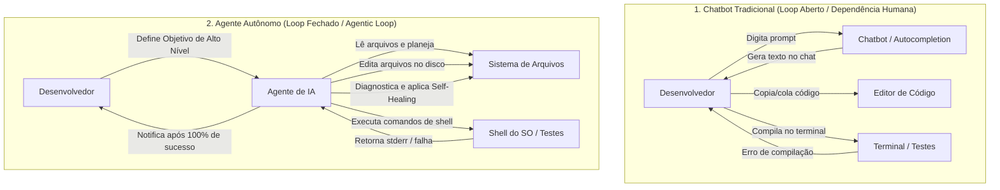
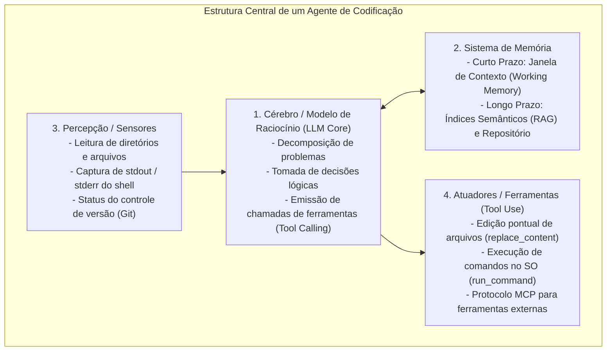
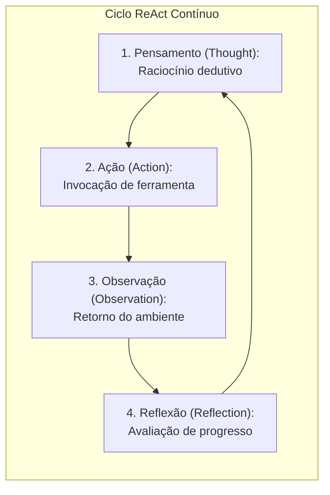
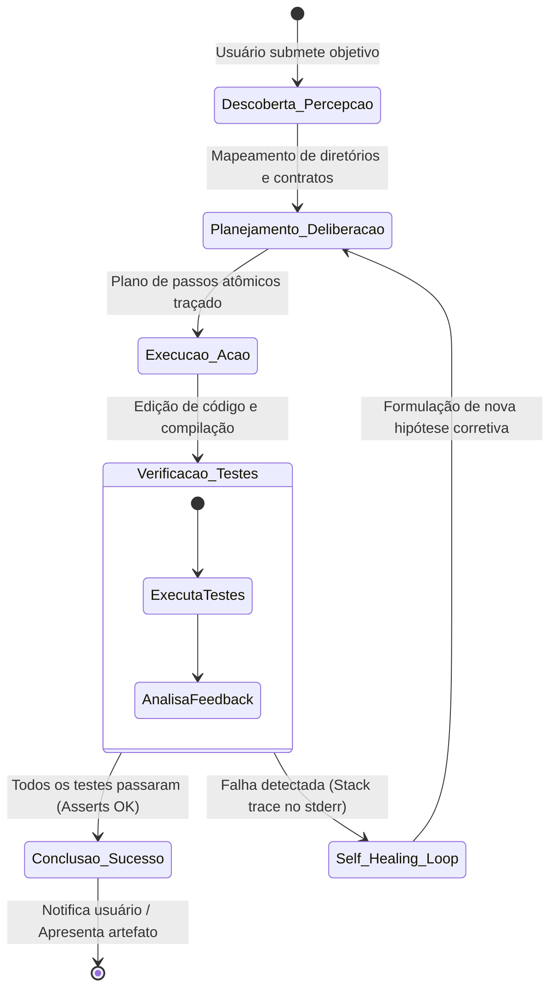
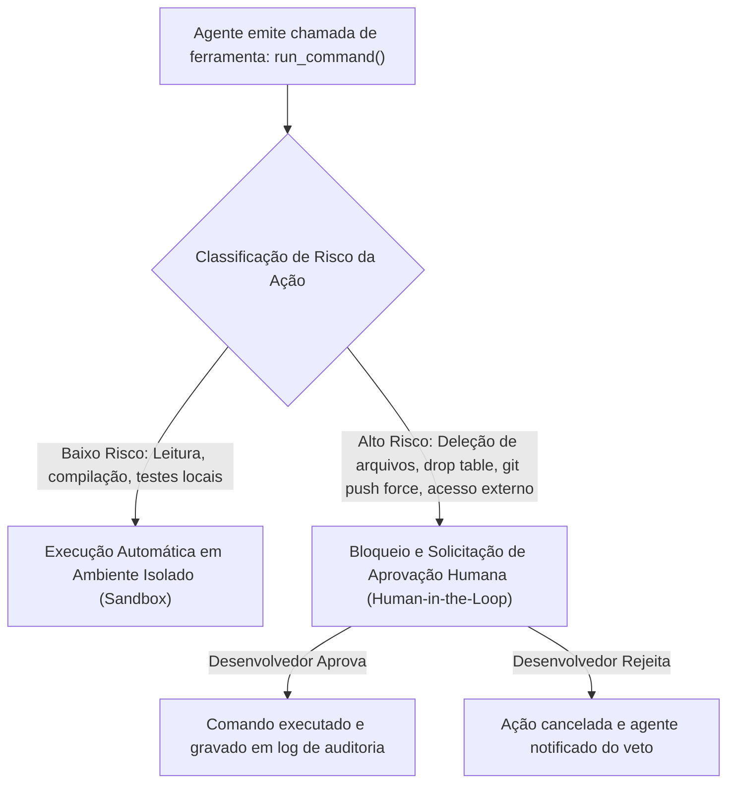

# 02 - Sistemas Agentivos de Desenvolvimento (CLI e IDE)

> **Matéria:** Engenharia de Software Assistida por IA e Sistemas Agentivos  
> **Cargo:** B02 – Técnico de Controle Externo – Especialidade: Tecnologia da Informação  
> **Arquivo:** `02_arquitetura_de_sistemas_agentivos_e_ferramentas_cli_ide.md`  


---


## 📌 Ementa / Itens do Edital
- Sistemas agentivos de desenvolvimento: arquitetura e funcionamento
- Assistentes de codificação em interfaces de terminal (CLI) e integradas a IDE (ex.: Claude Code, Antigravity CLI e equivalentes)
- Ciclo agentivo de desenvolvimento: descoberta, planejamento, execução, verificação e autocorreção (*self-healing*)
- Ações em sistema de arquivos e comandos de shell

---

## 🧭 Sumário

1. [Arquitetura dos Agentes de Codificação](#1-arquitetura-dos-agentes-de-codificacao)
    1. [A Evolução: De Chatbots Passivos a Agentes Orientados a Objetivos (Goal-Driven)](#11-a-evolucao-de-chatbots-passivos-a-agentes-orientados-a-objetivos-goal-driven)
    2. [Os Quatro Componentes Estruturais de um Agente de Software](#12-os-quatro-componentes-estruturais-de-um-agente-de-software)
    3. [Padrões de Interface: Agentes de Linha de Comando (CLI) vs. Agentes Nativos em IDE](#13-padroes-de-interface-agentes-de-linha-de-comando-cli-vs-agentes-nativos-em-ide)
    4. [Teste 129](#Teste-129)
    5. [Teste 130](#Teste-130)
    6. [Teste 131](#Teste-131)
2. [O Ciclo Agentivo de Desenvolvimento (The Agentic Loop)](#2-o-ciclo-agentivo-de-desenvolvimento-the-agentic-loop)
    1. [Fundamentos do Paradigma ReAct e Ciclo OODA](#21-fundamentos-do-paradigma-react-e-ciclo-ooda)
    2. [Fase 1: Descoberta e Coleta de Contexto (Percepção)](#22-fase-1-descoberta-e-coleta-de-contexto-percepcao)
    3. [Fase 2: Planejamento, Decomposição e Deliberação (Reasoning & Planning)](#23-fase-2-planejamento-decomposicao-e-deliberacao-reasoning-planning)
    4. [Fase 3: Execução de Ações no Ambiente (Action)](#24-fase-3-execucao-de-acoes-no-ambiente-action)
    5. [Fase 4: Verificação Autônoma e o Loop de Autocorreção (Self-Healing)](#25-fase-4-verificacao-autonoma-e-o-loop-de-autocorrecao-self-healing)
    6. [Critérios de Parada (Stop Conditions) e Disjuntores (Circuit Breakers)](#26-criterios-de-parada-stop-conditions-e-disjuntores-circuit-breakers)
    7. [Teste 132](#Teste-132)
    8. [Teste 133](#Teste-133)
    9. [Teste 134](#Teste-134)
    10. [Teste 135](#Teste-135)
    11. [Teste 136](#Teste-136)
3. [Ferramentas de Referência e Governança de Segurança](#3-ferramentas-de-referencia-e-governanca-de-seguranca)
    1. [Claude Code e a Filosofia Unix-First de Terminal](#31-claude-code-e-a-filosofia-unix-first-de-terminal)
    2. [Antigravity CLI e a Orquestração Hierárquica Multiagente](#32-antigravity-cli-e-a-orquestracao-hierarquica-multiagente)
    3. [Segurança Cibernética, Privilégio Mínimo e Human-in-the-Loop](#33-seguranca-cibernetica-privilegio-minimo-e-human-in-the-loop)
    4. [Teste 137](#Teste-137)
    5. [Teste 138](#Teste-138)
4. [Fontes Recomendadas na Internet](#4-fontes-recomendadas-na-internet)

---

## 1. Arquitetura dos Agentes de Codificação

### 1.1 A Evolução: De Chatbots Passivos a Agentes Orientados a Objetivos (Goal-Driven)
A evolução da inteligência artificial aplicada ao desenvolvimento de software pode ser compreendida pela transição entre sistemas de loop aberto (*Open-Loop*) e sistemas cibernéticos autônomos de loop fechado (*Closed-Loop*):



- **Chatbots e Completadores Passivos (Autocompletion):** Modelos reativos baseados em sugestão de texto fantasma (*ghost text*). O desenvolvedor programa manualmente e o modelo prevê a próxima linha. Diante de erros sintáticos ou falhas em testes, o desenvolvedor precisa copiar o log, colar na caixa de diálogo e pedir uma nova versão, aplicando o código manualmente no editor.
- **Agentes Autônomos Orientados a Objetivos (*Goal-Driven Agents*):** O usuário define a meta macro em linguagem natural (ex.: *"Implemente a emissão de certidão de débitos tributários com tratamento de concorrência e testes unitários"*). O agente assume a condução do fluxo: descobre a estrutura do projeto, inspeciona dependências, cria ou modifica arquivos no disco rígido, executa o compilador no shell, analisa as saídas de erro e realiza ciclos contínuos de autocorreção até que todas as condições de sucesso sejam satisfeitas.

### 1.2 Os Quatro Componentes Estruturais de um Agente de Software
Segundo a taxonomia clássica de agentes autônomos baseados em LLMs (formalizada por Lilian Weng, 2023), um agente de engenharia de software estrutura-se em quatro pilares articulados:



1. **Cérebro / Modelo de Raciocínio (LLM Core):** O modelo fundacional de ponta (ex.: Claude 3.5 Sonnet, GPT-4o) responsável pelo raciocínio lógico, interpretação de regras de negócio, planejamento em etapas e decisão de qual ferramenta acionar a cada instante.
2. **Sistema de Memória:**
    - **Memória de Curto Prazo (*Working Memory*):** Reside na janela de contexto da sessão ativa. Retém o objetivo da tarefa, o plano de trabalho corrente, o histórico recente de ações executadas e os logs parciais retornados pelo terminal.
    - **Memória de Longo Prazo:** Bases vetoriais locais ou grafos de código que mantêm o repositório indexado semanticamente, além de documentações e diretrizes institucionais persistentes entre sessões.

3. **Módulo de Percepção / Sensores:** Permite ao agente observar o ambiente de software:
    - Inspeção estrutural de diretórios (`list_dir`, `glob`);
    - Leitura pontual de arquivos de código (`view_file`, `grep`);
    - Captura dos fluxos padrão de saída (`stdout`) e de erro (`stderr`) emitidos pelo sistema operacional;
    - Monitoramento do status do controle de versão (`git status`, `git diff`).

4. **Módulo de Atuadores / Ferramentas (*Tool Use*):** Mecanismos determinísticos fornecidos pela aplicação hospedeira para que o agente altere o ambiente:
    - Manipulação de arquivos (`write_to_file`, `replace_file_content`);
    - Execução de processos e comandos de shell (`run_command`);
    - Invocação de ferramentas e serviços externos padronizados via protocolo MCP (*Model Context Protocol*).

### 1.3 Padrões de Interface: Agentes de Linha de Comando (CLI) vs. Agentes Nativos em IDE

| Dimensão Técnica | Agentes de Linha de Comando (CLI) | Agentes Integrados à IDE (IDE Native) |
|---|---|---|
| **Exemplos de Referência** | Claude Code, Antigravity CLI, Aider, Mentat. | Cursor, Windsurf, Copilot Workspace, Continue.dev. |
| **Ambiente de Hospedagem** | Terminal do Sistema Operacional (Bash, Zsh, PowerShell). | Painéis internos de Ambientes de Desenvolvimento Integrados (forks do VS Code, plugins JetBrains). |
| **Acesso a Ferramentas** | Acesso nativo direto a comandos do SO (`git`, `grep`, `find`, `docker`, scripts shell compilados). | Acesso intermediado por APIs da IDE e protocolos de linguagem (LSP - *Language Server Protocol*). |
| **Consumo de Recursos** | Mínimo overhead de memória e CPU; dispensa renderização de interfaces gráficas pesadas. | Elevado consumo de memória RAM devido aos processos gráficos e servidores de linguagem paralelos. |
| **Cenário de Uso Ideal** | Servidores remotos via SSH, máquinas virtuais sem interface gráfica (*headless*), automações de esteiras CI/CD e refatorações multi-repositório. | Programação interativa do dia a dia com edição visual lado a lado e navegação gráfica do código. |

---

### Teste 129
**(FGV – TJ-AP – Analista Judiciário - Tecnologia da Informação – 2023)**
Em um sistema de cabeamento estruturado, a conexão entre os 
equipamentos ativos de rede e o cabeamento horizontal pode ser 
realizada utilizando-se duas técnicas distintas.  
A técnica em que as portas dos ativos de rede são conectadas 
diretamente às portas do patch panel do cabeamento horizontal, 
utilizando patch cords, é conhecida como:

* **A)** interconexão;
* **B)** conexão direta;
* **C)** conexão cruzada;
* **D)** conexão crossover;
* **E)** conexão back-to-back.

---

> **Comentário Detalhado:**
>
> - **A)** Incorreta. Discrepa das diretrizes normativas e jurisprudenciais aplicáveis ao tema objeto do item.
> - **B)** Incorreta. Discrepa das diretrizes normativas e jurisprudenciais aplicáveis ao tema objeto do item.
> - **C)** Incorreta. Discrepa das diretrizes normativas e jurisprudenciais aplicáveis ao tema objeto do item.
> - **D)** Incorreta. Discrepa das diretrizes normativas e jurisprudenciais aplicáveis ao tema objeto do item.
> - **E)** Correta. Representa com precisão a disciplina do tema e o entendimento pacificado adotado pela banca (FGV).
>
> **Gabarito: E**

---
### Teste 130
**(FGV – TJ-AP – Analista Judiciário - Tecnologia da Informação – 2023)**
10 01 - 
10 02 - 

10 02 PC 4 
10 03 PC 2 

10 03 - 
20 04 - 

20 04 PC 5 
20 05 - 

20 05 - 
20 06 - 

20 06 PC 6 
30 07 PC 3 

30 07 - 
30 08 - 

30 08 - 
30 09 - 

30 09 - 
TRK 10 SW2 

TRK 10 SW1 
Os computadores pessoais que irão receber o pacote ARP 
(Address Resolution Protocol) enviado pelo PC 1 são:

* **A)** PC 2 e PC 3, somente;
* **B)** PC 2 e PC 4, somente;
* **C)** PC 4 e PC 6, somente;
* **D)** PC 2, PC 4 e PC 5, somente;
* **E)** PC 2, PC 3, PC 4, PC 5 e PC 6.

---

> **Comentário Detalhado:**
>
> - **A)** Incorreta. Discrepa das diretrizes normativas e jurisprudenciais aplicáveis ao tema objeto do item.
> - **B)** Correta. Representa com precisão a disciplina do tema e o entendimento pacificado adotado pela banca (FGV).
> - **C)** Incorreta. Discrepa das diretrizes normativas e jurisprudenciais aplicáveis ao tema objeto do item.
> - **D)** Incorreta. Discrepa das diretrizes normativas e jurisprudenciais aplicáveis ao tema objeto do item.
> - **E)** Incorreta. Discrepa das diretrizes normativas e jurisprudenciais aplicáveis ao tema objeto do item.
>
> **Gabarito: B**

---
### Teste 131
**(FGV – TJ-AP – Analista Judiciário - Segurança da Informação – 2023)**
Considere as seguintes competências da Autoridad e Nacional de 
Proteção de Dados (ANPD): 
 monitorar e realizar análise do mercado e do 
desenvolvimento de novas tecnologias que possam gerar 
impactos na proteção de dados e privacidade; 
 editar e publicar estudos e notas técnicas informativas 
realizadas pela Autoridade; 
 conscientizar e orientar sobre desenvolvimento de 
tecnologias relevantes para a proteção de dados, 
privacidade e segurança da informação; e 
 acompanhar e participar das discussões técnicas em fóruns 
internacionais de matérias relacionadas a tecn ologias 
utilizadas na proteção e no tratamento de dados pessoais e 
privacidade. 
O elemento da estrutura organizacional da ANPD que possui as 
competências apresentadas é:

* **A)** Coordenação-geral de administração;
* **B)** Coordenação-geral de normatização;
* **C)** Coordenação-geral de tecnologia e pesquisa;
* **D)** Conselho nacional de proteção de dados pessoais e da 
privacidade;
* **E)** Coordenação-geral de relações institucionais e internacionais.

---

> **Comentário Detalhado:**
>
> - **A)** Incorreta. Discrepa das diretrizes normativas e jurisprudenciais aplicáveis ao tema objeto do item.
> - **B)** Incorreta. Discrepa das diretrizes normativas e jurisprudenciais aplicáveis ao tema objeto do item.
> - **C)** Incorreta. Discrepa das diretrizes normativas e jurisprudenciais aplicáveis ao tema objeto do item.
> - **D)** Incorreta. Discrepa das diretrizes normativas e jurisprudenciais aplicáveis ao tema objeto do item.
> - **E)** Correta. Representa com precisão a disciplina do tema e o entendimento pacificado adotado pela banca (FGV).
>
> **Gabarito: E**

---
## 2. O Ciclo Agentivo de Desenvolvimento (The Agentic Loop)

### 2.1 Fundamentos do Paradigma ReAct e Ciclo OODA
O núcleo operacional que rege o comportamento autônomo apoia-se no paradigma **ReAct** (*Reasoning + Acting*, Yao et al., 2023), integrando raciocínio reflexivo e ação no mundo físico:



O ciclo opera em quatro fases sequenciais estruturadas:



### 2.2 Fase 1: Descoberta e Coleta de Contexto (Percepção)
Antes de redigir qualquer instrução de código, o agente inspeciona o ambiente para ancorar seu raciocínio em dados concretos:

1. **Identificação da Pilha Tecnológica:** Localização e leitura de manifestos de dependências (`pom.xml` para Java, `package.json` para TypeScript/Node, `pyproject.toml` para Python).
2. **Localização Cirúrgica de Símbolos:** Utilização de ferramentas de busca rápida (como `grep` ou comandos de busca semântica) para encontrar declarações exatas de métodos, evitando a leitura indiscriminada de pastas inteiras (o que provocaria esgotamento prematuro da janela de contexto).
3. **Mapeamento de Contratos e DDLs:** Identificação das interfaces, entidades e modelos já consolidados na base de código institucional.

### 2.3 Fase 2: Planejamento, Decomposição e Deliberação (Reasoning & Planning)
Nesta fase, o modelo formula uma estratégia de execução transparente:

- **Decomposição em Subtarefas Atômicas:** Em vez de tentar resolver um requisito complexo de uma só vez, o agente divide o problema em passos incrementais (ex.: 1. Criar migration no banco; 2. Implementar repositório; 3. Escrever regras de negócio no serviço; 4. Expor endpoint no controller; 5. Criar testes unitários).
- **Antecipação de Efeitos Colaterais:** Análise prévia de como a alteração impactará módulos interdependentes.
- **Mecanismo *Human-in-the-Loop* para Ambiguidade:** Caso o requisito de negócio contenha contradições ou indefinições, o agente pausa a execução e questiona o usuário de forma estruturada antes de tomar decisões arbitrárias.

### 2.4 Fase 3: Execução de Ações no Ambiente (Action)
O agente invoca as ferramentas disponibilizadas para alterar o estado do sistema:

- **Edição Atômica de Arquivos:** Aplicação de modificações cirúrgicas por correspondência de texto exato (`replace_file_content`), evitando a reescrita desnecessária de arquivos extensos de milhares de linhas (o que geraria alto custo e risco de truncamento acidental de código pré-existente).
- **Comandos de Terminal:** Compilação de código (`mvn compile`, `npm run build`), instalação de dependências e gerenciamento de processos em background.

### 2.5 Fase 4: Verificação Autônoma e o Loop de Autocorreção (Self-Healing)
É a fase que separa definitivamente um gerador estático de código de um sistema agentivo autônomo:

```mermaid
flowchart TD
    Exec["1. Execução de Testes Automatizados (pytest / mvn test / jest)"] --> Res{"Resultado da Execução"}
    Res -->|Sucesso Total (Exit Code 0)| Term["Conclui Tarefa com Sucesso"]
    Res -->|Falha ou Erro de Compilação (Exit Code != 0)| Cap["2. Captura do Stack Trace no stderr"]
    Cap --> Diag["3. Diagnóstico e Formulação de Nova Hipótese"]
    Diag --> Edit["4. Aplicação de Ajuste Cirúrgico no Código"]
    Edit --> Exec
```

1. **Disparo de Verificadores:** O agente roda suítes automatizadas de testes unitários e de integração (`pytest`, `jest`, `mvn test`), bem como linters e analisadores estáticos.
2. **Captura do Feedback do Ambiente:** O agente intercepta o código de retorno do processo (*exit code*) e os logs detalhados de erro emitidos no canal `stderr`.
3. **Mecânica do *Self-Healing*:** Ao se deparar com uma falha (como um `NullPointerException` ou uma asserção de teste frustrada), o agente **não desiste nem repassa o problema ao usuário imediatamente**. Ele lê a linha exata apontada pelo stack trace, diagnostica a causa-raiz, elabora uma correção no código e dispara os testes novamente de forma totalmente autônoma.

### 2.6 Critérios de Parada (Stop Conditions) e Disjuntores (Circuit Breakers)
Para evitar que o agente entre em ciclos infinitos de tentativa e erro que consumam excessivamente a cota de tokens e recursos de máquina, arquiteturas agentivas incorporam critérios rígidos de parada:

- **Critério de Sucesso:** Aprovação integral de 100% dos testes e ausência de violações no linter.
- **Disjuntor (*Circuit Breaker*):** Limite máximo parametrizado de iterações consecutivas sem progresso (tipicamente entre 3 e 5 iterações de *Self-Healing*). Ao atingir o limite, o disjuntor interrompe o loop, reverte alterações defeituosas via Git e convoca a intervenção do desenvolvedor humano com um relatório detalhado das falhas persistentes.

---

### Teste 132
**(FGV – TCE-GO – Analista de Controle Externo - Controle Externo – 2024)**
Em Senador Canedo /GO existe uma associação desportiva que 
mantém equipe de futebol profissional, cujo maior rival é uma 
equipe de futebol de Aparecida de Goiânia/GO, que no ano de 
2023 se transformou numa SAF (Sociedade Anônima do Futebol). 
Em relação ao percentual da contribuição de ambas as entidades 
para a Seguridade Social a ser feita em 2024, independentemente 
da base de cálculo, marque a alternativa correta.

* **A)** Ambas as entid ades estarão sujeitas à alíquota de 5% (cinco 
por cento).
* **B)** A associação desportiva se submeterá à alíquota de 20% e a 
SAF, 11%.
* **C)** Ambas as entidades estarão sujeitas à alíquota de 20% (vinte 
por cento).
* **D)** A SAF se submeterá à alíquota de 5% e a associação desportiva, 
11%.
* **E)** Ambas as entidades estarão sujeitas à alíquota de 11% (onze 
por cento).

---

> **Comentário Detalhado:**
>
> - **A)** Incorreta. Discrepa das diretrizes normativas e jurisprudenciais aplicáveis ao tema objeto do item.
> - **B)** Incorreta. Discrepa das diretrizes normativas e jurisprudenciais aplicáveis ao tema objeto do item.
> - **C)** Correta. Representa com precisão a disciplina do tema e o entendimento pacificado adotado pela banca (FGV).
> - **D)** Incorreta. Discrepa das diretrizes normativas e jurisprudenciais aplicáveis ao tema objeto do item.
> - **E)** Incorreta. Discrepa das diretrizes normativas e jurisprudenciais aplicáveis ao tema objeto do item.
>
> **Gabarito: C**

---
### Teste 133
**(FGV – TCE-PA – Auditor de Controle Externo – 2024)**
Com relação ao framework pytest, da linguagem de programação 
Python, avalie as afirmativas a seguir: 
I. O comando pytest executa os arquivos no formato 
test_*.py ou *_test.py no diretório corrente e nos 
subdiretórios. 
II. O comando abaixo mostra os 5 testes com maior tempo de 
duração. 
>>> pytest -vv --durations=5 
III. É possível invocar o framework pytest usando o próprio 
interpretador do Python por meio do comando abaixo: 
>>> python -m pytest 
Está correto o que se afirma em

* **A)** I, apenas.
* **B)** II, apenas.
* **C)** I e II, apenas.
* **D)** II e III, apenas.
* **E)** I, II e III. 

AUDITOR DE CONTROLE EXTERNO – AREA ADMINISTRATIVA - CIÊNCIA DE DADOS – MANHÃ  TIPO  BRANCA – PÁGINA 21

---

> **Comentário Detalhado:**
>
> - **A)** Incorreta. Discrepa das diretrizes normativas e jurisprudenciais aplicáveis ao tema objeto do item.
> - **B)** Incorreta. Discrepa das diretrizes normativas e jurisprudenciais aplicáveis ao tema objeto do item.
> - **C)** Incorreta. Discrepa das diretrizes normativas e jurisprudenciais aplicáveis ao tema objeto do item.
> - **D)** Correta. Representa com precisão a disciplina do tema e o entendimento pacificado adotado pela banca (FGV).
> - **E)** Incorreta. Discrepa das diretrizes normativas e jurisprudenciais aplicáveis ao tema objeto do item.
>
> **Gabarito: D**

---
### Teste 134
**(FCC – TRT-13 – Analista Judiciário - Tecnologia da Informação – 2014)**
O Ciclo PDCA inclui as seguintes etapas sequenciais:

* **A)** diagnóstico; definição de metas; monitoramento; 
avaliação.
* **B)** planejamento; execução; controle/verificação; ação 
avaliativa/corretiva.
* **C)** priorização; definição de objetivos, capacitação; 
ação avaliativa/corretiva.
* **D)** planejamento; desenvolvimento; capacitação; ava-
liação.
* **E)** programação; direcionamento; controle/verificação; 
avaliação de resultados. 
_________________________________________________________

---

> **Comentário Detalhado:**
>
> - **A)** Incorreta. Discrepa das diretrizes normativas e jurisprudenciais aplicáveis ao tema objeto do item.
> - **B)** Incorreta. Discrepa das diretrizes normativas e jurisprudenciais aplicáveis ao tema objeto do item.
> - **C)** Correta. Representa com precisão a disciplina do tema e o entendimento pacificado adotado pela banca (FCC).
> - **D)** Incorreta. Discrepa das diretrizes normativas e jurisprudenciais aplicáveis ao tema objeto do item.
> - **E)** Incorreta. Discrepa das diretrizes normativas e jurisprudenciais aplicáveis ao tema objeto do item.
>
> **Gabarito: C**

---
### Teste 135
**(FGV – TJ-BA – Analista Judiciário - Tecnologia da Informação – 2015)**
O comando switch da linguagem de programação C é, na 
linguagem Visual Basic .NET, semelhante ao comando:

* **A)** Select Case;
* **B)** Exit;
* **C)** For Each;
* **D)** Goto;
* **E)** Continue.

---

> **Comentário Detalhado:**
>
> - **A)** Incorreta. Discrepa das diretrizes normativas e jurisprudenciais aplicáveis ao tema objeto do item.
> - **B)** Incorreta. Discrepa das diretrizes normativas e jurisprudenciais aplicáveis ao tema objeto do item.
> - **C)** Correta. Representa com precisão a disciplina do tema e o entendimento pacificado adotado pela banca (FGV).
> - **D)** Incorreta. Discrepa das diretrizes normativas e jurisprudenciais aplicáveis ao tema objeto do item.
> - **E)** Incorreta. Discrepa das diretrizes normativas e jurisprudenciais aplicáveis ao tema objeto do item.
>
> **Gabarito: C**

---
### Teste 136
**(FGV – TRT – Analista Judiciário - Suporte e Infraestrutura de TI – 2022)**
A Estratégia Nacional de Segurança da Informação e 
Cibernética do Poder Judiciário (ENSEC -PJ) foi instituída com o 
objetivo de incrementar a segurança cibernética nos órgãos 
do Poder Judiciário, abrangendo aspectos essenciais da 
segurança da in formação e definindo objetivos para fortalecer 
o espaço cibernético do Poder Judiciário, assim como divulgar 
ações para os órgãos em seu âmbito de atuação.  
Um dos objetivos da ENSEC -PJ, instituída pela Resolução 
CNJ  nº 396/2021, é:

* **A)** estabelecer modelo centralizado de governança cibernética 
nacional;
* **B)** permitir a manutenção e a continuidade dos serviços, ou o 
seu restabelecimento em menor tempo possível;
* **C)** fortalecer as ações de governança cibernética;
* **D)** realizar prática em gestão de incidentes e e fetivar o 
aprimoramento contínuo do processo;
* **E)** estabelecer rede de cooperação do Judiciário para a 
segurança cibernética.

---

> **Comentário Detalhado:**
>
> - **A)** Incorreta. Discrepa das diretrizes normativas e jurisprudenciais aplicáveis ao tema objeto do item.
> - **B)** Incorreta. Discrepa das diretrizes normativas e jurisprudenciais aplicáveis ao tema objeto do item.
> - **C)** Correta. Representa com precisão a disciplina do tema e o entendimento pacificado adotado pela banca (FGV).
> - **D)** Incorreta. Discrepa das diretrizes normativas e jurisprudenciais aplicáveis ao tema objeto do item.
> - **E)** Incorreta. Discrepa das diretrizes normativas e jurisprudenciais aplicáveis ao tema objeto do item.
>
> **Gabarito: C**

---
## 3. Ferramentas de Referência e Governança de Segurança

### 3.1 Claude Code e a Filosofia Unix-First de Terminal
Desenvolvido pela Anthropic, o **Claude Code** tornou-se a referência contemporânea de assistente agentivo operado diretamente no terminal:

- **Integração com Ferramental Nativo:** Opera sobre o repositório git local utilizando ferramentas integradas como `Bash`, `Glob`, `Grep`, `FileEdit` e `FileRead`.
- **Raciocínio Contextual em Larga Escala:** Capacidade de analisar o grafo de arquivos do projeto para propor refatorações complexas mantendo compatibilidade com código legado.

### 3.2 Antigravity CLI e a Orquestração Hierárquica Multiagente
O **Antigravity CLI** destaca-se pela sua arquitetura modular voltada para governança e execução de tarefas concorrentes:

- **Delegação a Subagentes Especializados:** Capacidade de criar e despachar agentes filhos isolados (*subagents*) para atuar em tarefas complementares (ex.: um subagente encarregado de pesquisar documentações, outro focado em testes unitários e um terceiro dedicado à auditoria de vulnerabilidades de segurança).
- **Emissão Estruturada de Artefatos:** Geração de relatórios, memoriais de cálculo e planos de execução em arquivos Markdown estruturados, facilitando a inspeção e conferência humana antes e durante a execução.

### 3.3 Segurança Cibernética, Privilégio Mínimo e Human-in-the-Loop
A concessão de autonomia para que uma IA execute comandos de terminal exige controles de segurança e governança corporativa:



> 🚨 **ALERTA DE PROVA / FCC:**  
> A banca explora com rigor a fronteira entre a autonomia do **Self-Healing** e o controle de **Comandos Críticos**:  
>
> - No *Self-Healing*, o agente possui autonomia plena para **editar o código e reexecutar testes locais em loop fechado** sem requerer confirmação humana a cada linha alterada.  
> - Em contrapartida, para ações potencialmente destrutivas ou com efeitos colaterais irreversíveis (ex.: exclusão de arquivos, comandos com privilégios de superusuário `sudo`, alterações de banco de dados ou operações forçadas de rede), o sistema **deve obrigatoriamente impor confirmação humana explícita (*Human-in-the-Loop*)**.
> - **Princípio do Menor Privilégio (*Least Privilege*):** Agentes de desenvolvimento devem operar em ambientes isolados (*sandboxes* ou containers Docker/Podman) e nunca com privilégios de administrador/root da infraestrutura.

---

### Teste 137
**(FGV – TRF-1 – Analista Judiciário - Tecnologia da Informação – 2024)**
A coleta seletiva é um dos instrumentos da Política Nacional de 
Resíduos Sólidos (PNRS), juntamente com os sistemas de logística 
reversa e outras ferramentas relacionadas à implementação da 
responsabilidade compartilhada pelo ciclo de vida dos produtos. 
Sobre a coleta seletiva, é correto afirmar que:

* **A)** é facultado aos planos municipais de gestão integrada de 
resíduos sólidos o estabelecimento de metas de redução, 
reutilização, coleta seletiva e reciclagem, entre outras, com 
vistas a reduzir a quantidade d e rejeitos encaminhados para 
disposição final ambientalmente adequada;
* **B)** o titular dos serviços públicos de limpeza urbana e de manejo 
de resíduos sólidos priorizará a destinação de materiais 
reutilizáveis e recicláveis oriundos da coleta seletiva às 
indústrias recicladoras que apresentem proposta mais 
vantajosa economicamente;
* **C)** são consideradas formas de coleta seletiva a coleta porta a 
porta, a coleta por pontos de entrega voluntária (PEVs) e as 
unidades de triagem de resíduos;
* **D)** para a implementaç ão adequada da coleta seletiva, é 
imprescindível a contínua prática de educação ambiental e 
mobilização social que promovam a conscientização de que a 
gestão integrada de resíduos sólidos urbanos inicia -se com o 
gerador em sua residência, por meio da adequ ada separação 
e acondicionamento dos resíduos;
* **E)** dentre os desafios encontrados para a reciclagem, 
destacam-se o descarte incorreto dos materiais, a 
contaminação dos recicláveis e a prioridade legal conferida à 
incineração de resíduos. 


Noções de Direito Administrativo

---

> **Comentário Detalhado:**
>
> - **A)** Correta. Representa com precisão a disciplina do tema e o entendimento pacificado adotado pela banca (FGV).
> - **B)** Incorreta. Discrepa das diretrizes normativas e jurisprudenciais aplicáveis ao tema objeto do item.
> - **C)** Incorreta. Discrepa das diretrizes normativas e jurisprudenciais aplicáveis ao tema objeto do item.
> - **D)** Incorreta. Discrepa das diretrizes normativas e jurisprudenciais aplicáveis ao tema objeto do item.
> - **E)** Incorreta. Discrepa das diretrizes normativas e jurisprudenciais aplicáveis ao tema objeto do item.
>
> **Gabarito: A**

---
### Teste 138
**(FGV – TRT-1 – Analista Judiciário - Tecnologia da Informação – 2024)**
A coleta seletiva é um dos instrumentos da Política Nacional de 
Resíduos Sólidos (PNRS), juntamente com os sistemas de logística 
reversa e outras ferramentas r elacionadas à implementação da 
responsabilidade compartilhada pelo ciclo de vida dos produtos. 
Sobre a coleta seletiva, é correto afirmar que:

* **A)** é facultado aos planos municipais de gestão integrada de 
resíduos sólidos o estabelecimento de metas de reduç ão, 
reutilização, coleta seletiva e reciclagem, entre outras, com 
vistas a reduzir a quantidade de rejeitos encaminhados para 
disposição final ambientalmente adequada;
* **B)** o titular dos serviços públicos de limpeza urbana e de manejo 
de resíduos sólidos pr iorizará a destinação de materiais 
reutilizáveis e recicláveis oriundos da coleta seletiva às 
indústrias recicladoras que apresentem proposta mais 
vantajosa economicamente;
* **C)** são consideradas formas de coleta seletiva a coleta porta a 
porta, a coleta por  pontos de entrega voluntária (PEVs) e as 
unidades de triagem de resíduos;
* **D)** para a implementação adequada da coleta seletiva, é 
imprescindível a contínua prática de educação ambiental e 
mobilização social que promovam a conscientização de que a 
gestão integrada de resíduos sólidos urbanos inicia -se com o 
gerador em sua residência, por meio da adequada separação 
e acondicionamento dos resíduos;
* **E)** dentre os desafios encontrados para a reciclagem, 
destacam-se o descarte incorreto dos materiais, a 
contaminação dos recicláveis e a prioridade legal conferida à 
incineração de resíduos.

---

> **Comentário Detalhado:**
>
> - **A)** Correta. Representa com precisão a disciplina do tema e o entendimento pacificado adotado pela banca (FGV).
> - **B)** Incorreta. Discrepa das diretrizes normativas e jurisprudenciais aplicáveis ao tema objeto do item.
> - **C)** Incorreta. Discrepa das diretrizes normativas e jurisprudenciais aplicáveis ao tema objeto do item.
> - **D)** Incorreta. Discrepa das diretrizes normativas e jurisprudenciais aplicáveis ao tema objeto do item.
> - **E)** Incorreta. Discrepa das diretrizes normativas e jurisprudenciais aplicáveis ao tema objeto do item.
>
> **Gabarito: A**

---
## 4. Fontes Recomendadas na Internet

* [Model Context Protocol (MCP) Official Documentation](https://modelcontextprotocol.io/introduction) - Arquitetura cliente-servidor do protocolo aberto MCP para integração de LLMs com ferramentas.
* [ArXiv - ReAct: Synergizing Reasoning and Acting in Language Models (Yao et al.)](https://arxiv.org/abs/2210.03629) - Integração dinâmica de raciocínio verbal e execução de ações computacionais em agentes autônomos.
* [Anthropic Claude - Building Effective Agents Guide](https://docs.anthropic.com/en/docs/build-with-claude/prompt-engineering/overview) - Padrões de arquitetura agentiva: roteadores, encadeamentos, paralelismo e loops avaliador-otimizador.
* [NIST AI Risk Management Framework - Governance of Autonomous Systems](https://www.nist.gov/itl/ai-risk-management-framework) - Controle humano no loop (*human-in-the-loop*) e barreiras de segurança operacional.
* RUSSELL, Stuart; NORVIG, Peter. **Inteligência Artificial: Uma Abordagem Moderna**. 4. ed. Rio de Janeiro: GEN LTC, 2022. (Cap. 2 - Agentes Inteligentes e Arquiteturas Racionais).
* WOOLDRIDGE, Michael. **An Introduction to MultiAgent Systems**. 2. ed. Chichester: John Wiley & Sons, 2009. (Cap. 2 e 3 - Agentes Reativos e Deliberativos).
* HUYEN, Chip. **AI Engineering: Building Applications with Foundation Models**. Sebastopol: O'Reilly Media, 2025. (Cap. 5 - Autonomous Agents and Tool Use).
